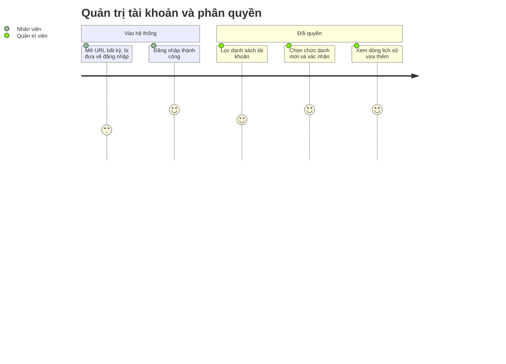

# Screens — F001_AdminAndPermissions

## Screen List

Ba màn thuộc tính năng này đều **đã xây ở LAB-3**. Trang `/403` (lỗi phân quyền) nằm ngoài 37 màn, là điểm đến của lớp chặn route.

| Screen Name | SCR### | What User Sees | What User Can Do |
|-------------|--------|----------------|------------------|
| Đăng nhập (ログイン) | [SCR002_Login](../../screens/SCR002_Login/spec.md) | Form hai ô (email, mật khẩu), tiêu đề, banner đỏ khi sai thông tin; banner riêng khi tài khoản bị vô hiệu hoá (`/login?reason=suspended`) | Nhập email + mật khẩu và gửi bằng Enter hoặc nút. Hai ô giữ nguyên nội dung khi bị từ chối |
| Danh sách tài khoản nội bộ (社内アカウント一覧) | [SCR003_AccountList](../../screens/SCR003_AccountList/spec.md) | Bảng họ tên, email, chức danh, trạng thái, ngày tạo; bộ lọc chức danh + trạng thái | Lọc, xoá lọc, bấm tên để sang chi tiết. Chỉ quản trị hệ thống mở được |
| Chi tiết tài khoản & quyền (アカウント詳細・権限) | [SCR004_AccountDetail](../../screens/SCR004_AccountDetail/spec.md) | Tên + email, khối "Đổi chức danh", bảng lịch sử đổi quyền (mới nhất trước) | Chọn chức danh mới, ghi chú, xác nhận; xem lịch sử |

## User Journey

1. Người dùng chưa đăng nhập mở một đường dẫn bất kỳ và được đưa tới **Đăng nhập**, con trỏ nằm sẵn ở ô email.
2. Người dùng gõ email, mật khẩu rồi gửi — nếu đúng, họ vào trang chủ theo chức danh ([F010](../F010_Notifications/screens.md) sở hữu trang chủ); nếu sai, thấy dòng báo lỗi chung "Email hoặc mật khẩu không đúng" và vẫn giữ nội dung đã gõ.
3. Quản trị viên mở **Danh sách tài khoản**, lọc theo chức danh hoặc trạng thái.
4. Quản trị viên chọn một người và tới **Chi tiết tài khoản & quyền**, chọn chức danh mới, xác nhận.
5. Hệ thống hiện banner xanh "Đã đổi quyền thành công" và thêm dòng lịch sử ở đầu bảng; nếu cố đổi quyền của chính mình, banner đỏ nêu rõ lý do.
6. Người dùng mở nhầm màn của chức danh khác thì tới trang "không đủ quyền", trang này chỉ nói chức danh hiện tại, không lộ dữ liệu của màn bị chặn.

