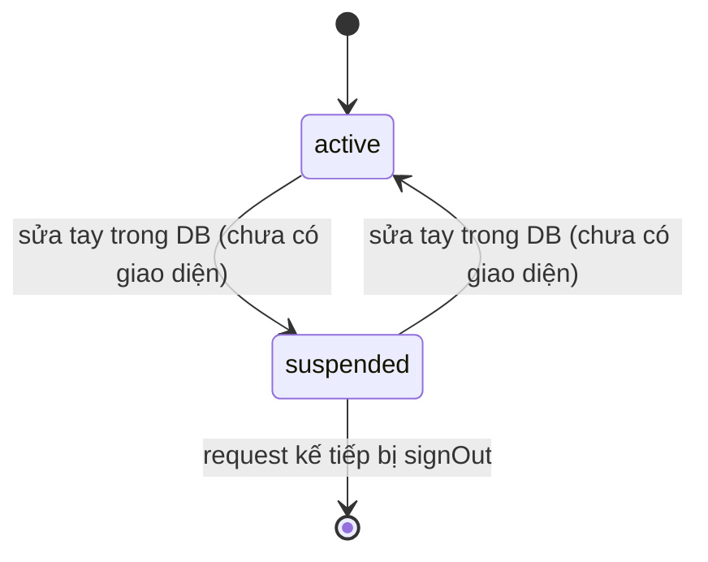

# F001_AdminAndPermissions — Technical Spec

**Priority**: P0
**Type**: ui
**Generated**: 2026-10-06

> Quy ước đọc: **[ĐÃ XÂY]** = có ở LAB-3, kèm file nguồn. **[ĐẶC TẢ]** = thiết kế LAB-4, chưa có code. **(đề xuất)** = suy luận ngoài nguồn khách. Mã FR/NFR/BR/US giữ nguyên mã LAB-1, không cấp mã mới. Mã lỗi chỉ dùng `P0001`–`P0009` đã cài (tài liệu gốc trong repo, không nộp: `db-schema.md` §4).

## Overview

Đăng nhập bằng tài khoản nội bộ, gán mỗi người một chức danh, và để chức danh đó quyết định route nào mở được và dòng dữ liệu nào đọc được. Dùng bởi quản trị hệ thống (đổi quyền) và cả bốn chức danh (đăng nhập). Chạm hai hệ con: **lớp chặn route** (`proxy.ts` → `canAccess()` đọc bảng `ROUTE_POLICY`) và **RLS + RPC** trên Postgres. Lý do không nhét chức danh vào JWT: xem [ADR-001](../../decisions/ADR-001-role-from-table-not-jwt.md).

## Polymorphic Behavior

Không áp dụng — `entities.md` chưa gán mã DISC cho `app_users.role`. Hành vi theo chức danh nằm ở bảng *Decision Logic* bên dưới.

## Cross-Cutting Logic

### Requirements

| Code | Description | Endpoint/Handler | Verifiable | Trạng thái |
|------|-------------|------------------|------------|------------|
| FR-IAM-01 | Xác thực và gán chức danh khi đăng nhập | Server Action `signIn` (`app/login/actions.ts:17`) + `updateSession` (`lib/supabase/proxy.ts:19`) | yes | ĐÃ XÂY |
| FR-IAM-02 | Cấp / thu / tạm dừng / mở lại quyền, có lưu vết | Server Action `changeRole` (`app/(app)/accounts/[id]/actions.ts:29`) → RPC `change_user_role` | yes | MỘT PHẦN — chỉ **đổi chức danh**; tạm dừng/mở lại/tạo tài khoản chưa có giao diện |
| NFR-SEC-01 | MFA bắt buộc cho quản trị và role phê duyệt (MFA phân tầng — đã chốt, PREMISE C-04) | — | yes | CHỈ ĐẶC TẢ (MOCK-1) |
| SEC-IAM-02 | Chính sách MFA cho người tham gia bên ngoài trên terminal dùng chung | — | không (đề xuất kỹ thuật) | CHỈ ĐẶC TẢ, khách chưa xác nhận giả định phân tầng (PREMISE C-04) |
| NFR-SEC-03 | Session timeout, tạm khoá khi sai nhiều lần, log hành vi bất thường | `updateSession` chặn tài khoản `suspended` (`lib/supabase/proxy.ts:74-80`) | yes | MỘT PHẦN — chỉ có chặn tài khoản ngưng; **thiếu** timeout, khoá tạm, log bất thường |
| NFR-SEC-04 | TLS, backup và secret tách khỏi source | Biến môi trường `NEXT_PUBLIC_SUPABASE_URL`, `NEXT_PUBLIC_SUPABASE_PUBLISHABLE_KEY` đọc trong `lib/supabase/proxy.ts:22-23`; `service_role` chỉ phía server | yes | MỘT PHẦN (phụ thuộc nền tảng hosting) |

**Source:** (tài liệu gốc trong repo, không nộp) `product-a-feature-list.md` mục F01; `product-a-rfp-business-summary.md` mục 7 và 13.

### Business Rules

LAB-1 **không cấp mã BR riêng** cho nhóm này. Các quy tắc dưới đây không mang mã mới; tổng hợp ở [business-rules](../../system/business-rules.md).

| Quy tắc | Nguồn LAB-1 | Thực thi ở |
|---------|-------------|-----------|
| Tách trách nhiệm: `sys_admin` **không** mở màn nghiệp vụ | 責任分離 (RFP 02-08) | `ROUTE_POLICY` — `/accounts` chỉ `sys_admin`, các route nghiệp vụ không có `sys_admin` (`lib/auth/route-policy.ts:17-27`) |
| Chức danh đọc từ bảng, không từ JWT, để đổi quyền có hiệu lực ngay | F01-04 | `current_app_role()` (`0002_core_identity.sql:43`); ADR-001 |
| Không tự đổi quyền của chính mình | — (bảo vệ vận hành) | RPC `change_user_role` → `P0007` (`0012_change_user_role_self_guard.sql:22`) |
| Mọi đổi quyền ghi 2 nơi: `role_change_log` và `audit_log` | `FR-IAM-02`, `FR-AUDIT-01` | `0012_change_user_role_self_guard.sql` thân hàm |
| Ba lượt phòng thủ độc lập: proxy → Server Action → RPC/RLS | — (ràng buộc kỹ thuật Next.js 16) | [architecture](../../system/architecture.md) §Phân quyền hai tầng |

### Decision Logic

#### DEC-001_RouteAccessByRole
**subtype:** flow
**Triggers in:** mọi request đi qua `proxy.ts`
**Involved entities:** `app_users.role`, `app_users.status`
**user_visible_outcome:** vào được màn, bị đưa về đăng nhập, hoặc sang `/403`
**Source:** `lib/supabase/proxy.ts:19-91`, `lib/auth/route-policy.ts:17-37`

```text
nếu không có claims:  /login → cho qua ; khác → redirect /login
nếu có claims và đang ở /login → cho qua (không redirect vòng)
đọc app_users(role, status) theo claims.sub
nếu không có dòng hoặc status ≠ active → signOut + redirect /login?reason=suspended
nếu không canAccess(pathname, role)  → redirect /403
còn lại → trả đúng supabaseResponse (giữ cookie refresh)
```

Bảng `ROUTE_POLICY` (khớp entry đầu tiên theo thứ tự khai báo — prefix cụ thể đứng trước prefix chung):

| Prefix | Chức danh được phép |
|---|---|
| `/lots/new` | `receiving` |
| `/lots` | `receiving`, `trading` |
| `/trades/negotiated`, `/trades/auction` | `trading` |
| `/trades` | `trading`, `reconcile` |
| `/deliveries` | `receiving` |
| `/reconciliation` | `reconcile` |
| `/accounts` | `sys_admin` |
| `/` | tất cả |

### State Machines

#### Vòng đời `app_users.status` (FIG không có — theo enum `user_status`)

**kind:** entity · **Source:** `0001_extensions_and_enums.sql` (enum `user_status`), `lib/supabase/proxy.ts:74-80`



| Từ | Sang | Guard | Hiệu ứng |
|----|------|-------|----------|
| active | suspended | quản trị sửa dữ liệu | request kế tiếp của người đó: `signOut()` + `/login?reason=suspended` |
| suspended | active | quản trị sửa dữ liệu | đăng nhập lại bình thường |

Đổi **chức danh** (`app_role`) không phải máy trạng thái — là một thao tác ghi đơn lẻ kèm log.

### Algorithms

Không áp dụng — không có thuật toán tính toán; chỉ có phép tra bảng `ROUTE_POLICY`.

### External Integrations

#### INT-Auth — Supabase Auth
**Type:** api-call · **Target:** Supabase Auth (email + mật khẩu) · **Trigger:** `signInWithPassword` trong `signIn` · **Payload:** email, mật khẩu (không ghi log) · **Failure handling:** `{ error }` → thông báo chung "sai thông tin"; không `throw`. Mất mạng giữa chừng **chưa được xử lý** (xem Unresolved Questions). **Source:** `app/login/actions.ts:17-37`. Mã INT-xxx chưa được cấp trong LAB-1 nên dùng nhãn cục bộ.

### Verification

Nhãn `V-F001-xx` là nhãn cục bộ của tài liệu này, không phải mã đã đăng ký. **Các bước dưới đây dựng từ migration và code; chưa chạy lại trong phiên viết spec** — kết quả "kỳ vọng" là hợp đồng, không phải kết quả đã đo.

- **V-F001-01** — Người chưa đăng nhập mở `/accounts` → bị chuyển về `/login` (covers FR-IAM-01).
- **V-F001-02** — Đăng nhập `receiving@demo.local`, mở `/accounts` → chuyển `/403`, trang nêu chức danh hiện tại (covers FR-IAM-02, quy tắc tách trách nhiệm).
- **V-F001-03** — Đăng nhập `admin@demo.local`, đổi chức danh một tài khoản khác, rồi chạy:
  ```sql
  select old_role, new_role, changed_by, changed_at, note
  from role_change_log order by changed_at desc limit 1;
  ```
  Kỳ vọng: 1 dòng khớp lần đổi; `audit_log` có thêm 1 dòng `action = 'change_user_role'`.
- **V-F001-04** — Admin đổi quyền chính mình → banner `P0007`; `role_change_log` không thêm dòng.
- **V-F001-05** — Quyền EXECUTE: không gọi được RPC bằng khoá anon.
  ```bash
  curl -s -X POST "$NEXT_PUBLIC_SUPABASE_URL/rest/v1/rpc/change_user_role" \
    -H "apikey: $NEXT_PUBLIC_SUPABASE_PUBLISHABLE_KEY" -H "Content-Type: application/json" \
    -d '{"p_user_id":"00000000-0000-0000-0000-000000000000","p_new_role":"trading"}'
  ```
  Kỳ vọng: lỗi `42501 permission denied` (sau `0011`). Kiểm lại bằng `select proname, has_function_privilege('anon', oid, 'EXECUTE') from pg_proc where pronamespace = 'public'::regnamespace and prosecdef;` — mọi dòng `false` (bài học ADR-002 và `0041`).
- **V-F001-06** — Chuyển `app_users.status = 'suspended'` cho một tài khoản đang có phiên → thao tác kế tiếp bị đưa về `/login?reason=suspended` (covers NFR-SEC-03 phần chặn tài khoản).

---

**Client behavior:** see [architecture.md](../../system/architecture.md) (hành vi phía client: chặn route, Server Action, keyboard-first, mất mạng), [permissions.md](../../system/permissions.md), [screen-flow.md](../../generated/screen-flow.md).

## User Stories

LAB-1 **không viết user story riêng** cho nhóm F01 (quản trị — "cần thiết nhưng không nằm trên đường sống của ngày nghiệp vụ", `product-a-user-stories.md`). Không bịa US mới. Điều kiện chấp nhận dưới đây rút từ requirement và từ [screen spec](../../screens/SCR004_AccountDetail/spec.md).

### (không có mã US) — Đổi chức danh có lưu vết (Priority: P0)

**What happens:** Quản trị viên đổi chức danh của một nhân viên; quyền mới có hiệu lực ngay và để lại dấu vết.
**Why this priority:** F01-03/F01-04 là P0; không có thì không chứng minh được phân quyền là thật.
**Independent Test:** V-F001-03.

**Acceptance Scenarios:**

1. **Given** quản trị viên đang ở màn chi tiết của nhân viên A, **When** chọn chức danh mới và xác nhận, **Then** RPC thành công, banner xanh hiện, bảng lịch sử thêm dòng (quyền cũ → quyền mới, người đổi, thời điểm).
2. **Given** nhân viên A vừa bị đổi từ `receiving` sang `trading`, **When** A mở `/lots/new` ở request kế tiếp, **Then** bị chuyển `/403` — không đợi token hết hạn.
3. **Given** quản trị viên mở chi tiết **chính mình**, **When** gửi đổi quyền, **Then** nhận `P0007`, không thay đổi dữ liệu.

**Requirements fulfilled:**
- **FR-IAM-02** — `changeRole` → `rpc('change_user_role')`. **Source:** `app/(app)/accounts/[id]/actions.ts:29-62`

**Rules enforced:** quy tắc "không tự đổi quyền" và "chức danh đọc từ bảng" (bảng Business Rules ở trên).

**Verification:** V-F001-03, V-F001-04.

### Edge Cases

Xem [edge-cases.md](./edge-cases.md) — 16 tình huống, đã phân loại đã xây / chỉ đặc tả.

## Key Entities

| Entity | Table | Key Columns | Purpose |
|--------|-------|-------------|---------|
| Tài khoản nội bộ | `app_users` | `id` (= `auth.users.id`), `email`, `role`, `status` | Nguồn sự thật duy nhất của chức danh; đọc ở mỗi request |
| Lịch sử đổi quyền | `role_change_log` | `target_user_id`, `old_role`, `new_role`, `changed_by`, `changed_at`, `note` | Append-only; chỉ `sys_admin` đọc |
| Nhật ký kiểm toán | `audit_log` | `table_name`, `action`, `actor_id`, `old_value`, `new_value` | Ghi thêm một dòng mỗi lần đổi quyền |

RLS (`0009_rls_policies.sql:20-30`): `app_users` — mọi role tự xem dòng của mình, `sys_admin` xem toàn bộ; `role_change_log`/`audit_log` — chỉ `sys_admin` SELECT, **không có policy ghi**.

## Artifact References

| Artifact | File | Codes Used |
|----------|------|------------|
| System Overview | [overview.md](../../system/overview.md) | — |
| Architecture | [architecture.md](../../system/architecture.md) | — |
| Business Rules | [business-rules.md](../../system/business-rules.md) | — |
| Permissions | [permissions.md](../../system/permissions.md) | — |
| Feature List | [feature-list.md](../../generated/feature-list.md) | F001 |
| Entities | [entities.md](../../generated/entities.md) | `app_users`, `role_change_log`, `audit_log` |
| Screens | [screens.md](./screens.md) | SCR002, SCR003, SCR004 |

Bộ này không có `api-map`, `route-list`, `behavior-logic`, `permissions-matrix`, `user-stories` riêng (không nằm trong layout đã chốt) nên không tham chiếu.

## Assumptions

- Chức danh luôn đọc từ `app_users` ở mỗi request; chấp nhận thêm một round-trip (ADR-001 nêu đây là chỗ đầu tiên phải xem lại nếu tải tăng).
- Tài khoản demo được tạo bằng seed (`supabase/seed.sql`), mật khẩu ghi ở (tài liệu gốc trong repo, không nộp) `db-schema.md` §8 — không có màn tạo tài khoản.
- (đề xuất) Khoá/mở khoá tài khoản làm ở màn chi tiết tài khoản khi triển khai thật. Rủi ro nếu đoán sai: thêm màn hoặc RPC riêng, ảnh hưởng ma trận quyền.

## Source Code References

| Order | Symbol | Path | Purpose |
|-------|--------|------|---------|
| 1 | `app_users`, `role_change_log`, `current_app_role` | `supabase/migrations/0002_core_identity.sql:5-52` | Bảng danh tính + hàm đọc chức danh |
| 2 | `ROUTE_POLICY`, `canAccess` | `lib/auth/route-policy.ts:17-37` | Hằng số duy nhất cho chặn route |
| 3 | `updateSession` | `lib/supabase/proxy.ts:19-91` | Làm mới phiên + kiểm trạng thái + chặn theo role |
| 4 | `proxy` | `proxy.ts:1-17` | Entry Next.js 16 (không phải `middleware.ts`) |
| 5 | `signIn`, `signOut` | `app/login/actions.ts:17-44` | Đăng nhập / đăng xuất |
| 6 | `change_user_role` | `supabase/migrations/0012_change_user_role_self_guard.sql:11-43` | RPC đổi quyền (thay thân hàm ở `0008`) |
| 7 | `changeRole` | `app/(app)/accounts/[id]/actions.ts:29-62` | Server Action, tự kiểm `sys_admin` |
| 8 | `listAccounts`, `listRoleChangeHistory` | `lib/domain/accounts.ts:41-121` | Truy vấn danh sách + lịch sử |
| 9 | RLS | `supabase/migrations/0009_rls_policies.sql:20-30` | Policy `app_users`, `role_change_log`, `audit_log` |

## Unresolved Questions

1. **MFA cho quản trị và người duyệt**: hướng đã chốt là MFA phân tầng (PREMISE C-04); còn lại là thiết bị cụ thể nào. Chặn: SEC-IAM-02 và ngân sách thiết bị chưa có.
2. **Số chức danh — đã chốt (PREMISE C-09):** 9 role key (4 đã có + 5 đề xuất: `party_admin`, `rule_admin`, `ops_admin`, `market_manager`, `internal_audit`) cộng cờ `app_users.can_approve` trên tài khoản; maker ≠ checker dùng cờ này. Chỉ còn giả định chưa được khách xác nhận; nếu khách bác bỏ thì ma trận quyền và maker-checker làm lại. Không dùng cờ `can_audit` (`internal_audit` là role đề xuất, chưa có trong DB).
3. **RLS `app_users` chỉ cho tự xem mình + `sys_admin`**: người duyệt ở F007/F002 sẽ thấy tên người lập là "—" — duyệt mà không biết phiếu của ai. Cần mở RLS có điều kiện khi xây các màn đó.
4. **Mất mạng lúc đăng nhập/đổi quyền** chưa có hành vi xác định.
5. **Khoá tạm sau nhiều lần sai, timeout phiên**: số liệu cụ thể do khách quyết (NFR-SEC-03).

## Source Walkthrough

1. **File:** `supabase/migrations/0002_core_identity.sql:5-52` — bảng `app_users` và hàm `current_app_role()`, nền của mọi phân quyền.
2. **File:** `lib/auth/route-policy.ts:17-37` — bảng chặn route, hằng số duy nhất.
3. **File:** `lib/supabase/proxy.ts:19-91` — nơi bảng trên được áp dụng cho từng request.
4. **File:** `app/(app)/accounts/[id]/actions.ts:29-62` — Server Action đổi quyền, lượt phòng thủ thứ hai.
5. **File:** `supabase/migrations/0012_change_user_role_self_guard.sql:11-43` — RPC thực thi, lượt thứ ba.

### Call Hierarchy

```text
Request -> proxy.ts -> updateSession -> getClaims -> app_users(role,status) -> canAccess(ROUTE_POLICY)
SCR004 form -> changeRole (kiểm sys_admin) -> rpc change_user_role (kiểm lại + P0007) -> app_users / role_change_log / audit_log
```

**Related files:** xem bảng *Source Code References* — cột **Order** là thứ tự đọc.

## DB Impact per Event

| Event/Endpoint | Table | Columns | Operation | Value Derivation | Source |
|----------------|-------|---------|-----------|-------------------|--------|
| RPC `change_user_role` | `app_users` | `role` | UPDATE | `p_new_role` từ form | `0012_change_user_role_self_guard.sql:32` |
| RPC `change_user_role` | `role_change_log` | `target_user_id, old_role, new_role, changed_by, note` | INSERT | `old_role` đọc `FOR UPDATE`; `changed_by = auth.uid()`; `note` từ form hoặc `NULL` | `0012_change_user_role_self_guard.sql:34-35` |
| RPC `change_user_role` | `audit_log` | `table_name, record_id, action, actor_id, old_value, new_value` | INSERT | `action = 'change_user_role'`, JSON `{role}` cũ/mới | `0012_change_user_role_self_guard.sql:37-39` |
| Đăng nhập / đăng xuất | — (bảng `auth.*` do Supabase quản lý) | — | — | — | `[INFERRED]` — thuộc dịch vụ ngoài, không có migration của dự án |
