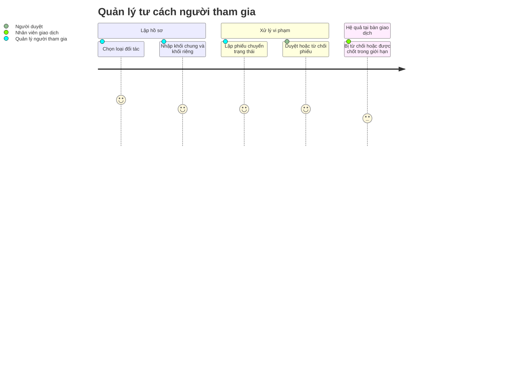

# Screens — F002_ParticipantsAndQualification

## Screen List

**Không màn hình nào của tính năng này được xây ở LAB-3.** Hồ sơ người tham gia hiện chỉ là dữ liệu seed (`participants`, `participant_qualifications`) cộng một phép kiểm chạy ngầm trong RPC chốt giao dịch. Cả ba màn dưới là **đặc tả thiết kế**; route đều là đề xuất.

| Screen Name | SCR### | What User Sees | What User Can Do |
|-------------|--------|----------------|------------------|
| Danh sách người tham gia (参加者一覧) — `/participants` | [SCR005_ParticipantList](../../screens/SCR005_ParticipantList/spec.md) | Bảng mã, tên, loại đối tác, căn cứ, số hiệu, ngày hiệu lực/hết hạn, trạng thái (huy hiệu khác màu cho "hạn chế có điều kiện" và "phải xét lại"), số ngày còn lại | Lọc theo mã/tên, loại đối tác, căn cứ, trạng thái, sắp hết hạn, ngưỡng cảnh báo; mở hồ sơ. Quản lý người tham gia có thêm nút "Thêm người tham gia" |
| Hồ sơ người tham gia (参加者台帳, **bốn biến thể**) — `/participants/[id]`, `/participants/new` | [SCR006_ParticipantProfile](../../screens/SCR006_ParticipantProfile/spec.md) | Khối chung (mã, tên, loại, liên hệ, số hiệu, hiệu lực) + khối riêng theo căn cứ: đăng ký chợ · giấy phép · chấp thuận · đăng ký tại điểm giao dịch; trạng thái tư cách ở chế độ chỉ đọc | Lập và sửa hồ sơ (chỉ quản lý người tham gia); gia hạn bằng dòng mới; bấm "Đề nghị chuyển trạng thái" để sang màn xét duyệt |
| Xét duyệt / tạm dừng tư cách (参加資格 審査・停止) — `/qualifications` | [SCR036_QualificationReview](../../screens/SCR036_QualificationReview/spec.md) | Danh sách phiếu (lọc theo trạng thái phiếu, căn cứ) và phiếu: khối lập, khối duyệt, các bước chuyển hợp lệ của đúng căn cứ | Lập phiếu, rút phiếu chưa duyệt, duyệt/từ chối (hộp thoại xác nhận có chủ ý, người duyệt khác người lập) |

Màn xét duyệt là màn **thiết kế mới**, không có trong 35 màn của LAB-1 (D-01).

## User Journey

1. Quản lý người tham gia mở **Danh sách người tham gia**, lọc "sắp hết hạn" để thấy hồ sơ cần gia hạn trước.
2. Quản lý chọn "Thêm người tham gia", chọn loại đối tác — hệ thống dựng đúng mẫu hồ sơ của căn cứ tương ứng, **không có bước chọn căn cứ**.
3. Quản lý lưu hồ sơ — ở lại màn, banner xác nhận, trạng thái hiện "có hiệu lực".
4. Khi có vi phạm, quản lý bấm "Đề nghị chuyển trạng thái" và tới **Xét duyệt tư cách**; danh sách bước chuyển chỉ gồm các bước hợp lệ của căn cứ đó.
5. Người duyệt (khác người lập) mở phiếu đang chờ, xác nhận qua hộp thoại và quyết định; nút duyệt **ẩn hẳn** với người lập.
6. Từ ngày hiệu lực, người mua ở trạng thái "phải xét lại" bị từ chối khi chốt giao dịch; người mua ở trạng thái "hạn chế có điều kiện" vẫn giao dịch được trong giới hạn.

