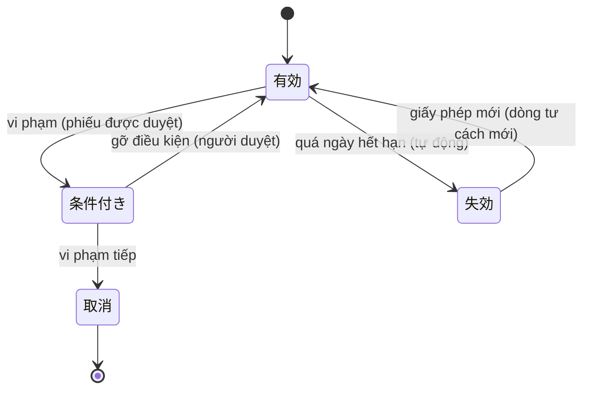
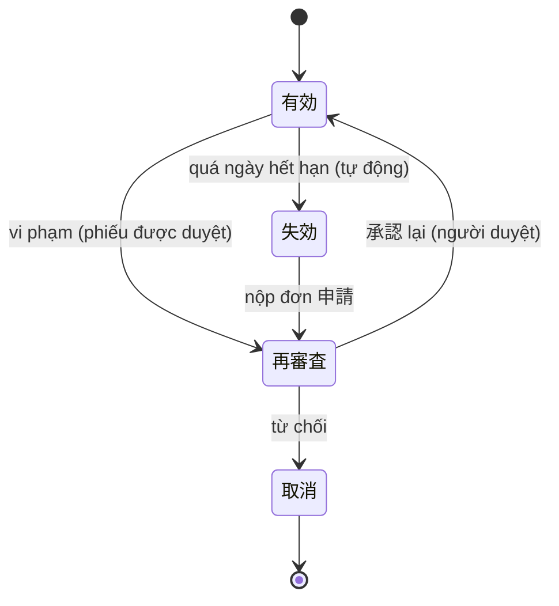

# F002_ParticipantsAndQualification — Technical Spec

**Priority**: P0
**Type**: mixed (một phép kiểm chạy ngầm đã xây; toàn bộ giao diện chỉ đặc tả)
**Generated**: 2026-10-06

> Quy ước: **[ĐÃ XÂY]** có ở LAB-3 kèm file nguồn · **[ĐẶC TẢ]** thiết kế LAB-4 chưa có code · **(đề xuất)** suy luận ngoài nguồn khách. Mã FR/NFR/BR/US giữ mã LAB-1. Mã lỗi `P0010`–`P0019` và `P0069`–`P0071` là **mã đề xuất** (README screen-specs), chưa cài; chỉ `P0001`–`P0009` đã chạy.

## Overview

Lập hồ sơ người tham gia theo bốn căn cứ, quản lý trạng thái hiệu lực, và kiểm tư cách mỗi lần chốt. **Ở LAB-3 chỉ có phần kiểm**: RPC nội bộ `_assert_buyer_qualified` chạy trong cùng transaction với `confirm_negotiated_trade`, `record_auction_result` và `record_delivery`; dữ liệu hồ sơ là seed. Phần còn lại — hồ sơ bốn biến thể, xét duyệt hai máy trạng thái, cảnh báo hết hạn — là thiết kế để vá sai lệch **D-01** ("prototype gộp bốn căn cứ thành một luật chung", RFP 12-06 xếp vào điều kiện bị loại). Quyết định kiến trúc: [ADR-006](../../decisions/ADR-006-split-license-approval-state-machines.md) (đề xuất, chưa xây); nền đọc chức danh: [ADR-001](../../decisions/ADR-001-role-from-table-not-jwt.md); đường ghi chỉ qua RPC: [ADR-002](../../decisions/ADR-002-no-write-policy-on-trades-deliveries.md). Thuộc [FL-03](../../flows/FL-03-participant-qualification-lifecycle.md).

## Polymorphic Behavior

Mã DISC chưa được cấp ở `entities.md`; bảng dưới là discriminator thật của dữ liệu — `participant_qualifications.basis_type` (suy 1:1 từ `participants.party_type`).

### DISC (chưa cấp mã) — participant_qualifications.basis_type

| Value | Render (SCR006) | Validation | Persistence |
|-------|-----------------|------------|-------------|
| `registration` (市場登録, 卸売業者) | Khối cơ quan đăng ký + ngày đăng ký | `valid_to` **tuỳ chọn** (đã chốt G9: trống = không thời hạn); chợ tuỳ chọn | Enum `qualification_status`: `有効` `失効` `取消`. Vi phạm → `取消` |
| `license` (許可, 仲卸) | Số giấy phép, cơ quan cấp **ngoài chợ**, ngày cấp, hạn; khối điều kiện chỉ đọc | `valid_to` **bắt buộc**; không gắn chợ (hiệu lực liên chợ) | **Bảng riêng** `qualification_license` (đề xuất), enum riêng: `有効` `条件付き` `失効` `取消` |
| `approval` (承認, 売買参加者) | Số chấp thuận, bên chấp thuận = chính chợ, hạn mức; khối xét lại chỉ đọc | `valid_to` **bắt buộc**; **bắt buộc có chợ** | **Bảng riêng** `qualification_approval` (đề xuất), enum riêng: `有効` `再審査` `失効` `取消` |
| `market_registration` (卸売場登録, 買出人) | Mã đăng ký + điểm giao dịch; phiên bản quy chế đang hiệu lực | `valid_to` **tuỳ chọn** (đã chốt G9: trống = không thời hạn; quy chế chợ có thể áp hạn mặc định); **bắt buộc có chợ**; mã theo regex đọc từ quy tắc chợ | Enum `qualification_status`; điều kiện đọc từ `market_rules` ([F012](../F012_MarketManagement/technical-spec.md)) |

Hiện trạng LAB-3: một bảng `participant_qualifications` + một enum ba giá trị `active/expired/revoked` cho cả bốn căn cứ (`0001_extensions_and_enums.sql`, `0003_participants_and_master.sql:39-53`); cột `qualification_basis_rules.violation_action` **không dòng logic nào đọc**.

**Source:** (tài liệu gốc trong repo, không nộp) `database-diagram.md` § D-01; `sc-06-ho-so-nguoi-tham-gia.md` mục 3; quyết định PREMISE C-06.

## Cross-Cutting Logic

### Requirements

| Code | Description | Handler | Verifiable | Trạng thái |
|------|-------------|---------|------------|------------|
| FR-PARTY-01 | Hồ sơ người tham gia theo 4 loại, mỗi loại có căn cứ riêng | Bảng + enum + seed (dữ liệu); SCR006 (giao diện) | yes | MỘT PHẦN — dữ liệu có (MOCK-3), giao diện chỉ đặc tả |
| FR-PARTY-02 | Kiểm hiệu lực 許可/承認 khi chốt giao dịch | `_assert_buyer_qualified` gọi từ `_confirm_trade` và `record_delivery` | yes | ĐÃ XÂY — kiểm đồng nhất, **chưa rẽ nhánh theo căn cứ** (D-01) |
| FR-PARTY-03 | Cảnh báo hồ sơ gần hết hạn, khoảng cảnh báo cấu hình được | SCR005 bộ lọc "sắp hết hạn" | yes | CHỈ ĐẶC TẢ |

**Source:** `0007_rpc_functions.sql:12-37` (hàm), `:71` (gọi từ `_confirm_trade`), `:144` (gọi từ `record_delivery`).

### Business Rules

| Mã LAB-1 | Nội dung | Thực thi ở | Trạng thái |
|----------|----------|-----------|------------|
| BR-PERM-01 | Kiểm hiệu lực 許可/承認 **tại thời điểm giao dịch** | `_assert_buyer_qualified(buyer, current_date)` — dùng `current_date` của DB, không phải ngày nghiệp vụ của giao dịch | ĐÃ XÂY, có điểm lệch (Unresolved #3) |
| GOV-RULE-01 | Đổi quy tắc/tỷ lệ: tối đa 4 lần/năm, maker-checker, có 発効日, rollback | Điều kiện của "hạn chế có điều kiện" đọc từ quy tắc chợ — thực thi ở [F012](../F012_MarketManagement/technical-spec.md) | CHỈ ĐẶC TẢ |

Quy tắc không mã (đề xuất, từ SCR036): người duyệt khác người lập phiếu · "hết hạn" là hệ quả của ngày tháng, không đi qua phiếu · gia hạn = dòng tư cách mới, không sửa đè dòng cũ. Tổng hợp ở [business-rules](../../system/business-rules.md).

### Decision Logic

#### DEC-001_QualificationGate
**subtype:** flow
**Triggers in:** SCR010, SCR011, SCR014 (khi gửi chốt/ghi)
**Involved entities:** `participant_qualifications.status/valid_from/valid_to`, `qualification_basis_rules`
**user_visible_outcome:** chốt được, hoặc bị từ chối kèm hết hạn từ ngày nào, căn cứ gì, liên hệ ai
**Source:** `0007_rpc_functions.sql:12-37`

```text
ok := tồn tại dòng q của người mua với q.status = 'active'
        và q.valid_from <= as_of <= q.valid_to   (đề xuất G9: q.valid_to NULL = bỏ vế này)
nếu ok → trả về (cho đi tiếp)
ngược lại → lấy dòng có valid_to muộn nhất (join qualification_basis_rules)
          → raise P0003 { expired_on, basis_type, basis_label, contact_office }
```

Đặc tả (đề xuất, ADR-006): thay phép kiểm đồng nhất bằng rẽ nhánh theo `basis_type` — `許可` + vượt điều kiện → `P0010`; `承認` + đang `再審査` → `P0011`; còn lại hết hạn → `P0003`.

### State Machines

#### FIG-010 — Tư cách tham gia (mức LAB-1)
**kind:** entity · **Source:** `product-a-rfp-business-summary.md` §7.2 (FIG-010); LAB-3 chỉ cài ba trạng thái `active/expired/revoked`.

#### Máy trạng thái A — 許可 (giấy phép) · [ĐẶC TẢ]
**Source:** (tài liệu gốc trong repo, không nộp) `architecture.md` §2.3; [ADR-006](../../decisions/ADR-006-split-license-approval-state-machines.md)



| Chuyển | Guard | Hệ quả |
|--------|-------|--------|
| 有効 → 条件付き | phiếu có nội dung + hạn điều kiện; maker ≠ checker | **vẫn giao dịch**; vượt điều kiện → `P0010` |
| 条件付き → 有効 | đã khắc phục, người duyệt | xoá điều kiện |
| 条件付き → 取消 | vi phạm tiếp | chặn, `P0003` |
| 有効 → 失効 | tự động khi quá hạn, **không qua phiếu** | chặn, `P0003` |

#### Máy trạng thái B — 承認 (chấp thuận) · [ĐẶC TẢ]



| Chuyển | Guard | Hệ quả |
|--------|-------|--------|
| 有効 → 再審査 | phiếu có hạn xét lại | **chặn giao dịch ngay**, `P0011` |
| 再審査 → 有効 | người có thẩm quyền duyệt lại | mở lại giao dịch |
| 再審査 → 取消 | từ chối | chặn, `P0003` |
| 失効 → 再審査 | nộp đơn | vẫn chặn tới khi duyệt lại |

Hai căn cứ còn lại (`市場登録`, `卸売場登録`) chỉ có `有効 → 取消` và `有効 → 失効` (giả định, Unresolved #4).

### Algorithms

Không áp dụng — không có thuật toán tính toán; phép kiểm tư cách mô tả ở DEC-001.

### External Integrations

Không áp dụng — giấy phép do cơ quan hành chính **ngoài chợ** cấp, hệ thống chỉ ghi số hiệu và hạn; RFP không yêu cầu tích hợp.

### Verification

Nhãn `V-F002-xx` là nhãn cục bộ. **Dựng từ migration, seed và code; chưa chạy lại trong phiên viết spec.**

- **V-F002-01** — Từ chối khi hết hạn (covers FR-PARTY-02, BR-PERM-01). Seed cố ý để `PTI-01`, `PTA-01`, `PTM-01` hết hạn 10 ngày trước (`supabase/seed.sql:129-150`). Đăng nhập `trading@demo.local`, vào `/trades/negotiated`, nhập một lô `公開` còn hàng + mã người mua `PTI-01` → banner `P0003` nêu ngày hết hạn, căn cứ, phòng liên hệ.
- **V-F002-02** — Không tạo bản ghi khi từ chối:
  ```sql
  select count(*) from trades
  where buyer_participant_id = (select id from participants where code = 'PTI-01')
    and confirmed_at > now() - interval '5 minutes';
  ```
  Kỳ vọng: `0` sau lần thử ở V-F002-01.
- **V-F002-03** — Hàm kiểm không gọi được từ ngoài: `select has_function_privilege('authenticated', 'public._assert_buyer_qualified(uuid,date)', 'EXECUTE');` kỳ vọng `false` (`0007_rpc_functions.sql:39`, `0011`).
- **V-F002-04** — Chứng minh D-01 còn tồn tại (phép thử "xoá `basis_type` mà logic vẫn chạy"): `select pg_get_functiondef('public._assert_buyer_qualified(uuid,date)'::regprocedure);` — kỳ vọng `basis_type` chỉ xuất hiện trong phần dựng thông báo, **không** có nhánh rẽ theo giá trị. Khi ADR-006 được xây, kết quả phải đổi.
- **V-F002-05** *(đặc tả, sau khi xây SCR036)* — dùng hai tài khoản quản lý người tham gia, một có cờ duyệt: lập phiếu `許可` → `条件付き`, duyệt bằng tài khoản thứ hai; chốt vượt điều kiện → `P0010` (không phải `P0003`); phiếu `承認` → `再審査` → chốt → `P0011`.
- **V-F002-06** *(đặc tả)* — người lập phiếu mở phiếu của mình: không thấy nút duyệt; gọi thẳng RPC duyệt → `P0013`.

---

**Client behavior:** see [architecture.md](../../system/architecture.md) (hành vi phía client: chặn route, Server Action, keyboard-first, mất mạng), [permissions.md](../../system/permissions.md), [screen-flow.md](../../generated/screen-flow.md).

## User Stories

### US-04 — Bị chặn khi người mua đã hết hạn tham gia (Priority: P0)

**What happens:** Nhân viên giao dịch bấm chốt cho người mua đã hết hạn; hệ thống từ chối ngay tại thời điểm chốt và nói rõ lý do.
**Why this priority:** BR-PERM-01 là quy tắc cứng; rủi ro tự ghi nhận của khách là "người hết hạn vẫn giao dịch được".
**Independent Test:** V-F002-01 + V-F002-02.

**Acceptance Scenarios (rút từ cột 受入 của LAB-1):**

1. **Given** người mua có mọi dòng tư cách hết hiệu lực tại ngày chốt, **When** nhân viên giao dịch gửi chốt, **Then** từ chối `P0003` và **không tạo bản ghi nào** — không tạo rồi huỷ, không tạo ở trạng thái chờ. *(ĐÃ XÂY)*
2. **Given** bị từ chối, **When** màn hiện thông báo, **Then** nêu hết hạn từ ngày nào, thuộc loại căn cứ nào, liên hệ phòng nào (kể cả bản tiếng Nhật qua `contact_office_ja`, `0031`). *(ĐÃ XÂY)*
3. **Given** kiểm hiệu lực, **When** xét thời điểm, **Then** kiểm **tại lúc chốt** — không phải lúc đăng nhập, không phải lúc tạo lô. *(ĐÃ XÂY, theo `current_date`)*

**Requirements fulfilled:**
- **FR-PARTY-02** — `confirm_negotiated_trade` / `record_auction_result` / `record_delivery` → `_assert_buyer_qualified`. **Source:** `0007_rpc_functions.sql:12-37`, `:71`, `:144`

**Rules enforced:** BR-PERM-01 (xem trên). **Verification:** V-F002-01, V-F002-02, V-F002-03.

Các story khác của F02 (F02-01…F02-05, F02-07) **không có US riêng** trong LAB-1 ("là dữ liệu gốc; phần quyết định đã có US-04") — không bịa thêm.

### Edge Cases

Xem [edge-cases.md](./edge-cases.md).

## Key Entities

| Entity | Table | Key Columns | Purpose |
|--------|-------|-------------|---------|
| Người tham gia | `participants` | `code` (unique), `name`, `party_type` | Hồ sơ gốc; `party_type` ∈ `wholesaler/intermediary/approved_trader/market_buyer` |
| Tư cách tham gia | `participant_qualifications` | `participant_id`, `basis_type`, `basis_no`, `issuer`, `valid_from`, `valid_to`, `status` | Một dòng/lần cấp; `valid_to` hiện `NOT NULL` (mâu thuẫn với căn cứ không có hạn — Unresolved #5) |
| Quy tắc căn cứ | `qualification_basis_rules` | `basis_type` (PK), `label_vi/ja`, `violation_action`, `contact_office(_ja)` | 4 dòng cố định; `violation_action` là nhãn, **không** là nguồn hành vi |
| Giấy phép *(đề xuất)* | `qualification_license` | `license_no`, `issuing_authority`, `condition_*` | Máy trạng thái A |
| Chấp thuận *(đề xuất)* | `qualification_approval` | `approval_no`, `participation_limit`, `review_*` | Máy trạng thái B |
| Phiếu chuyển trạng thái *(đề xuất)* | `qualification_transitions` | `qualification_id`, `from_status`, `to_status`, `requested_by`, `decided_by`, `decision_state` | Maker-checker |

RLS hiện hành: `participants`, `participant_qualifications`, `qualification_basis_rules` cho **mọi role đã đăng nhập** đọc (`0009_rls_policies.sql:32-38`); không policy ghi.

## Artifact References

| Artifact | File | Codes Used |
|----------|------|------------|
| System Overview | [overview.md](../../system/overview.md) | — |
| Architecture | [architecture.md](../../system/architecture.md) | — |
| Business Rules | [business-rules.md](../../system/business-rules.md) | BR-PERM-01, GOV-RULE-01 |
| Permissions | [permissions.md](../../system/permissions.md) | — |
| Feature List | [feature-list.md](../../generated/feature-list.md) | F002 |
| Entities | [entities.md](../../generated/entities.md) | `participants`, `participant_qualifications`, `qualification_basis_rules` |
| Screens | [screens.md](./screens.md) | SCR005, SCR006, SCR036 |

## Assumptions

- Phép kiểm dùng `current_date` của DB. Màn xem trước ở SCR010 (`lib/domain/trade-preview.ts:87-133`) **tự tính lại** bằng ngày UTC của server ứng dụng (`new Date().toISOString().slice(0,10)`) — hai nơi cùng một luật, chỉ để hiển thị; lệch ngày có thể xảy ra quanh nửa đêm UTC (đã quan sát từ code, chưa tái hiện).
- (đề xuất) `party_type → basis_type` là 1:1; `basis_type` là trường dẫn xuất, không phải ô chọn. Nguồn: ma trận 参加資格 của khách §7.2.
- (đề xuất) Không xoá người tham gia, chỉ `取消`. Rủi ro nếu sai: báo cáo kỳ cũ mất tham chiếu.
- Người duyệt xác định bằng cột `app_users.can_approve` trên tài khoản, không thêm role riêng — đã chốt (PREMISE C-09). Khách chưa xác nhận; nếu sai: làm lại ma trận quyền.

## Source Code References

| Order | Symbol | Path | Purpose |
|-------|--------|------|---------|
| 1 | bảng tư cách + `qualification_basis_rules` | `supabase/migrations/0003_participants_and_master.sql:12-53` | Mô hình dữ liệu gộp hiện tại |
| 2 | `_assert_buyer_qualified` | `supabase/migrations/0007_rpc_functions.sql:12-37` | Phép kiểm tư cách |
| 3 | gọi từ `_confirm_trade`, `record_delivery` | `supabase/migrations/0007_rpc_functions.sql:71`, `:144` | Hai điểm chặn |
| 4 | `contact_office_ja` | `supabase/migrations/0031_qualification_contact_office_ja.sql` | Thông báo P0003 song ngữ |
| 5 | `getBuyerQualification`, `localizeP0003Details` | `lib/domain/trade-preview.ts:87-149` | Xem trước + dịch details |
| 6 | seed tư cách hết hạn | `supabase/seed.sql:114-150` | `PTI-01`, `PTA-01`, `PTM-01` |

## Unresolved Questions

1. **"Hạn chế có điều kiện" cụ thể là gì?** Quyết định `P0010` có gì để kiểm. Chặn thiết kế.
2. **Ai duyệt "xét lại", trong bao lâu?** Đổi ma trận quyền của SCR036.
3. **Phép kiểm theo `current_date` hay ngày nghiệp vụ của giao dịch?** BR-PERM-01 nói "tại thời điểm giao dịch"; giao hàng kéo dài qua ngày (ADR-005) làm hai mốc lệch nhau. Chờ khách.
4. **Hai căn cứ còn lại có luồng vi phạm riêng không?** (ADR-006 câu hỏi 2.)
5. **`valid_to` nullable — ĐÃ CHỐT (PREMISE G9, người làm bài chốt; khách chưa xác nhận).** `市場登録` (`registration`) và `卸売場登録` (`market_registration`) không bắt buộc hạn (LAB-1 F02-01, F02-04 không ghi ngày hết hạn); `許可`, `承認` bắt buộc (F02-02, F02-03). Prototype `valid_to NOT NULL` → nới nullable là thay đổi ràng buộc **đề xuất**, phá tương thích, migration ở LAB-5; `有効 → 失効` tự động chỉ áp cho dòng có `valid_to`.
6. **Mã lỗi:** `P0069` = mã người tham gia đã tồn tại (SCR006), `P0070` = trạng thái đã đổi từ lúc mở phiếu (SCR036); `P0005` chỉ còn nghĩa "sai chức danh" (đã cài). Hai mã mới là đề xuất, chưa cài. Lịch sử cấp mã: xem bảng mã ở [business-rules](../../system/business-rules.md).
7. **RLS `participants` đang mở cho mọi role đọc**: siết lại để khớp ma trận SCR005 là thay đổi phá tương thích với màn chốt giao dịch.

## Source Walkthrough

1. **File:** `supabase/migrations/0003_participants_and_master.sql:12-53` — mô hình gộp hiện tại.
2. **File:** `supabase/migrations/0007_rpc_functions.sql:12-37` — phép kiểm duy nhất.
3. **File:** `lib/domain/trade-preview.ts:87-149` — bản hiển thị của cùng luật.
4. **File:** (tài liệu gốc trong repo, không nộp) `architecture.md:174-248` — thiết kế hai máy trạng thái (đặc tả).

### Call Hierarchy

```text
SCR010/SCR011 -> Server Action -> rpc confirm_negotiated_trade / record_auction_result -> _confirm_trade -> _assert_buyer_qualified
SCR014        -> Server Action -> rpc record_delivery -> _assert_buyer_qualified
```

**Related files:** bảng *Source Code References* — cột **Order**.

## DB Impact per Event

Hiện **không có sự kiện ghi** nào của tính năng này trong ứng dụng LAB-3 (hồ sơ do seed ghi trực tiếp). Các dòng sau là **đặc tả (đề xuất)**:

| Event/Endpoint | Table | Columns | Operation | Value Derivation | Source |
|----------------|-------|---------|-----------|-------------------|--------|
| RPC `upsert_participant_profile` | `participants`, bảng căn cứ theo biến thể | theo biến thể | INSERT/UPDATE | `basis_type` suy từ `party_type` | `[INFERRED]` — SCR006 mục 8, chưa có code |
| RPC `request_qualification_transition` | `qualification_transitions` | `from_status, to_status, reason, effective_on` | INSERT | `from_status` đọc lúc lập | `[INFERRED]` — SCR036 mục 8 |
| RPC `decide_qualification_transition` | bảng căn cứ + `qualification_transitions` + `audit_log` | trạng thái mới, `decided_by` | UPDATE/INSERT | `decided_by = auth.uid()`, ≠ người lập | `[INFERRED]` — SCR036 mục 8 |
