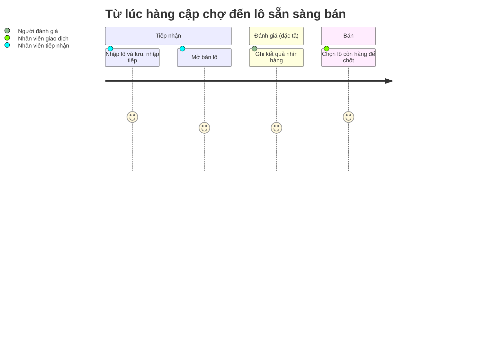

# Screens — F003_LotsAndInspection

## Screen List

Hai trong ba màn **đã xây ở LAB-3**; màn chi tiết lô chỉ đặc tả. Màn hàng chờ đồng bộ ([SCR035](../../screens/SCR035_SyncQueue/spec.md)) phục vụ F03-06 nhưng thuộc [F010](../F010_Notifications/screens.md) theo registry.

| Screen Name | SCR### | What User Sees | What User Can Do |
|-------------|--------|----------------|------------------|
| Nhập lô hàng (ロット入力) — `/lots/new` ⌨️ | [SCR007_LotEntry](../../screens/SCR007_LotEntry/spec.md) · **đã xây** | Form: mã chủ hàng, mã mặt hàng (gợi ý `datalist`), số lượng, ngày nghiệp vụ (tự điền ngày đang mở mới nhất), số chứng từ, ghi chú | Gõ và lưu bằng bàn phím (Enter ở ô cuối, Ctrl+Enter, Escape xoá form); lưu xong nhập tiếp, focus về ô mã chủ hàng. Chỉ `receiving` |
| Danh sách lô hàng (ロット一覧) — `/lots` | [SCR008_LotList](../../screens/SCR008_LotList/spec.md) · **đã xây** | Bảng mã lô, chủ hàng, mặt hàng, số lượng, đã bán, **còn lại** (tính từ view), trạng thái; lọc theo 5 trạng thái và ngày nghiệp vụ | Lọc; `receiving` có nút "Mở bán" ở lô `受付`/`下見済`; `trading` chỉ xem |
| Chi tiết lô hàng (ロット詳細) — `/lots/[id]` *(đề xuất)* | [SCR009_LotDetail](../../screens/SCR009_LotDetail/spec.md) · chỉ đặc tả | Thông tin lô, lịch sử đánh giá, khối ghi kết quả, nút điều chỉnh thuộc tính | Ghi kết quả đánh giá (người ghi tự gõ tên, không lấy từ tài khoản), điều chỉnh thuộc tính kèm lý do |

## User Journey

1. Nhân viên tiếp nhận mở **Nhập lô hàng**; con trỏ nằm sẵn ở ô mã chủ hàng, ngày nghiệp vụ đã điền.
2. Nhập đủ các ô rồi lưu — banner xanh "Đã lưu lô {mã lô}. Tiếp tục nhập lô mới."; form xoá sạch, focus về ô đầu.
3. Nếu mất mạng lúc lưu, banner đỏ báo chưa lưu được và **dữ liệu đã gõ vẫn còn nguyên** để thử lại.
4. Nhân viên mở **Danh sách lô hàng**, tìm lô vừa nhập (trạng thái "đã tiếp nhận") và bấm "Mở bán".
5. Nhân viên giao dịch mở cùng danh sách, thấy lô và số còn lại, rồi sang màn chốt giao dịch ([F004](../F004_TradeRecording/screens.md)).
6. Khi cần ghi kết quả đánh giá hoặc sửa thuộc tính, nhân viên mở **Chi tiết lô** (đặc tả); lô thuộc ngày đã chốt thì form ẩn hẳn và dẫn sang phiếu điều chỉnh ([F007](../F007_PostCloseCorrection/screens.md)).

