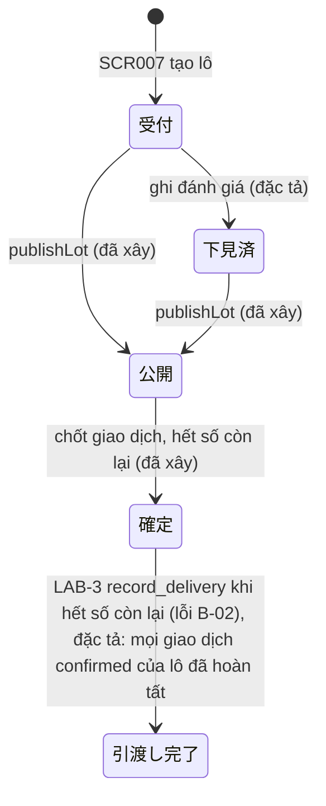

# F003_LotsAndInspection — Technical Spec

**Priority**: P0
**Type**: ui
**Generated**: 2026-10-06

> Quy ước: **[ĐÃ XÂY]** có ở LAB-3 kèm file nguồn · **[ĐẶC TẢ]** chưa có code · **(đề xuất)** suy luận ngoài nguồn khách · **(quan sát)** rút từ đọc migration/code, chưa chạy. Mã FR/NFR/BR/US giữ mã LAB-1. Mã lỗi `P0060`/`P0061` do SCR009 đề xuất, chưa cài.

## Overview

Tiếp nhận lô hàng, theo dõi vòng đời năm trạng thái, ghi kết quả đánh giá cảm quan do người nhập, và bảo đảm **số lượng khả dụng không âm**. Mở đầu [FL-01](../../flows/FL-01-lot-trade-delivery-reconciliation.md). Ở LAB-3: nhập lô (SCR007), danh sách + nút "Mở bán" (SCR008), view dẫn xuất `v_lot_availability` và phép kiểm số lượng trong RPC chốt giao dịch. Chưa có: ghi đánh giá, điều chỉnh thuộc tính, nháp offline. Quyết định kiến trúc liên quan: [ADR-003](../../decisions/ADR-003-derived-remaining-quantity-views.md) (số còn lại là view dẫn xuất), [ADR-002](../../decisions/ADR-002-no-write-policy-on-trades-deliveries.md), [ADR-004](../../decisions/ADR-004-invariants-at-database-layer.md).

## Polymorphic Behavior

Không áp dụng — không có discriminator; sự khác biệt theo trạng thái lô nằm ở máy trạng thái bên dưới.

## Cross-Cutting Logic

### Requirements

| Code | Description | Handler | Verifiable | Trạng thái |
|------|-------------|---------|------------|------------|
| FR-LOT-01 | Tạo mã lô, mặt hàng, số lượng ban đầu, chứng từ tiếp nhận; mã lô **unique** | `createLot` (`app/(app)/lots/actions.ts:50-131`) → `next_lot_code()` + insert `lots` | yes | ĐÃ XÂY — chứng từ chỉ là **số tham chiếu tuỳ chọn** (`0020`), chưa có tệp đính kèm |
| FR-LOT-02 | Lưu kết quả đánh giá kèm người xác nhận + thời điểm | RPC `record_lot_evaluation` (đề xuất) | yes | CHỈ ĐẶC TẢ (SCR009) |
| FR-LOT-03 | Kiểm số lượng khả dụng **trước** giao dịch/giao hàng, chống bán vượt | `_confirm_trade` (`P0004`), `record_delivery` (`P0006`), view `v_lot_availability` | yes | ĐÃ XÂY |
| FR-LOT-04 | Điều chỉnh thuộc tính lô có kiểm soát (P1) | RPC `adjust_lot_attributes` (đề xuất) → ghi `lot_adjustments` (giá trị trước/sau, lý do, người thực hiện; SCR009 #17–#21) | yes | CHỈ ĐẶC TẢ |
| NFR-AVL-02 | Mất mạng ngắn: tiếp tục nhập, re-sync sau, không trùng | hàng đợi cục bộ + khoá `client_generated_id` (đề xuất) | yes | CHỈ ĐẶC TẢ (MOCK-2) |
| NFR-USE-01 | Nhập lô dùng được thuần bàn phím, lỗi dễ hiểu | `use-lot-entry-form.ts` (Enter, Ctrl+Enter, Escape) | yes | ĐÃ XÂY |

### Business Rules

| Mã LAB-1 | Nội dung | Thực thi ở | Trạng thái |
|----------|----------|-----------|------------|
| BR-LOT-02 | Số lượng khả dụng của lô **không âm**; truy vết được tới lịch sử điều chỉnh | `remaining = quantity − Σ trades confirmed` tính tại view (`0006_derived_views.sql:6-25`); `_confirm_trade` khoá dòng lô `FOR UPDATE` và so `remaining < p_quantity` → `P0004` (`0007_rpc_functions.sql:41-94`) | MỘT PHẦN — xem bên dưới |
| BR-CLOSE-01 | Không sửa trực tiếp ngày đã khoá | Trigger `guard_closed_day_lots` (`0010_closed_day_guard.sql:45-47`) → `P0009` | ĐÃ XÂY |

**BR-LOT-02 — khoảng trống (quan sát, chưa chạy):** `lots.quantity` được chú thích "BẤT BIẾN sau khi tạo" (`0004_business_days_and_lots.sql:41-42`) nhưng chỉ là **chú thích**. Policy `lots_update` cho `receiving` UPDATE mọi cột (`0009_rls_policies.sql:48-52`) và không có trigger nào chặn đổi `quantity`. Một lệnh UPDATE trực tiếp hạ `quantity` dưới số đã bán sẽ khiến view cho `remaining < 0` — đúng điều BR-LOT-02 cấm. Đây là chỗ ADR-003/ADR-004 nói bất biến phải ở tầng dữ liệu nhưng chưa được áp cho cột này. Hướng vá thuộc FR-LOT-04 (RPC điều chỉnh có `P0061`, và bỏ quyền UPDATE trực tiếp cột `quantity`) — **đề xuất**.

**(quan sát) Khoảng trống trạng thái lô:** `_confirm_trade` không kiểm `lots.status`; lô ở `受付` vẫn chốt được (`0007_rpc_functions.sql:41-94` không có điều kiện trạng thái). FIG-011 coi `公開` là "chuẩn bị bán". Không cấp mã lỗi mới ở đây; nêu để quyết định ở Unresolved #4.

Tổng hợp quy tắc ở [business-rules](../../system/business-rules.md).

### Decision Logic

#### DEC-001_PublishButtonVisibility
**subtype:** render
**Triggers in:** SCR008 mỗi hàng lô
**Involved entities:** `lots.status`, vai trò người xem
**user_visible_outcome:** có hay không nút "Mở bán"
**Source:** `app/(app)/lots/page.tsx:97-113`, `app/(app)/lots/status-action.tsx`

```text
nếu user.role = receiving và lot.status ∈ {受付, 下見済} → hiện nút "Mở bán"
ngược lại → không hiện (UI chỉ để gọn; tầng chặn thật là Server Action publishLot)
```

### State Machines

#### SM — FIG-011 Vòng đời lô
**kind:** entity · **Linked FR:** FR-LOT-01..04 · **Source:** `0001_extensions_and_enums.sql` (enum `lot_status`); `app/(app)/lots/actions.ts:144-176`; `0007_rpc_functions.sql:88-90`, `:159-161`



| Chuyển | Guard | Hiệu ứng | Trạng thái |
|--------|-------|----------|------------|
| `受付` → `下見済` | `receiving`; lô ở `受付`/`下見済` | lưu bản ghi đánh giá | ĐẶC TẢ — enum có sẵn, **không có đường nhập** ở LAB-3 |
| `受付`/`下見済` → `公開` | `receiving`; điều kiện trạng thái nằm trong mệnh đề UPDATE | đổi trạng thái | ĐÃ XÂY |
| → `確定` | trong `_confirm_trade` khi `remaining − p_quantity = 0` | UPDATE `lots.status` | ĐÃ XÂY — **không kiểm trạng thái hiện tại** (quan sát) |
| `確定` → `引渡し完了` | **Đặc tả (đã chốt, PREMISE G3):** khi **mọi** giao dịch `confirmed` của lô đã hoàn tất giao hàng (`trades.delivery_completed_at` khác `NULL`, đặt bởi `complete_trade_delivery` ở SCR016) | UPDATE `lots.status` cùng transaction với lần chốt hoàn tất giao dịch cuối của lô | ĐẶC TẢ. **Code LAB-3 sai (B-02, B-04):** `record_delivery` lật `引渡し完了` ngay khi **một** giao dịch giao đủ (`0007_rpc_functions.sql:159-161`) — một lô bán cho nhiều giao dịch bị lật sớm, và lật cả khi lần giao còn `pending`/`in_transit`. Phải bỏ nhánh tự chuyển này. Chi tiết ở [F005](../F005_DeliveryTracking/technical-spec.md) |

### Algorithms

Không áp dụng — số còn lại là phép trừ tại view, không có thuật toán riêng. Sinh mã lô: `'LOT-' || yyyymmdd || '-' || lpad(nextval('lot_code_seq'), 4, '0')`, **một sequence toàn cục** không reset theo ngày (`0004_business_days_and_lots.sql:15-24`).

### External Integrations

Không áp dụng — không tích hợp ngoài; chứng từ tiếp nhận chỉ là số tham chiếu.

### Verification

Nhãn `V-F003-xx` là nhãn cục bộ. **Dựng từ migration và code; chưa chạy lại trong phiên viết spec.**

- **V-F003-01** — Mã lô duy nhất (covers FR-LOT-01): `select lot_code, count(*) from lots group by 1 having count(*) > 1;` kỳ vọng 0 dòng; ràng buộc `lots_lot_code_key` tồn tại.
- **V-F003-02** — Số còn lại là dẫn xuất, không phải cột lưu (covers FR-LOT-03, ADR-003): `select column_name from information_schema.columns where table_schema='public' and table_name='lots' and column_name ilike '%remain%';` kỳ vọng 0 dòng; và `select lot_code from v_lot_availability where remaining < 0;` kỳ vọng 0 dòng.
- **V-F003-03** — Chặn bán vượt (covers BR-LOT-02): đăng nhập `trading@demo.local`, `/trades/negotiated`, nhập lô `公開` với số lượng lớn hơn `remaining` → `P0004` kèm `sold_to[]`.
- **V-F003-04** — Thuần bàn phím (covers NFR-USE-01): mở `/lots/new` bằng `receiving@demo.local`; chỉ dùng Tab/Enter/Ctrl+Enter/Escape, lưu hai lô liên tiếp; kỳ vọng focus quay về ô mã chủ hàng sau mỗi lần lưu, form xoá sạch.
- **V-F003-05** — Ngày đã chốt chặn ghi trực tiếp (covers BR-CLOSE-01): chạy bằng quyền cao (SQL runner) `update lots set notes = 'x' where business_date = '<ngày đã chốt>';` kỳ vọng lỗi `P0009`.
- **V-F003-06** — *Chứng minh khoảng trống BR-LOT-02 (kỳ vọng hiện tại suy từ chính sách, chưa chạy)*: bằng phiên `receiving`, gọi `PATCH /rest/v1/lots?id=eq.<id>` với `{"quantity": 1}` cho lô đã bán hơn 1 → hiện được chấp nhận; sau khi vá FR-LOT-04 phải bị từ chối.
- **V-F003-07** *(đặc tả)* — ghi đánh giá: lô `受付` → bản ghi có người ghi + thời điểm, lô sang `下見済`; lô `公開` → `P0060`.

---

**Client behavior:** see [architecture.md](../../system/architecture.md) (hành vi phía client: chặn route, Server Action, keyboard-first, mất mạng), [permissions.md](../../system/permissions.md), [screen-flow.md](../../generated/screen-flow.md).

## User Stories

### US-01 — Tiếp nhận lô hàng vừa vào chợ (Priority: P0)

**What happens:** Nhân viên tiếp nhận nhập lô ngay khi hàng cập chợ để khỏi viết phiếu giấy rồi có người nhập lại.
**Why this priority:** Tiêu chí A (đường sống ngày nghiệp vụ); đánh vào nỗi đau lớn nhất (2,4 → ≤ 1,2 lần nhập lại).
**Independent Test:** V-F003-01 + V-F003-04.

**Acceptance Scenarios (cột 受入 của LAB-1):**

1. **Given** form hợp lệ, **When** lưu, **Then** lô có mã duy nhất do server sinh. *(ĐÃ XÂY)*
2. **Given** lô cần chứng từ tiếp nhận, **When** lưu, **Then** chứng từ được lưu. *(MỘT PHẦN — chỉ số tham chiếu tuỳ chọn; LAB-1 ghi "bắt buộc")*
3. **Given** dữ liệu trùng khoá nghiệp vụ, **When** gửi, **Then** hệ thống phát hiện trước khi nhận. *(KHOẢNG TRỐNG — chỉ có unique `lot_code` do server sinh; chưa có khoá nghiệp vụ nào khác, xem Unresolved #2)*
4. **Given** nhân viên đeo găng, **When** hoàn tất luồng, **Then** không cần chuột. *(ĐÃ XÂY)*

**Requirements fulfilled:**
- **FR-LOT-01** — `createLot`. **Source:** `app/(app)/lots/actions.ts:50-131`
- **NFR-USE-01** — hook form. **Source:** `app/(app)/lots/new/use-lot-entry-form.ts`

**Rules enforced:** mã lô unique (`lots_lot_code_key`), `quantity > 0` (`0004_business_days_and_lots.sql:35`). **Verification:** V-F003-01, V-F003-04.

### US-02 — Ghi kết quả đánh giá cảm quan (Priority: P0)

**What happens:** Người đánh giá ghi kết quả nhìn hàng vào lô để truy được về sau.
**Why this priority:** Tiêu chí C — một trong bốn điểm giữ quyết định con người.
**Independent Test:** V-F003-07.

**Acceptance Scenarios:**

1. **Given** lô `受付`/`下見済`, **When** ghi kết quả, **Then** lưu kèm tên người ghi và thời điểm; tên người ghi **khác** tài khoản đăng nhập (máy dùng chung theo ca). *(ĐẶC TẢ)*
2. **Given** màn đánh giá, **When** xem giao diện, **Then** không có gợi ý, không tự phân loại, không đọc ảnh. *(ĐẶC TẢ)*

**Requirements fulfilled:** **FR-LOT-02** — `record_lot_evaluation` (đề xuất). **Source:** `[INFERRED]` — SCR009 mục 8, chưa có code.

### US-05 — Bị chặn khi lô không còn đủ số lượng (Priority: P0)

**What happens:** Nhân viên giao dịch bị chặn khi lô không đủ hàng để chợ không bán quá số thực có. Màn thao tác là SCR010 ([F004](../F004_TradeRecording/technical-spec.md)); phép kiểm thuộc F03-04.
**Why this priority:** BR-LOT-02 là quy tắc cứng.
**Independent Test:** V-F003-03.

**Acceptance Scenarios:**

1. **Given** lô còn `r` đơn vị, **When** chốt `q > r`, **Then** `P0004`, không tạo giao dịch. *(ĐÃ XÂY)*
2. **Given** hai bàn chốt cùng lô đồng thời, **When** cả hai gửi, **Then** không tạo số âm (khoá `FOR UPDATE`). *(ĐÃ XÂY)*
3. **Given** bị từ chối, **When** màn hiện thông báo, **Then** nêu còn bao nhiêu, đã bán cho giao dịch nào. *(ĐÃ XÂY)*
4. **Given** ràng buộc, **When** xét tầng, **Then** nằm ở **tầng dữ liệu**. *(MỘT PHẦN — RPC giữ được; cột `quantity` sửa trực tiếp được, xem khoảng trống BR-LOT-02)*

### US-09 — Tiếp tục làm việc khi mất mạng (Priority: P0, dùng chung F005)

Chi tiết ở [F005 technical-spec](../F005_DeliveryTracking/technical-spec.md) và [SCR035](../../screens/SCR035_SyncQueue/spec.md); phần của F003 là F03-06 (nháp lô offline). **CHỈ ĐẶC TẢ.** Ranh giới đã chốt: chốt giao dịch và chốt sổ vẫn **cần mạng**.

### Edge Cases

Xem [edge-cases.md](./edge-cases.md).

## Key Entities

| Entity | Table | Key Columns | Purpose |
|--------|-------|-------------|---------|
| Lô | `lots` | `lot_code` (unique), `business_date`, `consignor_id`, `commodity_id`, `quantity`, `status`, `receiving_reference_no`, `notes` | Ghi `quantity` ban đầu; **không** lưu số còn lại |
| Số khả dụng | view `v_lot_availability` | `sold_qty`, `remaining`, `sold_to` | Dẫn xuất; `security_invoker = true` |
| Ngày nghiệp vụ | `business_days` | `business_date` (PK), `status` | Lô tham chiếu; ngày `closed` chặn ghi |
| Mặt hàng, chủ hàng | `commodities`, `participants` | `code`, tên VI/JA | Tra mã khi nhập |
| Kết quả đánh giá *(đề xuất)* | `lot_evaluations` | `lot_id`, `result_note`, `evaluated_by_name`, `evaluated_at`, `actor_id` | Append-only, hai lớp dấu vết |
| Lịch sử điều chỉnh lô *(đề xuất)* | `lot_adjustments` | `lot_id`, `target_field`, `old_value`, `new_value`, `reason`, người thực hiện (tên cột chưa đặt trong SCR009) | Ghi mỗi lần `adjust_lot_attributes`; FR-LOT-04, BR-LOT-02 (truy vết điều chỉnh) |

RLS: `lots` SELECT cho `receiving`+`trading`; INSERT/UPDATE cho `receiving` (`0009_rls_policies.sql:44-52`).

## Artifact References

| Artifact | File | Codes Used |
|----------|------|------------|
| System Overview | [overview.md](../../system/overview.md) | — |
| Architecture | [architecture.md](../../system/architecture.md) | — |
| Business Rules | [business-rules.md](../../system/business-rules.md) | BR-LOT-02, BR-CLOSE-01 |
| Permissions | [permissions.md](../../system/permissions.md) | — |
| Feature List | [feature-list.md](../../generated/feature-list.md) | F003 |
| Entities | [entities.md](../../generated/entities.md) | `lots`, `business_days` |
| Screens | [screens.md](./screens.md) | SCR007, SCR008, SCR009 |

## Assumptions

- Chủ hàng (`consignor`) lấy từ `participants` nhóm bán buôn; danh mục mặt hàng là seed (MOCK-3).
- Mã lô dùng **một sequence toàn cục**; seed dùng mã viết tay nên phải `setval` đuổi kịp (`0021_lot_code_seq_catch_up.sql`).
- Chức danh "Đánh giá" (目利き) gộp vào `receiving` — đã chốt (PREMISE C-10), ghi là nợ. Khách chưa xác nhận; nếu tách: thêm role, làm lại ma trận quyền.
- (đề xuất) Kết quả đánh giá là văn bản tự do (10–1000 ký tự), có thể ghi nhiều lần (append-only). Rủi ro nếu khách muốn ô có cấu trúc: cần danh mục hạng do khách cung cấp.

## Source Code References

| Order | Symbol | Path | Purpose |
|-------|--------|------|---------|
| 1 | bảng `lots`, `next_lot_code` | `supabase/migrations/0004_business_days_and_lots.sql:4-45` | Mô hình + sinh mã |
| 2 | `v_lot_availability` | `supabase/migrations/0006_derived_views.sql:6-25` | Số còn lại dẫn xuất |
| 3 | `_confirm_trade` | `supabase/migrations/0007_rpc_functions.sql:41-94` | Kiểm số lượng + lật `確定` |
| 4 | RLS `lots` | `supabase/migrations/0009_rls_policies.sql:44-52` | Ai đọc/ghi lô |
| 5 | `createLot`, `publishLot` | `app/(app)/lots/actions.ts:50-176` | Server Action nhập lô, mở bán |
| 6 | `listLots` | `lib/domain/lots.ts:57-122` | Đọc danh sách + số còn lại |
| 7 | trang nhập / danh sách | `app/(app)/lots/new/page.tsx`, `app/(app)/lots/page.tsx` | Giao diện |

## Unresolved Questions

1. **`quantity` có được điều chỉnh không?** Quyết định `P0061` và nửa màn điều chỉnh của SCR009; đồng thời quyết định có phải khoá cột này ở tầng dữ liệu hay không (xem khoảng trống BR-LOT-02).
2. **Khoá nghiệp vụ chống trùng lô** (US-01 tiêu chí 3) là gì? Hiện chỉ có `lot_code` do server sinh nên nhập hai lần cùng một lô vật lý vẫn ra hai mã.
3. **Chứng từ tiếp nhận** là số tham chiếu hay tệp? Thời hạn lưu chứng từ 3 năm (TBL-ATTACH-01) kéo theo kho lưu trữ nguội.
4. **Có cần ép lô phải `公開` trước khi chốt giao dịch?** Hiện không ép. Chọn ép thì cần một mã lỗi (chưa cấp).
5. **Người đánh giá (目利き) có là chức danh riêng không?** Đã chốt gộp `receiving` (PREMISE C-10); còn lại chỉ là khách có chấp nhận hay không.
6. **Đọc lô của `reconcile`**: RLS hiện không cho — cần quyết để SCR009 phục vụ đối chiếu.

## Source Walkthrough

1. **File:** `supabase/migrations/0004_business_days_and_lots.sql:4-45` — bảng lô và sinh mã.
2. **File:** `supabase/migrations/0006_derived_views.sql:6-25` — số còn lại tính ra.
3. **File:** `app/(app)/lots/actions.ts:50-176` — hai Server Action.
4. **File:** `supabase/migrations/0007_rpc_functions.sql:41-94` — nơi số lượng được kiểm lúc chốt.

### Call Hierarchy

```text
SCR007 -> createLot -> rpc next_lot_code -> insert lots (RLS lots_insert, trigger guard_closed_day)
SCR008 -> publishLot -> update lots set status='公開' where status in (受付, 下見済)
SCR008/SCR010 -> v_lot_availability (đọc)
```

**Related files:** bảng *Source Code References* — cột **Order**.

## DB Impact per Event

| Event/Endpoint | Table | Columns | Operation | Value Derivation | Source |
|----------------|-------|---------|-----------|-------------------|--------|
| `createLot` → `next_lot_code` | sequence `lot_code_seq` | — | nextval | tăng toàn cục | `0004_business_days_and_lots.sql:15-24` |
| `createLot` | `lots` | `lot_code, business_date, consignor_id, commodity_id, quantity, receiving_reference_no, notes, created_by` | INSERT | `lot_code` từ RPC; `created_by = user.id`; ô tuỳ chọn → `NULL`; `status` mặc định `受付` | `app/(app)/lots/actions.ts:113-124` |
| `publishLot` | `lots` | `status` | UPDATE | cố định `公開`, kèm `status in (受付, 下見済)` | `app/(app)/lots/actions.ts:159-166` |
| `_confirm_trade` | `lots` | `status` | UPDATE | `確定` khi `remaining − p_quantity = 0` | `0007_rpc_functions.sql:88-90` |
| `record_delivery` | `lots` | `status` | UPDATE | **LAB-3 (sai, B-02):** `引渡し完了` khi một giao dịch giao đủ. Đặc tả: bỏ nhánh này; chuyển ở `complete_trade_delivery` khi mọi giao dịch confirmed của lô đã hoàn tất | `0007_rpc_functions.sql:159-161` |
| `adjust_lot_attributes` *(đề xuất)* | `lots`, `lot_adjustments` | thuộc tính sửa; `target_field, old_value, new_value, reason` | UPDATE, INSERT | `old_value` đọc `FOR UPDATE`; sửa `quantity` kiểm `sold_qty` → `P0061` | `[INFERRED]` — SCR009 mục 8 |
| `record_lot_evaluation` *(đề xuất)* | `lot_evaluations`, `lots` | `result_note, evaluated_by_name, evaluated_at`; `status` | INSERT, UPDATE | tên người ghi nhập tay; `actor_id = auth.uid()` | `[INFERRED]` — SCR009 mục 8 |
