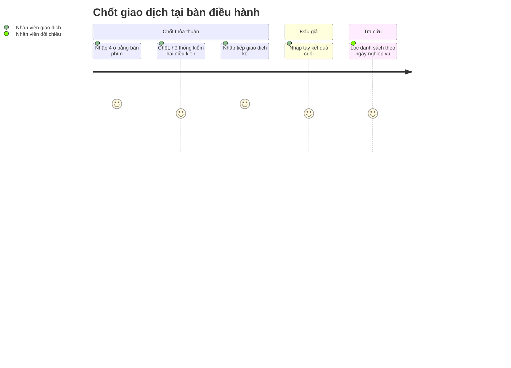

# Screens — F004_TradeRecording

## Screen List

Ba trong bốn màn **đã xây ở LAB-3**. Màn chi tiết giao dịch chỉ đặc tả.

| Screen Name | SCR### | What User Sees | What User Can Do |
|-------------|--------|----------------|------------------|
| Chốt giao dịch thỏa thuận (相対取引の確定) — `/trades/negotiated` ⌨️ | [SCR010_NegotiatedTradeConfirm](../../screens/SCR010_NegotiatedTradeConfirm/spec.md) · **đã xây** | 4 ô: mã lô, mã người mua, số lượng, đơn giá; **vùng tham khảo** (lô còn bao nhiêu, người mua còn hiệu lực không) kèm dòng "chỉ tham khảo, hệ thống vẫn kiểm tra lại khi chốt"; banner kết quả | Chốt bằng Enter ở ô cuối hoặc Ctrl+Enter từ bất kỳ ô nào; Escape xoá form. Thành công → focus về ô mã lô. Chỉ `trading` |
| Ghi kết quả phiên đấu giá (せり結果の記録) — `/trades/auction` | [SCR011_AuctionResultEntry](../../screens/SCR011_AuctionResultEntry/spec.md) · **đã xây** | 6 ô nhập tay: mã lô, người thắng, số lượng, đơn giá, thời điểm phiên, người xác nhận. **Không** có ô tải ảnh, không gợi ý tự động | Ghi kết quả; thành công thì form trắng lại. Chỉ `trading` |
| Danh sách giao dịch (取引一覧) — `/trades` | [SCR012_TradeList](../../screens/SCR012_TradeList/spec.md) · **đã xây** | Bảng giao dịch (mã, ngày nghiệp vụ, loại, lô, người mua, số lượng, đơn giá, thành tiền, trạng thái); bộ lọc ngày, mã người mua, trạng thái, loại | Lọc và xem. `trading` và `reconcile` mở được; `receiving` không mở được dù dữ liệu đọc được ngầm |
| Chi tiết giao dịch (取引詳細) — `/trades/[id]` *(đề xuất)* | [SCR013_TradeDetail](../../screens/SCR013_TradeDetail/spec.md) · chỉ đặc tả | Thông tin giao dịch, lịch sử sửa, nút huỷ | Huỷ giao dịch chưa chốt sổ (hộp thoại: lý do ≥ 10 ký tự + gõ lại mã giao dịch). Chỉ `trading` |

## User Journey

1. Nhân viên giao dịch mở **Chốt giao dịch thỏa thuận**; con trỏ ở ô mã lô.
2. Gõ mã lô, người mua, số lượng, đơn giá; vùng tham khảo hiện số còn lại và tình trạng tư cách để nhân viên biết trước (có thể đã cũ khi bấm chốt).
3. Chốt: nếu thành công, banner xanh "Đã chốt giao dịch {mã}. Lô còn lại {x} {đơn vị}." và form trắng lại để nhập tiếp.
4. Nếu bị từ chối, banner đỏ **tự nhận focus** để trình đọc màn hình đọc ngay (môi trường ồn); thông báo nêu đúng lý do, các ô giữ nguyên để sửa.
5. Với kết quả đấu giá, nhân viên mở **Ghi kết quả phiên đấu giá**, nhập tay đủ sáu ô và ghi.
6. Cuối ca, nhân viên (hoặc đối chiếu) mở **Danh sách giao dịch**, lọc theo ngày nghiệp vụ.
7. Cần huỷ một giao dịch chưa chốt sổ: mở **Chi tiết giao dịch**, nêu lý do và xác nhận (đặc tả).

