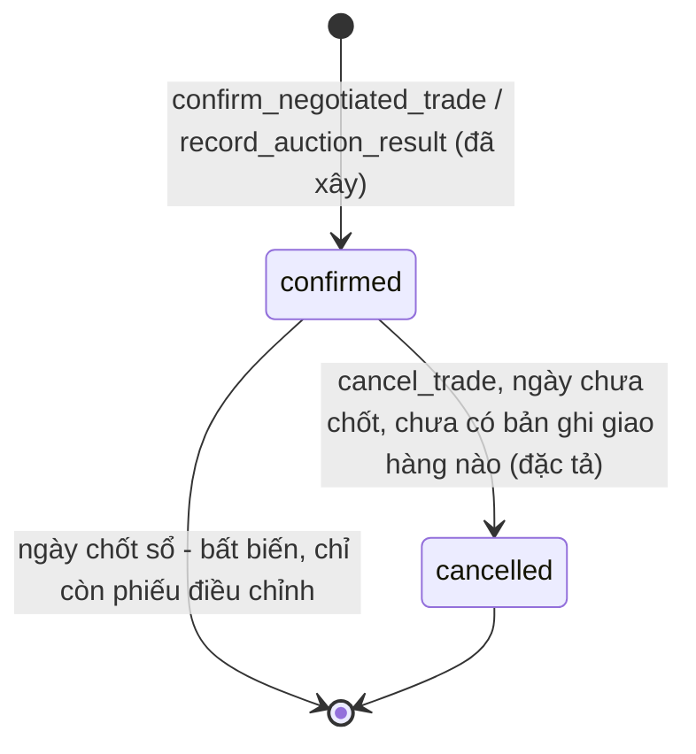
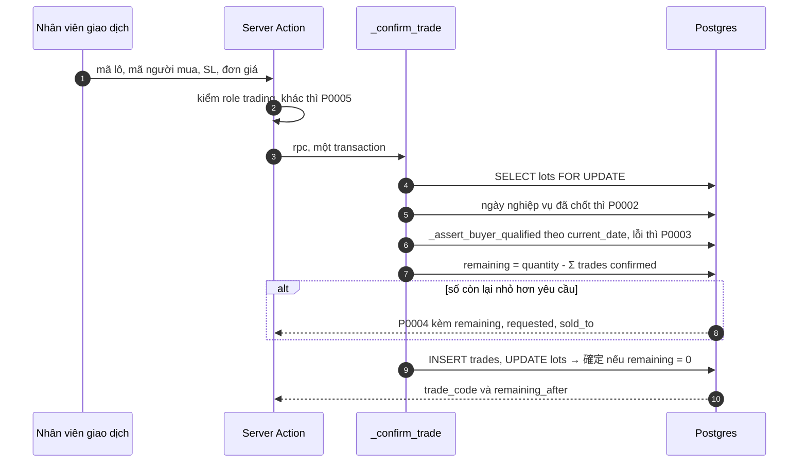

# F004_TradeRecording — Technical Spec

**Priority**: P0
**Type**: ui
**Generated**: 2026-10-06

> Quy ước: **[ĐÃ XÂY]** có ở LAB-3 kèm file nguồn · **[ĐẶC TẢ]** chưa có code · **(đề xuất)** suy luận ngoài nguồn khách · **(quan sát)** rút từ đọc code/migration, chưa chạy. Mã FR/NFR/BR/US giữ mã LAB-1. Chỉ dùng mã lỗi `P0001`–`P0009` đã cài, ngoại trừ `P0062` (SCR013 đề xuất).

## Overview

Ghi nhận giao dịch: **thỏa thuận trực tiếp** (相対, ~90% giá trị) và **kết quả phiên đấu giá** (せり, ~10%, nhập tay). Cả hai cùng đi qua hàm nội bộ `_confirm_trade`: khoá dòng lô, kiểm ngày chưa chốt, kiểm tư cách người mua, kiểm số lượng còn lại, rồi INSERT — trong **một transaction**. `trades` không có policy ghi; đường ghi duy nhất là RPC `SECURITY DEFINER` ([ADR-002](../../decisions/ADR-002-no-write-policy-on-trades-deliveries.md)). Ràng buộc "giao dịch đấu giá phải có đủ hai trường nhập tay" giữ ở tầng cơ sở dữ liệu ([ADR-004](../../decisions/ADR-004-invariants-at-database-layer.md), ba vòng migration). Bước hai của [FL-01](../../flows/FL-01-lot-trade-delivery-reconciliation.md). Phụ thuộc phép kiểm tư cách của [F002](../F002_ParticipantsAndQualification/technical-spec.md) và số lượng của [F003](../F003_LotsAndInspection/technical-spec.md).

## Polymorphic Behavior

Mã DISC chưa cấp ở `entities.md`; đây là discriminator thật: `trades.trade_type`.

### DISC (chưa cấp mã) — trades.trade_type

| Value | Render | Validation | Persistence |
|-------|--------|------------|-------------|
| `negotiated` (相対) | SCR010: 4 ô + vùng tham khảo | Hai phép kiểm trong RPC; `auction_session_at`, `auction_confirmed_by_name` **phải `NULL`** (CHECK `trades_auction_fields_check`, đã nới ở `0033_relax_auction_fields_check.sql:21-25` còn đúng chiều này) | RPC `confirm_negotiated_trade` → `_confirm_trade('negotiated', …)` |
| `auction` (せり) | SCR011: 6 ô, không ảnh, không gợi ý | Như trên + hai trường nhập tay **bắt buộc khác `NULL` lúc commit** (constraint trigger hoãn → `P0008`) | RPC `record_auction_result` 6 tham số: gọi `_confirm_trade('auction', …)` rồi UPDATE hai cột (`0030:45-60`) |

**Source:** `0005_trades_and_deliveries.sql:21-37`, `0030_auction_manual_fields.sql`, `0033`, `0034`, `0035`. Lịch sử: CHECK hai chiều ở `0030` làm hỏng SCR011 (`23514`); `0033` nới CHECK; `0034`/`0035` thay bằng constraint trigger hoãn đọc lại dòng (ADR-004).

## Cross-Cutting Logic

### Requirements

| Code | Description | Handler | Verifiable | Trạng thái |
|------|-------------|---------|------------|------------|
| FR-AITAI-01 | Tạo giao dịch 相対: mã giao dịch, người mua, số lượng, đơn giá, ngày nghiệp vụ | `confirmTrade` (`app/(app)/trades/actions.ts:56-110`) → `confirm_negotiated_trade` | yes | ĐÃ XÂY — tạo và chốt là **một bước** (không có "nháp") |
| FR-AITAI-02 | Từ chối chốt nếu hết hiệu lực / thiếu số lượng; hiện lý do; **không tạo giao dịch** | `_confirm_trade` (`0007_rpc_functions.sql:41-94`) | yes | ĐÃ XÂY |
| FR-AITAI-03 | Huỷ giao dịch chưa chốt sổ kèm lý do, hoàn số lượng, lưu lịch sử (P1) | RPC `cancel_trade` (đề xuất) | yes | CHỈ ĐẶC TẢ (SCR013) — enum có `cancelled` nhưng không có đường ghi |
| FR-SERI-01 | Chỉ ghi kết quả cuối do người vận hành nhập; **không** nhận dạng ký hiệu/OCR | `recordAuctionResult` (`trades/actions.ts:113-180`) | yes | ĐÃ XÂY — không có ô tải ảnh |
| FR-SERI-02 | Lưu người thắng, số lượng, đơn giá, thời điểm, người xác nhận | `record_auction_result` + `trades.auction_*` | yes | ĐÃ XÂY |
| FR-SERI-03 | Tra lại bản ghi せり + lịch sử sửa (P1) | SCR013 | yes | CHỈ ĐẶC TẢ |
| FR-RPT-03 | Tra cứu/lọc dữ liệu có cấu trúc | `listTrades` (`lib/domain/trades.ts:61`) | yes | ĐÃ XÂY (lọc ngày, người mua, trạng thái, loại) |
| NFR-USE-01 | Chốt giao dịch dùng được thuần bàn phím | `use-negotiated-form.ts:119-135` | yes | ĐÃ XÂY |

### Business Rules

| Mã LAB-1 | Nội dung | Thực thi ở | Trạng thái |
|----------|----------|-----------|------------|
| BR-PERM-01 | Kiểm hiệu lực tư cách tại thời điểm giao dịch | `_assert_buyer_qualified` (`0007:12-37`, gọi ở `:71`) | ĐÃ XÂY — chi tiết ở [F002](../F002_ParticipantsAndQualification/technical-spec.md) |
| BR-LOT-02 | Số khả dụng không âm | `FOR UPDATE` + so `remaining < p_quantity` → `P0004` (`0007:77-80`) | ĐÃ XÂY — chi tiết ở [F003](../F003_LotsAndInspection/technical-spec.md) |
| BR-CLOSE-01 | Không ghi vào ngày đã khoá | RPC kiểm `business_days.status` → `P0002` (`0007:62-69`); trigger `guard_closed_day_trades` → `P0009` | ĐÃ XÂY |

Quy tắc không mã: **server luôn là cổng duy nhất** — client chỉ kiểm định dạng; vùng tham khảo ở SCR010 tuyệt đối không được thành điều kiện chặn nút chốt. `P0003` và `P0004` đến từ **cùng một lời gọi RPC**; tách thành hai bước kiểm riêng sẽ phá `FOR UPDATE` và tính transaction. Tổng hợp ở [business-rules](../../system/business-rules.md).

### Decision Logic

#### DEC-001_KeyboardSubmitRules
**subtype:** interaction
**Triggers in:** SCR010 (và mẫu tương tự ở SCR007, SCR014)
**Involved entities:** trạng thái form (4 ô), vị trí focus
**user_visible_outcome:** khi nào form được gửi / xoá
**Source:** `app/(app)/trades/negotiated/use-negotiated-form.ts:112-140`

```text
Enter (không Ctrl) khi đang ở ô cuối (đơn giá) → gửi
Ctrl+Enter ở bất kỳ ô nào trong vùng form → gửi
Escape → xoá form, focus về ô mã lô
gửi thành công → xoá 4 ô + vùng tham khảo, focus về ô mã lô, giữ banner
lỗi → banner đỏ nhận focus; 4 ô giữ nguyên
```

### State Machines

#### SM — FIG-012 Vòng đời giao dịch
**kind:** entity · **Linked FR:** FR-AITAI-01..03 · **Source:** enum `trade_status` (`0001`); `0007:41-94`

LAB-1 mô tả năm trạng thái (`下書き` → `確認待ち` → `確定` / `取消` / `更正`); **prototype giữ hai** (`confirmed`, `cancelled`) vì FR-AITAI-02 cấm tạo bản ghi ở trạng thái chờ. "Cải chính" là bản ghi **mới** sinh từ phiếu điều chỉnh ([F007](../F007_PostCloseCorrection/technical-spec.md)), không phải một trạng thái của dòng cũ. Đây là điểm tài liệu LAB-1 tự mâu thuẫn; spec này giữ hai trạng thái (Unresolved #2).



| Chuyển | Guard | Hiệu ứng | Trạng thái |
|--------|-------|----------|------------|
| `[*]` → `confirmed` | vai `trading`; ngày mở; tư cách đạt; số lượng đủ | INSERT `trades`; lô → `確定` nếu `remaining = 0` | ĐÃ XÂY |
| `confirmed` → `cancelled` | `trading`; ngày chưa chốt; **không tồn tại** dòng `deliveries` của giao dịch (`P0062`): kiểm `exists(select 1 from deliveries where trade_id = …)` — **không** dùng `v_trade_delivery_status.delivery_count`, vì view chỉ đếm lần giao `completed`/`exception` (`0006_derived_views.sql:35`, bộ lọc `:42`) nên bỏ sót lần giao `pending`/`in_transit`; lý do ≥ 10 ký tự | UPDATE `trades.status`, `cancel_reason`, `cancelled_at`, `cancelled_by`; ghi `audit_log` (`action='cancel'`); **không** cập nhật cột tồn kho nào (số còn lại là view) | ĐẶC TẢ |

### Algorithms

#### ALG-TradeGate — Cổng chốt giao dịch
**Input:** mã lô, mã người mua, số lượng, đơn giá · **Output:** `{trade_code, remaining_after}` hoặc lỗi `P000x` · **Complexity:** O(số giao dịch của lô) cho phép cộng đã bán · **Source:** `0007_rpc_functions.sql:41-94`



Mã giao dịch: `'TRD-' || yyyymmdd || '-' || lpad(nextval('trade_code_seq'), 4, '0')` — **một sequence toàn cục** (`0005:7-19`); seed phải `setval` đuổi kịp (`0032`).

### External Integrations

Không áp dụng — phiên đấu giá diễn ra ngoài hệ thống; chỉ nhập kết quả cuối bằng tay.

### Verification

Nhãn `V-F004-xx` là nhãn cục bộ. **Dựng từ migration, ADR và code; chưa chạy lại trong phiên viết spec** (ADR-002 và ADR-004 ghi các kiểm chứng 42501 và `P0008` đã thực hiện ở LAB-3).

- **V-F004-01** — Không có đường ghi ngoài RPC (covers ADR-002): `select policyname, cmd from pg_policies where tablename in ('trades','deliveries');` kỳ vọng chỉ có `SELECT`.
- **V-F004-02** — Anon không gọi được RPC: `curl -s -X POST "$NEXT_PUBLIC_SUPABASE_URL/rest/v1/rpc/confirm_negotiated_trade" -H "apikey: $NEXT_PUBLIC_SUPABASE_PUBLISHABLE_KEY" -H "Content-Type: application/json" -d '{}'` → `42501`. Sau `0041`, kiểm cả chữ ký 6 tham số của `record_auction_result`: `select proname, has_function_privilege('anon', oid, 'EXECUTE') from pg_proc where pronamespace='public'::regnamespace and prosecdef;` toàn `false`.
- **V-F004-03** — Chốt thành công (covers FR-AITAI-01, US-03): `trading@demo.local`, lô `公開` còn hàng, người mua còn hiệu lực → `trade_code` mới; `select remaining from v_lot_availability where lot_code = '<mã>'` giảm đúng bằng số vừa chốt.
- **V-F004-04** — Từ chối không để lại bản ghi (covers FR-AITAI-02): thử với `PTI-01` (hết hạn) → `P0003`; với số lượng > `remaining` → `P0004`; đếm `trades` không đổi.
- **V-F004-05** — Ràng buộc hai trường đấu giá (covers FR-SERI-02, ADR-004): chèn thẳng bằng SQL runner một dòng `trade_type='auction'` thiếu `auction_session_at` → bị từ chối `P0008` **lúc commit**; qua giao diện SCR011 → thành công, hai trường lưu đúng.
- **V-F004-06** — Không có đường đọc ảnh (covers FR-SERI-01): form SCR011 không có `input type="file"`. Lệnh `grep -rn 'type="file"' app/` **vẫn ra một dòng** là chú thích ở `app/(app)/trades/auction/auction-form.tsx:14`, nên loại dòng chú thích: `grep -rn 'type="file"' app/ | grep -vE ':[0-9]+:\s*(\*|//)'` — kỳ vọng không có kết quả (đã chạy trên mã hiện tại, thoát mã 1).
- **V-F004-07** — Thuần bàn phím (covers NFR-USE-01): chốt hai giao dịch liên tiếp chỉ bằng bàn phím; focus quay về ô mã lô; form trắng sau mỗi lần.
- **V-F004-08** — `P0009` không bao giờ bắn trong luồng RPC bình thường (RPC bắn `P0002` trước), chỉ khi ghi trực tiếp — kiểm bằng SQL runner `update trades set unit_price = unit_price where business_date = '<ngày đã chốt>'` → `P0009`.
- **V-F004-09** *(đặc tả)* — huỷ giao dịch đã có lần giao → `P0062`; giao dịch ngày đã chốt → `P0002`.

---

**Client behavior:** see [architecture.md](../../system/architecture.md) (hành vi phía client: chặn route, Server Action, keyboard-first, mất mạng), [permissions.md](../../system/permissions.md), [screen-flow.md](../../generated/screen-flow.md).

## User Stories

### US-03 — Chốt giao dịch thỏa thuận trực tiếp (Priority: P0)

**What happens:** Nhân viên giao dịch chốt ngay tại bàn điều hành, không qua điện thoại – phiếu – nhập lại.
**Why this priority:** Tiêu chí A; luồng chính, 90% giá trị.
**Independent Test:** V-F004-03.

**Acceptance Scenarios (cột 受入 của LAB-1):**

1. **Given** chốt hợp lệ, **When** hoàn tất, **Then** giao dịch có mã duy nhất (`trades_trade_code_key`). *(ĐÃ XÂY)*
2. **Given** chốt hợp lệ, **When** hoàn tất, **Then** số khả dụng của lô giảm đúng (view). *(ĐÃ XÂY)*
3. **Given** việc trừ và việc chốt, **When** xét ranh giới, **Then** nằm trong cùng một transaction, không có trạng thái trung gian. *(ĐÃ XÂY)*
4. **Given** sau khi chốt, **When** nhìn màn, **Then** trạng thái hiện rõ và không tự biến mất. *(ĐÃ XÂY — banner có state riêng, không bị `revalidatePath` cuốn đi)*
5. **Given** nhân viên đeo găng, **When** làm luồng, **Then** không cần chuột. *(ĐÃ XÂY)*

**Requirements fulfilled:** **FR-AITAI-01** — `confirmTrade` → `confirm_negotiated_trade`. **Source:** `app/(app)/trades/actions.ts:56-110`
**Rules enforced:** BR-PERM-01, BR-LOT-02 (xem trên). **Verification:** V-F004-03, V-F004-07.

### US-04 — Bị chặn khi người mua hết hạn (Priority: P0)

Điều kiện chấp nhận và xác minh nằm ở [F002 technical-spec](../F002_ParticipantsAndQualification/technical-spec.md) (US-04); màn thao tác là SCR010. **ĐÃ XÂY.**

### US-05 — Bị chặn khi lô không đủ số lượng (Priority: P0)

Điều kiện chấp nhận ở [F003 technical-spec](../F003_LotsAndInspection/technical-spec.md) (US-05); màn thao tác là SCR010. **ĐÃ XÂY** (có khoảng trống cột `quantity`).

### US-06 — Ghi kết quả phiên đấu giá (Priority: P0)

**What happens:** Nhân viên giao dịch nhập kết quả cuối để nó vào thẳng luồng đối chiếu thay vì phiếu giấy và FAX.
**Why this priority:** Tiêu chí C — điểm giữ quyết định con người.
**Independent Test:** V-F004-05 + V-F004-06.

**Acceptance Scenarios:**

1. **Given** SCR011, **When** ghi, **Then** lưu đủ 5 thông tin: người thắng, số lượng, đơn giá, thời điểm, người xác nhận. *(ĐÃ XÂY)*
2. **Given** màn đấu giá, **When** xem chức năng, **Then** không tồn tại đọc ảnh/suy luận từ ký hiệu. *(ĐÃ XÂY)*
3. **Given** bản ghi, **When** báo cáo đối chiếu ngày cần, **Then** xuất đủ thông tin. *(MỘT PHẦN — dữ liệu có và `v_daily_reconciliation` gom tổng; báo cáo xuất là [F009](../F009_ReportsAndExport/technical-spec.md))*

**Requirements fulfilled:** **FR-SERI-01**, **FR-SERI-02** — `recordAuctionResult` → `record_auction_result`. **Source:** `app/(app)/trades/actions.ts:113-180`, `0030_auction_manual_fields.sql:45-60`
**Rules enforced:** hai lớp dấu vết — `auction_session_at` + `auction_confirmed_by_name` (người và thời điểm ở hiện trường) tách khỏi `confirmed_at` + `confirmed_by` (dấu vết hệ thống). **Verification:** V-F004-05, V-F004-06.

### Edge Cases

Xem [edge-cases.md](./edge-cases.md).

## Key Entities

| Entity | Table | Key Columns | Purpose |
|--------|-------|-------------|---------|
| Giao dịch | `trades` | `trade_code` (unique), `business_date`, `trade_type`, `lot_id`, `buyer_participant_id`, `quantity`, `unit_price`, `amount` (GENERATED), `status`, `confirmed_by`, `auction_session_at`, `auction_confirmed_by_name` | Không có policy ghi; `amount` không ghi tay được |
| Lô | `lots` | `status`, `quantity` | Khoá `FOR UPDATE`; lật `確定` |
| Tư cách tham gia | `participant_qualifications` | `valid_from`, `valid_to`, `status` | Đọc trong phép kiểm |
| Ngày nghiệp vụ | `business_days` | `status`, `closed_at` | Chặn khi `closed` |
| Số khả dụng | view `v_lot_availability` | `remaining`, `sold_to` | `sold_to` dựng thông báo `P0004` |
| Nhật ký kiểm toán | `audit_log` | — | Hiện **không** có dòng nào cho chốt giao dịch (chỉ đổi quyền, chốt sổ, lần thử bị chặn) |

## Artifact References

| Artifact | File | Codes Used |
|----------|------|------------|
| System Overview | [overview.md](../../system/overview.md) | — |
| Architecture | [architecture.md](../../system/architecture.md) | — |
| Business Rules | [business-rules.md](../../system/business-rules.md) | BR-PERM-01, BR-LOT-02, BR-CLOSE-01 |
| Permissions | [permissions.md](../../system/permissions.md) | — |
| Feature List | [feature-list.md](../../generated/feature-list.md) | F004 |
| Entities | [entities.md](../../generated/entities.md) | `trades`, `lots` |
| Screens | [screens.md](./screens.md) | SCR010, SCR011, SCR012, SCR013 |

## Assumptions

- Client rẽ nhánh theo `error.code`, **không** theo `error.message`; `error.details` là chuỗi JSON phải parse (`lib/domain/rpc-errors.ts`).
- `P0003` lấy `basis_label`/`contact_office` tiếng Việt từ RPC; bản tiếng Nhật tra lại ở Server Action (`localizeP0003Details`, `lib/domain/trade-preview.ts:134`).
- (quan sát) `_confirm_trade` không kiểm trạng thái lô (xem [F003](../F003_LotsAndInspection/technical-spec.md)); không chặn chốt trên lô `受付`.
- (đề xuất) Giữ hai trạng thái giao dịch. Rủi ro nếu khách muốn năm: thêm enum, bỏ nguyên tắc "không tạo ở trạng thái chờ" của FR-AITAI-02.
- (đề xuất) Huỷ giao dịch đã có lần giao bị chặn cứng (`P0062`). Rủi ro nếu khách muốn huỷ phần chưa giao: chồng với `partial_cancel` của F005.

## Source Code References

| Order | Symbol | Path | Purpose |
|-------|--------|------|---------|
| 1 | bảng `trades` + `next_trade_code` | `supabase/migrations/0005_trades_and_deliveries.sql:7-37` | Mô hình giao dịch, sinh mã |
| 2 | `_confirm_trade` | `supabase/migrations/0007_rpc_functions.sql:41-94` | Cổng chốt |
| 3 | `record_auction_result` (6 tham số) | `supabase/migrations/0030_auction_manual_fields.sql:45-60` | Ghi đấu giá |
| 4 | constraint trigger | `supabase/migrations/0034_auction_fields_deferred_check.sql:38-41`, `0035_auction_fields_trigger_refetch.sql:24-39` | `P0008` lúc commit |
| 5 | thu quyền EXECUTE | `supabase/migrations/0041_revoke_execute_new_signatures.sql` | Vá chữ ký mới |
| 6 | `confirmTrade`, `recordAuctionResult` | `app/(app)/trades/actions.ts:56-180` | Server Action |
| 7 | hook form | `app/(app)/trades/negotiated/use-negotiated-form.ts`, `app/(app)/trades/auction/use-auction-form.ts` | Hành vi bàn phím, không mất dữ liệu |
| 8 | `listTrades` | `lib/domain/trades.ts:61` | Danh sách + lọc |

## Unresolved Questions

1. **Huỷ giao dịch đã có lần giao** — chặn cứng hay huỷ phần chưa giao? Chồng `partial_cancel`.
2. **Hai hay năm trạng thái?** LAB-1 tự mâu thuẫn (F04-04 vs FR-AITAI-02).
3. **Cột `reason` của `audit_log`** hay quy ước trong `new_value`? FR-AUDIT-01 đòi đủ 5 trường; quyết cùng [F011](../F011_AuditLog/technical-spec.md).
4. **Mở RLS `audit_log`** cho `trading`/`reconcile` ở mức nào (toàn bảng hay theo `table_name`)?
5. **Chốt trên lô chưa mở bán** — có cần chặn? (quan sát ở F003.)
6. **Phân trang** `trades`: ngưỡng và giới hạn mặc định khi bỏ lọc ngày. `listTrades` (`lib/domain/trades.ts:61-86`) không gọi `.range()`/`.limit()`; `supabase/config.toml` đặt `max_rows = 1000` (cấu hình local) — một ngày 700–1.200 giao dịch có thể bị cắt **im lặng**, không báo lỗi (xem [edge-cases](./edge-cases.md)).

## Source Walkthrough

1. **File:** `supabase/migrations/0005_trades_and_deliveries.sql:21-37` — bảng giao dịch.
2. **File:** `supabase/migrations/0007_rpc_functions.sql:41-94` — cổng chốt.
3. **File:** `supabase/migrations/0030_auction_manual_fields.sql:45-60` rồi `0035…:24-39` — vì sao phải có trigger đọc lại dòng.
4. **File:** `app/(app)/trades/actions.ts:56-180` — Server Action.
5. **File:** `app/(app)/trades/negotiated/use-negotiated-form.ts:112-140` — hành vi bàn phím.

### Call Hierarchy

```text
SCR010 -> confirmTrade -> rpc confirm_negotiated_trade -> _confirm_trade -> (lots FOR UPDATE, _assert_buyer_qualified, INSERT trades)
SCR011 -> recordAuctionResult -> rpc record_auction_result -> _confirm_trade('auction') -> UPDATE trades(auction_*) -> constraint trigger P0008 lúc commit
```

**Related files:** bảng *Source Code References* — cột **Order**.

## DB Impact per Event

| Event/Endpoint | Table | Columns | Operation | Value Derivation | Source |
|----------------|-------|---------|-----------|-------------------|--------|
| `confirm_negotiated_trade` / `record_auction_result` | `trades` | `trade_code, business_date, trade_type, lot_id, buyer_participant_id, quantity, unit_price, status, confirmed_by` | INSERT | `trade_code` từ `next_trade_code`; `business_date` = ngày của lô; `status='confirmed'`; `confirmed_by = auth.uid()`; `amount` sinh tự động | `0007_rpc_functions.sql:83-88` |
| `confirm_negotiated_trade` / `record_auction_result` (qua `_confirm_trade`) | `lots` | `status` | UPDATE | `確定` khi `remaining − p_quantity = 0` | `0007_rpc_functions.sql:88-90` |
| `record_auction_result` | `trades` | `auction_session_at, auction_confirmed_by_name` | UPDATE | `p_session_at`, `p_confirmed_by_name` (nhập tay) theo `trade_code` vừa tạo | `0030_auction_manual_fields.sql:54-56` |
| `cancel_trade` *(đề xuất)* | `trades` | `status, cancel_reason, cancelled_at, cancelled_by` | UPDATE | `cancelled`; lý do từ hộp thoại; `cancelled_by = auth.uid()` | `[INFERRED]` — SCR013 mục 8 |
| `cancel_trade` *(đề xuất)* | `audit_log` | `table_name, record_id, action, actor_id, old_value, new_value, reason` | INSERT | `action = 'cancel'`; `reason` là lý do huỷ (cột `reason` chưa có — Unresolved #3) | `[INFERRED]` — SCR013 mục 8 |
