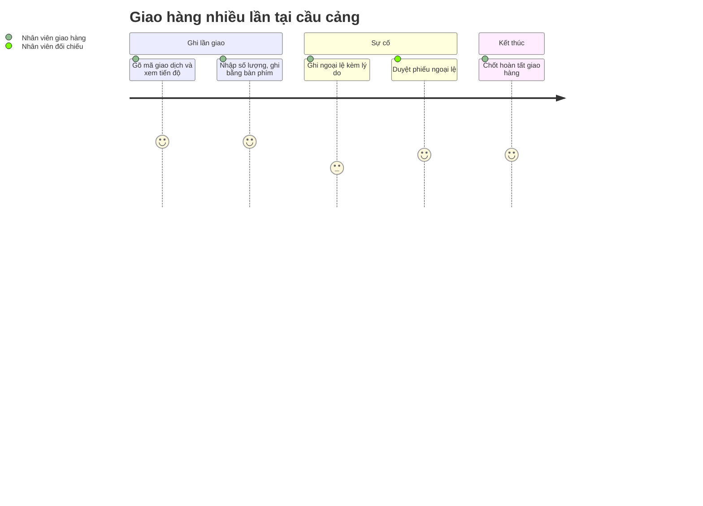

# Screens — F005_DeliveryTracking

## Screen List

Một trong bốn màn **đã xây ở LAB-3**. Ngoài ra route `/deliveries` trong code chỉ là một lệnh chuyển hướng sang `/deliveries/new` (`app/(app)/deliveries/page.tsx`) — **không** phải màn danh sách; màn danh sách ([SCR015](../../screens/SCR015_DeliveryList/spec.md)) là đặc tả và sẽ thay chỗ đó.

| Screen Name | SCR### | What User Sees | What User Can Do |
|-------------|--------|----------------|------------------|
| Ghi lần giao hàng (引渡し記録) — `/deliveries/new` ⌨️ | [SCR014_DeliveryEntry](../../screens/SCR014_DeliveryEntry/spec.md) · **đã xây** | Ô mã giao dịch, số lượng, trạng thái (chờ giao / đang giao / đã giao / ngoại lệ), loại ngoại lệ + lý do khi chọn "ngoại lệ"; **vùng "Tiến độ giao hàng"**: người nhận, mặt hàng, tổng, đã giao, còn lại, số lần giao, cảnh báo chia nhiều lần | Gõ mã → Tab → xem tiến độ → nhập số lượng → Enter (khi trạng thái mặc định) hoặc Ctrl+Enter; Escape xoá form. Chỉ `receiving` |
| Danh sách giao hàng (引渡し一覧) — `/deliveries` *(đề xuất)* | [SCR015_DeliveryList](../../screens/SCR015_DeliveryList/spec.md) · chỉ đặc tả | Mỗi dòng **một giao dịch**: tiến độ, số lần giao, nhãn tình trạng suy ra (đang giao dở, ứ đọng, có ngoại lệ) | Lọc theo mã giao dịch, người mua, ngày; mở chi tiết |
| Chi tiết giao hàng theo giao dịch (取引別 引渡し詳細) — `/deliveries/trade/[tradeId]` *(đề xuất)* | [SCR016_DeliveryDetail](../../screens/SCR016_DeliveryDetail/spec.md) · chỉ đặc tả | Các lần giao theo thứ tự, trạng thái từng lần, khối điều kiện chốt hoàn tất (ba điều kiện) | Chốt hoàn tất (hộp thoại: tên người chốt + ô xác nhận). Chỉ `receiving` |
| Ghi ngoại lệ giao hàng 🔒 (引渡例外の記録) — `/deliveries/exceptions/…` *(đề xuất)* | [SCR017_DeliveryException](../../screens/SCR017_DeliveryException/spec.md) · chỉ đặc tả | Form lập phiếu (loại ngoại lệ, số lượng thực tế, lý do, người xác nhận, thời điểm), danh sách chờ duyệt, màn duyệt | `receiving` lập phiếu; `reconcile` có cờ `can_approve` duyệt/từ chối (khác người lập) |

## User Journey

1. Nhân viên giao hàng mở **Ghi lần giao hàng**, con trỏ ở ô mã giao dịch.
2. Gõ mã rồi Tab — vùng tiến độ hiện *đã giao / còn lại / số lần* của giao dịch.
3. Nhập số lượng lần này và ghi bằng Enter — banner "Đã ghi lần giao thứ {n}… Còn lại {x}"; form xoá sạch để nhập tiếp.
4. Nếu giao vượt số còn lại, banner đỏ nêu đã giao bao nhiêu, còn bao nhiêu; ô số lượng giữ nguyên.
5. Nếu cần ghi ngoại lệ không lệch số lượng, chọn trạng thái "ngoại lệ", loại ngoại lệ và lý do; nếu ngoại lệ làm lệch số, hệ thống dẫn sang **Ghi ngoại lệ giao hàng** để lập phiếu có duyệt (đặc tả).
6. Khi giao đủ, mở **Chi tiết giao hàng** và chốt hoàn tất sau khi ba điều kiện đạt (đặc tả).
7. Nhân viên đối chiếu mở **Danh sách giao hàng**, lọc giao dịch ứ đọng hoặc có ngoại lệ.

