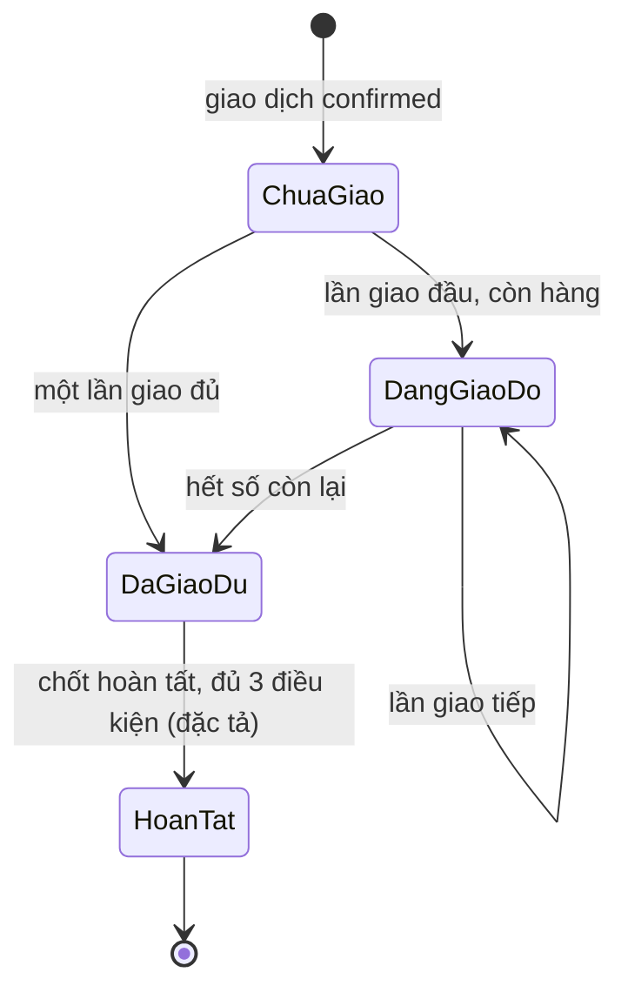

# F005_DeliveryTracking — Technical Spec

**Priority**: P0
**Type**: ui
**Generated**: 2026-10-06

> Quy ước: **[ĐÃ XÂY]** có ở LAB-3 kèm file nguồn · **[ĐẶC TẢ]** chưa có code · **(đề xuất)** suy luận ngoài nguồn khách · **(quan sát)** rút từ đọc code/migration, chưa chạy. Mã FR/NFR/BR/US giữ mã LAB-1. Mã `P0063`–`P0065` do SCR016/SCR017 đề xuất, chưa cài. Kết quả đã chạy ở LAB-3 nằm ở (tài liệu gốc trong repo, không nộp) `verification-checklist.md`. Luật hoàn tất giao hàng đã chốt (PREMISE G3): hoàn tất ghi ở **cấp giao dịch**; lô chỉ sang `引渡し完了` khi mọi giao dịch `confirmed` của lô đã hoàn tất. Người duyệt phiếu ngoại lệ: `reconcile` có cờ `can_approve`, maker ≠ checker (PREMISE C-09).

## Overview

Ghi từng lần giao cho một giao dịch, theo dõi đã giao / còn lại, và (đặc tả) chốt hoàn tất giao hàng và xử lý ngoại lệ có duyệt. Ở LAB-3 chỉ có **một màn ghi** (SCR014) gọi RPC `record_delivery`: khoá dòng giao dịch, kiểm ngày chưa chốt, kiểm tư cách người nhận, kiểm `requested ≤ remaining`, INSERT dòng `deliveries` với `seq = max + 1`. Số "đã giao / còn lại" là **view dẫn xuất** ([ADR-003](../../decisions/ADR-003-derived-remaining-quantity-views.md)); đường ghi chỉ qua RPC ([ADR-002](../../decisions/ADR-002-no-write-policy-on-trades-deliveries.md)); chốt sổ cảnh báo chứ không chặn khi còn giao dở ([ADR-005](../../decisions/ADR-005-close-day-warn-not-block.md)). Bước ba của [FL-01](../../flows/FL-01-lot-trade-delivery-reconciliation.md). Có **ba lỗi ở tầng giao hàng** (B-01, B-02 đã xác minh; B-04 mới đọc code) phải xử lý trước khi xây SCR016/SCR017, và lỗi B-05 ở view đối chiếu ngày (đã xác nhận) làm số tiền SCR018 sai khi một giao dịch có nhiều lần giao.

## Polymorphic Behavior

Mã DISC chưa cấp ở `entities.md`; discriminator thật: `deliveries.exception_type` (khi `status = 'exception'`).

### DISC (chưa cấp mã) — deliveries.exception_type

| Value | Render (SCR014 hiện tại / SCR017 đặc tả) | Validation | Persistence |
|-------|-------------------------------------------|------------|-------------|
| `short` (giao thiếu) | Chọn khi trạng thái "ngoại lệ" | Cần lý do; số lượng ≤ còn lại (`P0006`) | Dòng `deliveries` `status='exception'`; tính **vào** `delivered_qty` |
| `over` (giao thừa) | Có trong danh sách | **Không ghi được** qua `record_delivery` (`P0006` chặn `requested > remaining`); đường đúng là phiếu duyệt SCR017 (B-03) | Chỉ qua RPC duyệt (đề xuất) phải bỏ qua trần `P0006` tường minh |
| `returned` (trả hàng) | Có trong danh sách | Phải **trừ** khỏi lũy kế; hiện bị **cộng** (B-01) | Dòng `exception`; cần sửa view |
| `partial_cancel` (huỷ một phần) | Có trong danh sách | Phải trừ khỏi lũy kế; hiện bị cộng (B-01); chồng với huỷ giao dịch ([F004](../F004_TradeRecording/technical-spec.md), `P0062`) | như trên |

Ràng buộc bảng: `deliveries_exception_requires_status` — `exception_type` chỉ khác `NULL` khi `status='exception'` (`0005_trades_and_deliveries.sql:50-51`).

## Cross-Cutting Logic

### Requirements

| Code | Description | Handler | Verifiable | Trạng thái |
|------|-------------|---------|------------|------------|
| FR-DEL-05 | Nhiều lần giao/giao dịch; hiện đã giao và còn lại; lũy kế + số còn lại | `record_delivery` (`seq`), `v_trade_delivery_status`, vùng "Tiến độ" SCR014 | yes | ĐÃ XÂY (cảnh báo chia nhiều lần: ngưỡng 3 là **giả định**, `lib/domain/deliveries.ts:22`) |
| FR-DEL-01 | Theo dõi trạng thái từng lần: chờ giao / đang giao / hoàn tất / ngoại lệ | cột `deliveries.status` | yes | MỘT PHẦN — chọn trạng thái **lúc ghi**; không có đường cập nhật sau (không policy UPDATE, RPC chỉ INSERT) |
| FR-DEL-02 | Chốt hoàn tất khi khớp quy tắc 精算 (BR-DEL-03) | RPC `complete_trade_delivery` (đề xuất) | yes | CHỈ ĐẶC TẢ (SCR016) |
| FR-DEL-03 | Lưu lý do ngoại lệ (thiếu/thừa/trả/huỷ phần) + người xác nhận (P1) | SCR014 ghi lý do + `confirmed_by = auth.uid()`; phiếu duyệt SCR017 | yes | MỘT PHẦN — có lý do; **thiếu** tên người xác nhận nhập tay và bước duyệt |
| FR-DEL-04 | Liên kết giao hàng ↔ giao dịch/đối chiếu (P1) | SCR015/SCR016 | yes | CHỈ ĐẶC TẢ |
| NFR-AVL-02 | Mất mạng ngắn: ghi tiếp, đồng bộ lại, không trùng | hàng đợi + `client_generated_id` (đề xuất) | yes | CHỈ ĐẶC TẢ (F05-07, MOCK-2) |
| NFR-USE-01 | Ghi giao hàng thuần bàn phím | `use-delivery-form.ts` | yes | ĐÃ XÂY |

### Business Rules

| Mã LAB-1 | Nội dung | Thực thi ở | Trạng thái |
|----------|----------|-----------|------------|
| BR-PERM-01 | Tư cách người nhận còn hiệu lực **cả ở khâu giao hàng** | `_assert_buyer_qualified(buyer, current_date)` (`0007_rpc_functions.sql:144`) | ĐÃ XÂY — dùng `current_date`, không phải ngày nghiệp vụ (xem [F002](../F002_ParticipantsAndQualification/technical-spec.md)) |
| BR-DEL-03 | Hoàn tất chỉ khi số lượng khớp quy tắc 精算 hiện hành | `complete_trade_delivery` (đề xuất) | CHỈ ĐẶC TẢ — "khớp" chưa định nghĩa; giả định dung sai 0 |
| BR-CLOSE-01 | Không ghi vào ngày đã khoá | RPC kiểm → `P0002` (`0007:137-142`); trigger `guard_closed_day_deliveries` → `P0009` (`0010:53-55`) | ĐÃ XÂY |

Quy tắc không mã: **chặn vượt số còn lại là việc của RPC**, vùng tham khảo ở SCR014 chỉ hiển thị, không được thành điều kiện chặn nút (cùng lý lẽ SCR010). Tổng hợp ở [business-rules](../../system/business-rules.md).

### Decision Logic

#### DEC-001_ExceptionRouting
**subtype:** flow
**Triggers in:** SCR014 (hiện tại) → SCR017 (đặc tả)
**Involved entities:** `deliveries.status`, `exception_type`, độ lệch số lượng
**user_visible_outcome:** ngoại lệ ghi thẳng hay bị đẩy sang phiếu có duyệt
**Source:** (tài liệu gốc trong repo, không nộp) `sc-17-ngoai-le-giao-hang.md` mục 9 (đặc tả)

```text
hiện tại (LAB-3): mọi ngoại lệ ghi thẳng ở SCR014, không qua duyệt
đặc tả (đề xuất): nếu exception và độ lệch ≠ 0 → record_delivery từ chối P0064, dẫn sang SCR017
                  nếu exception không lệch số lượng → vẫn ghi thẳng
                  phiếu pending không tính vào delivered_qty cho tới khi được duyệt
người duyệt: role reconcile VÀ app_users.can_approve = true (PREMISE C-09); maker = checker hoặc thiếu can_approve → P0065
```

### State Machines

#### SM — Tiến độ giao hàng của một giao dịch (dẫn xuất)
**kind:** entity (dẫn xuất từ view) · **Linked FR:** FR-DEL-01, FR-DEL-02, FR-DEL-05 · **Source:** `0006_derived_views.sql:27-46`; FIG-014 (`product-a-rfp-business-summary.md` §7.6)



| Chuyển | Guard | Hiệu ứng | Trạng thái |
|--------|-------|----------|------------|
| → `DangGiaoDo` / `DaGiaoDu` | `record_delivery` thành công | `deliveries` thêm dòng. **LAB-3 (sai):** còn lật lô → `引渡し完了` khi `remaining = 0` (**B-02**; **B-04**: kể cả khi lần giao còn `pending`/`in_transit`). **Đặc tả:** `record_delivery` không đổi `lots.status` | ĐÃ XÂY (phần ghi lần giao); nhánh lật lô cần bỏ |
| `DaGiaoDu` → `HoanTat` | (a) số khớp quy tắc 精算; (b) mọi lần giao đã `completed`/`exception`; (c) tư cách người nhận còn hiệu lực | đặt `trades.delivery_completed_at` (đề xuất); **cùng transaction:** nếu mọi giao dịch `confirmed` của lô đã có `delivery_completed_at` thì `lots.status` → `引渡し完了` (chuyển ở cấp lô chỉ xảy ra tại đây; PREMISE G3, SCR016) | ĐẶC TẢ |

Trạng thái **từng lần giao** (`delivery_status`: `pending`, `in_transit`, `completed`, `exception`) chỉ được chọn lúc ghi; không có chuyển `pending → in_transit → completed` sau đó ở LAB-3 (quan sát từ RLS và RPC). Đặc tả để ngỏ có cần đường cập nhật hay không (Unresolved #6).

### Algorithms

#### ALG-DeliveredRemaining — đã giao / còn lại
**Input:** `trade_id` · **Output:** `delivered_qty`, `remaining`, `delivery_count` · **Source:** `0006_derived_views.sql:27-46`, `0007:146-152`

```text
delivered_qty := Σ quantity của deliveries(trade_id) có status ∈ {completed, exception}
remaining     := trade.quantity − delivered_qty
nếu requested > remaining → P0006 {delivered, remaining, requested}
seq           := max(seq của trade) + 1    # dưới khoá FOR UPDATE của dòng trade
```

**Lỗi B-01 (đã xác minh bằng `pg_get_viewdef`, README screen-specs):** công thức cộng **mọi** dòng `exception`; đúng cho `short`/`over` nhưng sai dấu với `returned` và `partial_cancel`. Mỗi lần trả hàng làm "đã giao" **tăng**. Chạm SCR014, SCR015, SCR016, SCR018. Đổi view là thay đổi phá tương thích (hỏi nội bộ số 12).
**Lỗi B-02:** `record_delivery` lật `lots.status = 引渡し完了` khi **một** giao dịch giao đủ, trong khi một lô bán cho nhiều giao dịch (ví dụ `LOT-20260924-0008` bán cho 2 giao dịch). Luật đã chốt (PREMISE G3): "đã giao xong" ghi ở **cấp giao dịch** (`trades.delivery_completed_at`); lô chỉ sang `引渡し完了` khi mọi giao dịch `confirmed` của lô đã hoàn tất. Tự chuyển ở cấp lô trong `record_delivery` **mâu thuẫn** với F05-04 (bước xác nhận kèm kiểm tư cách) nên phải bỏ.
**Lỗi B-04 (đọc code, chưa tái hiện):** `record_delivery` tính `v_delivered` chỉ từ lần giao `completed`/`exception` (`0007_rpc_functions.sql:146-147`) nhưng lật `lots.status = 引渡し完了` khi `v_remaining − p_quantity = 0` bất kể `p_status` (`0007:159-161`); form cho chọn `pending`/`in_transit` (`lib/domain/deliveries.ts:11`). Ghi một lần giao "Chờ giao" bằng đúng số còn lại → lô thành đã giao xong dù chưa giao gì. Hướng sửa (khớp luật đã chốt ở B-02): bỏ nhánh `UPDATE lots` khỏi `record_delivery`; lô chuyển ở `complete_trade_delivery` khi mọi giao dịch `confirmed` của lô đã hoàn tất.
**Lỗi B-05 (ĐÃ XÁC NHẬN trên DB thật 2026-10-06, nằm ở view đối chiếu):** giao dịch có nhiều lần giao làm `v_daily_reconciliation.total_amount` bị nhân theo số lần giao (ngày 2026-09-23: 53250.00 so với 38250.00 thật vì `TRD-20260923-0001` có 2 lần giao). Chi tiết ở [F006](../F006_ReconciliationAndClosing/technical-spec.md). **Chưa sửa; có bản vá nháp `supabase/migrations/0042_fix_daily_reconciliation_amount.sql` chưa áp.**

### External Integrations

Không áp dụng — chưa có tích hợp; tệp đính kèm chứng cứ ngoại lệ (đặc tả) nằm trong kho lưu trữ nội bộ.

### Verification

Nhãn `V-F005-xx` là nhãn cục bộ. Kết quả §1, §2, §3, §6 đã **chạy ở LAB-3** (ghi trong (tài liệu gốc trong repo, không nộp) `verification-checklist.md`); các mục còn lại **chưa chạy lại trong phiên viết spec**.

- **V-F005-01** — Tiến độ trước khi nhập (covers FR-DEL-05): gõ mã giao dịch còn hàng rồi Tab → vùng "Tiến độ giao hàng" hiện tổng, đã giao, còn lại, số lần *trước khi* gõ số lượng (checklist §1).
- **V-F005-02** — Chặn giao vượt (covers FR-DEL-05): nhập `999` cho giao dịch có `remaining = 25` → `P0006` kèm `delivered`, `remaining`; `select count(*) from deliveries d join trades t on t.id = d.trade_id where t.trade_code = '<mã>';` **không đổi** (checklist §2).
- **V-F005-03** — Giao đủ và trạng thái lô (covers FR-DEL-05, ghi nhận B-02): giao đủ giao dịch chưa giao → `remaining = 0`, `lots.status = '引渡し完了'` tự chuyển (checklist §3) — hành vi hiện tại, **chính là điều B-02 chỉ ra là sai nếu lô còn giao dịch khác**.
- **V-F005-04** — Phát hiện B-02: 
  ```sql
  select l.lot_code, t.trade_code, v.remaining
  from lots l join trades t on t.lot_id = l.id
  join v_trade_delivery_status v on v.trade_id = t.id
  where l.status = '引渡し完了' and v.remaining > 0;
  ```
  Kỳ vọng hiện tại: có dòng khi một lô bán cho nhiều giao dịch; sau khi sửa: 0 dòng.
- **V-F005-05** — Phát hiện B-01: `select pg_get_viewdef('public.v_trade_delivery_status'::regclass);` — kỳ vọng thấy điều kiện `status in ('completed','exception')` và **không** có nhánh theo `exception_type`.
- **V-F005-06** — Ngày đã chốt + nhật ký (covers BR-CLOSE-01, FR-AUDIT-01): ghi lần giao cho giao dịch của ngày đã chốt → `P0002`; `select table_name, action, old_value, new_value from audit_log where action='blocked_write_attempt' order by occurred_at desc limit 1;` có dòng `deliveries` (checklist §6).
- **V-F005-07** — Phân quyền: đăng nhập `trading@demo.local` mở `/deliveries/new` → `/403`; `/deliveries` với `receiving` chuyển sang `/deliveries/new` (checklist §7).
- **V-F005-08** *(đặc tả)* — chốt hoàn tất thiếu số lượng → `P0063`; phiếu ngoại lệ do chính người duyệt lập, hoặc người duyệt thiếu cờ `can_approve` → `P0065` và không có nút duyệt.
- **V-F005-09** *(đọc code, chưa chạy)* — Phát hiện B-04: với giao dịch còn `remaining = N`, ghi một lần giao `p_status = 'pending'` số lượng `N`, rồi `select status from lots where id = <lô của giao dịch>;` — kỳ vọng hiện tại: `引渡し完了` (sai); sau khi sửa: trạng thái lô không đổi.

---

**Client behavior:** see [architecture.md](../../system/architecture.md) (hành vi phía client: chặn route, Server Action, keyboard-first, mất mạng), [permissions.md](../../system/permissions.md), [screen-flow.md](../../generated/screen-flow.md).

## User Stories

### US-07 — Ghi từng lần giao và biết còn lại bao nhiêu (Priority: P0)

**What happens:** Nhân viên giao hàng ghi mỗi lần giao và thấy ngay còn phải giao bao nhiêu, khỏi cộng dồn tay.
**Why this priority:** Tiêu chí A; mục F05-01/F05-03 là P1, F05-02 là P0.
**Independent Test:** V-F005-01 + V-F005-02.

**Acceptance Scenarios (cột 受入 của LAB-1):**

1. **Given** một giao dịch, **When** ghi nhiều lần giao, **Then** mỗi lần là một dòng riêng (`UNIQUE (trade_id, seq)`). *(ĐÃ XÂY)*
2. **Given** các lần giao, **When** xem, **Then** có lũy kế đã giao và số còn lại theo giao dịch. *(ĐÃ XÂY)*
3. **Given** trạng thái từng lần, **When** chọn, **Then** có tối thiểu 4 giá trị. *(MỘT PHẦN — 4 giá trị có, chọn lúc ghi, không cập nhật sau)*
4. **Given** số lần chia vượt ngưỡng, **When** ghi, **Then** có cảnh báo. *(ĐÃ XÂY — ngưỡng 3 là giả định)*
5. **Given** nhân viên đeo găng, **When** ghi, **Then** không cần chuột. *(ĐÃ XÂY — Enter chỉ ghi ngay khi trạng thái mặc định "đã giao"; Ctrl+Enter ghi ở mọi trạng thái)*

**Requirements fulfilled:** **FR-DEL-05**, **FR-DEL-01** — `recordDelivery` → `record_delivery`. **Source:** `app/(app)/deliveries/actions.ts:47-95`, `0007_rpc_functions.sql:114-165`
**Rules enforced:** BR-PERM-01, BR-CLOSE-01. **Verification:** V-F005-01, V-F005-02, V-F005-06.

### US-08 — Chốt hoàn tất giao hàng (Priority: P0)

**What happens:** Nhân viên giao hàng chốt hoàn tất khi đã giao đủ để giao dịch đi tiếp vào đối chiếu.
**Why this priority:** Tiêu chí B; BR-DEL-03 bị RFP cố định.
**Independent Test:** V-F005-08.

**Acceptance Scenarios:**

1. **Given** số lượng khớp quy tắc 精算 hiện hành, **When** chốt hoàn tất, **Then** thành công. *(ĐẶC TẢ)*
2. **Given** thiếu trường bắt buộc hoặc số lượng sai, **When** chốt, **Then** không chốt được (`P0063`). *(ĐẶC TẢ)*
3. **Given** trước khi chốt, **When** kiểm, **Then** kiểm lại tư cách người nhận. *(ĐẶC TẢ — phép kiểm đã có trong RPC ghi lần giao, chưa có ở bước chốt)*

**Requirements fulfilled:** **FR-DEL-02** — `complete_trade_delivery` (đề xuất). **Source:** `[INFERRED]` — SCR016 mục 8, chưa có code.

### US-18 — Xác nhận giao hàng khi có tranh chấp (Priority: P0)

**What happens:** Nhân viên giao hàng ghi ngoại lệ kèm lý do và chứng cứ để tranh chấp xử lý trên bằng chứng.
**Why this priority:** Tiêu chí C — điểm giữ con người thứ tư; hệ thống không tự quyết.
**Independent Test:** V-F005-08.

**Acceptance Scenarios:**

1. **Given** SCR017, **When** lập phiếu, **Then** ghi được 4 loại ngoại lệ (thiếu, thừa, trả, huỷ một phần). *(MỘT PHẦN — enum đủ, `over` không ghi được ở LAB-3)*
2. **Given** ngoại lệ, **When** lưu, **Then** bắt buộc lý do và **người xác nhận**. *(MỘT PHẦN — có lý do; chưa có tên người xác nhận)*
3. **Given** tranh chấp, **When** theo dõi, **Then** có trạng thái, nguyên nhân, người xử lý, ngày dự kiến, kết quả cuối và danh sách đang mở. *(ĐẶC TẢ — thuộc [F006](../F006_ReconciliationAndClosing/technical-spec.md))*

### US-09 — Tiếp tục làm việc khi mất mạng (Priority: P0, dùng chung F003)

F05-07 (ghi lần giao offline). **CHỈ ĐẶC TẢ** — xem [SCR035](../../screens/SCR035_SyncQueue/spec.md) và [F003](../F003_LotsAndInspection/technical-spec.md).

### Edge Cases

Xem [edge-cases.md](./edge-cases.md).

## Key Entities

| Entity | Table | Key Columns | Purpose |
|--------|-------|-------------|---------|
| Lần giao | `deliveries` | `trade_id`, `seq` (unique cùng `trade_id`), `quantity`, `status`, `exception_type`, `reason`, `confirmed_by` | Không có policy ghi; CHECK `exception_type` ⇒ `status='exception'` |
| Giao dịch | `trades` | `quantity`, `buyer_participant_id`, `business_date`; *(đề xuất, SCR016)* `delivery_completed_at`, `delivery_completed_by`, `delivery_completed_by_name`, `delivery_completed_settlement_rule_version` | Khoá `FOR UPDATE` khi ghi lần giao; bốn cột đề xuất ghi lúc chốt hoàn tất (tên cột đầy đủ theo SCR016 bước 6 viết tắt `_by/_by_name/_settlement_rule_version`) |
| Tiến độ | view `v_trade_delivery_status` | `delivered_qty`, `remaining`, `delivery_count` | Dẫn xuất; **có lỗi B-01** |
| Lô | `lots` | `status` | Bị lật `引渡し完了` (**B-02**, **B-04**) |
| Nhật ký | `audit_log` | `action='blocked_write_attempt'` | Ghi lần thử vào ngày đã chốt |
| Phiếu ngoại lệ *(đề xuất)* | `delivery_exception_requests` | `trade_id`, `exception_type`, `delta`, `requested_by`, `decided_by` | Maker-checker; người duyệt = `reconcile` + `app_users.can_approve` |

RLS `deliveries` SELECT cho `receiving`+`trading`+`reconcile` (`0009_rls_policies.sql:58-60`); `trades` SELECT mở thêm cho `receiving` ở `0013` (chỉ tầng đọc, để view trả đúng dòng — D-05).

## Artifact References

| Artifact | File | Codes Used |
|----------|------|------------|
| System Overview | [overview.md](../../system/overview.md) | — |
| Architecture | [architecture.md](../../system/architecture.md) | — |
| Business Rules | [business-rules.md](../../system/business-rules.md) | BR-PERM-01, BR-DEL-03, BR-CLOSE-01 |
| Permissions | [permissions.md](../../system/permissions.md) | — |
| Feature List | [feature-list.md](../../generated/feature-list.md) | F005 |
| Entities | [entities.md](../../generated/entities.md) | `deliveries`, `trades` |
| Screens | [screens.md](./screens.md) | SCR014, SCR015, SCR016, SCR017 |

## Assumptions

- Ngưỡng cảnh báo chia nhiều lần = 3 là **hằng số giả định** (`lib/domain/deliveries.ts:22`), không phải ngưỡng của khách; không viết kiểm thử khẳng định "đúng 3".
- Dịch chữ của `P0003` ở SCR014 dùng namespace riêng (`t.delivery.rejection.*`) — hai bản dịch độc lập với SCR010; sửa một bên không tự sửa bên kia.
- Trạng thái "hoàn tất giao hàng" ở cấp giao dịch (`trades.delivery_completed_at`); lô → `引渡し完了` khi mọi giao dịch `confirmed` của lô đã hoàn tất; bỏ tự chuyển cấp lô trong `record_delivery` — đã chốt (PREMISE G3). Rủi ro nếu giữ cấp lô: vô hiệu hoá phép kiểm tư cách F05-04.
- Duyệt phiếu ngoại lệ giao hàng (SCR017): `decide_delivery_exception` kiểm role `reconcile` và cờ `app_users.can_approve`, maker ≠ checker; cả thiếu cờ lẫn trùng người lập đều trả `P0065` (PREMISE C-09; SCR017 đã đồng bộ).
- (đề xuất) Dung sai 精算 = 0. Rủi ro nếu khách cho dung sai: `P0063` và điều kiện (a) viết lại.
- (đề xuất) SCR014 chỉ giữ đường ghi thẳng cho ngoại lệ **không lệch số lượng**; lệch số lượng đi qua SCR017 (`P0064`). Rủi ro nếu bỏ: ai cũng đi vòng qua SCR014, bước duyệt vô hiệu.

## Source Code References

| Order | Symbol | Path | Purpose |
|-------|--------|------|---------|
| 1 | bảng `deliveries` | `supabase/migrations/0005_trades_and_deliveries.sql:39-52` | Mô hình lần giao |
| 2 | `v_trade_delivery_status` | `supabase/migrations/0006_derived_views.sql:27-46` | Đã giao / còn lại |
| 3 | `record_delivery` | `supabase/migrations/0007_rpc_functions.sql:114-165` | Cổng ghi lần giao |
| 4 | `guard_closed_day` | `supabase/migrations/0010_closed_day_guard.sql:6-55` | Chặn ghi ngày đã chốt |
| 5 | `log_blocked_write_attempt` | `supabase/migrations/0040_log_blocked_write_attempt.sql:21-46` | Nhật ký lần thử |
| 6 | `recordDelivery` | `app/(app)/deliveries/actions.ts:47-95` | Server Action |
| 7 | form + hook | `app/(app)/deliveries/new/delivery-form.tsx`, `use-delivery-form.ts` | Bàn phím, không mất dữ liệu |
| 8 | tiến độ | `lib/domain/deliveries.ts:84-125`, `app/(app)/deliveries/new/trade-progress.tsx` | Vùng tham khảo |
| 9 | chuyển hướng `/deliveries` | `app/(app)/deliveries/page.tsx` | Chưa có màn danh sách |

## Unresolved Questions

1. **Sửa B-01, B-02 và B-04 thế nào?** *(đã đóng phần luật, PREMISE G3: hoàn tất ở cấp giao dịch, lô chuyển khi mọi giao dịch đã hoàn tất, bỏ nhánh lật lô khỏi `record_delivery`.)* Còn lại là **thời điểm sửa** B-01: đổi view `v_trade_delivery_status` để trừ `returned`/`partial_cancel` là thay đổi phá tương thích chạm 4 màn.
2. **"Khớp quy tắc 精算" là gì?** Chặn `P0063` và nửa hộp thoại SCR016.
3. **Giới hạn số lần chia + thời điểm ghi nhận** (câu 2 gửi khách).
4. **Tư cách người nhận theo `current_date` hay ngày nghiệp vụ của giao dịch?**
5. **Phạm vi mất mạng** (câu 1 gửi khách).
6. **Có cần cập nhật trạng thái từng lần** (`pending → in_transit → completed`) sau khi ghi không? Hiện không có đường.
7. **Số cấp duyệt ngoại lệ** (câu 3 gửi khách, cùng câu chặn [F007](../F007_PostCloseCorrection/technical-spec.md)); `reconcile` vừa lập vừa duyệt? *(đã chốt: không — maker ≠ checker, `P0065`, người duyệt cần `can_approve`; PREMISE C-09.)*
8. **Danh mục lý do ngoại lệ dựng sẵn** — khách chưa cung cấp.

## Source Walkthrough

1. **File:** `supabase/migrations/0005_trades_and_deliveries.sql:39-52` — bảng lần giao.
2. **File:** `supabase/migrations/0006_derived_views.sql:27-46` — công thức đã giao (nơi B-01 nằm).
3. **File:** `supabase/migrations/0007_rpc_functions.sql:114-165` — cổng ghi (nơi B-02 và B-04 nằm, dòng 159-161; `v_delivered` ở dòng 146-147).
4. **File:** `app/(app)/deliveries/actions.ts:47-95` — Server Action và nhánh ghi nhật ký lần thử.

### Call Hierarchy

```text
SCR014 -> recordDelivery -> findTradeByCode -> rpc record_delivery (FOR UPDATE trade, P0002, P0003, P0006, INSERT deliveries, UPDATE lots)
        └ nếu P0002/P0009 -> logBlockedWriteAttempt -> rpc log_blocked_write_attempt (lời gọi riêng, ngoài transaction đã rollback)
```

**Related files:** bảng *Source Code References* — cột **Order**.

## DB Impact per Event

| Event/Endpoint | Table | Columns | Operation | Value Derivation | Source |
|----------------|-------|---------|-----------|-------------------|--------|
| RPC `record_delivery` | `deliveries` | `trade_id, seq, quantity, status, exception_type, reason, confirmed_by` | INSERT | `seq = max + 1` dưới khoá trade; `status` mặc định `completed`; `confirmed_by = auth.uid()` | `0007_rpc_functions.sql:155-157` |
| RPC `record_delivery` | `lots` | `status` | UPDATE | `引渡し完了` khi `remaining − p_quantity = 0` (B-02; B-04: kể cả khi `p_status` là `pending`/`in_transit`) | `0007_rpc_functions.sql:159-161` |
| `logBlockedWriteAttempt` → `log_blocked_write_attempt` | `audit_log` | `table_name, action, actor_id, old_value, new_value` | INSERT | `action='blocked_write_attempt'`; `old_value = {business_date, error_code}`; `new_value = context` | `0040_log_blocked_write_attempt.sql:21-46` |
| `complete_trade_delivery` *(đề xuất)* | `trades` | `delivery_completed_at, delivery_completed_by, delivery_completed_by_name, delivery_completed_settlement_rule_version` | UPDATE | `now()`; `completed_by = auth.uid()`; tên người chốt nhập tay; phiên bản quy tắc 精算 đọc tại `as_of = business_date` | `[INFERRED]` — SCR016 mục 8 (bước 6) |
| `complete_trade_delivery` *(đề xuất)* | `lots` | `status` | UPDATE | `引渡し完了` khi mọi giao dịch `confirmed` của lô đã có `delivery_completed_at` | `[INFERRED]` — PREMISE G3, SCR016 |
| `complete_trade_delivery` *(đề xuất)* | `audit_log` | `table_name, record_id, action, actor_id` | INSERT | ghi mỗi lần chốt hoàn tất | `[INFERRED]` — SCR016 mục 8 |
| `decide_delivery_exception` *(đề xuất)* | `deliveries`, `delivery_exception_requests` | `exception_type, quantity`; trạng thái phiếu | INSERT/UPDATE | bỏ qua trần `P0006` tường minh sau khi `reconcile` có `can_approve` duyệt (≠ người lập, `P0065`) | `[INFERRED]` — SCR017 mục 8 |
