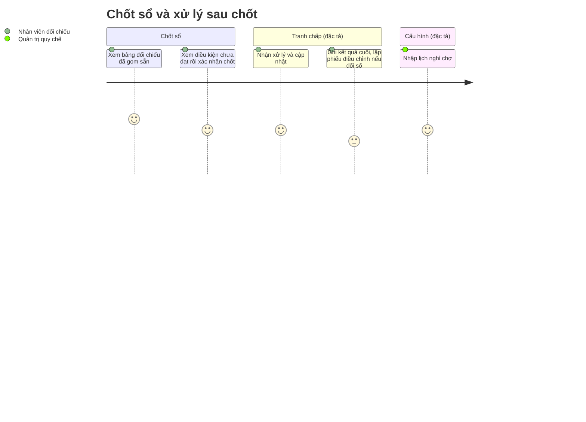

# Screens — F006_ReconciliationAndClosing

## Screen List

Một trong bốn màn **đã xây ở LAB-3**; ba màn còn lại chỉ đặc tả.

| Screen Name | SCR### | What User Sees | What User Can Do |
|-------------|--------|----------------|------------------|
| Bảng đối chiếu ngày & chốt sổ (業務日照合表) — `/reconciliation` | [SCR018_DailyReconciliation](../../screens/SCR018_DailyReconciliation/spec.md) · **đã xây** | Bảng mỗi ngày nghiệp vụ: trạng thái, số giao dịch, tổng tiền, số lần giao, số ca ngoại lệ, chốt lúc, người chốt; bộ lọc ngày | Lọc ngày; bấm "Chốt sổ" ở ngày còn mở → hộp thoại liệt kê điều kiện chưa đạt (cảnh báo, không chặn) → xác nhận. Chỉ `reconcile` |
| Danh sách tranh chấp (係争一覧) — `/disputes` *(đề xuất)* | [SCR019_DisputeList](../../screens/SCR019_DisputeList/spec.md) · chỉ đặc tả | Bảng mã, trạng thái, nhóm nguyên nhân, ngày nghiệp vụ, giao dịch, người tham gia, số tiền, người xử lý, hạn, số ngày quá hạn; hai con số tổng "đang mở / quá hạn" không chịu bộ lọc | Lọc theo trạng thái (mặc định "đang mở"), người xử lý, chỉ quá hạn, ngày nghiệp vụ; mở chi tiết. Không có form ghi |
| Chi tiết tranh chấp (係争詳細) — `/disputes/[id]` *(đề xuất)* | [SCR020_DisputeDetail](../../screens/SCR020_DisputeDetail/spec.md) · chỉ đặc tả | Thông tin vụ, khối cập nhật, lịch sử (mới nhất trước), chứng cứ | Nhận xử lý, ghi chú/chứng cứ, chuyển trạng thái, dời hạn kèm lý do, ghi kết quả cuối, đóng vụ, sang lập phiếu điều chỉnh. Chỉ `reconcile` |
| Lịch nghỉ chợ & ngày nghiệp vụ (休市日・業務日カレンダー) — `/markets/[id]/calendar` *(đề xuất)* | [SCR021_MarketCalendar](../../screens/SCR021_MarketCalendar/spec.md) · chỉ đặc tả | Lưới lịch ngày nghỉ, chuỗi ngày nghiệp vụ dẫn xuất (chỉ đọc), "đã sinh tới ngày", cảnh báo khi còn dưới 30 ngày | Quản trị quy chế thêm/bỏ ngày nghỉ khi lịch nhập tay; ở chế độ nguồn ngoài thì chỉ xem. Thuộc cả [F012](../F012_MarketManagement/screens.md) về quản lý chợ |

## User Journey

1. Nhân viên đối chiếu mở **Bảng đối chiếu** sau 10:00; số liệu ngày đã được gom sẵn.
2. Với ngày còn mở, bấm "Chốt sổ" — hộp thoại hiện danh sách giao dịch chưa giao xong (hoặc "Không còn giao dịch nào chưa giao xong") và dòng nhắc "hệ thống vẫn cho chốt".
3. Xác nhận — banner xanh "Đã chốt sổ ngày … lúc …", dòng đó mất nút chốt, trạng thái thành "đã chốt".
4. Nếu chốt lại ngày đã chốt hoặc đổi chức danh giữa chừng, banner đỏ nằm trong hộp thoại, hộp thoại vẫn mở để thử lại hoặc huỷ.
5. Khi có khiếu nại số lượng, nhân viên mở **Danh sách tranh chấp**, vào **Chi tiết** để nhận xử lý và cập nhật từng bước (đặc tả).
6. Nếu kết luận làm đổi số của ngày đã chốt, nhân viên bấm "Lập phiếu điều chỉnh" sang [F007](../F007_PostCloseCorrection/screens.md); mã phiếu quay lại gắn vào vụ.
7. Quản trị quy chế vào **Lịch nghỉ chợ** để nhập ngày nghỉ và kiểm tra chuỗi ngày nghiệp vụ còn đủ cho các tháng tới (đặc tả).

