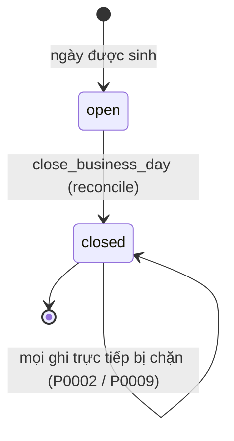
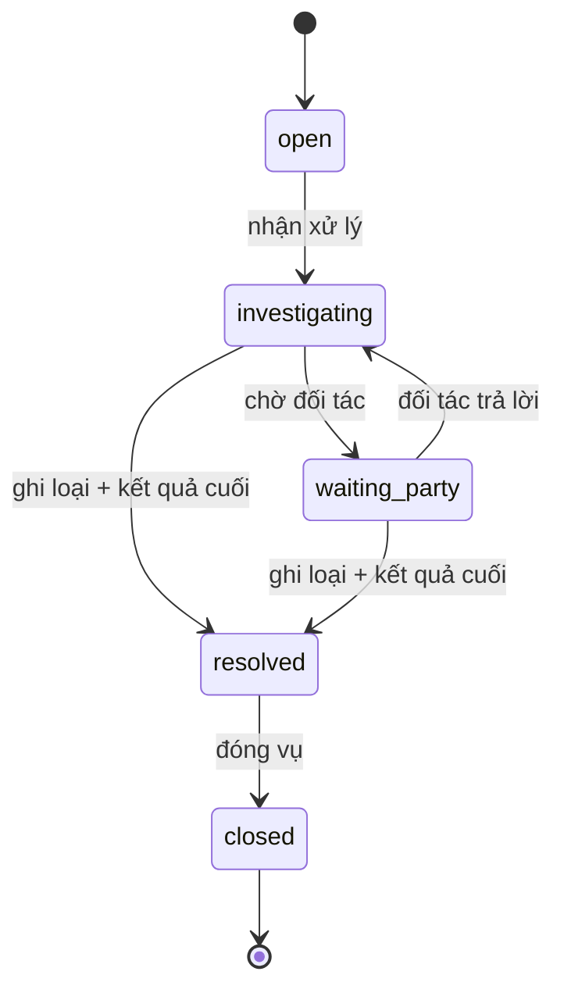

# F006_ReconciliationAndClosing — Technical Spec

**Priority**: P0
**Type**: ui
**Generated**: 2026-10-06

> Quy ước: **[ĐÃ XÂY]** có ở LAB-3 kèm file nguồn · **[ĐẶC TẢ]** chưa có code · **(đề xuất)** suy luận ngoài nguồn khách · **(quan sát)** rút từ đọc migration/code, chưa chạy. Mã FR/NFR/BR/US giữ mã LAB-1. Mã `P0055`–`P0059` do SCR020/SCR021 đề xuất, chưa cài. Kết quả đã chạy ở LAB-3 nằm ở (tài liệu gốc trong repo, không nộp) `verification-checklist.md`.

## Overview

Gom giao dịch + giao hàng + ngoại lệ của một ngày nghiệp vụ thành bảng đối chiếu, **chốt sổ** để ngày thành bất biến, chặn mọi ghi trực tiếp sau chốt (và ghi lại lần thử), cùng quản lý tranh chấp và lịch nghỉ chợ. Ở LAB-3 có: view `v_daily_reconciliation`, RPC `close_business_day`, trigger `guard_closed_day` trên `lots`/`trades`/`deliveries`, RPC `log_blocked_write_attempt`, màn SCR018. Chưa có: tranh chấp (SCR019/SCR020), lịch nghỉ (SCR021). Quyết định liên quan: [ADR-005](../../decisions/ADR-005-close-day-warn-not-block.md) (chốt cảnh báo chứ không chặn), [ADR-004](../../decisions/ADR-004-invariants-at-database-layer.md) (bất biến ở tầng dữ liệu), [ADR-007](../../decisions/ADR-007-market-rules-as-versioned-data.md) (lịch nghỉ là quy tắc theo chợ). Bước bốn của [FL-01](../../flows/FL-01-lot-trade-delivery-reconciliation.md); đường sau chốt là [FL-02](../../flows/FL-02-post-close-correction.md).

## Polymorphic Behavior

Không áp dụng — không có discriminator trong các thực thể của tính năng này; khác biệt theo trạng thái ngày nằm ở máy trạng thái bên dưới.

## Cross-Cutting Logic

### Requirements

| Code | Description | Handler | Verifiable | Trạng thái |
|------|-------------|---------|------------|------------|
| FR-SETTLE-01 | Tổng hợp giao dịch + giao hàng + ngoại lệ → bảng đối chiếu ngày; phản ánh **toàn bộ** giao dịch đủ điều kiện | view `v_daily_reconciliation`; `getDailyReconciliation` (`lib/domain/reconciliation.ts:44`) | yes | ĐÃ XÂY — **lỗi B-05: `total_amount` bị nhân theo số lần giao, đã xác nhận trên DB thật** (xem Algorithms) |
| FR-SETTLE-02 | Khoá ngày nghiệp vụ; sau khoá chỉ còn đường điều chỉnh có kiểm soát | RPC `close_business_day` (`0008_rpc_functions_admin.sql:6-41`); `closeDay` (`reconciliation/actions.ts:57-78`) | yes | ĐÃ XÂY — đường điều chỉnh là [F007](../F007_PostCloseCorrection/technical-spec.md), chưa xây |
| FR-CORR-03 | Không sửa trực tiếp ngày đã khoá; mọi lần thử bị chặn **và ghi log** | `guard_closed_day` (`0010:6-55`); `log_blocked_write_attempt` (`0040:21-46`) | yes | MỘT PHẦN — chặn đủ ba bảng; log **chỉ** được gọi từ đường ghi lần giao |
| FR-SETTLE-03 | Quản lý tranh chấp: trạng thái, nguyên nhân, người xử lý, ngày dự kiến, kết quả cuối, danh sách đang mở (P1) | RPC chuyển trạng thái + `disputes`, `dispute_events` (đề xuất) | yes | CHỈ ĐẶC TẢ (SCR019, SCR020) |
| (nguồn LAB-1 `00-02`) F06-05 | Nhập lịch nghỉ; 休市日 không sinh 業務日 | `market_holidays` + sinh `business_days` (đề xuất) | yes | CHỈ ĐẶC TẢ (SCR021); lịch nhập tay `calendar_mode=manual` — đã chốt (PREMISE C-08), khách chưa xác nhận giả định |

### Business Rules

| Mã LAB-1 | Nội dung | Thực thi ở | Trạng thái |
|----------|----------|-----------|------------|
| BR-CLOSE-01 | **Không được sửa trực tiếp** ngày nghiệp vụ đã khoá | RPC kiểm `status = 'closed'` → `P0002` (đường ứng dụng); trigger `guard_closed_day_*` → `P0009` (đường ghi tay) | ĐÃ XÂY |
| GOV-RULE-01 | (liên quan lịch nghỉ nếu coi là quy tắc chợ) tối đa 4 lần đổi/năm, maker-checker, 発効日, rollback | Khách **không** nêu lịch nghỉ phải theo khuôn này; SCR021 cố ý **không** mượn khuôn phiên bản của `market_rules` (lý do: `business_days` đã vật chất hoá quá khứ) | CHỈ ĐẶC TẢ |

Quy tắc không mã: `close_business_day` **cảnh báo, không chặn** (ADR-005, sai lệch có ý thức D-04); tranh chấp **không tự sửa số liệu** — kết luận đi qua phiếu điều chỉnh; `closed` của tranh chấp là một chiều; 休市日 không phải `business_days.status = 'closed'`. Tổng hợp ở [business-rules](../../system/business-rules.md).

### Decision Logic

#### DEC-001_CloseDayDialog
**subtype:** flow
**Triggers in:** SCR018 khi bấm "Chốt sổ"
**Involved entities:** `v_trade_delivery_status.remaining`, `business_days.status`
**user_visible_outcome:** hộp thoại hiện điều kiện chưa đạt nhưng không khoá nút xác nhận
**Source:** `app/(app)/reconciliation/actions.ts:25-78`, `app/(app)/reconciliation/close-day-dialog.tsx`

```text
mở hộp thoại → getCloseConditionsAction (kiểm reconcile) → danh sách {trade_code, remaining} của giao dịch confirmed có remaining > 0
danh sách rỗng → "Không còn giao dịch nào chưa giao xong."
bấm xác nhận → close_business_day; thành công → banner xanh + dòng mất nút; lỗi → banner đỏ trong hộp thoại, hộp thoại giữ mở
(nút xác nhận KHÔNG bị disable theo danh sách — chủ ý, ADR-005)
```

### State Machines

#### SM — Ngày nghiệp vụ
**kind:** entity · **Linked FR:** FR-SETTLE-02, FR-CORR-03 · **Source:** enum `business_day_status` (`0001`); `0008_rpc_functions_admin.sql:6-41`



| Chuyển | Guard | Hiệu ứng | Trạng thái |
|--------|-------|----------|------------|
| `open` → `closed` | role `reconcile`; ngày tồn tại; chưa `closed` | UPDATE `business_days(status, closed_at, closed_by)`; INSERT `audit_log` kèm `pending_conditions` | ĐÃ XÂY |
| `closed` → `open` | **không có đường** — không policy UPDATE cho client, không RPC mở lại | — | ĐÃ XÂY (một chiều; seed mở lại bằng quyền cao khi dọn dữ liệu) |

#### SM — Tranh chấp (đặc tả, đề xuất)
**kind:** entity · **Source:** SCR020 mục 3 (5 trạng thái, 6 chuyển hợp lệ — đề xuất, khách chưa liệt kê)



| Chuyển | Guard | Hiệu ứng |
|--------|-------|----------|
| `open → investigating` | `assignee_id` = người đang đăng nhập (`reconcile`, `active`) | sinh **hai** dòng `dispute_events` trong một transaction |
| `* → resolved` | `resolution_type` + `resolution_note` ≥ 20 ký tự, nếu thiếu → `P0056` | không tự sửa số liệu |
| `resolved → closed` | hộp thoại xác nhận | màn chuyển chỉ đọc; **không mở lại** (vụ mới trỏ vụ cũ) |
| chuyển khác | — | `P0055` |

### Algorithms

#### ALG-CloseBusinessDay
**Input:** `p_date` · **Output:** `{business_date, closed_at, pending_conditions[]}` · **Source:** `0008_rpc_functions_admin.sql:6-41`

```text
role ≠ reconcile → P0005
SELECT business_days WHERE business_date = p_date FOR UPDATE
không tồn tại → P0001 ; status = closed → P0002
pending := các giao dịch của p_date có v_trade_delivery_status.remaining > 0 (trade_code, remaining)
UPDATE business_days SET status='closed', closed_at=now(), closed_by=auth.uid()
INSERT audit_log(table_name='business_days', action='close_business_day', old/new_value gồm pending_conditions)
return {business_date, closed_at, pending_conditions}      # vẫn chốt dù pending ≠ rỗng
```

#### ALG-DailyReconciliation — lỗi B-05 `total_amount` (đã xác nhận)
**Source:** `0006_derived_views.sql:48-62`. View nối `business_days → trades(confirmed) → deliveries` rồi `GROUP BY ngày`. `trade_count` và `delivery_count` dùng `count(distinct …)` nên đúng; **`total_amount = sum(tr.amount)` cộng trên tích giao dịch × lần giao**, nên một giao dịch có *k* lần giao được cộng *k* lần. **ĐÃ XÁC NHẬN trên DB thật 2026-10-06 (lỗi B-05):** ngày 2026-09-23 view trả `53250.00`, tổng thật `sum(trades.amount where confirmed)` là `38250.00`, lệch +15000 vì `TRD-20260923-0001` có 2 lần giao; ngày 2026-09-24 khớp `69550.00`. Bảng kiểm chứng LAB-3 không bắt được vì đối chiếu số liệu với chính view. Ảnh hưởng FR-SETTLE-01, số hiển thị ở SCR018 và dữ liệu xuất kế toán ([F009](../F009_ReportsAndExport/technical-spec.md)). **Chưa sửa; có bản vá nháp `supabase/migrations/0042_fix_daily_reconciliation_amount.sql` chưa áp.** Hướng sửa đề xuất: tính `sum(amount)` trên `trades` trước (CTE hoặc subquery) rồi mới join để đếm `deliveries`.

#### ALG-DisputeOverdue (đặc tả, đề xuất)
```text
days_overdue := số 業務日 từ due_date tới 業務日 hiện tại, bỏ qua 休市日 (SCR021)
is_overdue   := status ∉ {resolved, closed} AND days_overdue > 0     # một công thức duy nhất, dùng chung RPT-09
```

### External Integrations

Không áp dụng — chốt sổ không gọi dịch vụ ngoài. Lịch nghỉ mặc định nhập tay (PREMISE C-08); có thể đồng bộ từ nguồn ngoài **nếu** khách đổi hướng; khi đó phát sinh hạng mục tích hợp, chưa có trong ước lượng.

### Verification

Nhãn `V-F006-xx` là nhãn cục bộ. §5–§6 của (tài liệu gốc trong repo, không nộp) `verification-checklist.md` **đã chạy ở LAB-3**; các mục còn lại **chưa chạy lại trong phiên viết spec**.

- **V-F006-01** — Bảng đối chiếu không có ô nhập (covers FR-SETTLE-01, US-10): đăng nhập `reconcile@demo.local`, mở `/reconciliation`; chỉ có bộ lọc ngày và nút "Chốt sổ".
- **V-F006-02** — Chốt sổ cảnh báo, không chặn (covers FR-SETTLE-02, ADR-005): chốt ngày còn giao dịch dở → hộp thoại liệt kê giao dịch + số còn lại; chốt vẫn thành công; `select new_value->'pending_conditions' from audit_log where action='close_business_day' order by occurred_at desc limit 1;` có danh sách (checklist §6).
- **V-F006-03** — Chặn sau chốt hai tầng (covers BR-CLOSE-01, FR-CORR-03): (a) ghi lần giao cho ngày đã chốt → `P0002` và có dòng `blocked_write_attempt`; (b) bằng SQL runner `update trades set unit_price = unit_price where trade_code = '<mã ngày đã chốt>';` → `P0009` (checklist §6).
- **V-F006-04** — Kiểm lỗi B-05 `total_amount` (covers FR-SETTLE-01; **đã chạy 2026-10-06**, ra dòng 2026-09-23 như trên):
  ```sql
  select v.business_date, v.total_amount,
         (select coalesce(sum(t.amount),0) from trades t
          where t.business_date = v.business_date and t.status = 'confirmed') as expected
  from v_daily_reconciliation v
  where v.total_amount <> (select coalesce(sum(t.amount),0) from trades t
                           where t.business_date = v.business_date and t.status = 'confirmed');
  ```
  Kỳ vọng sau khi sửa: 0 dòng. Hiện tại: có dòng ở ngày có giao dịch giao nhiều lần (2026-09-23) → lỗi đã xác nhận.
- **V-F006-05** — Chặn mở lại ngày: không có RPC hay policy mở lại; `select policyname, cmd from pg_policies where tablename = 'business_days';` kỳ vọng chỉ `SELECT`.
- **V-F006-06** — Phân quyền: `trading@demo.local` mở `/reconciliation` → `/403`; gọi RPC bằng khoá anon → `42501` (checklist §7; V-F001-05).
- **V-F006-07** *(đặc tả)* — tranh chấp: chuyển `open → resolved` trực tiếp → `P0055`; `resolved` thiếu kết quả → `P0056`; `due_date` là ngày nghỉ → `P0057`.
- **V-F006-08** *(đặc tả)* — lịch nghỉ: đặt nghỉ cho ngày đã có dữ liệu → `P0058`; nhập trùng ngày → không đổi gì.

---

**Client behavior:** see [architecture.md](../../system/architecture.md) (hành vi phía client: chặn route, Server Action, keyboard-first, mất mạng), [permissions.md](../../system/permissions.md), [screen-flow.md](../../generated/screen-flow.md).

## User Stories

### US-10 — Lập bảng đối chiếu ngày không phải nhập lại (Priority: P0)

**What happens:** Nhân viên đối chiếu để hệ thống tự gom số liệu của ngày, chuyển khung 06:30–10:00 từ nhập liệu sang kiểm tra.
**Why this priority:** Tiêu chí A; mục tiêu sai lệch nhập tay từ 1,8% xuống ≤ 0,3%.
**Independent Test:** V-F006-01 + V-F006-04.

**Acceptance Scenarios (cột 受入 của LAB-1):**

1. **Given** một ngày nghiệp vụ, **When** mở bảng, **Then** phản ánh toàn bộ giao dịch `confirmed` của ngày. *(ĐÃ XÂY)*
2. **Given** bảng, **When** xem, **Then** gom cả giao dịch, giao hàng và ngoại lệ. *(ĐÃ XÂY — số tiền sai khi giao dịch có nhiều lần giao, lỗi B-05, V-F006-04)*
3. **Given** bảng, **When** dùng, **Then** không phải nhập lại số liệu nào. *(ĐÃ XÂY)*

**Requirements fulfilled:** **FR-SETTLE-01** — `getDailyReconciliation`. **Source:** `lib/domain/reconciliation.ts:44-95`, `0006_derived_views.sql:48-62`

### US-11 — Chốt sổ ngày nghiệp vụ (Priority: P0)

**What happens:** Nhân viên đối chiếu chốt sổ để số liệu thành chính thức, không ai sửa được sau lưng.
**Why this priority:** Tiêu chí A và B.
**Independent Test:** V-F006-02.

**Acceptance Scenarios:**

1. **Given** ngày đã chốt, **When** muốn sửa, **Then** chỉ còn đường điều chỉnh có kiểm soát. *(MỘT PHẦN — chặn có; đường điều chỉnh là F007, chưa xây)*
2. **Given** hộp thoại chốt, **When** mở, **Then** hiện danh sách điều kiện trước khi chốt. *(ĐÃ XÂY — dưới dạng **cảnh báo**; LAB-1 viết "phải đạt", ADR-005 chọn không chặn)*

**Requirements fulfilled:** **FR-SETTLE-02** — `closeDay` → `close_business_day`. **Source:** `app/(app)/reconciliation/actions.ts:57-78`
**Rules enforced:** BR-CLOSE-01.

### US-12 — Bị chặn khi cố sửa trực tiếp ngày đã chốt (Priority: P0)

**What happens:** Nhân viên bị hệ thống chặn khi vô tình sửa vào ngày đã chốt, để số liệu công bố không bị đổi âm thầm.
**Why this priority:** Tiêu chí B; hiện chỉ 35% giao dịch có đủ dấu vết, mục tiêu ≥ 98%.
**Independent Test:** V-F006-03.

**Acceptance Scenarios:**

1. **Given** ngày đã chốt, **When** thử sửa trực tiếp, **Then** bị chặn. *(ĐÃ XÂY — hai tầng)*
2. **Given** lần thử bị chặn, **When** xảy ra, **Then** ghi log làm nguồn cho `RPT-08`. *(MỘT PHẦN — chỉ đường ghi lần giao gọi `log_blocked_write_attempt`)*
3. **Given** ràng buộc, **When** xét tầng, **Then** ở tầng dữ liệu. *(ĐÃ XÂY — trigger)*
4. **Given** người bị chặn, **When** đọc thông báo, **Then** được hướng sang đường xin điều chỉnh. *(CHỈ ĐẶC TẢ — chưa có SCR022 để dẫn tới)*

**Requirements fulfilled:** **FR-CORR-03**. **Source:** `0010_closed_day_guard.sql:6-55`, `0040_log_blocked_write_attempt.sql:21-46`, `app/(app)/deliveries/actions.ts:77-88`

### US-18 — Xác nhận giao hàng khi có tranh chấp (Priority: P0, phần tranh chấp)

Điều kiện chấp nhận đầy đủ ở [F005 technical-spec](../F005_DeliveryTracking/technical-spec.md). Phần của F006 là F06-04: tranh chấp lưu trạng thái, nguyên nhân, người xử lý, ngày dự kiến, kết quả cuối và có danh sách đang mở. **CHỈ ĐẶC TẢ** (SCR019/SCR020). Hệ thống không tự quyết — người xử lý ghi kết luận.

### Edge Cases

Xem [edge-cases.md](./edge-cases.md).

## Key Entities

| Entity | Table | Key Columns | Purpose |
|--------|-------|-------------|---------|
| Ngày nghiệp vụ | `business_days` | `business_date` (PK), `status`, `closed_at`, `closed_by` | Chỉ ghi qua RPC; không policy ghi |
| Bảng đối chiếu | view `v_daily_reconciliation` | `trade_count`, `total_amount`, `delivery_count`, `exception_count` | Dẫn xuất; `security_invoker`; lỗi B-05 ở `total_amount` |
| Nhật ký | `audit_log` | `table_name`, `action`, `old_value`, `new_value` | Dòng `close_business_day`, `blocked_write_attempt`; **thiếu cột `reason`**, RLS chỉ `sys_admin` đọc |
| Tranh chấp *(đề xuất)* | `disputes`, `dispute_events`, `dispute_evidence` | `status`, `due_date`, `assignee_id`, `resolution_*` | Append-only lịch sử |
| Lịch nghỉ *(đề xuất)* | `market_holidays` | `market_id`, `calendar_date`, `holiday_type`, `source` | UNIQUE `(market_id, calendar_date)` |

## Artifact References

| Artifact | File | Codes Used |
|----------|------|------------|
| System Overview | [overview.md](../../system/overview.md) | — |
| Architecture | [architecture.md](../../system/architecture.md) | — |
| Business Rules | [business-rules.md](../../system/business-rules.md) | BR-CLOSE-01, GOV-RULE-01 |
| Permissions | [permissions.md](../../system/permissions.md) | — |
| Feature List | [feature-list.md](../../generated/feature-list.md) | F006 |
| Entities | [entities.md](../../generated/entities.md) | `business_days`, `audit_log` |
| Screens | [screens.md](./screens.md) | SCR018, SCR019, SCR020, SCR021 |

## Assumptions

- Chỉ có một tài khoản `reconcile` trong dữ liệu mẫu nên người chốt luôn hiển thị đúng; nhiều tài khoản thì RLS `app_users` làm "Người chốt" thành "—".
- Chốt sổ cần mạng (ranh giới offline do kiến trúc vẽ): chốt trên dữ liệu cũ phá tính toàn vẹn.
- (đề xuất) Năm trạng thái tranh chấp, sáu chuyển hợp lệ, `+3` ngày nghiệp vụ mặc định cho hạn xử lý — **suy luận** từ `FR-SETTLE-03` và `RPT-09`; khách chưa cho SLA. Rủi ro nếu sai: viết lại máy trạng thái và `P0055`.
- Lịch nghỉ nhập tay trong hệ thống (`calendar_mode=manual`) — đã chốt (PREMISE C-08, giả định báo giá). Khách chưa xác nhận; rủi ro nếu khách đổi sang nguồn ngoài: khối ghi biến mất, `P0058`/`P0059` đổi vai, thêm hạng mục tích hợp.
- (đề xuất) `rule_admin` quản lý lịch (role `rule_admin` thuộc 9 role đã chốt ở PREMISE C-09, chưa có trong DB); nếu một chợ duy nhất thì bỏ bước chọn chợ.

## Source Code References

| Order | Symbol | Path | Purpose |
|-------|--------|------|---------|
| 1 | `v_daily_reconciliation` | `supabase/migrations/0006_derived_views.sql:48-62` | Bảng đối chiếu (nơi lỗi B-05 nằm) |
| 2 | `close_business_day` | `supabase/migrations/0008_rpc_functions_admin.sql:6-41` | Chốt sổ |
| 3 | `guard_closed_day` + 3 trigger | `supabase/migrations/0010_closed_day_guard.sql:6-55` | Chặn ghi sau chốt |
| 4 | `log_blocked_write_attempt` | `supabase/migrations/0040_log_blocked_write_attempt.sql:21-46` | Ghi lần thử |
| 5 | `closeDay`, `getCloseConditionsAction` | `app/(app)/reconciliation/actions.ts:25-78` | Server Action |
| 6 | truy vấn + `logBlockedWriteAttempt` | `lib/domain/reconciliation.ts:44-159` | Đọc dữ liệu, ghi nhật ký |
| 7 | trang + hộp thoại | `app/(app)/reconciliation/page.tsx`, `close-day-dialog.tsx` | Giao diện |

## Unresolved Questions

1. **Chốt cảnh báo hay chặn:** đã chốt cảnh báo (PREMISE C-07, ADR-005); khách chưa xác nhận cách đọc này. Còn mở: tranh chấp mở có chặn chốt không.
2. **Sửa B-05 thế nào và khi nào?** Lỗi đã xác nhận (V-F006-04); chưa sửa, có bản vá nháp 0042 chưa áp. Cần quyết áp bản vá (hoặc sửa view) trước LAB-5, vì số ở SCR018 và dữ liệu xuất kế toán đang sai ở các ngày có giao dịch giao nhiều lần.
3. **Log lần thử bị chặn** nên phủ mọi đường ghi (lô, giao dịch) hay chỉ giao hàng? FR-CORR-03 đòi "mọi lần".
4. **Ai tạo tranh chấp và từ màn nào?** Tự sinh từ ngoại lệ hay lập tay.
5. **SLA tranh chấp** (RPT-09 nhắc, không cho số).
6. **Chức danh `delivery`** xuất hiện trong spec nguồn (SCR019) nhưng không thuộc registry. Đã chốt (PREMISE C-10): bộ phận giao hàng gộp vào `receiving`; ma trận quyền SCR019 phải dùng `receiving`, không dùng `delivery`. Khách chưa xác nhận giả định gộp.
7. **Một chợ hay nhiều chợ** (ADR-007). Lịch nhập tay đã chốt (PREMISE C-08); còn lại là khách có xác nhận giả định hay không.
8. **Hạn thanh toán đếm theo ngày lịch hay ngày nghiệp vụ** (câu 10 + 16; chạm tiền khuyến khích [F008](../F008_IncentiveAndRateVersion/technical-spec.md)).

## Source Walkthrough

1. **File:** `supabase/migrations/0006_derived_views.sql:48-62` — nguồn của bảng đối chiếu.
2. **File:** `supabase/migrations/0008_rpc_functions_admin.sql:6-41` — chốt sổ.
3. **File:** `supabase/migrations/0010_closed_day_guard.sql:6-55` — lưới an toàn sau chốt.
4. **File:** `app/(app)/reconciliation/actions.ts:25-78` — Server Action và hộp thoại.
5. **File:** `lib/domain/reconciliation.ts:140-159` — ghi lần thử ngoài transaction.

### Call Hierarchy

```text
SCR018 -> getDailyReconciliation -> v_daily_reconciliation ; mở hộp thoại -> getCloseConditionsAction -> getCloseConditions (v_trade_delivery_status)
        -> closeDay -> rpc close_business_day -> business_days UPDATE + audit_log INSERT
ghi sau chốt -> RPC P0002 (ứng dụng) | guard_closed_day P0009 (ghi tay)
```

**Related files:** bảng *Source Code References* — cột **Order**.

## DB Impact per Event

| Event/Endpoint | Table | Columns | Operation | Value Derivation | Source |
|----------------|-------|---------|-----------|-------------------|--------|
| RPC `close_business_day` | `business_days` | `status, closed_at, closed_by` | UPDATE | `closed`, `now()`, `auth.uid()` | `0008_rpc_functions_admin.sql:32-33` |
| RPC `close_business_day` | `audit_log` | `table_name, action, actor_id, old_value, new_value` | INSERT | `action='close_business_day'`; JSON gồm `pending_conditions` | `0008_rpc_functions_admin.sql:35-38` |
| RPC `log_blocked_write_attempt` | `audit_log` | `table_name, action, actor_id, old_value, new_value` | INSERT | `action='blocked_write_attempt'`; `{business_date, error_code}` + ngữ cảnh | `0040_log_blocked_write_attempt.sql:37-45` |
| RPC chuyển trạng thái tranh chấp *(đề xuất)* | `disputes`, `dispute_events` | `status, assignee_id, due_date, resolution_*`; sự kiện | UPDATE, INSERT | trong **cùng** transaction; `actor_id = auth.uid()` | `[INFERRED]` — SCR020 mục 8 |
| RPC lịch nghỉ *(đề xuất)* | `market_holidays`, `business_days` | `calendar_date, holiday_type`; ngày sinh | INSERT | idempotent theo `(market_id, calendar_date)` | `[INFERRED]` — SCR021 mục 8 |
