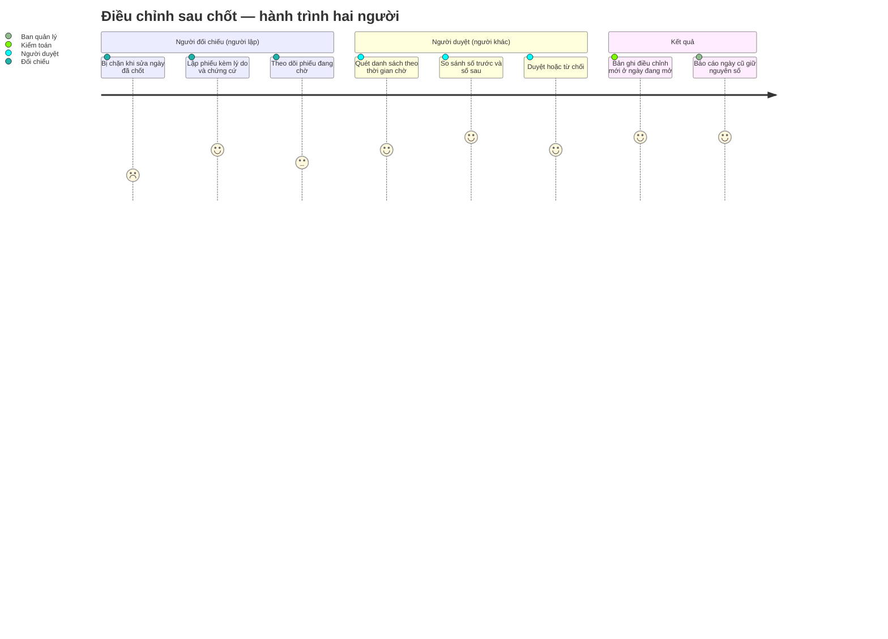

# Screens — F007_PostCloseCorrection

> Cả ba màn đều **chưa xây** (LAB-3 làm 11/35 màn; F07 là MOCK-6). Đặc tả theo bản đầy đủ của LAB-1, nguồn: (tài liệu gốc trong repo, không nộp) `sc-22…sc-24`. Chi tiết trường, validation, mã lỗi nằm ở spec từng màn; file này chỉ nối các màn thành hành trình.

## Screen List

| Screen Name | SCR### | What User Sees | What User Can Do |
|-------------|--------|----------------|------------------|
| Tạo phiếu xin điều chỉnh (修正申請票の作成) | [SCR022_CorrectionRequestCreate](../../screens/SCR022_CorrectionRequestCreate/spec.md) | Banner vàng cố định "Phiếu này KHÔNG sửa số liệu đã chốt"; khối chọn bản ghi đích và ngày đã chốt; khối số trước (chỉ đọc); khối số sau với chênh lệch tính tức thời; ngày ghi nhận điều chỉnh (tra tự động) | Chọn loại bản ghi và mã bản ghi, chọn kiểu điều chỉnh (đảo toàn bộ / ghi chênh lệch), nhập số sau, lý do, chứng cứ, gửi phiếu qua hộp thoại xác nhận; rút phiếu khi chưa ai duyệt |
| Danh sách phiếu chờ duyệt (承認待ち申請票一覧) | [SCR023_PendingRequestList](../../screens/SCR023_PendingRequestList/spec.md) | Bảng phiếu: mã phiếu, bản ghi đích, ngày nghiệp vụ, kiểu, chênh lệch tiền, người lập, thời gian chờ, trạng thái; chờ lâu nhất lên đầu | Lọc theo trạng thái, loại bản ghi, ngày; mở phiếu để duyệt (chỉ với phiếu của người khác và khi có thẩm quyền); xem phiếu của mình ở chế độ chỉ đọc |
| Chi tiết phiếu & duyệt (申請票詳細・承認) | [SCR024_RequestDetailApproval](../../screens/SCR024_RequestDetailApproval/spec.md) | Thông tin phiếu (lý do, chứng cứ, người lập); bảng so sánh trước / sau / chênh lệch; cảnh báo lệch ảnh chụp; khối quyết định (khi đủ điều kiện); sau khi duyệt: khối bản ghi điều chỉnh đã sinh kèm dòng "Bản ghi gốc không thay đổi" | Duyệt hoặc từ chối (từ chối bắt buộc nêu lý do) qua hộp thoại xác nhận; mở bản ghi gốc để tự kiểm; theo liên kết ngược từ bản điều chỉnh về phiếu |

Lối vào ngoài ba màn này: người dùng bị chặn khi sửa trực tiếp ngày đã chốt được dẫn sang màn tạo phiếu (các màn chi tiết lô, chi tiết giao dịch, danh sách giao dịch, đối chiếu cần có liên kết — [ĐẶC TẢ], xem [F004](../F004_TradeRecording/screens.md) và [F006](../F006_ReconciliationAndClosing/screens.md)).

## User Journey

1. Nhân viên đối chiếu sửa nhầm vào một giao dịch của ngày đã chốt — hệ thống chặn, ghi log và gợi ý sang màn xin điều chỉnh với bản ghi đã điền sẵn.
2. Tại **Tạo phiếu xin điều chỉnh**, người dùng thấy ngay banner cảnh báo số liệu gốc không đổi, chọn kiểu điều chỉnh, nhập số sau, lý do và chứng cứ rồi bấm gửi — hộp thoại xác nhận nhắc lại ngày ghi nhận điều chỉnh.
3. Phiếu vào trạng thái chờ duyệt; người lập có thể theo dõi nó trong **Danh sách phiếu chờ duyệt** nhưng không có nút duyệt ở phiếu của mình.
4. Người duyệt mở danh sách, quét cột thời gian chờ, bấm vào phiếu của người khác để sang **Chi tiết phiếu & duyệt**.
5. Người duyệt đọc lý do, mở chứng cứ, xem bảng trước/sau (số trước đọc lại từ bản ghi hiện tại); nếu số gốc đã đổi, cảnh báo lệch hiện đầu tiên và việc duyệt bị chặn.
6. Người duyệt chọn duyệt hoặc từ chối rồi xác nhận — duyệt thì khối bản ghi điều chỉnh hiện ngay bên dưới, từ chối thì không có bản ghi nào được tạo.
7. Báo cáo của ngày đã chốt giữ nguyên số cũ; số điều chỉnh xuất hiện ở ngày hoặc kỳ ghi nhận.

