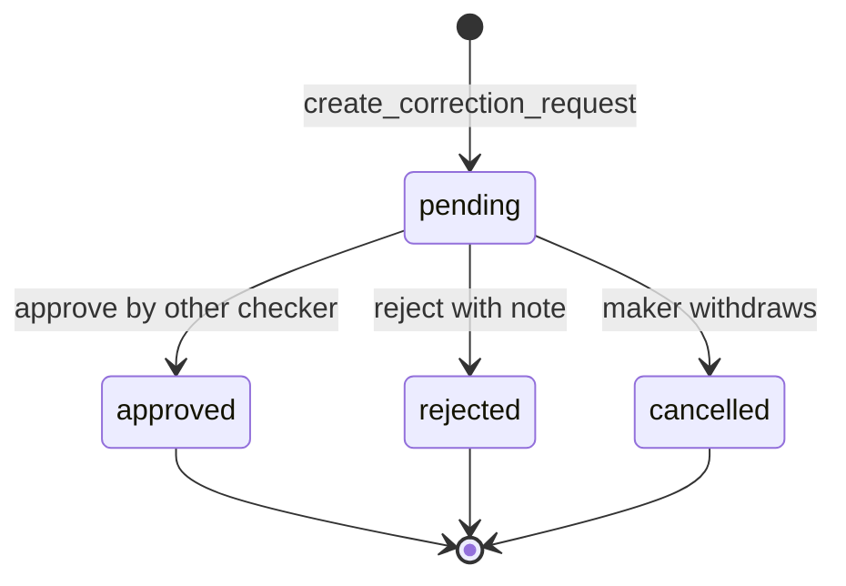
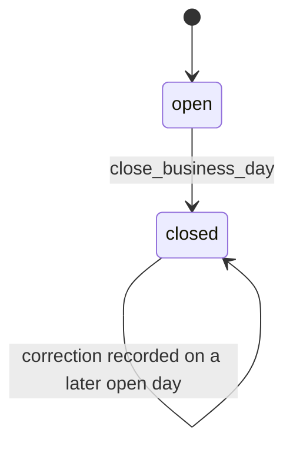
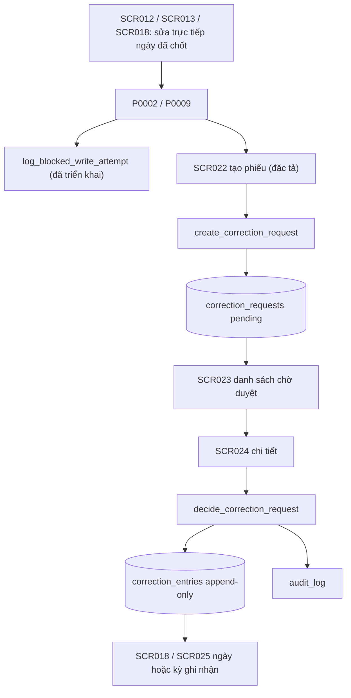

# F007_PostCloseCorrection — Technical Spec

**Priority**: P0 (F07-01…F07-04 là P0, F07-05 là P1)
**Type**: mixed (màn hình + RPC `SECURITY DEFINER` + trigger bảo vệ)
**Generated**: 2026-10-06

> **Ký hiệu.** `sc-NN…` (chữ thường) trong cột Source/Căn cứ = tệp screen-spec của bộ thiết kế gốc, **không nộp**; bản nộp tương ứng là SCR0NN. `[ĐÃ TRIỂN KHAI]` = chạy thật trong prototype LAB-3, có trích migration/code. `[ĐẶC TẢ]` = thiết kế, chưa xây (MOCK-6 trong (tài liệu gốc trong repo, không nộp) `lab3-scope-lock.md`). `(đề xuất)` = ngoài tài liệu khách, kèm mức rủi ro. Mã lỗi `P0001`–`P0009` đã cài; `P0020`–`P0027` là mã của bộ thiết kế (tài liệu gốc trong repo, không nộp) `screen-specs`, **chưa cài** — không cấp mã mới.

## Overview

F07 cho phép sửa số liệu của một ngày nghiệp vụ (業務日) **đã chốt** mà không ghi đè lịch sử: người đối chiếu lập phiếu xin điều chỉnh (bản gốc chưa đổi), một người khác duyệt, khi duyệt hệ thống ghi **bản ghi điều chỉnh mới** (reverse hoặc delta) vào ngày nghiệp vụ đang mở và liên kết ngược về phiếu. Màn liên quan: [SCR022](../../screens/SCR022_CorrectionRequestCreate/spec.md), [SCR023](../../screens/SCR023_PendingRequestList/spec.md), [SCR024](../../screens/SCR024_RequestDetailApproval/spec.md).

| Phần | Trạng thái | Căn cứ |
|---|---|---|
| Chặn sửa trực tiếp ngày đã chốt (`P0009`) | **[ĐÃ TRIỂN KHAI]** | `supabase/migrations/0010_closed_day_guard.sql:6-55` |
| Ghi log lần thử bị chặn (`blocked_write_attempt`) | **[ĐÃ TRIỂN KHAI]** | `supabase/migrations/0040_log_blocked_write_attempt.sql:21-46`, `lib/domain/reconciliation.ts:140-159`; lỗi RPC ghi log bị bỏ qua im lặng (xem dưới bảng) |
| Chốt sổ `close_business_day` | **[ĐÃ TRIỂN KHAI]** (thuộc F06) | `supabase/migrations/0008_rpc_functions_admin.sql:6-41` |
| Phiếu điều chỉnh, bản ghi điều chỉnh, 3 RPC, 3 view, cờ `can_approve` | **[ĐẶC TẢ]** | (tài liệu gốc trong repo, không nộp) `sc-22…sc-24` |

**Khoảng trống FR-CORR-03 (đã xác minh trong code):** `logBlockedWriteAttempt` bọc lời gọi `supabase.rpc("log_blocked_write_attempt", …)` trong `try/catch`, nhưng supabase-js trả lỗi RPC trong `{ error }` chứ không `throw`, và hàm không đọc `error` — nên nhánh `catch` chỉ bắt lỗi mạng/ngoại lệ; lỗi từ chính RPC (ví dụ bị RLS/đặc quyền từ chối) bị bỏ qua, không có `console.error`. Hệ quả: "chặn **và ghi log**" của FR-CORR-03 chưa được bảo đảm. Chi tiết và cách vá: [F011](../F011_AuditLog/technical-spec.md).

## Polymorphic Behavior

Hai bộ phân biệt giá trị của thực thể **đề xuất** `correction_requests` (đã mô tả trong [entities](../../generated/entities.md)).

### DISC-F007-01 — correction_requests.correction_type

| Value | Render | Validation | Persistence |
|-------|--------|------------|-------------|
| `delta` (mặc định) | SCR022 hiện ô số lượng sau (`after.quantity`), đơn giá sau (`after.unit_price` khi đích là `trades`); chênh lệch tính tức thời | `after.quantity > 0`, đơn giá `> 0`, tối đa 3/2 chữ số thập phân; phải có ít nhất một giá trị khác số trước (V-05, `P0022`) | Duyệt → 1 dòng `correction_entries` kiểu `delta`, số có thể âm |
| `reverse` | Ẩn ô số sau; chênh lệch = âm toàn bộ số gốc | Không cần số sau; vẫn bắt buộc lý do + chứng cứ | Duyệt → 1 dòng `correction_entries` kiểu `reverse` mang số âm của bản gốc (đề xuất, xem câu hỏi 2 ở Unresolved Questions) |

### DISC-F007-02 — correction_requests.target_table

| Value | Render | Validation | Persistence |
|-------|--------|------------|-------------|
| `trades` | Hiện số lượng, đơn giá, thành tiền | `target_code` phải khớp `trades.trade_code`; `after.quantity ≤ remaining của lô + before.quantity` | `target_record_id` = `trades.id` |
| `deliveries` | Hiện số lượng | `target_code` = mã giao dịch + `deliveries.seq` | `target_record_id` = `deliveries.id` |
| `incentive_results` | Hiện kỳ thay vì ngày (đề xuất) | `target_code` khớp `v_incentive_results.result_code` | Delta sinh ở **kỳ kế tiếp**, xem [F008](../F008_IncentiveAndRateVersion/technical-spec.md) |

**Source:** (tài liệu gốc trong repo, không nộp) `sc-22-tao-phieu-dieu-chinh.md:37-60`.

## Cross-Cutting Logic

### Requirements

| Code | Description | Endpoint/Handler | Verifiable |
|------|-------------|------------------|------------|
| FR-CORR-01 | Yêu cầu điều chỉnh giao dịch đã chốt kèm lý do + chứng cứ + trạng thái duyệt; có bản ghi yêu cầu riêng, giao dịch gốc không đổi trước khi duyệt (F07-01, F07-05) | RPC `create_correction_request`, `cancel_correction_request` (đề xuất) · [ĐẶC TẢ] | yes |
| FR-CORR-02 | Duyệt/từ chối; sinh reverse/delta thay vì ghi đè; bản gốc nguyên vẹn; bản điều chỉnh truy được về phiếu (F07-02, F07-03, F07-04) | RPC `decide_correction_request` (đề xuất) · [ĐẶC TẢ] | yes |
| FR-CORR-03 | Chặn sửa trực tiếp ngày đã lock và ghi log (thuộc F06-03, F07 dựa vào) | trigger `guard_closed_day` + RPC `log_blocked_write_attempt` · **[ĐÃ TRIỂN KHAI]** | yes |
| FR-INC-03 | Điều chỉnh sau lock sinh delta ở kỳ kế tiếp, báo cáo kỳ trước giữ nguyên (liên đới F08-06) | `calculate_incentive` đọc `correction_entries` (đề xuất) · [ĐẶC TẢ] | yes |
| FR-AUDIT-01 | Phiếu, duyệt, từ chối đều phải để lại vết 5 trường (liên đới [F011](../F011_AuditLog/technical-spec.md)) | ghi `audit_log` trong RPC (đề xuất) · [ĐẶC TẢ] | yes |
| NFR-SEC-01 | MFA bắt buộc cho role phê duyệt nội bộ — MFA phân tầng đã chốt (PREMISE C-04); prototype chỉ một lớp (MOCK-1) | Supabase Auth · [ĐẶC TẢ] | yes |
| NFR-OPS-02 | Quy tắc đổi bằng cấu hình, không sửa dữ liệu lịch sử (áp cho phiên bản ở [F008](../F008_IncentiveAndRateVersion/technical-spec.md), nêu ở đây để nối) | — | yes |

**Source:** (tài liệu gốc trong repo, không nộp) `product-a-rfp-business-summary.md:357-359`, (tài liệu gốc trong repo, không nộp) `product-a-feature-list.md:129-140`; handler lấy từ `sc-22…sc-24` mục 8.

### Business Rules

| Code | Rule | Enforced at | Nguồn |
|------|------|-------------|-------|
| BR-CLOSE-01 | Không sửa trực tiếp 業務日 đã lock. Mọi INSERT/UPDATE/DELETE trên `lots`/`trades`/`deliveries` của ngày `closed` bị chặn `P0009` | DB trigger · **[ĐÃ TRIỂN KHAI]** `0010:6-55` | RFP 07-03 |
| GOV-RULE-01 | Tách người lập và người duyệt (起票・承認分離); áp cho phiếu điều chỉnh theo US-17 | Thân RPC `decide_correction_request` (`P0023`, `P0027`) · [ĐẶC TẢ] | RFP 11-04, US-17 |
| CAP-HUMAN-01 (điểm 3) | Hệ thống không tự duyệt sửa dữ liệu nhạy cảm; Duyệt/Từ chối luôn qua hộp thoại xác nhận, không phím tắt | Giao diện + RPC · [ĐẶC TẢ] | function-list §F07 |
| BR-INC-01 / FR-INC-03 | Điều chỉnh tiền khuyến khích sau chốt kỳ → delta ở kỳ kế tiếp | `calculate_incentive` · [ĐẶC TẢ] | RFP B.5 |
| — (đề xuất, rủi ro Thấp) | `effective_business_date` = ngày nghiệp vụ `open` sớm nhất `≥ current_date`, không bao giờ bằng ngày gốc; tra từ `business_days`, không suy từ `now()` | RPC tính lại phía server | SCR022 §3 #13, architecture §3.1 |
| — (đề xuất, rủi ro Thấp) | Server tính lại `delta` và `effective_business_date`; không tin giá trị client | RPC | SCR022 §8 |
| — (đề xuất, rủi ro Trung bình) | Một bản ghi chỉ có một phiếu `pending` (`P0021`); khách có thể bác | RPC | SCR022 §4 |
| — (đề xuất, rủi ro Thấp) | Số gốc đọc lại lúc duyệt phải khớp `snapshot_before`, lệch → `P0024` | RPC `select … for update` | SCR024 §3 #15 |
| — (đề xuất, rủi ro Cao) | `correction_entries` append-only ở tầng DB (trigger chặn UPDATE/DELETE kể cả owner) và cho phép số âm ngay migration đầu | DB | SCR024 §8-§9 |
| — (đề xuất, rủi ro Trung bình) | Đổi khoá (người mua, lô) chỉ qua `reverse` rồi lập giao dịch mới | RPC | SCR022 §10 câu 3 |

### Decision Logic

User-facing decisions với kết quả nhìn thấy được.

---

#### DEC-F007-01_ApproveControlVisibility
**subtype:** render
**Triggers in:** SCR023 (cột Hành động) · SCR024 (Khối C)
**Involved entities:** `correction_requests.decision_state`, `correction_requests.requested_by`, `app_users.can_approve`
**user_visible_outcome:** nút "Mở phiếu & duyệt" chỉ hiện với người duyệt hợp lệ; phiếu của chính mình **ẩn hẳn** nút (không làm mờ)
**Source:** (tài liệu gốc trong repo, không nộp) `sc-23-danh-sach-phieu-cho-duyet.md:63-71`, `sc-24…md:64-70`

```pseudo
if decision_state == 'pending' AND requested_by != auth.uid() AND viewer.can_approve → show "Mở phiếu & duyệt" / Khối C
else if decision_state == 'pending' AND requested_by == auth.uid() → no approve control, show note "Bạn không duyệt được phiếu do chính mình lập"
else if decision_state != 'pending' → read-only link "Xem"
```

Việc ẩn nút chỉ là tiện lợi giao diện; bất biến thật nằm trong RPC (`P0023`, `P0027`).

---

#### DEC-F007-02_AfterRejectFlow
**subtype:** flow
**Triggers in:** SCR024 sau khi gửi quyết định
**Involved entities:** `correction_requests.decision_state`, `correction_entries`
**user_visible_outcome:** duyệt → banner xanh + Khối D (bản ghi đã sinh) hiện ngay; từ chối → banner trung tính, **không** có Khối D
**Source:** `sc-24…md:107-117`

```pseudo
if decision == 'approved' → insert correction_entries; render Block D + banner "Bản ghi gốc không thay đổi"
if decision == 'rejected' → update request only; no entries; render rejection note
```

---

### State Machines

#### SM-F007-01_CorrectionRequestDecisionState
**kind:** entity
**Linked FR:** FR-CORR-01, FR-CORR-02
**Source:** (tài liệu gốc trong repo, không nộp) `sc-22…md:123`, `sc-24…md:137-138` · [ĐẶC TẢ]
**States:** pending, approved, rejected, cancelled



**Transition rules:**
- `[*] → pending`: guard = role `reconcile`; ngày đích `closed` (`P0020` nếu chưa); không có phiếu `pending` khác trên bản ghi (`P0021`); delta khác 0 (`P0022`); side effect = chụp `snapshot_before`, server tính `delta` và `effective_business_date`, gán `request_code` dạng `COR-YYYYMMDD-0001`. **Không chạm `trades`/`deliveries`.**
- `pending → approved`: guard = `decided_by != requested_by` (`P0023`), có `can_approve` (`P0027`), phiếu còn `pending` (`P0025`), số gốc khớp `snapshot_before` (`P0024`), có ngày nghiệp vụ mở (`P0026`/`P0002`); side effect = INSERT `correction_entries` (1 dòng) + UPDATE phiếu, **cùng một transaction** với `select … for update`.
- `pending → rejected`: guard như trên, `decision_note` ≥ 10 ký tự; side effect = chỉ UPDATE phiếu.
- `pending → cancelled`: do chính người lập, khi chưa ai xử lý; phiếu giữ lại làm dấu vết.
- Trạng thái cuối không chuyển tiếp. Phiếu bị từ chối thì **lập phiếu mới**, không "sửa rồi gửi lại" (đề xuất, rủi ro Thấp).

#### SM-F007-02_BusinessDayStatusAroundCorrection
**kind:** entity
**Linked FR:** FR-CORR-03
**Source:** `supabase/migrations/0004_business_days_and_lots.sql:4-9`, `0008_rpc_functions_admin.sql:32-33`, `0010_closed_day_guard.sql:31-36` · **[ĐÃ TRIỂN KHAI]**
**States:** open, closed



**Transition rules:**
- `open → closed`: guard = role `reconcile`, ngày tồn tại và chưa chốt (`P0001`/`P0002`); side effect = ghi `closed_at`, `closed_by`, một dòng `audit_log` kèm `pending_conditions` ([ADR-005](../../decisions/ADR-005-close-day-warn-not-block.md): cảnh báo chứ không chặn).
- `closed → closed` (ghi trực tiếp): trigger `guard_closed_day` raise `P0009`; Server Action bắt `P0002`/`P0009` và gọi `log_blocked_write_attempt` (một lời gọi riêng, ngoài transaction đã rollback).
- Không có chuyển `closed → open` trong nghiệp vụ. (Seed mở lại ngày chỉ để dọn dữ liệu demo, xem (tài liệu gốc trong repo, không nộp) `db-schema.md` §7.)

### Algorithms

#### ALG-F007-01_ServerRecomputeDelta
**Linked FR:** FR-CORR-01
**Source:** `sc-22…md:56-61,136` · [ĐẶC TẢ]
**Input:** `target_table`, `target_record_id`, `correction_type`, `after.quantity`, `after.unit_price`
**Output:** `delta.quantity`, `delta.amount`, `effective_business_date`
**File Schema**: N/A — not a file-exchange type
**Complexity:** O(1) cho `delta`; một truy vấn có chỉ mục cho ngày mở
**Description:** client tính chỉ để hiển thị tức thời; server tính lại và là nguồn sự thật. Nếu server tin con số client thì `delta` thành dữ liệu người dùng nhập và nguyên tắc reverse/delta mất giá trị kiểm toán.

```text
before = read target record (quantity, unit_price, amount)
if type == 'reverse': dq = -before.quantity ; da = -before.amount
else: dq = after.quantity - before.quantity
      da = after.quantity * after.unit_price - before.amount
if dq == 0 AND da == 0: raise P0022
eff = min(business_date) where status='open' AND business_date >= current_date
if eff is null: raise P0026 ; if eff == target_business_date: impossible (target is closed)
```

#### ALG-F007-02_DecideInOneTransaction
**Linked FR:** FR-CORR-02
**Source:** `sc-24…md:137,153` · [ĐẶC TẢ]
**Input:** `p_request_id`, `p_decision`, `p_note`
**Output:** `{decision_state, entries[], effective_business_date}`
**File Schema**: N/A — not a file-exchange type
**Complexity:** O(1)
**Description:** năm phép kiểm nằm trong thân RPC, cùng transaction với khoá dòng phiếu; để ngoài RPC phép nào là để ngỏ phép đó — hai người duyệt đồng thời sẽ lọt qua mọi phép kiểm tầng ứng dụng và append-only làm sai thành vĩnh viễn.

```text
lock request row for update
check decision_state == 'pending'              else P0025
check current_app_role() == 'reconcile'        else P0005
check app_users.can_approve                    else P0027
check auth.uid() != requested_by               else P0023
check current(target record) == snapshot_before else P0024
check open business day exists                 else P0026
if approved: insert correction_entries (source_request_id = request.id) -- NO update on trades/deliveries
update request set decision_state, decided_by, decided_at = now(), decision_note
insert audit_log (approve | reject, old_value, new_value, reason)
```

### External Integrations

#### INT-F007-01_AccountingDeltaBatch
**Linked FR:** FR-CORR-02, IF-ACC-01
**Source:** `sc-24…md:177`, `sc-30-batch-ke-toan.md:98,127` · [ĐẶC TẢ, phụ thuộc giả định A4]
**Type:** queue-job (xuất file CSV một chiều qua SFTP — đã chốt PREMISE C-03, giả định A4 khách chưa xác nhận)
**Target:** hệ thống kế toán của 財務部門, qua [F009](../F009_ReportsAndExport/technical-spec.md)
**Trigger:** sau khi phiếu được duyệt, người vận hành/đối chiếu tạo lô `kind='delta'` ở màn batch kế toán
**Payload:** 6 trường tối thiểu của IF-ACC-01; dòng sinh từ phiếu mang `行ステータス = 調整済み` (suy luận — D.2 chốt ba giá trị nhưng không nói khi nào dùng giá trị nào)
**Failure handling:** `SCR030` hiện lỗi kèm hành động khắc phục; **không có đường sửa thẳng phía kế toán** — mọi sửa đổi quay về F07 rồi xuất lô delta mới (`supersedes` trỏ lô gốc)

Phiếu điều chỉnh **không** gửi thông báo cho người duyệt: tài liệu khách không yêu cầu (xem Unresolved Questions); [F010](../F010_Notifications/technical-spec.md) không có loại sự kiện này trong bốn loại baseline.

### Verification

- **VER-F007-01** — Sau khi lập phiếu, `trades`/`deliveries` của bản ghi đích không đổi giá trị nào; chỉ có thêm 1 dòng `correction_requests` (covers FR-CORR-01, SM-F007-01)
- **VER-F007-02** — Không có câu lệnh UPDATE/DELETE nào trên `trades`/`deliveries` trong thân `decide_correction_request` (quét tĩnh) (covers FR-CORR-02)
- **VER-F007-03** — Gọi thẳng RPC duyệt bằng chính người lập → `P0023`, không sinh dòng `correction_entries` (covers GOV-RULE-01)
- **VER-F007-04** — Hai người duyệt đồng thời cùng phiếu → đúng một người thành công, người kia nhận `P0025`; không có bản ghi điều chỉnh trùng (covers ALG-F007-02)
- **VER-F007-05** — Chèn thẳng SQL một dòng `trades` vào ngày `closed` → `P0009` và có thể dựng lại lần thử trong `audit_log` (`action = 'blocked_write_attempt'`) (covers FR-CORR-03, BR-CLOSE-01) **[kiểm được ngay trên prototype]**
- **VER-F007-06** — In lại báo cáo của ngày gốc sau khi duyệt → cùng checksum với bản đã công bố; dòng điều chỉnh xuất hiện ở ngày `effective_business_date` (covers FR-INC-03)
- **VER-F007-07** — `correction_entries` ghi được số âm và UPDATE/DELETE bị trigger chặn kể cả owner (covers FR-CORR-02)
- **VER-F007-08** — Số gốc đổi giữa lúc lập và lúc duyệt → `P0024`; màn hiện cảnh báo lệch trước khi người duyệt đọc gì khác (covers ALG-F007-02)

---

**Client behavior:** xem [`architecture.md`](../../system/architecture.md) (phân quyền ba lượt, Server Action, §3.1 append-only + temporal) và [`permissions.md`](../../system/permissions.md) (ma trận chức danh, cờ `can_approve`).

## User Stories

### US-12 — Bị chặn khi cố sửa trực tiếp ngày đã chốt (Priority: P0) — cửa vào của F07

**What happens:** nhân viên đối chiếu vô tình sửa vào ngày đã chốt; hệ thống chặn, ghi log và hướng sang đường xin điều chỉnh. Story này thuộc F06-03; F07 là nơi người dùng được dẫn tới.
**Why this priority:** quy tắc cứng BR-CLOSE-01 — làm sai là mất hồ sơ chứ không chỉ mất điểm.
**Independent Test:** sửa trực tiếp một giao dịch của ngày đã chốt, thấy `P0009`/`P0002`, rồi tra `audit_log` thấy dòng `blocked_write_attempt`.

**Acceptance Scenarios:**

1. **Given** một ngày nghiệp vụ đã `closed`, **When** `receiving` gửi `INSERT` trực tiếp vào `lots`, **Then** trigger raise `P0009` và không có dòng nào được thêm.
2. **Given** Server Action `recordDelivery` gặp `P0002`, **When** lỗi được trả về, **Then** một lời gọi riêng `log_blocked_write_attempt` ghi `audit_log`; lỗi ghi log không làm hỏng thông báo gốc.
3. **Given** người dùng thuộc `reconcile` bị chặn, **When** thông báo hiện ra, **Then** có liên kết sang SCR022 mang sẵn `?target=` **[ĐẶC TẢ — các màn SCR008/012/013/018 phải bổ sung liên kết]**.

**Requirements fulfilled:**
- **FR-CORR-03** chặn + ghi log — trigger `guard_closed_day` + RPC `log_blocked_write_attempt` **[ĐÃ TRIỂN KHAI]**
  **Source:** `supabase/migrations/0010_closed_day_guard.sql:33-36`, `0040_log_blocked_write_attempt.sql:37-44`

**Rules enforced:** BR-CLOSE-01.
**State transitions:** SM-F007-02 (`closed → closed`, ghi trực tiếp bị chặn).

**Verification:**
- **VER-F007-05** (covers FR-CORR-03)

---

### US-16 — Xin điều chỉnh số liệu đã chốt (Priority: P0)

**What happens:** nhân viên đối chiếu lập một phiếu riêng xin sửa số liệu của ngày đã chốt, nêu lý do và chứng cứ; giao dịch gốc không đổi.
**Why this priority:** F07-01 là P0; không có phiếu thì sau khi chốt không còn đường sửa hợp lệ (quy tắc cứng BR-CLOSE-01).
**Independent Test:** lập một phiếu hợp lệ rồi đối chiếu `trades` trước/sau — không đổi một ký tự.

**Acceptance Scenarios (điều kiện chấp nhận trích US-16):**

1. **Given** bản ghi thuộc ngày đã chốt, **When** người đối chiếu gửi phiếu có lý do ≥ 10 ký tự và chứng cứ, **Then** phiếu vào `pending`, hiện banner "Số liệu gốc chưa thay đổi".
2. **Given** bản ghi thuộc ngày chưa chốt, **When** gửi phiếu, **Then** `P0020` — hãy sửa trực tiếp.
3. **Given** bản ghi đang có phiếu `pending`, **When** gửi phiếu thứ hai, **Then** `P0021`.
4. **Given** màn hình mở, **When** người dùng chưa gõ gì, **Then** banner cảnh báo "Phiếu này KHÔNG sửa số liệu đã chốt" đã hiện, không đóng được.

**Requirements fulfilled:**
- **FR-CORR-01** — RPC `create_correction_request` · [ĐẶC TẢ]
  **Source:** (tài liệu gốc trong repo, không nộp) `sc-22-tao-phieu-dieu-chinh.md:125-137`

**Rules enforced:** BR-CLOSE-01; quy tắc đề xuất server tính lại delta (ALG-F007-01).
**State transitions:** SM-F007-01 `[*] → pending`, `pending → cancelled`.

**Verification:**
- **VER-F007-01** (covers FR-CORR-01, SM-F007-01)

---

### US-17 — Duyệt điều chỉnh mà không mất lịch sử (Priority: P0)

**What happens:** người có thẩm quyền, khác người lập, so số trước/sau rồi duyệt hoặc từ chối; duyệt thì hệ thống sinh bản ghi điều chỉnh mới.
**Why this priority:** là điểm giữ quyết định con người (CAP-HUMAN-01) và là nhóm khó nhất về kỹ thuật.
**Independent Test:** duyệt một phiếu rồi kiểm tra `trades` không đổi, `correction_entries` có đúng một dòng truy ngược về phiếu.

**Acceptance Scenarios (điều kiện chấp nhận trích US-17):**

1. **Given** phiếu `pending` do người A lập, **When** người B (có `can_approve`) duyệt, **Then** bản ghi gốc nguyên vẹn, có một dòng điều chỉnh mới liên kết `source_request_id`.
2. **Given** A mở phiếu của chính mình, **When** màn tải xong, **Then** không có khối duyệt; gọi thẳng RPC vẫn bị `P0023`.
3. **Given** số gốc đã đổi từ lúc lập phiếu, **When** B bấm duyệt, **Then** `P0024` và màn hiện cảnh báo lệch.
4. **Given** B từ chối với lý do < 10 ký tự, **When** gửi, **Then** V-02 chặn; từ chối hợp lệ không sinh bản ghi nào.

**Requirements fulfilled:**
- **FR-CORR-02** — RPC `decide_correction_request` · [ĐẶC TẢ]
  **Source:** `sc-24-chi-tiet-phieu-va-duyet.md:142-153`
- **F07-05** (danh sách phiếu chờ, không có US riêng; nhánh phụ của US-17) — `select` từ `v_correction_requests`
  **Source:** `sc-23-danh-sach-phieu-cho-duyet.md:114-125`

**Rules enforced:** GOV-RULE-01, CAP-HUMAN-01, BR-CLOSE-01 (xem DEC-F007-01).
**State transitions:** SM-F007-01 `pending → approved|rejected`.

**Verification:**
- **VER-F007-02**, **VER-F007-03**, **VER-F007-04**, **VER-F007-06**, **VER-F007-07**, **VER-F007-08**

---

### Edge Cases

| Scenario | Behavior |
|----------|----------|
| Ngày gốc chưa chốt | `P0020`: "Ngày {business_date} chưa chốt sổ — hãy sửa trực tiếp, không cần phiếu điều chỉnh." |
| Phiếu thứ hai trên cùng bản ghi | `P0021` (đề xuất, có thể bị khách bác) |
| Delta bằng 0 | V-05 phía client; `P0022` phía server |
| Người duyệt = người lập, gọi thẳng RPC | `P0023`; không ghi gì |
| Người duyệt không có `can_approve` | `P0027` |
| Hai người duyệt cùng lúc | Khoá dòng; người sau nhận `P0025` kèm tên người xử lý trước |
| Không có ngày nghiệp vụ mở | `P0026`; nếu ngày ghi nhận vừa bị chốt → `P0002` |
| RLS `app_users` che tên người lập | Cột "Người 起票" hiện "—" → người duyệt không biết phiếu của ai (lỗi nghiệp vụ, xem Unresolved Questions) |
| Mất mạng lúc gửi | Giữ nguyên dữ liệu đã gõ; nút "Thử lại" |

Bảng đầy đủ kèm thông báo người dùng: [edge-cases.md](./edge-cases.md).

## Key Entities

| Entity | Table | Key Columns | Purpose |
|--------|-------|-------------|---------|
| Trade | `trades` **[ĐÃ CÓ]** | `id`, `trade_code`, `business_date`, `quantity numeric(14,3)`, `unit_price numeric(14,2)`, `amount` (GENERATED), `status` | Bản ghi gốc — F07 chỉ đọc, không bao giờ ghi |
| Delivery | `deliveries` **[ĐÃ CÓ]** | `trade_id`, `seq`, `quantity`, `status`, `exception_type` | Bản ghi gốc loại giao hàng — chỉ đọc |
| BusinessDay | `business_days` **[ĐÃ CÓ]** | `business_date` PK, `status`, `closed_at`, `closed_by` | Xác định ngày đã chốt và ngày ghi nhận |
| AuditLog | `audit_log` **[ĐÃ CÓ]** | `table_name`, `record_id`, `action`, `actor_id`, `occurred_at`, `old_value`, `new_value` (chưa có `reason`) | Dấu vết lần thử bị chặn; dấu vết duyệt (cần bổ sung `reason`, xem [F011](../F011_AuditLog/technical-spec.md)) |
| AppUser | `app_users` **[ĐÃ CÓ]** | `id`, `role`, `status`, `full_name` (chưa có `can_approve`) | Người lập/duyệt; RLS chỉ cho tự xem mình + `sys_admin` |
| CorrectionRequest | `correction_requests` **[ĐỀ XUẤT]** | `request_code`, `target_table`, `target_record_id`, `target_business_date`, `correction_type`, `snapshot_before jsonb`, `proposed_after jsonb`, `effective_business_date`, `reason`, `evidence_ref`, `requested_by/at`, `decision_state`, `decided_by/at`, `decision_note` | Phiếu xin điều chỉnh |
| CorrectionEntry | `correction_entries` **[ĐỀ XUẤT]** | `entry_type`, `business_date`, `quantity`, `amount` (cho phép âm), `source_request_id` | Bản ghi điều chỉnh append-only |
| Views | `v_correction_target`, `v_correction_requests`, `v_correction_diff` **[ĐỀ XUẤT]** | `delta_amount`, `waiting_hours`, `has_drift` | Đọc cho SCR022/023/024; `security_invoker = true` |
| Flag | `app_users.can_approve boolean` **[ĐỀ XUẤT]** | — | Phân người duyệt, dùng chung với SCR024/SCR027/SCR036/SCR037 (đã chốt PREMISE C-09) |

## Artifact References

| Artifact | File | Codes Used |
|----------|------|------------|
| System Overview | [overview.md](../../system/overview.md) | — |
| Architecture | [architecture.md](../../system/architecture.md) | C5, C8, §3.1 |
| Feature List | [feature-list.md](../../generated/feature-list.md) | F007 |
| Entities | [entities.md](../../generated/entities.md) | correction_requests, correction_entries (đề xuất) |
| Screens | [screens.md](./screens.md) | SCR022, SCR023, SCR024 |
| Permissions | [permissions.md](../../system/permissions.md) | can_approve, reconcile |
| Business Rules | [business-rules.md](../../system/business-rules.md) | BR-CLOSE-01, GOV-RULE-01 |
| User Stories (nguồn LAB-1; layout spec không có `user-stories.md` riêng) | (tài liệu gốc trong repo, không nộp) `product-a-user-stories.md` | US-12, US-16, US-17 |

## Assumptions

- **Quy ước đặt mã** (suy luận): `SM-F007-nn`, `ALG-F007-nn`, `INT-F007-nn`, `DEC-F007-nn`, `VER-F007-nn` là mã của tài liệu này; không dùng tiền tố `SC-` cho Verification vì trùng alias màn hình của LAB-1.
- **Một cấp duyệt — đã chốt (PREMISE C-03b, giả định A3):** trưởng bộ phận đối chiếu sau chốt, maker ≠ checker, không cấp thứ ba. Khách chưa xác nhận (Q-03); nếu sai: +10…14 MD.
- **Cờ `app_users.can_approve`** trên tài khoản, đã chốt (PREMISE C-09), thay cho chức danh thứ năm: GOV-RULE-01 nói tách *người*, không tách chức danh; một cơ chế phân người duyệt cho cả hệ thống.
- `evidence_ref` là text (URL hoặc số hiệu văn bản), không tải file (đề xuất, rủi ro Trung bình nếu khách đòi file thật).
- Phiếu chỉ điều chỉnh **số lượng và đơn giá**; đổi khoá chỉ qua `reverse` (đề xuất, rủi ro Trung bình).
- Cần ≥ 2 tài khoản `reconcile` (một có `can_approve`); seed hiện chỉ có một (tài liệu gốc trong repo, không nộp: `db-schema.md` §8) — maker-checker chưa demo được.
- Thông báo "Người 起票 = —" do RLS `app_users` là lỗi nghiệp vụ thật phải xử lý (nới RLS cho `reconcile` đọc `full_name`, hoặc view lộ đúng cột tên) trước khi SCR023/024 có nghĩa.

## Source Code References

| Order | Symbol | Path | Purpose |
|-------|--------|------|---------|
| 1 | `trades`, `deliveries` | `supabase/migrations/0005_trades_and_deliveries.sql:21-54` | Bản ghi gốc; `amount` là cột GENERATED (rủi ro số âm cho reverse) |
| 2 | `business_days` | `supabase/migrations/0004_business_days_and_lots.sql:4-9` | Trạng thái chốt |
| 3 | `guard_closed_day` | `supabase/migrations/0010_closed_day_guard.sql:6-55` | Chặn ghi trực tiếp (`P0009`) |
| 4 | `close_business_day` | `supabase/migrations/0008_rpc_functions_admin.sql:6-44` | Chốt sổ + audit |
| 5 | `log_blocked_write_attempt` | `supabase/migrations/0040_log_blocked_write_attempt.sql:21-50` | Ghi vết lần thử |
| 6 | `logBlockedWriteAttempt` | `lib/domain/reconciliation.ts:140-159` | Server-side gọi RPC; chỉ `catch` ngoại lệ, không đọc `{ error }` của `rpc()` nên lỗi RPC bị bỏ qua |
| 7 | `recordDelivery` | `app/(app)/deliveries/actions.ts:45-95` (hằng `BLOCKED_DAY_CODES` dòng 45, ghi vết dòng 78-86) | Ví dụ bắt `P0002`/`P0009` rồi ghi vết |
| 8 | `ROUTE_POLICY` | `lib/auth/route-policy.ts:17-27` | Chưa có `/corrections` — cần thêm `{ prefix: "/corrections", roles: ["reconcile"] }` trước `"/"` |
| 9 | Screen specs | (tài liệu gốc trong repo, không nộp) `sc-22…sc-24` | Nguồn chính đặc tả F07 |

## Unresolved Questions

1. **Q-03 — số cấp duyệt**: đã chốt một cấp (PREMISE C-03b); câu hỏi còn lại chỉ là khách xác nhận giả định. Nếu khách đòi ba cấp thì thêm luồng, màn ngưỡng, `SCR023` tách theo cấp.
2. **`reverse` sinh một hay hai dòng**: đề xuất một dòng đảo (số âm), muốn thay bằng số mới thì lập tiếp phiếu `delta`; chưa có yêu cầu quyết.
3. **Điều chỉnh tiền khuyến khích có đi chung bảng không**: `FR-INC-03` dùng đơn vị **kỳ** (tháng), không phải ngày nghiệp vụ; giả định chung bảng, tách bằng `target_table='incentive_results'`.
4. **MFA khi duyệt**: đã chốt phân tầng — role duyệt nội bộ cần MFA (PREMISE C-04); luồng duyệt thêm một chặng khi triển khai thật.
5. **RLS `app_users`** chỉ cho tự xem mình + `sys_admin` — xử lý bằng nới RLS hay view `security_definer` lộ cột tên.
6. **Bản ghi điều chỉnh đi sang kế toán dưới trạng thái nào** (Q-04, `調整済み` là suy luận).
7. **Phiếu `pending` có hạn xử lý không** và có thông báo người duyệt không — chưa có yêu cầu; nếu có, cần thêm loại sự kiện ngoài bốn loại baseline của F10.
8. **Điều chỉnh `deliveries` có kéo `trades` không**; **phiếu bị từ chối có lập lại được không** (hiện: lập phiếu mới).

## Source Walkthrough

1. **File:** `supabase/migrations/0010_closed_day_guard.sql:6-55` — bắt đầu từ lưới an toàn: nơi ngày đã chốt chặn mọi ghi trực tiếp, lý do F07 tồn tại.
2. **File:** `supabase/migrations/0008_rpc_functions_admin.sql:6-44` — `close_business_day` tạo trạng thái `closed` và dòng audit.
3. **File:** `supabase/migrations/0040_log_blocked_write_attempt.sql:21-50` + `lib/domain/reconciliation.ts:140-159` — vết của lần thử bị chặn.
4. **File:** (tài liệu gốc trong repo, không nộp) `sc-22-tao-phieu-dieu-chinh.md:31-137` — đặc tả form lập phiếu và RPC.
5. **File:** (tài liệu gốc trong repo, không nộp) `sc-24-chi-tiet-phieu-va-duyet.md:142-168` — thân RPC duyệt, năm phép kiểm, rủi ro append-only.

### Call Hierarchy



**Related files:** xem `## Source Code References` — cột **Order** là thứ tự đọc.

## DB Impact per Event

| Event/Endpoint | Table | Columns | Operation | Value Derivation | Source |
|----------------|-------|---------|-----------|-------------------|--------|
| Ghi trực tiếp vào ngày đã chốt (đã triển khai) | `lots`/`trades`/`deliveries` | — | không ghi (raise `P0009`) | trigger đọc `business_days.status` | `0010_closed_day_guard.sql:31-36` |
| `log_blocked_write_attempt` (đã triển khai) | `audit_log` | `table_name`, `action='blocked_write_attempt'`, `actor_id`, `old_value`, `new_value` | INSERT | `old_value = {business_date, error_code}`, `new_value = p_context`, `actor_id = auth.uid()` | `0040_log_blocked_write_attempt.sql:37-44` |
| `create_correction_request` (đặc tả) | `correction_requests` | toàn bộ cột phiếu | INSERT | `snapshot_before` chụp lúc mở form; `delta`, `effective_business_date` do server tính | `sc-22…md:131` |
| `cancel_correction_request` (đặc tả) | `correction_requests` | `decision_state` | UPDATE → `cancelled` | do người lập, khi còn `pending` | `sc-22…md:132` |
| `decide_correction_request` — duyệt (đặc tả) | `correction_entries`, `correction_requests` | `entry_type`, `business_date`, `quantity`, `amount`, `source_request_id`; `decision_state`, `decided_by`, `decided_at` | INSERT + UPDATE | số từ ALG-F007-01; `decided_at = now()` phía server; **không UPDATE `trades`/`deliveries`** | `sc-24…md:137` |
| `decide_correction_request` — từ chối (đặc tả) | `correction_requests` | `decision_state`, `decision_note`, `decided_by/at` | UPDATE | `decision_note` ≥ 10 ký tự | `sc-24…md:138` |
