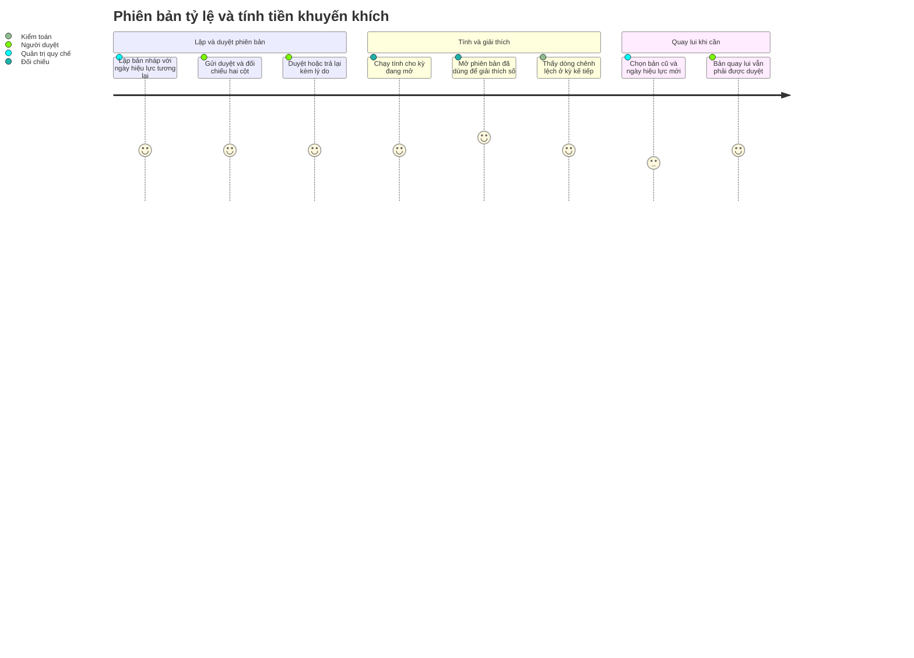

# Screens — F008_IncentiveAndRateVersion

> Cả ba màn đều **chưa xây** (F08 là MOCK-4). Đặc tả theo bản đầy đủ của LAB-1, nguồn: (tài liệu gốc trong repo, không nộp) `sc-25…sc-27`. Chi tiết trường, validation và mã lỗi nằm ở spec từng màn.

## Screen List

| Screen Name | SCR### | What User Sees | What User Can Do |
|-------------|--------|----------------|------------------|
| Kết quả tính tiền khuyến khích (完納奨励金 計算結果) | [SCR025_IncentiveResult](../../screens/SCR025_IncentiveResult/spec.md) | Bảng theo kỳ × người tham gia × loại dòng (chính / chênh lệch): số tiền đủ điều kiện, tỷ lệ áp dụng, hệ số thuế cố định, số trước làm tròn, tiền khuyến khích, phiên bản tỷ lệ và ngày hiệu lực, hạn thanh toán, ngày thanh toán xong, nguyên nhân bằng 0, kỳ được bù và lý do (với dòng chênh lệch) | Lọc theo kỳ, người tham gia, loại dòng, "chỉ dòng bằng 0"; mở chi tiết một dòng; bấm vào phiên bản để xem người lập/duyệt; chạy "Tính kỳ này" cho kỳ đang mở (chỉ nhân viên đối chiếu, qua hộp thoại xác nhận); xuất CSV đúng tập đang lọc |
| Danh sách phiên bản tỷ lệ (料率バージョン一覧) | [SCR026_RateVersionList](../../screens/SCR026_RateVersionList/spec.md) | Dòng thời gian mọi phiên bản: số phiên bản, tỷ lệ, ngày hiệu lực, trạng thái hiển thị (sáu nhãn), người lập, người duyệt, thay cho bản nào, lý do, số lần đổi trong năm | Lọc theo trạng thái và năm; lập bản mới; quay lui về một bản đã thay thế (chọn ngày hiệu lực tương lai + lý do, qua hộp thoại xác nhận); nhân viên đối chiếu và quản trị hệ thống chỉ xem |
| Chi tiết & duyệt phiên bản tỷ lệ (料率バージョン詳細・承認) | [SCR027_RateVersionApproval](../../screens/SCR027_RateVersionApproval/spec.md) | Form lập (tỷ lệ, ngày hiệu lực, số ngày tới hạn thanh toán, mốc tính, ngưỡng tối thiểu, lý do); khối dấu vết (người lập, người duyệt, thời điểm, lý do từ chối); khi chờ duyệt: hai cột bản đang hiệu lực và bản chờ duyệt, ô khác nhau được tô nền | Lưu nháp, gửi duyệt (người lập); duyệt hoặc trả lại kèm lý do (người duyệt khác người lập); xem chỉ đọc khi đi từ cột phiên bản của màn kết quả |

Hệ số thuế 110/100, kiểu làm tròn xuống và việc không có thời gian gia hạn **không** phải trường nhập ở bất kỳ màn nào — chúng chỉ hiện dưới dạng chỉ đọc ở màn kết quả.

## User Journey

1. Quản trị quy chế mở **Danh sách phiên bản tỷ lệ**, thấy dòng thời gian và số lần đã đổi trong năm, rồi bấm "Lập bản mới".
2. Tại **Chi tiết & duyệt**, form đã sao sẵn các tham số từ bản đang hiệu lực; quản trị quy chế nhập tỷ lệ mới, ngày hiệu lực tương lai và lý do rồi lưu nháp — bản nháp chưa có tác dụng gì.
3. Người lập gửi duyệt; form khoá. Một người khác (có thẩm quyền) mở bản chờ duyệt, so hai cột cạnh nhau và duyệt hoặc trả lại kèm lý do — người lập mở bản của mình thì không thấy nút duyệt.
4. Đến ngày hiệu lực, bản mới chi phối phép tính; bản cũ chuyển sang đã thay thế đúng ngày đó.
5. Nhân viên đối chiếu mở **Kết quả tính tiền khuyến khích**, chọn kỳ đang mở và bấm "Tính kỳ này"; hộp thoại nêu kỳ nào, phiên bản nào, việc chạy lại ghi đè kết quả tạm.
6. Mỗi dòng kết quả cho thấy tiền khuyến khích, và bấm vào phiên bản là sang màn chi tiết ở chế độ chỉ đọc để giải thích con số — không phải đi tìm bảng tính.
7. Khi một điều chỉnh sau chốt đã được duyệt, kỳ kế tiếp có thêm dòng chênh lệch nêu rõ bù cho kỳ nào; kỳ cũ giữ nguyên số.
8. Cần quay lui: quản trị quy chế chọn bản đã thay thế và ngày hiệu lực tương lai; hệ thống tạo phiên bản mới sao nội dung cũ và bản này lại đi qua bước duyệt.

