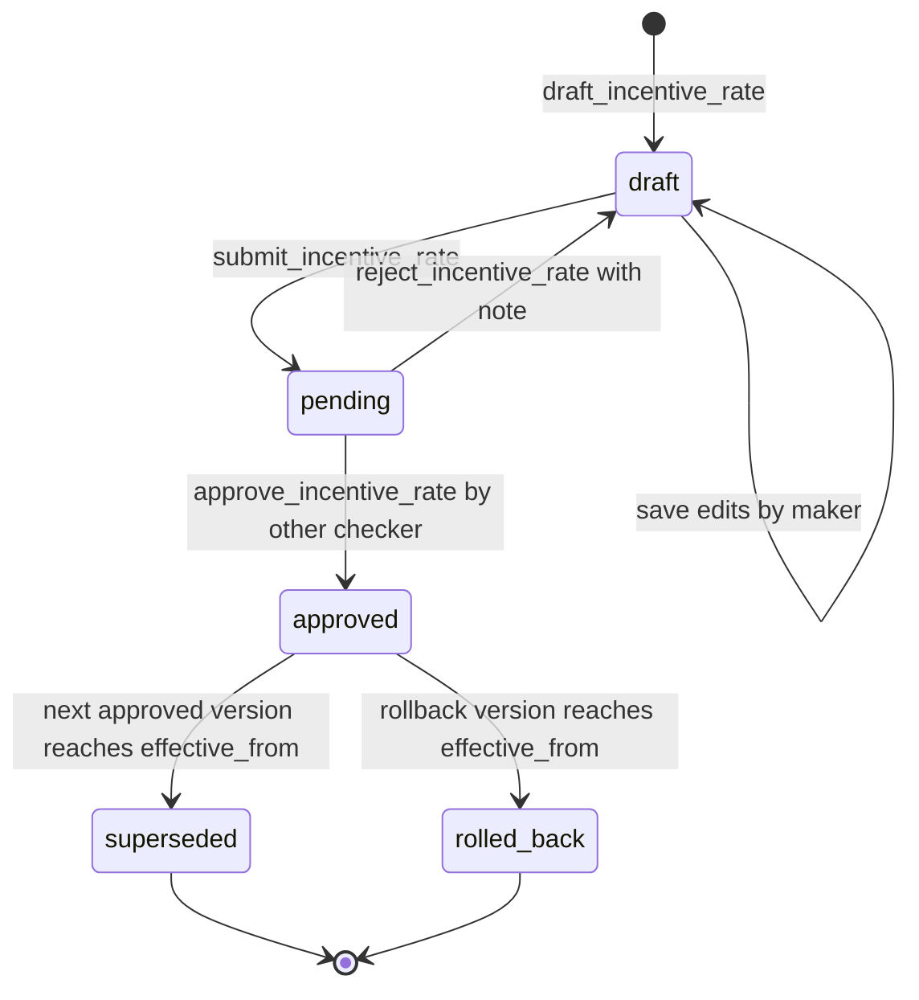
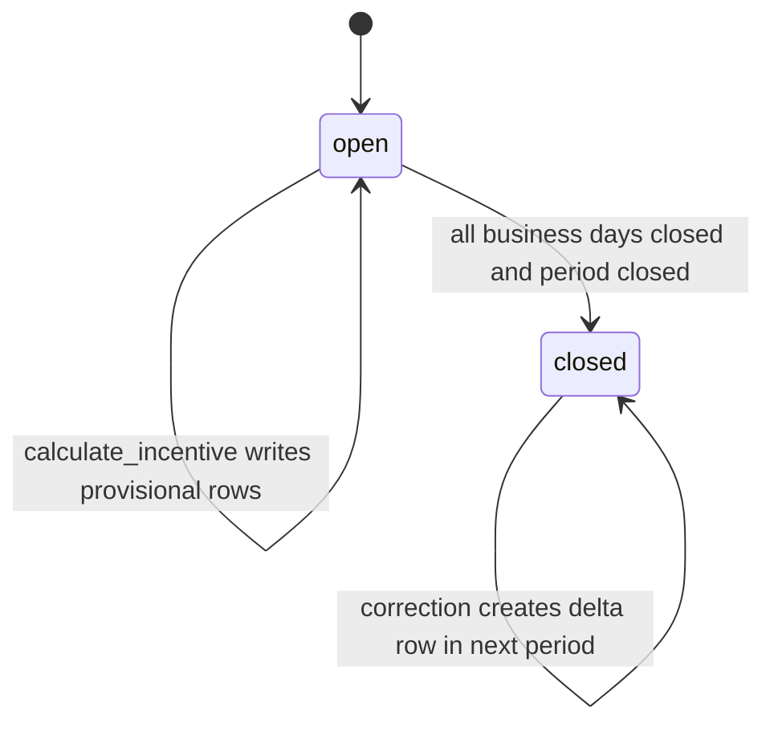
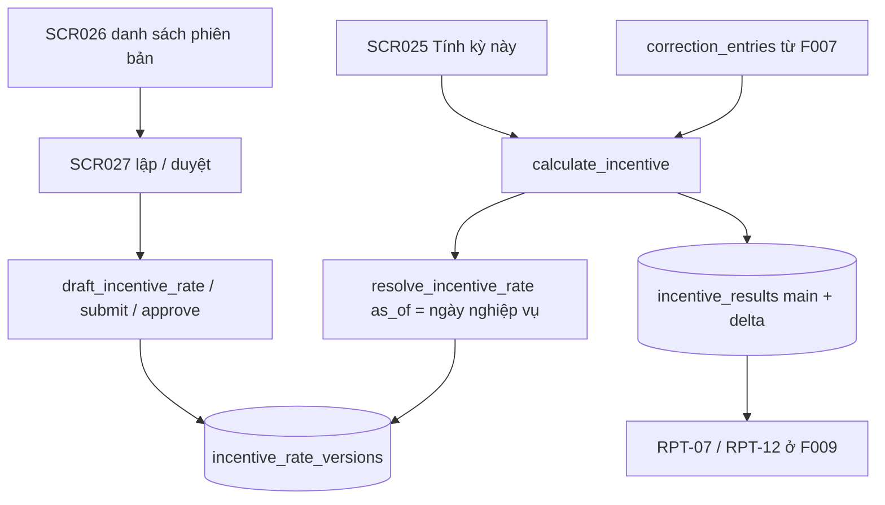

# F008_IncentiveAndRateVersion — Technical Spec

**Priority**: P0 (F08-01…F08-06 đều P0)
**Type**: mixed (màn hình + RPC `SECURITY DEFINER` + view dẫn xuất)
**Generated**: 2026-10-06

> **Ký hiệu.** `sc-NN…` (chữ thường) trong cột Source/Căn cứ = tệp screen-spec của bộ thiết kế gốc, **không nộp**; bản nộp tương ứng là SCR0NN. `[ĐÃ TRIỂN KHAI]` = chạy thật trong prototype LAB-3. `[ĐẶC TẢ]` = thiết kế, chưa xây (MOCK-4 trong (tài liệu gốc trong repo, không nộp) `lab3-scope-lock.md`). `(đề xuất)` = ngoài tài liệu khách, kèm mức rủi ro. Mã lỗi `P0030`–`P0038` là mã của bộ thiết kế (tài liệu gốc trong repo, không nộp) `screen-specs`, **chưa cài**; không cấp mã mới.

## Overview

F08 tính tiền khuyến khích 完納奨励金 theo công thức khách quy định cứng và quản lý **phiên bản tỷ lệ 料率** có ngày hiệu lực, maker-checker, trần 4 lần/năm và quay lui truy vết được. Mỗi kết quả tính gắn với một phiên bản cụ thể để in lại kỳ cũ luôn ra đúng số cũ. Màn liên quan: [SCR025](../../screens/SCR025_IncentiveResult/spec.md), [SCR026](../../screens/SCR026_RateVersionList/spec.md), [SCR027](../../screens/SCR027_RateVersionApproval/spec.md).

| Phần | Trạng thái | Căn cứ |
|---|---|---|
| Bảng/RPC/view tiền khuyến khích và phiên bản 料率 | **[ĐẶC TẢ]** — không có dòng nào trong `app/`, `lib/`, `supabase/` | `grep -ri "incentive\|rate_version\|settlement_period"` → 0 kết quả |
| Nền: `trades.amount` (cột GENERATED), `business_days.status/closed_at`, `audit_log` | **[ĐÃ TRIỂN KHAI]** | `supabase/migrations/0005_trades_and_deliveries.sql:21-33`, `0004…:4-9`, `0002…:28-37` |
| Chặn sửa ngày đã chốt (nguyên tắc nền của F08-06) | **[ĐÃ TRIỂN KHAI]** | `0010_closed_day_guard.sql:6-55` |
| Route `/incentives`, `/incentive-rates` trong `ROUTE_POLICY` | **[ĐẶC TẢ]** — bảng hiện chỉ có 9 entry, không có hai prefix này | `lib/auth/route-policy.ts:17-27` |

## Polymorphic Behavior

Các thực thể dưới đây là **đề xuất** (chưa có trong [entities](../../generated/entities.md)).

### DISC-F008-01 — incentive_rate_versions.status

| Value | Render | Validation | Persistence |
|-------|--------|------------|-------------|
| `draft` | Nhãn "Nháp" (下書き); sửa được bởi chính người lập | Không có hiệu lực; `resolve_incentive_rate` không bao giờ trả bản `draft` | Có thể lưu nhiều lần; mỗi lần không đổi `version` |
| `pending` | "Chờ duyệt"; form khoá với người lập; khối đối chiếu hai cột hiện cho người duyệt | Chỉ một bản `draft` hoặc `pending` tại một thời điểm (V-01 ở danh sách) | `submitted_at` do server đặt |
| `approved` | "Đã duyệt, chưa tới ngày" nếu `effective_from` > ngày nghiệp vụ; "Đang hiệu lực" nếu ≤ và không bản duyệt nào nằm giữa | Không sửa được; chỉ lập bản mới | `approved_by ≠ drafted_by`, `approved_at` do server |
| `superseded` | "Đã thay thế" | Chuyển **tại `effective_from` của bản mới**, không phải lúc duyệt | `supersedes_version` của bản mới trỏ về |
| `rolled_back` | "Đã quay lui" | Chuyển tại ngày hiệu lực của bản quay lui | — |

Sáu nhãn hiển thị (nháp · chờ duyệt · đã duyệt chưa tới ngày · đang hiệu lực · đã thay thế · đã quay lui) là **dẫn xuất** từ `status` + `effective_from` (view `v_incentive_rate_versions`); LAB-1 chỉ liệt kê bốn — hai nhãn thêm là đề xuất (rủi ro Thấp).

### DISC-F008-02 — incentive_results.row_type

| Value | Render | Validation | Persistence |
|-------|--------|------------|-------------|
| `main` (本計算) | Badge trung tính | `eligible_amount ≥ 0` | Một dòng cho mỗi (kỳ × người tham gia) |
| `delta` (差分) | Badge cảnh báo; hiện thêm kỳ gốc và lý do | Chỉ sinh ở **kỳ kế tiếp**; `delta_reason` 10–1000 ký tự chép từ phiếu F07 | `origin_period_id`, `delta_reason`; **không UPDATE dòng kỳ cũ** |

### DISC-F008-03 — incentive_rate_versions.payment_due_basis (đề xuất, rủi ro Trung bình)

| Value | Render | Validation | Persistence |
|-------|--------|------------|-------------|
| `trade_confirmed` (売買確定日) | Nhãn mốc | `payment_due_days` 0…180 | Tham số của phiên bản |
| `delivery_completed` (引渡し完了日) | Nhãn mốc | như trên | như trên |
| `period_end` (期末) | Nhãn mốc | như trên | như trên |

**Source:** (tài liệu gốc trong repo, không nộp) `sc-27-duyet-phien-ban-ty-le.md:44`; ba giá trị là suy luận từ Q-09, **chưa khách xác nhận**.

## Cross-Cutting Logic

### Requirements

| Code | Description | Endpoint/Handler | Verifiable |
|------|-------------|------------------|------------|
| FR-INC-01 | Tính 完納奨励金 từ số tiền đủ điều kiện + 交付率 + phiên bản đang hiệu lực; **khớp bộ số mẫu Appendix C**; giữ 規則版 (F08-01, F08-02) | RPC `calculate_incentive` · [ĐẶC TẢ] | yes — **bị chặn: chưa có bộ số mẫu (Q-17)** |
| FR-INC-02 | Tạo phiên bản 料率 với 発効日 tương lai, maker-checker, rollback theo phiên bản; draft không có hiệu lực (F08-03, F08-05) | RPC `draft_incentive_rate`, `submit_incentive_rate`, `approve_incentive_rate`, `reject_incentive_rate`, `rollback_incentive_rate` · [ĐẶC TẢ] | yes |
| FR-INC-03 | Điều chỉnh sau lock sinh delta ở kỳ kế tiếp; báo cáo kỳ trước giữ nguyên (F08-06) | `calculate_incentive` đọc `correction_entries` · [ĐẶC TẢ] | yes |
| FR-RULE-01 | Lưu người tạo, người duyệt, 発効日, trạng thái cho **mọi** phiên bản (F08-04) | cột của `incentive_rate_versions` · [ĐẶC TẢ] | yes |
| FR-AUDIT-03 | Mỗi bản ghi tiền khuyến khích hiển thị phiên bản và ngày hiệu lực đã dùng (F11-03) | cột lưu `rate_version_id`, `grant_rate_applied`; liên kết sang SCR027 | yes |
| NFR-OPS-02 | Đổi quy tắc/料率 bằng cấu hình có kiểm soát, không deploy, không sửa dữ liệu lịch sử | RPC phiên bản · [ĐẶC TẢ] | yes |
| NFR-PERF-01 | Tra cứu thông thường p95 ≤ 2 giây | `v_incentive_results` có chỉ mục theo kỳ/người tham gia (đề xuất) | yes |
| NFR-SEC-01 | MFA cho role phê duyệt — phân tầng đã chốt (PREMISE C-04); prototype một lớp (MOCK-1) | Supabase Auth · [ĐẶC TẢ] | yes |

**Source:** (tài liệu gốc trong repo, không nộp) `product-a-rfp-business-summary.md:396-418`, (tài liệu gốc trong repo, không nộp) `product-a-feature-list.md:143-155`; handler từ `sc-25…sc-27` mục 8.

### Business Rules

| Code | Rule | Enforced at | Nguồn |
|------|------|-------------|-------|
| BR-INC-01 | Hệ số thuế **110/100**; làm tròn **xuống (floor)** theo JPY; **không có 猶予期間**; quá hạn thanh toán → **= 0** (không giảm dần); mốc JST + 業務日; điều chỉnh sau chốt kỳ → delta kỳ kế tiếp | Hằng số trong thân `calculate_incentive` — **không** là field cấu hình | RFP B.5, FIG-013 |
| GOV-RULE-01 | Đổi 料率 tối đa **4 lần/năm**; 起票・承認分離; 発効日 tương lai; rollback truy vết được; không biến dạng dữ liệu đã chốt trước 発効日 | Thân RPC (`P0030` trần, `P0031` ngày hiệu lực, `P0032` maker ≠ checker/`can_approve`, `P0033` quay lui không còn bản trước) · [ĐẶC TẢ] | RFP 11-04 |
| BR-CLOSE-01 | Kỳ đã chốt không tính lại (`P0035`) | RPC · [ĐẶC TẢ]; nền `guard_closed_day` **[ĐÃ TRIỂN KHAI]** | RFP 07-03 |
| — (RFP/architecture §3.1) | Mọi tra cứu tỷ lệ theo `as_of` = **ngày nghiệp vụ**, không bao giờ `now()`; `resolve_incentive_rate` raise `P0034` khi không có bản | RPC `resolve_incentive_rate` | architecture §3.1, SCR026 §8 |
| — (đề xuất, rủi ro Thấp) | `resolve_incentive_rate` chỉ xét bản đã duyệt (`approved`, `superseded`, `rolled_back` — đều từng có hiệu lực) và chọn `effective_from` lớn nhất ≤ `as_of`; `draft`/`pending` không bao giờ chi phối tiền. Lọc riêng `approved` sẽ làm tra ngày quá khứ trượt sang bản mới sau khi bản cũ chuyển `superseded`, phá FR-INC-03 | RPC | SCR026 §9 |
| — (đề xuất, rủi ro Thấp) | `grant_rate_applied`, `rate_version_id`, `payment_due_date` là **cột lưu** tại lúc tính; không join động theo ngày hôm nay | Lược đồ + view | SCR025 §3 |
| — (đề xuất, rủi ro Trung bình) | Trần 4 lần đếm theo `effective_from` trong **năm dương lịch**, kiểm hai lần (lúc lưu nháp và lúc duyệt) | RPC | SCR026 §9, SCR027 §8 |
| — (đề xuất, rủi ro Cao) | Quay lui **tính vào** trần 4 lần (nếu không, quay lui thành đường lách trần) | RPC | SCR026 §10 câu 4 |
| — (đề xuất, rủi ro Trung bình) | Quay lui = tạo phiên bản mới sao nội dung bản cũ, vẫn qua duyệt; không UPDATE dòng cũ | RPC `rollback_incentive_rate` | SCR026 §7 |
| — (đề xuất, rủi ro Trung bình) | `payment_due_days`, `payment_due_basis`, `min_eligible_amount` là tham số của phiên bản; hệ số thuế, kiểu làm tròn, "không gia hạn" **không bao giờ** là field | Lược đồ payload | SCR027 §3 |
| — (đề xuất, rủi ro Trung bình) | Chạy tính thủ công cho kỳ đang mở; kỳ còn ngày `open` → kết quả tạm kèm cảnh báo `P0038`, vẫn cho chạy | RPC | SCR025 §4 |

**Đối ứng mã lỗi GOV-RULE-01 giữa F008 và [F012](../F012_MarketManagement/technical-spec.md).** Hai tính năng cùng khuôn phiên bản nhưng mỗi màn giữ mã riêng (không gộp để không đổi spec của màn kia):

| Bất biến | F008 (SCR026/SCR027) | F012 (SCR037) |
|---|---|---|
| Trần 4 lần/năm | `P0030` | `P0015` |
| `effective_from` ở tương lai, không trùng bản đã duyệt | `P0031` | `P0016` |
| Người duyệt ≠ người lập và có `can_approve` | `P0032` | `P0013` |
| Bản đã được xử lý/không còn chờ | `P0036` | `P0013` (F012 không có trạng thái `pending`) |
| Quay lui nhưng không còn bản trước | `P0033` | `P0071` |
| Không có bản hiệu lực tại `as_of` | `P0034` | `P0017` |

### Decision Logic

---

#### DEC-F008-01_ZeroIncentiveReason
**subtype:** render
**Triggers in:** SCR025 (cột Nguyên nhân bằng 0 (ゼロ理由))
**Involved entities:** `incentive_results.paid_on`, `incentive_results.payment_due_date`, `incentive_results.eligible_amount`, `incentive_rate_versions.min_eligible_amount`
**user_visible_outcome:** vì sao một dòng có tiền khuyến khích bằng 0
**Source:** (tài liệu gốc trong repo, không nộp) `sc-25-tien-khuyen-khich.md:58`

```pseudo
if paid_on is null at calculation time → zero_reason = 'unpaid'
else if paid_on > payment_due_date → zero_reason = 'overdue'
else if min_eligible_amount is not null AND eligible_amount < min_eligible_amount → zero_reason = 'below_threshold'  # đề xuất
else zero_reason = null (incentive_amount > 0)
```

---

#### DEC-F008-02_CalculateButtonVisibility
**subtype:** interaction
**Triggers in:** SCR025
**Involved entities:** `settlement_periods.status`, viewer role
**user_visible_outcome:** nút "Tính kỳ này" chỉ hiện với `reconcile` trên kỳ **đang mở**; `rule_admin` và kỳ đã chốt chỉ xem
**Source:** `sc-25…md:22-30,77-86`

```pseudo
if viewer.role == 'reconcile' AND period.status == 'open' → show "Tính kỳ này" (confirm dialog names period, rate version, overwrite of provisional result)
else → hide
```

---

#### DEC-F008-03_RateVersionControls
**subtype:** render
**Triggers in:** SCR026 · SCR027
**Involved entities:** `incentive_rate_versions.status`, `drafted_by`, `app_users.can_approve`
**user_visible_outcome:** "Lập bản mới" chỉ cho `rule_admin`; "Quay lui" chỉ cho `rule_admin` có `can_approve` (SCR026 `P0032`); nút 承認 **ẩn hẳn** với người lập (không làm mờ); quay lui chỉ trên bản `superseded`
**Source:** `sc-26…md:20-30,73-78`, `sc-27…md:20-31,77`

```pseudo
if viewer.role == 'rule_admin' AND no other draft/pending exists → show "Lập bản mới"
if status == 'pending' AND viewer.can_approve AND viewer.id != drafted_by → show 承認 / reject
else if status == 'pending' AND viewer.id == drafted_by → hide approve (V-06); RPC still raises P0032
if status == 'superseded' AND viewer.role == 'rule_admin' AND viewer.can_approve → enable "Quay lui"   # RPC vẫn raise P0032 nếu thiếu can_approve
```

---

### State Machines

#### SM-F008-01_IncentiveRateVersionStatus
**kind:** entity
**Linked FR:** FR-INC-02, FR-RULE-01
**Source:** `sc-26…md:56-67`, `sc-27…md:106-118` · [ĐẶC TẢ]
**States:** draft, pending, approved, superseded, rolled_back



**Transition rules:**
- `[*] → draft`: guard = role `rule_admin`; không có bản `draft`/`pending` khác (V-01); trần 4 lần/năm chưa đạt (`P0030`); `effective_from` > ngày nghiệp vụ và không trùng bản `approved` (`P0031`); `grant_rate` ∈ (0, 1], tối đa 4 chữ số thập phân, khác bản đang hiệu lực (V-02, V-03, `P0037`); `version` do server cấp.
- `draft → pending`: chỉ người lập; form khoá.
- `pending → draft`: checker từ chối kèm `reject_note` 10–1000 ký tự; vòng lập/trả lại giữ làm dấu vết, **không xoá dòng**.
- `pending → approved`: guard = `approved_by ≠ drafted_by` và `can_approve` (`P0032`), phiếu còn `pending` (`P0036`), trần 4 lần kiểm lại (`P0030`).
- `approved → superseded`: xảy ra **tại `effective_from` của bản mới**; giữa lúc duyệt và ngày đó, truy vấn `as_of` nằm trong khoảng vẫn trả bản cũ.
- `approved → rolled_back`: tại ngày hiệu lực của bản quay lui (banner SCR026: "Bản v{current} sẽ chuyển `rolled_back` tại ngày đó").
- Huỷ bản `draft`/`pending`: đề xuất chuyển `cancelled` thay vì xoá dòng, nhưng LAB-1 không liệt kê trạng thái này (đề xuất, rủi ro Thấp — xem Unresolved Questions).

#### SM-F008-02_SettlementPeriodAndResults
**kind:** entity
**Linked FR:** FR-INC-01, FR-INC-03
**Source:** `sc-25…md:80-103` · [ĐẶC TẢ]
**States:** open, closed



**Transition rules:**
- `open → open` (tính): guard = role `reconcile`; có bản 料率 `approved` hiệu lực tại ngày nghiệp vụ (`P0034`); kỳ còn ngày `open` → cảnh báo `P0038`, kết quả đánh dấu tạm và lần chạy lại ghi đè kết quả tạm.
- `open → closed`: cách đóng kỳ **chưa được đặc tả** (độ dài kỳ chưa định nghĩa — Unresolved Questions); bảng `settlement_periods` chưa tồn tại.
- `closed → closed` (tính lại): `P0035` — kỳ đã chốt không tính lại.
- `closed → closed` (điều chỉnh): không UPDATE dòng cũ; lần tính **kỳ kế tiếp** sinh dòng `delta` kèm `origin_period_id` và `delta_reason`.

### Algorithms

#### ALG-F008-01_CalculateIncentive
**Linked FR:** FR-INC-01
**Source:** `sc-25…md:18,63,112-128`; công thức kết hợp ba đại lượng là **suy luận** · [ĐẶC TẢ]
**Input:** `period_id`; với mỗi người tham gia: `eligible_amount`, `payment_due_date`, `paid_on`; phiên bản 料率 hiệu lực tại ngày nghiệp vụ (`grant_rate`, `payment_due_days`, `payment_due_basis`, `min_eligible_amount`)
**Output:** dòng `incentive_results` (`raw_amount` 2 chữ số thập phân, `incentive_amount` nguyên JPY, `zero_reason`, `rate_version_id`, `grant_rate_applied`)
**File Schema**: N/A — not a file-exchange type (xuất CSV nằm ở [F009](../F009_ReportsAndExport/technical-spec.md), báo cáo RPT-07)
**Complexity:** O(n) theo số người tham gia trong kỳ
**Description:** hệ số thuế `110/100`, **floor** theo JPY, không gia hạn, quá hạn = 0 là hằng số trong hàm. Nguồn **không** viết công thức kết hợp tường minh; `INC-EDGE-03` chỉ nói "giá trị thập phân sau khi nhân hệ số thuế → làm tròn xuống về JPY". Dạng dưới đây là suy luận (rủi ro **Cao** cho tới khi có bộ số mẫu, Q-17).

```text
ver = resolve_incentive_rate(as_of = business_date)   # raise P0034 if none; never now()
if period.status == 'closed': raise P0035
for each participant:
    if paid_on is null or paid_on > payment_due_date: incentive = 0 ; set zero_reason
    else raw = eligible_amount * ver.grant_rate * 110 / 100   # suy luận, chưa xác nhận
         incentive = floor(raw)                               # NOT round
    store raw, incentive, ver.id, ver.grant_rate as grant_rate_applied
```

#### ALG-F008-02_ResolveRateAsOf
**Linked FR:** FR-INC-02, FR-AUDIT-03
**Source:** `sc-26…md:115,120`, `sc-27…md:125` · [ĐẶC TẢ]
**Input:** `p_as_of` (ngày nghiệp vụ)
**Output:** `{version_id, grant_rate, effective_from, payment_due_days, payment_due_basis, min_eligible_amount}` hoặc raise `P0034`
**File Schema**: N/A — not a file-exchange type
**Complexity:** O(log n) với chỉ mục `(effective_from)`
**Description:** là hàm đọc nhưng vẫn là RPC, không phải view: cần tham số `as_of` để chọn **một** bản và cần raise khi không có bản — view chỉ trả rỗng, dễ bị hiểu thành "交付率 = 0" (trả khuyến khích bằng 0 cho cả kỳ mà không ai biết).

```text
select version where status in ('approved','superseded','rolled_back') AND effective_from <= p_as_of
order by effective_from desc limit 1   # draft/pending không bao giờ vào
if none: raise P0034
```

### External Integrations

Không áp dụng — F08 không gọi hệ thống ngoài. Kết nối ngân hàng nằm ngoài phạm vi RFP nên hệ thống không tự biết ngày tiền về; mốc "đã thanh toán" do bộ phận đối chiếu xác nhận trong hệ thống (đề xuất của LAB-1, Q-09). Kết quả đi ra ngoài qua [F009](../F009_ReportsAndExport/technical-spec.md): báo cáo RPT-07/RPT-12 và lô xuất kế toán.

### Verification

- **VER-F008-01** — Với bộ số mẫu Appendix C của khách, `calculate_incentive` cho đúng từng đồng (covers FR-INC-01) **[bị chặn tới khi có Q-17; dựng tạm test vector từ BR-INC-01 và ba tình huống INC-EDGE rồi xin khách xác nhận]**
- **VER-F008-02** — Số thập phân sau khi nhân hệ số thuế được làm tròn **xuống**, chênh 1 JPY so với làm tròn thường (covers BR-INC-01, tình huống INC-EDGE-03)
- **VER-F008-03** — `paid_on > payment_due_date` → `incentive_amount = 0` và `zero_reason='overdue'`, không giảm dần theo số ngày trễ (covers BR-INC-01)
- **VER-F008-04** — Sau khi đổi một phiên bản có `effective_from` sau kỳ T, in lại báo cáo kỳ T → cùng checksum (covers FR-INC-03, NFR-OPS-02)
- **VER-F008-05** — Quét tĩnh thân `calculate_incentive` và view kết quả không có `now()`/`current_date`/`current_timestamp` (covers ALG-F008-02)
- **VER-F008-06** — Người lập gọi thẳng RPC duyệt bản của mình → `P0032`; bản vẫn `pending` (covers GOV-RULE-01)
- **VER-F008-07** — Bản duyệt thứ 5 trong cùng năm dương lịch → `P0030`; bản quay lui cũng bị tính (covers GOV-RULE-01)
- **VER-F008-08** — Bản `draft`/`pending` không bao giờ được `resolve_incentive_rate` trả về; sau khi bản mới có hiệu lực, tra `as_of` trước ngày đó vẫn ra bản `superseded` (covers FR-INC-02, FR-INC-03)
- **VER-F008-09** — Quay lui không UPDATE dòng cũ: số dòng `incentive_rate_versions` tăng thêm đúng một, dòng cũ giữ nguyên (covers FR-INC-02)
- **VER-F008-10** — Tính kỳ `closed` → `P0035`; điều chỉnh sau chốt sinh dòng `delta` ở kỳ kế tiếp với `origin_period_id` + `delta_reason`, kỳ gốc không đổi (covers FR-INC-03)
- **VER-F008-11** — Mở dòng kết quả thấy `rate_version`, `rate_effective_from`, người lập, người duyệt (covers FR-AUDIT-03, FR-RULE-01)

---

**Client behavior:** xem [`architecture.md`](../../system/architecture.md) (§3.1 temporal, ba lượt phân quyền) và [`permissions.md`](../../system/permissions.md) (`rule_admin`, `can_approve`).

## User Stories

### US-13 — Tính tiền khuyến khích đúng công thức (Priority: P0)

**What happens:** nhân viên đối chiếu chạy tính cho kỳ đang mở; hệ thống áp đúng công thức cố định và giữ phiên bản tỷ lệ đã dùng trên từng dòng.
**Why this priority:** quy tắc cứng BR-INC-01; sai một đồng là trượt nghiệm thu (R-26 trong sổ rủi ro).
**Independent Test:** chạy tính trên bộ số mẫu và so từng dòng với kết quả kỳ vọng của khách.

**Acceptance Scenarios (điều kiện chấp nhận trích US-13):**

1. **Given** bộ số mẫu Appendix C, **When** chạy tính, **Then** kết quả khớp từng dòng và giữ phiên bản quy chế đã áp dụng.
2. **Given** số sau hệ số thuế có phần thập phân, **When** làm tròn, **Then** làm tròn **xuống** theo JPY.
3. **Given** thanh toán quá hạn, **When** tính, **Then** tiền khuyến khích bằng 0, không giảm dần, không có thời gian gia hạn ở bất kỳ đâu.
4. **Given** kỳ đã chốt, **When** bấm tính, **Then** `P0035` kèm gợi ý rằng điều chỉnh sẽ sinh chênh lệch ở kỳ kế tiếp.

**Requirements fulfilled:**
- **FR-INC-01** — RPC `calculate_incentive` · [ĐẶC TẢ]
  **Source:** (tài liệu gốc trong repo, không nộp) `sc-25-tien-khuyen-khich.md:106-117`
- **FR-INC-03** (F08-06, không có story riêng — đuôi của US-13) — dòng `delta` ở kỳ kế tiếp
  **Source:** `sc-25…md:103`
- **FR-AUDIT-03** (F11-03) — cột phiên bản + hiệu lực liên kết sang SCR027

**Rules enforced:** BR-INC-01, BR-CLOSE-01, quy tắc đề xuất `as_of` ngày nghiệp vụ.
**State transitions:** SM-F008-02.

**Verification:**
- **VER-F008-01**, **VER-F008-02**, **VER-F008-03**, **VER-F008-04**, **VER-F008-05**, **VER-F008-10**, **VER-F008-11**

---

### US-19 — Đổi tỷ lệ khuyến khích mà không cần sửa phần mềm (Priority: P0)

**What happens:** quản trị quy chế tự lập và công bố phiên bản tỷ lệ mới; người khác duyệt; bản mới có hiệu lực từ ngày đã đặt.
**Why this priority:** GOV-RULE-01 — đổi tối đa 4 lần/năm, cả 4 lần không cần bên đề xuất can thiệp; quy tắc cứng.
**Independent Test:** lập, gửi duyệt, duyệt một phiên bản có ngày hiệu lực tương lai rồi kiểm tra kết quả tính trước/sau ngày đó.

**Acceptance Scenarios (điều kiện chấp nhận trích US-19):**

1. **Given** một bản nháp, **When** chưa được duyệt, **Then** không có hiệu lực với bất kỳ phép tính nào.
2. **Given** người lập A, **When** A mở bản của mình, **Then** không có nút duyệt; gọi thẳng RPC vẫn `P0032`.
3. **Given** bản đã duyệt có `effective_from` tương lai, **When** truy vấn `as_of` trước ngày đó, **Then** vẫn trả bản cũ.
4. **Given** đã đủ 4 bản duyệt trong năm, **When** lập hoặc duyệt thêm, **Then** `P0030`.
5. **Given** cần quay lui, **When** chọn bản `superseded` và ngày hiệu lực tương lai, **Then** hệ thống tạo bản mới sao nội dung bản cũ và bản này phải qua duyệt.
6. Mọi phiên bản lưu đủ người tạo, người duyệt, ngày hiệu lực, trạng thái; thay đổi thực hiện bằng cấu hình, không deploy lại.

**Requirements fulfilled:**
- **FR-INC-02** — RPC `draft_incentive_rate`, `submit_incentive_rate`, `approve_incentive_rate`, `reject_incentive_rate`, `rollback_incentive_rate` · [ĐẶC TẢ]
  **Source:** `sc-27-duyet-phien-ban-ty-le.md:120-131`, `sc-26-danh-sach-phien-ban-ty-le.md:110-118`
- **FR-RULE-01** — người tạo, người duyệt, 発効日, trạng thái trên mọi phiên bản

**Rules enforced:** GOV-RULE-01, CAP-HUMAN-01 (duyệt qua hộp thoại xác nhận, không phím tắt).
**State transitions:** SM-F008-01.

**Verification:**
- **VER-F008-06**, **VER-F008-07**, **VER-F008-08**, **VER-F008-09**

---

### Edge Cases

| Scenario | Behavior |
|----------|----------|
| Kỳ đã chốt, bấm tính | `P0035`: "Kỳ {period} đã chốt — không tính lại. Điều chỉnh sẽ sinh chênh lệch ở kỳ {next_period}." |
| Không có bản 料率 hiệu lực tại ngày nghiệp vụ | `P0034`: "Không có phiên bản 料率 hiệu lực cho ngày {business_date}." |
| Kỳ còn ngày `open` | `P0038` là **cảnh báo**, vẫn cho tính, kết quả đánh dấu tạm |
| Đã 4 bản duyệt trong năm | `P0030` khi lưu nháp và khi duyệt |
| `発効日` không ở tương lai hoặc trùng bản đã duyệt | `P0031` |
| Hai người cùng xử lý một bản | Người sau nhận `P0036` |
| Giá trị `grant_rate` vượt khoảng khi server kiểm lại | `P0037` |

Bảng đầy đủ kèm thông báo người dùng: [edge-cases.md](./edge-cases.md).

## Key Entities

| Entity | Table | Key Columns | Purpose |
|--------|-------|-------------|---------|
| Trade | `trades` **[ĐÃ CÓ]** | `business_date`, `quantity`, `unit_price`, `amount` (GENERATED), `status` | Nguồn của `eligible_amount` (suy luận: cách đủ điều kiện chưa định nghĩa) |
| BusinessDay | `business_days` **[ĐÃ CÓ]** | `business_date`, `status`, `closed_at` | Ngày nghiệp vụ làm `as_of`; điều kiện chốt kỳ |
| AuditLog | `audit_log` **[ĐÃ CÓ]** | `action`, `actor_id`, `old_value`, `new_value` | Vết duyệt/quay lui (cần cột `reason`, xem [F011](../F011_AuditLog/technical-spec.md)) |
| IncentiveRateVersion | `incentive_rate_versions` **[ĐỀ XUẤT]** | `version`, `grant_rate`, `effective_from`, `payment_due_days`, `payment_due_basis`, `min_eligible_amount`, `change_note`, `status`, `drafted_by/at`, `submitted_at`, `approved_by/at`, `reject_note`, `supersedes_version` | Dòng thời gian phiên bản; không có policy ghi ([ADR-002](../../decisions/ADR-002-no-write-policy-on-trades-deliveries.md)) |
| IncentiveResult | `incentive_results` **[ĐỀ XUẤT]** | `period_id`, `participant_id`, `row_type`, `eligible_amount`, `grant_rate_applied`, `raw_amount`, `incentive_amount`, `rate_version_id`, `payment_due_date`, `paid_on`, `zero_reason`, `origin_period_id`, `delta_reason`, `calculated_at` | Kết quả tính; cột lưu, không join động |
| SettlementPeriod | `settlement_periods` **[ĐỀ XUẤT]** | `id`, `label`, `status`, `open_business_days` | Kỳ tính; độ dài kỳ chưa chốt |
| Views | `v_incentive_rate_versions`, `v_incentive_results` **[ĐỀ XUẤT]** | `display_state`, `changes_this_year`; join `rate_version_id` đã lưu | Đọc cho SCR025/026/027; `security_invoker = true` |
| CorrectionEntry | `correction_entries` **[ĐỀ XUẤT]** | xem [F007](../F007_PostCloseCorrection/technical-spec.md) | Nguồn của dòng `delta` |

## Artifact References

| Artifact | File | Codes Used |
|----------|------|------------|
| System Overview | [overview.md](../../system/overview.md) | — |
| Architecture | [architecture.md](../../system/architecture.md) | C6, §3.1, §3.2 |
| Feature List | [feature-list.md](../../generated/feature-list.md) | F008 |
| Entities | [entities.md](../../generated/entities.md) | đề xuất |
| Screens | [screens.md](./screens.md) | SCR025, SCR026, SCR027 |
| Permissions | [permissions.md](../../system/permissions.md) | rule_admin, can_approve |
| Business Rules | [business-rules.md](../../system/business-rules.md) | BR-INC-01, GOV-RULE-01 |
| User Stories (nguồn LAB-1; layout spec không có `user-stories.md` riêng) | (tài liệu gốc trong repo, không nộp) `product-a-user-stories.md` | US-13, US-19 |

## Assumptions

- **Quy ước đặt mã** (suy luận): `SM-F008-nn`, `ALG-F008-nn`, `DEC-F008-nn`, `VER-F008-nn` là mã của tài liệu này; không dùng tiền tố `SC-` cho Verification vì trùng alias màn hình của LAB-1.
- 料率 là quy tắc **quốc gia** (một dòng thời gian, thuộc F008), không phải của chợ: đã chốt — `incentive_rate` không phải `rule_key` của [F012](../F012_MarketManagement/technical-spec.md)/`market_rules`. Khách chưa xác nhận giả định; nếu khách chọn "thuộc chợ" thì SCR026/SCR027 thu về một `rule_key` của F012.
- Công thức kết hợp `eligible_amount × grant_rate × 110/100` là **suy luận** (rủi ro Cao); chỉ thứ tự "nhân hệ số thuế rồi làm tròn xuống" có trong nguồn.
- Mốc "đã thanh toán" = lúc bộ phận đối chiếu xác nhận trong hệ thống, có lưu người và thời điểm (đề xuất LAB-1 cho Q-09; chưa xác nhận). Cột `paid_on` và thao tác xác nhận **chưa có màn nào** trong 37 màn — khoảng trống cần quyết (rủi ro Trung bình).
- Cần ≥ 2 tài khoản `rule_admin` (một có `can_approve`); role `rule_admin` (đề xuất) và cột `app_users.can_approve` chưa có trong DB. Mô hình 9 role key + cờ `can_approve` trên tài khoản đã chốt (PREMISE C-09); `rule_admin` có `can_approve` là người quay lui và duyệt.
- Giả định A2 (Q-02): quyết toán phản ánh khi số còn lại bằng 0 — ảnh hưởng điều kiện "hoàn tất thanh toán".

## Source Code References

| Order | Symbol | Path | Purpose |
|-------|--------|------|---------|
| 1 | `trades` | `supabase/migrations/0005_trades_and_deliveries.sql:21-33` | `amount` GENERATED = `quantity × unit_price` (nguồn tiền) |
| 2 | `business_days` | `supabase/migrations/0004_business_days_and_lots.sql:4-9` | Ngày nghiệp vụ, trạng thái chốt |
| 3 | `v_daily_reconciliation` | `supabase/migrations/0006_derived_views.sql:48-62` | Khuôn view `security_invoker` mà view F08 phải theo |
| 4 | `guard_closed_day` | `supabase/migrations/0010_closed_day_guard.sql:6-55` | Bảo vệ nền của ngày đã chốt |
| 5 | `ROUTE_POLICY` | `lib/auth/route-policy.ts:17-27` | Cần thêm `/incentives`, `/incentive-rates` trước `"/"` |
| 6 | Screen specs | (tài liệu gốc trong repo, không nộp) `sc-25…sc-27` | Nguồn chính đặc tả F08 |
| 7 | Test vector (mô tả) | (tài liệu gốc trong repo, không nộp) `product-a-rfp-business-summary.md:380-407` | Ba tình huống INC-EDGE, chưa có số |

## Unresolved Questions

1. **Q-17 — bộ số mẫu Appendix C**: chặn nghiệm thu `FR-INC-01`/`US-13`; hiện chỉ có mô tả ba tình huống.
2. **Q-09 — định nghĩa 支払期日 và mốc "đã thanh toán"**: rủi ro nghiệm thu cao nhất; đề xuất tham số hoá trong phiên bản quy chế.
3. **Công thức kết hợp** `eligible_amount`, `grant_rate`, hệ số thuế: thứ tự nhân và nội dung của "số tiền đủ điều kiện" chưa được nguồn viết ra.
4. **Độ dài "kỳ"** và cách đóng kỳ (`settlement_periods` chưa tồn tại); liên quan Q-14 (lịch nghỉ chợ).
5. **Ngưỡng tối thiểu** (`min_eligible_amount`, `below_threshold`) — suy từ tình huống INC-EDGE-01; bỏ nếu khách xác nhận không có ngưỡng.
6. **Trần 4 lần tính năm dương lịch hay năm tài chính**; **quay lui có tính vào trần**. (料率 thuộc quốc gia/F008: đã chốt, xem Assumptions.)
7. **Bản 料率 đầu tiên** do dữ liệu di trú (phase 11 của WBS), cần khách chỉ định bản gốc và 発効日.
8. **Ai duyệt 料率** — đã chốt dùng chung cờ `can_approve` trên tài khoản với F007/F012 (PREMISE C-09, một cấp theo C-03b); khách chưa xác nhận giả định, nếu đòi thẩm quyền riêng/hai cấp thì cùng mẫu câu hỏi Q-03.
9. **Huỷ bản `draft`/`pending`** có lưu vết (`cancelled`) không; **6 trạng thái hiển thị** hay 4 như LAB-1; **tỷ lệ theo nhóm người tham gia**.
10. **Ai xác nhận "đã thanh toán" và ở màn nào** — không màn nào trong 37 màn có thao tác này (khoảng trống đặc tả).

## Source Walkthrough

1. **File:** `supabase/migrations/0005_trades_and_deliveries.sql:21-33` — nguồn số tiền (`amount` GENERATED).
2. **File:** `supabase/migrations/0004_business_days_and_lots.sql:4-9` — ngày nghiệp vụ dùng làm `as_of`.
3. **File:** (tài liệu gốc trong repo, không nộp) `sc-26-danh-sach-phien-ban-ty-le.md:99-130` — dòng thời gian phiên bản và `resolve_incentive_rate`.
4. **File:** (tài liệu gốc trong repo, không nộp) `sc-27-duyet-phien-ban-ty-le.md:106-141` — vòng lập/duyệt và RPC.
5. **File:** (tài liệu gốc trong repo, không nộp) `sc-25-tien-khuyen-khich.md:94-128` — tính, cột lưu và delta kỳ sau.

### Call Hierarchy



**Related files:** xem `## Source Code References` — cột **Order** là thứ tự đọc.

## DB Impact per Event

| Event/Endpoint | Table | Columns | Operation | Value Derivation | Source |
|----------------|-------|---------|-----------|-------------------|--------|
| `draft_incentive_rate` (đặc tả) | `incentive_rate_versions` | `version`, `grant_rate`, `effective_from`, `payment_due_*`, `min_eligible_amount`, `change_note`, `status='draft'`, `drafted_by/at` | INSERT / UPDATE (bản nháp của chính mình) | `version` server cấp; `drafted_by = auth.uid()`; `drafted_at` server | `sc-27…md:126` |
| `submit_incentive_rate` (đặc tả) | `incentive_rate_versions` | `status='pending'`, `submitted_at` | UPDATE | server đặt thời điểm | `sc-27…md:127` |
| `approve_incentive_rate` (đặc tả) | `incentive_rate_versions` | `status='approved'`, `approved_by`, `approved_at` | UPDATE | `approved_by = auth.uid() ≠ drafted_by`; bản cũ chuyển `superseded` **tại `effective_from`** | `sc-27…md:128,116` |
| `reject_incentive_rate` (đặc tả) | `incentive_rate_versions` | `status='draft'`, `reject_note` | UPDATE | note 10–1000 ký tự | `sc-27…md:129` |
| `rollback_incentive_rate` (đặc tả) | `incentive_rate_versions` | bản mới: `supersedes_version`, nội dung sao bản cũ, `status='draft'` | INSERT | không UPDATE dòng cũ | `sc-26…md:116,129` |
| `calculate_incentive` (đặc tả) | `incentive_results` | các cột kết quả, `row_type`, `origin_period_id`, `delta_reason` | INSERT (kỳ mở: ghi đè kết quả tạm) | ALG-F008-01; dòng `delta` ở kỳ kế tiếp từ `correction_entries` | `sc-25…md:112,103` |
| Mỗi RPC trên (đặc tả) | `audit_log` | `action`, `old_value`, `new_value`, `reason` | INSERT | FR-AUDIT-01; cột `reason` chưa có | `[INFERRED]` — F08 không nêu điểm ghi audit tường minh; suy từ FR-AUDIT-01 |
