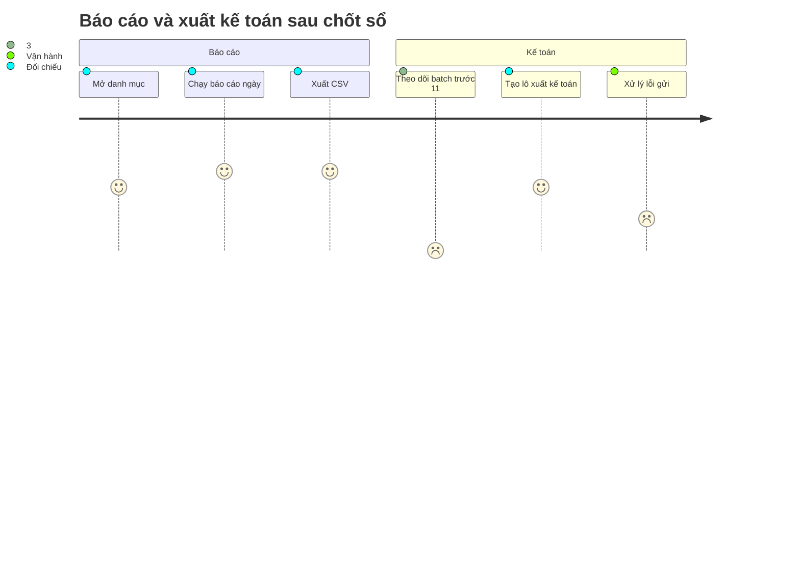

# Screens — F009_ReportsAndExport

Cả ba màn đều [ĐẶC TẢ — chưa xây]; không màn nào có trong prototype LAB-3. Nguồn: (tài liệu gốc trong repo, không nộp) `sc-28…sc-30`. Đặc tả đầy đủ từng màn ở thư mục màn hình tương ứng; xem thêm [technical-spec.md](./technical-spec.md).

## Screen List

| Screen Name | SCR### | What User Sees | What User Can Do |
|-------------|--------|----------------|------------------|
| Danh mục báo cáo (帳票カタログ, alias SC-28) | [SCR028_ReportCatalog](../../screens/SCR028_ReportCatalog/spec.md) | 12 báo cáo cố định (9 ngày, 3 tháng) kèm tần suất, tham số bắt buộc, lần chạy gần nhất và kết quả; dòng lỗi có badge đỏ. Danh sách thu hẹp theo chức danh | Lọc theo tần suất hoặc từ khoá; mở một báo cáo. Không có nút tạo báo cáo mới |
| Xem & xuất báo cáo (帳票の参照・出力, alias SC-29) | [SCR029_ReportViewExport](../../screens/SCR029_ReportViewExport/spec.md) | Form tham số dựng theo báo cáo, bảng kết quả, thanh siêu dữ liệu (thời điểm tạo, căn cứ quy chế, người chạy, mã lần chạy), badge "số liệu tạm" khi ngày chưa chốt, 10 lần chạy gần đây | Chạy báo cáo, xuất CSV, in lại một lần chạy cũ đúng theo tham số đã lưu |
| Trạng thái batch & lô kế toán (バッチ状況・会計連携バッチ, alias SC-30) | [SCR030_AccountingBatch](../../screens/SCR030_AccountingBatch/spec.md) | Hai tab: batch báo cáo ngày (đếm ngược tới 11:00, trạng thái, lần thử, mã lỗi, hành động khắc phục) và lô xuất kế toán (mã lô, checksum, trạng thái, loại, lô bị thay thế); chi tiết dòng của một lô | Tạo lô sau khi xem trước, chạy lại batch lỗi, mở phiếu điều chỉnh. `sys_admin` chỉ xem |

Chức danh mở được: `reconcile` (cả ba), `market_manager` (đề xuất; SCR028, SCR029), `ops_admin` (đề xuất; SCR030), `sys_admin` (chỉ xem SCR030). Các chức danh đề xuất chưa có trong DB.

## User Journey

1. Người đối chiếu mở danh mục sau khi sổ ngày đã chốt và thấy tập báo cáo mình được phép xem.
2. Người dùng chọn một báo cáo — hệ thống chuyển sang màn xem, mặc định chọn ngày nghiệp vụ đã chốt gần nhất, không phải hôm nay.
3. Người dùng bấm chạy; bảng hiện kèm thanh siêu dữ liệu. Ngày chưa chốt thì nhóm báo cáo chỉ-sau-chốt bị chặn, nhóm còn lại hiện số tạm.
4. Người dùng xuất CSV; file mang đủ bốn thông tin siêu dữ liệu.
5. Trước 11:00, người vận hành hoặc đối chiếu mở màn batch, thấy đếm ngược, rồi tạo lô kế toán sau khi xem trước số dòng, tổng tiền, thuế và phân bố trạng thái dòng.
6. Khi có lỗi, dòng đỏ chỉ hành động khắc phục; sai sau khi gửi thì chuyển sang phiếu điều chỉnh (xem [F007](../F007_PostCloseCorrection/screens.md)).

