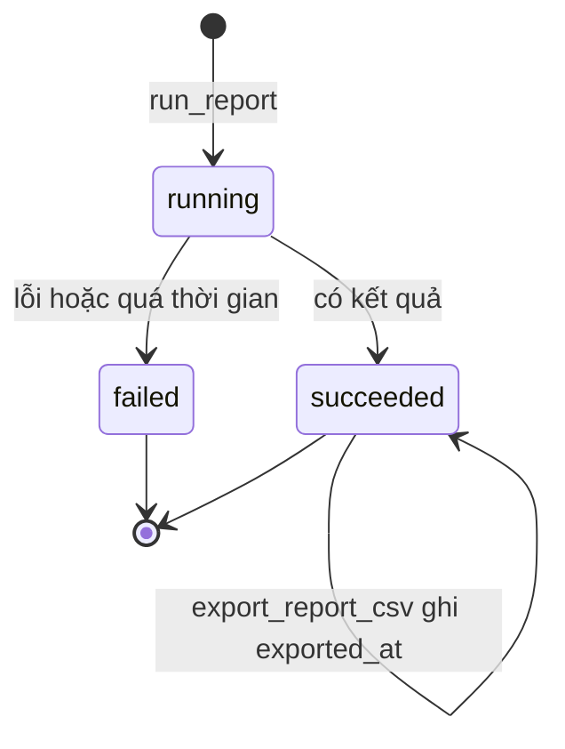
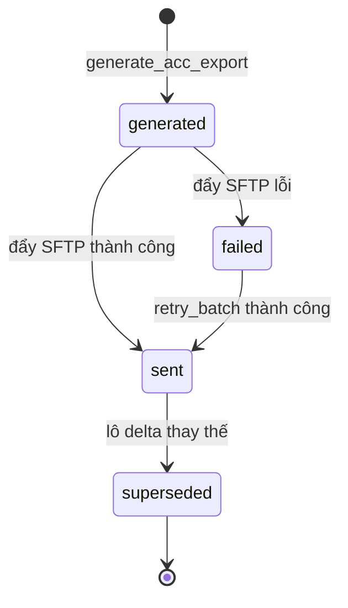
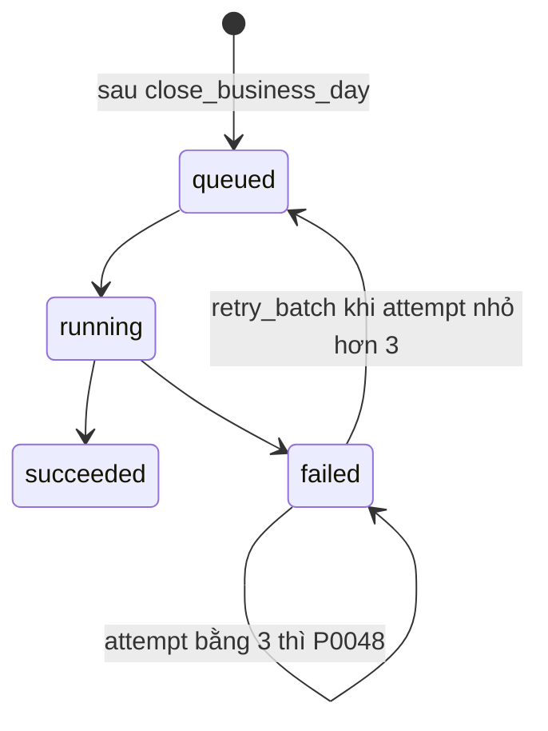
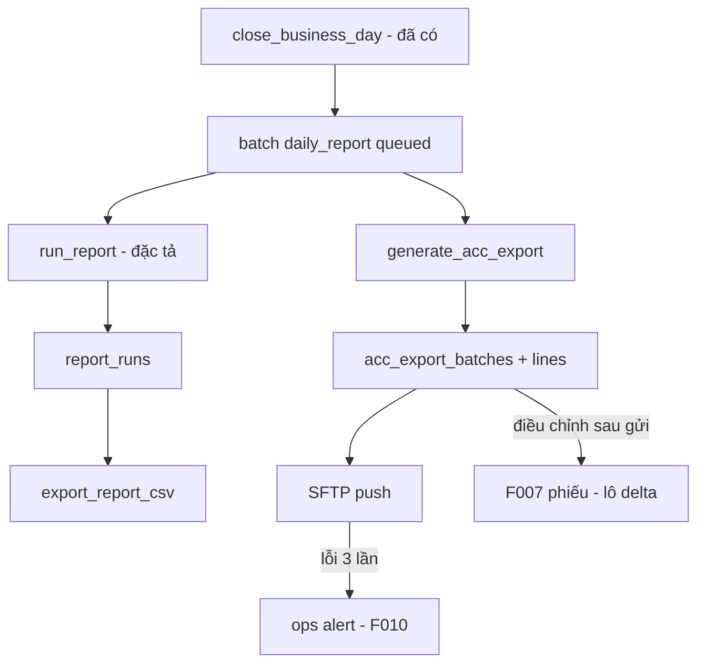

# F009_ReportsAndExport — Technical Spec

**Priority**: P0 (F09-01, F09-03, F09-05) · P1 (F09-02) · NFR (F09-04, F09-06)
**Type**: mixed (ui + background)
**Generated**: 2026-10-06

> Quy ước nguồn: `sc-NN` (chữ thường) = screen-spec của bộ thiết kế gốc, **không nộp**; bản nộp tương ứng là SCR0NN. Nhãn trạng thái dùng trong file: **[ĐÃ TRIỂN KHAI]** = có trong prototype LAB-3, trích migration/code đã kiểm; **[ĐẶC TẢ — chưa xây]** = thiết kế, chưa có code. Toàn bộ F009 là [ĐẶC TẢ — chưa xây] (MOCK-5 và một phần MOCK-9 trong (tài liệu gốc trong repo, không nộp) `lab3-scope-lock.md`), ngoại trừ nền chốt sổ ở mục Source Code References.

## Overview

F009 cung cấp 12 báo cáo cố định (9 ngày, 3 tháng; mã RPT-01…RPT-12) với xuất CSV, batch báo cáo ngày phải xong trước 11:00 JST, và lô xuất số liệu sau chốt sang hệ thống kế toán (IF-ACC-01) theo phương án đã chốt (PREMISE C-03, giả định A4): CSV một chiều qua SFTP. Người dùng chính là bộ phận đối chiếu (`reconcile`); ban quản lý (`market_manager`, đề xuất) và vận hành (`ops_admin`, đề xuất) dùng một phần. Kích hoạt bởi việc chốt sổ ngày (`close_business_day`, [ĐÃ TRIỂN KHAI]). Chạm bảng `business_days`, `audit_log` (đã có) và các bảng đề xuất `report_catalog`, `report_runs`, `batch_runs`, `acc_export_batches`, `acc_export_lines`.

Màn hình: [SCR028_ReportCatalog](../../screens/SCR028_ReportCatalog/spec.md) · [SCR029_ReportViewExport](../../screens/SCR029_ReportViewExport/spec.md) · [SCR030_AccountingBatch](../../screens/SCR030_AccountingBatch/spec.md). Chi tiết hiển thị xem [screens.md](./screens.md); tình huống biên xem [edge-cases.md](./edge-cases.md).

## Polymorphic Behavior

Cross-reference: [entities.md](../../generated/entities.md). Các trường phân nhánh hành vi (đều [ĐẶC TẢ — chưa xây]; "DISC" ở đây là trường rời rạc suy ra từ screen-spec, chưa có mã DISC chính thức — suy luận).

### acc_export_batches.kind

| Value | Render | Validation | Persistence |
|-------|--------|------------|-------------|
| `full` | Dòng lô thường, cột "Thay thế lô" rỗng | Đúng một lô `full` đã `sent` cho mỗi `business_date`; tạo thêm → P0046 (đề xuất, chưa cài). `total_amount` và `tax_amount` không âm | Ghi `acc_export_batches` + `acc_export_lines` cùng một transaction; `line_status` ∈ `保留` / `確認済み` |
| `delta` | Có liên kết "Thay thế lô" tới `batch_code` gốc | Chỉ sinh từ phiếu điều chỉnh F007 đã duyệt ([F007](../F007_PostCloseCorrection/technical-spec.md)); được phép số âm | `supersedes` trỏ lô gốc; dòng có `line_status = 調整済み`; lô gốc chuyển `superseded` |

**Source:** (tài liệu gốc trong repo, không nộp) `sc-30-batch-ke-toan.md` mục 3.2, 3.3.

### report_catalog.requires_closed_day (nhóm báo cáo)

| Value | Render | Validation | Persistence |
|-------|--------|------------|-------------|
| chỉ-sau-chốt (RPT-05, RPT-06, RPT-07, RPT-08) | Không có bản "tạm" | Ngày chưa `closed` → P0042 (đề xuất, chưa cài) | `report_runs.as_of` = `business_days.closed_at` |
| tra cứu vận hành (các báo cáo còn lại) | Badge vàng "Số liệu tạm" khi ngày chưa chốt | Chạy được với `as_of` rỗng | `as_of` NULL ⇔ `provisional = true`; CSV có hậu tố `-provisional` |

**Source:** `sc-29-xem-xuat-bao-cao.md` mục 3.1, 5. Việc chia hai nhóm là (đề xuất — rủi ro Trung bình): khách chưa nói gì về báo cáo trên ngày chưa chốt.

## Cross-Cutting Logic

### Requirements

| Code | Description | Endpoint/Handler | Trạng thái | Verifiable |
|------|-------------|------------------|-----------|------------|
| FR-RPT-01 (P0) | Báo cáo ngày theo catalog cố định, có bộ lọc và xuất CSV (F09-01, F09-03) | `run_report`, `export_report_csv` (RPC, đề xuất) | [ĐẶC TẢ — chưa xây] | yes |
| FR-RPT-02 (P1) | Báo cáo tháng tổng hợp theo ngày nghiệp vụ và phiên bản quy chế (F09-02) | `run_report` với tham số `period` | [ĐẶC TẢ — chưa xây] | yes |
| FR-RPT-03 (P1) | Xuất dữ liệu có cấu trúc; không có report builder (F09-03). Ghi nhận lệch diễn giải ở Unresolved Questions | `report_catalog` là seed chỉ đọc, không có màn CRUD | [ĐẶC TẢ — chưa xây] | yes |
| IF-ACC-01 / DR-SETTLE-01 (P0) | Gửi số liệu sau chốt sang kế toán, 6 trường tối thiểu (F09-05) | `preview_acc_export`, `generate_acc_export` | [ĐẶC TẢ — chưa xây] | yes |
| FIG-LOAD-01 | Batch báo cáo ngày xong trước 11:00 JST (F09-04) | batch `daily_report`; trạng thái `late` dẫn xuất | [ĐẶC TẢ — chưa xây] | yes |
| NFR-OPS-01 | Lỗi batch/xuất dữ liệu hiện ra cho vận hành, không mất im lặng (F09-06) | `v_batch_status`, chuyển sang [F010](../F010_Notifications/technical-spec.md) | [ĐẶC TẢ — chưa xây] | yes |
| NFR-PERF-01 | Tra cứu thông thường p95 ≤ 2 giây | Phân trang phía server cùng `run_code` | [ĐẶC TẢ — chưa xây] | yes |
| DR-RET-01 | Dữ liệu nghiệp vụ online 7 năm | Cách hiểu chờ Q-10 | [ĐẶC TẢ — chưa xây] | no (chờ Q-10) |
| FR-INC-03 | In lại báo cáo kỳ cũ ra đúng số cũ | `as_of` lưu trên `report_runs`, "In lại" dùng `params` + `as_of` đã lưu | [ĐẶC TẢ — chưa xây] | yes |

**Source:** (tài liệu gốc trong repo, không nộp) `product-a-rfp-business-summary.md` §7.x, §8.2–8.3, §9; (tài liệu gốc trong repo, không nộp) `sc-28…sc-30`.

### Business Rules

| Code | Rule | Nguồn / nhãn |
|------|------|--------------|
| BR-CLOSE-01 | Không sửa trực tiếp ngày đã chốt; hệ quả cho F009: mọi truy vấn báo cáo tham số hoá theo `business_date` + phiên bản quy chế tại `as_of`, không dùng `now()` | LAB-1 · trigger `guard_closed_day` [ĐÃ TRIỂN KHAI] (`0010_closed_day_guard.sql:6-55`); phần báo cáo [ĐẶC TẢ — chưa xây] |
| BR-INC-01 | Tổng tiền/thuế trong số liệu xuất theo công thức khách ghim (110/100, làm tròn xuống JPY) | LAB-1; xem [F008](../F008_IncentiveAndRateVersion/technical-spec.md) |
| IF-ACC-01 | Chỉ trao đổi dữ liệu sau khi lock; 6 trường tối thiểu; `行ステータス` ∈ {保留, 確認済み, 調整済み}, không thêm giá trị | LAB-1 §8.3 |
| BR-F009-01 (đề xuất, rủi ro Thấp) | Danh mục báo cáo đúng 12 mã, không có mã thứ 13; mỗi báo cáo có ít nhất một tham số thời gian | `sc-28` mục 3 |
| BR-F009-02 (đề xuất, rủi ro Trung bình) | `as_of` do server tra từ `business_days.closed_at`, client không gửi; thiếu `as_of` với báo cáo chỉ-sau-chốt → P0043 (đề xuất, chưa cài) | `sc-29` mục 3.1, 4 |
| BR-F009-03 (đề xuất, rủi ro Trung bình) | `full` đúng một lần cho mỗi `business_date`; mọi thay đổi sau đó là `delta` có `supersedes`; không có trạng thái `accepted` vì CSV một chiều (C-03) | `sc-30` mục 3.2, 4, 9 |
| BR-F009-04 (đề xuất, rủi ro Trung bình) | Xuất CSV quá 50.000 dòng không chạy đồng bộ mà chuyển hàng đợi nền (P0049, đề xuất, chưa cài); phân trang 500 dòng/trang khi trên 5.000 dòng. Ngưỡng chưa đo | `sc-29` mục 3.2, 4, 10 |
| BR-F009-05 (đề xuất, rủi ro Thấp) | "Chạy lại" chỉ áp dụng cho batch đang `failed` (ngoài ra → P0047, đề xuất, chưa cài). Trần thử lại batch là 3; từ lần 3 nút "Chạy lại" tắt và dòng chuyển sang hàng cảnh báo (P0048, đề xuất, chưa cài) | `sc-30` mục 3.1, 4 |

Mã BR-F009-nn là quy ước đặt mã của tài liệu này cho rule chưa có mã LAB-1 (suy luận).

### Decision Logic

#### DEC-F009-01_ReportRunBranch
**subtype:** flow
**Triggers in:** SCR029_ReportViewExport, khi bấm "Chạy báo cáo"
**Involved entities:** `business_days.status`, `report_catalog.requires_closed_day`
**user_visible_outcome:** chạy bình thường, chạy kèm cờ tạm, hoặc bị chặn
**Source:** (tài liệu gốc trong repo, không nộp) `sc-29-xem-xuat-bao-cao.md` mục 4, 5, 7 [ĐẶC TẢ — chưa xây]

```pseudo
if report_code not in catalog        -> P0040 (đề xuất, chưa cài)
else if role not in allowed_roles     -> P0044 (đề xuất, chưa cài)
else if day.status = 'closed'         -> run, as_of = closed_at
else if requires_closed_day           -> P0042 (đề xuất, chưa cài)
else                                  -> run, as_of = NULL, provisional = true
```

#### DEC-F009-02_BatchRemedy
**subtype:** interaction
**Triggers in:** SCR030_AccountingBatch, cột "Hành động khắc phục"
**Involved entities:** `batch_runs.error_code`, `batch_runs.attempt`
**user_visible_outcome:** nút khắc phục hiện ra theo mã lỗi
**Source:** `sc-30-batch-ke-toan.md` mục 4 (bảng hành động khắc phục) [ĐẶC TẢ — chưa xây]

```pseudo
SFTP_UNREACHABLE      -> attempt<3 ? "Chạy lại" : "Liên hệ 財務部門"
SFTP_AUTH_FAILED      -> chỉ "Liên hệ 財務部門"
REPORT_TIMEOUT        -> "Chạy lại" + còn bao lâu tới 11:00
DATA_INCOMPLETE       -> liên kết SCR018 hoặc SCR037
ADJUSTMENT_REQUIRED   -> liên kết SCR022 (không có đường sửa thẳng)
```

### State Machines

#### SM-F009-01_ReportRun
**kind:** entity
**Linked FR:** FR-RPT-01
**Source:** `sc-28` mục 3 (#7), `sc-29` mục 3.2, 8 [ĐẶC TẢ — chưa xây]
**States:** running, succeeded, failed



**Transition rules:**
- `running → succeeded`: ghi `run_code`, `generated_at`, `as_of`, `row_count`; lần chạy rỗng vẫn là một lần chạy có dấu vết.
- `running → failed`: dòng đỏ ở danh mục kèm liên kết sang SCR030.
- Xuất CSV không đổi `status`, chỉ đặt `exported_at` (suy luận từ `sc-29` mục 8).

#### SM-F009-02_AccExportBatch
**kind:** entity
**Linked FR:** IF-ACC-01
**Source:** `sc-30` mục 3.2, 7 [ĐẶC TẢ — chưa xây]
**States:** generated, sent, failed, superseded



**Transition rules:**
- `generated`: kiểm `business_days.status = closed` (P0045), kiểm trùng `batch_code`, ghi lô + dòng + checksum trong một transaction.
- `sent` không có nghĩa kế toán đã nhận; không có trạng thái `accepted` (CSV một chiều, PREMISE C-03).
- `failed → sent` qua retry là (suy luận); nguồn chỉ nói bước đẩy file chuyển `sent` hoặc `failed`.

#### SM-F009-03_BatchRun
**kind:** entity
**Linked FR:** FIG-LOAD-01
**Source:** `sc-30` mục 3.1, 5, 7 [ĐẶC TẢ — chưa xây]
**States:** queued, running, succeeded, failed



**Transition rules:**
- `late` là trạng thái dẫn xuất (không lưu): `finished_at` sau 11:00 `Asia/Tokyo` của `business_date`, hoặc chưa xong và đã quá hạn; tính trong view bằng giờ server, không bằng đồng hồ trình duyệt.
- `failed → queued` (retry_batch): guard = batch đang ở `failed`, nếu không `P0047`; `attempt` tăng 1.
- `failed` với `attempt` đạt 3: nút tắt, đẩy cảnh báo sang [F010](../F010_Notifications/technical-spec.md).
- Hệ thống không tự huỷ batch đang chạy quá hạn (huỷ giữa chừng để file dở phía kế toán).

### Algorithms

#### ALG-F009-01_ResolveAsOf
**Linked FR:** FR-INC-03
**Source:** `sc-29` mục 3.1 (#3) [ĐẶC TẢ — chưa xây]
**Input:** `report_code`, `business_date` hoặc `period`
**Output:** `as_of` (timestamp hoặc NULL) và cờ `provisional`
**File Schema**: N/A — không phải thuật toán trao đổi file
**Complexity:** O(1) tra một dòng
**Description:** Báo cáo ngày: `as_of = closed_at` của ngày. Báo cáo tháng: `closed_at` của ngày nghiệp vụ đã chốt cuối cùng trong kỳ. Chưa chốt: NULL. Bất biến: `generated_at` và `as_of` là hai mốc khác nhau, không gộp.

```text
if report.type == daily: d = business_days[business_date]
else: d = last closed day in period
as_of = d.closed_at if d.status == 'closed' else NULL
provisional = (as_of is NULL)
```

#### ALG-F009-02_AccExportBatchBuild
**Linked FR:** IF-ACC-01
**Source:** `sc-30` mục 3.2–3.3, 8 [ĐẶC TẢ — chưa xây]
**Input:** `business_date`, `kind`
**Output:** `batch_code`, `row_count`, `checksum` (SHA-256 nội dung file)
**File Schema**: file xuất cho kế toán

| Column | Type | Required | Notes |
|--------|------|----------|-------|
| business_date | date | yes | bằng ngày của lô |
| participant_code | text | yes | phải có trong `participants.code` |
| total_amount | number | yes | tổng `trades.amount` đã `confirmed`; lô `delta` được âm |
| tax_amount | number | yes | công thức thuế lấy từ phiên bản quy chế tại `as_of` |
| line_status | text | yes | `保留` / `確認済み` / `調整済み` |
| batch_code | text | yes | dạng `ACC-YYYYMMDD-nn` (đề xuất, rủi ro Thấp) |

**Complexity:** O(n) theo số dòng người tham gia trong ngày
**Description:** Hai lô cùng `business_date` không có điều chỉnh xen giữa phải cùng checksum. Khoá idempotency là `batch_code`.

```text
require day.status == 'closed'            # P0045
require no sent full batch for date       # P0046 nếu kind=full
lines = aggregate trades(date) by participant
for l in lines: l.line_status = derive(l)  # ALG-F009-03
batch = insert batch + lines; batch.checksum = sha256(file)
```

#### ALG-F009-03_LineStatusDerivation
**Linked FR:** IF-ACC-01
**Source:** `sc-30` mục 3.3 (bảng suy ra `行ステータス`) — toàn bộ là (đề xuất, rủi ro Trung bình)
**Input:** dòng người tham gia tại `as_of`
**Output:** một trong ba giá trị `行ステータス`
**File Schema**: N/A — không phải thuật toán trao đổi file
**Complexity:** O(1) mỗi dòng
**Description:** `D.2` của khách chốt ba giá trị nhưng không nói khi nào dùng giá trị nào; quy tắc dưới đây do bộ thiết kế suy ra.

```text
if line from approved F007 correction: 調整済み
elif open dispute or unresolved delivery exception at as_of: 保留
else: 確認済み
```

### External Integrations

#### INT-F009-01_AccountingSftp
**Linked FR:** IF-ACC-01
**Source:** (tài liệu gốc trong repo, không nộp) `architecture.md` §4; `sc-30` mục 10 [ĐẶC TẢ — chưa xây]
**Type:** queue-job (đẩy file)
**Target:** hệ thống kế toán của 財務部門, qua SFTP một chiều (đã chốt PREMISE C-03, giả định A4; khách chưa xác nhận Q-04)
**Trigger:** người dùng bấm tạo lô sau khi `daily_report` xong; chỉ sau `close_business_day`; phải xong trước 11:00 JST
**Payload:** file CSV theo bảng File Schema ở ALG-F009-02; không chứa thông tin xác thực
**Failure handling:** `failed` kèm `error_code` ∈ {SFTP_UNREACHABLE, SFTP_AUTH_FAILED, REPORT_TIMEOUT, DATA_INCOMPLETE, ADJUSTMENT_REQUIRED}; tối đa 3 lần thử; khoảng cách giữa các lần thử chưa có căn cứ; sau 3 lần → hàng cảnh báo ([F010](../F010_Notifications/technical-spec.md)).

```text
generate_acc_export -> status=generated
push file via SFTP -> sent | failed
failed and attempt<3 -> retry_batch (attempt+1)
```

**Hệ quả của phương án CSV một chiều (C-03):** không có đường nhận phản hồi từ kế toán; sửa sai chỉ qua [F007](../F007_PostCloseCorrection/technical-spec.md) rồi lô `delta`. Khuyến nghị kiến trúc: viết tầng xuất sau cổng `IAccountingExport` để đổi vận chuyển không đụng logic đối chiếu.

**Nếu đổi sang API hai chiều** (LAB-1: +25…35 MD ở P10, ~25 → ~55 MD): (1) `行ステータス` thành dữ liệu hai chủ, cần quy tắc bên nào thắng; (2) `close_business_day` không còn là điểm cuối vòng đời ngày, cần trạng thái "đã chốt, chờ kế toán xác nhận" và SCR018 phải đổi; (3) cần retry và idempotency tầng HTTP cùng môi trường test do 財務部門 cấp (chưa có). Khi đó thiết kế SCR030 phải làm lại, không chỉ sửa thêm.

### Verification

- **VER-F009-01** — Chạy RPT-07 cho kỳ T, đổi một phiên bản quy chế có `発効日` sau T, "In lại" `run_code` cũ: checksum phải trùng (covers FR-INC-03, BR-F009-02, SM-F009-01).
- **VER-F009-02** — Gọi `run_report` với `as_of` rỗng cho RPT-05: bị từ chối P0043; kèm test tĩnh quét SQL tầng báo cáo không chứa `now()`, `current_date`, `current_timestamp` (covers BR-CLOSE-01, BR-F009-02).
- **VER-F009-03** — Tạo lô `full` thứ hai cho cùng `business_date` đã `sent`: bị từ chối P0046; lô `delta` tạo được và `supersedes` trỏ lô gốc (covers BR-F009-03, SM-F009-02).
- **VER-F009-04** — Mỗi dòng lô có đủ 6 trường tối thiểu và `line_status` ∈ ba giá trị đã chốt (covers IF-ACC-01).
- **VER-F009-05** — Đo batch ngày trên dữ liệu quy mô 7 năm: xong trước 11:00 JST (covers FIG-LOAD-01, F09-04).
- **VER-F009-06** — Mỗi lần batch hoặc lô lỗi sinh một cảnh báo hiển thị ở hàng vận hành (covers NFR-OPS-01, F09-06).
- **VER-F009-07** — Danh mục chỉ có đúng 12 dòng; người dùng không có `allowed_roles` nhận danh sách thu hẹp, không lỗi (covers BR-F009-01).
- **VER-F009-08** — Bấm "Chạy lại" trên batch `succeeded`/`running`: bị từ chối P0047, `attempt` không đổi; trên batch `failed` với `attempt` < 3: về `queued`, `attempt` tăng 1 (covers BR-F009-05, SM-F009-03).

---

**Client behavior:** xem [`architecture.md`](../../system/architecture.md) và [`permissions.md`](../../system/permissions.md).

## User Stories

### US-14 — Lấy báo cáo ngày trong 15 phút (Priority: P1)

**What happens:** Nhân viên đối chiếu lấy báo cáo ngày trực tiếp từ hệ thống thay vì ghép tay từ 5 nguồn.
**Why this priority:** Nằm trên đường sống của ngày nghiệp vụ (tiêu chí A); mục tiêu khách 90 → ≤ 15 phút.
**Independent Test:** Chạy một báo cáo ngày đã chốt, xuất CSV, kiểm 4 trường siêu dữ liệu.

**Acceptance Scenarios:**

1. **Given** ngày 2026-03-04 đã chốt, **When** chạy RPT-05 với `business_date` đó, **Then** bảng hiện kèm `generated_at`, `as_of`, `triggered_by`, `run_code`.
2. **Given** báo cáo có kết quả, **When** bấm Xuất CSV, **Then** file mang thời điểm tạo, ngày nghiệp vụ, người kích hoạt, mã lô gửi.
3. **Given** sổ chốt 10:00, **When** batch ngày chạy, **Then** hoàn thành trước 11:00 JST.

**Requirements fulfilled:**
- **FR-RPT-01** báo cáo ngày + CSV — `run_report`, `export_report_csv` (RPC đề xuất)
  **Source:** (tài liệu gốc trong repo, không nộp) `sc-29-xem-xuat-bao-cao.md` mục 8

**Rules enforced:** BR-CLOSE-01, BR-F009-02, BR-F009-04.
**State transitions:** SM-F009-01.
**Verification:** VER-F009-01, VER-F009-02, VER-F009-05.

---

### US-15 — Gửi số liệu sang hệ thống kế toán (Priority: P1)

**What happens:** Nhân viên đối chiếu gửi số liệu đối chiếu sang kế toán để tài chính không nhập lại từ bản in.
**Why this priority:** Tiêu chí A; nhưng cách gửi đã chốt CSV một chiều (C-03; khách chưa xác nhận Q-04) nên điều kiện đối chiếu ngược có thể đổi nếu khách đổi.
**Independent Test:** Tạo lô cho ngày đã chốt, kiểm 6 trường và mã lô.

**Acceptance Scenarios:**

1. **Given** ngày đã chốt, **When** tạo lô `full`, **Then** sinh `batch_code`, `row_count`, `checksum` và dòng đủ 6 trường.
2. **Given** ngày chưa chốt, **When** tạo lô, **Then** từ chối P0045.
3. **Given** lô `full` đã `sent`, **When** tạo lại, **Then** từ chối P0046 kèm lối sang phiếu điều chỉnh.
4. **Given** gửi lỗi, **When** quá 3 lần, **Then** sinh cảnh báo, không mất im lặng.

**Requirements fulfilled:**
- **IF-ACC-01 / DR-SETTLE-01** — `preview_acc_export`, `generate_acc_export`, `retry_batch`
  **Source:** (tài liệu gốc trong repo, không nộp) `sc-30-batch-ke-toan.md` mục 8

**Rules enforced:** IF-ACC-01, BR-F009-03, BR-F009-05.
**State transitions:** SM-F009-02, SM-F009-03.
**Verification:** VER-F009-03, VER-F009-04, VER-F009-06.

---

### Không có US riêng — F09-02, F09-04, F09-06

LAB-1 xếp báo cáo tháng (F09-02) vào "cùng cơ chế với báo cáo ngày, đã có US-14", batch ngày (F09-04) và cảnh báo lỗi (F09-06) vào "hành vi nền, không có giao diện". Acceptance Scenarios suy từ mã tính năng (suy luận):

1. **Given** có ngày đã chốt trong tháng, **When** chạy RPT-10, **Then** `as_of` là `closed_at` của ngày chốt cuối trong tháng.
2. **Given** batch quá 11:00, **When** mở SCR030, **Then** dòng hiện `late` và cảnh báo được đẩy đi.

**Verification:** VER-F009-05, VER-F009-06.

### Edge Cases

| Scenario | Behavior |
|----------|----------|
| `report_code` ngoài 12 mã | P0040 (đề xuất, chưa cài): chuyển về danh mục kèm banner |
| Tham số lạ gửi lên `run_report` | P0041 (đề xuất, chưa cài); form không render rồi gửi rỗng |
| Hai lần tạo lô cùng ngày | P0046 (đề xuất, chưa cài); idempotent theo `batch_code` |
| "Chạy lại" khi batch không ở `failed` | P0047 (đề xuất, chưa cài): chỉ chạy lại được batch thất bại |
| Mất mạng khi bấm chạy lại | Banner nhắc tải lại trước khi thử tiếp; trạng thái batch có thể đã cũ |

Danh sách đầy đủ ở [edge-cases.md](./edge-cases.md).

## Key Entities

| Entity | Table | Key Columns | Purpose |
|--------|-------|-------------|---------|
| BusinessDay | `business_days` [ĐÃ TRIỂN KHAI] | `business_date`, `status`, `closed_at`, `closed_by` | Nguồn `as_of` và điều kiện chốt |
| AuditLog | `audit_log` [ĐÃ TRIỂN KHAI] | `table_name`, `action`, `actor_id`, `occurred_at`, `old_value`, `new_value` | Nguồn RPT-08; xem [F011](../F011_AuditLog/technical-spec.md) |
| ReportCatalog | `report_catalog` (đề xuất, chưa tồn tại) | `report_code`, `frequency`, `param_schema`, `column_schema`, `allowed_roles`, `requires_closed_day` | 12 dòng seed chỉ đọc |
| ReportRun | `report_runs` (đề xuất) | `run_code`, `params`, `as_of`, `generated_at`, `triggered_by`, `status`, `row_count`, `exported_at` | Lịch sử chạy, cơ sở "In lại" |
| BatchRun | `batch_runs` (đề xuất) | `business_date`, `kind`, `status`, `attempt`, `error_code`, `error_detail` | `UNIQUE(business_date, kind)` |
| AccExportBatch | `acc_export_batches` (đề xuất) | `batch_code`, `business_date`, `kind`, `status`, `row_count`, `checksum`, `supersedes` | Outbox lô kế toán |
| AccExportLine | `acc_export_lines` (đề xuất) | `batch_code`, `participant_code`, `total_amount`, `tax_amount`, `line_status` | 6 trường tối thiểu |

Bảng đề xuất khác dùng chung: `market_rules` ([F012](../F012_MarketManagement/technical-spec.md)) cho phiên bản quy chế tại `as_of`.

## Artifact References

| Artifact | File | Codes Used |
|----------|------|------------|
| System Overview | [overview.md](../../system/overview.md) | — |
| Architecture | [architecture.md](../../system/architecture.md) | — |
| Business Rules | [business-rules.md](../../system/business-rules.md) | BR-CLOSE-01, BR-INC-01 |
| Permissions | [permissions.md](../../system/permissions.md) | — |
| Feature List | [feature-list.md](../../generated/feature-list.md) | F009 |
| Screen List | [screen-list.md](../../generated/screen-list.md) | SCR028, SCR029, SCR030 |
| Screens | [screens.md](./screens.md) | SCR028, SCR029, SCR030 |
| Related | [F007](../F007_PostCloseCorrection/technical-spec.md) · [F008](../F008_IncentiveAndRateVersion/technical-spec.md) · [F010](../F010_Notifications/technical-spec.md) · [F011](../F011_AuditLog/technical-spec.md) · [F012](../F012_MarketManagement/technical-spec.md) | — |

## Assumptions

- Mã BR-F009-nn, SM-F009-nn, ALG-F009-nn, INT-F009-nn, DEC-F009-nn, VER-F009-nn là quy ước đặt mã của tài liệu này, không phải mã LAB-1 (suy luận).
- IF-ACC-01 là CSV một chiều qua SFTP, một batch mỗi `業務日`, khách chịu phía nhận: đã chốt (PREMISE C-03, giả định A4). Khách chưa xác nhận (Q-04).
- Danh mục 12 báo cáo là seed chỉ đọc; thêm báo cáo là báo giá riêng.
- Không có code F009 trong `app/`, `lib/`, `supabase/migrations/` (đã grep `report_runs`, `acc_export`, `report_catalog`: không có kết quả); hệ quả: mọi RPC, bảng, view và mã lỗi P0040–P0049 là đề xuất chưa cài.
- Nhãn JA của 12 báo cáo là đề xuất (khách chỉ cho tên rút gọn).

## Source Code References

| Order | Symbol | Path | Purpose |
|-------|--------|------|---------|
| 1 | `business_days` | `supabase/migrations/0004_business_days_and_lots.sql:4-9` | Bảng ngày nghiệp vụ, `closed_at` làm `as_of` |
| 2 | `close_business_day` | `supabase/migrations/0008_rpc_functions_admin.sql:6-44` | Chốt sổ, ghi `audit_log`, trả `pending_conditions` |
| 3 | `guard_closed_day` | `supabase/migrations/0010_closed_day_guard.sql:6-55` | Chặn ghi trực tiếp ngày đã chốt (P0009) |
| 4 | `audit_log` | `supabase/migrations/0002_core_identity.sql:28-39` | Nguồn RPT-08 |
| 5 | `logBlockedWriteAttempt` | `lib/domain/reconciliation.ts:140-159` | Ghi lần thử ghi bị chặn |
| 6 | Screen specs | (tài liệu gốc trong repo, không nộp) `sc-28-danh-muc-bao-cao.md`, `sc-29-xem-xuat-bao-cao.md`, `sc-30-batch-ke-toan.md` | Nguồn đặc tả F009 |

## Unresolved Questions

1. **Cách gửi kế toán (Q-04)**: đã chốt file một chiều (PREMISE C-03); khách chưa xác nhận. Còn mở: ai sửa phía kế toán, môi trường test; nếu khách đổi sang API hai chiều thì thiết kế SCR030 và RPT-06 làm lại.
2. **Trần ¥60M (Q-16)**: có phủ chi phí định kỳ không; ảnh hưởng phương án hai chiều.
3. **"Online 7 năm" (Q-10)**: p95 2 giây cho 24 tháng hay cả 7 năm; ảnh hưởng cửa sổ batch.
4. **Lệch diễn giải FR-RPT-03**: screen-spec sc-28/29 đọc là "report builder ngoài phạm vi", business-summary đọc là "xuất dữ liệu có cấu trúc, không cần report builder". Hai cách đọc cùng loại bỏ builder nhưng khác phạm vi CSV; cần thống nhất.
5. **Ngưỡng 5.000 / 50.000 dòng**: đề xuất, chưa đo; chốt sau khi đo trên dữ liệu 7 năm.
6. **P0049**: mô tả vừa là lỗi vừa là "không chặn, chuyển chạy nền"; cần quyết định coi đây là cảnh báo hay lỗi (suy luận: cảnh báo).
7. **Bộ cột 12 báo cáo**: khách chưa duyệt (`column_schema` là suy luận từ 7 vùng dữ liệu).
8. **Role `ops_admin` / `market_manager`**: đã chốt trong 9 role key (PREMISE C-09) nhưng là đề xuất, chưa có trong DB; route-policy trong `sc-30` ghi chuỗi `ops` lệch với `ops_admin`; tài liệu này dùng `ops_admin`.
9. **Quy tắc `行ステータス`** và ai được tạo lô (vận hành, đối chiếu hay cả hai): cần khách xác nhận.

## Source Walkthrough

1. **File:** `supabase/migrations/0004_business_days_and_lots.sql:4-9` — bắt đầu từ bảng ngày nghiệp vụ, nguồn `as_of`.
2. **File:** `supabase/migrations/0008_rpc_functions_admin.sql:6-44` — điểm kích hoạt: chốt sổ.
3. **File:** `supabase/migrations/0010_closed_day_guard.sql:6-55` — bất biến sau chốt mà báo cáo phải tôn trọng.
4. **File:** (tài liệu gốc trong repo, không nộp) `sc-29-xem-xuat-bao-cao.md:1-142` — đặc tả chạy/xuất báo cáo.
5. **File:** (tài liệu gốc trong repo, không nộp) `sc-30-batch-ke-toan.md:1-163` — đặc tả batch và lô kế toán.

### Call Hierarchy



**Related files:** xem `## Source Code References`; cột Order là thứ tự đọc.

## DB Impact per Event

Toàn bộ trừ dòng đầu là [ĐẶC TẢ — chưa xây]; cột Source dẫn tới screen-spec mô tả hành vi.

| Event/Endpoint | Table | Columns | Operation | Value Derivation | Source |
|----------------|-------|---------|-----------|-------------------|--------|
| `close_business_day` [ĐÃ TRIỂN KHAI] | `business_days` | `status`, `closed_at`, `closed_by` | UPDATE | `now()` và `auth.uid()` phía server | `supabase/migrations/0008_rpc_functions_admin.sql:32-33` |
| `close_business_day` [ĐÃ TRIỂN KHAI] | `audit_log` | `table_name`, `action`, `actor_id`, `old_value`, `new_value` | INSERT | `action='close_business_day'`, kèm `pending_conditions` | `supabase/migrations/0008_rpc_functions_admin.sql:35-37` |
| `run_report` | `report_runs` | `run_code`, `params`, `as_of`, `generated_at`, `triggered_by`, `status`, `row_count` | INSERT | `as_of` tra từ `business_days.closed_at`; `run_code` server cấp | `sc-29-xem-xuat-bao-cao.md` mục 8 |
| `export_report_csv` | `report_runs` | `exported_at` | UPDATE | thời điểm server | `sc-29-xem-xuat-bao-cao.md` mục 8 |
| `generate_acc_export` | `acc_export_batches`, `acc_export_lines` | `batch_code`, `row_count`, `checksum`, `status`, dòng 6 trường | INSERT | tổng hợp từ `v_daily_reconciliation` và `trades`; checksum SHA-256 | `sc-30-batch-ke-toan.md` mục 8 |
| Đẩy SFTP | `acc_export_batches` | `status` | UPDATE | `sent` hoặc `failed` theo kết quả | `[INFERRED]` — screen-spec mô tả bước nhưng không nêu RPC/worker ghi |
| `retry_batch` | `batch_runs` | `status`, `attempt` | UPDATE | `attempt + 1` | `sc-30-batch-ke-toan.md` mục 8 |
