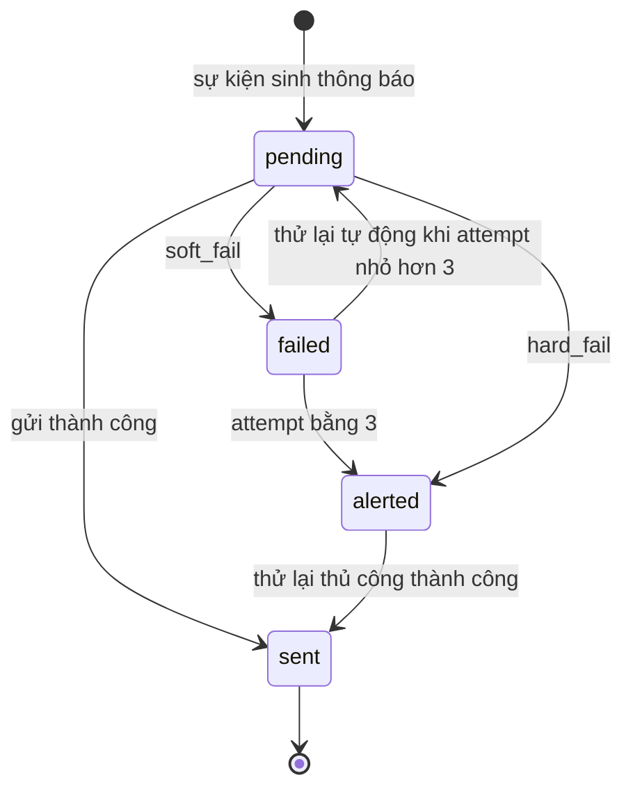
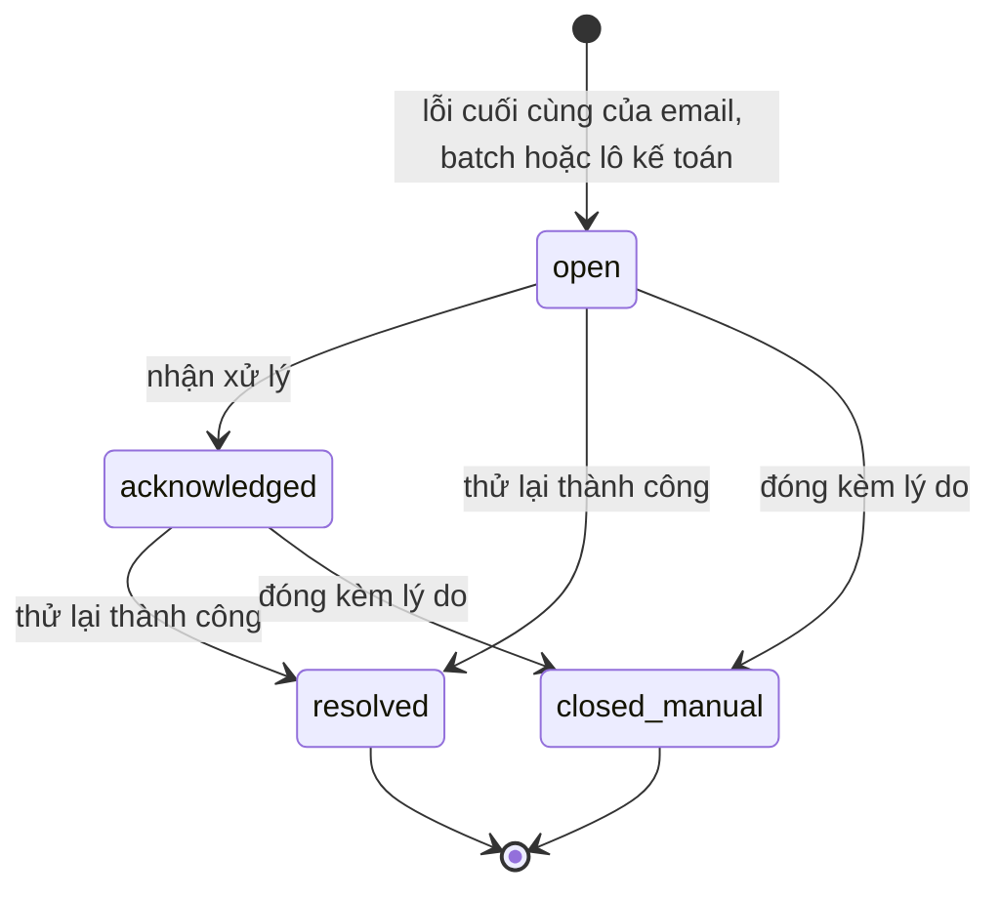
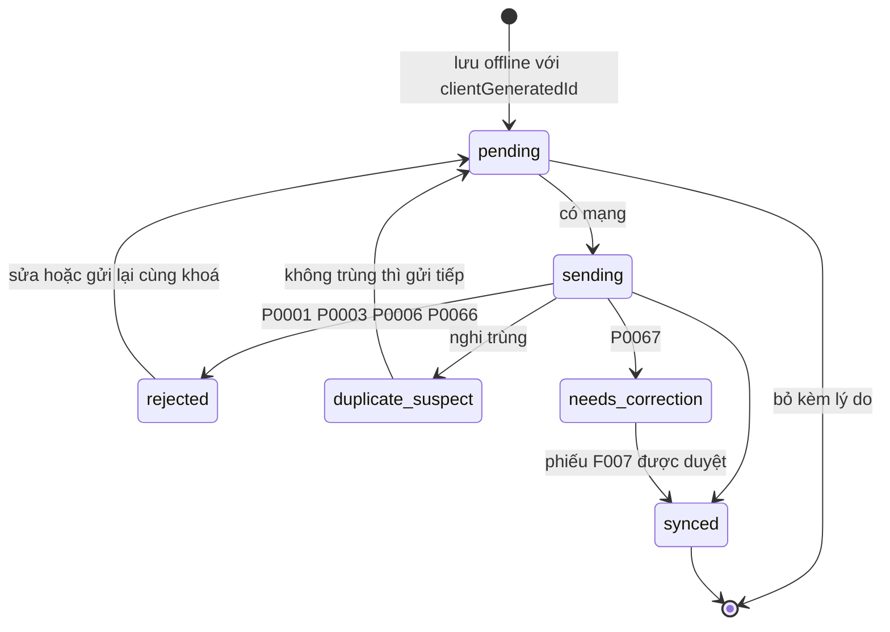
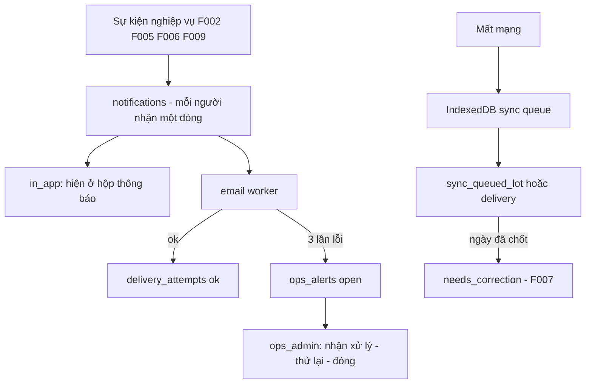

# F010_Notifications — Technical Spec

**Priority**: P1 (F10-01…F10-05) · gồm F03-06 / F05-07 (hàng chờ đồng bộ, theo US-09)
**Type**: mixed (ui + background)
**Generated**: 2026-10-06

> Quy ước nguồn: `sc-NN` (chữ thường) = screen-spec của bộ thiết kế gốc, **không nộp**; bản nộp tương ứng là SCR0NN. Nhãn: **[ĐÃ TRIỂN KHAI]** = có trong prototype LAB-3, đã kiểm trong code/migration; **[ĐẶC TẢ — chưa xây]** = thiết kế. Kiểm bằng grep `notification` trong `app/`, `lib/`, `supabase/migrations/`: không có bảng, RPC hay route nào cho thông báo; không có hàng đợi IndexedDB hay service worker (MOCK-2, MOCK-7 trong (tài liệu gốc trong repo, không nộp) `lab3-scope-lock.md`). Vì vậy toàn bộ F010 là [ĐẶC TẢ — chưa xây], trừ trang chủ theo chức danh mô tả ở dưới.

## Overview

F010 gửi thông báo trong ứng dụng và email cho bốn loại sự kiện (F10-02), bảo đảm việc quan trọng gửi xong trong 5 phút, thử lại email tối đa 3 lần rồi đẩy vào hàng cảnh báo vận hành, và cho cấu hình người nhận, ngưỡng, thời điểm gửi mà không mất lịch sử. Bộ thiết kế gộp thêm hàng chờ đồng bộ khi mất mạng (SCR035); LAB-1 gắn màn này với F03-06 và F05-07. Người dùng: mọi chức danh (hộp thông báo), `ops_admin` đề xuất (cấu hình, hàng cảnh báo), `receiving` (hàng chờ đồng bộ). Kích hoạt bởi sự kiện nghiệp vụ ở F002, F005, F006, F009; chạm các bảng đề xuất `notifications`, `notification_settings`, `delivery_attempts`, `ops_alerts`, và hàng đợi IndexedDB phía máy khách.

**Đã triển khai:** trang chủ [SCR001_RoleHome](../../screens/SCR001_RoleHome/spec.md) hiện số liệu thống kê tính thật theo 4 chức danh (`lib/domain/home-stats.ts`, `app/(app)/page.tsx`), nhưng không có badge thông báo, không hộp thông báo, không gửi email.

## Polymorphic Behavior

Cross-reference: [entities.md](../../generated/entities.md). Chưa có mã DISC chính thức cho các trường dưới đây (suy luận).

### notification_settings.event_type (đúng 4 giá trị, khoá cứng theo F10-02)

| Value | Render | Validation | Persistence |
|-------|--------|------------|-------------|
| `qualification_expiring` | Ngưỡng tính bằng ngày trước hạn; mặc định 30 (đề xuất, rủi ro Thấp) | `threshold_value` nguyên, lớn hơn 0, nhỏ hơn hoặc bằng 365; sai → P0051 (đề xuất, chưa cài) | Một dòng cấu hình; người nhận mặc định: quản lý người tham gia |
| `dispute_open` | Ngưỡng tính bằng ngày quá hạn dự kiến | như trên | người nhận mặc định: bộ phận đối chiếu |
| `export_failed` | Không có ngưỡng; sinh ngay lần lỗi đầu; mặc định `severity = critical` (đề xuất) | — | người nhận mặc định: vận hành hệ thống |
| `delivery_backlog` | Ngưỡng tính bằng số 業務日 còn `remaining > 0`; mặc định 3 (đề xuất) | `threshold_value` nhỏ hơn hoặc bằng 1000 khi tính theo số lần/dòng | người nhận: bộ phận giao hàng và ban quản lý |

**Source:** (tài liệu gốc trong repo, không nộp) `sc-32-cau-hinh-thong-bao.md` mục 3.

### sync_queue.kind

| Value | Render | Validation | Persistence |
|-------|--------|------------|-------------|
| `lot` | Tóm tắt "chủ hàng · mặt hàng · số lượng" | Nội dung khớp, cùng chủ hàng + mặt hàng + số lượng trong 30 phút bị coi nghi trùng (đề xuất) | `sync_queued_lot` ghi `lots` kèm `client_generated_id` |
| `delivery` | Tóm tắt "mã giao dịch · lần giao dự kiến · số lượng" | P0001, P0003, P0006 tại thời điểm đồng bộ; gửi tuần tự theo `entered_at` | `sync_queued_delivery` bọc ngoài `record_delivery` |

**Source:** (tài liệu gốc trong repo, không nộp) `sc-35-hang-cho-dong-bo.md` mục 3.1, 7.

## Cross-Cutting Logic

### Requirements

| Code | Description | Endpoint/Handler | Trạng thái | Verifiable |
|------|-------------|------------------|-----------|------------|
| FR-NOTIFY-01 (P1) | Hai kênh trong ứng dụng + email cho 4 loại sự kiện; không SMS/FAX; log gửi có kênh, người nhận, kết quả, số lần thử (F10-01, F10-02) | `mark_notification_read`, `mark_all_notifications_read`; view `v_my_notifications` | [ĐẶC TẢ — chưa xây] | yes |
| FR-NOTIFY-02 (P1) | Loại Critical gửi xong trong 5 phút; email lỗi thử lại tối đa 3 lần; thất bại → hàng cảnh báo (F10-03, F10-04) | `retry_notification_delivery`, `acknowledge_ops_alert`, `close_ops_alert` | [ĐẶC TẢ — chưa xây] | yes |
| FR-NOTIFY-03 (P1) | Cấu hình người nhận/ngưỡng/thời điểm; đổi cấu hình không làm mất lịch sử gửi (F10-05) | `update_notification_setting` | [ĐẶC TẢ — chưa xây] | yes |
| BR-NOTIFY-01 | Kênh baseline = trong ứng dụng + email; retry tối đa 3 lần | — | [ĐẶC TẢ — chưa xây] | yes |
| NFR-OPS-01 | Giám sát được lỗi batch/xuất dữ liệu, lỗi gửi thông báo | `v_ops_alerts` | [ĐẶC TẢ — chưa xây] | yes |
| NFR-AVL-02 (US-09) | Mất mạng ngắn vẫn tiếp tục nhập lô và ghi lần giao, tự đồng bộ không tạo trùng (F03-06, F05-07) | `sync_queued_lot`, `sync_queued_delivery` | [ĐẶC TẢ — chưa xây]; ranh giới offline hẹp đã chốt (PREMISE C-02; khách chưa xác nhận Q-01) | yes |
| FR-AUDIT-01 | Bản ghi bị bỏ khỏi hàng chờ ghi lý do vào `audit_log` khi có mạng lại (`action = queue_discarded`) | xem [F011](../F011_AuditLog/technical-spec.md) | [ĐẶC TẢ — chưa xây] | yes |

**Source:** (tài liệu gốc trong repo, không nộp) `product-a-rfp-business-summary.md` §7.9; `sc-31…sc-33`, `sc-35`.

### Business Rules

| Code | Rule | Nguồn / nhãn |
|------|------|--------------|
| BR-NOTIFY-01 | Chỉ hai kênh `in_app` và `email`; không SMS, không FAX (Q-15 chờ xác nhận) | LAB-1 |
| BR-F010-01 | Trạng thái đã đọc theo người nhận, không theo máy; một sự kiện gửi cho 5 người sinh 5 dòng `notifications` | `sc-31` mục 9 (đề xuất, rủi ro Thấp) |
| BR-F010-02 | `severity = critical` bắt buộc `send_mode = immediate`; chọn `digest` cho critical bị chặn vì không giữ nổi cam kết 5 phút | `sc-32` mục 3 (đề xuất, rủi ro Trung bình) |
| BR-F010-03 | Giá trị cấu hình (kênh, người nhận) được sao vào dòng thông báo lúc sinh; hàng chờ không đọc lại cấu hình, nên đổi cấu hình không mất thông báo đang chờ | `sc-32` mục 9 (đề xuất, rủi ro Thấp) |
| BR-F010-04 | "3 lần" là trần retry tự động; lần thử thủ công đánh số từ 4 và không bị trần | `sc-33` mục 9 (đề xuất, rủi ro Trung bình) |
| BR-F010-05 | `hard_fail` (hộp thư không tồn tại) không thử lại dù chưa đủ 3 lần; đi đường sửa người nhận rồi đóng cảnh báo | `sc-33` mục 4 (đề xuất, rủi ro Trung bình) |
| BR-F010-06 | `clientGeneratedId` sinh lúc bấm lưu, không phải lúc gửi; gửi lại dùng đúng khoá cũ | `sc-35` mục 9 (đề xuất, rủi ro Cao nếu hiểu sai) |
| BR-F010-07 | Gửi hàng chờ tuần tự theo `entered_at` tăng dần; không song song | `sc-35` mục 7, 9 (đề xuất) |
| BR-CLOSE-01 | Bản ghi đồng bộ về ngày đã chốt không chèn thẳng: P0067 (đề xuất, chưa cài); P0009 (đã cài) chỉ là lưới an toàn cuối | LAB-1; trigger `guard_closed_day` [ĐÃ TRIỂN KHAI] (`supabase/migrations/0010_closed_day_guard.sql:6-55`) |

Mã BR-F010-nn là quy ước đặt mã của tài liệu này (suy luận).

### Decision Logic

#### DEC-F010-01_RetryDecision
**subtype:** interaction
**Triggers in:** SCR033_OpsAlertQueue, nút "Thử lại"
**Involved entities:** `ops_alerts.state`, `delivery_attempts.result`
**user_visible_outcome:** cho thử lại hoặc báo lý do từ chối
**Source:** (tài liệu gốc trong repo, không nộp) `sc-33-hang-canh-bao-van-hanh.md` mục 4 [ĐẶC TẢ — chưa xây]

```pseudo
if alert.state not in (open, acknowledged)  -> P0054 reason=already_resolved
else if last.result = hard_fail             -> P0054 reason=hard_fail_not_retryable
else if attempt in flight                   -> P0054 reason=attempt_in_flight
else enqueue manual attempt (attempt_no >= 4, is_manual = true)
```

#### DEC-F010-02_SyncOutcome
**subtype:** flow
**Triggers in:** SCR035_SyncQueue, khi có mạng lại
**Involved entities:** `sync_queue.state`, `lots` / `deliveries.client_generated_id`
**user_visible_outcome:** dòng chuyển trạng thái, bản ghi không bao giờ bị xoá khỏi hàng chờ trừ khi người dùng bỏ
**Source:** `sc-35-hang-cho-dong-bo.md` mục 4, 7 [ĐẶC TẢ — chưa xây]

```pseudo
same client_generated_id and same content -> synced (idempotent, trả record cũ)
same id, different content                -> rejected (P0066, không ghi đè)
different id, similar content in 30 min   -> duplicate_suspect (người quyết)
business day closed                       -> needs_correction (P0067), mở phiếu F007
buyer qualification expired               -> rejected (P0003)
quantity exceeds remaining                -> rejected (P0006)
```

#### DEC-F010-03_SettingsSaveGuard
**subtype:** interaction
**Triggers in:** SCR032_NotificationSettings, nút Lưu
**Involved entities:** `notification_settings`
**user_visible_outcome:** lưu hoặc báo xung đột
**Source:** `sc-32-cau-hinh-thong-bao.md` mục 4 [ĐẶC TẢ — chưa xây]

```pseudo
if threshold out of range                     -> P0051
else if enabled and no recipients             -> P0052
else if expected_updated_at != current        -> P0053 (khoá lạc quan)
else save one row; keep queued notifications
```

### State Machines

#### SM-F010-01_NotificationEmailDelivery
**kind:** entity
**Linked FR:** FR-NOTIFY-02
**Source:** `sc-31` mục 3 (#9), `sc-33` mục 3, 7 [ĐẶC TẢ — chưa xây]
**States:** pending, sent, failed, alerted



**Transition rules:**
- Chỉ nhánh email có retry; nhánh `in_app` ghi thẳng vào DB, luôn đã tới nơi. `delivery_state` mô tả email.
- `latency_seconds` tính bằng `sent_at − created_at`; trên 300 giây là vi phạm cam kết 5 phút (F10-03).
- Worker phải ghi `delivery_attempts` mỗi lần thử, kể cả thành công, nếu không không đo được 5 phút.
- `alerted → sent` khi retry thủ công thành công (cảnh báo chuyển `resolved`).

#### SM-F010-02_OpsAlert
**kind:** entity
**Linked FR:** NFR-OPS-01
**Source:** `sc-33` mục 3 (#9), 7 [ĐẶC TẢ — chưa xây]
**States:** open, acknowledged, resolved, closed_manual



**Transition rules:**
- Nguồn cảnh báo: `notification_delivery` (F10-04), `report_batch`, `accounting_export` (F09-06; xem [F009](../F009_ReportsAndExport/technical-spec.md)). Batch và lô kế toán không thử lại ở đây mà đi sang SCR030.
- Đóng cảnh báo cần `close_note` từ 10 ký tự; không dòng nào bị xoá.
- `resolved` nghĩa là lần gửi sau cùng thành công, không nghĩa là nguyên nhân gốc đã sửa.

#### SM-F010-03_SyncQueueItem
**kind:** ui
**Linked FR:** NFR-AVL-02
**Source:** `sc-35` mục 3.1 (#5), 7 [ĐẶC TẢ — chưa xây]
**States:** pending, sending, synced, rejected, duplicate_suspect, needs_correction



| From | To | Guard | Side effect |
|------|----|-------|-------------|
| pending | sending | `connectivity` có mạng | gửi tuần tự theo `entered_at` |
| sending | synced | RPC thành công hoặc idempotent | hiện liên kết bản ghi thật; rời danh sách sau 24 giờ |
| rejected / needs_correction | — | không bao giờ tự xoá | giữ nguyên trong hàng chờ |
| pending | bỏ | lý do từ 10 ký tự | ghi `audit_log` khi có mạng (`queue_discarded`) |

### Algorithms

#### ALG-F010-01_ConfigSnapshotOnCreate
**Linked FR:** FR-NOTIFY-03
**Source:** `sc-32` mục 9 [ĐẶC TẢ — chưa xây]
**Input:** sự kiện nghiệp vụ + `notification_settings` hiện hành của `event_type`
**Output:** N dòng `notifications`, mỗi người nhận một dòng
**File Schema**: N/A — không phải thuật toán trao đổi file
**Complexity:** O(số người nhận)
**Description:** Sao `channels`, `recipient_user_id`, `severity`, `send_mode` vào dòng thông báo lúc sinh; hàng chờ không đọc lại cấu hình. Kiểm được: lưu cấu hình khi `pending_count = N` thì sau lưu vẫn bằng N và N thông báo gửi theo kênh cũ.

```text
cfg = settings[event_type]; if not cfg.enabled: return
for u in expand(cfg.recipient_roles, cfg.recipient_user_ids):
    insert notifications(u, copy of cfg fields, created_at=server now)
```

#### ALG-F010-02_IdempotentSync
**Linked FR:** NFR-AVL-02
**Source:** `sc-35` mục 7, 8 [ĐẶC TẢ — chưa xây]
**Input:** `p_client_generated_id`, payload, `p_entered_by`, `p_entered_at`
**Output:** `{record_id, was_existing}` hoặc lỗi
**File Schema**: N/A — không phải thuật toán trao đổi file
**Complexity:** O(1) tra theo khoá duy nhất `client_generated_id`
**Description:** Chạy trong một transaction có khoá; ghi vết theo `p_entered_by` (người đã nhập), không theo người đang đăng nhập; kiểm ngày chốt trước khi insert.

```text
lock; if business_day(closed): P0067
if exists(client_generated_id): same content ? return existing : P0066
if similar within 30 min (cùng ngày): return W-duplicate (không ghi)
insert with client_generated_id; audit_log(actor = p_entered_by)
```

### External Integrations

#### INT-F010-01_EmailChannel
**Linked FR:** FR-NOTIFY-02
**Source:** `sc-33` mục 8, 10 [ĐẶC TẢ — chưa xây]
**Type:** notification (email)
**Target:** nhà cung cấp email — chưa chọn
**Trigger:** worker xử lý hàng chờ `pending` của `notifications`; gửi mạng không nằm trong transaction database
**Payload:** tiêu đề, nội dung dựng từ mẫu theo `event_type`, địa chỉ người nhận; không chứa bí mật
**Failure handling:** `soft_fail` thử lại tự động tối đa 3 lần; `hard_fail` không thử lại; sau đó `ops_alerts`. Phân biệt bounce cứng/mềm phụ thuộc nhà cung cấp, chưa chốt thì mọi lỗi coi là `soft_fail` và trần 3 luôn bị dùng hết. Kênh SMS và FAX loại hẳn (BR-NOTIFY-01); FAX là thao tác thủ công (Q-15 chờ xác nhận).

```text
worker: pick pending email
  send -> ok: delivery_attempts(ok), state=sent
       -> soft_fail: attempt+1; if attempt=3: ops_alerts(open)
       -> hard_fail: ops_alerts(open)
```

#### INT-F010-02_OfflineQueue
**Linked FR:** NFR-AVL-02
**Source:** (tài liệu gốc trong repo, không nộp) `architecture.md` §3.5; `sc-35` mục 8 [ĐẶC TẢ — chưa xây]
**Type:** queue-job (phía máy khách)
**Target:** IndexedDB + service worker; RPC `sync_queued_lot`, `sync_queued_delivery`
**Trigger:** mất mạng khi lưu ở SCR007/SCR014; dò kết nối mỗi 30 giây khi offline
**Payload:** `p_client_generated_id`, trường của form gốc, `p_entered_by`, `p_entered_at`
**Failure handling:** không tăng `attemptCount` khi vẫn offline; từ lần thứ 5 dừng tự gửi, chỉ gửi tay. Chỉ hai loại `lot` và `delivery` chạy offline (A1); chốt giao dịch và chốt sổ luôn cần mạng.

```text
save: id = uuid(); put IndexedDB(state=pending)
online: for item in order by entered_at: call RPC sequentially
```

### Verification

- **VER-F010-01** — Lưu cấu hình khi có N thông báo `pending`: sau lưu vẫn N và gửi theo kênh cũ; lịch sử `notifications` không đổi dòng nào (covers FR-NOTIFY-03, BR-F010-03).
- **VER-F010-02** — Thông báo critical `immediate` gửi xong ≤ 300 giây; `latency_seconds` lớn hơn 300 hiện cờ vi phạm (covers FR-NOTIFY-02).
- **VER-F010-03** — Email lỗi 3 lần liên tiếp sinh đúng một cảnh báo `open`; lần thủ công đánh số từ 4 (covers BR-NOTIFY-01, BR-F010-04, SM-F010-01).
- **VER-F010-04** — Đánh dấu đã đọc thông báo của người khác trả P0050 giống thông báo không tồn tại (covers BR-F010-01).
- **VER-F010-05** — Gửi lại cùng `clientGeneratedId` hai lần chỉ tạo một bản ghi; lần hai trả `was_existing = true` (covers NFR-AVL-02, BR-F010-06).
- **VER-F010-06** — Bản chờ thuộc ngày đã chốt: P0067, dòng ở lại hàng chờ với `needs_correction`; P0009 không xuất hiện trong luồng bình thường (covers BR-CLOSE-01).
- **VER-F010-07** — Bốn loại sự kiện và hai kênh: không có giá trị thứ 5 hay kênh `sms`/`fax` (covers BR-NOTIFY-01, F10-02).

---

**Client behavior:** xem [`architecture.md`](../../system/architecture.md), [`permissions.md`](../../system/permissions.md), [`architecture.md`](../../system/architecture.md).

## User Stories

### US-09 — Tiếp tục làm việc khi mất mạng (Priority: P1)

**What happens:** Nhân viên tiếp nhận hoặc giao hàng ghi được khi mạng mất vài phút, rồi bản ghi tự gửi khi có mạng, không trùng.
**Why this priority:** Tiêu chí B; mạng khu tiếp nhận mất 3–5 lần mỗi tuần giờ cao điểm. Ranh giới offline hẹp đã chốt (PREMISE C-02; khách chưa xác nhận Q-01).
**Independent Test:** Tắt mạng, lưu một lô và một lần giao, bật mạng, kiểm trạng thái và số bản ghi.

**Acceptance Scenarios:**

1. **Given** mất mạng, **When** lưu lô, **Then** bản ghi vào hàng chờ với chỉ báo "đang chờ" và số chờ tăng trên thanh điều hướng.
2. **Given** có mạng lại, **When** hàng chờ gửi, **Then** gửi tuần tự, không tạo bản ghi trùng.
3. **Given** vẫn mất mạng, **When** chốt giao dịch hoặc chốt sổ, **Then** báo lỗi rõ ràng, không đưa vào hàng chờ.

**Requirements fulfilled:**
- **NFR-AVL-02** — `sync_queued_lot`, `sync_queued_delivery` (RPC đề xuất)
  **Source:** (tài liệu gốc trong repo, không nộp) `sc-35-hang-cho-dong-bo.md` mục 8

**Rules enforced:** BR-F010-06, BR-F010-07, BR-CLOSE-01.
**State transitions:** SM-F010-03.
**Verification:** VER-F010-05, VER-F010-06.

---

### Không có US riêng — F10-01…F10-05

LAB-1 xếp F10-01…F10-05 vào "hỗ trợ vận hành, không chặn giao dịch" và F10-03, F09-06 vào "hành vi nền". Acceptance Scenarios suy từ mã tính năng (suy luận):

1. **F10-01/02** — **Given** một giao hàng ứ đọng vượt ngưỡng, **When** sự kiện sinh, **Then** người nhận cấu hình thấy thông báo trong ứng dụng và nhận email.
2. **F10-03/04** — **Given** email lỗi, **When** quá 3 lần thử, **Then** có đúng một dòng ở hàng cảnh báo vận hành kèm kết quả từng lần.
3. **F10-05** — **Given** đổi người nhận, **When** lưu, **Then** lịch sử đã gửi không đổi và banner nêu số thông báo đang chờ vẫn giữ nguyên.

**Verification:** VER-F010-01, VER-F010-02, VER-F010-03.

### Edge Cases

| Scenario | Behavior |
|----------|----------|
| Đánh dấu đã đọc thông báo của người khác | P0050 (đề xuất, chưa cài), gộp với "không tồn tại" |
| Hai người cùng sửa cấu hình | P0053 (đề xuất, chưa cài), khoá lạc quan |
| Bản chờ nhập bù trùng nội dung | `duplicate_suspect`, người quyết định |
| Ngày nghiệp vụ đã chốt khi đồng bộ | P0067 (đề xuất, chưa cài), `needs_correction` |

Danh sách đầy đủ ở [edge-cases.md](./edge-cases.md).

## Key Entities

| Entity | Table | Key Columns | Purpose |
|--------|-------|-------------|---------|
| BusinessDay | `business_days` [ĐÃ TRIỂN KHAI] | `business_date`, `status`, `closed_at` | Kiểm ngày chốt khi đồng bộ |
| AppUser | `app_users` [ĐÃ TRIỂN KHAI] | `id`, `role`, `status` | Người nhận; RLS hiện chỉ cho tự xem mình và `sys_admin` |
| AuditLog | `audit_log` [ĐÃ TRIỂN KHAI] | `action`, `actor_id`, `old_value`, `new_value` | Ghi `queue_discarded`; xem [F011](../F011_AuditLog/technical-spec.md) |
| Notification | `notifications` (đề xuất, chưa tồn tại) | `recipient_user_id`, `event_type`, `severity`, `subject_table`, `subject_id`, `read_at`, `created_at` | Một dòng mỗi người nhận |
| NotificationSetting | `notification_settings` (đề xuất) | `event_type`, `enabled`, `severity`, `recipient_roles[]`, `recipient_user_ids[]`, `channels[]`, `threshold_value`, `send_mode`, `digest_at`, `quiet_hours`, `updated_by`, `updated_at` | 4 dòng seed |
| DeliveryAttempt | `delivery_attempts` (đề xuất) | `attempt_no`, `attempted_at`, `channel`, `result`, `error_detail`, `is_manual` | Kết quả từng lần |
| OpsAlert | `ops_alerts` (đề xuất) | `alert_code`, `source`, `severity`, `attempt_count`, `state`, `assignee_id` | Hàng cảnh báo |
| LotsDeliveries | `lots`, `deliveries` [ĐÃ TRIỂN KHAI]; cột `client_generated_id` (đề xuất) | `client_generated_id uuid UNIQUE` | Khoá chống trùng |

`notifications` cần cột `market_id` nếu hệ thống nhiều chợ (ADR-007, xem [F012](../F012_MarketManagement/technical-spec.md)).

## Artifact References

| Artifact | File | Codes Used |
|----------|------|------------|
| System Overview | [overview.md](../../system/overview.md) | — |
| Architecture | [architecture.md](../../system/architecture.md) | — |
| Business Rules | [business-rules.md](../../system/business-rules.md) | BR-NOTIFY-01, BR-CLOSE-01 |
| Permissions | [permissions.md](../../system/permissions.md) | — |
| Feature List | [feature-list.md](../../generated/feature-list.md) | F010 |
| Screen List | [screen-list.md](../../generated/screen-list.md) | SCR001, SCR031, SCR032, SCR033, SCR035 |
| Screens | [screens.md](./screens.md) | SCR001, SCR031, SCR032, SCR033, SCR035 |
| Related | [F009](../F009_ReportsAndExport/technical-spec.md) · [F007](../F007_PostCloseCorrection/technical-spec.md) · [F011](../F011_AuditLog/technical-spec.md) · [F012](../F012_MarketManagement/technical-spec.md) | — |

## Assumptions

- Mã BR-F010-nn, SM-F010-nn, ALG-F010-nn, INT-F010-nn, DEC-F010-nn, VER-F010-nn là quy ước đặt mã của tài liệu này (suy luận).
- Mỗi SCR### thuộc đúng một feature: SCR035 thuộc F010 dù LAB-1 gắn nó với F03-06 và F05-07; tài liệu giữ cả hai tham chiếu.
- Chỉ nhập lô nháp và ghi lần giao chạy offline: đã chốt (PREMISE C-02, giả định A1); khách chưa xác nhận (Q-01).
- Toàn bộ bảng, RPC, mã lỗi P0050–P0054, P0066, P0067 là đề xuất chưa cài; P0001, P0003, P0005, P0006, P0009 đã cài.
- Bộ bảng `ops_alerts`, `delivery_attempts` do bộ thiết kế suy từ F10-04, F09-06, FR-NOTIFY-01; LAB-1 chỉ có một dòng yêu cầu.

## Source Code References

| Order | Symbol | Path | Purpose |
|-------|--------|------|---------|
| 1 | `getLatestBusinessDate` và `get*HomeStats` | `lib/domain/home-stats.ts:1-182` | Phần đã có của trang chủ: số liệu thống kê, chưa có badge |
| 2 | HomePage | `app/(app)/page.tsx:1-71` | Rẽ nhánh theo chức danh |
| 3 | `ROUTE_POLICY`, `canAccess` | `lib/auth/route-policy.ts` | Thứ tự prefix; `/notifications/settings` phải đặt trước `/notifications` |
| 4 | `guard_closed_day` | `supabase/migrations/0010_closed_day_guard.sql:6-55` | Lưới an toàn P0009 |
| 5 | `logBlockedWriteAttempt` | `lib/domain/reconciliation.ts:140-159` | Mẫu gọi RPC ghi vết tách khỏi transaction đã rollback |
| 6 | Screen specs | (tài liệu gốc trong repo, không nộp) `sc-31…sc-33`, `sc-35` | Nguồn đặc tả |

## Unresolved Questions

1. **Phạm vi offline (Q-01)** — đã chốt hẹp (PREMISE C-02); khách chưa xác nhận. Nếu khách đòi rộng hơn thì cần màn điều hoà mâu thuẫn cho SCR035.
2. **FAX (Q-15)** — khách xác nhận không tích hợp.
3. **Thế nào là critical** — thuộc cấu hình theo `event_type`, cách đo 5 phút tổng hợp theo ngày (có cần báo cáo thứ 13 không?).
4. **Người tham gia bên ngoài** có hộp thông báo không.
5. **Lệch "3 lần"**: BR-NOTIFY-01 là trần retry tự động; lần thủ công đánh số từ 4 — cần xác nhận không xung đột với nguyên văn FR-NOTIFY-02.
6. **market_id** trên `notifications` và khoá `(market_id, event_type)` nếu nhiều chợ (ADR-007).
7. **Chức danh ops_admin** chưa có; screen-spec dùng tên này (đề xuất).
8. **Cảnh báo ngoài băng** khi email hỏng; heartbeat của job sinh cảnh báo.
9. **Ngưỡng 30 phút nghi trùng, 24 giờ bản chờ, 92 ngày lọc, nhà cung cấp email**: đều đề xuất hoặc chưa chọn.
10. **RLS app_users**: chỉ cho tự xem mình và `sys_admin`; chọn người nhận đích danh ở SCR032 cần danh sách `app_users` đang hoạt động — cần nới RLS (suy luận).

## Source Walkthrough

1. **File:** `lib/domain/home-stats.ts:1-182` — phần đã có: số liệu trang chủ; hiểu giới hạn trước khi thêm badge.
2. **File:** `app/(app)/page.tsx:1-71` — nơi rẽ nhánh biến thể theo chức danh.
3. **File:** `lib/auth/route-policy.ts` — bảng chặn route, nơi thêm prefix mới đúng thứ tự.
4. **File:** `supabase/migrations/0010_closed_day_guard.sql:6-55` — bất biến ngày chốt mà đồng bộ phải tôn trọng.
5. **File:** (tài liệu gốc trong repo, không nộp) `sc-35-hang-cho-dong-bo.md:1-139` — đặc tả đồng bộ.

### Call Hierarchy



**Related files:** xem `## Source Code References`; cột Order là thứ tự đọc.

## DB Impact per Event

Toàn bộ là [ĐẶC TẢ — chưa xây]; chưa có migration nào cho thông báo.

| Event/Endpoint | Table | Columns | Operation | Value Derivation | Source |
|----------------|-------|---------|-----------|-------------------|--------|
| Sự kiện nghiệp vụ → sinh thông báo | `notifications` | toàn bộ cột, gồm bản sao cấu hình | INSERT | `created_at` server; kênh, người nhận sao từ cấu hình lúc sinh | `[INFERRED]` — screen-spec nêu nguyên tắc nhưng không nêu thủ tục sinh |
| `mark_notification_read` | `notifications` | `read_at` | UPDATE | `now()` phía server, đặt một lần | `sc-31-hop-thong-bao.md` mục 8 |
| `mark_all_notifications_read` | `notifications` | `read_at` | UPDATE | `now()`; `marked_count` | `sc-31-hop-thong-bao.md` mục 8 |
| `update_notification_setting` | `notification_settings` | các cột cấu hình, `updated_by`, `updated_at` | UPDATE | server đặt `updated_*`; kiểm `p_expected_updated_at` | `sc-32-cau-hinh-thong-bao.md` mục 8 |
| Worker gửi email | `delivery_attempts` | `attempt_no`, `result`, `error_detail` | INSERT | kết quả từ nhà cung cấp email | `sc-33-hang-canh-bao-van-hanh.md` mục 9 |
| Gửi lỗi sau lần thứ 3 | `ops_alerts` | `source`, `attempt_count`, `last_error`, `state='open'` | INSERT | từ `delivery_attempts` | `[INFERRED]` — cơ chế sinh cảnh báo không được mô tả |
| `acknowledge_ops_alert` | `ops_alerts` | `state`, `assignee_id` | UPDATE | `auth.uid()` | `sc-33-hang-canh-bao-van-hanh.md` mục 8 |
| `close_ops_alert` | `ops_alerts` | `state`, `close_note` | UPDATE | `closed_manual` | `sc-33-hang-canh-bao-van-hanh.md` mục 8 |
| `sync_queued_lot` / `sync_queued_delivery` | `lots` / `deliveries`, `audit_log` | `client_generated_id`, dữ liệu form, vết theo `p_entered_by` | INSERT | khoá do máy khách sinh lúc bấm lưu | `sc-35-hang-cho-dong-bo.md` mục 8 |
