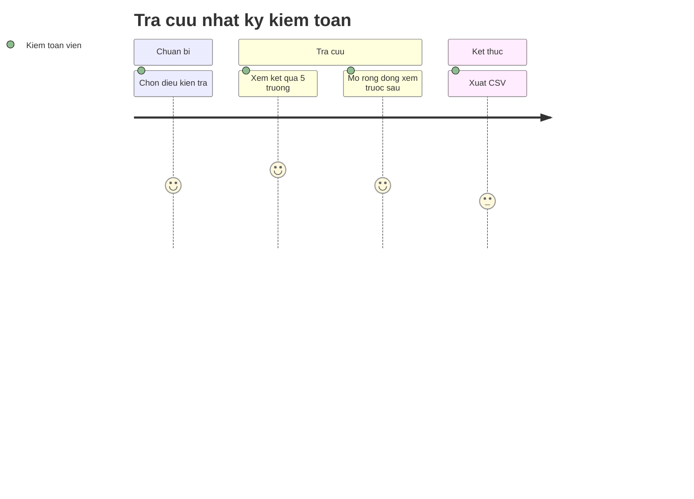

# Screens — F011_AuditLog

## Screen List

| Screen Name | SCR### | What User Sees | What User Can Do |
|-------------|--------|----------------|------------------|
| Tra cứu nhật ký kiểm toán (監査証跡の検索) · route `/audit` (đề xuất) · [ĐẶC TẢ — chưa xây] | [SCR034_AuditLogSearch](../../screens/SCR034_AuditLogSearch/spec.md) | Bộ lọc bốn chiều (mã giao dịch, khoảng ngày nghiệp vụ, mã người tham gia, loại thao tác) cộng ba chiều bổ sung (đề xuất, rủi ro Thấp: người thực hiện, đối tượng, thời điểm thao tác); bảng kết quả năm trường: ai làm, lúc nào, số cũ, số mới, lý do; liên kết sang giao dịch; phiên bản quy chế khi có | Tra cứu; mở rộng dòng xem nội dung trước/sau; lọc nhanh ("Hôm nay", "Lần ghi bị chặn 7 ngày qua", "Thay đổi quyền 30 ngày qua"); xuất CSV; chia sẻ đường dẫn điều kiện tra. Không có nút sửa hay xoá, kể cả với `sys_admin` |

Ghi chú: ghi vết (F11-01) và lưu trữ (F11-04) là hành vi nền, không có màn riêng; xuất hiện dưới dạng dòng dữ liệu ở màn trên. Bản prototype chưa có màn nào đọc `audit_log`.

## User Journey

1. Kiểm toán viên (`internal_audit`, đề xuất) hoặc nhân viên đối chiếu mở màn tra cứu; thấy gợi ý chọn ít nhất một điều kiện và ba nút tra nhanh.
2. Chọn một hay nhiều chiều rồi bấm "Tra cứu"; điều kiện được đưa lên đường dẫn.
3. Nếu khoảng ngày quá rộng mà chưa có điều kiện thu hẹp, màn báo cần thu hẹp và giữ nguyên điều kiện đã chọn.
4. Kết quả hiện theo thời điểm thao tác mới nhất trước, kèm tổng số vết và thời gian truy vấn.
5. Bấm một dòng để xem nội dung trước/sau và mở bản ghi gốc (lô, giao dịch, giao hàng).
6. Lọc "thao tác bị chặn" để thấy các lần thử sửa vào ngày đã chốt — bằng chứng cho đường điều chỉnh sau chốt.
7. Xuất CSV; việc xuất cũng được ghi lại.

