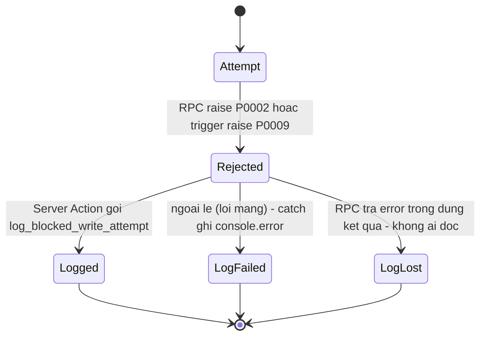

# F011_AuditLog — Technical Spec

**Priority**: P0 (F11-01) · P1 (F11-02, F11-03) · NFR (F11-04)
**Type**: mixed (ghi vết nền = background; tra cứu = ui)
**Generated**: 2026-10-06

Quy ước nguồn: `sc-34` (chữ thường) = screen-spec của bộ thiết kế gốc, **không nộp**; bản nộp tương ứng là SCR034. Nhãn trạng thái dùng trong file: **[ĐÃ TRIỂN KHAI]** = có trong migration/code LAB-3, đã đọc lại và trích dòng · **[ĐẶC TẢ — chưa xây]** = thiết kế LAB-4 · **(đề xuất, rủi ro X)** = ngoài tài liệu khách · **(suy luận)**. Mã lỗi `P0001`–`P0009` đã cài; `P0010` trở lên là đề xuất của bộ screen-spec, chưa cài.

## Overview

F011 ghi vết mọi thao tác quan trọng và cho tra cứu lại theo bốn chiều. Phần ghi vết **[ĐÃ TRIỂN KHAI]** một phần: `audit_log` + `role_change_log` append-only, ba đường ghi thật (chốt sổ, đổi quyền, lần thử ghi vào ngày đã chốt). Phần tra cứu (màn [SCR034_AuditLogSearch](../../screens/SCR034_AuditLogSearch/spec.md), view `v_audit_search`, mở RLS cho `internal_audit`/`reconcile`, cột `reason`) **[ĐẶC TẢ — chưa xây]** (MOCK-8 trong (tài liệu gốc trong repo, không nộp) `lab3-scope-lock.md`). Dữ liệu đang nằm trong bảng mà chưa màn nào đọc ra.

Quan hệ: là nguồn của báo cáo RPT-08 (xem [F009_ReportsAndExport](../F009_ReportsAndExport/technical-spec.md)); bằng chứng cho đường điều chỉnh [F007_PostCloseCorrection](../F007_PostCloseCorrection/technical-spec.md); `ruleVersion` đọc từ [F012_MarketManagement](../F012_MarketManagement/technical-spec.md) / [F008_IncentiveAndRateVersion](../F008_IncentiveAndRateVersion/technical-spec.md).

## Polymorphic Behavior

Phân biệt theo cột `audit_log.action` (text, không phải enum DB). **Hai bộ giá trị đang lệch nhau** — cần thống nhất trước LAB-5.

| `action` thật trong code [ĐÃ TRIỂN KHAI] | Nhãn thiết kế ở màn tra cứu (sc-34) | Render | Validation | Persistence |
|---|---|---|---|---|
| `close_business_day` | `close_day` 締め | dòng gắn ngày; số cũ `{status: open}`, số mới kèm `pending_conditions` | chỉ role `reconcile` gọi được RPC (P0005) | `record_id` **NULL**; `table_name='business_days'` (`0008:35-37`) |
| `change_user_role` | `role_change` 権限変更 | `{role}` cũ → mới | `sys_admin` mới gọi được; không tự đổi quyền mình (P0007) | `record_id` = user bị đổi; ghi kèm `role_change_log` (`0008:64-69`, `0012:34-39`) |
| `blocked_write_attempt` | `blocked_write` 遮断された書込 | `old_value` = `{business_date, error_code}`; `new_value` = ngữ cảnh | người gọi phải có role hợp lệ (P0005) | `record_id` **NULL**; `business_date` chỉ nằm trong `old_value` (`0040:37-44`) |
| *(chưa có đường ghi)* | `insert` 作成 · `update` 修正 · `cancel` 取消 · `approve` 承認 | — | — | không RPC/trigger nào ghi: lệch với FR-AUDIT-01 (tạo, sửa, duyệt) |

Ánh xạ thật↔thiết kế: chọn một bộ. (đề xuất, rủi ro Thấp) giữ giá trị thật và đổi nhãn thiết kế, vì sửa chuỗi đã ghi trong dữ liệu là migration dữ liệu trên bảng append-only.

## Cross-Cutting Logic

### Requirements

| Code | Description | Handler / nguồn | Trạng thái | Verifiable |
|---|---|---|---|---|
| FR-AUDIT-01 (P0) | Ghi vết tạo, sửa, duyệt, chốt, đổi quyền: 実行主体, timestamp, 変更前/変更後, lý do | RPC `close_business_day`, `change_user_role`, `log_blocked_write_attempt` | **[ĐÃ TRIỂN KHAI một phần]**: có chốt sổ, đổi quyền, lần thử bị chặn. Thiếu: tạo/sửa/duyệt; thiếu cột `reason` | yes |
| FR-AUDIT-02 (P1) | Tìm theo mã giao dịch, 業務日, người tham gia, loại thao tác, trong ngưỡng NFR | màn SCR034 + view `v_audit_search` | [ĐẶC TẢ — chưa xây] | yes |
| FR-AUDIT-03 (P1) | Bản ghi incentive/精算 hiển thị 規則版/料率版 + 発効日 | cột `ruleVersion` ở màn tra cứu | [ĐẶC TẢ — chưa xây]; phụ thuộc F008/F012 | yes |
| FR-CORR-03 (P0, chung với F006) | Chặn sửa trực tiếp ngày đã lock **và ghi log** | trigger `guard_closed_day` + RPC `log_blocked_write_attempt` + `logBlockedWriteAttempt` | **[ĐÃ TRIỂN KHAI một phần]**: chỉ `recordDelivery` (SCR014) gọi `logBlockedWriteAttempt`; các Server Action khác chưa gọi. **Khoảng trống:** lỗi do chính RPC trả về bị bỏ qua im lặng (xem SM-F011-01) nên phần "và ghi log" chưa được bảo đảm | yes |
| NFR-PERF-01 | Tra cứu thông thường p95 ≤ 2 giây | index `(table_name, record_id)`, `(occurred_at)` + `P0068` | [ĐẶC TẢ] (đề xuất index) | yes (load test) |
| DR-RET-01 | Dữ liệu tra cứu online 7 năm; chứng từ/ảnh 3 năm → cold, restore ≤ 2 ngày làm việc | chính sách lưu trữ | [ĐẶC TẢ]; ngưỡng p95 theo 2 năm hay 7 năm chờ Q-10 | yes |
| F11-04 | Lưu trữ theo thời hạn | như DR-RET-01 | [ĐẶC TẢ] | yes |

**Source:** (tài liệu gốc trong repo, không nộp) `product-a-rfp-business-summary.md` §7.10, §8.4, §9; (tài liệu gốc trong repo, không nộp) `sc-34-tra-cuu-nhat-ky-kiem-toan.md`.

### Business Rules

| Code | Rule | Nguồn / trạng thái |
|---|---|---|
| BR-CLOSE-01 | Lần thử sửa trực tiếp ngày đã chốt bị chặn **và ghi log**; log là sự kiện nghiệp vụ, nguồn của RPT-08 | [ĐÃ TRIỂN KHAI] `0010:33-36`, `0040:37-44` |
| BR-AUD-APPEND (mã mô tả, suy luận) | `audit_log` và `role_change_log` append-only: không policy ghi qua RLS, chỉ `SECURITY DEFINER` ghi | [ĐÃ TRIỂN KHAI] `0002:26,39`, `0009:25-29` |
| BR-AUD-NODELETE (mã mô tả, suy luận) | Cấm hard-delete bản ghi giao dịch/精算 đã được truy vết trong báo cáo chính thức (B.7); màn tra cứu không có nút sửa/xoá, kể cả `sys_admin` | LAB-1 B.7; màn [ĐẶC TẢ] |
| BR-AUD-OUTTX (mã mô tả) | Lần thử bị chặn phải ghi bằng lời gọi RIÊNG sau khi RPC gốc đã rollback; lỗi ghi log không được ném lại **nhưng phải để lại dấu** (log phía máy chủ hoặc bộ đếm), không được mất im lặng | [ĐÃ TRIỂN KHAI] phần "gọi riêng, không ném lại" `reconciliation.ts:131-159`; phần "để lại dấu khi RPC lỗi" **chưa có** (khoảng trống FR-CORR-03) |
| BR-AUD-DIM (mã mô tả) | "Người tham gia" (bên ngoài) ≠ "người thực hiện" (tài khoản nội bộ); "ngày nghiệp vụ" ≠ "thời điểm thao tác" — không gộp | sc-34 §9 [ĐẶC TẢ] |
| BR-AUD-SCOPE (đề xuất, rủi ro Thấp) | Khoảng ngày nghiệp vụ > 31 ngày mà không có mã giao dịch / người tham gia / người thực hiện → từ chối `P0068` (đề xuất, chưa cài) | sc-34 §4; ngưỡng 31 chưa có nguồn |
| BR-AUD-EXPORT (đề xuất, rủi ro Trung bình) | Xuất CSV cũng ghi một dòng audit; dữ liệu có thông tin cá nhân (APPI) | sc-34 §7.6, §10 |

Các mã `BR-AUD-*` là nhãn mô tả của tài liệu này (không phải mã LAB-1).

### Decision Logic

**Subtypes:** `render`, `flow`.

#### DEC-F011-01_ActorColumn
**subtype:** render
**Triggers in:** SCR034_AuditLogSearch, mỗi dòng kết quả
**Involved entities:** `audit_log.actor_id`, `app_users.full_name`
**user_visible_outcome:** hiện "họ tên · chức danh lúc đó"; tài khoản không tra được thì hiện `actor_id` thô, không hiện "—"
**Source:** (tài liệu gốc trong repo, không nộp) `sc-34-tra-cuu-nhat-ky-kiem-toan.md` §3.3 (#8)

```pseudo
names = select id, full_name from app_users where id in (actor_ids)   # truy vấn thứ hai
row.actor = names[actor_id] ?? actor_id
```

#### DEC-F011-02_RangeGuard
**subtype:** flow
**Triggers in:** SCR034_AuditLogSearch, bấm "Tra cứu"
**Involved entities:** điều kiện tra (khoảng ngày, mã giao dịch, người tham gia, người thực hiện)
**user_visible_outcome:** quá rộng → banner đỏ, bộ lọc giữ nguyên; không chạy truy vấn
**Source:** sc-34 §4, §7.3 (đề xuất)

```pseudo
days = to - from
if days > 31 and none(tradeCode, participantCode, actorId): reject P0068 {days, max_days:31}
else run query
```

### State Machines

Không có state machine của thực thể: một dòng `audit_log` bất biến, không có trạng thái. Sơ đồ dưới là luồng sự kiện cho FR-CORR-03 (không phải vòng đời bản ghi).

### SM-F011-01_BlockedWriteLogging
**kind:** ui (luồng sự kiện; ≥3 trạng thái)
**Linked FR:** FR-CORR-03, FR-AUDIT-01
**Source:** `app/(app)/deliveries/actions.ts:45,78-86`, `supabase/migrations/0010_closed_day_guard.sql:33-36`, `0040:37-44`
**States:** Attempt, Rejected, Logged, LogFailed, LogLost



| From | To | Guard | Side effect |
|---|---|---|---|
| Attempt | Rejected | ngày `business_days.status='closed'` | transaction RPC rollback; lỗi trả client |
| Rejected | Logged | mã ∈ {P0002, P0009} | INSERT `audit_log` action `blocked_write_attempt` |
| Rejected | LogFailed | lời gọi `rpc()` **ném ngoại lệ** (lỗi mạng) | `catch` → `console.error`; không ném lại; thông báo lỗi gốc vẫn hiện |
| Rejected | LogLost | `rpc()` **trả `{ error }`** (supabase-js không ném) — ví dụ `P0005` chưa đăng nhập, lỗi quyền, ràng buộc | **không có gì**: `logBlockedWriteAttempt` không đọc `error` (`reconciliation.ts:150-155`) nên không `console.error`, lần thử không có vết, không ai biết. Đây là khoảng trống FR-CORR-03; đề xuất đọc `{ error }` và ghi log/bộ đếm, vẫn không ném lại |

### Algorithms

### ALG-F011-01_FourDimensionSearch
**Linked FR:** FR-AUDIT-02
**Source:** sc-34 §3, §8 (đề xuất — chưa xây)
**Input:** `tradeCode?`, `businessDateFrom/To?`, `participantCode?`, `action[]?`, (bổ sung: `actorId?`, `tableName?`, `occurredFrom/To?`)
**Output:** dòng theo 5 trường + `tradeCode`, `businessDate`, `ruleVersion`
**File Schema**: xuất CSV: cột = điều kiện tra + 5 trường + liên kết; kèm siêu dữ liệu thời điểm tạo, điều kiện, người kích hoạt (cùng khuôn RPT).
**Complexity:** phụ thuộc index; mục tiêu p95 ≤ 2 giây
**Description:** `audit_log` không có `business_date`, `trade_code`, `participant_code` → view `v_audit_search` (`security_invoker = true`) nối `audit_log` với `trades`/`lots`/`deliveries` theo `record_id`. Với `blocked_write_attempt` (`record_id` NULL) ngày nghiệp vụ lấy từ `old_value->>'business_date'`.

```text
if code of participant not found -> return empty (not error)
if scope too wide -> P0068
select from v_audit_search where <filters> order by occurred_at desc
```

### External Integrations

Không áp dụng — F011 không gọi hệ thống ngoài; xuất CSV là thao tác nội bộ (Server Action).

### Verification

- **VER-F011-01** — `close_business_day` ghi đúng một dòng `audit_log` `action='close_business_day'`, `record_id` NULL (covers FR-AUDIT-01) **[ĐÃ TRIỂN KHAI]**.
- **VER-F011-02** — `change_user_role` ghi đồng thời `role_change_log` và `audit_log` (covers FR-AUDIT-01) **[ĐÃ TRIỂN KHAI]**.
- **VER-F011-03** — ghi `record_delivery` vào ngày đã chốt → lỗi P0002 và có dòng `blocked_write_attempt` mang `business_date` (covers FR-CORR-03, BR-CLOSE-01) **[ĐÃ TRIỂN KHAI]**.
- **VER-F011-04** — role ≠ `sys_admin` đọc `audit_log` nhận 0 dòng; hiện tại `reconcile` cũng 0 dòng (covers BR-AUD-APPEND) **[ĐÃ TRIỂN KHAI]**.
- **VER-F011-05** — tra theo 4 chiều trả đủ 5 trường; kịch bản chuẩn ≤ 2 giây p95 (covers FR-AUDIT-02, NFR-PERF-01) [ĐẶC TẢ].
- **VER-F011-06** — không có đường UPDATE/DELETE `audit_log` qua REST (covers BR-AUD-NODELETE) [ĐẶC TẢ, kiểm bằng gọi trực tiếp PostgREST].
- **VER-F011-07** — khi `log_blocked_write_attempt` trả `{ error }` (ví dụ phiên hết hạn → `P0005`), phía máy chủ phải có dấu vết (log hoặc bộ đếm); hiện **không** có (covers FR-CORR-03, BR-AUD-OUTTX) **[khoảng trống ĐÃ TRIỂN KHAI, kiểm được ngay trên prototype]**.

## User Stories

### US-20 — Tra lại một giao dịch cũ trong 2 phút (Priority: P1)

**What happens:** kiểm toán nội bộ tra một giao dịch cũ theo mã giao dịch / ngày nghiệp vụ / người tham gia / loại thao tác và thấy ai làm gì, lúc nào, số cũ, số mới, lý do.
**Why this priority:** tiêu chí A (đường sống); hiện 15–30 phút, mục tiêu ≤ 2 phút; dấu vết đủ 35% → ≥ 98%.
**Independent Test:** nạp dữ liệu có ≥1 thao tác mỗi loại, tra theo từng chiều, đo thời gian.

**Acceptance Scenarios:** (trích điều kiện chấp nhận US-20)

1. **Given** có vết cho một giao dịch, **When** tra theo mã giao dịch, **Then** mỗi kết quả hiện đủ 5 trường.
2. **Given** bản ghi tiền khuyến khích, **When** mở dòng, **Then** thấy phiên bản quy chế đã áp dụng và ngày hiệu lực (phụ thuộc F008/F012).
3. **Given** kịch bản tìm chuẩn, **When** chạy, **Then** trong ngưỡng hiệu năng đã cam kết.

**Requirements fulfilled:**
- **FR-AUDIT-02**, **FR-AUDIT-03** — màn SCR034 qua `v_audit_search` [ĐẶC TẢ]
  **Source:** (tài liệu gốc trong repo, không nộp) `sc-34-tra-cuu-nhat-ky-kiem-toan.md`

**Rules enforced:** BR-AUD-DIM, BR-AUD-SCOPE (đề xuất).
**State transitions:** không áp dụng.

**Verification:** VER-F011-05.

---

### US-12 — Bị chặn khi cố sửa trực tiếp ngày đã chốt (Priority: P0, chung với F006)

**What happens:** mọi lần thử sửa trực tiếp bị chặn **và ghi log**; log là nguồn RPT-08; thông báo hướng sang đường xin điều chỉnh. F011 cung cấp phần "ghi log" và phần đọc lại.
**Why this priority:** tiêu chí B (BR-CLOSE-01); chặn ở tầng dữ liệu.
**Independent Test:** ghi giao hàng vào ngày đã chốt, rồi lọc `blocked_write`.

**Acceptance Scenarios:**

1. **Given** ngày `closed`, **When** ghi giao hàng, **Then** bị chặn (P0002/P0009) và có dòng `blocked_write_attempt`.
2. **Given** log đã ghi, **When** lọc loại thao tác bị chặn trong 7 ngày, **Then** thấy các lần thử (bằng chứng cho US-12).

**Requirements fulfilled:** FR-CORR-03 **[ĐÃ TRIỂN KHAI]** `reconciliation.ts:140-159`.
**Rules enforced:** BR-CLOSE-01, BR-AUD-OUTTX.
**Verification:** VER-F011-03.

---

### Edge Cases

| Scenario | Behavior |
|---|---|
| Mã giao dịch không tồn tại | Kết quả rỗng, không phải lỗi |
| Mã người tham gia không tồn tại | Kết quả rỗng, không báo lỗi |
| Khoảng > 31 ngày, không điều kiện thu hẹp | `P0068` (đề xuất, chưa cài): "Khoảng tra cứu {days} ngày là quá rộng…" |
| Ghi log thất bại | Ngoại lệ (lỗi mạng) → `console.error`; lỗi RPC trả trong `{ error }` → bị bỏ qua im lặng. Cả hai: lỗi gốc vẫn hiện, lần thử đó không có vết |
| Role không được phép (`receiving`, `trading`) | Route chặn → `/403`; RLS trả 0 dòng |

Chi tiết đầy đủ: [edge-cases.md](edge-cases.md).

## Key Entities

| Entity | Table | Key Columns | Purpose |
|---|---|---|---|
| AuditLog **[ĐÃ CÓ]** | `audit_log` | `id, table_name, record_id, action, actor_id, occurred_at, old_value, new_value` (không có `reason`, `business_date`, `trade_code`) | nhật ký append-only |
| RoleChangeLog **[ĐÃ CÓ]** | `role_change_log` | `target_user_id, old_role, new_role, changed_by, changed_at, note` | vết đổi quyền (có `note`) |
| AppUser **[ĐÃ CÓ]** | `app_users` | `id, full_name, role, status` | tra tên người thực hiện (RLS: tự xem mình + `sys_admin`) |
| BusinessDay **[ĐÃ CÓ]** | `business_days` | `business_date, status, closed_at, closed_by` | ngày chốt |
| Trade/Lot/Delivery **[ĐÃ CÓ]** | `trades`, `lots`, `deliveries` | `trade_code, business_date, record id` | nối để lộ `trade_code`, ngày, người tham gia |
| Participant **[ĐÃ CÓ]** | `participants` | `code` | chiều người tham gia |
| AuditSearch [ĐẶC TẢ] | view `v_audit_search` | `trade_code, business_date, participant_code` | view mới, `security_invoker = true` |

## Artifact References

| Artifact | File | Codes Used |
|----------|------|------------|
| System Overview | [overview.md](../../system/overview.md) | — |
| Architecture | [architecture.md](../../system/architecture.md) | C5 |
| Business Rules | [business-rules.md](../../system/business-rules.md) | BR-CLOSE-01 |
| Permissions | [permissions.md](../../system/permissions.md) | `internal_audit` (role đề xuất, C-09) |
| Feature List | [feature-list.md](../../generated/feature-list.md) | F011 |
| Screens | [screens.md](screens.md) | SCR034 |
| Entities | [entities.md](../../generated/entities.md) | audit_log |
| Screen List | [screen-list.md](../../generated/screen-list.md) | SCR034 |

## Assumptions

- Mã `VER-F0xx-nn`, `SM-F0xx-nn`, `ALG-F0xx-nn`, `DEC-F0xx-nn`, `BR-AUD-*` là quy ước đặt mã của bộ tài liệu này (suy luận), không phải mã LAB-1; tránh trùng alias màn hình của LAB-1.
- `audit_log.action` là text tự do; giá trị thật gồm 3 chuỗi ở bảng Polymorphic Behavior.
- Mở RLS cho `internal_audit`/`reconcile` là migration mới (đề xuất, rủi ro Trung bình: lộ dữ liệu cá nhân — nên giới hạn `table_name`).
- Các RPC nghiệp vụ hiện tại (`confirm_negotiated_trade`, `record_delivery`…) **không** ghi `audit_log` (đã grep `insert into public.audit_log`: chỉ 0008, 0012, 0040) — nên FR-AUDIT-01 mới đạt một phần.
- Nhật ký nhiều chợ cần `market_id` (ADR-007) — chưa thiết kế.

## Source Code References

| Order | Symbol | Path | Purpose |
|-------|--------|------|---------|
| 1 | audit_log, role_change_log | `supabase/migrations/0002_core_identity.sql:16-39` | định nghĩa bảng append-only |
| 2 | RLS audit | `supabase/migrations/0009_rls_policies.sql:25-29` | chỉ `sys_admin` SELECT |
| 3 | close_business_day | `supabase/migrations/0008_rpc_functions_admin.sql:6-41` | ghi audit (35-37) |
| 4 | change_user_role | `supabase/migrations/0012_change_user_role_self_guard.sql:11-43` | thay thân hàm 0008:46-73; P0007 (21-24) |
| 5 | guard_closed_day | `supabase/migrations/0010_closed_day_guard.sql:6-55` | P0009 (33-36) |
| 6 | log_blocked_write_attempt | `supabase/migrations/0040_log_blocked_write_attempt.sql:21-50` | ghi `blocked_write_attempt` |
| 7 | logBlockedWriteAttempt | `lib/domain/reconciliation.ts:140-159` | gọi RPC; `catch` chỉ bắt ngoại lệ, `{ error }` của `rpc()` không được đọc |
| 8 | recordDelivery | `app/(app)/deliveries/actions.ts:45,78-86` | bắt P0002/P0009 rồi gọi log |

## Unresolved Questions

1. **Cột `reason`**: thêm `reason text` vào `audit_log` hay nhét vào `new_value->>'reason'` (không kiểm được)? (câu hỏi nội bộ; dùng chung với SCR013)
2. **Thống nhất giá trị `action`** thật vs thiết kế (câu hỏi nội bộ).
3. **Phạm vi đọc của `reconcile`** (toàn bảng hay chỉ lots/trades/deliveries/business_days) — câu hỏi nội bộ. `internal_audit` là role đề xuất, đã chốt (PREMISE C-09); không dùng cờ `can_audit`.
4. **Trigger phủ toàn bộ bảng** (MOCK-8) để có `insert/update/approve` — phạm vi và chi phí (câu hỏi nội bộ).
5. **Hiệu năng 7 năm**: p95 2 giây cho 2 năm hay 7 năm (Q-10, chưa trả lời); partition `audit_log` (rủi ro R-23).
6. **Ngưỡng 31 ngày của `P0068`** chưa có nguồn; **xuất CSV** có cần duyệt/giới hạn (APPI).
7. **Nhiều chợ**: nhật ký có `market_id` không (liên quan F012).

## Source Walkthrough

1. **File:** `supabase/migrations/0002_core_identity.sql:16-39` — bắt đầu từ hai bảng nhật ký.
2. **File:** `supabase/migrations/0009_rls_policies.sql:25-29` — ai đọc được.
3. **File:** `supabase/migrations/0008_rpc_functions_admin.sql:6-76` — hai đường ghi nghiệp vụ.
4. **File:** `supabase/migrations/0010_closed_day_guard.sql:6-55` — nguồn sự kiện bị chặn.
5. **File:** `supabase/migrations/0040_log_blocked_write_attempt.sql:21-50` — đường ghi lần thử.
6. **File:** `lib/domain/reconciliation.ts:131-159` rồi `app/(app)/deliveries/actions.ts:78-86` — nơi gọi.

### Call Hierarchy

```text
recordDelivery (Server Action) -> rpc record_delivery -> (P0002 | trigger guard_closed_day P0009)
  -> logBlockedWriteAttempt -> rpc log_blocked_write_attempt -> INSERT audit_log
Server Action chot so (SCR018) -> rpc close_business_day -> UPDATE business_days + INSERT audit_log
Server Action doi quyen (SCR004) -> rpc change_user_role -> INSERT role_change_log + INSERT audit_log
[ĐẶC TẢ] SCR034 -> select v_audit_search -> audit_log JOIN trades/lots/deliveries
```

## DB Impact per Event

| Event/Endpoint | Table | Columns | Operation | Value Derivation | Source |
|----------------|-------|---------|-----------|-------------------|--------|
| `close_business_day` | `audit_log` | table_name, action, actor_id, old_value, new_value | INSERT | `'business_days'`, `'close_business_day'`, `auth.uid()`, `{status:open}`, `{status:closed, business_date, pending_conditions}` | `0008:35-37` |
| `change_user_role` | `role_change_log` | target_user_id, old_role, new_role, changed_by, note | INSERT | từ tham số + `auth.uid()` | `0012:34-35` |
| `change_user_role` | `audit_log` | table_name, record_id, action, actor_id, old_value, new_value | INSERT | `'app_users'`, user id, `'change_user_role'`, role cũ/mới | `0012:37-39` |
| `log_blocked_write_attempt` | `audit_log` | table_name, action, actor_id, old_value, new_value | INSERT | `p_table`, `'blocked_write_attempt'`, `auth.uid()`, `{business_date, error_code}`, `p_context` | `0040:37-44` |
| (SCR034 xuất CSV) | `audit_log` | action… | INSERT | dòng ghi lại việc xuất | `[INFERRED]` — thiết kế sc-34 §7.6, chưa có code |
