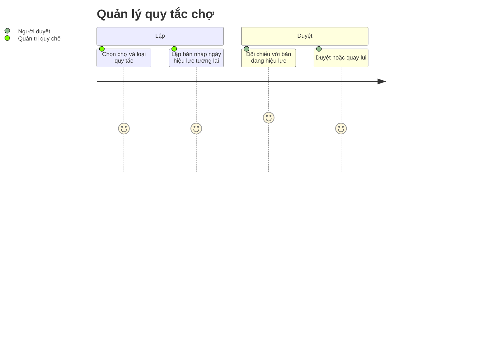

# Screens — F012_MarketManagement

## Screen List

Một màn duy nhất, **chỉ đặc tả**, phục vụ F12-01 (khối chợ), F12-02 (soạn, duyệt) và F12-04 (quay lui); F12-03 (`resolve_market_rule`) là hành vi nền, không có màn riêng. Cả bốn tính năng con đều P0 (xem [technical-spec](./technical-spec.md#requirements)).

| Screen Name | SCR### | What User Sees | What User Can Do |
|-------------|--------|----------------|------------------|
| Quản lý chợ & quy tắc vận hành (市場・業務規程管理) · route `/markets`, `/markets/[id]/rules`, `/markets/[id]/rules/[rule_key]` (đề xuất) · [ĐẶC TẢ — chưa xây]; màn mới ngoài 35 màn LAB-1 | [SCR037_MarketManagement](../../screens/SCR037_MarketManagement/spec.md) | Danh sách chợ; với mỗi chợ, danh mục loại quy tắc kèm phiên bản đang hiệu lực và ngày hiệu lực; dòng thời gian các phiên bản (đã qua, đang hiệu lực, đã duyệt chưa tới ngày, nháp); số lần đổi trong năm (cảnh báo từ lần 3, chặn ở lần 4) | `rule_admin` (role đề xuất): khai báo chợ, lập bản nháp. Người có cờ `can_approve`, khác người lập: duyệt, quay lui (hộp thoại xác nhận nêu bản nào sống lại, từ ngày nào, bản nào bị huỷ hiệu lực). `reconcile`, `party_admin`, `sys_admin`: chỉ xem. Không có nút sửa bản đã duyệt hay xoá chợ |

## User Journey

1. Quản trị quy chế mở danh sách chợ và chọn một chợ; thấy các loại quy tắc cùng phiên bản đang hiệu lực.
2. Chọn một loại quy tắc; thấy dòng thời gian các phiên bản.
3. Bấm "Lập bản mới": form sao nội dung từ bản đang hiệu lực, số phiên bản do hệ thống cấp, ngày hiệu lực để trống.
4. Nhập ngày hiệu lực trong tương lai và lý do thay đổi (tối thiểu 10 ký tự), lưu nháp; thấy nhãn "chưa có hiệu lực".
5. Nếu đã đủ 4 lần đổi trong năm, hệ thống từ chối và giữ nguyên dữ liệu đã nhập.
6. Người duyệt khác người lập mở bản nháp, xem cạnh bản đang hiệu lực, duyệt.
7. Cần quay lui: chọn bản cũ; hệ thống tạo bản mới sao nội dung đó và vẫn qua duyệt.

