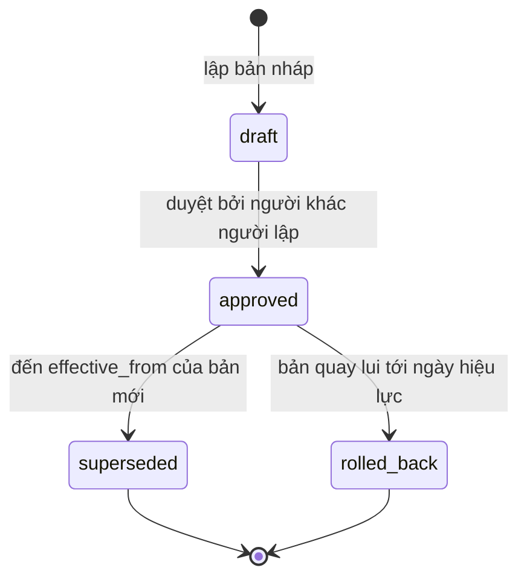
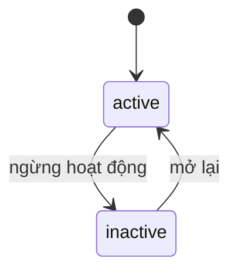

# F012_MarketManagement — Technical Spec

**Priority**: P0 (đề xuất; F12-01…F12-04 đều P0 — tư cách tham gia và chốt đấu giá đều tra quy chế chợ, thiếu quy chế thì `resolve_market_rule` raise `P0017`; không có ưu tiên LAB-1 vì không thuộc 63 tính năng)
**Type**: mixed (form có duyệt + hàm tra cứu dùng chung)
**Generated**: 2026-10-06

Nhãn: **[ĐÃ TRIỂN KHAI]** · **[ĐẶC TẢ — chưa xây]** · (đề xuất, rủi ro X) · (suy luận). `P0001`–`P0009` đã cài; `P0010` trở lên là đề xuất của bộ screen-spec, chưa cài.

## Overview

F012 là tính năng **mới của LAB-4** (không thuộc nhóm F01–F11 của LAB-1): khai báo chợ (`markets`) và quy tắc vận hành riêng từng chợ dưới dạng dữ liệu có phiên bản, ngày hiệu lực, maker-checker (`market_rules`) — ADR-007, sai lệch D-02. **Toàn bộ là [ĐẶC TẢ — chưa xây]**: prototype không có thực thể chợ (đã kiểm (tài liệu gốc trong repo, không nộp) `schema-snapshot.json`: chỉ có giá trị enum `market_buyer`, `market_registration`, không có bảng nào tên chợ). Bốn tính năng con **F12-01…F12-04** (bảng Requirements). Một màn: [SCR037_MarketManagement](../../screens/SCR037_MarketManagement/spec.md), route `/markets` (đề xuất). Là màn **gốc** của [SCR006](../../screens/SCR006_ParticipantProfile/spec.md) (biến thể đăng ký tại điểm giao dịch) và [SCR036](../../screens/SCR036_QualificationReview/spec.md) (nhánh `条件付き`); dùng chung khuôn phiên bản với [F008_IncentiveAndRateVersion](../F008_IncentiveAndRateVersion/technical-spec.md) và cùng nguyên tắc append-only với [F007_PostCloseCorrection](../F007_PostCloseCorrection/technical-spec.md).

Hiện trạng liên quan **[ĐÃ TRIỂN KHAI]**: `qualification_basis_rules` có cột `violation_action = 'Theo quy chế chợ'` cho căn cứ `market_registration`, không dòng logic nào đọc (`supabase/migrations/0003_participants_and_master.sql:12-30`); `_assert_buyer_qualified` kiểm đồng nhất, không đọc quy tắc chợ (`0007_rpc_functions.sql:12-37`).

## Polymorphic Behavior

Phân biệt theo `market_rules.rule_key` (danh mục đề xuất; lược đồ `payload` chưa có từ khách — cả bốn khóa là đề xuất, rủi ro Trung bình). `incentive_rate` **không** là khóa của F012: 料率 là quy tắc quốc gia, có dòng thời gian riêng ở [F008](../F008_IncentiveAndRateVersion/technical-spec.md) (SCR026/SCR027).

| `rule_key` | Render (form payload) | Validation | Persistence / consumer |
|---|---|---|---|
| `buyer_registration` | regex mã đăng ký, `sites[]`, thời hạn, điều kiện gia hạn | thiếu trường theo lược đồ → `V-05` | đọc bởi SCR006 biến thể D |
| `license_condition` | trần số lượng/ngày, có cho せり hay không, hạn điều kiện mặc định | như trên | đọc bởi SCR036 và nhánh `条件付き` trong `_assert_buyer_qualified` → `P0010` (đề xuất, chưa cài; hàm đó rẽ nhánh theo `basis_type`, không có hàm riêng cho `許可`); chờ khách định nghĩa `条件付き` (giả định G4) |
| `seri_cutoff` | giờ cắt phiên đấu giá | như trên | đọc bởi SCR011 |
| `qualification_expiry_warning_days` | số ngày cảnh báo trước hết hạn | số nguyên dương | bộ lọc SCR005 |

Không đưa vào `market_rules`: 料率 (thuộc F008) và hệ số thuế 110/100 và làm tròn xuống theo JPY (BR-INC-01 — quy tắc quốc gia).

## Cross-Cutting Logic

### Requirements

LAB-1 không có FR riêng cho F012; bốn tính năng con F12-01…F12-04 là mã mới của LAB-4 (đặt tiếp quy tắc LAB-1, đồng bộ [feature-list](../../generated/feature-list.md)), cùng ưu tiên P0. Căn cứ ràng buộc nguồn: GOV-RULE-01, FR-RULE-01, NFR-OPS-02, FR-INC-03, BR-CLOSE-01. Tên RPC dưới đây từ `sc-n2-quan-ly-cho.md` §8 [ĐẶC TẢ — chưa xây].

| Mã | Ưu tiên | Code | Description | Handler | Verifiable |
|---|---|---|---|---|---|
| F12-01 | P0 | (đề xuất) tạo/sửa chợ | Quản lý thực thể chợ: khai báo chợ, ngừng hoạt động (không xoá) | `upsert_market` | yes |
| F12-02 | P0 | GOV-RULE-01 · FR-RULE-01 · NFR-OPS-02 | Soạn, duyệt, thay thế quy tắc chợ có phiên bản: 起票・承認分離; có 発効日; lưu người tạo, người duyệt, 発効日, trạng thái cho mọi version; đổi bằng cấu hình có kiểm soát, không deploy, không sửa dữ liệu lịch sử | `draft_market_rule`, `approve_market_rule`; cột `drafted_by`, `approved_by`, `effective_from`, `status` của `market_rules` | yes |
| F12-03 | P0 | FR-INC-03 · BR-CLOSE-01 | Tra quy tắc theo ngày hiệu lực: in lại kỳ cũ ra đúng số cũ → tra theo `as_of` = ngày nghiệp vụ | `resolve_market_rule(p_market_id, p_rule_key, p_as_of)` | yes |
| F12-04 | P0 | GOV-RULE-01 | Quay lại phiên bản trước, tối đa 4 lần đổi/năm; rollback truy vết được, không biến dạng dữ liệu đã chốt trước 発効日 | `rollback_market_rule` | yes |

**Source:** (tài liệu gốc trong repo, không nộp) `product-a-rfp-business-summary.md` §7.8; (tài liệu gốc trong repo, không nộp) `architecture.md` C6, §3.2.

### Business Rules

| Code | Rule | Mã lỗi |
|---|---|---|
| GOV-RULE-01 (a) | Trần 4 bản **đã duyệt** (mọi trạng thái trừ `draft`: `approved`, `superseded`, `rolled_back`) có `effective_from` trong cùng năm; đếm theo `effective_from`, không theo ngày duyệt; năm dương lịch (**giả định**, chờ khách) | `P0015` (đề xuất, chưa cài) |
| GOV-RULE-01 (b) | `effective_from` > ngày hiện tại và không trùng bản `approved` cùng `(market_id, rule_key)` | `P0016` (đề xuất, chưa cài) |
| GOV-RULE-01 (c) | Người duyệt ≠ người lập và có quyền duyệt (cờ `app_users.can_approve` trên tài khoản, đã chốt PREMISE C-09; cột chưa có trong DB) — kiểm trong thân RPC, không chỉ ẩn nút | `P0013` (đề xuất, chưa cài) |
| GOV-RULE-01 (d) | Quay lui = tạo bản mới sao nội dung bản cũ, không sửa dòng cũ; không còn bản trước → lỗi | `P0071` (đề xuất, chưa cài) |
| BR-F012-DRAFT (mã mô tả) | `draft` không có hiệu lực. `resolve_market_rule` chỉ xét bản đã duyệt (`approved`, `superseded`, `rolled_back` — đều từng có hiệu lực) và chọn bản có `effective_from` lớn nhất ≤ `as_of`; `draft` không bao giờ vào kết quả | — |
| BR-F012-SUPERSEDE (mã mô tả) | Bản cũ chuyển `superseded` (hoặc `rolled_back` nếu bản mới là bản quay lui) tại `effective_from` của bản mới, không ngay lúc duyệt; bản đã chuyển vẫn là đáp án khi tra `as_of` trước ngày đó | — |
| BR-F012-LOCK (đề xuất, rủi ro Thấp) | `code` chợ và `rule_key` khóa sau khi tạo; bản `approved` không sửa, chỉ tạo bản mới; chợ không xoá, chỉ `inactive` | — |
| BR-F012-NATIONAL | Quy tắc quốc gia (thuế, làm tròn) không vào `market_rules` | — |
| BR-F012-DUP (đề xuất, rủi ro Thấp) | Trùng mã chợ → `P0069` (đề xuất, chưa cài, dùng chung với SCR006; `P0005` đã cài nghĩa "sai chức danh" nên không dùng) | `P0069` |

Mã `BR-F012-*` là nhãn mô tả của tài liệu này (suy luận).

### Decision Logic

**Subtypes:** `render`, `interaction`.

#### DEC-F012-01_ApproveButton
**subtype:** render
**Triggers in:** SCR037_MarketManagement, khối duyệt của bản `draft`
**Involved entities:** `market_rules.drafted_by`, `app_users.can_approve` (đã chốt PREMISE C-09)
**user_visible_outcome:** nút duyệt chỉ hiện với người có `can_approve` và khác người lập; người lập thấy câu "Bạn không duyệt được bản do chính mình lập" (ẩn hẳn nút). Đây chỉ là tiện lợi giao diện — chặn thật nằm trong RPC.
**Source:** (tài liệu gốc trong repo, không nộp) `sc-n2-quan-ly-cho.md` §4 (V-06), §2

```pseudo
if status == draft and viewer.can_approve and viewer.id != drafted_by -> show Approve
else if status == draft and viewer.id == drafted_by -> show V-06 text, hide button
else read-only
```

#### DEC-F012-02_RollbackConfirm
**subtype:** interaction
**Triggers in:** SCR037, bấm "Quay lui"
**user_visible_outcome:** hộp thoại chặn luồng nêu bản nào sống lại, từ ngày nào, bản nào bị huỷ hiệu lực (CAP-HUMAN-01 điểm 3).
**Source:** sc-n2 §6.

### State Machines

### SM-F012-01_MarketRuleVersion
**kind:** entity
**Linked FR:** GOV-RULE-01, FR-RULE-01
**Source:** (tài liệu gốc trong repo, không nộp) `sc-n2-quan-ly-cho.md` §3 (#12), §7 [ĐẶC TẢ — chưa xây]
**States:** draft, approved, superseded, rolled_back



**Transition rules:**
- `draft → approved`: guard = người duyệt ≠ người lập, có `can_approve`; chưa đủ 4 bản đã duyệt trong năm; side effect: ghi `approved_by`, `approved_at`.
- `approved → superseded`: guard = tới `effective_from` của bản kế tiếp; không phải lúc duyệt.
- Rollback không hồi sinh dòng cũ: tạo `draft` mới sao payload bản chọn, rồi đi tiếp qua duyệt; tại `effective_from` của bản mới, bản bị thay chuyển `rolled_back` (cùng cơ chế với `superseded`, chỉ khác nhãn lý do).
- Nguồn không mô tả đường **từ chối** bản `draft` (khác SCR026/027 của F008 có `pending`) — chưa chốt (Unresolved).

**Trạng thái hiển thị dẫn xuất** (suy luận, theo mẫu bảng sáu trạng thái của F008): "approved nhưng chưa tới ngày" = `status='approved'` và `effective_from` > ngày nghiệp vụ → hiện khác "đang hiệu lực"; không có thêm cột lưu.

### SM-F012-02_MarketStatus
**kind:** entity
**Linked FR:** (không có FR LAB-1)
**Source:** sc-n2 §3 (#7), §10 câu 7 (đề xuất)
**States:** active, inactive



Không có xoá vật lý (đề xuất, rủi ro Thấp).

### Algorithms

### ALG-F012-01_ResolveMarketRule
**Linked FR:** FR-INC-03 (nguyên tắc `as_of`)
**Source:** `sc-n2-quan-ly-cho.md` §8 [ĐẶC TẢ]
**Input:** `p_market_id`, `p_rule_key`, `p_as_of` (ngày nghiệp vụ)
**Output:** `jsonb` payload của bản hiệu lực; raise lỗi khi không có bản
**File Schema**: N/A — not a file-exchange type
**Complexity:** O(log n) theo index `(market_id, rule_key, effective_from)` (đề xuất)
**Description:** là RPC chứ không phải view: cần tham số `as_of` để chọn **một** bản và cần raise khi không có (view chỉ trả rỗng, bị hiểu nhầm "không có hạn chế"). Không bao giờ dùng `now()`.

```text
select payload from market_rules
 where market_id=? and rule_key=? and status in ('approved','superseded','rolled_back')
   and effective_from <= p_as_of
 order by effective_from desc limit 1
if none -> raise P0017 (đề xuất, chưa cài; nghĩa riêng: không có quy chế hiệu lực tại as_of)
```
Ghi chú: lọc gồm `superseded` và `rolled_back` để tra ngày quá khứ vẫn ra bản cũ; `draft` bị loại. Nguồn chỉ nói "lọc approved" nên đây là suy luận, thống nhất với BR-F012-DRAFT và SM-F012-01.

### ALG-F012-02_AnnualCap
**Linked FR:** GOV-RULE-01
**Source:** sc-n2 §3 (#19), §7.4 [ĐẶC TẢ]
**Input:** `market_id`, `rule_key`, năm của `effective_from`
**Output:** số bản đã duyệt (mọi trạng thái trừ `draft`) trong năm; chặn khi ≥ 4
**Description:** kiểm hai lần — lúc lưu nháp (báo sớm) và lúc duyệt (có thể có bản khác chen vào). Cảnh báo khi ≥ 3.

```text
n = count(status<>'draft' where year(effective_from)=year(new.effective_from))
if n >= 4 -> P0015
```

### External Integrations

Không áp dụng — không có hệ thống ngoài. Consumer nội bộ (ADR-007): SCR006 (biến thể D), SCR036, SCR011, SCR005, F009 (RPT-12) gọi `resolve_market_rule` với `as_of`.

### Verification

- **VER-F012-01** — lưu nháp không làm `resolve_market_rule` đổi kết quả (covers BR-F012-DRAFT).
- **VER-F012-02** — bản thứ 5 trong cùng năm bị `P0015` (đề xuất) ở cả bước lưu nháp và duyệt (covers ALG-F012-02).
- **VER-F012-03** — gọi trực tiếp RPC duyệt bằng chính người lập bị `P0013` dù giao diện ẩn nút (covers GOV-RULE-01 (c)).
- **VER-F012-04** — sau duyệt, tra với `as_of` trước `effective_from` vẫn ra bản cũ; từ ngày đó ra bản mới (covers BR-F012-SUPERSEDE).
- **VER-F012-05** — in lại báo cáo kỳ T sau khi đổi quy tắc có hiệu lực sau T cho số cũ (covers FR-INC-03).
- **VER-F012-06** — quay lui không UPDATE dòng cũ (đếm dòng trước/sau) (covers GOV-RULE-01 (d)).
- **VER-F012-08** — sau khi bản quay lui có hiệu lực, tra `as_of` trước ngày đó vẫn ra bản `rolled_back`; từ ngày đó ra bản mới (covers BR-F012-SUPERSEDE, ALG-F012-01).
- **VER-F012-07** — phép quét tĩnh: không có `now()` / `current_date` trong hàm tra quy tắc (covers `as_of`).

## User Stories

LAB-1 **không có user story riêng** cho F012. US-19 ("đổi tỷ lệ mà không cần sửa phần mềm") cùng khuôn nên được dùng làm mẫu điều kiện chấp nhận; story dưới đây là **(đề xuất)** — suy luận, chưa được khách xác nhận.

### US-19 (mẫu) — Đổi quy tắc chợ mà không cần sửa phần mềm (Priority: P1, đề xuất)

**What happens:** quản trị quy chế lập phiên bản quy tắc mới có ngày hiệu lực tương lai, người khác duyệt, quay lui được.
**Why this priority:** đề bài LAB-4 nêu đích danh quy tắc riêng từng chợ; GOV-RULE-01 cứng.
**Independent Test:** lập nháp → duyệt bằng người khác → tra trước/sau ngày hiệu lực.

**Acceptance Scenarios:** (điều kiện trích từ US-19)

1. **Given** bản nháp, **When** chưa duyệt, **Then** không có hiệu lực.
2. **Given** người lập, **When** tự duyệt, **Then** bị từ chối ở tầng dữ liệu.
3. **Given** bản đã duyệt, **When** tra ngày trước `effective_from`, **Then** vẫn ra bản cũ.
4. **Given** đã đủ 4 lần đổi trong năm, **When** lập thêm, **Then** bị từ chối.
5. **Given** cần quay lui, **When** xác nhận, **Then** có bản mới sao nội dung cũ, truy vết được.

**Requirements fulfilled:** F12-02, F12-03, F12-04 (GOV-RULE-01, FR-RULE-01, NFR-OPS-02) — `draft_market_rule` / `approve_market_rule` / `rollback_market_rule` / `resolve_market_rule` [ĐẶC TẢ]
**Source:** (tài liệu gốc trong repo, không nộp) `sc-n2-quan-ly-cho.md:127-141`
**Rules enforced:** GOV-RULE-01 (a)–(d), BR-F012-DRAFT, BR-F012-SUPERSEDE.
**State transitions:** SM-F012-01.
**Verification:** VER-F012-01…06, VER-F012-08.

---

### Edge Cases

| Scenario | Behavior |
|---|---|
| Duyệt tháng 12 cho hiệu lực tháng 1 | Tính vào năm sau (đếm theo `effective_from`) |
| Hai người cùng duyệt một bản | Bản không còn `draft` khi người thứ hai gửi → `P0013` (đề xuất; theo quy ước maker-checker của F012; F008 dùng `P0036` cho bản của F008) |
| Chợ chưa có quy tắc cho `rule_key` | Tra raise lỗi, không trả rỗng |

Chi tiết: [edge-cases.md](edge-cases.md).

## Key Entities

Tất cả **[ĐẶC TẢ — chưa tồn tại]**, trừ các bảng nối.

| Entity | Table | Key Columns | Purpose |
|---|---|---|---|
| Market | `markets` (đề xuất) | `id, code, name_ja, name_vi, operator_name, timezone, service_window, status` | khai báo chợ |
| MarketRule | `market_rules` (đề xuất) | `id, market_id, rule_key, version, effective_from, payload jsonb, status, drafted_by, drafted_at, approved_by, approved_at, superseded_by, change_note` | phiên bản quy tắc |
| MarketRuleVersions | view `v_market_rule_versions` (đề xuất) | + `changes_this_year` | dòng thời gian |
| AppUser **[ĐÃ CÓ]** | `app_users` | `id, role, status` + `can_approve` (đã chốt PREMISE C-09, cột chưa có) | người lập/duyệt |
| QualificationBasisRule **[ĐÃ CÓ]** | `qualification_basis_rules` | `basis_type, violation_action` | dữ liệu chết `Theo quy chế chợ` |
| BusinessDay **[ĐÃ CÓ]** | `business_days` | `business_date` (PK đơn) | sẽ đổi sang PK ghép `(market_id, business_date)` — bước phá tương thích |
| Lot / ParticipantQualification **[ĐÃ CÓ]** | `lots`, `participant_qualifications` | thêm `market_id` | gắn về chợ |

## Artifact References

| Artifact | File | Codes Used |
|----------|------|------------|
| System Overview | [overview.md](../../system/overview.md) | — |
| Architecture | [architecture.md](../../system/architecture.md) | C6 |
| Business Rules | [business-rules.md](../../system/business-rules.md) | GOV-RULE-01 |
| Permissions | [permissions.md](../../system/permissions.md) | `rule_admin` (đề xuất), `can_approve` (đã chốt C-09) |
| Feature List | [feature-list.md](../../generated/feature-list.md) | F012 |
| Screen List | [screen-list.md](../../generated/screen-list.md) | SCR037 |
| Entities | [entities.md](../../generated/entities.md) | markets, market_rules (đề xuất) |
| Screens | [screens.md](screens.md) | SCR037 |

## Assumptions

- Mã `VER-F0xx-nn`, `SM-F0xx-nn`, `ALG-F0xx-nn`, `DEC-F0xx-nn`, `BR-F012-*` là quy ước đặt mã của bộ tài liệu này (suy luận).
- Mã lỗi `P0013`, `P0015`, `P0016`, `P0017`, `P0069`, `P0071` lấy từ screen-spec SCR037; **chưa cài**. `P0005` đã cài nghĩa "sai chức danh" (tài liệu gốc trong repo, không nộp: `db-schema.md` §4); "mã chợ đã tồn tại" dùng `P0069`, "không còn phiên bản trước để quay lui" dùng `P0071`, còn `P0017` chỉ nghĩa "không có quy chế hiệu lực tại `as_of`" (bảng mã lỗi: [business-rules](../../system/business-rules.md)).
- Năm = năm dương lịch (chờ khách); quay lui tính vào trần (chờ khách).
- Một chợ mặc định cho dữ liệu hiện có; đường di trú: tạo `markets` 1 dòng → backfill `market_id` → đổi PK `business_days` sau cùng.
- Role `rule_admin`, `party_admin` (đề xuất) và cột `app_users.can_approve` chưa có trong DB (DB chỉ có 4 role: sys_admin, receiving, trading, reconcile). Mô hình 9 role key + cờ `can_approve` trên tài khoản đã chốt (PREMISE C-09).

## Source Code References

Không có code F012 (chưa xây). Điểm chạm trong code hiện tại:

| Order | Symbol | Path | Purpose |
|-------|--------|------|---------|
| 1 | qualification_basis_rules | `supabase/migrations/0003_participants_and_master.sql:12-30` | `violation_action` "Theo quy chế chợ" trỏ khoảng không |
| 2 | _assert_buyer_qualified | `supabase/migrations/0007_rpc_functions.sql:12-37` | kiểm đồng nhất; sẽ rẽ nhánh theo căn cứ và đọc quy tắc chợ |
| 3 | business_days | `supabase/migrations/0004_business_days_and_lots.sql:4-9` | PK `business_date`, sẽ đổi |
| 4 | ROUTE_POLICY | `lib/auth/route-policy.ts:17-27` | thêm `/markets` trước entry `/` |

## Unresolved Questions

1. **Một chợ hay nhiều chợ?** (câu hỏi nội bộ/khách; chưa có Q-xx LAB-1). Một chợ → thu về trang cấu hình, bỏ `market_id`.
2. **`条件付き` hạn chế cụ thể gì?** quyết lược đồ `license_condition` (chưa có Q-xx).
3. **Ai duyệt quy chế chợ?** Đã chốt dùng chung cờ `can_approve` trên tài khoản (PREMISE C-09, KISS); khách chưa xác nhận giả định rằng thẩm quyền duyệt quy chế và duyệt tư cách là một.
4. **Trần 4 lần**: năm dương lịch hay năm tài chính; quay lui có tính vào trần (nội bộ/khách).
5. **Từ chối bản `draft`** có không, và trạng thái `pending`/`cancelled` (SCR026 có `pending`; SCR037 không).
6. **Lược đồ `payload`** từng `rule_key` chưa có từ khách.
7. Chợ có bị xoá không (đề xuất: chỉ `inactive`).

## Source Walkthrough

8. **File:** (tài liệu gốc trong repo, không nộp) `database-diagram.md` § D-02 — vì sao cần chợ.
9. **File:** (tài liệu gốc trong repo, không nộp) `architecture.md` C6 và §3.2 — thiết kế bảng, hàm, đường di trú.
10. **File:** (tài liệu gốc trong repo, không nộp) `sc-n2-quan-ly-cho.md` §3, §4, §8 — field, lỗi, RPC.
11. **File:** `supabase/migrations/0003_participants_and_master.sql:12-30` — dữ liệu chết cần được thay.

### Call Hierarchy

```text
[ĐẶC TẢ] SCR037 -> draft_market_rule -> INSERT market_rules(draft)
SCR037 (checker) -> approve_market_rule -> UPDATE market_rules(approved) + supersede at effective_from
SCR037 -> rollback_market_rule -> INSERT market_rules(new copy)
SCR006 / SCR036 / SCR011 / SCR005 -> resolve_market_rule(market, rule_key, as_of) -> SELECT market_rules
```

## DB Impact per Event

Tất cả [ĐẶC TẢ — chưa xây]; nguồn là bảng RPC của `sc-n2-quan-ly-cho.md:129-137`.

| Event/Endpoint | Table | Columns | Operation | Value Derivation | Source |
|----------------|-------|---------|-----------|-------------------|--------|
| `upsert_market` | `markets` | code, name_*, operator_name, timezone, service_window, status | INSERT/UPDATE | từ form; `code` khóa sau khi tạo | `sc-n2-quan-ly-cho.md:134` |
| `draft_market_rule` | `market_rules` | market_id, rule_key, version, effective_from, payload, status, drafted_by, drafted_at, change_note | INSERT | `version` server cấp; `status='draft'`; `drafted_by=auth.uid()` | `sc-n2-quan-ly-cho.md:135` |
| `approve_market_rule` | `market_rules` | status, approved_by, approved_at | UPDATE | `approved`, `auth.uid()`, server time; bản cũ → `superseded` tại `effective_from` | `[INFERRED]` — thiết kế nêu RPC, không nêu câu UPDATE chi tiết (`sc-n2:136`) |
| `rollback_market_rule` | `market_rules` | như INSERT draft | INSERT | sao payload bản chọn; bản bị thay → `rolled_back` | `sc-n2-quan-ly-cho.md:137` |
