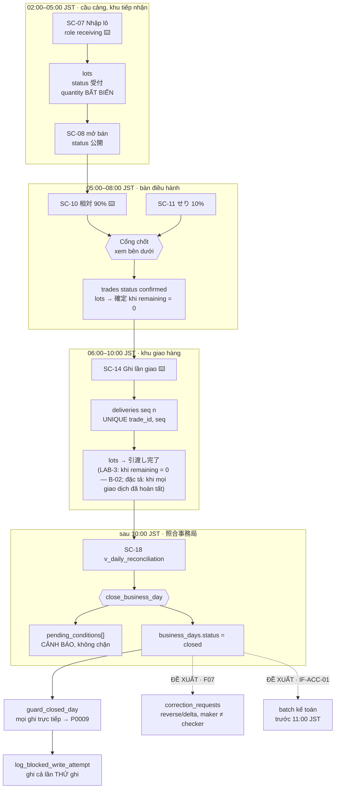
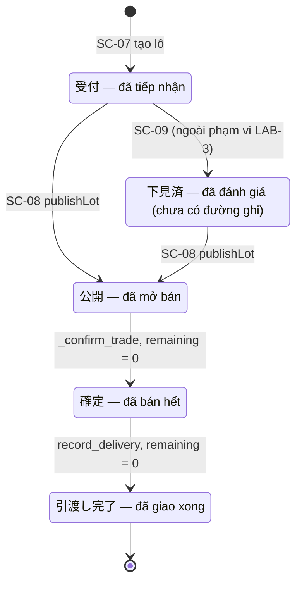
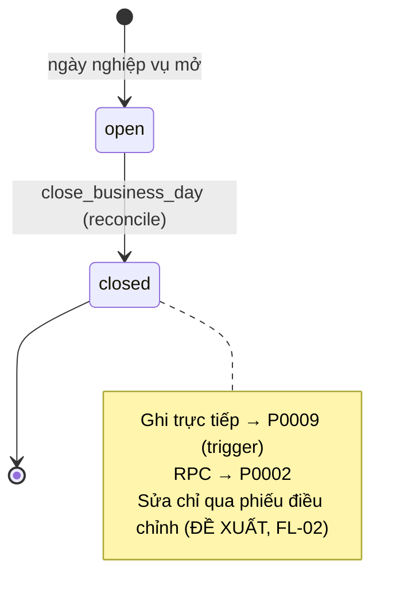
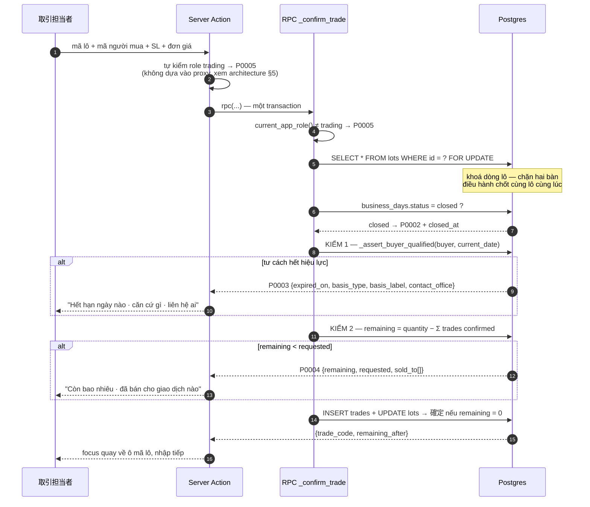

# FL-01 — Chuỗi lô → giao dịch → giao hàng → đối chiếu

> Đường sống của một ngày nghiệp vụ (業務日): lô hàng được tiếp nhận, bán (相対 ≈ 90% / せり ≈ 10%), giao nhiều lần, rồi bộ phận đối chiếu chốt sổ. Chuỗi chạy bằng **hành động của người** (SC-07 → SC-10/11 → SC-14 → SC-18) và **hệ quả tự động trong RPC** (lô tự chuyển `確定`, `引渡し完了`). Mọi chuyển trạng thái của giao dịch/giao hàng đi qua RPC `SECURITY DEFINER` ([ADR-002](../decisions/ADR-002-no-write-policy-on-trades-deliveries.md)); số còn lại không bao giờ là cột lưu sẵn ([ADR-003](../decisions/ADR-003-derived-remaining-quantity-views.md)). Phần **đã triển khai** trong prototype LAB-3; phần **đề xuất** (điều chỉnh sau chốt, batch kế toán) ghi riêng.

**Subject entity:** `lots` · **State field:** `lots.status` (cùng `deliveries.status`, `business_days.status`)
**Enum source:** `supabase/migrations/0001_extensions_and_enums.sql` — `lot_status`: `受付, 下見済, 公開, 確定, 引渡し完了` · `delivery_status`: `pending, in_transit, completed, exception` · `business_day_status`: `open, closed`

Quy ước mã: `SC-nn` (LAB-1) tương ứng thư mục `SCR0nn_…` — ví dụ SC-10 = [SCR010_NegotiatedTradeConfirm](../screens/SCR010_NegotiatedTradeConfirm/spec.md).

---

## Day Lifeline

Đường sống một ngày nghiệp vụ. Nét liền = đã triển khai; nét đứt = ĐỀ XUẤT.

Khung giờ lấy từ cửa sổ dịch vụ RFP 03: **02:00–10:00 JST**, batch báo cáo xong trước **11:00 JST**. `pending_conditions` **cảnh báo chứ không chặn** là quyết định có cân nhắc ([ADR-005](../decisions/ADR-005-close-day-warn-not-block.md)): giao hàng kéo dài qua ngày là bình thường (lịch xe gom), chặn cứng thì không ngày nào chốt được.

---

## States

### `lots.status` — vòng đời lô (FIG-011)

| State | Meaning | Who acts here | Invariant / what is allowed |
|-------|---------|---------------|----------------------------|
| `受付` | Đã tiếp nhận | `receiving` (SC-07) | `quantity` đã khoá, bất biến; chưa mở bán |
| `下見済` | Đã đánh giá cảm quan (目利き) | người đánh giá (ROLE-JUDGE) | **Có trong enum, chưa có đường ghi** trong prototype (SC-09 ngoài phạm vi); `目利き` dùng role `receiving` (đã chốt, PREMISE C-10) |
| `公開` | Đã mở bán | `receiving` (SC-08) | Cho phép `trading` chốt giao dịch |
| `確定` | Đã bán hết (`remaining = 0`) | hệ thống, trong `_confirm_trade` | Không còn số lượng để bán |
| `引渡し完了` | Đã giao xong | LAB-3: hệ thống, trong `record_delivery` (sai cấp, B-02). Đặc tả: `complete_trade_delivery` (SCR016) khi **mọi** giao dịch `confirmed` của lô có `trades.delivery_completed_at` (PREMISE G3) | Trạng thái cuối |

`受付` là entry state; `引渡し完了` là terminal state (không có đường quay lại trong prototype).

### `deliveries.status` — một lần giao

| State | Meaning | Who acts here | Invariant / what is allowed |
|-------|---------|---------------|----------------------------|
| `pending` · `in_transit` | Chờ giao / đang giao | — | Có trong enum; luồng prototype không ghi (đọc thân `record_delivery` + `actions.ts`: tham số `p_status` mặc định `completed`) |
| `completed` | Giao xong lần này | `receiving` (SC-14) | Tính vào `delivered_qty` |
| `exception` | Giao có ngoại lệ (`short` `over` `returned` `partial_cancel`) | `receiving` (SC-14) | `exception_type` chỉ hợp lệ khi `status='exception'` (CHECK). Tính vào `delivered_qty` — xem B-01 |

### `business_days.status` — ngày nghiệp vụ

| State | Meaning | Who acts here | Invariant / what is allowed |
|-------|---------|---------------|----------------------------|
| `open` | Đang mở | — | Mọi RPC/ghi trực tiếp của ngày được phép (theo role) |
| `closed` | Đã chốt sổ | `reconcile` (SC-18) | Mọi INSERT/UPDATE/DELETE trực tiếp trên `lots`/`trades`/`deliveries` của ngày bị trigger chặn (`P0009`); RPC tự kiểm và trả `P0002` |

`open` là entry state; `closed` là terminal state (mở lại kỳ đã chốt chỉ qua đường điều chỉnh có kiểm soát — [FL-02](./FL-02-post-close-correction.md), ĐỀ XUẤT).

---

## State Diagram

---

## Transitions

| # | From --> To | Trigger type | Trigger | Guard (must hold) | Side effects | Source |
|---|-----------|--------------|---------|-------------------|--------------|--------|
| T1 | `∅ -> 受付` | user-action | SC-07 `createLot`: `next_lot_code()` rồi `INSERT lots` | role `receiving` (policy `lots_insert`); ngày chưa chốt (trigger `guard_closed_day_lots`); `quantity > 0`; `lot_code` unique | sinh mã `LOT-YYYYMMDD-0001` | `app/(app)/lots/actions.ts:105-113`; `0004_business_days_and_lots.sql:15-39`; `0009_rls_policies.sql:46-47`; `0010_closed_day_guard.sql:45-47` |
| T2 | `受付`/`下見済` `-> 公開` | user-action | SC-08 `publishLot`: `UPDATE lots … WHERE status IN ('受付','下見済')` | role `receiving` (policy `lots_update`); điều kiện trạng thái nằm trong mệnh đề `WHERE` (đọc + ghi một câu lệnh) | — | `app/(app)/lots/actions.ts:156-165`; `0009:48-51` |
| T3 | `公開 -> 確定` | event | trong `_confirm_trade`, khi `remaining − p_quantity = 0` | đã qua cổng chốt (bên dưới) | `INSERT trades` (status `confirmed`, `trade_code` `TRD-YYYYMMDD-0001`) rồi `UPDATE lots SET status='確定'` | `0007_rpc_functions.sql:82-90` |
| T4 | `確定 -> 引渡し完了` | event | trong `record_delivery`, khi `remaining − p_quantity = 0` của **giao dịch** | role `receiving`; ngày chưa chốt (`P0002`); tư cách người mua còn hiệu lực (`P0003`); không giao vượt (`P0006`) | `INSERT deliveries` (seq = max+1); `UPDATE lots` — xem B-02, B-04 ở Open Questions | `0007:155-161` |
| T4' *(ĐẶC TẢ, đã chốt PREMISE G3)* | `確定 -> 引渡し完了` | user-action | SCR016 `complete_trade_delivery` ghi `trades.delivery_completed_at` cho **một giao dịch**; lô chuyển khi **mọi** giao dịch `confirmed` của lô đã hoàn tất | role `receiving`; đủ điều kiện hoàn tất (`P0063`: số lượng khớp `精算`, không còn lần giao `pending`/`in_transit`) | `UPDATE trades SET delivery_completed_at`; nếu là giao dịch cuối của lô thì `UPDATE lots SET status='引渡し完了'` cùng transaction | [SCR016_DeliveryDetail](../screens/SCR016_DeliveryDetail/spec.md) |
| T5 | `deliveries ∅ -> completed/exception` | user-action | SC-14 `recordDelivery` → RPC `record_delivery` | như T4 | ghi `deliveries`; trả `{delivery_seq, remaining_after}`; nếu bị `P0002`/`P0009` → `log_blocked_write_attempt` | `0007:114-165`; `app/(app)/deliveries/actions.ts:63-80`; `lib/domain/reconciliation.ts:140-159` |
| T6 | `open -> closed` | user-action | SC-18 `close_business_day(p_date)` | role `reconcile` (`P0005`); ngày tồn tại (`P0001`); chưa `closed` (`P0002`) | tính `pending_conditions`; `UPDATE business_days`; `INSERT audit_log` (action `close_business_day`); **không chặn** khi còn tồn | `0008_rpc_functions_admin.sql:6-41`; `app/(app)/reconciliation/actions.ts:68` |

### In-state recurring behaviors (NOT transitions)

- Khi `business_days.status = 'closed'`: trigger `guard_closed_day` (BEFORE INSERT/UPDATE/DELETE trên `lots`, `trades`, `deliveries`) raise `P0009`; `deliveries` tra ngày qua `trades` — `0010_closed_day_guard.sql:6-55`.
- `_confirm_trade` và `record_delivery` tự kiểm `business_days.status` **trước** khi insert nên qua đường RPC chỉ thấy `P0002`; `P0009` chỉ xuất hiện khi ghi **trực tiếp** (vd `lots` qua policy của `receiving`, hoặc SQL chạy tay) — tài liệu gốc trong repo, không nộp: `db-schema` §11.3.

---

## Cổng chốt giao dịch — SC-10 / SC-11

Hai phép kiểm trong **một** transaction — ranh giới cứng #3 của LAB-3 (tài liệu gốc trong repo, không nộp: `lab3-scope-lock`). *(ĐÃ TRIỂN KHAI — `0007:41-94`)*

Hai nhánh từ chối **không** trả về cùng một thông báo. `P0003` trả `contact_office` vì người thao tác cần biết **gọi ai** — hồ sơ 許可/承認 nằm ở cơ quan ngoài hệ thống. `P0004` trả `sold_to[]` vì câu hỏi tiếp theo luôn là "ai đã mua mất". Client **rẽ nhánh theo `error.code`, không bao giờ theo `error.message`** — SQLSTATE ổn định, câu chữ thì không; `error.details` là chuỗi JSON cần `JSON.parse` (tài liệu gốc trong repo, không nộp: `db-schema` §4).

Với `せり` (SC-11): `record_auction_result` (6 tham số, `0030:45-60`) gọi `_confirm_trade('auction', …)` rồi `UPDATE` hai cột nhập tay `auction_session_at`, `auction_confirmed_by_name` **trong cùng transaction**; ràng buộc "đủ hai trường lúc commit" do `CONSTRAINT TRIGGER` giữ (`P0008`, [ADR-004](../decisions/ADR-004-invariants-at-database-layer.md)). SC-11 là form **nhập tay** — không OCR, không gợi ý tự động (FR-SERI-01, CAP-HUMAN-01).

---

## Số liệu dẫn xuất dùng trong chuỗi

| View | Dùng ở bước | Ghi chú |
|---|---|---|
| `v_lot_availability` | SC-08, cổng chốt (SC-10) | `remaining`, `sold_to[]` |
| `v_trade_delivery_status` | SC-14, `close_business_day` (tính `pending_conditions`) | `delivered_qty` gộp `completed` + `exception` |
| `v_daily_reconciliation` | SC-18 | `trade_count`, `total_amount`, `delivery_count`, `exception_count`; `total_amount` sai khi giao dịch có nhiều lần giao (B-05) |

Định nghĩa đầy đủ: [entities.md](../generated/entities.md#ba-view-dẫn-xuất).

---

## Entry Contract

Một `business_days` dòng `open` tồn tại cho ngày đó (FK `lots.business_date → business_days`), và người dùng có role phù hợp (`receiving` để tạo lô/ghi giao; `trading` để chốt; `reconcile` để chốt sổ). Terminal dùng chung theo ca: form phải xoá sạch sau submit (architecture §3.4).

## Exit Contract

`business_days.status = 'closed'` là điểm cuối của vòng đời ngày trong prototype. Hai đầu ra **ĐỀ XUẤT**: (1) phiếu điều chỉnh sau chốt — [FL-02](./FL-02-post-close-correction.md); (2) batch xuất kế toán `IF-ACC-01` sau chốt và xong trước 11:00 JST (architecture §4, giả định A4: CSV một chiều qua SFTP; chưa chốt phương thức kết nối).

## Outcomes

- **Success:** lô `受付` → `公開` → `確定` → `引渡し完了`; ngày `closed`; báo cáo ngày (SC-18) khớp giao dịch + giao hàng.
- **Partial:** ngày chốt khi còn `pending_conditions` (giao dịch chưa giao xong) — chấp nhận có chủ ý (ADR-005); số liệu kỳ đó không phản ánh trạng thái giao hàng cuối cùng.
- **Rejected (không tạo bản ghi nào):** `P0003` hết hiệu lực tư cách · `P0004` thiếu số lượng · `P0002` ngày đã chốt · `P0006` giao vượt · `P0005` sai chức danh.

## Guard & Cascade Rules

| # | Edge | Actor | Guard | Cascade / side effect | Source |
|---|------|-------|-------|----------------------|--------|
| 1 | bất kỳ ghi trực tiếp vào ngày `closed` | bất kỳ | trigger `guard_closed_day` | `P0009`; Server Action bắt `P0002`/`P0009` rồi gọi `log_blocked_write_attempt` (lời gọi **riêng**, ngoài transaction đã rollback) → `audit_log` action `blocked_write_attempt` | `0010:6-55`; `0040_log_blocked_write_attempt.sql:21-46`; `lib/domain/reconciliation.ts:140-159` |
| 2 | `auction` thiếu hai trường lúc commit | hệ thống | `trg_auction_fields_complete` (DEFERRABLE INITIALLY DEFERRED, đọc lại dòng theo `id`) | `P0008` | `0035_auction_fields_trigger_refetch.sql:24-41` |
| 3 | mất mạng ở hiện trường | người dùng | SC-07, SC-14 **được phép** nhập bù (ĐỀ XUẤT); SC-10/SC-11/SC-18 **không** | prototype: không có hàng đợi (MOCK-2), submit thất bại kèm lỗi rõ | architecture §3.5; MOCK-2 của tài liệu gốc `lab3-scope-lock` (trong repo, không nộp) |

---

## Open Questions

- **Q (B-01, lỗi thật):** `v_trade_delivery_status` cộng mọi dòng `exception` vào `delivered_qty` (`0006:42`), kể cả `returned` và `partial_cancel` vốn phải trừ ra — trả hàng làm "đã giao" **tăng lên**. Sửa view là thay đổi phá tương thích, chạm SC-14/15/16/18.
- **Q (B-02, lỗi thật):** T4 lật `lots.status = 引渡し完了` khi **một giao dịch** giao đủ, nhưng một lô có thể bán cho nhiều giao dịch (vd `LOT-20260924-0008` bán cho 2 giao dịch) → trạng thái lô sai cho các giao dịch còn lại. Hành vi đúng đã chốt (PREMISE G3): hoàn tất ở cấp giao dịch (T4').
- **Q (B-04, đọc code, chưa tái hiện):** T4 lật `lots.status = 引渡し完了` khi `remaining − p_quantity = 0` bất kể `p_status`, trong khi `delivered` chỉ tính `completed`/`exception`; form cho chọn `pending`/`in_transit` → một lần giao "Chờ giao" bằng đúng số còn lại làm lô thành đã giao xong (`0007:146-147, 159-161`). Hướng sửa đề xuất: chỉ lật khi `p_status in ('completed','exception')`.
- **Q (B-05, ĐÃ XÁC NHẬN trên DB thật 2026-10-06):** bước đối chiếu SC-18 đọc `v_daily_reconciliation`, view này `LEFT JOIN deliveries` rồi `sum(tr.amount)` nên tiền nhân theo số lần giao (2026-09-23: 53250.00 so với 38250.00 thật, do `TRD-20260923-0001` có 2 lần giao). Số tiền hiển thị trước khi chốt sổ vì vậy sai ở các ngày đó; chi tiết ở [F006](../features/F006_ReconciliationAndClosing/technical-spec.md). Hướng sửa đề xuất: tính `sum` trên `trades` trước rồi mới join đếm `deliveries`. **Code không sửa trong đợt nộp này; chưa sửa, đã có bản vá nháp `0042_fix_daily_reconciliation_amount.sql`, chưa áp.**
- **Q (suy luận từ đọc code):** `_confirm_trade` (`0007:58-80`) không kiểm `lots.status` — chưa thấy chỗ nào ép lô phải ở `公開` mới được chốt. Cần xác nhận nghiệp vụ trước khi coi `公開` là điều kiện bắt buộc.
- **Q:** `受付 → 下見済` (目利き, FR-LOT-02) chưa có đường ghi trong prototype; thiết kế: người ghi là `receiving` (đã chốt PREMISE C-10), chi tiết ghi/xác nhận ở SC-09 ([SCR009_LotDetail](../screens/SCR009_LotDetail/spec.md)).
- **Q (B-03):** `over` (giao thừa) không ghi được vì `P0006` chặn; đường đúng là phiếu duyệt SC-17 ([SCR017_DeliveryException](../screens/SCR017_DeliveryException/spec.md)), RPC duyệt phải bỏ qua trần `P0006` tường minh.
- **Q (LAB-1, chặn estimate):** giới hạn số lần chia giao và thời điểm phản ánh vào 精算/完納奨励金 (Q-02); "khớp rule 精算" (`BR-DEL-03`) nghĩa là gì.
- **LIVENESS:** không có trạng thái không-terminal nào thiếu đường thoát tự động trong phần đã triển khai; riêng lô `確定` mà không bao giờ có lần giao nào thì treo ở `確定` — được cảnh báo qua `pending_conditions` lúc chốt sổ, không có job nhắc (F10 ngoài phạm vi LAB-3).
