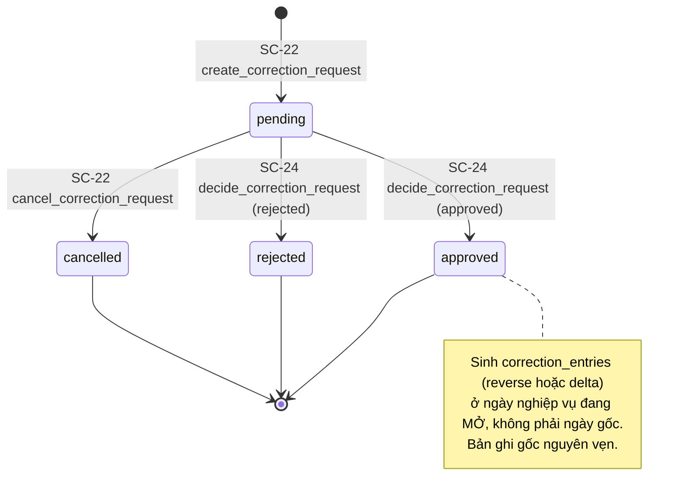

# FL-02 — Điều chỉnh sau chốt (maker-checker)

> **Toàn bộ flow này là ĐỀ XUẤT — chưa có trong prototype LAB-3** (MOCK-6). Nó mô tả đường sửa **hợp lệ duy nhất** cho số liệu thuộc ngày nghiệp vụ đã chốt: người đối chiếu lập phiếu (maker), người thứ hai duyệt (checker), hệ thống **không ghi đè** bản ghi gốc mà sinh bản ghi reverse/delta ở ngày nghiệp vụ đang mở. Chạy nối tiếp [FL-01](./FL-01-lot-trade-delivery-reconciliation.md) từ trạng thái `business_days.status = closed`. Điều phối bằng hành động của người, không có thành phần theo thời gian.

**Subject entity:** `correction_requests` (ĐỀ XUẤT) · **State field:** `decision_state`
**Enum source:** chưa có migration — giá trị lấy từ [SCR023_PendingRequestList](../screens/SCR023_PendingRequestList/spec.md) / [SCR024_RequestDetailApproval](../screens/SCR024_RequestDetailApproval/spec.md): `pending, approved, rejected, cancelled`

Nguồn yêu cầu (LAB-1/RFP): `BR-CLOSE-01` (không sửa trực tiếp 業務日 đã lock) · `FR-CORR-01` (phiếu riêng, bản gốc không đổi trước khi duyệt) · `FR-CORR-02` (duyệt → reverse/delta, không ghi đè) · `FR-CORR-03` (chặn sửa trực tiếp **và ghi log**) · `FR-INC-03` (điều chỉnh sau lock → delta kỳ kế tiếp) · `GOV-RULE-01` (起票・承認分離) · `CAP-HUMAN-01` điểm 3 (phê duyệt sửa dữ liệu nhạy cảm — hệ thống không tự duyệt).

> RFP **chưa chốt** ma trận quyền cho quy trình sửa sau chốt (người xin, số cấp duyệt, thời điểm chốt, cách huỷ giao dịch) — bidder phải nêu assumption. Câu hỏi Q-03 / A3: bộ này đã chốt **một cấp** (PREMISE C-03b); khách chưa xác nhận.

---

## States

| State | Meaning | Who acts here | Invariant / what is allowed |
|-------|---------|---------------|----------------------------|
| `pending` | Phiếu đã gửi, chờ duyệt | maker (lập, rút); checker (duyệt/từ chối) | **Bản ghi gốc không đổi một ký tự**. Mỗi bản ghi đích tối đa một phiếu `pending` (`P0021`, ĐỀ XUẤT có thể bị khách bác) |
| `approved` | Đã duyệt | checker (`can_approve`, khác người lập) | Đã sinh `correction_entries` (reverse/delta) ở `effective_business_date`; **không có `UPDATE`/`DELETE` nào trên `trades`/`deliveries`** |
| `rejected` | Bị từ chối | checker | Không sinh bản ghi; muốn làm lại phải lập phiếu mới, phiếu cũ giữ làm dấu vết |
| `cancelled` | Maker rút khi chưa ai duyệt | maker | Vẫn lưu dấu vết |

`pending` là entry state. `approved`, `rejected`, `cancelled` là terminal state (absorbing — không mở lại; duyệt nhầm thì lập **phiếu điều chỉnh ngược**).

---

## State Diagram

---

## Transitions

Tất cả cột "Source" là **tài liệu thiết kế** (chưa có file code); tên RPC, bảng, mã `P0020`–`P0027` là ĐỀ XUẤT.

| # | From --> To | Trigger type | Trigger | Guard (must hold) | Side effects | Source |
|---|-----------|--------------|---------|-------------------|--------------|--------|
| T1 | `∅ -> pending` | user-action | `rpc('create_correction_request', …)` từ SC-22 | role `reconcile` (`P0005`); ngày của bản ghi đích **đã `closed`** (`P0020`: nếu chưa chốt thì sửa trực tiếp); chưa có phiếu `pending` trên cùng `(target_table, target_record_id)` (`P0021`); `delta` ≠ 0 (`P0022`); lý do + chứng cứ | ghi `snapshot_before jsonb` (ảnh chụp lúc mở form); tra `effective_business_date` = ngày `open` gần nhất `≥ current_date`; trả `{request_id, request_code, effective_business_date}` | [SCR022_CorrectionRequestCreate](../screens/SCR022_CorrectionRequestCreate/spec.md) §4, §8 |
| T2 | `pending -> cancelled` | user-action | `rpc('cancel_correction_request', { p_request_id })` | chỉ maker, khi `pending` | lưu dấu vết | SCR022 §7 bước 9 |
| T3 | `pending -> approved` | user-action | `rpc('decide_correction_request', { p_request_id, p_decision:'approved', p_note })` | trong **một transaction** với `select … for update` dòng phiếu: còn `pending` (`P0025`); `decided_by <> requested_by` (`P0023`); có `can_approve` (`P0027`); bản ghi gốc hiện tại khớp `snapshot_before` (`P0024`); có ngày nghiệp vụ `open` (`P0026`); `effective_business_date` chưa bị chốt giữa chừng (`P0002`) | `INSERT correction_entries` (1 dòng `delta`, hoặc dòng `reverse` mang số âm), `UPDATE` phiếu → `approved`, `decided_at` do server đặt | [SCR024_RequestDetailApproval](../screens/SCR024_RequestDetailApproval/spec.md) §7 bước 9, §8 |
| T4 | `pending -> rejected` | user-action | `decide_correction_request` với `p_decision:'rejected'` | như T3 trừ phần sinh bản ghi; `decision_note` 10–1000 ký tự | chỉ `UPDATE` phiếu; không sinh bản ghi | SCR024 §7 bước 10 |

### In-state recurring behaviors (NOT transitions)

- Khi ghi trực tiếp bị chặn (`P0009`/`P0002`), hệ thống ghi **lần thử** vào `audit_log` qua `log_blocked_write_attempt` (ĐÃ TRIỂN KHAI, `0040_log_blocked_write_attempt.sql:21-46`) và dẫn người dùng sang SC-22 (US-12). Đây là điểm vào duy nhất đã có thật của flow.

---

## Entry Contract

`business_days.status = 'closed'` cho ngày của bản ghi đích (kết quả của T6 trong FL-01), và người lập có role `reconcile`. `trades.amount` là cột `GENERATED` nên `correction_entries` **phải cho phép số âm ngay từ migration đầu** — sao khuôn đó thì `reverse` không ghi được.

## Exit Contract

`correction_entries` cộng vào số của ngày/kỳ `effective_business_date`: `v_daily_reconciliation` (SC-18) và bảng tiền khuyến khích (SC-25) **phải được sửa để gộp** — nếu không bản ghi điều chỉnh nằm chết trong bảng. Báo cáo của ngày gốc **không đổi một con số nào** (`FR-INC-03`, `INC-EDGE-02`). Điều chỉnh sinh `調整済み` có thể đi sang batch kế toán `IF-ACC-01` — tài liệu khách chưa nối hai chỗ này.

## Outcomes

- **Success:** `approved` — sinh bản ghi điều chỉnh ở kỳ sau, bản gốc nguyên vẹn, truy ngược được về phiếu (`source_request_id`).
- **Rejected:** `rejected` — không sinh bản ghi, lý do lưu lại.
- **Withdrawn:** `cancelled` — maker rút.
- **Không có "Reopened":** duyệt nhầm chỉ sửa được bằng phiếu điều chỉnh ngược; giao diện phải nói rõ ở hộp thoại xác nhận.

## Guard & Cascade Rules

| # | Edge | Actor | Guard | Cascade / side effect | Source |
|---|------|-------|-------|----------------------|--------|
| 1 | `correction_entries` không bao giờ `UPDATE`/`DELETE` | mọi actor kể cả owner | trigger chặn + không policy ghi (cùng vai trò lưới an toàn như `guard_closed_day`) | "không ghi đè lịch sử" thành ràng buộc vật lý, không chỉ quy ước | SCR024 §8; [ADR-004](../decisions/ADR-004-invariants-at-database-layer.md) |
| 2 | maker ≠ checker | checker | kiểm **trong thân RPC** (`P0023`), không chỉ ẩn nút ở SC-23 | `US-17`: "cưỡng chế ở tầng dữ liệu" | SC-23 §2; ADR-002 (đường ghi duy nhất là RPC) |
| 3 | `correction_entries.business_date ≠ target_business_date` | hệ thống | nếu bằng ngày gốc, `guard_closed_day` chặn (`P0009`) | **không** nới trigger — cái sai là ngày, không phải trigger | SCR024 §9 |

---

## Open Questions

- **Q (khách chưa xác nhận; đã chốt một cấp ở PREMISE C-03b):** số cấp duyệt — đề xuất LAB-1 là **một cấp** (sau chốt sổ → trưởng bộ phận đối chiếu), maker ≠ checker; khách chưa xác nhận (câu 3, A3). Nếu phân cấp theo số tiền thì `F07-02` nở thành 3–5 luồng + cần màn định nghĩa ngưỡng.
- **Q:** `reverse` sinh một dòng hay hai (đảo + lập lại)? Hiện đề xuất một dòng đảo, muốn thay số mới thì lập phiếu `delta`.
- **Q:** điều chỉnh tiền khuyến khích có đi chung luồng? Đơn vị kỳ là **tháng**, không phải ngày nghiệp vụ → `effective_*` phải là kỳ. Giả định dùng chung bảng, tách bằng `target_table='incentive_results'`.
- **Q:** phiếu bị từ chối có sửa-rồi-gửi-lại không? Hiện: lập phiếu mới.
- **Q:** một bản ghi có tối đa mấy phiếu `pending`? Hiện chặn ở một (`P0021`).
- **Q:** có cần xác thực hai lớp khi duyệt (SC-02 LAB-1) không?
- **Q (điều kiện triển khai):** seed hiện chỉ có **1** tài khoản `reconcile` → maker-checker không demo được; RLS `app_users` chỉ cho tự xem mình + `sys_admin` nên người duyệt thấy "Người 起票 = —".
- **LIVENESS:** phiếu `pending` không có hạn xử lý — có thể treo vô hạn (đề xuất ở SC-N1: cảnh báo sau 7 ngày, không tự huỷ; chưa áp dụng cho F07).
