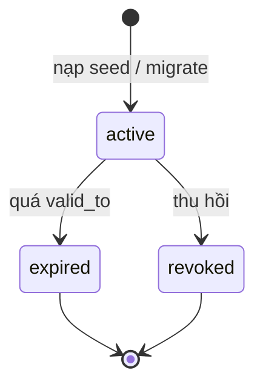
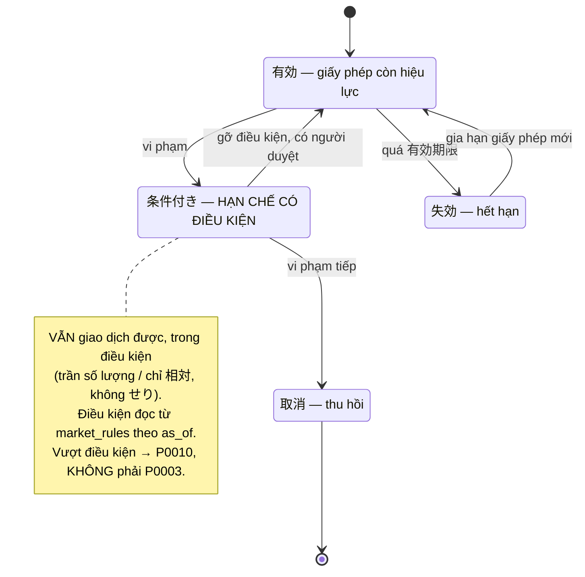
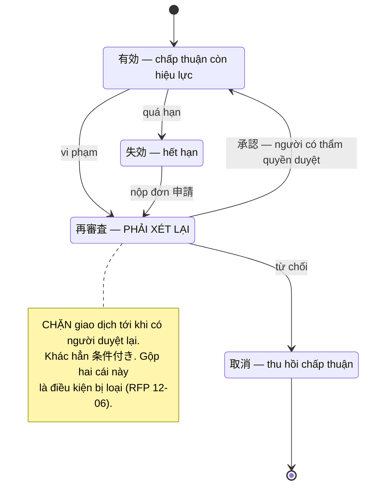
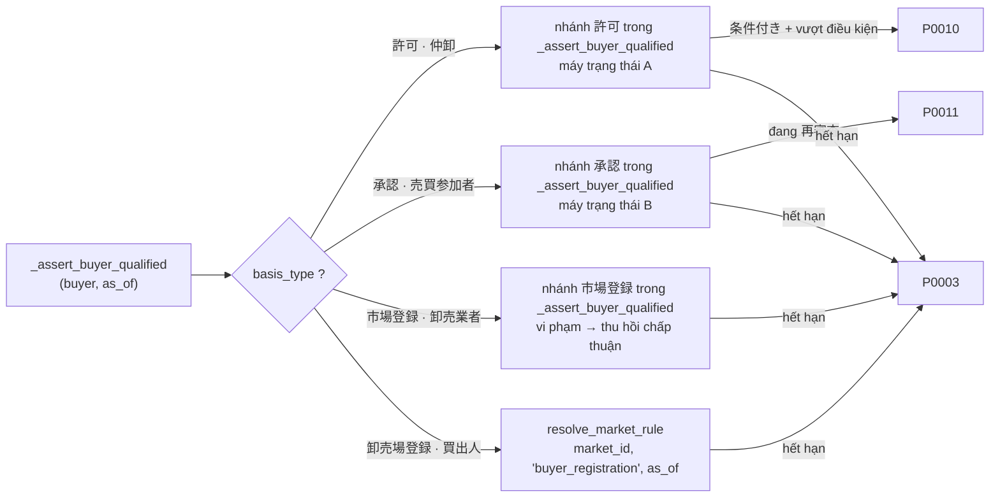

# FL-03 — Vòng đời tư cách tham gia

> Theo dõi **hiệu lực tham gia** của một đối tác — điều kiện để chốt giao dịch (`BR-PERM-01`: kiểm 許可/承認 **tại thời điểm giao dịch**). Flow có hai nửa: **(A) ĐÃ TRIỂN KHAI** — một máy trạng thái ba bước dùng chung cho cả bốn căn cứ, hiệu lực quyết định bởi ngày; **(B) ĐỀ XUẤT** — hai máy trạng thái riêng cho `許可` và `承認` ([ADR-006](../decisions/ADR-006-split-license-approval-state-machines.md), sai lệch D-01) cộng quy tắc theo chợ ([ADR-007](../decisions/ADR-007-market-rules-as-versioned-data.md)). RFP 12-06 xếp việc gộp `許可` và `承認` vào **điều kiện trực tiếp bị loại**.

**Subject entity:** `participant_qualifications` · **State field:** `status`
**Enum source:** `supabase/migrations/0001_extensions_and_enums.sql:29-42` — `qualification_basis`: `registration, license, approval, market_registration` · `qualification_status`: `active, expired, revoked`

Ánh xạ căn cứ ↔ nhóm đối tác (LAB-1 `TBL-ACTOR-01`):

| Nhóm (`party_type`) | Căn cứ tham gia | `basis_type` (enum) | Nhãn JA trong DB |
|---|---|---|---|
| 卸売業者 `wholesaler` | 市場登録 | `registration` | 市場登録 |
| 仲卸 `intermediary` | **許可** | `license` | 許可 |
| 売買参加者 `approved_trader` | **承認** | `approval` | 承認 |
| 買出人 `market_buyer` | Đăng ký tại điểm giao dịch | `market_registration` | 卸売場登録 |

---

## States

### (A) ĐÃ TRIỂN KHAI — `qualification_status`

| State | Meaning | Who acts here | Invariant / what is allowed |
|-------|---------|---------------|----------------------------|
| `active` | Còn hiệu lực | — (nạp từ seed/migrate; chưa có màn quản lý) | Giao dịch được **nếu** `valid_from <= as_of <= valid_to` (prototype; đề xuất G9: `valid_to` NULL = không thời hạn, vế `valid_to` bỏ qua) |
| `expired` | Hết hạn | — | Bị chặn giao dịch (`P0003`) |
| `revoked` | Thu hồi | — | Bị chặn giao dịch (`P0003`) |

Không có RPC hay màn nào đổi `status` trong prototype — `grep participant_qualifications` trong `supabase/`, `app/`, `lib/` chỉ thấy đường **đọc** (`0007:19,28`; `lib/domain/trade-preview.ts:96`) và policy SELECT (`0009:36`). Dữ liệu demo nạp bằng seed: 3 tư cách hết hạn `PTI-01`, `PTA-01`, `PTM-01` (`valid_to = current_date − 10`) để demo `P0003` ở SC-10.

### (B) ĐỀ XUẤT — máy trạng thái A: `許可` (giấy phép, cơ quan hành chính ngoài chợ cấp)

| State | Meaning | Who acts here | Invariant / what is allowed |
|-------|---------|---------------|----------------------------|
| `有効` | Giấy phép còn hiệu lực | — | Giao dịch bình thường |
| `条件付き` | **Hạn chế có điều kiện** | maker/checker (SC-N1) | **VẪN giao dịch được**, trong điều kiện; vượt điều kiện → `P0010`, **không** phải `P0003` |
| `失効` | Hết hạn | hệ thống (theo ngày) | Chặn giao dịch (`P0003`) |
| `取消` | Thu hồi | checker | Chặn giao dịch; terminal |

### (B) ĐỀ XUẤT — máy trạng thái B: `承認` (chấp thuận, do chính chợ cấp)

| State | Meaning | Who acts here | Invariant / what is allowed |
|-------|---------|---------------|----------------------------|
| `有効` | Chấp thuận còn hiệu lực | — | Giao dịch bình thường |
| `再審査` | **Phải xét lại** | maker/checker (SC-N1) | **CHẶN giao dịch** tới khi có người duyệt lại (`P0011`) — khác hẳn `条件付き` |
| `失効` | Hết hạn | hệ thống (theo ngày) | Chặn giao dịch (`P0003`); nộp đơn `申請` → `再審査` |
| `取消` | Thu hồi chấp thuận | checker | Chặn giao dịch; terminal |

Hai căn cứ còn lại (`registration` — `市場登録`, `market_registration` — `卸売場登録`) chỉ có `有効 → 取消` và `有効 → 失効`; `有効 → 失効` chỉ áp khi dòng có `valid_to` (G9: `valid_to` NULL = không thời hạn, chỉ rời `有効` bằng `取消`); với `market_registration` điều kiện đọc từ `resolve_market_rule(market_id, 'buyer_registration', effective_on)`.

---

## State Diagram

Máy (A) đã triển khai — một luồng dùng chung (dữ liệu, không có chuyển trạng thái qua giao diện):

Máy A (ĐỀ XUẤT) — `許可`:

Máy B (ĐỀ XUẤT) — `承認`:

Cổng kiểm tại thời điểm giao dịch sau khi tách (ĐỀ XUẤT) — `_assert_buyer_qualified(buyer, as_of)` rẽ nhánh theo `basis_type`:

---

## Transitions

### (A) ĐÃ TRIỂN KHAI — kiểm hiệu lực (không đổi trạng thái)

| # | From --> To | Trigger type | Trigger | Guard (must hold) | Side effects | Source |
|---|-----------|--------------|---------|-------------------|--------------|--------|
| T1 | `(bất kỳ) -> được phép giao dịch` | derived | `_assert_buyer_qualified(p_participant_id, current_date)` được gọi từ `_confirm_trade` và `record_delivery` | tồn tại dòng `status='active' AND valid_from <= as_of AND valid_to >= as_of` — **một phép kiểm đồng nhất cho cả bốn căn cứ**; hiệu lực xét theo `current_date`, không theo `business_date` | không | `0007_rpc_functions.sql:12-25`, `:71`, `:144` |
| T2 | `(không có dòng active hợp lệ) -> bị chặn` | derived | cùng hàm | không thoả T1 | raise `P0003`, `detail` = `{expired_on, basis_type, basis_label, contact_office}`; thông tin lấy từ dòng có `valid_to` lớn nhất + `qualification_basis_rules` | `0007:27-35` |

`basis_type` chỉ được đọc **sau khi đã quyết định** (để dựng thông báo); cột `qualification_basis_rules.violation_action` khai bốn hành động khác nhau (`Thu hồi chấp thuận` / `Hạn chế có điều kiện` / `Phải xét lại` / `Theo quy chế chợ`, `0003:26-29`) nhưng **không logic nào đọc** — D-01.

### (B) ĐỀ XUẤT — chuyển trạng thái qua phiếu maker-checker

Tên bảng `qualification_transitions` và RPC là đề xuất ([SCR036_QualificationReview](../screens/SCR036_QualificationReview/spec.md) §3, §8); chưa có migration.

| # | From --> To | Trigger type | Trigger | Guard (must hold) | Side effects | Source |
|---|-----------|--------------|---------|-------------------|--------------|--------|
| T3 | `許可: 有効 -> 条件付き` | user-action | `request_qualification_transition` + `decide_qualification_transition` | cần `condition_note`, `condition_until` (`P0014`); `condition_until > effective_on`; maker ≠ checker, checker có `can_approve` (`P0013`) | vẫn giao dịch được; vượt điều kiện → `P0010` ở SC-10/11 | SCR036 §3 bảng "Bước chuyển hợp lệ — 許可"; architecture §2.3 |
| T4 | `許可: 条件付き -> 有効` | user-action | như T3 | đã khắc phục, có người duyệt | xoá nội dung điều kiện | như T3 |
| T5 | `許可: 条件付き -> 取消` | user-action | như T3 | vi phạm tiếp | chặn giao dịch (`P0003`) | như T3 |
| T6 | `承認: 有効 -> 再審査` | user-action | như T3 | cần `review_due_on > effective_on` | **chặn giao dịch ngay** (`P0011`) | SCR036 §3 "Bước chuyển hợp lệ — 承認" |
| T7 | `承認: 再審査 -> 有効` | user-action | như T3 | người có thẩm quyền `承認` lại | mở lại giao dịch | như T6 |
| T8 | `承認: 再審査 -> 取消` | user-action | như T3 | từ chối | chặn giao dịch (`P0003`) | như T6 |
| T9 | `承認: 失効 -> 再審査` | user-action | nộp đơn `申請` | — | vẫn chặn cho tới khi `承認` | như T6 |
| T10 | `許可/承認: 有効 -> 失効` (căn cứ có hạn; `市場登録`/`卸売場登録` chỉ khi `valid_to` khác NULL — G9) | scheduled / derived | quá hạn (`current_date > expires_on`) | **không qua phiếu** — là hệ quả của ngày tháng; cho lập phiếu `→ 失効` sẽ tạo hai nguồn sự thật | chặn giao dịch (`P0003`) | SCR036 §9 "Dễ hiểu sai #3" |
| T11 | mọi phiếu `pending -> cancelled` | user-action | `cancel_qualification_transition` | maker rút khi chưa duyệt | lưu dấu vết | SCR036 §7 bước 7 |

Mã lỗi đề xuất: `P0010` (vượt điều kiện `条件付き`), `P0011` (đang `再審査`), `P0012` (bước chuyển không thuộc máy trạng thái của `basis_type`), `P0013` (maker=checker / thiếu `can_approve`), `P0014` (thiếu điều kiện cho `条件付き`), `P0017` (không có quy chế hiệu lực tại `effective_on`). Xem [business-rules.md](../system/business-rules.md#mã-lỗi-đề-xuất-chưa-cài).

---

## Entry Contract

Đối tác (`participants`) đã được tạo với `party_type` đúng và có ít nhất một dòng `participant_qualifications` hợp lệ cho căn cứ tương ứng nhóm. (B): dòng tư cách mới cho giấy phép gia hạn được tạo ở SC-06, **không** chuyển trạng thái `失効 → 有効`.

## Exit Contract

Kết quả của flow nuôi **cổng chốt giao dịch** trong [FL-01](./FL-01-lot-trade-delivery-reconciliation.md) (KIỂM 1, `P0003`) và cả `record_delivery`. (B): `effective_on` tương lai nghĩa là phiếu đã duyệt **chưa có hiệu lực**; `_assert_buyer_qualified` phải so với **ngày nghiệp vụ** của giao dịch, không phải `now()`.

## Outcomes

- **Success (A):** giao dịch được phép khi tồn tại dòng hợp lệ.
- **Blocked (A):** `P0003` kèm `{expired_on, basis_type, basis_label, contact_office}` — người thao tác biết hết hạn ngày nào, căn cứ gì, liên hệ ai.
- **Partial (B):** `条件付き` — giao dịch được nhưng trong điều kiện.
- **Reopened (B):** `再審査 → 有効` sau khi duyệt lại.

## Guard & Cascade Rules

| # | Edge | Actor | Guard | Cascade / side effect | Source |
|---|------|-------|-------|----------------------|--------|
| 1 | mọi phiếu chuyển trạng thái (B) | checker | **maker ≠ checker** ở tầng RPC, cùng transaction với `select … for update` dòng tư cách | hai người duyệt đồng thời không ghi đè nhau | SCR036 §8 |
| 2 | danh sách bước chuyển hợp lệ | server | `list_allowed_transitions` do **server** quyết định; client không giữ bảng chuyển (tránh bản sao thứ hai của máy trạng thái — cùng lý do [ADR-003](../decisions/ADR-003-derived-remaining-quantity-views.md)) | — | SCR036 §8 |
| 3 | `participants_select` hiện cho **mọi** role đọc (`0009:34-35`) | — | nếu siết RLS (SC-05 đề xuất chỉ `party_admin`, `reconcile`, `trading`) thì **phá `lib/domain/master-data.ts`** mà SC-07/SC-10 dùng tra mã→tên | cần cập nhật cùng lúc | [business-rules.md](../system/business-rules.md#điểm-chưa-chốt-trước-lab-5) mục 13–18 |

---

## Open Questions

- **Q (ưu tiên cao nhất):** `条件付き` cụ thể hạn chế cái gì — trần số lượng, trần giá trị, cấm せり, hay do chợ tự định? Tài liệu khách chỉ có cụm "hạn chế có điều kiện". `P0010` chưa có gì để kiểm; các trường trần/`negotiated_only` trong SC-N1 là **suy luận** của tài liệu LAB-4.
- **Q (khách chưa trả lời; hướng đã chọn ở PREMISE G8):** ai có thẩm quyền duyệt `再審査` — đã chọn `party_admin` có cờ `can_approve`, khác người lập; hướng loại: chức danh `qualification_approver` riêng, hoặc ban lãnh đạo duyệt ngoài hệ thống.
- **Q (ĐÃ CHỐT ở PREMISE G9, khách chưa xác nhận):** `市場登録` (`registration`) và `卸売場登録` (`market_registration`) **không bắt buộc** `valid_to` (NULL = không thời hạn; LAB-1 F02-01, F02-04 không ghi ngày hết hạn); `許可`, `承認` bắt buộc có hạn (F02-02, F02-03). Prototype `valid_to NOT NULL` → nới nullable là thay đổi ràng buộc đề xuất (LAB-5). Còn mở: hai căn cứ này có luồng vi phạm riêng ngoài `取消` không.
- **Q (khách chưa trả lời; thiết kế đã chọn dữ liệu theo chợ, ADR-007):** hệ thống phục vụ một chợ hay nhiều chợ — ảnh hưởng `market_id` trên phiếu và giới hạn quyền duyệt theo chợ.
- **Q:** `条件付き` hết `condition_until` thì tự về `有効` hay tự sang `取消`? Hai cách đọc hệ quả ngược nhau — **không giả định**.
- **Q (lệch giữa các tài liệu):** LAB-1 FIG-010 mô tả máy `有効 → 一時停止 → 有効`, `有効 → 失効 → 再審査 → 有効` (một máy chung); thiết kế LAB-4 tách theo căn cứ. Máy A của LAB-4 cho `失効 → 有効` (gia hạn) ở architecture §2.3 nhưng SC-N1 nói gia hạn = tạo dòng tư cách mới, không chuyển trạng thái — chọn một cách trước LAB-5.
- **Q:** phiếu `pending` có hạn xử lý không (đề xuất cảnh báo sau 7 ngày, không tự huỷ)? Có cần xác thực hai lớp khi duyệt?
- **LIVENESS:** `再審査` chặn giao dịch tới khi có người duyệt; nếu chợ chỉ có một người đủ thẩm quyền và họ vắng thì không có đường thoát tự động — cần biết số người duyệt trước khi vận hành.
