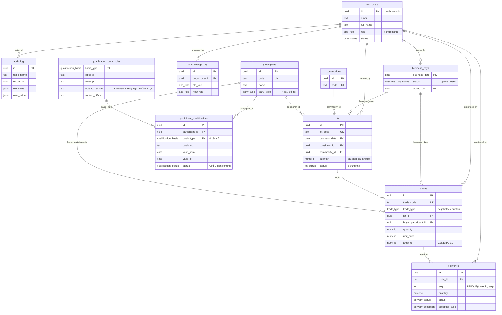

# Entities

**Project**: Product A — 水産物卸売市場 業務支援システム (hệ thống hỗ trợ nghiệp vụ chợ đầu mối thủy sản)
**Generated**: 2026-10-06
**Nguồn**: schema đang chạy (`pg_catalog` → [`schema-snapshot.json`](./schema-snapshot.json) → [`erd.mmd`](./erd.mmd)), đối chiếu với `supabase/migrations/0001…0041`. Ký hiệu: **ĐÃ TRIỂN KHAI** = có trong migration; **ĐỀ XUẤT** = thiết kế LAB-4, chưa cài.

**Quy mô thật (đọc từ snapshot, không gõ tay):** 11 bảng · 83 cột · 17 khoá ngoại · 11 enum · 3 view dẫn xuất.

Điều hướng: [Entity Relationship Diagram](#entity-relationship-diagram) · [Entities](#entities-1) · [Enums](#mười-một-enum) · [Derived Views](#ba-view-dẫn-xuất) · [Validation Rules](#validation-rules) · [Đối chiếu thiết kế ↔ bảng thật](#đối-chiếu-thiết-kế--bảng-thật) · [Summary](#summary)

## Entity Relationship Diagram

Sơ đồ rút gọn, chú thích nghiệp vụ. Bản đầy đủ cột (kể cả `created_at`, `issuer`, `contact`, `contact_office_ja`…) nằm ở [`erd.mmd`](./erd.mmd), sinh tự động từ snapshot.



Ghi chú đọc sơ đồ:
- `app_users.id` tham chiếu `auth.users.id` của Supabase (bảng ngoài schema `public`, không vẽ) — đây là khoá ngoại thứ 17 trong snapshot (`app_users_id_fkey`).
- `role_change_log` có **hai** khoá ngoại về `app_users` (`changed_by` và `target_user_id`); sơ đồ chỉ vẽ một cạnh vì Mermaid gộp cạnh cùng cặp thực thể.
- `participant_qualifications.status` chú thích "CHỈ 1 luồng chung" và `violation_action` chú thích "logic KHÔNG đọc" là hai điểm mấu chốt của sai lệch **D-01** (xem mục đối chiếu bên dưới).
- Thiết kế ĐỀ XUẤT (bảng chợ, hai bảng tư cách, phiếu điều chỉnh, phiên bản 料率, lô xuất kế toán) nằm ở mục [Thực thể đề xuất](#thực-thể-đề-xuất-chưa-xây) — không vẽ trong ERD trên vì chưa tồn tại trong DB.

## Entities

Tất cả 11 bảng bật RLS (xác minh `pg_tables WHERE rowsecurity=false` → 0 dòng, tài liệu gốc `db-schema` §6, trong repo, không nộp). Ma trận quyền theo bảng ở [permissions.md](../system/permissions.md).

### app_users

**Description**: Nguồn sự thật duy nhất của chức danh nội bộ (xem [ADR-001](../decisions/ADR-001-role-from-table-not-jwt.md)). PK trùng `auth.users.id`. Không có policy ghi — ghi qua RPC `change_user_role`. *(ĐÃ TRIỂN KHAI — `0002_core_identity.sql:5`)*

| Attribute | Type | Constraints | Description |
|-----------|------|-------------|-------------|
| id | uuid | PK, NOT NULL, FK → `auth.users(id)` ON DELETE CASCADE | Trùng id tài khoản Supabase Auth |
| email | text | NOT NULL, UNIQUE | Email đăng nhập |
| full_name | text | NOT NULL | Họ tên hiển thị |
| role | app_role | NOT NULL | Chức danh (4 giá trị) |
| status | user_status | NOT NULL, DEFAULT `active` | `suspended` bị `signOut()` ngay tại `proxy.ts` |
| created_at | timestamptz | NOT NULL, DEFAULT now() | Thời điểm tạo |

**Relationships**:
- One-to-Many với `audit_log` (`actor_id`), `business_days` (`closed_by`), `deliveries` (`confirmed_by`), `lots` (`created_by`), `trades` (`confirmed_by`), `role_change_log` (`changed_by`, `target_user_id`)

**Discriminator Fields**:

| Field | DISC-### | Values | Description |
|-------|----------|--------|-------------|
| role | — (chưa cấp mã) | `sys_admin`, `receiving`, `trading`, `reconcile` | Chức danh nội bộ; mỗi giá trị mở một tập màn hình khác nhau |
| status | — (chưa cấp mã) | `active`, `suspended` | Tài khoản dùng được / bị khoá |

---

### role_change_log

**Description**: Lịch sử đổi chức danh, append-only. SELECT chỉ `sys_admin`; không có policy ghi (RPC `change_user_role` ghi bằng `SECURITY DEFINER`). *(ĐÃ TRIỂN KHAI — `0002_core_identity.sql:16`)*

| Attribute | Type | Constraints | Description |
|-----------|------|-------------|-------------|
| id | uuid | PK, DEFAULT gen_random_uuid() | |
| target_user_id | uuid | FK → app_users, NOT NULL | Tài khoản bị đổi quyền |
| old_role | app_role | NULL được | Chức danh cũ |
| new_role | app_role | NOT NULL | Chức danh mới |
| changed_by | uuid | FK → app_users, NOT NULL | Người thực hiện |
| changed_at | timestamptz | NOT NULL, DEFAULT now() | Thời điểm |
| note | text | NULL được | Ghi chú tuỳ chọn |

**Relationships**: Many-to-One với `app_users` qua `target_user_id` và `changed_by`.

**Discriminator Fields**: None.

---

### audit_log

**Description**: Nhật ký kiểm toán append-only. Hiện ghi: đổi quyền (SC-04), chốt sổ (SC-18), lần thử ghi bị chặn (SC-14, qua `log_blocked_write_attempt`). SELECT chỉ `sys_admin`; không policy INSERT. *(ĐÃ TRIỂN KHAI — `0002_core_identity.sql:28`, `0040_log_blocked_write_attempt.sql:21`)*

| Attribute | Type | Constraints | Description |
|-----------|------|-------------|-------------|
| id | uuid | PK, DEFAULT gen_random_uuid() | |
| table_name | text | NOT NULL | Bảng bị tác động |
| record_id | uuid | NULL được | Bản ghi bị tác động |
| action | text | NOT NULL | `close_business_day`, `change_user_role`, `blocked_write_attempt` |
| actor_id | uuid | FK → app_users, NULL được | Người thực hiện |
| occurred_at | timestamptz | NOT NULL, DEFAULT now() | Thời điểm |
| old_value | jsonb | NULL được | 変更前 |
| new_value | jsonb | NULL được | 変更後 |

**Relationships**: Many-to-One với `app_users` qua `actor_id`.

**Discriminator Fields**:

| Field | DISC-### | Values | Description |
|-------|----------|--------|-------------|
| action | — (chưa cấp mã) | `close_business_day`, `change_user_role`, `blocked_write_attempt` (text tự do, không phải enum) | Loại sự kiện kiểm toán |

Thiếu so với `FR-AUDIT-01`: cột `reason` (lý do) — xem mục [Đối chiếu](#đối-chiếu-thiết-kế--bảng-thật) và điểm chưa chốt #15 ở [business-rules.md](../system/business-rules.md#điểm-chưa-chốt-trước-lab-5).

---

### qualification_basis_rules

**Description**: 4 dòng cố định nạp ở `0003`, mô tả 4 căn cứ tham gia (`許可`, `承認`, `市場登録`, đăng ký tại điểm giao dịch). *(ĐÃ TRIỂN KHAI — `0003_participants_and_master.sql:12`, cột `contact_office_ja` thêm ở `0031`)*

| Attribute | Type | Constraints | Description |
|-----------|------|-------------|-------------|
| basis_type | qualification_basis | PK | `registration` · `license` · `approval` · `market_registration` |
| label_vi | text | NOT NULL | Nhãn tiếng Việt |
| label_ja | text | NOT NULL | Nhãn tiếng Nhật |
| violation_action | text | NOT NULL | Hành động khi vi phạm — **khai báo nhưng không logic nào đọc** (D-01) |
| contact_office | text | NOT NULL | Nơi liên hệ (VI) |
| contact_office_ja | text | NOT NULL (thêm ở `0031`) | Nơi liên hệ (JA) |

Giá trị thật nạp ở `0003:26-29`:

| basis_type | label_vi | label_ja | violation_action | contact_office |
|---|---|---|---|---|
| `registration` | Đăng ký chợ | 市場登録 | Thu hồi chấp thuận | Phòng quản lý chợ |
| `license` | Giấy phép | 許可 | Hạn chế có điều kiện | Phòng cấp phép |
| `approval` | Chấp thuận | 承認 | Phải xét lại | Phòng quản lý người tham gia |
| `market_registration` | Đăng ký tại điểm giao dịch | 卸売場登録 | Theo quy chế chợ | Ban quản lý chợ |

**Relationships**: One-to-Many với `participant_qualifications` qua `basis_type`.

**Discriminator Fields**:

| Field | DISC-### | Values | Description |
|-------|----------|--------|-------------|
| basis_type | — (chưa cấp mã) | `registration`, `license`, `approval`, `market_registration` | Bốn căn cứ tham gia; theo LAB-1 phải có luồng trạng thái riêng (hiện bị gộp, D-01) |

---

### participants

**Description**: Đối tác — dùng cho cả chủ hàng (`lots.consignor_id`) lẫn người mua (`trades.buyer_participant_id`). *(ĐÃ TRIỂN KHAI — `0003:31`)*

| Attribute | Type | Constraints | Description |
|-----------|------|-------------|-------------|
| id | uuid | PK, DEFAULT gen_random_uuid() | |
| code | text | NOT NULL, UNIQUE | Mã đối tác (vd `PTI-01`) |
| name | text | NOT NULL | Tên |
| party_type | party_type | NOT NULL | Nhóm đối tác |
| contact | text | NULL được | Liên hệ |

**Relationships**: One-to-Many với `lots` (`consignor_id`), `trades` (`buyer_participant_id`), `participant_qualifications` (`participant_id`).

**Discriminator Fields**:

| Field | DISC-### | Values | Description |
|-------|----------|--------|-------------|
| party_type | — (chưa cấp mã) | `wholesaler` (卸売業者), `intermediary` (仲卸), `approved_trader` (売買参加者), `market_buyer` (買出人) | 4 nhóm tham gia theo `TBL-ACTOR-01` |

---

### participant_qualifications

**Description**: Tư cách tham gia của một đối tác theo một căn cứ. Hiệu lực xét theo `current_date` lúc gọi RPC, **không** theo `business_date` của lô/giao dịch. *(ĐÃ TRIỂN KHAI — `0003:39`)*

| Attribute | Type | Constraints | Description |
|-----------|------|-------------|-------------|
| id | uuid | PK | |
| participant_id | uuid | FK → participants, NOT NULL, có index | |
| basis_type | qualification_basis | FK → qualification_basis_rules, NOT NULL | Căn cứ |
| basis_no | text | NOT NULL | Số hiệu giấy phép/chấp thuận/đăng ký |
| issuer | text | NOT NULL | Cơ quan cấp |
| valid_from | date | NOT NULL | Có hiệu lực từ |
| valid_to | date | NOT NULL | Hết hiệu lực. Prototype: **NOT NULL** (`0003:47`). **ĐỀ XUẤT (PREMISE G9):** nới thành **nullable** (NULL = không thời hạn) cho `registration` và `market_registration`; `license` và `approval` vẫn bắt buộc có hạn (CHECK theo `basis_type`) — migration ở LAB-5, phá tương thích |
| status | qualification_status | NOT NULL, DEFAULT `active` | `active` `expired` `revoked` — 1 luồng chung (D-01) |

**Relationships**:
- Many-to-One với `participants` qua `participant_id`
- Many-to-One với `qualification_basis_rules` qua `basis_type`

**Discriminator Fields**:

| Field | DISC-### | Values | Description |
|-------|----------|--------|-------------|
| status | — (chưa cấp mã) | `active`, `expired`, `revoked` | Chưa có `条件付き`, `再審査` (D-01) |

---

### commodities

**Description**: Danh mục mặt hàng. *(ĐÃ TRIỂN KHAI — `0003:55`)*

| Attribute | Type | Constraints | Description |
|-----------|------|-------------|-------------|
| id | uuid | PK | |
| code | text | NOT NULL, UNIQUE | Mã mặt hàng |
| name_vi | text | NOT NULL | Tên VI |
| name_ja | text | NOT NULL | Tên JA |
| unit | text | NOT NULL | Đơn vị |

**Relationships**: One-to-Many với `lots` qua `commodity_id`.

**Discriminator Fields**: None.

---

### business_days

**Description**: Ngày nghiệp vụ (業務日). Chốt sổ = chuyển `closed` qua RPC `close_business_day`; từ đó trigger `guard_closed_day` chặn ghi trực tiếp (P0009). *(ĐÃ TRIỂN KHAI — `0004_business_days_and_lots.sql:4`)*

| Attribute | Type | Constraints | Description |
|-----------|------|-------------|-------------|
| business_date | date | PK | Ngày nghiệp vụ |
| status | business_day_status | NOT NULL, DEFAULT `open` | `open` / `closed` |
| closed_at | timestamptz | NULL được | Lúc chốt |
| closed_by | uuid | FK → app_users, NULL được | Người chốt |

**Relationships**: One-to-Many với `lots`, `trades` qua `business_date`; Many-to-One với `app_users` qua `closed_by`.

**Discriminator Fields**:

| Field | DISC-### | Values | Description |
|-------|----------|--------|-------------|
| status | — (chưa cấp mã) | `open`, `closed` | Đã chốt thì mọi ghi trực tiếp vào lô/giao dịch/giao hàng của ngày bị chặn |

---

### lots

**Description**: Lô hàng. `quantity` là số lượng ban đầu, **bất biến sau khi tạo**; số còn lại luôn tính ở `v_lot_availability` ([ADR-003](../decisions/ADR-003-derived-remaining-quantity-views.md)). Có policy ghi trực tiếp cho `receiving` (dùng `next_lot_code(date)` sinh mã trước khi insert). *(ĐÃ TRIỂN KHAI — `0004:29`, cột `receiving_reference_no`, `notes` thêm ở `0020`)*

| Attribute | Type | Constraints | Description |
|-----------|------|-------------|-------------|
| id | uuid | PK | |
| lot_code | text | NOT NULL, UNIQUE | Dạng `LOT-YYYYMMDD-0001` |
| business_date | date | FK → business_days, NOT NULL, có index | |
| consignor_id | uuid | FK → participants, NOT NULL | Chủ hàng |
| commodity_id | uuid | FK → commodities, NOT NULL | Mặt hàng |
| quantity | numeric(14,3) | NOT NULL, CHECK `> 0` | Số lượng ban đầu, bất biến |
| status | lot_status | NOT NULL, DEFAULT `受付`, có index | Vòng đời lô |
| received_at | timestamptz | NOT NULL, DEFAULT now() | Thời điểm tiếp nhận |
| created_by | uuid | FK → app_users, NULL được | Người tạo |
| receiving_reference_no | text | NULL được (`0020`) | Số chứng từ tiếp nhận |
| notes | text | NULL được (`0020`) | Ghi chú |

**Relationships**: Many-to-One với `business_days`, `participants`, `commodities`, `app_users`; One-to-Many với `trades` qua `lot_id`.

**Discriminator Fields**:

| Field | DISC-### | Values | Description |
|-------|----------|--------|-------------|
| status | — (chưa cấp mã) | `受付`, `下見済`, `公開`, `確定`, `引渡し完了` | Vòng đời FIG-011; `下見済` có trong enum nhưng chưa có đường ghi (SC-09 ngoài phạm vi LAB-3) |

---

### trades

**Description**: Giao dịch. **Không có policy INSERT/UPDATE/DELETE** — đường ghi duy nhất là RPC `confirm_negotiated_trade` / `record_auction_result` ([ADR-002](../decisions/ADR-002-no-write-policy-on-trades-deliveries.md)). *(ĐÃ TRIỂN KHAI — `0005_trades_and_deliveries.sql:21`, hai cột đấu giá thêm ở `0030`)*

| Attribute | Type | Constraints | Description |
|-----------|------|-------------|-------------|
| id | uuid | PK | |
| trade_code | text | NOT NULL, UNIQUE | Dạng `TRD-YYYYMMDD-0001` |
| business_date | date | FK → business_days, NOT NULL, có index | |
| trade_type | trade_type | NOT NULL | `negotiated` (相対) / `auction` (せり) |
| lot_id | uuid | FK → lots, NOT NULL, có index | |
| buyer_participant_id | uuid | FK → participants, NOT NULL | Người mua |
| quantity | numeric(14,3) | NOT NULL, CHECK `> 0` | |
| unit_price | numeric(14,2) | NOT NULL, CHECK `> 0` | |
| amount | numeric(18,2) | GENERATED ALWAYS AS (quantity * unit_price) STORED | Thành tiền (cột sinh — không ghi được số âm, điểm chưa chốt #16) |
| status | trade_status | NOT NULL, DEFAULT `confirmed` | `confirmed` / `cancelled` |
| confirmed_at | timestamptz | NOT NULL, DEFAULT now() | **Dấu vết hệ thống**: lúc gọi API |
| confirmed_by | uuid | FK → app_users, NULL được | **Dấu vết hệ thống**: tài khoản gọi API |
| auction_session_at | timestamptz | NULL được (`0030`) | **Nhập tay**: thời điểm phiên せり |
| auction_confirmed_by_name | text | NULL được (`0030`) | **Nhập tay**: người xác nhận tại hiện trường |

**Relationships**: Many-to-One với `business_days`, `lots`, `participants`, `app_users`; One-to-Many với `deliveries` qua `trade_id`.

**Discriminator Fields**:

| Field | DISC-### | Values | Description |
|-------|----------|--------|-------------|
| trade_type | — (chưa cấp mã) | `negotiated`, `auction` | 相対 ≈ 90% giá trị, せり ≈ 10% (FIG-009); chỉ `auction` mang hai cột nhập tay |
| status | — (chưa cấp mã) | `confirmed`, `cancelled` | `cancelled` chưa có đường ghi (FR-AITAI-03 ngoài phạm vi LAB-3) |

---

### deliveries

**Description**: Một lần giao hàng của một giao dịch (một giao dịch giao nhiều lần — FR-DEL-05). Không có cột `business_date`; trigger tra qua `trades`. Không có policy ghi — chỉ RPC `record_delivery`. *(ĐÃ TRIỂN KHAI — `0005:39`)*

| Attribute | Type | Constraints | Description |
|-----------|------|-------------|-------------|
| id | uuid | PK | |
| trade_id | uuid | FK → trades, NOT NULL, có index | |
| seq | int | NOT NULL, UNIQUE `(trade_id, seq)` | Số thứ tự lần giao |
| quantity | numeric(14,3) | NOT NULL, CHECK `> 0` | |
| delivered_at | timestamptz | NOT NULL, DEFAULT now() | |
| status | delivery_status | NOT NULL, DEFAULT `completed` | |
| exception_type | delivery_exception | NULL được; CHECK `exception_type is null or status='exception'` | Loại ngoại lệ |
| reason | text | NULL được | Lý do |
| confirmed_by | uuid | FK → app_users, NULL được | Người xác nhận |

**Relationships**: Many-to-One với `trades`, `app_users`.

**Discriminator Fields**:

| Field | DISC-### | Values | Description |
|-------|----------|--------|-------------|
| status | — (chưa cấp mã) | `pending`, `in_transit`, `completed`, `exception` | Prototype hiện chỉ ghi `completed`/`exception` |
| exception_type | — (chưa cấp mã) | `short`, `over`, `returned`, `partial_cancel` | `over` không ghi được (P0006 chặn — lỗi B-03) |

---

## Mười một enum

Nguồn: `0001_extensions_and_enums.sql`. *(ĐÃ TRIỂN KHAI)*

| Enum | Giá trị |
|---|---|
| `app_role` | `sys_admin` `receiving` `trading` `reconcile` |
| `party_type` | `wholesaler` `intermediary` `approved_trader` `market_buyer` |
| `qualification_basis` | `registration` `license` `approval` `market_registration` |
| `qualification_status` | `active` `expired` `revoked` |
| `lot_status` | `受付` `下見済` `公開` `確定` `引渡し完了` |
| `trade_type` | `negotiated` `auction` |
| `trade_status` | `confirmed` `cancelled` |
| `delivery_status` | `pending` `in_transit` `completed` `exception` |
| `delivery_exception` | `short` `over` `returned` `partial_cancel` |
| `business_day_status` | `open` `closed` |
| `user_status` | `active` `suspended` |

## Ba view dẫn xuất

Không phải bảng. Tồn tại để giữ ranh giới cứng #2 của LAB-3: số còn lại luôn tính từ dữ liệu, không bao giờ là cột lưu sẵn cập nhật tay. Cả ba bật `security_invoker = true` nên RLS bảng gốc vẫn áp dụng. *(ĐÃ TRIỂN KHAI — `0006_derived_views.sql`)*

| View | Tính gì | Màn hình dùng | Source |
|---|---|---|---|
| `v_lot_availability` | `remaining = lots.quantity − Σ(trades confirmed)`, kèm `sold_qty`, `sold_to[]` (mảng `trade_code`) | SC-08, SC-10 | `0006:6-22` |
| `v_trade_delivery_status` | `delivered_qty = Σ(deliveries.status ∈ completed, exception)`, `remaining`, `delivery_count` | SC-14 | `0006:27-43` |
| `v_daily_reconciliation` | Gom `trades` (confirmed) + `deliveries` theo `business_date`: `trade_count`, `total_amount`, `delivery_count`, `exception_count`. **Lỗi B-05:** `total_amount` nhân theo số lần giao (đã xác nhận trên DB thật 2026-10-06, xem [Đối chiếu](#năm-lỗi-tầng-dữ-liệu-phát-hiện-khi-viết-spec)) | SC-18 | `0006:48-62` |

Lưu ý nghiệp vụ trong công thức: `v_trade_delivery_status` tính cả delivery `exception` vào `delivered_qty` vì đó là số đã thực giao. Hệ quả sai đã phát hiện ở **B-01** (cộng cả `returned`/`partial_cancel`) — xem [Đối chiếu](#năm-lỗi-tầng-dữ-liệu-phát-hiện-khi-viết-spec).

## Thực thể đề xuất (chưa xây)

Toàn bộ mục này là **ĐỀ XUẤT** của LAB-4; tên bảng/cột lấy từ [architecture.md](../system/architecture.md) §C6/§2.3/§4 và các screen spec liên quan. Chưa có migration.

| Thực thể | Mục đích | Sinh từ | Nguồn thiết kế |
|---|---|---|---|
| `markets(id, code, name_ja, name_vi, service_window, timezone)` | Thực thể chợ | D-02 · [ADR-007](../decisions/ADR-007-market-rules-as-versioned-data.md) | architecture §C6 |
| `market_rules(id, market_id, rule_key, version, effective_from, payload jsonb, status, drafted_by, approved_by, superseded_by)` | Quy tắc có phiên bản + 発効日 + maker-checker | D-02 · ADR-007 | architecture §C6 |
| `resolve_market_rule(p_market_id, p_rule_key, p_as_of date) → jsonb` | Tra quy tắc theo **ngày nghiệp vụ** (không `now()`) | ADR-007 | architecture §C6 |
| `incentive_rate_versions(version, grant_rate, effective_from, payment_due_days, payment_due_basis, min_eligible_amount, change_note, status, drafted_by/at, submitted_at, approved_by/at, reject_note, supersedes_version)` | Bảng phiên bản **料率 完納奨励金** (thuộc quốc gia, **không** phải `market_rules`): 発効日, maker-checker, trần 4 lần/năm, quay lui không UPDATE dòng cũ; không có policy ghi (ADR-002) | F08 · FR-INC-02 · FR-RULE-01 | [F008 technical-spec](../features/F008_IncentiveAndRateVersion/technical-spec.md) § Key Entities; [SCR026](../screens/SCR026_RateVersionList/spec.md)/[SCR027](../screens/SCR027_RateVersionApproval/spec.md) |
| `incentive_results`, `settlement_periods` | Kết quả tính 完納奨励金 (lưu `rate_version_id`, `grant_rate_applied` — cột lưu, không join động) và kỳ tính | F08 · BR-INC-01 | F008 technical-spec § Key Entities; [SCR025](../screens/SCR025_IncentiveResult/spec.md) |
| `qualification_license` | Trạng thái và trường riêng của `許可` (許可番号, 許可行政庁, nội dung + hạn điều kiện) | D-01 · [ADR-006](../decisions/ADR-006-split-license-approval-state-machines.md) | architecture §2.3 |
| `qualification_approval` | Trạng thái và trường riêng của `承認` (承認番号, hạn mức tham gia, lý do + hạn 再審査) | D-01 · ADR-006 | architecture §2.3 |
| `qualification_transitions` | Phiếu chuyển trạng thái tư cách, maker-checker | D-01 | [SCR036_QualificationReview](../screens/SCR036_QualificationReview/spec.md) |
| `correction_requests`, `correction_entries` | Phiếu điều chỉnh sau chốt + bản ghi reverse/delta append-only (cho phép số âm) | F07 · [FL-02](../flows/FL-02-post-close-correction.md) | architecture §3.1; [SCR024_RequestDetailApproval](../screens/SCR024_RequestDetailApproval/spec.md) |
| `acc_export_batches(batch_code, business_date, generated_at, row_count, checksum, status)` | Outbox xuất kế toán, idempotent theo `batch_code` | IF-ACC-01 (giả định A4) | architecture §4 |
| cột `app_users.can_approve` | Cờ thẩm quyền duyệt **trên tài khoản** (không phải trên role), bổ sung cho 9 role key | đã chốt PREMISE C-09 (9 role key + cờ trên tài khoản) | [SCR036_QualificationReview](../screens/SCR036_QualificationReview/spec.md) |
| cột `market_id` trên `business_days`, `lots`, `participant_qualifications` | Gắn dữ liệu về chợ; `business_days` đổi sang PK ghép `(market_id, business_date)` | ADR-007 | architecture §C6 |
| cột `client_generated_id` | Khoá idempotency cho nhập bù offline | C9 | architecture §3.5 |

Đường di trú đề xuất cho chợ: tạo `markets` với 1 dòng mặc định → backfill `market_id` → đổi PK `business_days`. Bước đổi PK là bước duy nhất phá tương thích, làm sau cùng.

## Validation Rules

Ràng buộc tầng database (ĐÃ TRIỂN KHAI). Cột "Error Message" là mã/thông điệp thật từ migration; mã lỗi nghiệp vụ `P00xx` giải thích ở [business-rules.md](../system/business-rules.md#bảng-mã-lỗi-đã-triển-khai).

### app_users

| Rule | Field | Constraint | Error Message |
|------|-------|------------|---------------|
| email duy nhất | email | UNIQUE | `23505` unique_violation |
| role bắt buộc | role | NOT NULL, kiểu enum `app_role` | `23502` / `22P02` |
| tự đổi quyền bị chặn | role (qua RPC `change_user_role`) | `p_user_id = auth.uid()` → từ chối | `P0007` "Không được tự đổi quyền của chính mình" (`0012:21-24`) |

### participant_qualifications

| Rule | Field | Constraint | Error Message |
|------|-------|------------|---------------|
| khoảng hiệu lực | valid_from, valid_to | CHECK `valid_to >= valid_from` (`participant_qualifications_valid_range`); khi nới nullable (G9) CHECK vẫn qua với NULL | `23514` check_violation |
| hạn bắt buộc theo căn cứ *(ĐỀ XUẤT, G9)* | basis_type, valid_to | CHECK `basis_type NOT IN ('license','approval') OR valid_to IS NOT NULL` | `23514` check_violation |
| hiệu lực tại thời điểm giao dịch | status, valid_from, valid_to | `_assert_buyer_qualified`: tồn tại dòng `active` với `valid_from <= as_of <= valid_to` (`0007:18-22`) | `P0003` "Tư cách tham gia hết hiệu lực" |

### lots

| Rule | Field | Constraint | Error Message |
|------|-------|------------|---------------|
| mã lô duy nhất | lot_code | UNIQUE (FR-LOT-01) | `23505` |
| số lượng dương | quantity | CHECK `quantity > 0` | `23514` |
| ngày đã chốt | business_date | trigger `guard_closed_day_lots` | `P0009` "Ngày nghiệp vụ đã chốt sổ, không thể sửa" |

### trades

| Rule | Field | Constraint | Error Message |
|------|-------|------------|---------------|
| mã duy nhất | trade_code | UNIQUE | `23505` |
| số lượng, đơn giá dương | quantity, unit_price | CHECK `> 0` | `23514` |
| negotiated không mang trường đấu giá | auction_session_at, auction_confirmed_by_name | CHECK `trades_auction_fields_check`: `trade_type='auction' OR (cả hai IS NULL)` (`0033`) | `23514` |
| auction phải đủ hai trường lúc commit | auction_session_at, auction_confirmed_by_name | `CONSTRAINT TRIGGER trg_auction_fields_complete … DEFERRABLE INITIALLY DEFERRED`, thân trigger `SELECT` lại theo `id` (`0034:38`, `0035:24-39`) — xem [ADR-004](../decisions/ADR-004-invariants-at-database-layer.md) | `P0008` "Giao dịch đấu giá thiếu thời điểm phiên hoặc người xác nhận" |
| lô còn đủ số lượng | quantity | RPC `_confirm_trade`: `remaining < p_quantity` → từ chối (`0007:77-80`) | `P0004` "Lô không đủ số lượng" |
| ngày đã chốt | business_date | `_confirm_trade` kiểm trước (`0007:66-69`) + trigger `guard_closed_day_trades` | `P0002` / `P0009` |

### deliveries

| Rule | Field | Constraint | Error Message |
|------|-------|------------|---------------|
| số thứ tự duy nhất theo giao dịch | (trade_id, seq) | UNIQUE `deliveries_trade_seq_unique` | `23505` |
| số lượng dương | quantity | CHECK `> 0` | `23514` |
| ngoại lệ phải đi kèm trạng thái `exception` | exception_type, status | CHECK `deliveries_exception_requires_status` | `23514` |
| không giao vượt | quantity | RPC `record_delivery`: `p_quantity > remaining` (`0007:150-153`) | `P0006` "Vượt số lượng còn lại của giao dịch" |
| ngày đã chốt | trade → business_date | `record_delivery` kiểm (`0007:139-142`) + trigger `guard_closed_day_deliveries` | `P0002` / `P0009` |

### business_days

| Rule | Field | Constraint | Error Message |
|------|-------|------------|---------------|
| chốt một lần | status | `close_business_day`: đã `closed` → từ chối (`0008:22-25`) | `P0002` |
| ngày tồn tại | business_date | không có dòng → từ chối (`0008:18-21`) | `P0001` "Không tìm thấy ngày nghiệp vụ" |

---

## Đối chiếu thiết kế ↔ bảng thật

Phần đề bài LAB-4 yêu cầu đích danh. Nguồn: sơ đồ CSDL gốc của LAB-4 (tài liệu gốc trong repo, không nộp). Hai sai lệch đầu (D-01, D-02) là **sai lệch nghiệp vụ** phải sửa nếu làm thật.

### Bảng tổng hợp

| Mã | Sai lệch | Loại | Mức |
|---|---|---|---|
| **D-01** | 4 căn cứ tham gia dùng chung một luật và một luồng trạng thái | **Nghiệp vụ** | **Phải sửa** — LAB-1 ghi là điều kiện bị loại |
| **D-02** | Không có thực thể chợ, không có quy tắc riêng từng chợ | **Nghiệp vụ** | **Phải sửa** — đề LAB-4 nêu đích danh |
| D-03 | Gộp `配送部門` vào `荷受け` | Tổ chức | Phải tách khi làm thật |
| D-04 | Chốt sổ cảnh báo thay vì chặn | Nghiệp vụ | Có chủ ý, giữ nguyên |
| D-05 | `receiving` đọc được `trades` | Kỹ thuật | Có chủ ý, chỉ tầng đọc |
| D-06 | 9 hạng mục ngoài phạm vi | Phạm vi | Đã khai báo từ đầu |

### D-01 — Bốn căn cứ tham gia bị gộp thành một luật chung

**Thiết kế phải thế nào.** LAB-1 §7.2: bốn căn cứ có **luồng trạng thái riêng**.

| | 市場登録 | **許可** (giấy phép) | **承認** (chấp thuận) | Đăng ký tại điểm GD |
|---|---|---|---|---|
| Thực thi giao dịch | 承認 | 承認 | 承認 | Theo quy chế chợ |
| **Tạm dừng / gỡ** | 承認 | **条件付き** — hạn chế có điều kiện | **再審査** — phải xét lại | — |

LAB-1 ghi rõ: *"許可 ≠ 承認 — hai căn cứ khác bản chất, tuyệt đối không gộp thành một rule chung. Đây là điều kiện trực tiếp bị loại (RFP 12-06)."* Và *"là hai mô hình dữ liệu riêng, hai luồng trạng thái riêng."*

**Prototype làm gì** *(ĐÃ TRIỂN KHAI, kiểm trong migration)*:
- Lưu đúng 4 căn cứ ở `qualification_basis` (`0001:29`), nhưng `qualification_status` chỉ có **ba giá trị dùng chung** `active`/`expired`/`revoked` — không có `条件付き`, không có `再審査`.
- `_assert_buyer_qualified` dùng **một phép kiểm đồng nhất** cho cả bốn (`0007:18-22`):
  ```sql
  exists(... status = 'active' AND valid_from <= as_of AND valid_to >= as_of)
  ```
  *(ĐỀ XUẤT, G9)* khi `valid_to` nullable, vế cuối thành `(valid_to IS NULL OR valid_to >= as_of)`; dòng không thời hạn không bao giờ sang `expired` theo ngày.
  `basis_type` chỉ được đọc **sau khi đã quyết định**, để dựng thông báo lỗi (`0007:27-35`).
- `qualification_basis_rules.violation_action` khai khác nhau cho từng loại nhưng **không dòng logic nào đọc** cột này.

**Hệ quả.** Luồng rẽ nhánh đặc thù Nhật bị làm phẳng thành luồng tuyến tính. `violation_action` tạo ảo giác là quy tắc đã được mô hình hoá trong khi chỉ là dữ liệu chết.

**Thiết kế đề xuất** *(ĐỀ XUẤT — [ADR-006](../decisions/ADR-006-split-license-approval-state-machines.md), [FL-03](../flows/FL-03-participant-qualification-lifecycle.md))*:

```
許可 (license):   active → 条件付き(có điều kiện) → active | revoked
承認 (approval):  active → 再審査(chờ xét lại)   → active | revoked
```

Bản ghi gốc của D-01 viết "mở rộng `qualification_status`"; ADR-006 sau đó được sửa thành **bảng riêng + enum riêng** cho `許可`/`承認` (giữ `qualification_status` cũ cho hai căn cứ còn lại). Màn hình: SC-06 (4 biến thể form — [SCR006_ParticipantProfile](../screens/SCR006_ParticipantProfile/spec.md)) và màn xét duyệt mới [SCR036_QualificationReview](../screens/SCR036_QualificationReview/spec.md).

### D-02 — Không có khái niệm chợ, nên không có quy tắc riêng từng chợ

**Thiết kế phải thế nào.** Đề LAB-4 nêu đích danh *"quy tắc vận hành riêng của từng chợ"*; tài liệu khách tham chiếu *"mua theo quy chế chợ"* cho nhóm 売買参加者, và căn cứ `market_registration` có `violation_action = "Theo quy chế chợ"`.

**Prototype làm gì.** Không có bảng nào về chợ. Truy vấn `information_schema.columns` tìm cột hoặc bảng chứa `market` → **0 kết quả** (xác minh trên DB đang chạy). Mọi quy tắc là toàn cục. LAB-1 cũng không có màn hình nào cho việc này (gần nhất là SC-21 lịch nghỉ chợ) — lỗ hổng có từ khâu phân tích.

**Hệ quả.** Hệ thống giả định một chợ duy nhất; `violation_action = "Theo quy chế chợ"` trỏ tới thực thể không tồn tại.

**Thiết kế đề xuất** *(ĐỀ XUẤT — [ADR-007](../decisions/ADR-007-market-rules-as-versioned-data.md))*: thêm `markets` + `market_rules`, gắn `business_days`, `lots`, `participant_qualifications` về chợ. Màn hình mới: [SCR037_MarketManagement](../screens/SCR037_MarketManagement/spec.md).

### D-03 — Gộp hai chức danh thành một

LAB-1 có `配送部門` (bộ phận giao hàng) tách khỏi `荷受け` (tiếp nhận). Prototype gộp làm một (`receiving`) để giữ 4 chức danh — sai lệch có ý thức (S1 của LAB-3; đã chốt giữ gộp ở PREMISE C-10; tài liệu gốc trong repo, không nộp: `lab3-scope-lock`). Gộp này cũng áp cho `目利き` (ROLE-JUDGE → `receiving`). **Nếu làm thật phải tách lại**: phân tách nhiệm vụ giữa người nhận hàng và người giao hàng là kiểm soát nội bộ, không phải chi tiết kỹ thuật.

### D-04 — Chốt sổ không chặn khi còn giao dịch chưa giao xong

`close_business_day` trả `pending_conditions` để cảnh báo nhưng vẫn cho chốt (`0008:27-39`). Quyết định có cân nhắc: F05 ghi một giao dịch giao nhiều lần "do lịch xe gom và lịch hạ hàng", nên giao hàng kéo dài qua ngày là bình thường; chặn cứng thì không ngày nào chốt được. Xem [ADR-005](../decisions/ADR-005-close-day-warn-not-block.md).

### D-05 — Mở quyền đọc `trades` cho chức danh tiếp nhận

Ma trận LAB-3 cho `trades` SELECT thuộc `trading` + `reconcile`. Migration `0013_trades_select_receiving.sql` mở thêm cho `receiving`. Lý do kỹ thuật: `v_trade_delivery_status` bật `security_invoker`, thiếu quyền đọc bảng gốc thì view trả 0 dòng và SC-14 không hiện được "đã giao / còn lại". Chỉ mở tầng **đọc** — `trades` vẫn không có policy INSERT. Xem ADR-003 (hệ quả phụ).

### D-06 — Chín hạng mục ngoài phạm vi prototype

Tiền khuyến khích và version quy chế (F08) · xuất dữ liệu kế toán (F09 batch) · điều chỉnh sau chốt có duyệt (F07) · thông báo (F10) · màn tra cứu nhật ký kiểm toán (F11) · tranh chấp · lịch nghỉ chợ · hồ sơ người tham gia 4 biến thể · chạy được khi mất mạng. Chi tiết "nếu làm thật thì cần gì": mục *Phần được mock* (MOCK-1…MOCK-9) của tài liệu gốc trong repo, không nộp: `lab3-scope-lock`.

### Năm lỗi tầng dữ liệu phát hiện khi viết spec

Không phải sai lệch thiết kế — là **lỗi thật trong code LAB-3**. B-01…B-03 và B-05 xác minh trên DB đang chạy; B-04 mới đọc code, chưa tái hiện. Phải xử lý trước LAB-5. **Code không sửa trong đợt nộp này** (đề không yêu cầu nộp code). B-05 chưa sửa; đã có bản vá nháp `0042_fix_daily_reconciliation_amount.sql`, chưa áp.

| # | Lỗi | Bằng chứng | Ảnh hưởng |
|---|---|---|---|
| **B-01** | `v_trade_delivery_status` cộng mọi dòng ngoại lệ vào `delivered_qty` (`sum(quantity) where status in ('completed','exception')`, `0006:42`); nhưng `returned` và `partial_cancel` phải **trừ ra** | `pg_get_viewdef` | Mỗi lần trả hàng làm "đã giao" **tăng lên**. Chạm SC-14, 15, 16, 18 |
| **B-02** | `record_delivery` lật `lots.status = 引渡し完了` khi **một** giao dịch giao đủ (`0007:159-161`), trong khi một lô bán cho nhiều giao dịch | `LOT-20260924-0008` bán cho 2 giao dịch | Trạng thái lô sai cho các giao dịch còn lại. Hành vi đúng đã chốt (PREMISE G3): hoàn tất ghi ở cấp giao dịch (`trades.delivery_completed_at`); lô chuyển khi mọi giao dịch `confirmed` đã hoàn tất |
| **B-03** | `over` không ghi được bằng đường nào — `record_delivery` chặn `requested > remaining` bằng `P0006` (`0007:150-153`) | Đọc thân hàm | Enum có giá trị không bao giờ dùng. Thực ra là **thiếu tính năng** (SC-17 chưa xây); đường đúng qua phiếu duyệt |
| **B-04** | `record_delivery` tính `v_delivered` chỉ từ `completed`/`exception` (`0007:146-147`) nhưng lật `lots.status = 引渡し完了` khi `v_remaining − p_quantity = 0` bất kể `p_status` (`0007:159-161`); form cho chọn `pending`/`in_transit` (`lib/domain/deliveries.ts:11`) | Đọc thân hàm (chưa tái hiện) | Ghi một lần giao "Chờ giao" bằng đúng số còn lại → lô thành đã giao xong. Hướng sửa: chỉ lật khi `p_status in ('completed','exception')` |
| **B-05** | `v_daily_reconciliation` `LEFT JOIN deliveries` rồi `sum(tr.amount)` (`0006:48-62`) → tiền giao dịch nhân theo số lần giao | **Đã xác nhận trên DB thật 2026-10-06**: ngày 2026-09-23 view = 53250.00, `sum(trades.amount where confirmed)` = 38250.00, lệch +15000 do `TRD-20260923-0001` có 2 lần giao; ngày 2026-09-24 khớp 69550.00. Checklist LAB-3 không bắt được vì đối chiếu số với chính view | SC-18 hiển thị sai tổng tiền. SQL kiểm: so `v_daily_reconciliation.total_amount` với `sum(amount)` từ `trades`. Hướng sửa: `sum` trên `trades` trước, rồi join đếm `deliveries` (hoặc subquery). **Chưa sửa; đã có bản vá nháp `0042_fix_daily_reconciliation_amount.sql`, chưa áp** |

### Cách tái lập sơ đồ

```bash
# Hút schema từ database đang chạy ra schema-snapshot.json (cùng thư mục với trang này)
supabase db query --linked "<truy vấn pg_catalog>" > schema-snapshot.json
# Sinh lại erd.mmd (script nằm trong repo gốc, không nộp)
python3 scripts/gen-erd.py
```

Mọi con số (11 bảng, 83 cột, 17 khoá ngoại, 11 enum, 3 view) đọc từ `schema-snapshot.json`. Bản sao nằm ở [`schema-snapshot.json`](./schema-snapshot.json) và [`erd.mmd`](./erd.mmd) cùng thư mục.

---

## Summary

- **Total Entities**: 11 bảng (ĐÃ TRIỂN KHAI) + 3 view dẫn xuất; các nhóm thực thể ĐỀ XUẤT chưa xây (xem mục Thực thể đề xuất)
- **Total Relationships**: 17 khoá ngoại (`erd.mmd` vẽ 16 cạnh, gồm cạnh `users → app_users`; `role_change_log` có 2 FK về `app_users` nhưng chỉ vẽ 1 cạnh. ERD rút gọn ở đầu file vẽ 15 cạnh, bỏ cạnh `auth.users`)
- **Total Enums**: 11
- **Sai lệch thiết kế ↔ DB**: 6 (D-01…D-06) + 5 lỗi dữ liệu (B-01…B-05)
