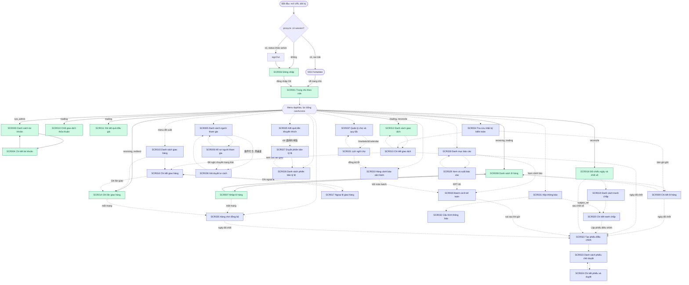
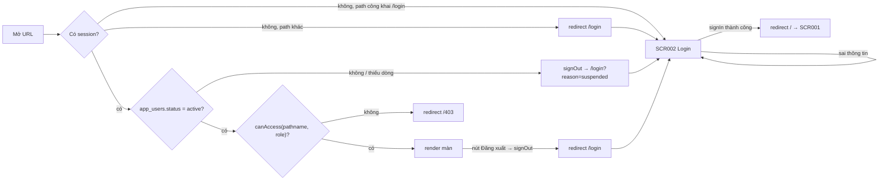

# Screen Flow

**Project**: Product A — 水産物卸売市場 業務支援システム
**Generated**: 2026-10-06
**Analysis Scope**: điều hướng của 37 màn (SCR001–SCR037): 11 màn đã xây (đọc từ `proxy.ts`, `lib/supabase/proxy.ts`, `lib/auth/route-policy.ts`, `lib/nav/menu-config.ts`, `app/`) + 26 màn thiết kế (suy từ mục "Luồng thao tác" của spec; **mọi cạnh/route/guard của màn thiết kế là đề xuất**). Danh sách màn: [screen-list.md](./screen-list.md).

**Code Format**: `SCR###_NameSlug` | `SCR###/REG###` cho chuyển tiếp theo vùng. Đường liền = đã có code; đường đứt = thiết kế. Alias LAB-1 (`SC-xx`) xem screen-list.

**Quy ước role**: prototype có 4 role (`sys_admin` `receiving` `trading` `reconcile`). Role đề xuất — `party_admin` `rule_admin` `ops_admin` `market_manager` `internal_audit` — ghi kèm *(đề xuất)*. Cờ `can_approve` là **cờ trên tài khoản** (`app_users.can_approve`), không phải role mới; đã chốt PREMISE C-09 (xem § Điểm lệch).

## Navigation Map



Màu xanh lá = đã xây ở LAB-3; tím = thiết kế LAB-4. Cạnh `NAV --> X` thể hiện mục menu `AppNav` (`app/(app)/app-nav.tsx:17`): mục menu hiện chỉ có 8 route (`lib/nav/menu-config.ts:17-26`) — các mục menu của màn thiết kế là **đề xuất** (cần mở rộng `MENU_ITEMS`). `SCR004`, `SCR007` là màn con, không có mục menu riêng (`menu-config.ts:9-10`).

## Feature Entry Points

Mỗi F### có đúng một màn vào chính; thứ tự theo [feature-list.md](./feature-list.md).

| Feature | Entry screen | Owned screens | Exit screens |
|---------|--------------|---------------|--------------|
| F001_AdminAndPermissions | SCR002_Login — `/login` | SCR002, SCR003, SCR004 | SCR001 (đăng nhập xong) |
| F002_ParticipantsAndQualification | SCR005_ParticipantList — `/participants` *(đề xuất)* | SCR005, SCR006, SCR036 | SCR010/SCR011 (hệ quả tư cách khi chốt) |
| F003_LotsAndInspection | SCR008_LotList — `/lots` | SCR007, SCR008, SCR009 | SCR010 (lô đã mở bán được chốt) |
| F004_TradeRecording | SCR010_NegotiatedTradeConfirm — `/trades/negotiated` | SCR010, SCR011, SCR012, SCR013 | SCR014 (giao dịch đã chốt → giao hàng) |
| F005_DeliveryTracking | SCR014_DeliveryEntry — `/deliveries/new` (menu `/deliveries`) | SCR014, SCR015, SCR016, SCR017 | SCR018 (đối chiếu) |
| F006_ReconciliationAndClosing | SCR018_DailyReconciliation — `/reconciliation` | SCR018, SCR019, SCR020, SCR021 | SCR022 (sửa sau chốt) |
| F007_PostCloseCorrection | SCR022_CorrectionRequestCreate — `/corrections/new` | SCR022, SCR023, SCR024 | SCR018, SCR025 (số kỳ mở đổi) |
| F008_IncentiveAndRateVersion | SCR025_IncentiveResult — `/incentives` | SCR025, SCR026, SCR027 | SCR024 (điều chỉnh) |
| F009_ReportsAndExport | SCR028_ReportCatalog — `/reports` | SCR028, SCR029, SCR030 | SCR022 (sai sau khi gửi kế toán) |
| F010_Notifications | SCR001_RoleHome — `/` (badge chưa đọc) | SCR001, SCR031, SCR032, SCR033, SCR035 | đối tượng theo `subject_ref` (ví dụ SCR020) |
| F011_AuditLog | SCR034_AuditLogSearch — `/audit` | SCR034 | SCR009, SCR013, SCR016 (bản ghi gốc) |
| F012_MarketManagement | SCR037_MarketManagement — `/markets` | SCR037 | SCR021, SCR005/SCR006 (quy chế) |

## Screen Access Paths

| From Screen | To Screen | Action/Trigger | Conditions | Region |
|-------------|-----------|----------------|------------|--------|
| START | SCR002_Login | URL bất kỳ khi chưa có session | không | |
| SCR002_Login | SCR001_RoleHome | submit thành công → `redirect("/")` (`app/login/actions.ts:36`) | email+mật khẩu hợp lệ | |
| SCR001_RoleHome | SCR003/008/010/011/012/014/018 | mục menu `AppNav` | chỉ mục mà `canAccess(href, role)` = true | |
| SCR003_AccountList | SCR004_AccountDetail | bấm tên tài khoản (`accounts/page.tsx:62-66`) | `sys_admin` | |
| SCR004_AccountDetail | SCR003_AccountList | menu / back | | SCR004/REG001 ghi tại chỗ, không đổi route |
| SCR008_LotList | SCR007_LotEntry | nút "Nhập lô mới" (`lots/page.tsx:113-119`) | `user.role === "receiving"` | |
| SCR007_LotEntry | SCR008_LotList | menu | | |
| SCR008_LotList | SCR009_LotDetail | bấm mã lô *(đề xuất)* | `receiving`/`trading`/`reconcile` | |
| SCR009_LotDetail | SCR022_CorrectionRequestCreate | link trong dải "đã chốt sổ" *(đề xuất)* | `business_days.status='closed'` | |
| SCR012_TradeList | SCR013_TradeDetail | bấm mã giao dịch *(đề xuất)* | `trading`/`reconcile` | |
| SCR013_TradeDetail | SCR016_DeliveryDetail | "Xem các lần giao" *(đề xuất)* | | |
| SCR013_TradeDetail | SCR022_CorrectionRequestCreate | nút thay cho "Huỷ" khi ngày đã chốt *(đề xuất)* | ngày đã chốt | |
| SCR015_DeliveryList | SCR016_DeliveryDetail | bấm mã giao dịch *(đề xuất)* | | |
| SCR015_DeliveryList | SCR014_DeliveryEntry | nút "Ghi lần giao" *(đề xuất)* | chỉ `receiving` | |
| SCR016_DeliveryDetail | SCR014_DeliveryEntry / SCR017_DeliveryException | "Ghi lần giao" / "Ghi ngoại lệ" *(đề xuất)* | chỉ `receiving` | |
| SCR018_DailyReconciliation | SCR019_DisputeList | link *(đề xuất)* | `reconcile` | |
| SCR019_DisputeList | SCR020_DisputeDetail | bấm dòng *(đề xuất)* | | |
| SCR020_DisputeDetail | SCR022_CorrectionRequestCreate | "Lập phiếu điều chỉnh" *(đề xuất)* | kết quả làm đổi số liệu ngày đã chốt | |
| SCR022_CorrectionRequestCreate | SCR023_PendingRequestList | sau khi gửi phiếu *(đề xuất)* | | |
| SCR023_PendingRequestList | SCR024_RequestDetailApproval | "Mở phiếu & duyệt" *(đề xuất)* | phiếu của người khác + `can_approve` | |
| SCR005_ParticipantList | SCR006_ParticipantProfile | mở dòng / "Thêm người tham gia" *(đề xuất)* | thêm mới chỉ `party_admin` *(đề xuất)* | |
| SCR005/SCR006 | SCR036_QualificationReview | "Đề nghị chuyển trạng thái" / đường tắt *(đề xuất)* | trạng thái `条件付き`/`再審査` hoặc maker | |
| SCR037_MarketManagement | SCR021_MarketCalendar | `/markets/[id]/calendar` *(đề xuất)* | `rule_admin`/`reconcile`/`sys_admin`/`ops_admin` | |
| SCR025_IncentiveResult | SCR027_RateVersionApproval | bấm `v{n}` cột 適用料率版 *(đề xuất)* | chỉ đọc cho `reconcile` | |
| SCR026_RateVersionList | SCR027_RateVersionApproval | "Lập bản mới" / bấm dòng *(đề xuất)* | `rule_admin` | |
| SCR028_ReportCatalog | SCR029_ReportViewExport | "Mở báo cáo" *(đề xuất)* | `reconcile`/`market_manager` | |
| SCR028/SCR033 | SCR030_AccountingBatch | "Xem cảnh báo" / "Mở màn batch" *(đề xuất)* | | |
| SCR031_NotificationInbox | đối tượng theo `subject_ref` | bấm dòng (đánh dấu đã đọc cùng lúc) *(đề xuất)* | | |
| SCR007_LotEntry / SCR014_DeliveryEntry | SCR035_SyncQueue | mất mạng → bản ghi vào IndexedDB *(đề xuất)* | `receiving` | |
| SCR035_SyncQueue | SCR022_CorrectionRequestCreate | "Lập phiếu điều chỉnh" khi `P0067` *(đề xuất)* | ngày đã chốt | |
| SCR034_AuditLogSearch | SCR009/SCR013/SCR016 | liên kết bản ghi gốc *(đề xuất)* | | |

## Screen Transitions

Dạng bảng thay cho 37 mục con (một dòng một màn). "Decision" = điểm rẽ nhánh trên màn.

| Screen | Entry Points | Exit Points | Decision Points |
|--------|--------------|-------------|-----------------|
| SCR001_RoleHome | sau đăng nhập; menu; `/403` → "Về trang chủ" | menu → màn khác theo role | `switch (user.role)` chọn 1 trong 4 biến thể (`app/(app)/page.tsx:24`) |
| SCR002_Login | mọi URL khi chưa đăng nhập; `?reason=suspended`; đăng xuất | SCR001 | thiếu/sai thông tin → ở lại + banner; đã đăng nhập vẫn mở được (không tự đá về `/`) |
| SCR003_AccountList | menu `sys_admin` | SCR004 | `searchParams` lạ → bỏ qua lặng lẽ |
| SCR004_AccountDetail | SCR003 | SCR003 | `id` không tồn tại → `notFound()` (404 mặc định); đổi quyền lỗi → banner |
| SCR005_ParticipantList | menu *(đề xuất)* | SCR006, SCR036 | chọn `条件付き`/`再審査` mà căn cứ "tất cả" → tự đặt căn cứ + `V-02` |
| SCR006_ParticipantProfile | SCR005 | SCR005, SCR036 | `party_type` → đúng 1 trong 4 biến thể |
| SCR007_LotEntry | SCR008 (nút) | SCR008 (menu) | lỗi field/mạng → ở lại, giữ dữ liệu; `Escape` xoá form |
| SCR008_LotList | menu `receiving`/`trading` | SCR007, SCR009 | `status ∈ {受付, 下見済}` → hiện "Mở bán"; chỉ `receiving` |
| SCR009_LotDetail | SCR008, SCR034 | SCR008, SCR022 | `dayStatus = closed` → chỉ đọc + link SCR022; `lots.status ∉ {受付, 下見済}` → `P0060` |
| SCR010_NegotiatedTradeConfirm | menu `trading` | (ở lại, nhập kế tiếp), SCR012 qua menu | từ chối `P0001–P0005` → ở lại, giữ dữ liệu |
| SCR011_AuctionResultEntry | menu `trading` | (ở lại), SCR012 qua menu | từ chối → ở lại, giữ dữ liệu |
| SCR012_TradeList | menu `trading`/`reconcile`; sau SCR010/011 | SCR013 | `buyerCode` không tồn tại → bảng rỗng |
| SCR013_TradeDetail | SCR012, SCR034 | SCR012, SCR016, SCR022 | ngày đã chốt → ẩn nút huỷ (`P0002`) ; đã có lần giao → `P0062` |
| SCR014_DeliveryEntry | menu `/deliveries` (redirect), SCR015, SCR016 | SCR015/SCR016, SCR035 | `status='exception'` → hiện loại ngoại lệ + lý do |
| SCR015_DeliveryList | menu *(đề xuất)* | SCR016, SCR014 | "Chỉ hiện ứ đọng"; nút "Ghi lần giao" ẩn với `reconcile` |
| SCR016_DeliveryDetail | SCR015, SCR013 | SCR014, SCR017, SCR015 | đủ điều kiện → hiện "Chốt hoàn tất"; trượt `P0063`/`P0003` → hộp thoại giữ nguyên |
| SCR017_DeliveryException | SCR016 | SCR016 | `delta = 0` → tự áp dụng; `delta ≠ 0` → hàng duyệt; maker = checker → ẩn nút duyệt |
| SCR018_DailyReconciliation | menu `reconcile` | SCR019, SCR022, SCR030 | dòng `open` → "Chốt sổ" (dialog, điều kiện chưa đạt chỉ cảnh báo — ADR-005) |
| SCR019_DisputeList | SCR018 | SCR020 | mặc định "đang mở"; "Xoá lọc" về mặc định, không phải "tất cả" |
| SCR020_DisputeDetail | SCR019, SCR031 | SCR019, SCR022 | kết quả đổi số ngày đã chốt → "Lập phiếu điều chỉnh"; chuyển trạng thái sai → `P0055` |
| SCR021_MarketCalendar | SCR037 | SCR037, SCR033 | `calendar_mode = manual` / `external_sync`; ngày đã chốt → `P0058` |
| SCR022_CorrectionRequestCreate | SCR012, SCR018, SCR009, SCR013, SCR020, SCR030, SCR035 | SCR023 | trùng phiếu pending / delta = 0 → chặn |
| SCR023_PendingRequestList | SCR022 (sau gửi), menu | SCR024 | 3 nhánh theo người xem (duyệt được / phiếu của mình / chỉ xem) |
| SCR024_RequestDetailApproval | SCR023 | SCR023 | chỉ hiện khối duyệt khi `pending` + người xem ≠ người lập + `can_approve`; số gốc đã đổi → `P0024` |
| SCR025_IncentiveResult | menu *(đề xuất)* | SCR027 | kỳ đã chốt → chỉ xem; `reconcile` chạy tính cho kỳ mở |
| SCR026_RateVersionList | menu *(đề xuất)* | SCR027 | "Lập bản mới" chỉ `rule_admin`; 6 trạng thái hiển thị dẫn xuất |
| SCR027_RateVersionApproval | SCR026, SCR025 | SCR026 | `draft` + người lập → sửa được; `pending` → khối đối chiếu; checker ≠ maker |
| SCR028_ReportCatalog | menu *(đề xuất)* | SCR029, SCR030 | `last_run_status='failed'` → badge + "Xem cảnh báo" |
| SCR029_ReportViewExport | SCR028 | SCR028, SCR030 | `row_count > 50.000` → `P0049`, hàng đợi nền; thiếu `as_of` → chặn |
| SCR030_AccountingBatch | SCR018 (batch ~10:00), SCR028, SCR033 | SCR022, SCR029 | `attempt ≥ 3` → `P0048`, tắt nút "Chạy lại" |
| SCR031_NotificationInbox | badge ở SCR001; menu | SCR032, đối tượng `subject_ref` | bấm dòng = điều hướng + đánh dấu đã đọc |
| SCR032_NotificationSettings | SCR031 | SCR031 | `critical` bắt buộc `immediate`; `recipient` rỗng khi bật → `P0052` |
| SCR033_OpsAlertQueue | menu *(đề xuất)*, SCR021 | SCR030 | cảnh báo batch/kế toán → không retry tại chỗ, sang SCR030 |
| SCR034_AuditLogSearch | menu *(đề xuất)* | SCR009, SCR013, SCR016 | 4 chiều tra cứu; mở rộng dòng hiện `old_value`/`new_value` |
| SCR035_SyncQueue | SCR007/SCR014 (mất mạng), menu | SCR022 | ngày đã chốt → `needs_correction` (`P0067`), bản ghi ở nguyên hàng đợi |
| SCR036_QualificationReview | SCR005, SCR006 | SCR005 | maker = checker → ẩn khối duyệt (`V-05`); `許可` ↔ `条件付き`, `承認` ↔ `再審査` |
| SCR037_MarketManagement | menu *(đề xuất)* | SCR021 | đã 4 bản `approved`/năm → `P0015`; quay lui = tạo bản mới |

## Region Transitions

> Chuyển tiếp theo vùng của màn composite — thường là client-state (không đổi URL); chỉ ghi chuyển tiếp đổi trạng thái nhìn thấy hoặc vượt ranh giới vùng.

| From Region | To Target | Action/Trigger | Client-State Only |
|-------------|-----------|----------------|-------------------|
| SCR004_AccountDetail/REG001 (RoleChangeForm) | SCR004/REG002 (RoleHistoryTable) | đổi quyền thành công → `revalidatePath` thêm dòng lịch sử | Không (re-render server, URL giữ nguyên) |
| SCR008_LotList/REG002 (nút "Mở bán") | SCR008/REG001 (bảng lô) | "Mở bán" thành công → badge dòng đổi sang "Đã mở bán" | Không (`revalidatePath("/lots")`) |
| SCR009_LotDetail/REG002 (đánh giá) | SCR009/REG001 (thông tin lô) | `markAsPreviewed` → `status 受付 → 下見済` | Không (nạp lại sau RPC) |
| SCR009_LotDetail/REG003 (hộp thoại điều chỉnh) | SCR009/REG001 | điều chỉnh thành công → đóng hộp thoại, nạp lại số mới | Không |
| SCR010_NegotiatedTradeConfirm/REG001 (form) | SCR010/REG002 (vùng tham khảo) | `onBlur` mã lô / mã người mua → Server Action tra cứu | Có (không đổi URL; chỉ hiển thị) |
| SCR010_NegotiatedTradeConfirm/REG001 | SCR010/REG002 | chốt thành công / `Escape` → xoá vùng tham khảo (`resetPreview`) | Có |
| SCR024_RequestDetailApproval/REG002 (quyết định) | SCR023 (toàn màn) | duyệt/từ chối xong → về danh sách | Không (đổi URL) |
| SCR030_AccountingBatch/REG001 → REG002 | tab lô xuất kế toán | chuyển tab = đổi route con (`/operations/batches` ↔ `/operations/acc-exports`) | Không |
| SCR036_QualificationReview/REG001 (danh sách) | SCR036/REG002 (phiếu) | mở phiếu → `/qualifications/[id]` | Không |
| SCR037_MarketManagement/REG001 (chợ) | SCR037/REG002 (phiên bản) | chọn chợ → `/markets/[id]/rules` → `/markets/[id]/rules/[rule_key]` | Không |

---

## Authentication Flow



| Screen | Authentication Required | Authorization Level |
|--------|------------------------|-------------------|
| SCR002_Login | Không (route công khai duy nhất — `lib/supabase/proxy.ts:5`) | Public |
| SCR001_RoleHome | Có | mọi role (`"/"` = `all`) |
| SCR003_AccountList, SCR004_AccountDetail | Có | `sys_admin` |
| SCR007_LotEntry | Có | `receiving` |
| SCR008_LotList | Có | `receiving`, `trading` |
| SCR010_NegotiatedTradeConfirm, SCR011_AuctionResultEntry | Có | `trading` |
| SCR012_TradeList | Có | `trading`, `reconcile` |
| SCR014_DeliveryEntry | Có | `receiving` |
| SCR018_DailyReconciliation | Có | `reconcile` |
| SCR005, SCR006 *(đề xuất)* | Có | `party_admin`, `reconcile`, `trading` |
| SCR009 *(đề xuất)* | Có | `receiving`, `trading`, `reconcile` (thêm `reconcile` vào `/lots`) |
| SCR013 *(đề xuất)* | Có | `trading`, `reconcile` |
| SCR015, SCR016 *(đề xuất)* | Có | `receiving`, `reconcile` |
| SCR017 *(đề xuất)* | Có | `receiving` (lập), `reconcile` (duyệt) |
| SCR019, SCR020 *(đề xuất)* | Có | `reconcile`, `trading` (xem); chức danh LAB-1 "delivery" ánh xạ về `receiving` |
| SCR021 *(đề xuất)* | Có | `rule_admin` (ghi), `reconcile`, `sys_admin`, `ops_admin` (xem) |
| SCR022, SCR023, SCR024 *(đề xuất)* | Có | `reconcile` (lập; duyệt cần `can_approve` và ≠ người lập) |
| SCR025 *(đề xuất)* | Có | `reconcile` (chạy tính), `rule_admin` (xem) |
| SCR026, SCR027 *(đề xuất)* | Có | `rule_admin` (lập), `rule_admin`+`can_approve` (duyệt), `sys_admin`/`reconcile` (xem) |
| SCR028, SCR029 *(đề xuất)* | Có | `reconcile`, `market_manager` |
| SCR030 *(đề xuất)* | Có | `ops_admin`, `reconcile` (ghi); `sys_admin` (xem) |
| SCR031 *(đề xuất)* | Có | mọi role (hộp thông báo cá nhân) |
| SCR032 *(đề xuất)* | Có | `ops_admin` (ghi); `sys_admin`, `reconcile` (xem) |
| SCR033 *(đề xuất)* | Có | `ops_admin` (ghi); `reconcile`, `sys_admin` (xem) |
| SCR034 *(đề xuất)* | Có | `sys_admin`, `internal_audit`, `reconcile` (cần nới RLS) |
| SCR035 *(đề xuất)* | Có | `receiving` |
| SCR036 *(đề xuất)* | Có | `party_admin` (lập), `party_admin`+`can_approve` (duyệt), `reconcile` (xem) |
| SCR037 *(đề xuất)* | Có | `rule_admin` (lập), `rule_admin`+`can_approve` (duyệt), `sys_admin`/`reconcile`/`party_admin` (xem) |

---

## Error Handling Flows

| Screen | Error | Handling | Scope |
|--------|-------|----------|-------|
| mọi màn `(app)` | chưa đăng nhập | `proxy.ts` redirect `/login` (`lib/supabase/proxy.ts:58-63`) | screen |
| mọi màn `(app)` | sai role | redirect `/403` — trang không tiết lộ dữ liệu màn bị chặn, chỉ nêu chức danh hiện tại + nút "Về trang chủ" (`app/403/page.tsx:10-35`; ảnh `sc403-forbidden-vi.png`) | screen |
| mọi màn `(app)` | tài khoản `suspended`/thiếu `app_users` | `signOut` + `/login?reason=suspended` (`proxy.ts:74-80`) — thông báo "vô hiệu hoá" cũng hiện khi thực chất thiếu dòng `app_users` | screen |
| SCR001, SCR003, SCR008, SCR012, SCR018 | truy vấn Supabase lỗi (`throw`) | **không có `error.tsx`/`loading.tsx`** trong `app/` → trang lỗi mặc định Next.js | screen |
| SCR004 | `id` không tồn tại | `notFound()` → 404 mặc định (không có `not-found.tsx`) (`accounts/[id]/page.tsx:27`) | screen |
| SCR002 | sai thông tin | banner `role="alert"` dưới ô mật khẩu, giữ dữ liệu | screen |
| SCR002 | mất mạng khi submit | **chưa định nghĩa** (không `try/catch`, không `error.tsx`) | screen |
| SCR004 | `P0001`/`P0005`/`P0007`/`generic` | banner đỏ, giữ lựa chọn | region:REG001 |
| SCR007 | lỗi field / `forbidden` / `network` | lỗi dưới ô + banner; **giữ dữ liệu**; ngày đã chốt rơi vào `network` (không phân biệt) | screen |
| SCR008 | `forbidden`/`invalidTransition`/`network`/`validation` | dưới nút "Mở bán" của đúng dòng | region:REG002 |
| SCR010 | `P0001`–`P0005`, `V-format`, `V-positive`, mất mạng | banner `aria-live="assertive"` tự nhận focus; giữ 4 field | screen |
| SCR010 | tra tham khảo lỗi / null | vùng tham khảo hiện "không tìm thấy", **không chặn submit** | region:REG002 |
| SCR011 | `V-format`, `generic`, `P0001`–`P0005`, mất mạng | banner `role="alert"`; giữ 6 field (không tự nhận focus) | screen |
| SCR012 | `buyerCode` không tồn tại | bảng rỗng, không báo lỗi | screen |
| SCR014 | `P0002`/`P0009` (ngày đã chốt) | banner + gọi `log_blocked_write_attempt` ghi `audit_log` (`deliveries/actions.ts:80`, `lib/domain/reconciliation.ts:140-158`) | screen |
| SCR018 | `P0001`/`P0002`/`P0005`/network khi chốt sổ | banner đỏ trong dialog, dialog giữ mở | screen |
| SCR009, SCR013, SCR016, SCR017, SCR020, SCR022, SCR024, SCR027, SCR037 *(đề xuất)* | lỗi nghiệp vụ RPC (`P0002`, `P0005`, `P006x`, …) | banner đỏ tự nhận focus; hộp thoại không đóng; giữ dữ liệu; lỗi mạng giữ dữ liệu như SCR007 | screen |
| SCR009, SCR013 *(đề xuất)* | `id` không tồn tại (`P0001`) | `notFound()` → 404 | screen |
| SCR029, SCR030 *(đề xuất)* | `P0049`, `P0048` | đẩy hàng đợi nền / tắt nút, cảnh báo sang SCR033 | screen |
| SCR035 *(đề xuất)* | `P0067` ngày đã chốt | bản ghi ở nguyên hàng đợi (`needs_correction`), không mất | screen |
| SCR005 *(đề xuất)* | `P0017` thiếu quy tắc | suy giảm êm: mặc định 30 ngày + banner, không chặn xem | region:bộ lọc |

> **Khoảng trống quan sát (2026-10-06):** F06-03 yêu cầu *mọi* lần thử sửa vào ngày đã chốt đều bị chặn **và ghi log**. Code hiện chỉ gọi `logBlockedWriteAttempt` ở `app/(app)/deliveries/actions.ts:80`; `lots/actions.ts` (SCR007/SCR008) và `trades/actions.ts` (SCR010/SCR011) không gọi — lần thử bị chặn ở các màn này không vào `audit_log`.

---

## Circular Dependencies Check

- [x] Không có phụ thuộc vòng *bắt buộc*: các cặp hai chiều (SCR003↔SCR004, SCR008↔SCR007, SCR023↔SCR024…) đều là điều hướng đi-về, không phải điều kiện tiên quyết dữ liệu.
- [x] Mọi màn có ít nhất 1 điểm vào và 1 điểm ra (bảng Screen Transitions).
- [x] Mọi đường điều hướng kết thúc: không có chuỗi chuyển hướng tự động nào vòng (`/login` đã đăng nhập không redirect; `/deliveries` → `/deliveries/new` một bước).
- [ ] **Lưu ý thứ tự triển khai:** SCR030 phụ thuộc SCR022/F007 (đường khắc phục duy nhất sau khi gửi lô kế toán); SCR017 phụ thuộc RPC duyệt bỏ qua trần `P0006`; SCR034 cần migration thêm `reason` + nới RLS (xem mục *Phụ thuộc thứ tự triển khai* ở [business-rules.md](../system/business-rules.md#điểm-chưa-chốt-trước-lab-5)).

---

## Guard Logic

Route guard của app chạy theo 3 lớp: `proxy.ts` (route) → Server Action (ghi) → RPC/RLS (dữ liệu). Mục đã xây có `file:line`; mục thiết kế là đề xuất.

### GUARD-001 — Authentication gate trên mọi route (trừ `/login` và static asset)
**trigger:** `middleware` (Next.js 16: `proxy.ts` thay `middleware.ts`)
**source:** `proxy.ts:9-17`, `lib/supabase/proxy.ts:19-63`
**logic:**
```pseudo
if (!claims) {
  if (isPublicPath(pathname)) → pass          # chỉ "/login"
  else → redirect /login
}
if (isPublicPath(pathname)) → pass            # đã đăng nhập mở /login: không redirect vòng
```
**failure path:** `/login`. Matcher bỏ qua `_next/static`, `_next/image`, `favicon.ico`, ảnh `.svg/.png/.jpg/.jpeg/.gif/.webp` (`proxy.ts:13-17`).

### GUARD-002 — Tài khoản còn hoạt động
**trigger:** `middleware`
**source:** `lib/supabase/proxy.ts:68-80`
**logic:**
```pseudo
appUser = select role,status from app_users where id = claims.sub
if (!appUser || appUser.status != 'active') → signOut; redirect /login?reason=suspended
```
**failure path:** `/login?reason=suspended` + banner `role="alert"` (`app/login/page.tsx:26-30`).

### GUARD-003 — Role vs route (`ROUTE_POLICY`)
**trigger:** `middleware`
**source:** `lib/auth/route-policy.ts:17-37`, `lib/supabase/proxy.ts:82-87`
**logic:**
```pseudo
entry = ROUTE_POLICY.find(e => pathname.startsWith(e.prefix))   # entry đầu tiên khớp thắng
if (!entry) → deny
allow if entry.roles == "all" or role in entry.roles
```
Bảng hiện tại (theo thứ tự khai báo): `/lots/new`→receiving · `/lots`→receiving,trading · `/trades/negotiated`→trading · `/trades/auction`→trading · `/trades`→trading,reconcile · `/deliveries`→receiving · `/reconciliation`→reconcile · `/accounts`→sys_admin · `/`→all.
**failure path:** `redirect /403` (`proxy.ts:83-87`).

### GUARD-004 — Trang cần user (defense-in-depth ở tầng trang)
**trigger:** Server Component
**source:** `app/(app)/layout.tsx:14-15`; mỗi `page.tsx` (ví dụ `accounts/page.tsx:22-23`); `lib/auth/current-user.ts:17-39`
**logic:** `getCurrentUser()` trả `null` (không session / không có `app_users` / `status ≠ active`) → `redirect("/login")`. Trang **chỉ kiểm đăng nhập, không kiểm role** — phân quyền thật dựa vào GUARD-003 + Server Action + RLS.
**failure path:** `/login`.

### GUARD-005 — Menu lọc theo role (chỉ UI)
**trigger:** component render
**source:** `app/(app)/app-nav.tsx:16-19`
**logic:** `MENU_ITEMS.filter(item => canAccess(item.href, role))` — mục không thuộc quyền **không hiện** (không phải disabled). Không phải lớp bảo mật.
**failure path:** không có (ẩn mục).

### GUARD-006 — Server Action tự kiểm role (tầng phòng thủ thứ hai)
**trigger:** Server Action (Server Function là POST tới chính route chứa nó — matcher đổi hoặc route bị refactor có thể âm thầm mất lớp proxy)
**source:** `app/(app)/lots/actions.ts:55,149` (receiving) · `app/(app)/trades/actions.ts:58,118` (trading) · `app/(app)/accounts/[id]/actions.ts:34` (sys_admin) · `app/(app)/deliveries/actions.ts:49` (receiving) · `app/(app)/reconciliation/actions.ts:27,59` (reconcile)
**logic:** `if (!user || user.role !== <role>) return { error: forbidden | P0005 }` **trước** khi chạm DB.
**failure path:** banner lỗi tại màn (xem § Error Handling Flows).

### GUARD-007 — RPC `SECURITY DEFINER` tự kiểm role (tầng ba)
**trigger:** database function
**source:** `supabase/migrations/0007_rpc_functions.sql:53` (`_confirm_trade`), `:126` (`record_delivery`) · `0008_rpc_functions_admin.sql:12` (`close_business_day`) · `0012_change_user_role_self_guard.sql:15-25` (`change_user_role`, thêm `P0007` tự đổi quyền chính mình)
**logic:** `current_app_role() is distinct from <role>` → `raise 'P0005'`.
**failure path:** `error.code = P0005` → banner "Chức danh của bạn không được phép…".

### GUARD-008 — RLS theo bảng
**trigger:** PostgREST
**source:** `supabase/migrations/0009_rls_policies.sql:20-58`, `0013_trades_select_receiving.sql:16-21`
**logic:** `app_users` — tự xem dòng mình + `sys_admin` xem tất cả · `role_change_log`, `audit_log` — chỉ `sys_admin` đọc · master data — mọi role đã đăng nhập · `lots` — SELECT `receiving`+`trading`, INSERT/UPDATE `receiving` · `trades` — SELECT `receiving`+`trading`+`reconcile`, không policy ghi · `deliveries` — SELECT `receiving`+`trading`+`reconcile`, không policy ghi (ADR-002).
**failure path:** trả rỗng (không phải `/403`) — vì vậy hai tầng route/RLS lệch nhau có chủ ý ở SCR012 (sai lệch D-05).

### GUARD-009 — Trigger chặn ghi vào ngày đã chốt
**trigger:** database trigger `before insert or update or delete`
**source:** `supabase/migrations/0010_closed_day_guard.sql:6-60` (trigger trên `lots`, `trades`, `deliveries`: `:45-55`)
**logic:** `business_days.status = 'closed'` → `raise 'P0009'`.
**failure path:** `P0009` → SCR014 gọi `log_blocked_write_attempt`; SCR007/SCR008 rơi vào `network` (không map riêng).

### Guard đề xuất cho màn thiết kế

> **Cảnh báo — `canAccess` dùng `startsWith`:** (1) entry cụ thể phải đứng **trước** entry chung; (2) route có segment động ở giữa (`/markets/[id]/calendar`) chỉ phân quyền được theo tiền tố `/markets` — phần phân biệt theo role phải làm ở trang + RLS.

| Route (đề xuất) | Roles cho phép | Ghi chú thứ tự / bẫy |
|-----------------|----------------|----------------------|
| `/participants` | `party_admin`, `reconcile`, `trading` | đặt trước `"/"`; **siết RLS `participants_select`** (hiện mọi role) — kiểm `SCR010` trước (xem spec SCR005) |
| `/qualifications` | `party_admin`, `reconcile` | duyệt cần `can_approve` ở RPC |
| `/lots` (sửa entry) | thêm `reconcile` | cho SCR009; **cũng phải thêm `reconcile` vào RLS `lots_select`** |
| `/trades` | giữ `trading`, `reconcile` | `/trades/[id]` khớp sẵn |
| `/deliveries/new` | `receiving` | **khớp chính xác `/deliveries/new` trước** entry `/deliveries` — nếu nới prefix `/deliveries` cho `reconcile` sẽ vô tình mở SCR014 |
| `/deliveries` (+ `/deliveries/trade/…`) | `receiving`, `reconcile` | code hiện redirect `/deliveries` → `/deliveries/new`; phải thay bằng SCR015 |
| `/deliveries/exceptions` | `receiving` (lập), `reconcile` + cờ `can_approve` (duyệt) | maker≠checker ở RPC (`P0065`) |
| `/disputes` | `reconcile`, `trading`, `receiving` | `delivery` của LAB-1 ánh xạ `receiving` |
| `/corrections` | `reconcile` | duyệt: `can_approve` + maker≠checker (`P0023`, `P0027`) |
| `/incentives`, `/incentive-rates` | `reconcile`, `rule_admin`, `sys_admin` (xem) | lập/duyệt: `rule_admin` / `rule_admin`+`can_approve` |
| `/reports` | `reconcile`, `market_manager` | `allowed_roles` theo từng `report_code` |
| `/operations` | `ops_admin`, `reconcile`, `sys_admin` | |
| `/notifications/settings` | `ops_admin` (ghi), `sys_admin`, `reconcile` (xem) | **khai báo trước `/notifications`** (mọi role) |
| `/ops/alerts` | `ops_admin`, `reconcile`, `sys_admin` | |
| `/audit` | `sys_admin`, `internal_audit`, `reconcile` | RLS `audit_log` hiện chỉ `sys_admin` + thiếu cột `reason` |
| `/sync-queue` | `receiving` | |
| `/markets` | `sys_admin`, `rule_admin`, `reconcile`, `party_admin`, `ops_admin` | hợp của SCR037 + SCR021; phân biệt theo trang |

---

## Deep-Link State Restoration

Màn dùng `searchParams` (Server Component) nên bookmark/chia sẻ/refresh giữ nguyên bộ lọc.

### SCR003_AccountList
**URL pattern:** `/accounts?role={r}&status={s}`
**State restored:**

| Param | Restores | Default if missing |
|-------|----------|--------------------|
| role | select chức danh | rỗng = tất cả |
| status | select trạng thái | rỗng = tất cả |

**Failure mode:** giá trị không thuộc enum bị bỏ qua lặng lẽ (`accounts/page.tsx:29-32`).

### SCR008_LotList
**URL pattern:** `/lots?status={s}&businessDate={YYYY-MM-DD}`
**State restored:** `status` (select 5 trạng thái), `businessDate` (ô ngày) — mặc định rỗng = không lọc.
**Failure mode:** `status` lạ bị bỏ qua (`isLotStatus`, `lots/page.tsx:44`).

### SCR012_TradeList
**URL pattern:** `/trades?businessDate=…&buyerCode=…&status=…&tradeType=…`
**State restored:** 4 ô lọc (mặc định rỗng).
**Failure mode:** `status`/`tradeType` lạ bị bỏ qua (`trades/page.tsx:20-26`); `buyerCode` không tồn tại → bảng rỗng (`lib/domain/trades.ts:76-80`).

### SCR018_DailyReconciliation
**URL pattern:** `/reconciliation?businessDate={YYYY-MM-DD}`
**State restored:** lọc một ngày (mặc định rỗng = toàn bộ ngày).
**Failure mode:** không ràng buộc (`reconciliation/page.tsx:13,27`).

### SCR002_Login
**URL pattern:** `/login?reason=suspended` — hiện banner vô hiệu hoá; giá trị khác bị bỏ qua (`app/login/page.tsx:26`).

### Màn thiết kế *(đề xuất)*
`/disputes` (mặc định "đang mở"; "Xoá lọc" về mặc định) · `/reports/[report_code]?businessDate=…` (tham số dựng từ `param_schema`; thiếu `as_of` → chặn) · `/corrections/new?target=…` (đích sẵn từ SCR012/SCR018/SCR009/SCR013) · `/participants?…` (7 ô lọc, nằm trên URL nên không mất khi tải lại) · `/deliveries?…` (giữ trạng thái lọc trên URL để chia sẻ).

---

## Unsaved-Changes Protection

**Không có `beforeunload`/route-leave guard/`isDirty` ở bất kỳ màn nào** (grep `beforeunload|useBeforeUnload|isDirty` trong `app/ components/ lib/` = rỗng). Thay vào đó, các form ⌨️ tự bảo vệ dữ liệu theo **lỗi mạng**, không theo điều hướng:

### SCR007_LotEntry, SCR010_NegotiatedTradeConfirm, SCR011_AuctionResultEntry, SCR014_DeliveryEntry
**trigger:** `fetch`/Server Action throw khi mất mạng (không phải rời trang)
**source:** `app/(app)/lots/new/use-lot-entry-form.ts:36-93` · `app/(app)/trades/negotiated/use-negotiated-form.ts:65-108` · `app/(app)/trades/auction/use-auction-form.ts:47-116` · `app/(app)/deliveries/new/use-delivery-form.ts:87-120`
**dirty detection:** không cần — input **controlled** bằng state; lỗi mạng chỉ `setState` của chính component, **không điều hướng**, nên dữ liệu đã gõ còn nguyên.
**prompt:** banner "Mất kết nối mạng — không thể gửi… Chưa có bản ghi nào được tạo." (SCR010) / "Chưa lưu được do lỗi kết nối. Dữ liệu trên form vẫn được giữ nguyên…" (SCR007). Nguyên nhân kỹ thuật: `useActionState` + `<form action>` khiến Next.js thử lại bằng native form submission khi offline → trình duyệt điều hướng thật và mất dữ liệu; vì vậy gọi thẳng Server Action trong `onSubmit` (`preventDefault`) + `useTransition` + `try/catch`. **SCR011 từng mắc lỗi này và đã vá ở commit `c62a586`** (đã kiểm bằng tắt mạng thật qua Puppeteer `setOfflineMode`).

### Mã còn lại
- SCR010/SCR007: `Escape` xoá toàn bộ form có chủ ý (không hỏi xác nhận); form thành công cũng tự xoá (máy dùng chung theo ca, không giữ dữ liệu lô trước).
- SCR004 (`useActionState`): lỗi mạng **chưa định nghĩa** (xem SCR004 `### Unresolved Questions`); SCR002: tương tự.
- *(đề xuất)* SCR009/SCR022/SCR027/SCR037: giữ dữ liệu khi lỗi mạng theo cùng khuôn mẫu; hộp thoại điều chỉnh/huỷ **không đóng** khi thất bại và đóng bằng `Escape`.

---

## Ngoài 37 màn

| Route | Trong code | Vai trò đối với screen flow |
|-------|-----------|-----------------------------|
| `/403` | `app/403/page.tsx:10-35` (nằm **ngoài** route group `(app)` → không header/nav) | Điểm đến của GUARD-003 khi sai role. Hiện tiêu đề + "bạn đang là {chức danh}" + nút "Về trang chủ" (`/`). Không tiết lộ dữ liệu màn bị chặn. Ảnh: `sc403-forbidden-vi.png`. Người **chưa đăng nhập** mở `/403` bị `proxy.ts` đẩy về `/login` (chỉ `/login` là path công khai); nhánh `unknownRole` của trang (`app/403/page.tsx:13-15`) chỉ chạy khi có session nhưng `getCurrentUser()` trả null — gần như không xảy ra sau GUARD-002. |
| `/deliveries` | `app/(app)/deliveries/page.tsx:11-15` — `redirect("/deliveries/new")` | Là **cửa vào menu "Ghi giao hàng"** (`menu-config.ts:23`) chuyển thẳng sang SCR014, do phạm vi LAB-3 không có màn danh sách giao hàng. Khi xây SCR015 (route `/deliveries`) **phải gỡ redirect này** và dùng entry khớp-chính-xác cho `/deliveries/new` (xem § Guard đề xuất). |

## Điểm lệch / lưu ý khi tổng hợp

- **Cờ `can_approve`** là cờ `app_users.can_approve` **trên tài khoản** (xuất hiện ở SCR022–SCR024, SCR026/027, SCR036, SCR037), không phải role; **đã chốt (PREMISE C-09)**: 9 role key quyết định mở màn, cờ quyết định duyệt.
- **Chức danh LAB-1 "delivery"** (SCR019/SCR020, `US-18`) không có trong enum `app_role`; ánh xạ về `receiving` — **đã chốt (PREMISE C-10)**, cùng với `目利き`; khách chưa xác nhận giả định.
- Spec SCR020 cũ nêu nút "Lập phiếu điều chỉnh" dẫn sang `SC-23` (danh sách phiếu chờ duyệt) — *suy luận* đây là `SC-22` (tạo phiếu), nên screen-flow vẽ tới SCR022. Đã đối chiếu: spec SCR020 hiện hành dẫn tới SCR022.
- **Thứ tự prefix trong `ROUTE_POLICY`** (mục 18 ở [business-rules.md](../system/business-rules.md#điểm-chưa-chốt-trước-lab-5); thiết kế đề xuất): `/notifications/settings` trước `/notifications`; `/deliveries/new` khớp chính xác trước `/deliveries`.

## Extraction Signatures

Mẫu đã dùng để tìm các cấu trúc trên trong code hiện có:

- **Guard:** `canAccess|ROUTE_POLICY|getClaims|isPublicPath` (`lib/auth/route-policy.ts`, `lib/supabase/proxy.ts`); Server Action `user.role !==`; RPC `current_app_role() is distinct from`.
- **Deep-link:** `searchParams` (Promise ở Next.js 16, phải `await`) ở `accounts/page.tsx`, `lots/page.tsx`, `trades/page.tsx`, `reconciliation/page.tsx`, `login/page.tsx`.
- **Unsaved-changes:** `beforeunload|useBeforeUnload|isDirty` — không có kết quả; thay bằng mẫu `startTransition(async () => { try {…} catch {…} })` trong các hook `use-*-form.ts`.
