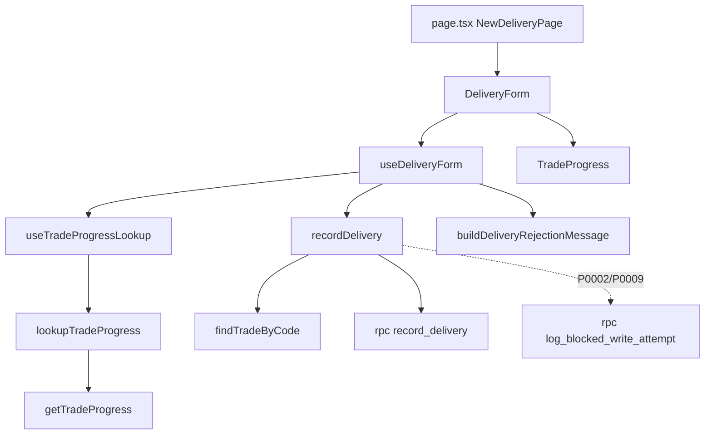

# SCR014_DeliveryEntry — Screen Spec

> Alias LAB-1: **SC-14** · 引渡し記録 · Ghi lần giao hàng

**Screen**: SCR014: DeliveryEntry (Ghi lần giao hàng)
**Feature**: [F005_DeliveryTracking](../../features/F005_DeliveryTracking/screens.md) — tính năng LAB-1 `F05-03` (giao hàng nhiều lần cho một giao dịch)
**Type**: composite (form keyboard-first + vùng tham khảo tiến độ giao hàng chỉ đọc)
**Route**: `/deliveries/new`
**Generated**: 2026-10-06
**Trạng thái**: Đã xây ở LAB-3
**Role**: `receiving` (xem + ghi)
**User story**: `US-07`
**Ảnh**: [sc14-delivery-new-vi.png](../../design/screenshots/sc14-delivery-new-vi.png)

## Purpose

Ghi lại **một lần giao hàng** cho một giao dịch đã chốt — một giao dịch có thể giao **nhiều lần** do lịch xe gom hàng (F05 của LAB-1). Người dùng là `receiving` ở khu giao hàng (06:00–10:00 JST), đeo găng tay, thao tác liên tục nhiều lần giao trong ca, terminal dùng chung theo ca — cùng ràng buộc keyboard-first với SCR007/SCR010. Màn hình phải cho thấy **đã giao / còn lại** trước khi cho nhập lần mới, nhưng số đó chỉ là tham khảo — cổng chặn giao vượt số còn lại là RPC chạy phía server.

## Screen Layout

Trang trong khung `(app)` chung: tiêu đề (`PageHeader`), rồi một cột `flex-col gap-6` gồm banner thành công/lỗi, dòng gợi ý phím tắt, form `max-w-lg` (mã giao dịch, số lượng, nhóm radio trạng thái, [loại ngoại lệ + lý do], nút ghi) và vùng "Tiến độ giao hàng (tham khảo)" bên dưới. Bàn phím được bắt ở container ngoài cùng (`app/(app)/deliveries/new/delivery-form.tsx:53`); form `max-w-lg` (`:83`); không có breakpoint riêng ngoài lưới `sm:grid-cols-2` của vùng tiến độ (`trade-progress.tsx:42`).

### Layout Sketch

```
┌──────────────────────────────────────────────────────┐
│ R1: Header ứng dụng + nav (khung (app))              │
├──────────────────────────────────────────────────────┤
│ R2: PageHeader — tiêu đề + mô tả                     │
├──────────────────────────────────────────────────────┤
│ R3: Banner thành công (xanh) | lỗi (đỏ, tự nhận focus)│
│     gợi ý phím tắt                                   │
├──────────────────────────────────────────────────────┤
│ R4: Form: [Mã giao dịch] [Số lượng lần này]          │
│     (•) Trạng thái 4 radio                           │
│     - - [Loại ngoại lệ] [Lý do] (khi "Ngoại lệ") - - │
│     [Ghi lần giao]                                   │
├──────────────────────────────────────────────────────┤
│ R5: Tiến độ giao hàng (tham khảo, chỉ đọc)           │
│     người mua · mặt hàng · tổng · đã giao · CÒN LẠI  │
│     · số lần  - - banner hổ phách khi ≥ 3 lần - -    │
└──────────────────────────────────────────────────────┘
```

### Layout Regions

| Region ID | Name | Position | Scrollable | Key Components | Responsive Behavior |
|-----------|------|----------|------------|----------------|---------------------|
| R1 | Header (trên) + nav (sidebar trái `w-64`) | static | no | khung `(app)` — `app/(app)/layout.tsx:19-26`, `app-header.tsx:18`, `app-nav.tsx:22` | always |
| R2 | Tiêu đề | static | no | `PageHeader` (`app/(app)/deliveries/new/page.tsx:20`) | fluid |
| R3 | Banner kết quả | static | no | div `role="status"` / `role="alert"` (`delivery-form.tsx:54-79`) | fluid |
| R4 | Form ghi lần giao | static | no | `Field`, input, radio, select, textarea, nút (`delivery-form.tsx:83-163`) | `max-w-lg` |
| R5 | Vùng tiến độ giao hàng | static | no | `TradeProgress` (`trade-progress.tsx:25-91`) | `grid-cols-1` → `sm:grid-cols-2`; conditional (nội dung chỉ khi tra được giao dịch) |

## Child Routes

Không áp dụng — màn này là một route đơn, không phải khung chứa route con.

## User Flow

> Phạm vi: tương tác trong màn. Điều hướng liên màn xem [screen-flow](../../generated/screen-flow.md).

### Happy Path

1. Trang tải, `status` mặc định "Đã giao", focus vào ô mã giao dịch.
2. Gõ mã giao dịch → Tab (rời ô kích hoạt `handleTradeCodeBlur`: tra `v_trade_delivery_status` + `trades` + `lots` + `participants` + `commodities`, hiện vùng "Tiến độ giao hàng (tham khảo)"; nếu lần giao dự kiến ≥ 3, hiện thêm banner cảnh báo).
3. Gõ số lượng lần này → `Enter` nếu trạng thái vẫn mặc định "Đã giao" (ghi ngay), hoặc Tab tiếp để đổi trạng thái.
4. (Tùy chọn) Chọn trạng thái khác "Đã giao" — nếu chọn "Ngoại lệ", hai field Loại ngoại lệ + Lý do hiện thêm, cả hai bắt buộc.
5. Bấm "Ghi lần giao" hoặc `Ctrl+Enter`.
6. Client kiểm định dạng → thiếu/không dương/thiếu lý do khi ngoại lệ → banner lỗi, dừng.
7. Server Action tự kiểm role → tra `tradeCode` → `id`, không tìm thấy → `P0001`.
8. Gọi RPC `record_delivery` trong transaction: kiểm ngày chốt (`P0002`) → kiểm tư cách người nhận (`P0003`) → kiểm số lượng còn lại của giao dịch (`P0006`) → insert `deliveries` với `seq` kế tiếp; nếu đây là lần giao cuối (`remaining = 0` sau khi trừ) → `lots.status` chuyển `引渡し完了`. *(Mô tả đúng code đã xây. Hành vi đã chốt ở PREMISE G3 khác: hoàn tất giao hàng ghi ở cấp giao dịch qua `SCR016`, lô chỉ chuyển `引渡し完了` khi mọi giao dịch `confirmed` của lô đã hoàn tất — xem lỗi B-02/B-04 ở `### Dependencies & Risks`.)*
9. **Nhánh thành công:** banner xanh hiện số thứ tự lần giao + còn lại, form xoá sạch, focus về ô mã giao dịch, quay lại bước 2.
10. **Nhánh bị từ chối:** nếu `P0002`/`P0009`, server còn gọi `log_blocked_write_attempt` ghi vào `audit_log`; banner đỏ hiện, dữ liệu giữ nguyên để sửa và gửi lại.

### Branches

| Decision point | Condition | Outcome on this screen | Source |
|----------------|-----------|------------------------|--------|
| Bước 2 | `deliveryCount + 1 ≥ DELIVERY_COUNT_WARNING_THRESHOLD` (3) | banner hổ phách `role="status"` trong vùng tiến độ, **không chặn submit** | `app/(app)/deliveries/new/use-delivery-form.ts:148-149`; `trade-progress.tsx:75-82` |
| Bước 2 | không tra được giao dịch sau khi `onBlur` | vùng tiến độ hiện "không tìm thấy" (đỏ) — chỉ thông tin, không chặn | `app/(app)/deliveries/new/trade-progress.tsx:86` |
| Bước 3 | `status ≠ completed` | `Enter` ở ô số lượng **không** submit | `app/(app)/deliveries/new/use-delivery-form.ts:127-132` |
| Bước 4 | `status = exception` | hiện Loại ngoại lệ + Lý do (bắt buộc) | `app/(app)/deliveries/new/delivery-form.tsx:125-153` |
| Bước 6 | thiếu / không dương / thiếu lý do | banner lỗi, không gọi server | `app/(app)/deliveries/new/use-delivery-form.ts:65-77` |
| Bước 8 | `P0002` / `P0009` | thêm lời gọi `log_blocked_write_attempt` (riêng, lỗi bị nuốt) | `app/(app)/deliveries/actions.ts:78-86` |
| Bước 8 | Server Action throw | banner `networkError`, 5 field giữ nguyên | `app/(app)/deliveries/new/use-delivery-form.ts:120-122` |

## Data Inventory

> Chỉ field chỉ đọc: vùng tham khảo "Tiến độ giao hàng" (không gửi lên server). Ô nhập nằm ở `## Validation & Error Feedback`.

| Field | Display Label | Source | Format | Empty Behavior | Cross-ref |
|-------|---------------|--------|--------|----------------|-----------|
| `progress.buyerName` | Người mua / 買受人 | `participants.name` theo `trades.buyer_participant_id` | text | vùng ẩn khi chưa tra được | participants |
| `progress.commodityName` | Mặt hàng / 品目 | `commodities.name_vi`/`name_ja` theo `lots.commodity_id` | text theo locale | vùng ẩn | commodities |
| `progress.quantity` | Tổng số lượng giao dịch / 取引総数量 | `v_trade_delivery_status.quantity` (= `trades.quantity`) | `toLocaleString()` + đơn vị | vùng ẩn | v_trade_delivery_status |
| `progress.deliveredQty` | Đã giao / 引渡し済み | `v_trade_delivery_status.delivered_qty = Σ deliveries.quantity WHERE status IN ('completed','exception')` | `toLocaleString()` + đơn vị | vùng ẩn | v_trade_delivery_status |
| `progress.remaining` | Còn lại / 残数量 | `v_trade_delivery_status.remaining = quantity − delivered_qty` | `toLocaleString()` + đơn vị, chữ lớn đậm | vùng ẩn | v_trade_delivery_status |
| `progress.deliveryCount` | Số lần đã giao / 引渡し回数 | `v_trade_delivery_status.delivery_count` | number | vùng ẩn | v_trade_delivery_status |

Nguồn hiển thị: `app/(app)/deliveries/new/trade-progress.tsx:40-73`. Delivery `exception` (giao thiếu/thừa) **vẫn tính vào** `delivered_qty` vì là số đã thực giao thật, không phải số dự kiến (tài liệu gốc trong repo, không nộp: `db-schema.md` §3).

### Read Calls *(mục bổ sung)*

| Thao tác | Cách gọi | Tham số | Trả về |
|---|---|---|---|
| Tham khảo tiến độ giao hàng (`onBlur` mã giao dịch) | `select` từ `trades` + `v_trade_delivery_status` + `lots` + `participants` + `commodities` qua Server Action `lookupTradeProgress` (`preview-actions.ts:16-29` → `getTradeProgress`, `lib/domain/deliveries.ts:84`) | `tradeCode` | `TradeDeliveryProgress \| null` — chỉ hiển thị, không chặn |

## UI States

| State | Trigger | Visual Behavior | User Action Available | Source |
|-------|---------|----------------|-----------------------|--------|
| empty | mở trang lần đầu / sau khi ghi thành công | form trắng, `status` mặc định "Đã giao" (`completed`), vùng tiến độ trống, focus ở ô mã giao dịch | nhập mã | `use-delivery-form.ts:19,55-63`; `delivery-form.tsx:90` |
| loading (tiến độ) | đang tra tiến độ sau `onBlur` | `progressLoading` → "đang tải" trong vùng tham khảo | none | `trade-progress.tsx:38`; `use-trade-progress-lookup.ts:25-30` |
| saving | `isPending` | nút "Ghi lần giao" đổi nhãn "Đang ghi…", `disabled` | none | `delivery-form.tsx:155-162` |
| success | RPC trả `{delivery_seq, remaining_after}` | banner xanh lá `role="status"`: "Đã ghi lần giao thứ {seq} cho {trade_code}. Còn lại {remaining} {unit}."; form xoá sạch (`status` reset về `completed`); focus quay về ô mã giao dịch | dismiss / ghi tiếp | `use-delivery-form.ts:97-107`; `delivery-form.tsx:54-67` |
| error (nghiệp vụ) | RPC trả P0001–P0006 hoặc validate định dạng thất bại | banner đỏ `role="alert" aria-live="assertive"`, **tự nhận focus**; dữ liệu field giữ nguyên | sửa và gửi lại | `use-delivery-form.ts:51-53,109-119`; `delivery-form.tsx:69-79` |
| error (mạng) | `fetch` throw | cùng banner đỏ, thông báo riêng (Error Catalogue); dữ liệu field giữ nguyên | thử lại | `use-delivery-form.ts:120-122` |
| warning (không chặn) | số lần giao dự kiến (`deliveryCount + 1`) `≥ 3` (`DELIVERY_COUNT_WARNING_THRESHOLD`, hằng số giả định — RFP chưa chốt ngưỡng thật) | banner hổ phách `role="status"` trong vùng tiến độ: "Giao dịch này đã chia {count} lần giao — vượt ngưỡng cảnh báo {threshold} lần... vẫn có thể tiếp tục ghi" — **không chặn submit** | tiếp tục ghi | `trade-progress.tsx:75-82`; `lib/domain/deliveries.ts:22` |
| read-only | ngày nghiệp vụ của giao dịch đã chốt sổ | không có giao diện riêng — rơi vào nhánh lỗi `P0002` như mọi lỗi nghiệp vụ, kèm ghi `audit_log` ở phía server | xem banner | `deliveries/actions.ts:78-86` |

## Validation & Error Feedback

### A) Client-side

`validateFormat()` CHỈ kiểm định dạng (`use-delivery-form.ts:65-77`).

| Field | Type | Required | Constraints | Async Check | Error Message |
|-------|------|----------|-------------|-------------|---------------|
| `tradeCode` / 取引コード | text (autoFocus) | yes | không rỗng (định dạng); phải tồn tại trong `trades.trade_code` (kiểm ở server → `P0001`) | `onBlur` → `lookupTradeProgress` (chỉ tham khảo) | `V-required` |
| `quantity` / 今回の数量 | number (`step=0.001`, `min=0`) | yes | `> 0`, hữu hạn | không (không kiểm `remaining` ở client) | `V-required` / `V-positive` |
| `status` / 状態 | radio, 4 lựa chọn (`pending`/`in_transit`/`completed`/`exception`) | yes | phải thuộc `DELIVERY_STATUS_VALUES`; mặc định `completed` ("Đã giao") | không | — |
| `exceptionType` / 例外種別 | select, 4 lựa chọn (`short`/`over`/`returned`/`partial_cancel`) | yes (chỉ khi `status='exception'`) | phải thuộc `DELIVERY_EXCEPTION_VALUES`; field **chỉ hiện** khi `status='exception'`; mặc định rỗng | không | — |
| `reason` / 理由 | textarea | yes (chỉ khi `status='exception'`) | không rỗng khi hiện; mặc định rỗng | không | `V-reason` |

Mã thông báo xem Error Catalogue bên dưới. `P0006` (giao vượt số còn lại) và `P0003` (tư cách hết hạn) **tuyệt đối không kiểm phía client**.

### B) Server-side

#### Ghi lần giao
- **Endpoint:** `rpc('record_delivery')` gọi từ Server Action `recordDelivery` sau khi tra `tradeCode` → `id` qua `findTradeByCode` (`lib/domain/deliveries.ts:43`)
- **Request:** `p_trade_id, p_quantity, p_status, p_exception_type, p_reason`
- **Success:** `jsonb {delivery_seq, remaining_after}` → banner xanh, form xoá sạch, focus về ô mã giao dịch; `revalidatePath` `/deliveries`, `/lots`, `/reconciliation`
- **Errors:** `P0001` · `P0002` · `P0003` · `P0005` · `P0006` (và `generic`)
- **Trigger:** nút "Ghi lần giao" / `Ctrl+Enter` / `Enter` ở ô số lượng khi `status = completed`
- **Source:** `app/(app)/deliveries/actions.ts:47-95`; RPC `supabase/migrations/0007_rpc_functions.sql:114-166`

#### Ghi lần thử bị chặn (chỉ khi `P0002`/`P0009`)
- **Endpoint:** `rpc('log_blocked_write_attempt')`, gọi **riêng**, sau khi lỗi gốc đã trả về — lỗi ghi log bị nuốt (`try/catch`, không ném lại)
- **Request:** `p_table: "deliveries", p_business_date, p_error_code, p_context`
- **Success:** `void` (không ảnh hưởng tới thông báo lỗi gốc)
- **Errors:** `P0005` (chưa đăng nhập) — bị nuốt
- **Trigger:** Server Action `recordDelivery` khi RPC trả `P0002`/`P0009`
- **Source:** `app/(app)/deliveries/actions.ts:45,78-86`; `lib/domain/reconciliation.ts:140`; `supabase/migrations/0040_log_blocked_write_attempt.sql`

Ghi bắt buộc qua RPC vì `deliveries` không có policy ghi qua RLS (tài liệu gốc trong repo, không nộp: `db-schema.md` §2) — đường ghi duy nhất là `record_delivery`.

#### Error Catalogue *(mục bổ sung)*

| Mã | Điều kiện kích hoạt | Thông báo VI | Thông báo JA | Hiện ở đâu | Chặn gửi? |
|---|---|---|---|---|:---:|
| `V-required` | `tradeCode`/`quantity` rỗng | Vui lòng nhập đủ mã giao dịch và số lượng. | 取引コードと数量を入力してください。 | banner `aria-live="assertive"` đầu vùng form | ● |
| `V-positive` | `quantity` không phải số hoặc `≤ 0` | Số lượng phải là số dương. | 数量は正の数で入力してください。 | banner | ● |
| `V-reason` | `status='exception'` nhưng `reason` rỗng | Vui lòng nhập lý do khi trạng thái là ngoại lệ. | 状態が例外の場合は理由を入力してください。 | banner | ● |
| `P0001` | `tradeCode` không tra được `id` | Không tìm thấy mã giao dịch đã nhập. Kiểm tra lại mã này. | 入力された取引コードが見つかりません。もう一度確認してください。 | banner | ● |
| `P0002` | ngày nghiệp vụ của giao dịch đã chốt sổ (kiểm **trong RPC**, trước khi insert) | Ngày nghiệp vụ {business_date} đã chốt sổ lúc {closed_at}, không thể ghi thêm lần giao. | 業務日{business_date}は{closed_at}に締められており、引渡しを追加記録できません。 | banner | ● |
| `P0003` | tư cách người mua/nhận hết hiệu lực (kiểm trong RPC) | Người nhận {buyer_name} đã hết hạn tham gia từ {expired_on}, căn cứ {basis_label}. Liên hệ {contact_office} để xử lý. | 買受人{buyer_name}は{expired_on}から資格が失効しています（根拠：{basis_label}）。{contact_office}にご連絡ください。 | banner | ● |
| `P0005` | role ≠ `receiving` | Chức danh của bạn không được phép thực hiện thao tác này. | あなたの職掌ではこの操作を実行できません。 | banner | ● |
| `P0006` | `requested > remaining` của giao dịch (kiểm **trong RPC**, dựng từ `details: delivered, remaining, requested`) | Giao dịch {trade_code} đã giao {delivered} {unit}, chỉ còn {remaining} {unit} — không đủ cho yêu cầu {requested} {unit}. | 取引{trade_code}はすでに{delivered} {unit}引渡し済みで、残りは{remaining} {unit}です — 要求数量{requested} {unit}には不足しています。 | banner | ● |
| (generic) | lỗi Postgres khác | Có lỗi xảy ra khi ghi lần giao, vui lòng thử lại. | 引渡しの記録中にエラーが発生しました。もう一度お試しください。 | banner | ● |
| (network) | `fetch`/Server Action throw | Mất kết nối mạng — không thể gửi lần giao. Kiểm tra lại kết nối rồi thử lại. Chưa có bản ghi nào được tạo. | ネットワーク接続が切断されました — 引渡しを送信できません。接続を確認して再度お試しください。まだ記録は作成されていません。 | banner | ● |

**Then chốt:** `P0006` (giao vượt số còn lại của giao dịch) và `P0003` (tư cách hết hạn) **tuyệt đối không kiểm phía client** — `validateFormat()` trong `use-delivery-form.ts` chỉ kiểm định dạng. Hai phép kiểm chạy duy nhất trong RPC `record_delivery` (transaction phía server). Vùng tham khảo "Tiến độ giao hàng" (Data Inventory, vùng tiến độ) chỉ hiển thị — comment code nói thẳng: "TUYỆT ĐỐI không thêm `if (remaining < qty)` hay điều kiện chặn submit nào dựa trên props của component này".

**Sự kiện phụ khi `P0002` (và lý thuyết `P0009`):** Server Action gọi thêm RPC `log_blocked_write_attempt` (một lời gọi **riêng**, ngoài transaction đã rollback của `record_delivery`) để ghi lần thử ghi vào ngày đã chốt vào `audit_log` — đây là hệ quả kiến trúc C5 (tài liệu gốc trong repo, không nộp: `architecture.md`), không hiện gì thêm trên UI ngoài banner lỗi P0002 bình thường.

## Interaction Patterns

- **Tab order: Mã giao dịch (autofocus) → Số lượng lần này → nhóm radio Trạng thái (Tab vào rồi mũi tên chọn theo chuẩn radio HTML) → *(nếu chọn "Ngoại lệ")* Loại ngoại lệ → Lý do → nút "Ghi lần giao"** — source: `app/(app)/deliveries/new/delivery-form.tsx:84-162`.
- **`Enter` (không giữ Ctrl) ở ô số lượng ghi ngay chỉ khi `status` đang là mặc định `completed`; nếu đã chọn trạng thái khác thì không làm gì đặc biệt** — source: `app/(app)/deliveries/new/use-delivery-form.ts:127-132` (`handleQuantityKeyDown`).
- **`Ctrl+Enter` ghi từ bất kỳ đâu trong vùng form, kể cả không có input nào được focus** (bắt ở cấp container ngoài cùng, cùng khuôn với SCR010) — source: `app/(app)/deliveries/new/use-delivery-form.ts:135-139`; `delivery-form.tsx:53`.
- **`Escape` xoá toàn bộ form (bao gồm reset `status` về `completed`), focus quay về ô mã giao dịch** — source: `app/(app)/deliveries/new/use-delivery-form.ts:141-145`.
- **Focus ban đầu: ô mã giao dịch (`autoFocus`). Sau khi gửi: thành công → quay về ô mã giao dịch; thất bại → banner lỗi tự nhận focus (`tabIndex={-1}` + `.focus()` trong `useEffect`)** — source: `delivery-form.tsx:90`; `use-delivery-form.ts:51-53,105`.
- **`onBlur` của ô mã giao dịch kích hoạt tra cứu vùng tiến độ — lệnh gọi mạng phụ xảy ra tự nhiên khi Tab rời ô** (giống `handleLotBlur` của SCR010) — source: `use-delivery-form.ts:165`; `use-trade-progress-lookup.ts:17-31`.
- **Không có dialog chặn giữa luồng** — source: `delivery-form.tsx` (không có `<dialog>`).
- **Mất mạng không mất dữ liệu đã gõ** (xem Unresolved Questions): gọi thẳng Server Action trong `onClick`/`onKeyDown` + `useTransition` + `try/catch`, không dùng `useActionState` + `<form action>` — source: `use-delivery-form.ts:79-124`.

## Accessibility

| Aspect | Status | Notes |
|--------|--------|-------|
| ARIA roles/labels | present | banner thành công `role="status" aria-live="polite"` (`delivery-form.tsx:55-58`), lỗi `role="alert" aria-live="assertive"` (`:73-74`); `Field` gắn nhãn (`components/ui/field.tsx`); `fieldset`/`legend` cho nhóm radio (`:107-108`) |
| Keyboard navigation | supported | Tab order như trên; `Enter`/`Ctrl+Enter`/`Escape`; gợi ý phím tắt hiển thị `t.sc14.keyboardHint` (`:81`) |
| Focus management | managed | `autoFocus` ô mã giao dịch; banner lỗi nhận focus qua `tabIndex={-1}`; focus quay về ô 1 sau thành công/`Escape` |
| Screen reader compatibility | unknown | chưa kiểm bằng trình đọc màn hình; vùng tiến độ dùng `<dl>` ngữ nghĩa (`trade-progress.tsx:42`) |

## Conditional Rendering

| Condition | Type | Renders | Hidden | Notes |
|-----------|------|---------|--------|-------|
| `status === "exception"` | hardcoded-id | select Loại ngoại lệ + textarea Lý do | — | `delivery-form.tsx:125-153` |
| `successBanner` có giá trị | hardcoded-id | banner xanh | — | `delivery-form.tsx:54-67` |
| `errorMessage` có giá trị | hardcoded-id | banner đỏ tự nhận focus | — | `delivery-form.tsx:69-79` |
| `showCountWarning` (`deliveryCount + 1 ≥ 3`) | hardcoded-id | banner hổ phách | — | ngưỡng giả định [NEEDS_DOMAIN_CONFIRMATION]; `trade-progress.tsx:75-82` |
| `!loading && progress` | hardcoded-id | khối `<dl>` tiến độ | — | `trade-progress.tsx:40-73` |
| `!loading && !progress && attempted` | hardcoded-id | "không tìm thấy" | — | `trade-progress.tsx:86` |
| role ≠ `receiving` | auth | — | toàn trang (→ `/403`) | chặn ở `proxy.ts` theo `ROUTE_POLICY`; bypass bị Server Action và RPC chặn `P0005` |

## Component Variants

Không áp dụng — màn không có component đổi hình dạng theo biến thể; khác biệt theo chức danh/trạng thái đã mô tả ở Conditional Rendering.

## Security Surface

| Guard | Type | Consequence if bypassed |
|-------|------|------------------------|
| `ROUTE_POLICY` `{ prefix: "/deliveries", roles: ["receiving"] }` (`lib/auth/route-policy.ts:23`) — áp cho cả `/deliveries/new` | role | role khác bị chuyển `/403` bởi `proxy.ts` |
| Server Action `recordDelivery` tự kiểm `user.role !== "receiving"` → `P0005` (`app/(app)/deliveries/actions.ts:48-55`) | role | Server Function là POST tới chính route — không dựa vào `proxy.ts` |
| RPC `record_delivery` tự kiểm `current_app_role()` (`0007_rpc_functions.sql:126-129`) | permission | tầng ba chặn ghi từ role sai |
| RPC kiểm ngày chốt `P0002`, tư cách `P0003`, số còn lại `P0006` trong một transaction có khoá dòng (`0007_rpc_functions.sql:132-152`) | permission | giao vượt số còn lại / sau chốt sổ / người nhận hết tư cách |
| Trigger `guard_closed_day` trên `deliveries` (`0010_closed_day_guard.sql:53`) → `P0009` | permission | ghi trực tiếp bảng vào ngày đã chốt bị chặn tầng dữ liệu |

Quyền theo chức danh (9 role, PREMISE C-09): `sys_admin` ✗ · `receiving` xem + ghi (gồm cả 配送部門, đã chốt gộp ở PREMISE C-10 — ghi là nợ: phân tách nhiệm vụ nhận/giao là kiểm soát nội bộ) · `trading` ✗ · `reconcile` ✗ · 5 role đề xuất (`party_admin`, `rule_admin`, `ops_admin`, `market_manager`, `internal_audit`) ✗. `can_approve` không liên quan. Chặn ở cả hai tầng ứng dụng (route + Server Action) cộng tầng RPC.

## Source References

1. Page/View: `app/(app)/deliveries/new/page.tsx:12-24`
2. Form (JSX): `app/(app)/deliveries/new/delivery-form.tsx:24-176`
3. State + bàn phím + validate: `app/(app)/deliveries/new/use-delivery-form.ts:35-176`
4. Vùng tiến độ: `app/(app)/deliveries/new/trade-progress.tsx:25-91`; tra cứu: `use-trade-progress-lookup.ts:12-39`, `preview-actions.ts:16-29`
5. Server Action ghi: `app/(app)/deliveries/actions.ts:47-95`
6. Ánh xạ thông báo lỗi: `app/(app)/deliveries/new/delivery-rejection-message.ts`
7. Miền dữ liệu: `lib/domain/deliveries.ts` (`DELIVERY_COUNT_WARNING_THRESHOLD` dòng 22, `findTradeByCode` 43, `getTradeProgress` 84)
8. Chính sách route: `lib/auth/route-policy.ts:17-27`
9. DB: `supabase/migrations/0007_rpc_functions.sql:114-166` (`record_delivery`), `0006_derived_views.sql:27` (`v_trade_delivery_status`), `0040_log_blocked_write_attempt.sql`
10. Route `/deliveries` (gốc) chỉ chuyển hướng: `app/(app)/deliveries/page.tsx:11-15`

## Source Walkthrough

1. **File:** `supabase/migrations/0007_rpc_functions.sql:114-166` — bắt đầu từ RPC `record_delivery`: nó là cổng thật, mọi thứ ở UI chỉ để dẫn tới đây.
2. **File:** `lib/domain/deliveries.ts:11-125` — kiểu, hằng số (`DELIVERY_STATUS_VALUES`, ngưỡng cảnh báo) và truy vấn tra giao dịch/tiến độ.
3. **File:** `app/(app)/deliveries/new/page.tsx:12-24` — Server Component kiểm đăng nhập, nạp từ điển, dựng `DeliveryForm`.
4. **File:** `app/(app)/deliveries/new/use-delivery-form.ts:35-176` — toàn bộ state và hành vi bàn phím; đọc để hiểu luồng gửi.
5. **File:** `app/(app)/deliveries/new/delivery-form.tsx:24-176` — JSX thuần, gắn state vào input.
6. **File:** `app/(app)/deliveries/new/trade-progress.tsx:25-91` — vùng tham khảo (không phải cổng).
7. **File:** `app/(app)/deliveries/actions.ts:47-95` — Server Action: kiểm role, tra mã, gọi RPC, ánh xạ lỗi, ghi `audit_log` khi bị chặn.

Ảnh bản deploy: xem `Ảnh` ở đầu trang. Cross-ref `entities.md` cho `deliveries`, `trades`, `v_trade_delivery_status`.

### Call Hierarchy



**Related files:** xem `## Source References` (đã đánh số theo thứ tự).

## Dependencies & Risks *(mục bổ sung)*

- Cần có giao dịch `confirmed` còn `remaining > 0` để demo ghi thành công nhiều lần (seed có lô giao dở dang T1, còn lại 7) và một giao dịch có ca ngoại lệ sẵn (T5, `status='exception', exception_type='short'`) để tham chiếu khi thiết kế UI "Ngoại lệ".
- `DELIVERY_COUNT_WARNING_THRESHOLD = 3` là **hằng số giả định**, không phải ngưỡng nghiệp vụ đã xác nhận (comment trong `lib/domain/deliveries.ts` dẫn (tài liệu gốc trong repo, không nộp) `lab3-scope-lock.md`, rủi ro R6-5) — LAB-5 không nên viết test case khẳng định "đúng 3 lần" là ngưỡng chính thức.
- **Lỗi B-04 (đọc code, chưa tái hiện):** `record_delivery` lật `lots.status = 引渡し完了` khi `remaining − p_quantity = 0` bất kể `p_status` (`supabase/migrations/0007_rpc_functions.sql:159-161`), trong khi `v_delivered` chỉ tính `completed`/`exception` (`0007:146-147`) và form cho chọn `pending`/`in_transit` (`lib/domain/deliveries.ts:11`). Ghi một lần giao "Chờ giao" bằng đúng số còn lại → lô thành đã giao xong. Hướng sửa đề xuất: chỉ lật khi `p_status in ('completed','exception')` (cộng hướng sửa B-02: lật theo lô, không theo một giao dịch). **Chưa sửa** (đề không yêu cầu nộp code); hành vi đúng đã chốt ở PREMISE G3. Xem [F005](../../features/F005_DeliveryTracking/technical-spec.md).
- Rủi ro triển khai giống SCR010: không được biến vùng "Tiến độ giao hàng" (Data Inventory, vùng tiến độ) thành điều kiện chặn submit ở client.
- `P0003` ở màn này dùng cùng hàm `_assert_buyer_qualified`/`localizeP0003Details` với SCR010/SCR011 nhưng dictionary chữ khác namespace (`t.delivery.rejection.*` thay vì `t.trades.rejection.*`) — hai bản dịch độc lập, sửa một bên không tự động sửa bên kia.

### Unresolved Questions *(mục bổ sung)*

- **Mất mạng — dữ liệu đã gõ có giữ lại không: CÓ, xác nhận qua code.** `use-delivery-form.ts` cố ý **không** dùng `useActionState` + `<form action={formAction}>` — comment trong code nêu rõ lý do giống hệt SCR007: cơ chế "progressive enhancement" của Next.js 16 coi fetch thất bại là tín hiệu làm lại bằng submit form gốc (native), và submit gốc lúc offline khiến trình duyệt điều hướng thật, hiện trang lỗi riêng của nó, mất sạch dữ liệu đang gõ (vi phạm MOCK-2). Thay vào đó gọi thẳng Server Action trong `onSubmit`/`onClick` (đã kiểm soát bằng tay, không phải `<form>` HTML submit) + `useTransition` + `try/catch` — lỗi mạng chỉ set lại `errorMessage` của chính component, 5 field (`tradeCode, quantity, status, exceptionType, reason`) **không bị xoá**, không có điều hướng nào xảy ra. Đây là bằng chứng trực tiếp từ code, không phải suy luận.
- Ngưỡng cảnh báo `DELIVERY_COUNT_WARNING_THRESHOLD = 3` còn là giả định chờ khách xác nhận (xem `### Dependencies & Risks`): nếu khách chốt ngưỡng khác hoặc cho cấu hình theo chợ (`market_rules`), cần đổi từ hằng số sang quy tắc có phiên bản.
