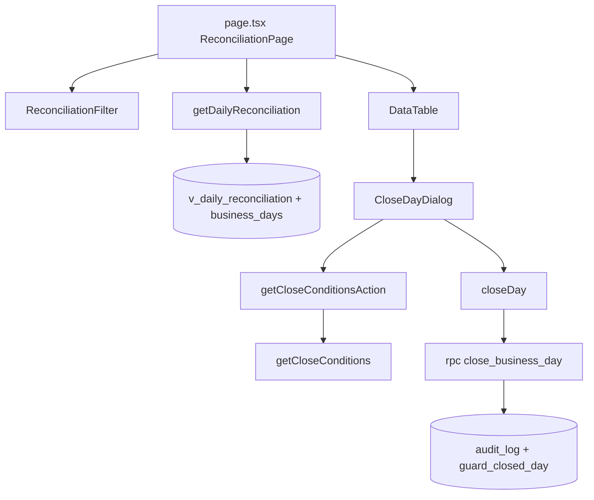

# SCR018_DailyReconciliation — Screen Spec

> Alias LAB-1: **SC-18** · 業務日照合表 · Bảng đối chiếu ngày & chốt sổ

**Screen**: SCR018: DailyReconciliation (Bảng đối chiếu ngày & chốt sổ)
**Feature**: [F006_ReconciliationAndClosing](../../features/F006_ReconciliationAndClosing/screens.md) — tính năng LAB-1 `F06-01` (đối chiếu + chốt sổ ngày nghiệp vụ)
**Type**: composite (bảng + bộ lọc + hộp thoại chốt sổ)
**Route**: `/reconciliation`
**Generated**: 2026-10-06
**Trạng thái**: Đã xây ở LAB-3
**Role**: `reconcile` (xem + chốt sổ)
**User story**: `US-09`
**Ảnh**: [sc18-reconciliation-vi.png](../../design/screenshots/sc18-reconciliation-vi.png) · [sc18-reconciliation-ja.png](../../design/screenshots/sc18-reconciliation-ja.png)

## Purpose

Người `reconcile` (照合事務局, làm việc sau 10:00 JST) xem bảng gom giao dịch + giao hàng + ngoại lệ theo từng ngày nghiệp vụ và **chốt sổ** một ngày đang mở. Đây là màn hình **đọc dữ liệu thuần** — không có ô nhập số liệu nào; mọi con số đến từ view tổng hợp. Sau khi chốt, mọi ghi trực tiếp vào ngày đó bị chặn ở tầng database (`P0009`), độc lập với màn hình này.

## Screen Layout

Trang trong khung `(app)` chung gồm tiêu đề (`PageHeader`), thanh bộ lọc một ô ngày và bảng một dòng = một ngày nghiệp vụ; mỗi dòng còn mở có nút "Chốt sổ" mở `<dialog>` modal. Bố cục một cột `flex-col gap-6` (`app/(app)/reconciliation/page.tsx:92-101`); bộ lọc `flex-wrap` (`reconciliation-filter.tsx:16-20`); hộp thoại `max-w-md` căn giữa theo `<dialog>` gốc (`close-day-dialog.tsx:83`).

### Layout Sketch

```
┌──────────────────────────────────────────────────────┐
│ R1: Header ứng dụng + nav (khung (app))              │
├──────────────────────────────────────────────────────┤
│ R2: PageHeader — tiêu đề + mô tả                     │
├──────────────────────────────────────────────────────┤
│ R3: Bộ lọc [Ngày nghiệp vụ] [Áp dụng] [Xoá lọc]      │
├──────────────────────────────────────────────────────┤
│ R4: DataTable — ngày·trạng thái·số GD·tổng tiền·     │
│     số lần giao·ngoại lệ·chốt lúc·người chốt·[Chốt sổ]│
└──────────────────────────────────────────────────────┘
   ┌─ R5: <dialog> "Xác nhận chốt sổ" (modal) ─┐
   │ điều kiện chưa đạt · cảnh báo · [Huỷ][Xác nhận chốt sổ] │
   └──────────────────────────────────────────┘
```

### Layout Regions

| Region ID | Name | Position | Scrollable | Key Components | Responsive Behavior |
|-----------|------|----------|------------|----------------|---------------------|
| R1 | Header (trên) + nav (sidebar trái `w-64`) | static | no | khung `(app)` — `app/(app)/layout.tsx:19-26`, `app-header.tsx:18`, `app-nav.tsx:22` | always |
| R2 | Tiêu đề | static | no | `PageHeader` | fluid |
| R3 | Bộ lọc ngày | static | no | `ReconciliationFilter` (form GET) | `flex-wrap` |
| R4 | Bảng đối chiếu | static | yes | `DataTable`, `StatusBadge`, `CloseDayDialog` | fluid |
| R5 | Hộp thoại chốt sổ | floating (modal) | no | `<dialog>` + `showModal()` | `w-full max-w-md`; conditional (mở khi bấm "Chốt sổ") |

## Child Routes

Không áp dụng — màn này là một route đơn, không phải khung chứa route con.

## User Flow

> Phạm vi: tương tác trong màn. Điều hướng liên màn xem [screen-flow](../../generated/screen-flow.md).

### Happy Path

1. Trang tải, hiện toàn bộ ngày nghiệp vụ (mới nhất trước), mỗi dòng kèm số liệu tổng hợp.
2. (Tùy chọn) Lọc theo một ngày cụ thể qua form GET → trang tải lại với `?businessDate=...`.
3. Với dòng `status='open'`, bấm "Chốt sổ" → mở `<dialog>`, đồng thời gọi `getCloseConditionsAction` để tải danh sách giao dịch chưa giao xong.
4. Dialog hiện mô tả + danh sách điều kiện chưa đạt (hoặc "Không còn giao dịch nào chưa giao xong." nếu rỗng) + dòng cảnh báo cố định.
5. Bấm "Xác nhận chốt sổ" → gọi RPC `close_business_day`.
6. **Nhánh thành công:** dialog đổi sang banner xanh "Đã chốt sổ...", `revalidatePath` làm bảng nền cập nhật ngay (dòng đó mất nút Chốt sổ, badge chuyển `closed`).
7. **Nhánh thất bại (P0001/P0002/P0005/network):** banner đỏ trong dialog, dialog vẫn mở, người dùng có thể "Huỷ" đóng dialog hoặc thử lại.
8. Bấm "Huỷ" bất kỳ lúc nào trước khi xác nhận → đóng dialog, không gọi RPC chốt.

### Branches

| Decision point | Condition | Outcome on this screen | Source |
|----------------|-----------|------------------------|--------|
| Bước 3 | dòng `status='closed'` | không có nút "Chốt sổ" | `app/(app)/reconciliation/page.tsx:86-87` |
| Bước 4 | danh sách điều kiện chưa đạt rỗng | "Không còn giao dịch nào chưa giao xong." | `app/(app)/reconciliation/close-day-dialog.tsx:99-101` |
| Bước 4 | còn giao dịch chưa giao xong | liệt kê `{trade_code} — còn lại {remaining}`; nút xác nhận **vẫn bật** (ADR-005) | `app/(app)/reconciliation/close-day-dialog.tsx:102-110` |
| Bước 5 | `result.ok` | banner xanh trong dialog; bảng nền cập nhật | `app/(app)/reconciliation/close-day-dialog.tsx:62-65` |
| Bước 5 | `P0001`/`P0002`/`P0005`/khác | banner đỏ `role="alert"` trong dialog, không tự đóng | `app/(app)/reconciliation/close-day-dialog.tsx:66` |
| Bước 5 | Server Action throw | thông báo mạng (`t.networkError`) | `app/(app)/reconciliation/close-day-dialog.tsx:67-69` |

## Data Inventory

> Bảng danh sách: mỗi dòng = một ngày nghiệp vụ. Ô lọc nằm ở `## Validation & Error Feedback`.

| Field | Display Label | Source | Format | Empty Behavior | Cross-ref |
|-------|---------------|--------|--------|----------------|-----------|
| `businessDate` | Ngày nghiệp vụ / 業務日 | `v_daily_reconciliation.business_date` | date `toLocaleDateString()` (`page.tsx:35-38`) | luôn có | business_days |
| `status` | Trạng thái / 状態 | `v_daily_reconciliation.business_day_status` | badge; `open` → tông xanh lá (`positive`), `closed` → trung tính (`page.tsx:40-47`) | luôn có | business_days |
| `tradeCount` | Số giao dịch / 取引件数 | `v_daily_reconciliation.trade_count` | number `toLocaleString()` (`page.tsx:50-54`) | 0 | trades |
| `totalAmount` | Tổng tiền / 合計金額 | `v_daily_reconciliation.total_amount` | number (`page.tsx:56-60`) | 0 | trades |
| `deliveryCount` | Số lần giao / 引渡し回数 | `v_daily_reconciliation.delivery_count` | number (`page.tsx:62-66`) | 0 | deliveries |
| `exceptionCount` | Số ca ngoại lệ / 例外件数 | `v_daily_reconciliation.exception_count` | number (`page.tsx:68-72`) | 0 | deliveries |
| `closedAt` | Chốt lúc / 締め時刻 | `business_days.closed_at` | datetime; "—" nếu `null` (`page.tsx:74-77`) | "—" | business_days |
| `closedBy` | Người chốt / 締め担当者 | `business_days` → `app_users.full_name` | text; "—" nếu `null` hoặc bị RLS chặn (`page.tsx:79-82`) | "—" | app_users |
| `action` | Hành động / 操作 | — | nút "Chốt sổ", **chỉ hiện khi `status='open'`**; dòng `closed` không có nút (`page.tsx:84-88`) | không có nút | — |
| `conditions` | Điều kiện chưa đạt / 未達の条件 | `getCloseConditions`: giao dịch `confirmed` của ngày này có `v_trade_delivery_status.remaining > 0` | danh sách trong hộp thoại, mỗi dòng `{trade_code} — còn lại {remaining}` | "Không còn giao dịch nào chưa giao xong." | v_trade_delivery_status |

### Read Calls *(mục bổ sung)*

| Thao tác | Cách gọi | Tham số | Trả về |
|---|---|---|---|
| Đọc bảng đối chiếu | `select` từ `v_daily_reconciliation` (Server Component, trước render) qua `getDailyReconciliation` — `lib/domain/reconciliation.ts:44-53` | lọc `business_date` nếu có | mảng `DailyReconciliationRow` |
| Đọc tên người chốt | `select` từ `business_days` kèm `app_users(full_name)` qua cùng hàm `getDailyReconciliation` (`reconciliation.ts:59`) | danh sách `business_date` đã đọc ở trên | `closed_at`, `closedByName` (có thể `null` nếu RLS chặn) |
| Tra điều kiện chưa đạt | `select` từ `trades` (`status='confirmed'`) + `v_trade_delivery_status` (`remaining > 0`) qua Server Action `getCloseConditionsAction` → `getCloseConditions` (`reconciliation.ts:99-125`) | `businessDate` | `PendingCondition[]` — chỉ hiển thị, **không** dùng để chặn nút xác nhận |

Đọc bảng + điều kiện dùng `select` thẳng vì chỉ hiển thị.

## UI States

| State | Trigger | Visual Behavior | User Action Available | Source |
|-------|---------|----------------|-----------------------|--------|
| empty | `v_daily_reconciliation` không có dòng nào khớp bộ lọc | "Chưa có ngày nghiệp vụ nào khớp bộ lọc." (`emptyList`) | Xoá lọc | `app/(app)/reconciliation/page.tsx:100` |
| loading (điều kiện) | mở hộp thoại, đang tra điều kiện (`loadingConditions`) | "Đang kiểm tra điều kiện…" trong hộp thoại | Huỷ | `app/(app)/reconciliation/close-day-dialog.tsx:98` |
| saving | đang gọi `closeDay` (`isPending`) | nút "Xác nhận chốt sổ" đổi nhãn "Đang chốt…", `disabled` | none | `app/(app)/reconciliation/close-day-dialog.tsx:129-136` |
| success | `close_business_day` trả `{business_date, closed_at}` | trong hộp thoại: banner xanh `role="status"` "Đã chốt sổ ngày {business_date} lúc {closed_at}."; `revalidatePath("/reconciliation")` → bảng nền cập nhật dòng sang `closed`, mất nút "Chốt sổ" | đóng bằng `Escape` (nhánh thành công không có nút) | `close-day-dialog.tsx:90-93`; `actions.ts:75-77` |
| error (nghiệp vụ) | RPC trả `P0001`/`P0002`/`P0005`/khác | `role="alert"` màu đỏ trong hộp thoại, hộp thoại **không tự đóng** | Huỷ / thử lại | `app/(app)/reconciliation/close-day-dialog.tsx:115-119` |
| error (mạng) | Server Action throw | cùng vị trí như lỗi nghiệp vụ, thông báo riêng (Error Catalogue) | Huỷ / thử lại | `app/(app)/reconciliation/close-day-dialog.tsx:67-69` |
| read-only | dòng có `status='closed'` | không có nút "Chốt sổ" cho dòng đó — các cột số liệu vẫn hiển thị bình thường vì bảng luôn chỉ-đọc | none | `app/(app)/reconciliation/page.tsx:86-87` |

## Validation & Error Feedback

### A) Client-side

Chỉ có bộ lọc; hộp thoại chốt sổ không có ô nhập.

| Field | Type | Required | Constraints | Async Check | Error Message |
|-------|------|----------|-------------|-------------|---------------|
| `businessDate` / 業務日 | `input type="date"` (GET form) | no | không ràng buộc — để trống hiện toàn bộ; mặc định rỗng (`searchParams.businessDate`); query string GET, **không** gửi Server Action | không | không có |

Nguồn: `app/(app)/reconciliation/reconciliation-filter.tsx:21-32`.

### B) Server-side

#### Tra điều kiện chưa đạt
- **Endpoint:** Server Action `getCloseConditionsAction` (`select` `trades` + `v_trade_delivery_status`)
- **Request:** `businessDate`
- **Success:** `{ ok: true, conditions }` → danh sách trong hộp thoại (advisory)
- **Errors:** `P0005` (role ≠ `reconcile`) · `generic`
- **Trigger:** bấm "Chốt sổ" (mở hộp thoại)
- **Source:** `app/(app)/reconciliation/actions.ts:25-39`

#### Chốt sổ
- **Endpoint:** `rpc('close_business_day', { p_date })` gọi từ Server Action `closeDay`
- **Request:** `p_date`
- **Success:** `jsonb {business_date, closed_at, pending_conditions[]}` → banner xanh, `revalidatePath("/reconciliation")`
- **Errors:** `P0001` · `P0002` · `P0005`
- **Trigger:** nút "Xác nhận chốt sổ"
- **Source:** `app/(app)/reconciliation/actions.ts:57-78`; RPC `supabase/migrations/0008_rpc_functions_admin.sql:6-41`

Chốt sổ bắt buộc qua RPC vì đây là thao tác ghi nhạy cảm (đổi `business_days.status`, kích hoạt trigger `guard_closed_day` cho mọi bảng liên quan) — không có policy UPDATE trực tiếp nào trên `business_days` qua RLS thông thường.

#### Error Catalogue *(mục bổ sung)*

| Mã | Điều kiện kích hoạt | Thông báo VI | Thông báo JA | Hiện ở đâu | Chặn gửi? |
|---|---|---|---|---|:---:|
| `P0001` | ngày nghiệp vụ không tồn tại trong `business_days` | Không tìm thấy ngày nghiệp vụ này. | この業務日が見つかりません。 | trong hộp thoại, dưới mô tả | ● |
| `P0002` | ngày đã `status='closed'` từ trước (chốt lần 2) | Ngày nghiệp vụ {business_date} đã được chốt sổ trước đó, không thể chốt lại. | 業務日{business_date}はすでに締め処理済みです。再度締めることはできません。 | trong hộp thoại | ● |
| `P0005` | role ≠ `reconcile` | Chức danh của bạn không được phép chốt sổ. | あなたの職掌では締め処理を実行できません。 | trong hộp thoại | ● |
| `P0003`/`P0004`/`P0006`/`P0009` (gộp vào thông báo chung) | không áp dụng cho `close_business_day` thật, nhưng `CLOSE_ERROR_KEY` trong `close-day-dialog.tsx` vẫn map 3 mã này + `generic` cùng về một thông báo | Có lỗi xảy ra khi chốt sổ, vui lòng thử lại. | 締め処理中にエラーが発生しました。もう一度お試しください。 | trong hộp thoại | ● |
| (network) | `fetch`/Server Action throw | Mất kết nối mạng — không thể chốt sổ. Kiểm tra lại kết nối rồi thử lại. | ネットワーク接続が切断されました — 締め処理を送信できません。接続を確認して再度お試しください。 | trong hộp thoại | ● |

**Then chốt — điểm dễ hiểu sai nhất của màn này:** danh sách "Điều kiện chưa đạt" (Data Inventory, `conditions`) là **cảnh báo, không phải điều kiện chặn**. Nút "Xác nhận chốt sổ" **không bị disable** dù danh sách còn giao dịch chưa giao xong — đây là quyết định nghiệp vụ đã chốt (xem Dependencies and Risks, ADR liên quan): `close_business_day` trả `pending_conditions[]` để cảnh báo nhưng **vẫn cho chốt**, vì giao hàng kéo dài qua ngày nghiệp vụ kế tiếp là bình thường trong thực tế (lịch xe gom hàng). Dòng chữ cố định dưới danh sách xác nhận điều này (`t.delivery.sc18.dialogWarningNote`): "Hệ thống vẫn cho chốt dù còn điều kiện chưa đạt — giao dịch có thể tiếp tục giao hàng ở ngày nghiệp vụ sau (lịch xe gom hàng kéo dài qua ngày là bình thường)." Mô tả đầu hộp thoại: "Sau khi chốt, mọi bản ghi thuộc ngày này trở thành bất biến — không thể sửa trực tiếp."

Sau khi chốt thành công, **không có nhánh lỗi UI riêng** cho việc ghi trực tiếp vào ngày đã chốt (`P0009`) — vì `P0009` xảy ra ở tầng trigger khi có ai ghi/sửa trực tiếp bảng `lots`/`trades`/`deliveries`, không phải một thao tác người dùng thực hiện trên chính màn SCR018.

## Interaction Patterns

- **Bộ lọc là `<form method="GET">` thường — Tab qua ô ngày → nút "Áp dụng" → liên kết "Xoá lọc"; Enter trong ô ngày submit form GET theo hành vi HTML gốc** — source: `app/(app)/reconciliation/reconciliation-filter.tsx:16-41`.
- **Nút "Chốt sổ" mở `<dialog>` gốc HTML (`showModal()`) — trình duyệt tự khoá focus trong dialog và tự xử lý `Escape` để đóng** (không có `onKeyDown` tuỳ chỉnh nào ghi đè) — source: `app/(app)/reconciliation/close-day-dialog.tsx:41-45,83`.
- **"Huỷ" đóng dialog, không gọi RPC chốt** — source: `app/(app)/reconciliation/close-day-dialog.tsx:122-128`.
- Không có `autoFocus` riêng trong dialog; không có `Ctrl+Enter`/phím tắt chốt nhanh. SCR018 không thuộc ba màn keyboard-first bắt buộc.

## Accessibility

| Aspect | Status | Notes |
|--------|--------|-------|
| ARIA roles/labels | partial | banner thành công `role="status"` (`close-day-dialog.tsx:91`), lỗi `role="alert"` (`:116`); ô lọc có `<label htmlFor="businessDate">` (`reconciliation-filter.tsx:22-24`) |
| Keyboard navigation | supported | form GET + `<dialog>` gốc xử lý `Escape`; không phím tắt riêng |
| Focus management | partial | `<dialog>` modal khoá focus do trình duyệt; không `autoFocus`, không trả focus tường minh về nút mở; nhánh thành công không có nút đóng (chỉ `Escape`) — quan sát từ code `:90-93` |
| Screen reader compatibility | unknown | chưa kiểm bằng trình đọc màn hình |

## Conditional Rendering

| Condition | Type | Renders | Hidden | Notes |
|-----------|------|---------|--------|-------|
| `row.status === "open"` | hardcoded-id | nút "Chốt sổ" (`CloseDayDialog`) | — | `page.tsx:86-87`; dòng `closed` không có nút |
| `closedAt` đã có (sau chốt thành công) | hardcoded-id | banner xanh | vùng điều kiện + nút Huỷ/Xác nhận | `close-day-dialog.tsx:90-139` |
| `conditions.length > 0` | hardcoded-id | danh sách điều kiện | thông báo "Không còn giao dịch…" | `close-day-dialog.tsx:99-110`; nút xác nhận **không** bị disable theo điều kiện này |
| `errorMessage` | hardcoded-id | `<p role="alert">` | — | `close-day-dialog.tsx:115-119` |

## Component Variants

Không áp dụng — màn không có component đổi hình dạng theo biến thể; khác biệt theo chức danh/trạng thái đã mô tả ở Conditional Rendering.

## Security Surface

| Guard | Type | Consequence if bypassed |
|-------|------|------------------------|
| `ROUTE_POLICY` `{ prefix: "/reconciliation", roles: ["reconcile"] }` (`lib/auth/route-policy.ts:24`) | role | role khác bị chuyển `/403` bởi `proxy.ts` |
| Server Actions `closeDay`/`getCloseConditionsAction` tự kiểm `user.role !== "reconcile"` → `P0005` (`actions.ts:27,59`) | role | Server Function là POST tới chính route — không dựa vào `proxy.ts` |
| RPC `close_business_day` kiểm `current_app_role()` (`0008_rpc_functions_admin.sql:12-15`) | permission | tầng ba chặn ghi từ role sai |
| Trigger `guard_closed_day` (`0010_closed_day_guard.sql:6`) → `P0009` | permission | sau chốt, ghi trực tiếp `lots`/`trades`/`deliveries` của ngày đó bị chặn ở tầng dữ liệu, độc lập với màn này |

Quyền theo chức danh (9 role, PREMISE C-09): `sys_admin` ✗ · `receiving` ✗ · `trading` ✗ · `reconcile` xem + ghi ("ghi" nghĩa là chốt sổ — không có thao tác sửa số liệu nào khác) · 5 role đề xuất (`party_admin`, `rule_admin`, `ops_admin`, `market_manager`, `internal_audit`) ✗. Cờ `can_approve` **không** áp dụng cho chốt sổ ở bản đã xây (chỉ `reconcile` là đủ); chốt sổ không phải thao tác duyệt maker-checker. Chặn ở cả hai tầng ứng dụng (route + Server Action) cộng tầng RPC.

## Source References

1. Page/View: `app/(app)/reconciliation/page.tsx:23-102`
2. Hộp thoại chốt sổ: `app/(app)/reconciliation/close-day-dialog.tsx:33-144`
3. Bộ lọc: `app/(app)/reconciliation/reconciliation-filter.tsx:14-43`
4. Server Actions: `app/(app)/reconciliation/actions.ts:25-78`
5. Truy vấn miền dữ liệu: `lib/domain/reconciliation.ts:44` (`getDailyReconciliation`), `:99` (`getCloseConditions`), `:140` (`logBlockedWriteAttempt`)
6. Chính sách route: `lib/auth/route-policy.ts:17-27`
7. DB: `supabase/migrations/0006_derived_views.sql:48` (`v_daily_reconciliation`), `0008_rpc_functions_admin.sql:6` (`close_business_day`), `0010_closed_day_guard.sql:6` (`guard_closed_day`)

## Source Walkthrough

1. **File:** `supabase/migrations/0006_derived_views.sql:48-62` — bắt đầu từ view mà bảng đọc: gom `trades` `confirmed` + `deliveries` theo `business_date`.
2. **File:** `lib/domain/reconciliation.ts:44-125` — hai hàm đọc (`getDailyReconciliation`, `getCloseConditions`) tách khỏi UI.
3. **File:** `app/(app)/reconciliation/page.tsx:23-102` — Server Component dựng cột bảng và gắn `CloseDayDialog`.
4. **File:** `app/(app)/reconciliation/close-day-dialog.tsx:33-144` — hộp thoại: mở, tra điều kiện, xác nhận.
5. **File:** `app/(app)/reconciliation/actions.ts:25-78` — Server Actions: kiểm role, gọi RPC, `revalidatePath`.
6. **File:** `supabase/migrations/0008_rpc_functions_admin.sql:6-41` — `close_business_day`: nơi chốt thật và ghi `audit_log`.

Ảnh bản deploy: xem `Ảnh` ở đầu trang. Cross-ref `entities.md` cho `business_days`, `trades`, `deliveries`.

### Call Hierarchy



**Related files:** xem `## Source References` (đã đánh số theo thứ tự đọc).

## Dependencies & Risks *(mục bổ sung)*

- Cần ít nhất một `business_days` đang `status='open'` có giao dịch `confirmed` còn `remaining > 0` để demo danh sách "Điều kiện chưa đạt" có nội dung (seed: ngày `current_date - 1` có giao dịch T1 dở dang).
- **Rủi ro triển khai lớn nhất:** đọc nhầm "Điều kiện chưa đạt" là điều kiện chặn rồi disable nút xác nhận khi danh sách không rỗng — đây là **quyết định nghiệp vụ đã chốt ngược lại**, xem (tài liệu gốc trong repo, không nộp) `adr.md` → **ADR-005 "Chốt sổ cảnh báo chứ không chặn khi còn giao dịch chưa giao xong"**: `US-11` của LAB-1 đọc sát chữ có vẻ đòi chặn ("điều kiện phải đạt"), nhưng phương án "chặn cứng" bị loại vì giao hàng kéo dài qua ngày là bình thường (F05) — chặn cứng thì không ngày nào chốt được, hệ thống tự khoá chính nó. Phương án "chặn nhưng cho ghi đè kèm lý do" cũng bị loại vì tốn thêm luồng duyệt, ngoài ngân sách prototype.
- `closedByName` có thể `null` dù `closed_at` đã có — do RLS `app_users` chỉ cho tự xem mình + `sys_admin` xem toàn bộ; ở quy mô demo (một tài khoản `reconcile` duy nhất) luôn hiển thị đúng, nhưng khi có nhiều tài khoản `reconcile`, người xem không phải người đã chốt có thể thấy "—" thay vì tên thật.
- **Lỗi B-05 — `Tổng tiền` sai khi giao dịch có nhiều lần giao (ĐÃ XÁC NHẬN trên DB thật 2026-10-06):** view `v_daily_reconciliation` (`supabase/migrations/0006_derived_views.sql:48-62`) `LEFT JOIN deliveries` rồi `sum(tr.amount)`, nên tiền giao dịch bị nhân theo số lần giao. Ngày 2026-09-23 view trả `53250.00`, tổng thật `sum(trades.amount where confirmed)` là `38250.00`, lệch +15000 vì `TRD-20260923-0001` có 2 lần giao; ngày 2026-09-24 khớp `69550.00`. Cột `totalAmount` ở Data Inventory vì vậy hiển thị sai ở các ngày đó. Checklist LAB-3 không bắt được vì đối chiếu số với chính view. Câu SQL kiểm: so `v_daily_reconciliation.total_amount` với `sum(amount)` từ `trades` (V-F006-04 ở [F006](../../features/F006_ReconciliationAndClosing/technical-spec.md)). Hướng sửa đề xuất: tính `sum` trên `trades` trước rồi mới join đếm `deliveries`, hoặc dùng subquery. **Trạng thái B-05: chưa sửa; đã có bản vá nháp `supabase/migrations/0042_fix_daily_reconciliation_amount.sql` (trong repo, chưa áp lên database, chưa commit).**
- Sau khi chốt, **không có đường quay lui** ở chính màn này — mọi điều chỉnh sau chốt phải đi qua đường điều chỉnh `[ĐỀ XUẤT]` (`correction_requests`, C8 trong (tài liệu gốc trong repo, không nộp) `architecture.md`) hiện **chưa xây**; SCR018 không có UI nào gợi ý đường này.

### Unresolved Questions *(mục bổ sung)*

- Lỗi B-05 của view nguồn: cần quyết áp bản vá nháp `0042` (hoặc sửa tương đương) trước LAB-5 — màn đang hiển thị `totalAmount` sai ở ngày có giao dịch nhiều lần giao.
- "Điều kiện chưa đạt" dựa trên `v_trade_delivery_status.remaining > 0` nên chịu ảnh hưởng lỗi B-01 (cộng nhầm `returned`/`partial_cancel`) và chưa phản ánh hoàn tất giao hàng ở cấp giao dịch (`trades.delivery_completed_at`, PREMISE G3). Khi đổi view/hoàn tất, cần quyết định "chưa hoàn tất" hay "còn số lượng" mới là điều kiện cảnh báo.
- Chốt sổ có cần cờ `can_approve` hoặc MFA (PREMISE C-04: MFA cho role duyệt nội bộ) khi làm thật không? Bản đã xây chỉ kiểm role `reconcile`.
