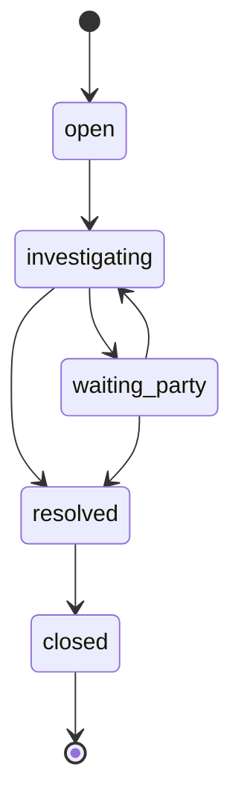

# SCR020_DisputeDetail — Screen Spec

> Alias LAB-1: **SC-20** · 係争詳細 · Chi tiết tranh chấp

**Screen**: SCR020: DisputeDetail (Chi tiết tranh chấp)
**Feature**: [F006_ReconciliationAndClosing](../../features/F006_ReconciliationAndClosing/screens.md) — tính năng LAB-1 `F06-04`
**Type**: composite (chi tiết + form cập nhật + lịch sử append-only)
**Route**: `/disputes/[id]` *(đề xuất)*
**Generated**: 2026-10-06
**Trạng thái**: Thiết kế mới, chưa xây (LAB-4)
**Role**: `reconcile` (xem + ghi) · `receiving` (xem; gộp 配送部門, PREMISE C-10) · `trading` (xem, đề xuất) · `internal_audit` (xem, đề xuất — role đề xuất, chưa có trong `app_role`)
**User story**: `US-18` — LAB-1 gán `SC-17` `SC-19` `SC-20` cho US này. Requirement: `FR-SETTLE-03`.

## Purpose

`reconcile`, trong khung làm việc sau 10:00 JST, xem và cập nhật **một** vụ tranh chấp: nguyên nhân, người xử lý, ngày dự kiến, kết quả cuối, và **lịch sử cập nhật**. LAB-1 liệt kê đúng năm thứ này cho SC-20; `FR-SETTLE-03` nhắc lại ba trong số đó (*"trạng thái, nguyên nhân, 責任者 xử lý, kết quả cuối"*) cộng yêu cầu lịch sử. Tần suất thấp nhưng mỗi lần chạm đều là chạm vào số liệu nhạy cảm.

**Nguyên tắc chi phối toàn màn:** lịch sử cập nhật là **chỉ thêm, không sửa**. Mọi lần đổi trạng thái, đổi người xử lý, dời `due_date` đều sinh **một dòng mới** trong `dispute_events`; không có thao tác nào sửa hay xoá dòng cũ. Cùng nguyên tắc append-only mà `F07` và ADR-004 đặt cho dữ liệu sau chốt — tranh chấp là chứng cứ, và chứng cứ bị ghi đè thì hết là chứng cứ.

## Screen Layout

Trang chi tiết một cột trong khung ứng dụng chung với ba khối: thông tin vụ việc (readonly + ô sửa được), khối cập nhật (nút chuyển trạng thái, ghi chú, chứng cứ) và lịch sử (mới nhất trước). "Đóng vụ" mở hộp thoại xác nhận chặn luồng. Chưa có code nên chưa có breakpoint chốt.

### Layout Sketch

```
┌──────────────────────────────────────────────────────┐
│ R1: Header ứng dụng + nav (static)                │
├──────────────────────────────────────────────────────┤
│ R2: Banner kết quả/lỗi (role=status | alert)         │
├──────────────────────────────────────────────────────┤
│ R3: Thông tin vụ việc (disputes) + badge trạng thái  │
│     - - dòng "Vụ đã đóng — lập vụ mới…" (closed) - - │
├──────────────────────────────────────────────────────┤
│ R4: Khối cập nhật: nguyên nhân · người xử lý · hạn · │
│     kết quả · [Nhận xử lý][Chuyển trạng thái][Lập    │
│     phiếu điều chỉnh → SCR022]                       │
├──────────────────────────────────────────────────────┤
│ R5: Lịch sử dispute_events (mới nhất trước) + chứng cứ│
└──────────────────────────────────────────────────────┘
   ┌─ R6: Hộp thoại "Đóng vụ" — "vụ đã đóng không mở lại được" ─┐
```

### Layout Regions

| Region ID | Name | Position | Scrollable | Key Components | Responsive Behavior |
|-----------|------|----------|------------|----------------|---------------------|
| R1 | Header + nav | static | no | khung `(app)` chung | always |
| R2 | Banner kết quả/lỗi | static | no | `role="status"` / `role="alert"` | always |
| R3 | Thông tin vụ việc | static | no | khối readonly | fluid |
| R4 | Khối cập nhật | static | yes | form, nút chuyển trạng thái | fluid; ẩn khi `closed` hoặc role xem |
| R5 | Lịch sử + chứng cứ | static | yes | bảng `dispute_events`, danh sách tệp | fluid |
| R6 | Hộp thoại "Đóng vụ" | floating (modal) | no | xác nhận một chiều | conditional |

## Child Routes

Không áp dụng — màn này là một route đơn, không phải khung chứa route con.

## User Flow

> Phạm vi: tương tác trong màn. Điều hướng liên màn xem [screen-flow](../../generated/screen-flow.md).

### Happy Path

1. Từ SCR019 bấm một dòng → `/disputes/[id]`.
2. Trang hiện ba khối: thông tin vụ việc, khối cập nhật, lịch sử (mới nhất trước).
3. "Nhận xử lý" → đặt `assignee_id` = người đang đăng nhập, `status: open → investigating`. Sinh **hai** dòng lịch sử (`assignee_changed`, `status_changed`) trong **một** transaction.
4. Thêm ghi chú / chứng cứ bất cứ lúc nào → `note_added` / `evidence_added`, không đổi trạng thái. *(RPC ghi hai event này chưa được đặc tả — xem Unresolved Questions #6.)*
5. Chờ đối tác trả lời → `investigating → waiting_party`. Có trả lời → quay lại `investigating`.
6. **Nhánh dời hạn:** đổi `due_date` bắt buộc kèm lý do; nếu ngày chọn là 休市日 → `P0057`, không ghi.
7. **Chốt kết quả:** chọn `resolution_type` + gõ `resolution_note` → "Ghi nhận kết quả" → `resolved`. Thiếu một trong hai → `P0056`.
8. **Nhánh quan trọng nhất:** nếu kết quả **làm đổi số liệu của một 業務日 đã chốt** thì màn này **không sửa số**. Nó hiện nút "Lập phiếu điều chỉnh" sang [SCR022](../SCR022_CorrectionRequestCreate/spec.md) (`F07`, kèm ngữ cảnh `dispute_id`/`trade_id`), và mã phiếu quay lại gắn vào `correction_request_ref`. `BR-CLOSE-01` cấm sửa trực tiếp sau lock — tranh chấp không phải ngoại lệ.
9. Xong việc → "Đóng vụ" (có hộp thoại) → `closed`, màn chuyển chỉ đọc.

### Branches

| Decision point | Condition | Outcome on this screen | Source |
|----------------|-----------|------------------------|--------|
| Bước 6 | `due_date` rơi vào 休市日 | `P0057`, không ghi | thiết kế LAB-4 |
| Bước 7 | thiếu `resolution_type` hoặc `resolution_note` | `P0056` | thiết kế LAB-4 |
| Bước 3–9 | chuyển tiếp ngoài 6 đường hợp lệ | `P0055` | thiết kế LAB-4 |
| Bước 8 | kết quả làm đổi số liệu ngày đã chốt | hiện nút "Lập phiếu điều chỉnh" → SCR022; không sửa số tại đây | thiết kế LAB-4 |
| Bước 9 | `status = closed` | chỉ đọc, hiện "Vụ đã đóng — lập vụ mới nếu có tình tiết mới." | thiết kế LAB-4 |

### State Machine (mục bổ sung)

Chỉ 6 chuyển tiếp này hợp lệ, mọi chuyển tiếp khác trả `P0055`:



**Không có đường quay lại từ `closed`.** Vụ đã đóng mà phát sinh tình tiết mới thì lập vụ mới trỏ về vụ cũ (`disputes.supersedes_id`), giữ append-only.

## Data Inventory

> Chỉ field chỉ đọc; ô sửa được nằm ở `## Validation & Error Feedback`.

### Khối thông tin vụ việc — `disputes`

| Field | Display Label | Source | Format | Empty Behavior | Cross-ref |
|-------|---------------|--------|--------|----------------|-----------|
| `dispute_code` | Mã tranh chấp / 係争番号 | `disputes.dispute_code` | text, **khoá sau khi tạo** | luôn có | disputes *(mới, đề xuất)* |
| `trade_code` | Giao dịch / 取引番号 | `disputes.trade_id` → `trades(trade_code)` | link; phải tồn tại trong `trades.trade_code`; **khoá sau khi tạo** — gắn nhầm giao dịch thì đóng vụ và lập vụ mới, không sửa | luôn có | trades |
| `business_date` | 業務日 | `disputes.business_date` | date; = `業務日` của giao dịch gốc; **khoá** | luôn có | disputes |
| `counterparty` | Người tham gia / 参加者 | `disputes.participant_id` → `participants(code, name)` | `{tên} ({mã})` | luôn có | participants |
| `status` | Trạng thái / 状態 | `disputes.status` | badge ∈ `open` `investigating` `waiting_party` `resolved` `closed`; **đổi bằng nút chuyển trạng thái, không bằng select** | `open` | disputes |
| `correction_request_ref` | Phiếu điều chỉnh liên quan / 関連修正申請 | `disputes.correction_request_id` → [SCR024](../SCR024_RequestDetailApproval/spec.md) | link tới chi tiết phiếu `F07` (SCR024) nếu kết quả làm đổi số liệu đã chốt | "—" | correction_requests |
| `days_overdue` / `is_overdue` | Số ngày quá hạn / Quá hạn / 超過日数 / 期限超過 | `v_disputes_overdue` | **cùng công thức với SCR019** (Data Inventory, `days_overdue`/`is_overdue`), đọc từ cùng một view | — | v_disputes_overdue |

### Khối lịch sử cập nhật — `dispute_events`, chỉ thêm

| Field | Display Label | Source | Format | Empty Behavior | Cross-ref |
|-------|---------------|--------|--------|----------------|-----------|
| `event_type` | Loại cập nhật / 更新種別 | `dispute_events.event_type` | badge ∈ `created` `status_changed` `assignee_changed` `due_date_changed` `note_added` `evidence_added` `resolved` `closed` | luôn có | dispute_events |
| `from_value` / `to_value` | Giá trị cũ / mới / 変更前 / 変更後 | `dispute_events.from_value`, `to_value` | text; rỗng với `note_added`, `evidence_added` | "—" | dispute_events |
| `note` | Ghi chú / メモ | `dispute_events.note` | text; bắt buộc với `due_date_changed` (≥ 10 ký tự) | — | dispute_events |
| `actor` | Người thao tác / 実行者 | `dispute_events.actor_id` | tra `app_users.full_name` bằng **truy vấn thứ hai**, không embed — `dispute_events` có thể có 2 FK tới `app_users` (`actor_id`, `assignee`), tên ràng buộc auto-sinh không chắc khớp hint embed (cùng vết đã gặp ở SCR004) | — | app_users |
| `occurred_at` | Thời điểm / 日時 | `dispute_events.occurred_at` | datetime JST, **server đặt**, không nhận từ client | luôn có | dispute_events |
| `evidence` | Chứng cứ / 証憑 | `dispute_evidence` | danh sách tệp ảnh/PDF; lưu **3 năm**, sau đó cold archive restore ≤ 2 ngày làm việc (`TBL-ATTACH-01`) | rỗng | dispute_evidence |

### Read Calls *(mục bổ sung)*

| Thao tác | Cách gọi | Tham số | Trả về |
|---|---|---|---|
| Đọc chi tiết vụ | `select` từ `v_disputes_overdue` lọc `id` | `id` (từ URL) | `DisputeRow` hoặc `null` → `notFound()` |
| Đọc lịch sử | `select` từ `dispute_events` lọc `dispute_id`, rồi `select` **thứ hai** từ `app_users` tra tên người thao tác | `dispute_id` | mảng, mới nhất trước |
| Đọc chứng cứ | `select` từ `dispute_evidence` | `dispute_id` | mảng `{file_path, uploaded_at}` |

## UI States

| State | Trigger | Visual Behavior | User Action Available | Source |
|-------|---------|----------------|-----------------------|--------|
| empty | vụ mới tạo, chưa có cập nhật nào ngoài `created` | lịch sử hiện đúng một dòng `created`; **không hiện "chưa có lịch sử"** — vụ nào cũng có ít nhất một dòng | cập nhật | thiết kế LAB-4 |
| loading / saving | sau khi bấm nút chuyển trạng thái / lưu | nút `disabled`, không đổi nhãn (cùng quy ước SCR004) | none | thiết kế LAB-4 |
| success | RPC trả về | banner xanh `role="status"` nêu rõ **thao tác vừa làm**; lịch sử thêm một dòng **trên cùng**; `revalidatePath` làm mới khối thông tin | dismiss | thiết kế LAB-4 |
| error (nghiệp vụ) | `P0055`/`P0056`/`P0057`/`P0005` | banner đỏ **tự nhận focus**; **mọi giá trị đã gõ giữ nguyên**, sửa và gửi lại ngay được | sửa | thiết kế LAB-4 |
| error (mạng) | mất kết nối lúc lưu | banner + nút thử lại; **nội dung textarea giữ nguyên** — ô người dùng gõ lâu nhất trên màn, mất nó là mất nhiều phút công | thử lại | thiết kế LAB-4 |
| read-only | `status = closed`, hoặc role ∈ `receiving` `trading` `internal_audit` | mọi ô readonly, ẩn hẳn nút chuyển trạng thái, hiện dòng "Vụ đã đóng — lập vụ mới nếu có tình tiết mới." | xem | thiết kế LAB-4 |

## Validation & Error Feedback

### A) Client-side

| Field | Type | Required | Constraints | Async Check | Error Message |
|-------|------|----------|-------------|-------------|---------------|
| `cause_category` / 原因区分 | select, 6 lựa chọn | yes | ∈ `short_delivery` `over_delivery` `return` `partial_cancel` `price` `other` — 4 giá trị đầu khớp 4 loại ngoại lệ của `US-18`; mặc định lấy từ ngoại lệ giao hàng sinh ra vụ này | không | xem Error Catalogue |
| `cause_detail` / 原因 | textarea | yes | **10–2000 ký tự**; `other` ⇒ tối thiểu 30 ký tự *(đề xuất)* | không | xem Error Catalogue |
| `assignee_id` / 担当者 | select người dùng | yes khi `status ≠ open` | phải tồn tại trong `app_users`, `role = 'reconcile'`, `status = 'active'` | đọc `app_users` | xem Error Catalogue |
| `due_date` / 処理予定日 | date | yes | `≥ business_date`; phải là **業務日 có sinh** (không rơi vào 休市日 — SCR021); dời được, mỗi lần dời sinh một dòng lịch sử kèm lý do; mặc định `business_date + 3 業務日` *(đề xuất — khách chưa cho SLA)* | không (`P0057` ở server) | xem Error Catalogue |
| lý do dời hạn (`dispute_events.note`) / メモ | textarea | yes khi dời `due_date` | ≥ 10 ký tự | không | xem Error Catalogue |
| `amount_in_dispute` / 係争金額 | number | no | `≥ 0`, số nguyên JPY (không phần thập phân — cùng quy ước `BR-INC-01`) | không | xem Error Catalogue |
| `quantity_in_dispute` / 係争数量 | number | no | `> 0` khi có; `≤ trades.quantity` của giao dịch gốc | không | xem Error Catalogue |
| `resolution_type` / 解決区分 | select, 5 lựa chọn | yes khi chuyển sang `resolved` | ∈ `accept_our_figure` `accept_their_figure` `split` `no_fault` `escalated_offline` *(đề xuất)* | không | `P0056` |
| `resolution_note` / 最終結果 | textarea | yes khi chuyển sang `resolved` | **20–2000 ký tự** — là chứng cứ kiểm toán, không nhận câu một chữ | không | `P0056` |

### B) Server-side

Mọi đường ghi qua RPC `SECURITY DEFINER`; `disputes` và `dispute_events` **không có policy ghi** (ADR-002). Ba bất biến nằm trong thân RPC, không ở client: **máy trạng thái 6 chuyển tiếp**, **có kết quả mới cho `resolved`**, và **`dispute_events` ghi cùng transaction với thay đổi nó mô tả**. Bất biến thứ ba là lý do mọi thao tác đều là RPC chứ không phải `UPDATE` thẳng: một `UPDATE` thành công kèm một `INSERT` log thất bại tạo ra lịch sử nói dối, và lịch sử nói dối tệ hơn không có lịch sử.

#### Cập nhật nội dung (nguyên nhân, số tiền, số lượng)
- **Endpoint:** `rpc('update_dispute')` *(đề xuất)*
- **Request:** `p_dispute_id, p_payload`
- **Success:** `jsonb { dispute_id }` → banner xanh
- **Errors:** `P0005` · `V-02` (server kiểm lại độ dài `cause_detail`; ràng buộc số lượng/số tiền xem Unresolved Questions #7)
- **Trigger:** nút lưu
- **Source:** chưa có code — màn chỉ đặc tả ở LAB-4

#### Đổi người xử lý
- **Endpoint:** `rpc('assign_dispute')` *(đề xuất)*
- **Request:** `p_dispute_id, p_assignee_id`
- **Success:** `jsonb { assignee_id }`
- **Errors:** `P0005` (sai chức danh người gọi) · mã cho người được giao không hợp lệ — **chưa có**, xem Unresolved Questions #8
- **Trigger:** "Nhận xử lý" / chọn người xử lý
- **Source:** chưa có code — màn chỉ đặc tả ở LAB-4

#### Dời ngày dự kiến
- **Endpoint:** `rpc('reschedule_dispute')` *(đề xuất)*
- **Request:** `p_dispute_id, p_due_date, p_note`
- **Success:** `jsonb { due_date }`
- **Errors:** `P0057` · `V-04` · `V-05`
- **Trigger:** nút lưu ngày dự kiến
- **Source:** chưa có code — màn chỉ đặc tả ở LAB-4

#### Chuyển trạng thái
- **Endpoint:** `rpc('transition_dispute')` *(đề xuất)*
- **Request:** `p_dispute_id, p_to_status, p_resolution_type?, p_resolution_note?`
- **Success:** `jsonb { status }`
- **Errors:** `P0055` · `P0056`
- **Trigger:** nút chuyển trạng thái / "Ghi nhận kết quả" / "Đóng vụ"
- **Source:** chưa có code — màn chỉ đặc tả ở LAB-4

#### Error Catalogue *(mục bổ sung)*

| Mã | Điều kiện kích hoạt | Thông báo VI | Thông báo JA | Hiện ở đâu | Chặn gửi? |
|---|---|---|---|---|:---:|
| `V-01` | ô bắt buộc để trống | Mục này bắt buộc. | 必須項目です。 | dưới ô | ● |
| `V-02` | `cause_detail` < 10 ký tự (hoặc < 30 khi `other`) | Nguyên nhân phải từ {min} ký tự. | 原因は{min}文字以上で入力してください。 | dưới ô | ● |
| `V-03` | `resolution_note` < 20 ký tự | Kết quả cuối phải từ 20 ký tự. | 最終結果は20文字以上で入力してください。 | dưới ô | ● |
| `V-04` | dời `due_date` mà `note` < 10 ký tự | Dời ngày dự kiến phải nêu lý do từ 10 ký tự. | 処理予定日の変更には10文字以上の理由が必要です。 | dưới ô | ● |
| `V-05` | `due_date < business_date` | Ngày dự kiến không được trước 業務日 của giao dịch. | 処理予定日は取引の業務日より前にできません。 | dưới ô | ● |
| `P0055` *(mới, đề xuất)* | chuyển trạng thái không thuộc 6 chuyển tiếp hợp lệ | Không chuyển từ「{from}」sang「{to}」được. | 「{from}」から「{to}」へは遷移できません。 | banner đầu trang | ● |
| `P0056` *(mới, đề xuất)* | chuyển sang `resolved` mà thiếu `resolution_type` hoặc `resolution_note` | Phải ghi loại kết quả và kết quả cuối trước khi đóng vụ. | 解決にするには解決区分と最終結果の記入が必要です。 | banner đầu trang | ● |
| `P0057` | `due_date` rơi vào 休市日 (không sinh 業務日) | Ngày {due_date} là 休市日 của chợ, không phải 業務日. | {due_date}は休市日のため業務日ではありません。 | dưới ô `due_date` | ● |
| `P0005` | role ≠ `reconcile` — bắt ở Server Action **trước** khi chạm RPC, và RPC tự kiểm lần nữa | Chức danh của bạn không được phép cập nhật tranh chấp. | あなたの職掌では係争を更新できません。 | banner đầu trang | ● |
| `P0001` | `id` trong URL không tồn tại trong `disputes` | — (không dùng banner) | — | `notFound()` → trang 404 | ● |

Rẽ nhánh theo `error.code`; thông báo dựng từ `error.details` (`from`, `to`, `min`, `due_date`) — không so khớp chuỗi `message`. `P0057` dùng chung với `SCR021` vì **cùng một ràng buộc lịch**, không nhân bản mã mới (DRY).

## Interaction Patterns

- **Không có yêu cầu bàn phím riêng** — không thuộc ba màn keyboard-first (SCR007, SCR010, SCR014) — thiết kế LAB-4.
- **"Đóng vụ" (`resolved → closed`) có hộp thoại xác nhận chặn luồng, nêu rõ "vụ đã đóng không mở lại được"** — vì đây là chuyển tiếp **một chiều duy nhất** của máy trạng thái; thiết kế LAB-4.
- **"Nhận xử lý" sinh hai dòng lịch sử trong một transaction** — thiết kế LAB-4.

## Accessibility

| Aspect | Status | Notes |
|--------|--------|-------|
| ARIA roles/labels | partial (đặc tả) | banner thành công `role="status"`; lỗi tự nhận focus |
| Keyboard navigation | supported (đặc tả) | input gốc; hộp thoại đóng vụ cần `Escape` (đề xuất) |
| Focus management | managed (đặc tả) | banner lỗi tự nhận focus; giữ nguyên giá trị đã gõ |
| Screen reader compatibility | unknown | chưa có bản dựng để kiểm |

## Conditional Rendering

| Condition | Type | Renders | Hidden | Notes |
|-----------|------|---------|--------|-------|
| role = `reconcile` và `status ≠ closed` | auth | khối cập nhật + nút chuyển trạng thái | — | bypass: RPC `P0005` |
| role ∈ `receiving` `trading` `internal_audit` | auth | chỉ đọc | nút chuyển trạng thái | |
| `status = closed` | hardcoded-id | "Vụ đã đóng — lập vụ mới nếu có tình tiết mới." | nút chuyển trạng thái | không có đường quay lại |
| kết quả làm đổi số liệu ngày đã chốt | hardcoded-id | nút "Lập phiếu điều chỉnh" → SCR022 | — | `BR-CLOSE-01` |
| `status` chuẩn bị `resolved` | hardcoded-id | `resolution_type` + `resolution_note` bắt buộc | — | `P0056` |

## Component Variants

Không áp dụng — màn không có component đổi hình dạng theo biến thể; khác biệt theo chức danh/trạng thái đã mô tả ở Conditional Rendering.

## Security Surface

| Guard | Type | Consequence if bypassed |
|-------|------|------------------------|
| route `/disputes` (prefix khớp cả `/disputes/[id]`) theo `ROUTE_POLICY` *(đề xuất)* | role | role ngoài danh sách mở được màn |
| RLS trên `disputes` và `dispute_events` | permission | đọc ngoài chức danh |
| mỗi RPC tự kiểm `current_app_role() = 'reconcile'` ở dòng đầu → `P0005` | permission | tầng ba độc lập; lý do giữ ba tầng giống SCR004: Server Action là POST tới chính route chứa nó, một lần refactor matcher có thể âm thầm mất lớp proxy; `[UNVERIFIED]` — RPC chưa tồn tại |

Quyền theo chức danh: Quyền theo chức danh (đủ 9 role, PREMISE C-09; cùng nhóm với SCR019):

| Role | Quyền | Ghi chú |
|---|:---:|---|
| `reconcile` | xem + ghi | chức danh duy nhất cập nhật được |
| `receiving` | xem | gánh cả 配送部門 (C-10); nguồn ngoại lệ giao hàng |
| `trading` | xem | vụ liên quan giao dịch của mình *(đề xuất, như SCR019)* |
| `internal_audit` | xem | *(đề xuất)* chỉ đọc, như SCR019 |
| `sys_admin` `party_admin` `rule_admin` `ops_admin` `market_manager` | ✗ | |

Cờ `can_approve` chỉ liên quan nếu Q4 chốt "đóng vụ cần người khác duyệt".

## Source References

Chưa có code — màn chỉ đặc tả ở LAB-4. Tài liệu nguồn đã đọc:

1. (tài liệu gốc trong repo, không nộp) `sc-20-chi-tiet-tranh-chap.md` — spec 10 mục gốc
2. `lib/auth/route-policy.ts:17-27` — `ROUTE_POLICY` hiện có (chưa có `/disputes`)
3. (tài liệu gốc trong repo, không nộp) `adr.md` — ADR-002 (không policy ghi), ADR-004 (bất biến ở tầng DB)

## Source Walkthrough

Chưa có code — màn chỉ đặc tả ở LAB-4.

### Call Hierarchy

```text
(thiết kế) /disputes/[id] page -> v_disputes_overdue + dispute_events + dispute_evidence (đọc)
   -> Server Action -> rpc update_dispute | assign_dispute | reschedule_dispute | transition_dispute
```

## Dependencies & Risks *(mục bổ sung)*

- **Cần trước:** `SCR019` để điều hướng vào (không có đường nhập `id` trực tiếp từ UI nào khác). `SCR021` cho phép kiểm `due_date` là 業務日 thật. `SCR022` (tạo phiếu) và `SCR024` (xem phiếu, `F07`) cho nhánh bước 8.
- **Suy luận có đánh dấu:** LAB-1 cho SCR020 đúng một dòng (*"nguyên nhân, người xử lý, ngày dự kiến, kết quả cuối, lịch sử cập nhật"*) — năm thứ đó là **bắt buộc theo khách**. Máy trạng thái 5 trạng thái/6 chuyển tiếp, `resolution_type` 5 giá trị, ngưỡng độ dài ô chữ, và bảng `dispute_events` 8 `event_type` đều là **đề xuất của tài liệu này**.
- **Dễ hiểu sai #1:** kết quả tranh chấp **không tự sửa số liệu**. Màn này ghi *kết luận*; việc đổi số đi qua `F07` và sinh bản ghi mới. Triển khai nhầm thành `UPDATE trades` là vi phạm `BR-CLOSE-01` và trigger `guard_closed_day` sẽ chặn bằng `P0009` — nhưng chỉ khi ngày đã chốt. **Ngày chưa chốt thì không có gì chặn**, và đó mới là chỗ nguy hiểm.
- **Dễ hiểu sai #2:** `closed` là một chiều. Không có nút nào mở lại, kể cả cho `sys_admin`.
- **Dễ hiểu sai #3:** `dispute_events` phải ghi **trong cùng transaction** với thay đổi. Gọi tách hai lần từ Server Action là lặp lại đúng vết `log_blocked_write_attempt` ở `architecture.md` — nhưng ngược dấu: ở đó log phải ra **ngoài** transaction đã rollback, ở đây log phải ở **trong** transaction thành công. Đọc nhầm sang nhau là hỏng cả hai.
- **Rủi ro lưu trữ:** chứng cứ ảnh giữ 3 năm rồi vào cold archive với thời gian restore **tối đa 2 ngày làm việc**. Một vụ tranh chấp mở lại sau 3 năm (dạng vụ mới trỏ vụ cũ) sẽ không xem được chứng cứ ngay — cần nói trước với người dùng, không để họ phát hiện lúc cần gấp.

### Unresolved Questions *(mục bổ sung)*

1. **Tranh chấp có SLA bao nhiêu ngày?** Giá trị mặc định `+3 業務日` ở `due_date` là **đề xuất**, không có căn cứ từ khách. `RPT-09` nhắc "SLA xử lý" nhưng không cho số.
2. **Năm trạng thái có đúng nghiệp vụ không?** `waiting_party` suy từ thực tế phải chờ đối tác trả lời; khách chưa liệt kê trạng thái nào. Nếu khách chỉ cần `open`/`closed` thì máy trạng thái thu về một chuyển tiếp và `P0055` gần như không dùng tới.
3. **Kết quả tranh chấp có bắt buộc gắn phiếu `F07` không?** Hiện để **tuỳ chọn** (`correction_request_ref` rỗng được) vì không phải vụ nào cũng đổi số. Nếu khách muốn mọi vụ `accept_their_figure` đều phải có phiếu thì đó là một ràng buộc mới cần mã lỗi riêng.
4. **Ai được đóng vụ — người xử lý hay cấp trên?** `F07` đặt nguyên tắc maker ≠ checker cho điều chỉnh; tranh chấp có cần nguyên tắc đó không thì khách chưa nói. Hiện cho phép người xử lý tự đóng. Nếu khách muốn có nguyên tắc đó thì dùng đúng cơ chế đã chốt: cờ `can_approve` quyết ai được đóng và `P0013` (maker ≠ checker), không cấp mã mới.
5. **Chứng cứ tải lên ở màn này hay chỉ ở `SCR017`?** Data Inventory `evidence` giả định cả hai. Nếu chỉ `SCR017` thì bỏ `evidence_added` khỏi danh sách `event_type`.
6. **Ghi chú / chứng cứ ghi bằng gì?** Chỉ có bốn RPC ở mục Server-side; `note_added` và `evidence_added` chưa có đường ghi, trái nguyên tắc "mọi đường ghi qua RPC". Cần thêm `add_dispute_note` và `add_dispute_evidence` *(đề xuất)*, cùng ràng buộc ô nhập (ghi chú 1–2000 ký tự, tệp ảnh/PDF, giới hạn dung lượng — chưa có số từ khách) và mã lỗi tệp. Cũng chưa có RPC lập vụ mới trỏ `supersedes_id`.
7. **Ràng buộc số lượng/số tiền bắt ở đâu?** `quantity_in_dispute ≤ trades.quantity` và `amount_in_dispute ≥ 0` hiện chỉ nằm ở client; `V-02`/`V-05` cũng cần server kiểm lại. Chưa có mã `V-xx`/`Pxxxx` cho hai ràng buộc số — cần quyết dùng mã nào (không tự cấp mã ở đây).
8. **Mã lỗi cho người được giao không hợp lệ.** `assignee_id` phải là `reconcile` + `active`, nhưng `P0005` là *sai chức danh người gọi* nên không dùng cho người được giao. Cần một mã riêng *(đề xuất, chưa cấp)* hoặc một `V-xx` — chờ sổ đăng ký mã lỗi.
9. **`internal_audit` có được xem vụ tranh chấp không?** Đang để xem (chỉ đọc) là *đề xuất*; cần khách xác nhận (cùng câu SCR019 #4).
10. **SCR022 chưa nhận ngữ cảnh tranh chấp.** Nút "Lập phiếu điều chỉnh" mở [SCR022](../SCR022_CorrectionRequestCreate/spec.md) kèm `dispute_id`/`trade_id`, nhưng spec SCR022 hiện không có tham số nguồn `dispute_id` và không có RPC nào ghi `correction_request_id` ngược vào `disputes` (field `correction_request_ref`). Cần bổ sung ở SCR022 (tham số URL, điền sẵn bản ghi đích) và một đường ghi liên kết *(đề xuất)* — chưa quyết.
