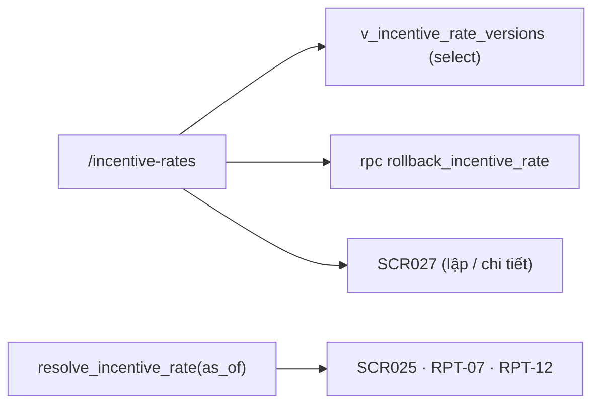

# SCR026_RateVersionList — Screen Spec

> Alias LAB-1: **SC-26** · 料率バージョン一覧 · Danh sách phiên bản tỷ lệ

**Screen**: SCR026_RateVersionList: Danh sách phiên bản tỷ lệ (料率バージョン一覧)
**Feature**: F008_IncentiveAndRateVersion (tính năng con `F08-03` `F08-05`; user story `US-19`)
**Type**: atomic
**Route**: `/incentive-rates`
**Generated**: 2026-10-06
**Trạng thái**: thiết kế mới, chưa xây — **Chưa có code — màn chỉ đặc tả ở LAB-4**
**Liên kết**: [F008](../../features/F008_IncentiveAndRateVersion/business-context.md) · ADR-002 · ADR-007 (thư mục `decisions/`) · màn kề: [SCR027](../SCR027_RateVersionApproval/spec.md) · [SCR025](../SCR025_IncentiveResult/spec.md) · [SCR037](../SCR037_MarketManagement/spec.md)

## Purpose

Dòng thời gian **toàn bộ các phiên bản 料率** của 完納奨励金: bản nào đã qua, bản nào đang hiệu lực, bản nào đã duyệt nhưng chưa tới `発効日`, bản nào còn là nháp. Từ đây lập bản mới (`F08-03`) và quay lui về bản cũ (`F08-05`).

Người dùng: quản trị quy chế (`rule_admin` (đề xuất)) lập và quay lui; bộ phận đối chiếu (`reconcile`) chỉ xem, để giải thích vì sao số của một kỳ ra như vậy. Giờ hành chính, **tần suất rất thấp** — `GOV-RULE-01` giới hạn **tối đa 4 lần đổi mỗi năm**.

**Vì sao là một danh sách phiên bản, không phải một ô cấu hình.** `FR-INC-03`: in lại báo cáo kỳ cũ phải ra **đúng con số cũ**. Một ô 料率 ghi đè được sẽ viết lại quá khứ ngay lần sửa đầu tiên. Đây cũng chính là lập luận của **ADR-007**, áp cho cùng một khuôn phiên bản.

**Quan hệ với [SCR037](../SCR037_MarketManagement/spec.md) (SC-N2).** Hai màn dùng **chung một khuôn phiên bản**: cùng vòng đời trạng thái, cùng ba bất biến (trần 4 lần/năm · maker ≠ checker · `発効日` tương lai), cùng kiểu quay lui bằng cách tạo bản mới. Khác ở **phạm vi và lược đồ nội dung**: 料率 ở đây là quy tắc **quốc gia** (một dòng thời gian duy nhất), còn `market_rules` là quy tắc **của từng chợ**. Xem Unresolved Questions câu 1.

## Screen Layout

*(Suy luận từ bảng field của đặc tả — chưa có wireframe cho màn này.)* Một trang danh sách một cột: banner lỗi/thành công ở đầu, thanh bộ lọc (trạng thái, năm hiệu lực) kèm nút "Lập bản mới", rồi bảng dòng thời gian phiên bản (mới nhất trên cùng) có cột `年内変更回数`. "Quay lui" mở hộp thoại nổi trên bảng.

### Layout Sketch

```
┌──────────────────────────────────────────────────────────┐
│ R1: Banner (static) — lỗi nghiệp vụ / thành công         │
├──────────────────────────────────────────────────────────┤
│ R2: Bộ lọc + [Lập bản mới]  (static)                     │
├──────────────────────────────────────────────────────────┤
│ R3: Bảng phiên bản, mới nhất trên cùng (scrollable)      │
│   v · 交付率 · 発効日 · Trạng thái · 起案者 · 承認者 ·   │
│   承認日時 · 旧版 · 変更理由 · 年内変更回数 · [Quay lui] │
│     ┌ - - - - - - - - - - - - - - - - - - - - - - ┐      │
│     │ R4: Hộp thoại quay lui (modal, có điều kiện)│      │
│     └ - - - - - - - - - - - - - - - - - - - - - - ┘      │
└──────────────────────────────────────────────────────────┘
```

### Layout Regions

| Region ID | Name | Position | Scrollable | Key Components | Responsive Behavior |
|-----------|------|----------|------------|----------------|---------------------|
| R1 | Banner | static | no | banner lỗi/thành công, tự nhận focus khi lỗi | always |
| R2 | Bộ lọc + hành động | static | no | `filter.status`, `filter.year`, nút "Lập bản mới" (chỉ `rule_admin`) | chưa xác định |
| R3 | Bảng phiên bản | static | yes | 10 cột #3–#12, badge `display_state`, nút "Quay lui" mỗi dòng | chưa xác định |
| R4 | Hộp thoại quay lui | modal (có điều kiện) | no | chọn `発効日` tương lai, nhập `変更理由`, xác nhận | chưa xác định |

## Child Routes

Không áp dụng — màn không phải shell có route con. (Đi sang [SCR027](../SCR027_RateVersionApproval/spec.md): `/incentive-rates/new`, `/incentive-rates/[version_id]`.)

## User Flow

> **Scope:** within-screen interactions. Điều hướng liên màn xem `generated/screen-flow.md`.

### Happy Path

1. `rule_admin` mở `/incentive-rates` → R3 hiện dòng thời gian phiên bản, mới nhất trên cùng, kèm `年内変更回数` của năm đang lọc.
2. "Lập bản mới" (R2) → sang [SCR027](../SCR027_RateVersionApproval/spec.md) ở chế độ lập, form **sao 交付率 và các tham số từ bản đang hiệu lực**, `effective_from` để trống.
3. Bấm một dòng → sang [SCR027](../SCR027_RateVersionApproval/spec.md) chỉ đọc: đủ 起案者 / 承認者 / 発効日 / 変更理由.
4. "Quay lui" trên một bản `superseded` → R4: chọn `発効日` **tương lai** + nhập `変更理由` → xác nhận.
5. Hệ thống **tạo một bản mới sao nội dung bản cũ**, không hồi sinh dòng cũ. Giữ append-only, truy vết được — `GOV-RULE-01` đòi rollback *truy vết được*, không đòi khôi phục tại chỗ.
6. Bản quay lui vẫn **phải qua [SCR027](../SCR027_RateVersionApproval/spec.md) để duyệt** — người lập khác người duyệt, không có đường tắt.
7. Mọi màn nghiệp vụ ([SCR025](../SCR025_IncentiveResult/spec.md), báo cáo `RPT-07`/`RPT-12`) tra 料率 bằng `resolve_incentive_rate(as_of)` với `as_of` là **ngày nghiệp vụ**.

### Branches

| Decision point | Condition | Outcome on this screen | Source |
|----------------|-----------|------------------------|--------|
| Bước 5 | đã đủ 4 bản `approved` trong năm | `P0030`, không tạo bản quay lui | (tài liệu gốc trong repo, không nộp) `sc-26-danh-sach-phien-ban-ty-le.md` §7 |
| Bước 2 | đã có bản `draft`/`pending` | `V-01`, chặn "Lập bản mới" | cùng file §4 |
| Bước 4 | dòng không phải `superseded` | `V-02`, nút "Quay lui" bị vô hiệu | cùng file §4 |

## Data Inventory

> Field nhập (bộ lọc, hộp thoại quay lui) ở `## Validation & Error Feedback`. Dưới đây là cột hiển thị. Mỗi dòng bảng là **một phiên bản**. Bảng nguồn: **chưa có** trong migration (`supabase/migrations/` chưa có `incentive_rate_versions`) — thiết kế mới.

| Field | Display Label | Source | Format | Empty Behavior | Cross-ref |
|-------|---------------|--------|--------|----------------|-----------|
| `version` | Phiên bản / 版 | `incentive_rate_versions.version` | số nguyên tăng dần, **server cấp**; client không gửi | — | `entities.md` (đề xuất) |
| `grant_rate` | 交付率 / 交付率 | `incentive_rate_versions.grant_rate` | 4 chữ số thập phân, không làm tròn khi hiển thị | — | — |
| `effective_from` | Ngày hiệu lực / 発効日 | `incentive_rate_versions.effective_from` | ngày nghiệp vụ JST | — | — |
| `display_state` | Trạng thái / 状態 | tính trong `v_incentive_rate_versions` | badge — **dẫn xuất**, bảng dưới | — | — |
| `drafted_by` | Người lập / 起案者 | `app_users.full_name` | text | — | — |
| `approved_by` | Người duyệt / 承認者 | `app_users.full_name` | text; **luôn khác `drafted_by`** | "—" khi chưa duyệt | — |
| `approved_at` | Lúc duyệt / 承認日時 | `incentive_rate_versions.approved_at` | datetime JST | "—" khi chưa duyệt | — |
| `supersedes` | Thay cho bản / 旧版 | `incentive_rate_versions.supersedes_version` | `v{n}` của bản bị thay | rỗng với bản đầu | — |
| `change_note` | Lý do thay đổi / 変更理由 | `incentive_rate_versions.change_note` | cắt 1 dòng; bung đủ khi mở [SCR027](../SCR027_RateVersionApproval/spec.md) | — | — |
| `changes_this_year` | Số lần đổi trong năm / 年内変更回数 | tính trong view | đếm bản `approved` có `effective_from` trong **cùng năm dương lịch**; tông cảnh báo khi `≥ 3`, chặn lập mới khi `≥ 4` | — | — |

#### Trạng thái hiển thị — dẫn xuất từ `status` + `effective_from`

| Nhãn VI | Nhãn JA *(đề xuất)* | Điều kiện |
|---|---|---|
| Nháp | 下書き | `status = draft` — **không có hiệu lực** |
| Chờ duyệt | 承認待ち | `status = pending` — maker đã gửi, checker chưa xử lý |
| Đã duyệt, chưa tới ngày | 承認済み（発効前） | `status = approved` **và** `effective_from > ngày nghiệp vụ` |
| Đang hiệu lực | 有効 | `status = approved`, `effective_from ≤ ngày nghiệp vụ`, và **không có** bản `approved` nào có `effective_from` nằm giữa |
| Đã thay thế | 置換済み | `status = superseded` |
| Đã quay lui | 取消済み | `status = rolled_back` |

**Sáu trạng thái hiển thị, không phải bốn.** LAB-1 liệt kê bốn (*nháp · chờ duyệt · đang hiệu lực · đã thay thế*). Hai cái thêm là hệ quả bắt buộc của `発効日` tương lai và của rollback — một bản đã duyệt nhưng chưa tới ngày **không** phải "đang hiệu lực". Gộp hai cái đó lại là mời người dùng đọc nhầm bản nào đang áp. Xem Unresolved Questions câu 2.

## UI States

| State | Trigger | Visual Behavior | User Action Available | Source |
|-------|---------|----------------|-----------------------|--------|
| empty | chưa có phiên bản nào | "Chưa có phiên bản 料率 nào." + nút "Lập bản đầu tiên" (chỉ `rule_admin`) | Lập bản đầu tiên | đặc tả §5 |
| loading | mở màn / đổi bộ lọc | khung xương dòng thời gian | none | đặc tả §5 |
| success | sau khi quay lui | banner "Đã lập bản v{new} sao nội dung v{old}, hiệu lực từ {effective_from}. Bản v{current} sẽ chuyển `rolled_back` tại ngày đó." | dismiss | đặc tả §5 |
| error (nghiệp vụ) | RPC từ chối | banner **tự nhận focus**; bộ lọc giữ nguyên | sửa rồi gửi lại | đặc tả §5 |
| error (mạng) | mất kết nối | banner + nút thử lại; **nội dung đã gõ trong hộp thoại quay lui giữ nguyên** | thử lại | đặc tả §5 |
| saving | `rollback_incentive_rate` đang chạy | *(suy luận — nguồn không mô tả; theo mẫu chung: nút xác nhận vô hiệu)* | none | — |
| read-only | chức danh `reconcile` hoặc `sys_admin` | ẩn hẳn nút "Lập bản mới" và "Quay lui"; bảng vẫn xem đủ | chỉ xem | đặc tả §5 |

## Validation & Error Feedback

### A) Client-side

Bộ lọc (field nhập):

| Field | Type | Required | Constraints | Async Check | Error Message | Default | Source |
|-------|------|----------|-------------|-------------|---------------|---------|--------|
| `filter.status` — Trạng thái / 状態 | select | no | ∈ `draft` `pending` `approved` `superseded` `rolled_back` | không | — | rỗng = tất cả | `incentive_rate_versions.status` |
| `filter.year` — Năm hiệu lực / 発効年 | select | no | năm dương lịch của `effective_from` | không | — | năm hiện tại | `incentive_rate_versions.effective_from` |

Chặn phía giao diện:

| Mã | Điều kiện kích hoạt | Thông báo VI | Thông báo JA | Hiện ở đâu | Chặn gửi? |
|---|---|---|---|---|:---:|
| `V-01` | bấm "Lập bản mới" khi đã có một bản `draft` hoặc `pending` | Đang có bản v{n} chưa xử lý xong. Hoàn tất hoặc huỷ bản đó trước. | 未処理の版v{n}があります。先に処理してください。 | banner đầu danh sách | ● |
| `V-02` | bấm "Quay lui" trên dòng không phải `superseded` | Chỉ quay lui được về phiên bản đã từng có hiệu lực. | 過去に有効だった版にのみ戻せます。 | tooltip trên nút bị vô hiệu | ● |

### B) Server-side

#### Quay lui phiên bản

- **Endpoint:** `rpc('rollback_incentive_rate', { p_to_version, p_effective_from, p_change_note })` — RPC `SECURITY DEFINER` *(chưa có trong migration)*
- **Request:** `p_to_version`, `p_effective_from` (`発効日` tương lai), `p_change_note` (`変更理由`)
- **Success:** `jsonb { new_version }` → banner thành công (mục UI States)
- **Trigger:** xác nhận trong hộp thoại quay lui (R4); hộp thoại phải nêu rõ **bản nào sẽ sống lại, 交付率 bao nhiêu, từ ngày nào, và bản nào bị huỷ hiệu lực**
- **Source:** đặc tả §8 — (tài liệu gốc trong repo, không nộp) `sc-26-danh-sach-phien-ban-ty-le.md`
- **Errors:**

| Mã | Điều kiện kích hoạt | Thông báo VI | Thông báo JA | Hiện ở đâu | Chặn? |
|---|---|---|---|---|:---:|
| `P0030` *(mới, đề xuất)* | đã có 4 bản `approved` với `effective_from` trong cùng năm dương lịch | 料率 đã đổi 4 lần trong năm {year} — mức tối đa theo quy chế. | 料率は{year}年に4回変更済みで上限です。 | banner đầu danh sách | ● |
| `P0033` *(mới, đề xuất)* | quay lui mà không còn bản `approved`/`superseded` nào trước đó | Không còn phiên bản trước để quay lại. | 戻せる旧版がありません。 | banner đầu danh sách | ● |
| `P0032` *(mới, đề xuất)* | người bấm quay lui không có `can_approve` | Quay lui cần thẩm quyền 承認. | ロールバックには承認権限が必要です。 | banner đầu danh sách | ● |
| `P0031` *(mới, đề xuất)* | `発効日` của bản quay lui `≤ ngày nghiệp vụ` hoặc trùng bản `approved` khác | 発効日 phải ở tương lai và không trùng bản đã duyệt. | 発効日は未来日かつ既承認版と重複しない日にしてください。 | trong hộp thoại quay lui | ● |

Rẽ nhánh theo `error.code`; thông báo dựng từ `error.details` (`year`, `count`, `version`) qua `mapRpcError` — **không so khớp chuỗi `message`**.

#### Đọc dữ liệu (không phải submit)

| Thao tác | Cách gọi | Tham số | Trả về |
|---|---|---|---|
| Đọc dòng thời gian | `select` từ `v_incentive_rate_versions` | `status?`, `year?` | mảng dòng, kèm `display_state` và `changes_this_year` |
| Tra 料率 hiệu lực | `rpc('resolve_incentive_rate', { p_as_of })` | `p_as_of` là **ngày nghiệp vụ** | `jsonb { version_id, grant_rate, effective_from }` hoặc raise `P0034` |

Đọc danh sách dùng `select` thẳng vì chỉ hiển thị. Quay lui bắt buộc qua RPC `SECURITY DEFINER` — nó ghi, và nó phải kiểm ba bất biến trong cùng một transaction.

**`resolve_incentive_rate` là hàm đọc nhưng vẫn là RPC**, không phải view — cùng lập luận với `resolve_market_rule` ở [SCR037](../SCR037_MarketManagement/spec.md): nó cần tham số `as_of` để chọn **một** bản, và cần raise `P0034` khi không có bản nào. View chỉ trả rỗng, và rỗng dễ bị hiểu nhầm thành "交付率 = 0" — tức là trả tiền khuyến khích bằng 0 cho cả kỳ mà không ai báo lỗi.

## Interaction Patterns

- **Không có phím tắt riêng** — màn không thuộc ba màn ⌨️ (`SC-07`, `SC-10`, `SC-14`) — source: đặc tả §6.
- **Quay lui mở hộp thoại xác nhận chặn luồng** (ngoại lệ có chủ ý, cùng lý do với [SCR037](../SCR037_MarketManagement/spec.md)): hộp thoại nêu rõ bản nào sống lại, 交付率, từ ngày nào, bản nào bị huỷ hiệu lực. `CAP-HUMAN-01` điểm 3 — hệ thống không tự quyết thay người — source: đặc tả §6.
- **Lỗi nghiệp vụ → banner tự nhận focus**, bộ lọc giữ nguyên — source: đặc tả §5.

## Accessibility

| Aspect | Status | Notes |
|--------|--------|-------|
| ARIA roles/labels | unknown | chưa có code; đặc tả chỉ yêu cầu banner lỗi tự nhận focus |
| Keyboard navigation | unknown | không có yêu cầu riêng (đặc tả §6); nút "Quay lui" bị vô hiệu kèm tooltip (`V-02`) |
| Focus management | partial (theo đặc tả) | banner lỗi tự nhận focus; hộp thoại quay lui chặn luồng *(chi tiết focus trap chưa nêu)* |
| Screen reader compatibility | unknown | chưa kiểm — `[NO_A11Y_DETECTED]` ngoài các điểm trên, cần audit khi xây |

## Conditional Rendering

| Condition | Type | Renders | Hidden | Notes |
|-----------|------|---------|--------|-------|
| chức danh `rule_admin` (maker) | auth | "Lập bản mới", "Lập bản đầu tiên" (khi rỗng) | — | chỉ lập bản nháp |
| `rule_admin` có `can_approve` (checker) | auth | "Quay lui" | — | bypass → RPC từ chối `P0032` |
| `reconcile` hoặc `sys_admin` | auth | bảng đọc đủ | "Lập bản mới", "Quay lui" (ẩn hẳn) | chỉ đọc |
| dòng `status ≠ superseded` | hardcoded-state | nút "Quay lui" bị vô hiệu + tooltip `V-02` | — | |
| `changes_this_year ≥ 3` / `≥ 4` | hardcoded-threshold | tông cảnh báo / chặn lập mới (`P0030`) | — | ngưỡng 4 theo `GOV-RULE-01` |

## Component Variants

Không áp dụng — chưa có code, không có component đa hình dùng chung được xác định.

## Security Surface

| Guard | Type | Consequence if bypassed |
|-------|------|------------------------|
| `route-policy.ts` thêm `{ prefix: "/incentive-rates", roles: ["sys_admin", "rule_admin", "reconcile"] }` *(đề xuất — chưa có trong code)* | role | chặn từ tầng route, đẩy về `/403` |
| RLS SELECT trên `incentive_rate_versions`; **không có policy ghi** (ADR-002) | permission | bypass route vẫn không đọc/ghi được ngoài RLS |
| Bất biến trong RPC: trần 4 lần/năm, maker ≠ checker, `発効日` tương lai | permission | tầng thứ ba; gọi thẳng PostgREST vẫn bị `P0030`/`P0031`/`P0032` |

Vai trò đề xuất: `sys_admin` xem (hỗ trợ, không quyết định nghiệp vụ) · `rule_admin` (đề xuất; LAB-1 "Quản trị quy chế", dùng chung định nghĩa với SCR037) xem + lập bản nháp, là **maker** · `rule_admin` có cờ `can_approve` (đề xuất) xem + quay lui, là **checker** (duyệt ở SCR027) · `reconcile` chỉ xem (LAB-1 gán màn cho cả "Đối chiếu") · `trading` · `receiving` · `party_admin` (đề xuất) không truy cập. Server enforcement: `[UNVERIFIED]` — chưa có code.

## Source References

Chưa có code — màn chỉ đặc tả ở LAB-4.

1. Đặc tả gốc: (tài liệu gốc trong repo, không nộp) `sc-26-danh-sach-phien-ban-ty-le.md`
2. Kiến trúc: (tài liệu gốc trong repo, không nộp) `architecture.md` (C6 — tầng quy tắc theo chợ; §3.2)
3. ADR: (tài liệu gốc trong repo, không nộp) `adr.md` (ADR-002, ADR-004, ADR-007)
4. Bảng/RPC dự kiến (chưa có trong `supabase/migrations/`): `incentive_rate_versions`, view `v_incentive_rate_versions`, RPC `resolve_incentive_rate`, `rollback_incentive_rate`; cột `app_users.can_approve` (đề xuất)

## Source Walkthrough

Không có file code để dẫn đọc. Thứ tự đọc đề xuất cho người làm LAB-5:

1. **File:** (tài liệu gốc trong repo, không nộp) `sc-27-duyet-phien-ban-ty-le.md` — vòng đời lập/duyệt mà màn này chỉ liệt kê và quay lui
2. **File:** (tài liệu gốc trong repo, không nộp) `sc-n2-quan-ly-cho.md` — khuôn phiên bản dùng chung, và câu hỏi quốc gia/chợ

### Call Hierarchy

*(Thiết kế dự kiến — không phải code hiện có.)*



**Related files:** xem `## Source References`.

## Dependencies & Risks *(mục bổ sung)*

- **Cần trước:** không có màn nào. Đây là màn **gốc** của [SCR025](../SCR025_IncentiveResult/spec.md) — không có bản `approved` nào thì `calculate_incentive` raise `P0034`.
- **Dữ liệu phải có sẵn:** ít nhất một bản 料率 `approved` có `effective_from` **sớm hơn ngày nghiệp vụ cũ nhất còn phải tính lại**. Bản đầu tiên là dữ liệu di trú, không phải do người dùng lập — xem Unresolved Questions câu 3.
- **Dễ hiểu sai #1:** `draft` và `pending` là dữ liệu đã ghi nhưng **không có hiệu lực**. `resolve_incentive_rate` phải lọc `status = 'approved'`; quên lọc là cho bản nháp chi phối tiền thật.
- **Dễ hiểu sai #2:** bản cũ chuyển `superseded` **tại `effective_from` của bản mới**, không phải ngay lúc duyệt. Giữa hai mốc đó, truy vấn với `as_of` nằm trong khoảng vẫn phải trả bản cũ.
- **Dễ hiểu sai #3:** trần 4 lần/năm đếm theo **`effective_from`**, không theo ngày duyệt. Duyệt tháng 12 cho hiệu lực tháng 1 thì tính vào năm sau.
- **Dễ hiểu sai #4:** quay lui **không** `UPDATE` dòng cũ. Sửa đè làm mất dấu vết và phá đúng yêu cầu rollback-truy-vết-được.
- **Trùng lặp với SCR037:** hai khuôn phiên bản song song là chi phí bảo trì có thật. Đánh đổi đã cân nhắc ở Purpose; nếu khách chốt 料率 thuộc chợ thì gộp được, và lúc đó SCR026/SCR027 thu về một `rule_key` của SCR037.

## Unresolved Questions *(mục bổ sung)*

1. **料率 完納奨励金 thuộc quốc gia hay thuộc chợ?** Tài liệu này chọn **quốc gia** — `BR-INC-01` pin 110/100 và 切り捨て ở tầng quy định chung, và LAB-1 cho 料率 một cặp màn riêng tách khỏi quy chế chợ. Nhưng `architecture.md` C6 lại xếp `incentive_rate` vào `market_rules`. **Đây là cùng một câu hỏi với SCR037 (Unresolved Questions câu 4) — phải trả lời một lần cho cả hai màn.**
2. **Khách chấp nhận sáu trạng thái hay chỉ muốn bốn?** LAB-1 ghi bốn. Tài liệu này tách thêm *đã duyệt chưa tới ngày* và *đã quay lui*, vì bốn trạng thái không mô tả nổi một bản duyệt trước 発効日.
3. **Bản 料率 đầu tiên lấy 交付率 ở đâu?** Hiện nay công thức nằm trong bảng tính cá nhân, nhiều bản khác ngày hiệu lực (`ASIS-06`). Cần khách chỉ định **đúng một bản là gốc** kèm 発効日 của nó, nếu không thì mọi kết quả tính lại của dữ liệu cũ sẽ lệch.
4. **Quay lui có bị tính vào trần 4 lần/năm không?** Tài liệu này giả định **có**, vì quay lui tạo một bản `approved` mới. Cần khách xác nhận — nếu không thì quay lui thành đường lách trần.
5. **Trần 4 lần tính theo năm dương lịch hay năm tài chính Nhật (tháng 4–tháng 3)?** `GOV-RULE-01` chỉ ghi "4 lần/năm". Khác nhau ở biên tháng 1–tháng 3. Cùng câu hỏi với SCR037 (câu 5).
6. **Huỷ một bản `draft`/`pending` có cần lưu vết không?** Đề xuất: có, chuyển `cancelled` chứ không xoá dòng — nhưng LAB-1 không liệt kê trạng thái này.
