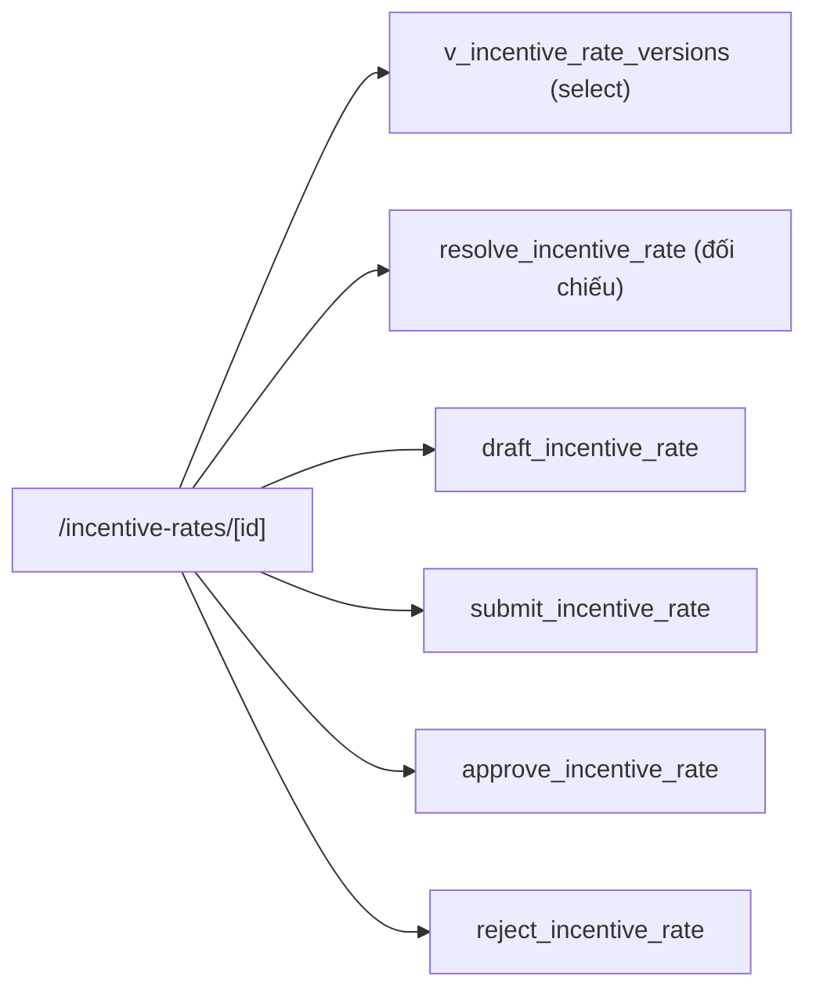

# SCR027_RateVersionApproval — Screen Spec

> Alias LAB-1: **SC-27** · 料率バージョン詳細・承認 · Chi tiết & duyệt phiên bản tỷ lệ

**Screen**: SCR027_RateVersionApproval: Chi tiết & duyệt phiên bản tỷ lệ (料率バージョン詳細・承認)
**Feature**: F008_IncentiveAndRateVersion (tính năng con `F08-03` `F08-04`; user story `US-19`)
**Type**: atomic
**Route**: `/incentive-rates/new` (lập bản mới) · `/incentive-rates/[version_id]` (chi tiết · duyệt)
**Generated**: 2026-10-06
**Trạng thái**: thiết kế mới, chưa xây — **Chưa có code — màn chỉ đặc tả ở LAB-4**
**Liên kết**: [F008](../../features/F008_IncentiveAndRateVersion/business-context.md) · ADR-004 (thư mục `decisions/`) · màn kề: [SCR026](../SCR026_RateVersionList/spec.md) · [SCR025](../SCR025_IncentiveResult/spec.md) · [SCR037](../SCR037_MarketManagement/spec.md) · [SCR022](../SCR022_CorrectionRequestCreate/spec.md)

## Purpose

Lập một phiên bản 料率 mới với `発効日` **đặt trong tương lai**, và **duyệt** phiên bản đó bởi một người **khác người lập**. Đây là chỗ nguyên tắc `起票・承認分離` của `GOV-RULE-01` được hiện thực hoá ở tầng giao diện, và là chỗ `FR-RULE-01` lấy đủ bốn thứ phải lưu cho mọi phiên bản: **người tạo, người duyệt, `発効日`, trạng thái**.

Người dùng: quản trị quy chế (`rule_admin` (đề xuất)) lập bản nháp; người có cờ duyệt 🔒 (`can_approve` (đề xuất)) xử lý bản chờ duyệt. Giờ hành chính, **tối đa 4 lần/năm** — màn dùng rất ít nhưng mỗi lần dùng đều đụng tới tiền.

**Vì sao duyệt không phải là một nút trên [SCR026](../SCR026_RateVersionList/spec.md).** Người duyệt phải **đọc được bản mới đặt cạnh bản đang hiệu lực** trước khi quyết. Một nút trên danh sách khuyến khích duyệt mà không đọc, và `CAP-HUMAN-01` điểm 3 ghi rõ *hệ thống không tự duyệt*.

**Người lập không duyệt được bản của chính mình.** Không phải ẩn nút cho đẹp — là bất biến kiểm trong thân RPC (`P0032`), vì nút ẩn thì gọi thẳng PostgREST vẫn gọi được.

## Screen Layout

*(Suy luận từ bảng field — chưa có wireframe.)* Một form/chi tiết một cột: banner đầu trang; khối lập (maker) với các ô nhập; khối vết (readonly) bên dưới hoặc cạnh bên; khối đối chiếu hai cột chỉ hiện khi `status = pending`; cụm nút hành động (Lưu nháp · Gửi duyệt · 承認 · Từ chối). 承認 và Từ chối mở hộp thoại xác nhận chặn luồng.

### Layout Sketch

```
┌──────────────────────────────────────────────────────────┐
│ R1: Banner lỗi / thành công (static)                     │
├──────────────────────────────────────────────────────────┤
│ R2: Khối lập — maker (editable khi draft + là người lập) │
│   交付率 · 発効日 · 支払期日 日数/起算点 · 最低対象金額  │
│   · 変更理由                                             │
├──────────────────────────────────────────────────────────┤
│ R3: Khối vết — readonly (mọi trạng thái)                 │
├──────────────────────────────────────────────────────────┤
│ ┌ - - - - - - - - - - - - - - - - - - - - - - - - - ┐    │
│ │ R4: Khối đối chiếu 2 cột (chỉ khi pending)        │    │
│ └ - - - - - - - - - - - - - - - - - - - - - - - - - ┘    │
├──────────────────────────────────────────────────────────┤
│ R5: Hành động: Lưu nháp · Gửi duyệt · 承認 · Từ chối     │
│   ┌ - - - - - - - - - - - - - ┐                          │
│   │ R6: Hộp thoại xác nhận    │ (modal)                  │
│   └ - - - - - - - - - - - - - ┘                          │
└──────────────────────────────────────────────────────────┘
```

### Layout Regions

| Region ID | Name | Position | Scrollable | Key Components | Responsive Behavior |
|-----------|------|----------|------------|----------------|---------------------|
| R1 | Banner | static | no | banner lỗi nghiệp vụ (tự nhận focus), thành công | always |
| R2 | Khối lập (maker) | static | yes | field #1–#7 | chưa xác định |
| R3 | Khối vết | static | yes | field #8–#16 (readonly) | chưa xác định |
| R4 | Khối đối chiếu | static, có điều kiện | no | hai cột "đang hiệu lực" / "đang chờ duyệt" cho #2 #4 #5 #6 | chỉ khi `status = pending` |
| R5 | Hành động | static | no | nút Lưu nháp / Gửi duyệt / 承認 / Từ chối | hiện theo vai trò + trạng thái |
| R6 | Hộp thoại xác nhận | modal | no | nêu lại `交付率`, `発効日`, bản bị thay thế | khi 承認/Từ chối |

## Child Routes

Không áp dụng — màn không phải shell có route con.

## User Flow

> **Scope:** within-screen interactions. Điều hướng liên màn xem `generated/screen-flow.md`.

### Happy Path

1. `rule_admin` vào từ [SCR026](../SCR026_RateVersionList/spec.md) → `/incentive-rates/new`. Form **sao 交付率 và các tham số từ bản đang hiệu lực**; `effective_from` và `change_note` để trống.
2. Nhập `交付率` mới, `発効日` **tương lai**, `変更理由` → "Lưu nháp". Bản `draft` **không có tác dụng gì** — `resolve_incentive_rate` không bao giờ trả bản `draft`/`pending`.
3. Người lập sửa tiếp bản nháp của mình bao nhiêu lần cũng được, rồi "Gửi duyệt" → `status = pending`, form khoá với chính người lập.
4. Checker (có `can_approve`, **khác người lập**) mở bản `pending` → R4 hai cột → 承認 hoặc từ chối kèm `reject_note`.
5. 承認 xong: bản mới `approved`. Bản cũ chuyển `superseded` **tại `発効日`**, không phải ngay lúc duyệt — giữa hai mốc đó, `resolve_incentive_rate(as_of)` với `as_of` nằm trong khoảng vẫn trả bản cũ.
6. Từ chối: `status` về `draft`, `reject_note` lưu lại. Người lập sửa và gửi lại. **Không xoá dòng** — vòng lập/trả lại cũng là dấu vết kiểm toán.
7. `reconcile` đi từ cột 適用料率版 của [SCR025](../SCR025_IncentiveResult/spec.md) sang đây, chế độ chỉ đọc, để giải thích một con số cũ (`F11-03` / `FR-AUDIT-03`).

### Branches

| Decision point | Condition | Outcome on this screen | Source |
|----------------|-----------|------------------------|--------|
| Bước 2 | đã đủ 4 bản `approved` trong năm | `P0030`, không lưu | (tài liệu gốc trong repo, không nộp) `sc-27-duyet-phien-ban-ty-le.md` §7 |
| Bước 2 | `発効日` không ở tương lai hoặc trùng | `P0031`, không lưu | cùng file |
| Bước 4 | chính người lập mở | nút 承認 **không hiện** (`V-06`); gọi thẳng RPC vẫn chặn (`P0032`) | cùng file |
| Bước 4 | người khác vừa xử lý bản này | `P0036` | cùng file |

## Data Inventory

> Bảng nguồn `incentive_rate_versions` **chưa có** trong `supabase/migrations/` — thiết kế mới. Field nhập (#1–#7) ở `## Validation & Error Feedback`.

Khối vết (readonly với mọi người, mọi trạng thái):

| Field | Display Label | Source | Format | Empty Behavior | Cross-ref |
|-------|---------------|--------|--------|----------------|-----------|
| `version` (#1, hiển thị) | Phiên bản / 版 | `incentive_rate_versions.version` | số nguyên tăng dần, **server cấp**; client không gửi | — | — |
| `status` | Trạng thái / 状態 | `incentive_rate_versions.status` | badge ∈ `draft` `pending` `approved` `superseded` `rolled_back`; nhãn hiển thị theo bảng dẫn xuất ở [SCR026](../SCR026_RateVersionList/spec.md) | mặc định `draft` | — |
| `drafted_by` | Người lập / 起案者 | `app_users.full_name` | người đăng nhập lúc tạo bản nháp; server đặt | — | — |
| `drafted_at` | Lúc lập / 起案日時 | `incentive_rate_versions.drafted_at` | JST, server đặt | — | — |
| `submitted_at` | Lúc gửi duyệt / 承認依頼日時 | `incentive_rate_versions.submitted_at` | JST | rỗng khi còn `draft` | — |
| `approved_by` | Người duyệt / 承認者 | `app_users.full_name` | **phải khác `drafted_by`** | rỗng khi chưa duyệt | — |
| `approved_at` | Lúc duyệt / 承認日時 | `incentive_rate_versions.approved_at` | JST, server đặt | rỗng khi chưa duyệt | — |
| `reject_note` | Lý do từ chối / 差戻し理由 | `incentive_rate_versions.reject_note` | 10–1000 ký tự; chỉ có khi checker trả lại bản | ẩn | — |
| `supersedes_version` | Thay cho bản / 旧版 | `incentive_rate_versions.supersedes_version` | link `v{n}` | rỗng với bản đầu tiên | — |
| `changes_this_year` | Số lần đổi trong năm / 年内変更回数 | tính trong view | đếm bản `approved` có `effective_from` cùng năm dương lịch; cảnh báo khi `≥ 3`, chặn khi `≥ 4` | — | — |

Khối đối chiếu (chỉ khi `status = pending`): hai cột cạnh nhau — **bản đang hiệu lực** (đọc qua `resolve_incentive_rate`) và **bản đang chờ duyệt** — cho các field #2, #4, #5, #6. Ô nào khác thì tô nền khác. Không có ô nhập nào trong khối này.

## UI States

| State | Trigger | Visual Behavior | User Action Available | Source |
|-------|---------|----------------|-----------------------|--------|
| empty | `/incentive-rates/new` và chưa có bản nào trước đó | form trắng, không có giá trị sao chép; ghi chú "Đây là bản đầu tiên" | nhập form | đặc tả §5 |
| loading | mở `/incentive-rates/[id]` | khung xương form + khối vết | none | đặc tả §5 |
| success (lưu nháp) | sau khi lưu nháp | banner "Đã lưu bản nháp v{n} — **chưa có hiệu lực**"; nhãn 下書き nổi bật | tiếp tục sửa / Gửi duyệt | đặc tả §5 |
| success (gửi duyệt) | sau khi gửi duyệt | banner "Đã gửi v{n} cho người duyệt"; form chuyển chỉ đọc | — | đặc tả §5 |
| success (duyệt) | sau khi duyệt | banner "Đã 承認 v{n}, 発効日 {effective_from}"; khối vết hiện đủ 承認者 + 承認日時 | — | đặc tả §5 |
| success (từ chối) | sau khi từ chối | banner "Đã trả lại v{n} cho người lập"; `status` về `draft`, `reject_note` hiện trong khối vết | — | đặc tả §5 |
| error (nghiệp vụ) | RPC từ chối | banner **tự nhận focus**; **dữ liệu đã gõ giữ nguyên** | sửa & gửi lại | đặc tả §5 |
| error (mạng) | mất kết nối | banner + nút thử lại; **dữ liệu đã gõ giữ nguyên** — không reset form | thử lại | đặc tả §5 |
| saving | RPC `draft_`/`submit_`/`approve_`/`reject_incentive_rate` đang chạy | *(suy luận — nguồn không mô tả: nút hành động vô hiệu)* | none | — |
| read-only | `status ∈ approved, superseded, rolled_back`, hoặc người xem không phải người lập, hoặc chức danh `reconcile`/`sys_admin` | mọi ô readonly. **Bản đã duyệt không sửa được — chỉ lập bản mới** | chỉ xem | đặc tả §5 |

## Validation & Error Feedback

### A) Client-side

Khối lập (maker) — sửa được khi `status = draft` **và** người xem là người lập:

| Field | Type | Required | Constraints | Async Check | Error Message | Default | Source |
|-------|------|----------|-------------|-------------|---------------|---------|--------|
| `grant_rate` — 交付率 | number | yes | `> 0` và `≤ 1`; tối đa 4 chữ số thập phân; **phải khác `grant_rate` của bản đang hiệu lực** (bản mới không đổi gì là bản vô nghĩa) | `resolve_incentive_rate` (so với bản hiện hành) | `V-02`, `V-03` | sao từ bản đang hiệu lực | `incentive_rate_versions.grant_rate` |
| `effective_from` — Ngày hiệu lực / 発効日 | date | yes | `> ngày nghiệp vụ hiện tại`; không trùng `effective_from` của bất kỳ bản `approved` nào | kiểm lại ở server | `P0031` | rỗng | `incentive_rate_versions.effective_from` |
| `payment_due_days` — Số ngày tới 支払期日 *(đề xuất)* / 支払期日までの日数 *(đề xuất)* | number | yes | số nguyên `≥ 0`, `≤ 180` | không | `V-05` | sao từ bản đang hiệu lực | `incentive_rate_versions.payment_due_days` |
| `payment_due_basis` — Mốc tính 支払期日 *(đề xuất)* / 支払期日の起算点 *(đề xuất)* | select | yes | ∈ `trade_confirmed` (売買確定日) · `delivery_completed` (引渡し完了日) · `period_end` (期末) | không | `V-01` | sao từ bản đang hiệu lực | `incentive_rate_versions.payment_due_basis` |
| `min_eligible_amount` — Ngưỡng tối thiểu *(đề xuất)* / 最低対象金額 *(đề xuất)* | number | no | số nguyên `≥ 0`, đơn vị JPY; rỗng = không có ngưỡng | không | — | sao từ bản đang hiệu lực | `incentive_rate_versions.min_eligible_amount` |
| `change_note` — Lý do thay đổi / 変更理由 | text (nhiều dòng) | yes | 10–1000 ký tự — là chứng cứ kiểm toán của `FR-RULE-01` | không | `V-04` | rỗng | `incentive_rate_versions.change_note` |

**Ba thứ KHÔNG phải field ở màn này, và không bao giờ được thành field:** hệ số thuế `110/100`, làm tròn **xuống theo JPY**, và việc **không có 猶予期間**. `BR-INC-01` pin cứng ba thứ đó ở tầng quy định quốc gia; đưa chúng vào payload phiên bản là mở đường cho một lần đổi cấu hình làm sai thuế. Chúng là hằng số trong hàm tính, hiện ở [SCR025](../SCR025_IncentiveResult/spec.md) dưới dạng chỉ đọc.

| Mã | Điều kiện kích hoạt | Thông báo VI | Thông báo JA | Hiện ở đâu | Chặn gửi? |
|---|---|---|---|---|:---:|
| `V-01` | ô bắt buộc để trống | Mục này bắt buộc. | 必須項目です。 | dưới ô | ● |
| `V-02` | `grant_rate` ngoài `(0, 1]` hoặc quá 4 chữ số thập phân | 交付率 phải lớn hơn 0, không quá 1, tối đa 4 chữ số thập phân. | 交付率は0より大きく1以下、小数4桁までです。 | dưới ô | ● |
| `V-03` | `grant_rate` bằng bản đang hiệu lực | 交付率 không đổi so với bản v{n} — không cần bản mới. | 交付率が版v{n}と同じです。 | dưới ô | ● |
| `V-04` | `change_note` < 10 ký tự | Lý do thay đổi phải từ 10 ký tự. | 変更理由は10文字以上で入力してください。 | dưới ô | ● |
| `V-05` | `payment_due_days` ngoài `[0, 180]` hoặc không nguyên | Số ngày tới 支払期日 là số nguyên từ 0 đến 180. | 支払期日までの日数は0〜180の整数です。 | dưới ô | ● |
| `V-06` | người đang xem là `drafted_by` của bản `pending` | Bạn không duyệt được bản do chính mình lập. | 自身が起案した版は承認できません。 | thay chỗ nút 承認 | ● — **ẩn hẳn nút** |

`V-*` kiểm ở client để phản hồi nhanh; `P00*` **kiểm lại ở server và là nguồn sự thật** — client bỏ qua được, PostgREST thì không.

### B) Server-side

Mọi đường ghi qua RPC `SECURITY DEFINER` *(chưa có trong migration)*; `incentive_rate_versions` **không có policy ghi** (ADR-002). Trần 4 lần/năm được kiểm **hai lần** — lúc lưu nháp (để báo sớm) và lúc 承認 (vì giữa hai thời điểm có thể có bản khác được duyệt chen vào).

#### Lưu nháp / Gửi duyệt / 承認 / Từ chối

- **Endpoint:**
  - Lưu nháp: `rpc('draft_incentive_rate', { p_version_id?, p_grant_rate, p_effective_from, p_payment_due_days, p_payment_due_basis, p_min_eligible_amount, p_change_note })` — `p_version_id` rỗng = tạo mới
  - Gửi duyệt: `rpc('submit_incentive_rate', { p_version_id })`
  - 承認: `rpc('approve_incentive_rate', { p_version_id })`
  - Từ chối: `rpc('reject_incentive_rate', { p_version_id, p_reject_note })`
- **Request:** như trên; `p_params`/payload **không** chứa trường do server đặt (`version`, `drafted_by`, `approved_by`, timestamp)
- **Success:** lưu nháp → `jsonb { version_id, version }` · gửi duyệt → `jsonb { status }` · 承認 → `jsonb { version, effective_from }` · từ chối → `jsonb { status }`
- **Errors:** `P0030` `P0031` `P0037` (lưu nháp) · `P0036` (gửi duyệt) · `P0032` `P0036` `P0030` (承認) · `P0032` `P0036` (từ chối) — bảng bên dưới
- **Trigger:** nút trong R5; 承認 và Từ chối qua hộp thoại xác nhận (R6)
- **Source:** (tài liệu gốc trong repo, không nộp) `sc-27-duyet-phien-ban-ty-le.md` §8

| Mã | Điều kiện kích hoạt | Thông báo VI | Thông báo JA | Hiện ở đâu | Chặn? |
|---|---|---|---|---|:---:|
| `P0030` *(mới, đề xuất)* | đã có 4 bản `approved` với `effective_from` trong cùng năm dương lịch | 料率 đã đổi 4 lần trong năm {year} — mức tối đa theo quy chế. | 料率は{year}年に4回変更済みで上限です。 | banner đầu form | ● |
| `P0031` *(mới, đề xuất)* | `effective_from ≤ ngày nghiệp vụ`, hoặc trùng `effective_from` của bản `approved` khác | 発効日 phải ở tương lai và không trùng bản đã duyệt. | 発効日は未来日かつ既承認版と重複しない日にしてください。 | banner đầu form | ● |
| `P0032` *(mới, đề xuất)* | `approved_by = drafted_by`, hoặc người duyệt không có `can_approve` | Người duyệt phải khác người lập và phải có thẩm quyền 承認. | 承認者は起案者と異なり、かつ承認権限が必要です。 | banner đầu form | ● |
| `P0036` *(mới, đề xuất)* | duyệt một bản không còn ở `pending` (người khác vừa xử lý) | Bản v{n} đã được xử lý — trạng thái hiện tại là {status}. | 版v{n}は既に処理済みです（現在: {status}）。 | banner đầu form | ● |
| `P0037` *(mới, đề xuất)* | `grant_rate` vượt khoảng cho phép khi kiểm lại ở server | 交付率 {value} nằm ngoài khoảng cho phép. | 交付率{value}は許容範囲外です。 | banner đầu form | ● |

Rẽ nhánh theo `error.code`, thông báo dựng từ `error.details` (`year`, `n`, `status`, `value`) qua `mapRpcError`, **không so khớp chuỗi `message`**.

#### Đọc dữ liệu (không phải submit)

| Thao tác | Cách gọi | Tham số | Trả về |
|---|---|---|---|
| Đọc một phiên bản | `select` từ `v_incentive_rate_versions` | `version_id` | một dòng kèm `display_state`, `changes_this_year` |
| Đọc bản đang hiệu lực để sao / đối chiếu | `rpc('resolve_incentive_rate', { p_as_of })` | `p_as_of` = **ngày nghiệp vụ** | `jsonb { version_id, grant_rate, payment_due_days, payment_due_basis, min_eligible_amount }` hoặc raise `P0034` |

## Interaction Patterns

- **Không có phím tắt riêng** — không thuộc ba màn ⌨️ (`SC-07`, `SC-10`, `SC-14`) — source: đặc tả §6.
- **承認 và Từ chối đều mở hộp thoại xác nhận chặn luồng**; hộp thoại 承認 nêu lại `交付率`, `発効日`, và **bản nào sẽ bị thay thế tại ngày đó**. `CAP-HUMAN-01` điểm 3: phê duyệt dữ liệu nhạy cảm là thao tác của người, không có đường một-phím — source: đặc tả §6.
- **Lỗi nghiệp vụ → banner tự nhận focus; dữ liệu đã gõ giữ nguyên** — source: đặc tả §5.

## Accessibility

| Aspect | Status | Notes |
|--------|--------|-------|
| ARIA roles/labels | unknown | chưa có code; đặc tả chưa nêu role/label cho form |
| Keyboard navigation | unknown | không có yêu cầu riêng (đặc tả §6) |
| Focus management | partial (theo đặc tả) | banner lỗi tự nhận focus; hộp thoại xác nhận chặn luồng *(focus trap chưa nêu)* |
| Screen reader compatibility | unknown | chưa kiểm — `[NO_A11Y_DETECTED]` ngoài các điểm trên, cần audit khi xây |

## Conditional Rendering

| Condition | Type | Renders | Hidden | Notes |
|-----------|------|---------|--------|-------|
| `status = draft` **và** người xem là người lập | auth | form sửa được + Lưu nháp + Gửi duyệt | — | maker |
| `status = pending` **và** có `can_approve` **và** khác người lập | auth | R4 đối chiếu + 承認 + Từ chối | — | bypass → `P0032` |
| người xem là `drafted_by` của bản `pending` | auth | thông báo `V-06` thay chỗ nút | nút 承認 (ẩn hẳn) | ẩn nút **không** phải cơ chế thực thi |
| `status ∈ approved, superseded, rolled_back` | hardcoded-state | mọi ô readonly | nút ghi | chỉ lập bản mới |
| chức danh `reconcile` / `sys_admin` | auth | chỉ đọc | nút ghi | |
| `/incentive-rates/new` | route | form sao từ bản hiệu lực (hoặc form trắng nếu chưa có bản nào) | R3 vết | |
| `status = draft` có `reject_note` | hardcoded-state | `reject_note` trong khối vết | — | sau từ chối |

## Component Variants

Không áp dụng — chưa có code, không có component đa hình dùng chung được xác định.

## Security Surface

| Guard | Type | Consequence if bypassed |
|-------|------|------------------------|
| `route-policy.ts` dùng chung tiền tố `{ prefix: "/incentive-rates", roles: ["sys_admin", "rule_admin", "reconcile"] }` *(đề xuất)* | role | đẩy về `/403` |
| RLS SELECT trên `incentive_rate_versions`, không policy ghi (ADR-002) | permission | không đọc/ghi ngoài RLS |
| Tầng RPC: maker ≠ checker, `発効日` tương lai, trần 4 lần/năm | permission | gọi thẳng PostgREST vẫn bị chặn; ba thứ này là bất biến nghiệp vụ, không phải quy ước giao diện (bài học ADR-004) |

Vai trò đề xuất: `sys_admin` xem (hỗ trợ, không quyết định nghiệp vụ) · `rule_admin` (đề xuất) xem + lập/sửa bản nháp của mình/gửi duyệt, là **maker** · `rule_admin` có `can_approve` (đề xuất) xem + duyệt/từ chối, là **checker** 🔒 và **phải khác người lập của chính bản đó** · `reconcile` xem (đi từ cột 適用料率版 của SCR025, `F11-03`) · `trading` · `receiving` · `party_admin` (đề xuất) không truy cập. Cờ `can_approve` dùng chung cột với [SCR036](../SCR036_QualificationReview/spec.md) và [SCR037](../SCR037_MarketManagement/spec.md) cho DRY — nhưng duyệt 料率 là duyệt tiền, không cùng loại với duyệt tư cách (Unresolved Questions câu 4). Server enforcement: `[UNVERIFIED]` — chưa có code.

## Source References

Chưa có code — màn chỉ đặc tả ở LAB-4.

1. Đặc tả gốc: (tài liệu gốc trong repo, không nộp) `sc-27-duyet-phien-ban-ty-le.md`
2. ADR: (tài liệu gốc trong repo, không nộp) `adr.md` (ADR-002, ADR-004)
3. Bảng/RPC dự kiến (chưa có trong `supabase/migrations/`): `incentive_rate_versions`, view `v_incentive_rate_versions`, RPC `resolve_incentive_rate` · `draft_incentive_rate` · `submit_incentive_rate` · `approve_incentive_rate` · `reject_incentive_rate`; cột `app_users.can_approve` (đề xuất — `supabase/migrations/0002_core_identity.sql` hiện chưa có)

## Source Walkthrough

Không có file code để dẫn đọc. Thứ tự đọc đề xuất:

1. **File:** (tài liệu gốc trong repo, không nộp) `sc-26-danh-sach-phien-ban-ty-le.md` — bảng sáu trạng thái hiển thị dùng lại ở màn này
2. **File:** (tài liệu gốc trong repo, không nộp) `architecture.md` — C6 và §3.2 (quy tắc là dữ liệu có phiên bản)

### Call Hierarchy

*(Thiết kế dự kiến — không phải code hiện có.)*



**Related files:** xem `## Source References`.

## Dependencies & Risks *(mục bổ sung)*

- **Cần trước:** [SCR026](../SCR026_RateVersionList/spec.md) (vào từ đó). `SC-03`/`SC-04` ([SCR003](../SCR003_AccountList/spec.md), [SCR004](../SCR004_AccountDetail/spec.md)) phải có sẵn ít nhất **hai** tài khoản `rule_admin`, một có `can_approve` — nếu chỉ có một người thì luồng này **không chạy được**, đúng theo thiết kế.
- **Dữ liệu phải có sẵn:** `app_users.can_approve` — cột này là **đề xuất mới**, chưa có trong prototype; dùng chung với SCR036 và SCR037.
- **Dễ hiểu sai #1:** ẩn nút 承認 ở client **không phải** cách thực thi maker ≠ checker. Phải kiểm trong thân RPC, nếu không thì một lệnh `curl` tới PostgREST tự duyệt được bản của chính mình.
- **Dễ hiểu sai #2:** `発効日` so với **ngày nghiệp vụ**, không phải `now()`. Chợ làm việc từ 2 giờ sáng JST — `now()` ở múi giờ khác sẽ lệch một ngày đúng vào khoảng giờ đông việc nhất.
- **Dễ hiểu sai #3:** `draft` và `pending` **không có hiệu lực**. Đây là chỗ dễ sai nhất khi viết `resolve_incentive_rate`.
- **Dễ hiểu sai #4:** duyệt **không** làm bản cũ hết hiệu lực ngay. Hết hiệu lực tại `発効日`.
- **Rủi ro vận hành:** 4 lần/năm nghĩa là màn này chạy thật khoảng 4 lần mỗi năm. Lỗi ở đây sẽ **không được phát hiện bằng việc dùng hằng ngày** — phải phủ bằng test tự động, không trông vào người dùng báo lỗi.

## Unresolved Questions *(mục bổ sung)*

1. **Test vector Appendix C của khách — chưa có.** LAB-1 ghi rõ `FR-INC-01` đòi *kết quả phải khớp test vector Appendix C*, và `US-13` lặp lại điều đó. Hiện chỉ có **mô tả ba case**, không có số. **Không verify được công thức tính 完納奨励金, cũng không verify được một bản 料率 mới có cho ra số đúng hay không, nếu khách không cung cấp bộ số đầu vào/đầu ra.** Phải lấy trước LAB-5 — đây là mục chặn nghiệm thu, nhắc lại từ SC-25 (SCR025) câu 1.
2. **`payment_due_days` và `payment_due_basis` là field đề xuất**, suy từ câu 10 gửi khách (định nghĩa 支払期日) và từ ghi chú của `product-a-feature-list.md` rằng hạn thanh toán *"thiết kế là tham số của phiên bản quy chế"*. Nếu khách định nghĩa 支払期日 theo cách khác — ví dụ ngày cố định trong tháng — thì lược đồ payload đổi.
3. **`min_eligible_amount` là field đề xuất**, suy từ `INC-EDGE-01` (*"tỷ lệ giao dịch đúng ngưỡng tối thiểu"*). Nếu không có ngưỡng thì bỏ field và bỏ `zero_reason = below_threshold` ở SCR025.
4. **Ai được duyệt 料率?** Tài liệu này dùng chung cột `can_approve` với SCR036/SCR037 cho KISS. Nhưng duyệt 料率 là duyệt tiền; khách có thể muốn một thẩm quyền riêng, hoặc hai cấp duyệt theo mức thay đổi — đúng mẫu câu hỏi đang treo của `F07` (câu 3 gửi khách).
5. **Có cho huỷ một bản `approved` chưa tới `発効日` không?** Chưa chốt. Đề xuất: không huỷ, chỉ quay lui bằng một bản mới ở SCR026 — nhưng như vậy mỗi lần sửa nhầm tốn hai suất trong trần 4 lần/năm.
6. **`交付率` có khác nhau theo nhóm người tham gia không?** Tài liệu khách chỉ nói một 交付率. Nếu thực tế phân nhóm thì bảng này cần thêm chiều, và lược đồ phiên bản phức tạp hẳn lên.
