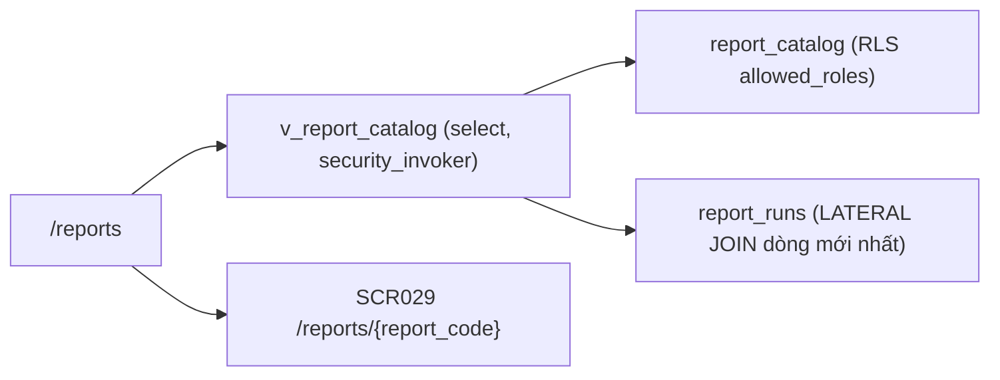

# SCR028_ReportCatalog — Screen Spec

> Alias LAB-1: **SC-28** · 帳票カタログ · Danh mục báo cáo

**Screen**: SCR028_ReportCatalog: Danh mục báo cáo (帳票カタログ)
**Feature**: F009_ReportsAndExport (tính năng con `F09-01` `F09-02`; user story `US-14`)
**Type**: atomic
**Route**: `/reports` *(đề xuất)*
**Generated**: 2026-10-06
**Trạng thái**: thiết kế mới, chưa xây — **Chưa có code — màn chỉ đặc tả ở LAB-4**
**Liên kết**: [F009](../../features/F009_ReportsAndExport/business-context.md) · màn kề: [SCR029](../SCR029_ReportViewExport/spec.md) · [SCR030](../SCR030_AccountingBatch/spec.md) · [SCR018](../SCR018_DailyReconciliation/spec.md)

## Purpose

Cổng vào duy nhất của **12 báo cáo cố định** (`TBL-REPORT-01`): 9 báo cáo ngày + 3 báo cáo tháng. Người đối chiếu (`reconcile`) mở màn này sau khi sổ đã chốt (~10:00 JST) để lấy báo cáo ngày trong cửa sổ trước 11:00; ban quản lý chợ (`market_manager` (đề xuất)) mở đầu tháng để lấy `RPT-10`/`RPT-11`/`RPT-12`.

Màn này **cố ý không có nút "Tạo báo cáo mới"**. `FR-RPT-03` (self-service report builder) nằm **ngoài phạm vi** — 発注者 không yêu cầu, bên thầu đã ghi là **option báo giá riêng**. Việc danh mục là dữ liệu seed chỉ-đọc (`report_catalog`, không có màn CRUD) là cách thể hiện biên phạm vi đó ở tầng dữ liệu, không chỉ ở lời nói.

Màn này không chạy truy vấn báo cáo. Nó chỉ liệt kê, kiểm quyền, và điều hướng sang [SCR029](../SCR029_ReportViewExport/spec.md).

## Screen Layout

*(Suy luận từ bảng field — chưa có wireframe.)* Trang danh sách: banner lỗi ở đầu (khi quay về từ URL sai), thanh bộ lọc GET (tần suất, tìm theo tên/mã, nút "Áp dụng"), rồi bảng 12 dòng (hoặc tập con theo `allowed_roles`) sắp theo `report_code`, nhóm `daily` trước `monthly`. Mỗi dòng có liên kết "Mở báo cáo".

### Layout Sketch

```
┌──────────────────────────────────────────────────────────┐
│ R1: Banner P0040/P0044 (static, role="alert")            │
├──────────────────────────────────────────────────────────┤
│ R2: Bộ lọc GET — frequency · q · [Áp dụng]               │
├──────────────────────────────────────────────────────────┤
│ R3: Bảng danh mục (scrollable)                           │
│  mã · tên VI/JA · tần suất · tham số · lần chạy gần nhất │
│  · kết quả · vùng dữ liệu · [Mở báo cáo]                 │
└──────────────────────────────────────────────────────────┘
```

### Layout Regions

| Region ID | Name | Position | Scrollable | Key Components | Responsive Behavior |
|-----------|------|----------|------------|----------------|---------------------|
| R1 | Banner lỗi | static | no | banner đỏ `role="alert"` | always |
| R2 | Bộ lọc | static | no | select `frequency`, text `q`, nút "Áp dụng" (form GET) | chưa xác định |
| R3 | Bảng danh mục | static | yes | 12 dòng seed; chip tham số; badge tần suất/kết quả; liên kết "Mở báo cáo" | chưa xác định |

## Child Routes

Không áp dụng — màn không phải shell có route con. (Mỗi dòng dẫn tới `/reports/{report_code}` = [SCR029](../SCR029_ReportViewExport/spec.md).)

## User Flow

> **Scope:** within-screen interactions. Điều hướng liên màn xem `generated/screen-flow.md`.

### Happy Path

1. `reconcile` hoặc `market_manager` mở `/reports` sau khi [SCR018](../SCR018_DailyReconciliation/spec.md) đã chốt sổ ngày.
2. Danh sách hiện 12 dòng (hoặc tập con theo `allowed_roles`), sắp theo `report_code` tăng dần, nhóm `daily` trước `monthly`.
3. Dòng có `last_run_status='failed'` hiện badge đỏ + liên kết "Xem cảnh báo" sang [SCR030](../SCR030_AccountingBatch/spec.md).
4. (Tùy chọn) lọc theo tần suất hoặc gõ từ khoá → tải lại bằng query string GET.
5. Bấm "Mở báo cáo" → sang [SCR029](../SCR029_ReportViewExport/spec.md) với `report_code` đã chọn; **mọi tham số nhập ở SCR029, không nhập ở đây**.

### Branches

| Decision point | Condition | Outcome on this screen | Source |
|----------------|-----------|------------------------|--------|
| Bước 5 / gõ URL | gõ thẳng URL mã không tồn tại/không được phép | chuyển hướng về `/reports` kèm banner `P0040`/`P0044` | (tài liệu gốc trong repo, không nộp) `sc-28-danh-muc-bao-cao.md` §7 |
| Bước 4 | `q` không khớp dòng nào | "Không có báo cáo nào khớp bộ lọc." (không phải lỗi) | cùng file §4 |

## Data Inventory

> Một dòng = một báo cáo trong danh mục. Bảng nguồn `report_catalog`, `report_runs`, view `v_report_catalog` **chưa có** trong `supabase/migrations/` — thiết kế mới.

| Field | Display Label | Source | Format | Empty Behavior | Cross-ref |
|-------|---------------|--------|--------|----------------|-----------|
| `report_code` | Mã báo cáo / 帳票コード | `report_catalog.report_code` | `^RPT-(0[1-9]\|1[0-2])$` — **đúng 12 giá trị, không có giá trị thứ 13** | — | — |
| `name_vi` | Tên báo cáo / 帳票名 | `report_catalog.name_vi` | 1–120 ký tự | — | — |
| `name_ja` | — / 帳票名（日本語） | `report_catalog.name_ja` | hiển thị khi `locale='ja'` | — | — |
| `frequency` | Tần suất / 頻度 | `report_catalog.frequency` | badge ∈ `daily` `monthly` `on_change` (`RPT-12` là `on_change` + tháng) | — | — |
| `required_params` | Tham số bắt buộc / 必須パラメータ | `report_catalog.param_schema` (`jsonb`) | chip list; mỗi báo cáo có **ít nhất một** tham số thời gian (`業務日` hoặc `kỳ`) — không báo cáo nào chạy không tham số | — | — |
| `last_run_at` | Lần chạy gần nhất / 直近実行日時 | `max(report_runs.finished_at)` theo `report_code`, lọc `status='succeeded'` | datetime JST | "—" nếu chưa chạy lần nào | — |
| `last_run_status` | Kết quả gần nhất / 直近結果 | `report_runs.status` của dòng mới nhất | badge ∈ `succeeded` `failed` `running`; `failed` tông đỏ kèm liên kết sang [SCR030](../SCR030_AccountingBatch/spec.md) | "—" | — |
| `data_domains` | Vùng dữ liệu / データ領域 | `report_catalog.data_domains` | chip list — tham chiếu 7 vùng dữ liệu LAB-1 (`D-TRADE`, `D-SETTLE`…), giúp đánh giá ảnh hưởng khi một vùng lỗi | — | — |
| Hành động | Mở báo cáo / 開く | — | link, luôn hiện; trỏ `/reports/{report_code}` | — | — |

**Nội dung danh mục — 12 dòng seed** (nhãn JA là **đề xuất**, `TBL-REPORT-01` chỉ cho tên tiếng Việt/Nhật rút gọn):

| Mã | Tên VI | 帳票名 *(đề xuất)* | Tần suất | Tham số bắt buộc | Chức danh thấy |
|---|---|---|---|---|---|
| `RPT-01` | Tổng hợp giao dịch theo 業務日 | 業務日別取引集計表 | daily | `業務日` | `reconcile` `market_manager` |
| `RPT-02` | Lịch sử lot + log trạng thái giao dịch | ロット履歴・取引状態ログ | daily | `業務日`, (lot, trạng thái — tuỳ chọn) | `reconcile` |
| `RPT-03` | Người tham gia đã/gần hết hiệu lực | 参加者資格失効・失効間近一覧 | daily | `as_of_date` | `reconcile` |
| `RPT-04` | Giao hàng ứ đọng + ngoại lệ | 引渡し滞留・例外一覧 | daily | `業務日`, (loại ngoại lệ) | `reconcile` `market_manager` |
| `RPT-05` | Bảng đối chiếu ngày | 業務日照合表 | daily | `業務日` | `reconcile` `market_manager` |
| `RPT-06` | Bảng xuất cho đối chiếu kế toán | 会計照合用出力表 | daily | `業務日`, (batch code) | `reconcile` |
| `RPT-07` | Kết quả tính 完納奨励金 theo kỳ | 完納奨励金計算結果 | daily/kỳ | `kỳ`, (参加者) | `reconcile` `market_manager` |
| `RPT-08` | Log điều chỉnh sau lock | 締め後調整ログ | daily | `業務日`, (実行主体) | `reconcile` |
| `RPT-09` | Tổng hợp tranh chấp + SLA | 紛争集計・SLA表 | daily | `業務日` hoặc trạng thái tranh chấp | `reconcile` `market_manager` |
| `RPT-10` | Báo cáo tháng theo 参加者 | 参加者別月次報告 | monthly | `tháng`, (参加者) | `reconcile` `market_manager` |
| `RPT-11` | Báo cáo tháng theo loại giao dịch | 取引種別月次報告 | monthly | `tháng`, (loại giao dịch) | `reconcile` `market_manager` |
| `RPT-12` | Thay đổi rule + version áp dụng | 規程変更・適用版報告 | on_change + monthly | `規則版` hoặc `発効日` | `reconcile` `market_manager` |

## UI States

| State | Trigger | Visual Behavior | User Action Available | Source |
|-------|---------|----------------|-----------------------|--------|
| empty | bộ lọc không khớp, hoặc RLS lọc hết (chức danh chỉ thấy tập con) | "Không có báo cáo nào khớp bộ lọc." — **không** gợi ý "tạo báo cáo mới" | đổi bộ lọc | đặc tả §5 |
| loading | Server Component đọc trước render; không có `loading.tsx` riêng | (không mô tả riêng) | none | đặc tả §5 |
| success | không áp dụng — màn chỉ đọc | — | — | đặc tả §5 |
| error (nghiệp vụ) | `P0040`/`P0044` khi quay về từ URL sai | banner đỏ `role="alert"` trên đầu danh sách, danh sách vẫn hiện bình thường bên dưới | đóng / chọn báo cáo khác | đặc tả §5 |
| error (mạng) | truy vấn `report_catalog` throw | trang lỗi — danh mục là dữ liệu seed nhỏ, không có cache phía client | tải lại | đặc tả §5 |
| saving | không áp dụng — không có thao tác ghi | — | — | — |
| read-only | **luôn luôn** | không có hành động ghi nào trên màn này | — | đặc tả §5 |

## Validation & Error Feedback

### A) Client-side

Bộ lọc (field nhập; form GET):

| Field | Type | Required | Constraints | Async Check | Error Message | Default | Source |
|-------|------|----------|-------------|-------------|---------------|---------|--------|
| `frequency` — Tần suất / 頻度 | select | no | ∈ `daily` `monthly` `on_change` + "Tất cả"; giá trị khác bị bỏ qua | không | — | rỗng | `searchParams.frequency` |
| `q` — Tìm theo tên/mã / 検索 | text | no | ≤ 60 ký tự; khớp không phân biệt hoa thường trên `report_code`, `name_vi`, `name_ja` | không | — | rỗng | `searchParams.q` |

Không có form ghi. Hai lỗi đều phát sinh khi người dùng gõ thẳng URL hoặc dùng bookmark cũ.

### B) Server-side

#### Điều hướng tới `/reports/{report_code}` (kiểm khi vào [SCR029](../SCR029_ReportViewExport/spec.md), hiện lại ở đây sau chuyển hướng)

- **Endpoint:** không có submit — `select` từ `v_report_catalog` (`security_invoker = true`)
- **Request:** `frequency?`, `q?`
- **Success:** mảng `ReportCatalogRow`
- **Trigger:** mở trang / bấm "Áp dụng"
- **Source:** đặc tả §8
- **Errors:**

| Mã | Điều kiện kích hoạt | Thông báo VI | Thông báo JA | Hiện ở đâu | Chặn? |
|---|---|---|---|---|:---:|
| `P0040` | `report_code` trên URL không thuộc 12 mã seed | Mã báo cáo {report_code} không có trong danh mục. Danh mục gồm đúng 12 báo cáo cố định. | 帳票コード{report_code}はカタログに存在しません。カタログは固定の12帳票のみです。 | banner đầu danh sách sau khi chuyển hướng về `/reports` | ● |
| `P0044` | `report_code` tồn tại nhưng `current_app_role()` không nằm trong `allowed_roles` | Chức danh của bạn không được xem báo cáo {report_code}. | あなたの職掌では帳票{report_code}を参照できません。 | banner đầu danh sách | ● |
| — | bộ lọc `q` không khớp dòng nào | (không phải lỗi) "Không có báo cáo nào khớp bộ lọc." | 条件に一致する帳票がありません。 | vùng danh sách | không áp dụng |

Thông báo dựng từ trường `details.report_code` của lỗi RPC, **không so khớp chuỗi `message`**.

| Thao tác đọc | Cách gọi | Tham số | Trả về |
|---|---|---|---|
| Đọc danh mục | `select` từ `v_report_catalog` (`security_invoker = true`) | `frequency?`, `q?` | mảng `ReportCatalogRow` |
| Đọc kết quả chạy gần nhất | cùng view — `v_report_catalog` đã `LATERAL JOIN` dòng `report_runs` mới nhất theo `report_code` | — | `last_run_at`, `last_run_status` |

Select thẳng, không qua RPC: không có thao tác ghi, không có bất biến nghiệp vụ nào phải giữ trong transaction. Gộp "lần chạy gần nhất" vào view thay vì gọi riêng 12 lần — tránh N+1 ngay từ thiết kế.

## Interaction Patterns

- **Không có phím tắt riêng** — không thuộc ba màn keyboard-first (`SC-07` · `SC-10` · `SC-14`). Tab qua bộ lọc → nút "Áp dụng" → lần lượt từng liên kết "Mở báo cáo" — source: đặc tả §6.
- **Enter trong ô `q` submit form GET** theo hành vi HTML gốc — source: đặc tả §6.
- **Dòng báo cáo lỗi lần chạy gần nhất → liên kết "Xem cảnh báo" sang SCR030** — source: đặc tả §7.

## Accessibility

| Aspect | Status | Notes |
|--------|--------|-------|
| ARIA roles/labels | partial (theo đặc tả) | banner lỗi `role="alert"` |
| Keyboard navigation | supported (theo đặc tả) | Tab: bộ lọc → "Áp dụng" → từng "Mở báo cáo"; Enter trong `q` submit |
| Focus management | unknown | không mô tả; không có hộp thoại |
| Screen reader compatibility | unknown | chưa kiểm — cần audit khi xây |

## Conditional Rendering

| Condition | Type | Renders | Hidden | Notes |
|-----------|------|---------|--------|-------|
| `current_app_role()` ∈ `allowed_roles` của dòng | auth | dòng báo cáo | dòng khác | RLS trên `report_catalog` lọc theo `allowed_roles`; `market_manager` không thấy `RPT-08` và `RPT-03`; trả rỗng dòng, không báo lỗi |
| `last_run_status = 'failed'` | hardcoded-state | badge đỏ + "Xem cảnh báo" → SCR030 | — | |
| không có nút "Tạo báo cáo mới" | hardcoded (phạm vi) | — | nút tạo | cố ý — `FR-RPT-03` ngoài phạm vi |
| danh mục rỗng với một chức danh | auth | thông báo rỗng | — | **không phải lỗi**; đừng thêm fallback "nếu rỗng thì hiện tất cả" |

## Component Variants

Không áp dụng — chưa có code, không có component đa hình dùng chung được xác định.

## Security Surface

| Guard | Type | Consequence if bypassed |
|-------|------|------------------------|
| `route-policy.ts` thêm `{ prefix: "/reports", roles: ["reconcile","market_manager"] }` *(đề xuất)* | role | đẩy về `/403` |
| RLS trên `report_catalog` lọc theo `allowed_roles` | permission | danh sách dòng đã khác nhau giữa hai chức danh |

Vai trò đề xuất: `reconcile` xem (người dùng chính) · `market_manager` (đề xuất; "Ban quản lý" trong `04_画面一覧`, **chưa tồn tại** trong 4 chức danh prototype) xem · `sys_admin` ✗ (không có nhu cầu nghiệp vụ; số liệu kinh doanh không mở cho quản trị hệ thống) · `receiving` ✗ · `trading` ✗ · `party_admin` `rule_admin` `ops_admin` `internal_audit` ✗ (không thuộc `roles` của route `/reports`; đủ 9 role theo PREMISE C-09). **Không ai có quyền ghi** — danh mục là seed, sửa bằng migration. Server enforcement: `[UNVERIFIED]` — chưa có code.

## Source References

Chưa có code — màn chỉ đặc tả ở LAB-4.

1. Đặc tả gốc: (tài liệu gốc trong repo, không nộp) `sc-28-danh-muc-bao-cao.md`
2. Bảng LAB-1: (tài liệu gốc trong repo, không nộp) `product-a-screen-list.md` (SC-28)
3. Bảng/view dự kiến (chưa có trong `supabase/migrations/`): `report_catalog` (seed 12 dòng), `report_runs`, view `v_report_catalog`

## Source Walkthrough

Không có file code để dẫn đọc. Thứ tự đọc đề xuất:

1. **File:** (tài liệu gốc trong repo, không nộp) `sc-29-xem-xuat-bao-cao.md` — màn nhận `report_code` và dựng form tham số từ `param_schema`
2. **File:** (tài liệu gốc trong repo, không nộp) `sc-30-batch-ke-toan.md` — nơi liên kết "Xem cảnh báo" dẫn tới

### Call Hierarchy

*(Thiết kế dự kiến — không phải code hiện có.)*



**Related files:** xem `## Source References`.

## Dependencies & Risks *(mục bổ sung)*

- Cần bảng seed `report_catalog` (12 dòng) + bảng `report_runs` tồn tại trước; SCR028 không tạo dòng nào ở cả hai.
- Cần role `market_manager` được thêm vào `app_users.role` — **chưa có trong DB** (role đề xuất, đã chốt ở PREMISE C-09); nếu bài làm thật không thêm thì "Ban quản lý" phải tạm dùng `reconcile`, và cột "Chức danh thấy" mất ý nghĩa.
- **Dễ hiểu sai khi triển khai:** danh mục rỗng với một chức danh **không phải lỗi** — đó là RLS theo `allowed_roles` làm đúng việc. Đừng thêm fallback "nếu rỗng thì hiện tất cả".
- Rủi ro phạm vi: màn danh sách có bộ lọc rất dễ bị đề nghị "thêm nút lưu bộ lọc thành báo cáo của tôi". Đó **chính là** `FR-RPT-03`, nằm ngoài baseline.
- `last_run_status` đọc từ `report_runs` do SCR029/batch của SCR030 ghi — nếu hai màn kia chưa xây, cột `last_run_at` và `last_run_status` luôn "—", danh mục vẫn dùng được.

## Unresolved Questions *(mục bổ sung)*

- **`internal_audit` và `rule_admin` có được xem danh mục báo cáo không?** Hiện ✗ ở cả hai. (Câu "thêm `market_manager` hay gán vào `reconcile`" đã đóng: C-09 chốt 9 role, `market_manager` là role *đề xuất*.) Ảnh hưởng cả SCR029.
- `allowed_roles` cho từng báo cáo là **đề xuất của bên thầu**, chưa hỏi khách. Nhạy nhất là `RPT-08` (log điều chỉnh sau chốt) — có nên cho ban quản lý xem không là câu hỏi quản trị, không phải câu hỏi kỹ thuật.
- Giả định **A4 (CSV một chiều qua SFTP)** của LAB-1 **chưa được khách xác nhận** — `RPT-06` trong danh mục này mô tả đầu ra cho kế toán theo đúng giả định đó. Nếu 検討会 đổi sang API hai chiều, `RPT-06` phải thêm cột trạng thái phía kế toán; hệ quả đầy đủ ghi ở [SCR030](../SCR030_AccountingBatch/spec.md) (Unresolved Questions).
