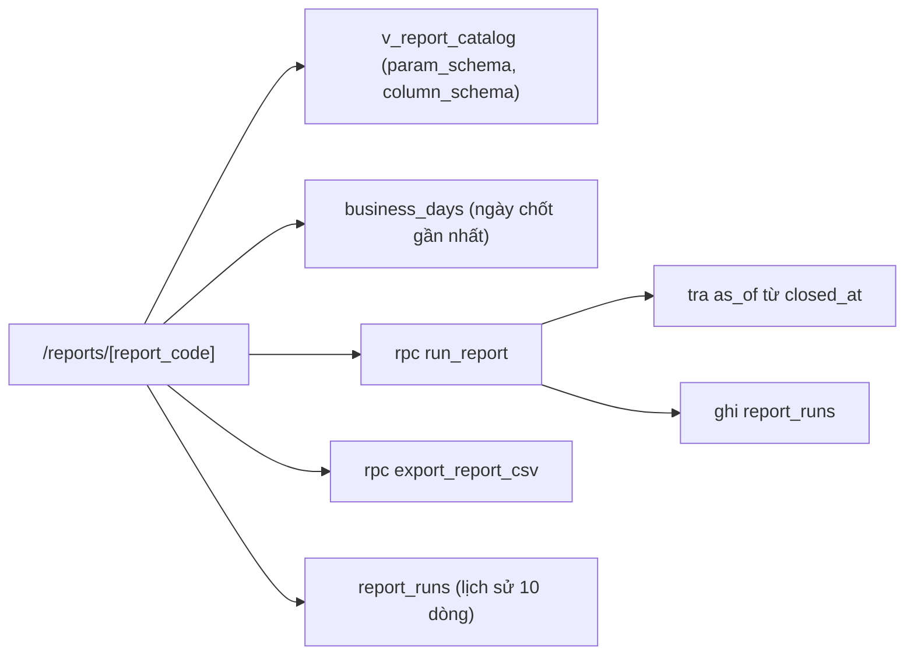

# SCR029_ReportViewExport — Screen Spec

> Alias LAB-1: **SC-29** · 帳票の参照・出力 · Xem & xuất báo cáo

**Screen**: SCR029_ReportViewExport: Xem & xuất báo cáo (帳票の参照・出力)
**Feature**: F009_ReportsAndExport (tính năng con `F09-01` `F09-02` `F09-03`; user story `US-14`)
**Type**: composite (form tham số + bảng kết quả + lịch sử lần chạy)
**Route**: `/reports/[report_code]` *(đề xuất)* — ví dụ `/reports/RPT-05?businessDate=2026-03-04`
**Generated**: 2026-10-06
**Trạng thái**: thiết kế mới, chưa xây — **Chưa có code — màn chỉ đặc tả ở LAB-4**
**Liên kết**: [F009](../../features/F009_ReportsAndExport/business-context.md) · ADR-003 · ADR-005 (thư mục `decisions/`) · màn kề: [SCR028](../SCR028_ReportCatalog/spec.md) · [SCR030](../SCR030_AccountingBatch/spec.md) · [SCR018](../SCR018_DailyReconciliation/spec.md) · [SCR037](../SCR037_MarketManagement/spec.md)

## Purpose

**Một màn hình phục vụ cả 12 báo cáo.** Nhận `report_code` từ [SCR028](../SCR028_ReportCatalog/spec.md), dựng form tham số theo `param_schema` của báo cáo đó, chạy truy vấn, hiện bảng kết quả, và xuất CSV. Lý do gộp: 12 báo cáo khác nhau ở **tham số và tập cột**, không khác nhau ở tương tác — tách thành 12 màn là nhân bản 12 lần cùng một luồng.

Người dùng: bộ phận đối chiếu (`reconcile`), sau khi [SCR018](../SCR018_DailyReconciliation/spec.md) đã chốt sổ, trong cửa sổ hẹp giữa ~10:00 và hạn batch 11:00 JST; ban quản lý chợ (`market_manager`, role đề xuất — chưa có trong DB) dùng cho ba báo cáo tháng. Mục tiêu đo được của khách: báo cáo ngày **90 phút → ≤ 15 phút**.

**Ràng buộc trung tâm của màn này** (`architecture.md` §3.1): mọi truy vấn báo cáo **tham số hoá theo `業務日` + version quy tắc tại `as_of`**, **không bao giờ theo `now()`**. Một `now()` lọt vào tầng báo cáo là đủ phá `BR-CLOSE-01` **mà không có test nào đỏ** — báo cáo vẫn chạy, vẫn ra số, chỉ là số sai khi in lại kỳ cũ.

## Screen Layout

*(Suy luận từ bảng field — chưa có wireframe.)* Trang một cột: banner lỗi đầu màn; khối tham số động (dựng từ `param_schema`) kèm nút "Chạy báo cáo"; thanh siêu dữ liệu + bảng kết quả (có phân trang phía server khi > 5.000 dòng) kèm nút "Xuất CSV"; cuối trang "Lần chạy gần đây" (10 dòng) với liên kết "In lại".

### Layout Sketch

```
┌──────────────────────────────────────────────────────────┐
│ R1: Banner lỗi / liên kết SCR030 (role="alert")          │
├──────────────────────────────────────────────────────────┤
│ R2: Form tham số động (param_schema) · [Chạy báo cáo]    │
├──────────────────────────────────────────────────────────┤
│ R3: Thanh siêu dữ liệu: generated_at · as_of ·           │
│     triggered_by · run_code · badge "Số liệu tạm"        │
│     [Xuất CSV]                                           │
├──────────────────────────────────────────────────────────┤
│ R4: Bảng kết quả — cột động (scrollable, phân trang 500) │
├──────────────────────────────────────────────────────────┤
│ R5: Lần chạy gần đây (10 dòng) · [In lại]                │
└──────────────────────────────────────────────────────────┘
```

### Layout Regions

| Region ID | Name | Position | Scrollable | Key Components | Responsive Behavior |
|-----------|------|----------|------------|----------------|---------------------|
| R1 | Banner | static | no | banner đỏ `role="alert"`; banner `P0049` dưới bảng kèm liên kết SCR030 | always |
| R2 | Form tham số | static | no | field động #1–#8; nút "Chạy báo cáo" | chỉ field có trong `param_schema` |
| R3 | Thanh siêu dữ liệu + hành động | static | no | `generated_at` `as_of` `triggered_by` `run_code`, badge `provisional`, nút "Xuất CSV" | hiện sau khi chạy |
| R4 | Bảng kết quả | static | yes | `columns[]` / `rows[]`, `row_count`, phân trang phía server | chưa xác định |
| R5 | Lần chạy gần đây | static | no | 10 dòng cuối của báo cáo, liên kết "In lại" | chưa xác định |

## Child Routes

Không áp dụng — màn không phải shell có route con.

## User Flow

> **Scope:** within-screen interactions. Điều hướng liên màn xem `generated/screen-flow.md`.

### Happy Path

1. Vào từ [SCR028](../SCR028_ReportCatalog/spec.md) với `report_code` đã chọn (hoặc URL trực tiếp).
2. Form tham số dựng theo `param_schema`; `business_date` mặc định là **ngày nghiệp vụ đã chốt gần nhất** — không phải hôm nay, vì hôm nay thường chưa chốt.
3. Bấm "Chạy báo cáo" → `run_report`. Server tự tra `as_of` từ `business_days.closed_at`, client không gửi.
4. Kết quả hiện kèm thanh siêu dữ liệu. `row_count > 5.000` → phân trang 500 dòng/trang (phân trang **phía server**, cùng `run_code`, không chạy lại truy vấn). *(Nơi lưu kết quả và endpoint lấy trang chưa được đặc tả — xem Unresolved Questions: `get_report_page` (đề xuất).)*
5. Bấm "Xuất CSV" → `export_report_csv` cập nhật `report_runs.exported_at` của lần chạy đang xem (dòng `report_runs` đã do `run_report` tạo ở bước 3) rồi trả file.
6. Phần "Lần chạy gần đây" (10 dòng cuối của báo cáo này) có liên kết **In lại** — chạy lại với `params` + `as_of` **đã lưu**, không phải tham số đang hiển thị. *(RPC thực hiện việc này chưa được đặc tả — xem Unresolved Questions: `reprint_report` (đề xuất).)*
7. Đổi tham số → lặp từ bước 3; lần chạy cũ vẫn còn trong lịch sử.

### Branches

| Decision point | Condition | Outcome on this screen | Source |
|----------------|-----------|------------------------|--------|
| Bước 3 | ngày chưa chốt, báo cáo chỉ-sau-chốt | `P0042`, dừng | (tài liệu gốc trong repo, không nộp) `sc-29-xem-xuat-bao-cao.md` §7 |
| Bước 3 | ngày chưa chốt, báo cáo tra cứu vận hành | chạy, gắn cờ `provisional` | cùng file |
| Bước 5 | `row_count > 50.000` | `export_report_csv` **không** raise lỗi mà trả `{ queued: true, batch_code }`; màn hiện thông báo mã `P0049` và theo dõi ở [SCR030](../SCR030_AccountingBatch/spec.md) | cùng file |

## Data Inventory

> Field nhập (tham số) ở `## Validation & Error Feedback`. Bảng/RPC nguồn (`report_catalog`, `report_runs`, `run_report`…) **chưa có** trong `supabase/migrations/`; `business_days` đã có (`0004_business_days_and_lots.sql`).

| Field | Display Label | Source | Format | Empty Behavior | Cross-ref |
|-------|---------------|--------|--------|----------------|-----------|
| `as_of` (#3) | Thời điểm căn cứ quy tắc / 規程基準時点 | `business_days.closed_at` | datetime JST; **server đặt, client không gửi**: = `closed_at` của `business_date` (báo cáo ngày) hoặc của ngày nghiệp vụ **đã chốt cuối cùng trong kỳ** (báo cáo tháng). `NULL` ⇔ bản xem tạm | — | `business_days` |
| `columns[]` (#9) | (tiêu đề cột) / 列見出し | `report_catalog.column_schema` | thứ tự + nhãn VI/JA lấy từ schema; **không suy ra từ tên cột SQL** | — | — |
| `rows[]` (#10) | (dòng dữ liệu) / 明細行 | kết quả `run_report` | số và tiền `.toLocaleString()`; ngày `YYYY-MM-DD` | "Không có dòng nào khớp tham số." | — |
| `row_count` (#11) | Số dòng / 件数 | `run_report` → `jsonb.row_count` | hiện ngay trên bảng; **> 5.000 → phân trang 500 dòng/trang** | — | — |
| `generated_at` (#12) | Thời điểm tạo / 作成日時 | `report_runs.generated_at` | datetime JST — thời điểm **chạy truy vấn**, khác `as_of`, hai mốc không được gộp | — | — |
| `triggered_by` (#13) | Người kích hoạt / 実行主体 | `report_runs.triggered_by` → `app_users.full_name` | tên người đang đăng nhập | — | — |
| `run_code` (#14) | Mã lần chạy / 実行コード | `report_runs.run_code` | `^RUN-\d{8}-RPT\d{2}-\d{3}$` *(đề xuất)*; là "mã lô gửi" mà `08-05` đòi gắn vào dữ liệu xuất | — | — |
| `provisional` (#15) | Cờ số liệu tạm / 暫定 | dẫn xuất từ `as_of` | badge; `true` ⇔ `as_of IS NULL` ⇔ `業務日` chưa chốt; badge vàng "Số liệu tạm — ngày chưa chốt"; mặc định `false` | ẩn khi `false` | — |
| Lịch sử lần chạy | Lần chạy gần đây | `report_runs` (10 dòng mới nhất theo `report_code`) | `run_code`, `params`, `as_of`, `row_count`, `status` ∈ `running` `ok` `failed` `queued` *(đề xuất — tập giá trị chưa có nguồn)* | — | — |

**Nội dung file CSV** — 4 dòng tiêu đề siêu dữ liệu trước phần bảng (`08-05` bắt buộc đủ 4 thứ): `generated_at`, `業務日`/`period`, `triggered_by`, `run_code`. Thêm `as_of` và `provisional` — **đề xuất của bên thầu**, vì thiếu `as_of` thì không ai kiểm được bản in lại có đúng version quy tắc hay không.

## UI States

| State | Trigger | Visual Behavior | User Action Available | Source |
|-------|---------|----------------|-----------------------|--------|
| empty | chưa bấm "Chạy báo cáo" | chỉ form tham số + mô tả báo cáo; vùng bảng ghi "Chọn tham số rồi bấm Chạy báo cáo." | nhập tham số | đặc tả §5 |
| empty (không có dữ liệu) | chạy xong, `row_count = 0` | "Không có dòng nào khớp tham số." — **vẫn hiện** `generated_at`, `as_of`, `run_code`: lần chạy rỗng cũng là một lần chạy có dấu vết | đổi tham số | đặc tả §5 |
| loading | đang chạy `run_report` | nút đổi nhãn "Đang chạy…", disabled; bảng cũ **mờ đi chứ không bị xoá**, tránh nhấp nháy khi đổi tham số | none | đặc tả §5 |
| success | có kết quả | bảng + thanh siêu dữ liệu (`generated_at` · `as_of` · `triggered_by` · `run_code`); nút Xuất CSV bật | Xuất CSV, đổi tham số | đặc tả §5 |
| provisional | `業務日` chưa chốt, báo cáo **không** thuộc nhóm chỉ-sau-chốt | badge vàng "Số liệu tạm — ngày chưa chốt"; CSV xuất được nhưng tên file có hậu tố `-provisional` và dòng siêu dữ liệu `provisional=true` | Xuất CSV | đặc tả §5 |
| error (nghiệp vụ) | `P0040`–`P0044` | banner đỏ `role="alert"`, **tham số đã nhập giữ nguyên** | sửa tham số | đặc tả §5 |
| error (mạng) | Server Action throw | như trên, thông báo riêng; không mất tham số | chạy lại | đặc tả §5 |
| saving | `export_report_csv` đang chạy | *(suy luận — nguồn không mô tả riêng)* | none | — |
| read-only | **luôn luôn với số liệu nghiệp vụ** | không có ô nào sửa được số; ngày đã chốt không làm màn này đổi hành vi — ngược lại, chốt rồi mới là trạng thái đầy đủ | — | đặc tả §5 |

## Validation & Error Feedback

### A) Client-side

Khối tham số — dựng động từ `report_catalog.param_schema`. **Quy tắc dựng form:** mỗi `report_code` chỉ hiện đúng các field có trong `param_schema` của nó. Field không có trong schema **không được render ẩn rồi gửi rỗng** — gửi tham số lạ lên `run_report` phải bị từ chối (`P0041`), nếu không tầng báo cáo sẽ nhận tham số không ai kiểm.

| Field | Type | Required | Constraints | Async Check | Error Message | Default | Source |
|-------|------|----------|-------------|-------------|---------------|---------|--------|
| `business_date` — Ngày nghiệp vụ / 業務日 | date | yes (báo cáo `daily`) | phải tồn tại trong `business_days.business_date`; **không nhận ngày tương lai** (`≤ ngày hiện tại theo Asia/Tokyo`; kiểm này nằm ở lớp validate của `run_report`, ngoài tầng truy vấn báo cáo — test tĩnh cấm `current_date` phải whitelist đúng chỗ này) | `P0041` ở server | `V-02` (tương lai/không hợp lệ) / `P0041` | ngày nghiệp vụ **đã chốt gần nhất**, không phải hôm nay | `business_days` |
| `period` — Kỳ / tháng / 対象期間 | month (`YYYY-MM`) | yes (báo cáo `monthly`, `RPT-07`) | `^\d{4}-(0[1-9]\|1[0-2])$`; phải có ≥ 1 ngày nghiệp vụ trong kỳ | `P0041` | `V-01` (để trống) · `V-03` (sai dạng) / `P0041` | tháng của ngày chốt gần nhất | `business_days` |
| `participant_code` — Người tham gia / 参加者 | text + gợi ý | no | `^[A-Z]{3}-\d{2}$`; mã không tồn tại → **trả 0 dòng, không báo lỗi** (cùng quy ước SC-12 / [SCR012](../SCR012_TradeList/spec.md)) | không | — | rỗng | `participants.code` |
| `lot_code` — Mã lô / ロット | text | no | ≤ 14 ký tự; chỉ hiện với `RPT-02` | không | — | rỗng | `lots.lot_code` |
| `status_filter` — Trạng thái / 状態 | select | no | tập giá trị lấy từ `param_schema`, khác nhau theo báo cáo (trạng thái giao dịch / ngoại lệ / tranh chấp / hiệu lực) | không | — | rỗng | `report_catalog.param_schema` |
| `batch_code` — Mã lô gửi / バッチコード | text | no | chỉ hiện với `RPT-06`; `^ACC-\d{8}-\d{2}$`; phải tồn tại trong `acc_export_batches.batch_code` | tra `acc_export_batches` | `P0041` | rỗng | `acc_export_batches` |
| `rule_version` — Phiên bản quy tắc / 規則版 | select | no | chỉ hiện với `RPT-12`; liệt kê version có `発効日 ≤ as_of`; khi `as_of` là `NULL` (ngày chưa chốt) → dùng bản quy tắc hiệu lực mới nhất và hiện badge `provisional` *(đề xuất — xem Unresolved Questions)* | không | — | rỗng | `market_rules` ([SCR037](../SCR037_MarketManagement/spec.md)) |

Hành động:

| Field | Type | Constraints |
|-------|------|-------------|
| Chạy báo cáo / 実行 | button | disabled khi còn tham số bắt buộc trống |
| Xuất CSV / CSV出力 | button | chỉ bật **sau khi** đã có kết quả; `row_count > 50.000` → không xuất đồng bộ (`P0049`) |
| In lại / 再出力 | link mỗi dòng lịch sử | chạy lại với **đúng `params` + `as_of` đã lưu** (`report_runs`), không lấy tham số đang hiển thị trên form |

| Mã | Điều kiện kích hoạt | Thông báo VI | Thông báo JA | Hiện ở đâu | Chặn gửi? |
|---|---|---|---|---|:---:|
| `V-01` | tham số bắt buộc (`business_date` / `period`) để trống | Chọn {tên tham số} trước khi chạy báo cáo. | {パラメータ名}を選択してください。 | dưới ô | ● |
| `V-02` *(đề xuất)* | `business_date` ở tương lai hoặc không phải ngày hợp lệ | Ngày nghiệp vụ không hợp lệ hoặc ở tương lai. | 業務日が不正、または未来日です。 | dưới ô | ● |
| `V-03` *(đề xuất)* | `period` không đúng dạng `YYYY-MM` | Kỳ phải có dạng YYYY-MM. | 期間はYYYY-MM形式で入力してください。 | dưới ô | ● |
| (network) | Server Action throw | Mất kết nối — báo cáo chưa chạy. Tham số đã nhập vẫn giữ nguyên. | 接続が切断されました。入力したパラメータは保持されています。 | banner đầu form | ● |

### B) Server-side

#### Chạy báo cáo

- **Endpoint:** `rpc('run_report', { p_report_code, p_params jsonb })` — `p_params` **không chứa** `as_of`
- **Request:** `p_report_code`, `p_params` (các tham số mục A)
- **Success:** `jsonb { run_code, generated_at, as_of, provisional, row_count, columns[], rows[] }`
- **Trigger:** bấm "Chạy báo cáo" / Enter trong ô tham số
- **Source:** (tài liệu gốc trong repo, không nộp) `sc-29-xem-xuat-bao-cao.md` §8
- **Errors:** `P0040`–`P0044` (bảng dưới)

#### Xuất CSV

- **Endpoint:** `rpc('export_report_csv', { p_run_code })` qua Server Action
- **Request:** `run_code` của lần chạy đang xem
- **Success:** đường dẫn file + cập nhật `report_runs.exported_at`; khi `row_count > 50.000` trả `{ queued: true, batch_code }` thay vì file (đây là kết quả thành công, **không** raise exception — raise thì transaction rollback, không thể đồng thời xếp hàng nền)
- **Errors:** `P0044` (kiểm lại `allowed_roles`); `run_code` không tồn tại — chưa có mã, xem Unresolved Questions
- **Trigger:** bấm "Xuất CSV"

| Mã | Điều kiện kích hoạt | Thông báo VI | Thông báo JA | Hiện ở đâu | Chặn? |
|---|---|---|---|---|:---:|
| `P0040` | `report_code` không thuộc 12 mã seed | Mã báo cáo {report_code} không có trong danh mục. | 帳票コード{report_code}はカタログに存在しません。 | banner đầu màn | ● |
| `P0041` | tham số không có trong `param_schema`, sai định dạng, hoặc `business_date` không tồn tại trong `business_days` | Tham số {param} không dùng được cho báo cáo {report_code}. | パラメータ{param}は帳票{report_code}では使用できません。 | banner đầu form | ● |
| `P0042` | `業務日` chưa `closed` **và** báo cáo thuộc nhóm chỉ-sau-chốt (`RPT-05` `RPT-06` `RPT-07` `RPT-08`) | Ngày nghiệp vụ {business_date} chưa chốt sổ. Báo cáo {report_code} chỉ chạy được sau khi chốt. | 業務日{business_date}は未締めです。帳票{report_code}は締め処理後にのみ実行できます。 | banner đầu form | ● |
| `P0043` | `as_of` do server tra ra là `NULL` cho báo cáo chỉ-sau-chốt (lỗi lập trình, không phải do người dùng), hoặc truy vấn báo cáo tham chiếu `now()`/`current_date` | Báo cáo thiếu thời điểm căn cứ quy tắc — không chạy để tránh ra số sai. | 規程基準時点が指定されていないため実行を中止しました。 | banner đầu form | ● |
| `P0044` | `current_app_role()` không nằm trong `allowed_roles` | Chức danh của bạn không được xem báo cáo {report_code}. | あなたの職掌では帳票{report_code}を参照できません。 | banner đầu màn | ● |
| `P0049` | `row_count > 50.000` khi bấm Xuất CSV | Kết quả {row_count} dòng vượt ngưỡng xuất trực tiếp. Đã chuyển sang chạy nền — theo dõi ở màn Trạng thái batch. | 結果{row_count}件は直接出力の上限を超えています。バックグラウンド実行に切り替えました。 | banner dưới bảng, kèm liên kết SCR030 | ✗ — **mã thông báo, không phải lỗi RPC**: `export_report_csv` trả `queued:true`, việc chạy nền do SCR030 quản lý (bảng nền chưa đặc tả ở đây) |

Thông báo dựng từ `details` của lỗi RPC (`details.param`, `details.business_date`, `details.row_count`), **không so khớp chuỗi `message`**.

**`P0043` là mã phòng thủ, không phải mã người dùng gặp.** Nó tồn tại để một lỗi lập trình (quên truyền `as_of`, hoặc viết `now()` trong SQL báo cáo) **nổ ngay** thay vì âm thầm ra số sai. Kèm theo nó phải có một test tĩnh quét SQL của tầng báo cáo tìm `now()` / `current_date` / `current_timestamp` — vì sai lầm này không có triệu chứng ở runtime.

Đọc dữ liệu (không phải submit):

| Thao tác | Cách gọi | Tham số | Trả về |
|---|---|---|---|
| Đọc định nghĩa báo cáo | `select` từ `v_report_catalog` (RLS lọc theo `allowed_roles`) | `report_code` | `param_schema`, `column_schema`, `allowed_roles`, `requires_closed_day` |
| Tra ngày nghiệp vụ đã chốt gần nhất | `select` từ `business_days` (`status='closed'`, `order by business_date desc limit 1`) | — | `business_date`, `closed_at` |
| Lịch sử lần chạy | `select` từ `report_runs` (RLS: chỉ thấy dòng của `report_code` thuộc `allowed_roles` của chức danh mình) | `report_code`, 10 dòng mới nhất | `run_code`, `params`, `as_of`, `row_count`, `status` |

Chạy báo cáo **bắt buộc qua RPC**, không select thẳng, vì ba việc phải nằm trong cùng một transaction và cùng một chỗ: tra `as_of` từ `business_days`, kiểm `allowed_roles`, và `INSERT` `report_runs` (`run_report` là nơi **duy nhất** tạo dòng; `export_report_csv` chỉ `UPDATE exported_at`). Để client tự ghép ba việc này là mở đúng cánh cửa cho `now()` lọt vào.

## Interaction Patterns

- **Không có phím tắt riêng, không có dialog chặn giữa luồng** — không thuộc ba màn keyboard-first. Tab: `business_date`/`period` → các tham số tuỳ chọn theo thứ tự `param_schema` → "Chạy báo cáo" → "Xuất CSV" — source: đặc tả §6.
- **Enter trong ô tham số chạy báo cáo** (submit form) — source: đặc tả §6.
- **Đổi tham số khi bảng cũ đang hiện → bảng mờ đi, không bị xoá** (tránh nhấp nháy) — source: đặc tả §5.
- **Bấm "In lại" → chạy lại với `params` + `as_of` đã lưu**, không dùng tham số trên form — source: đặc tả §7.
- **`row_count > 5.000` → phân trang phía server 500 dòng/trang**, cùng `run_code`, không chạy lại truy vấn — source: đặc tả §7.

## Accessibility

| Aspect | Status | Notes |
|--------|--------|-------|
| ARIA roles/labels | partial (theo đặc tả) | banner lỗi `role="alert"` |
| Keyboard navigation | supported (theo đặc tả) | Tab theo thứ tự `param_schema`; Enter chạy báo cáo |
| Focus management | unknown | không có dialog; chưa mô tả focus sau khi chạy |
| Screen reader compatibility | unknown | chưa kiểm — cần audit khi xây |

## Conditional Rendering

| Condition | Type | Renders | Hidden | Notes |
|-----------|------|---------|--------|-------|
| field có trong `param_schema` của `report_code` | hardcoded (theo dữ liệu) | field tham số tương ứng | field không có trong schema | **không** render ẩn rồi gửi rỗng (`P0041`) |
| `report_code = RPT-02` / `RPT-06` / `RPT-12` | hardcoded-id | `lot_code` / `batch_code` / `rule_version` | các field đó ở báo cáo khác | field chỉ hiện với báo cáo tương ứng |
| `provisional = true` | hardcoded-state | badge vàng, hậu tố CSV `-provisional` | — | ngày chưa chốt + báo cáo không thuộc nhóm chỉ-sau-chốt |
| chưa có kết quả | hardcoded-state | form + mô tả | bảng, nút Xuất CSV | |
| `row_count > 5.000` / `> 50.000` | hardcoded-threshold | phân trang / `P0049` | — | ngưỡng là đề xuất bên thầu, chưa đo |
| `current_app_role()` ∉ `allowed_roles` | auth | banner `P0044` | báo cáo | RPC kiểm lại |

## Component Variants

Không áp dụng — chưa có code. (Bảng kết quả dựng theo `column_schema` động nhưng đây là dữ liệu, không phải biến thể component đã được xác định.)

## Security Surface

| Guard | Type | Consequence if bypassed |
|-------|------|------------------------|
| `route-policy.ts` `{ prefix: "/reports", roles: ["reconcile","market_manager"] }` *(đề xuất)* | role | đẩy về `/403` |
| RLS trên `report_runs` và `v_report_catalog` lọc theo `allowed_roles` *(đề xuất)* | permission | đọc thẳng bằng `select` không qua RPC nên `P0044` không áp dụng: thiếu RLS thì chức danh ngoài `allowed_roles` đọc được `params`/`row_count` của người khác |
| RPC `run_report` tự kiểm `current_app_role() = ANY(report_catalog.allowed_roles)` → `P0044` | permission | route chỉ chặn theo tiền tố chung, không biết từng `report_code` — thiếu kiểm này thì chức danh được vào route xem được mọi báo cáo |

Quyền theo chức danh (đủ 9 role, PREMISE C-09). "Ghi" = `run_report` tạo bản ghi `report_runs` và `export_report_csv` cập nhật `exported_at`; không sửa được số liệu nghiệp vụ nào.

| Role | Quyền | Ghi chú |
|---|:---:|---|
| `reconcile` | xem + "ghi" | |
| `market_manager` | xem + "ghi" | *(đề xuất — role chưa có trong DB)*; chỉ với `report_code` có trong `allowed_roles` (xem [SCR028](../SCR028_ReportCatalog/spec.md)) |
| `sys_admin` `receiving` `trading` `party_admin` `rule_admin` `ops_admin` `internal_audit` | ✗ | route `/reports` chỉ cho `reconcile`, `market_manager` |

Cờ `can_approve` không dùng ở màn này. Server enforcement: `[UNVERIFIED]` — chưa có code.

## Source References

Chưa có code — màn chỉ đặc tả ở LAB-4.

1. Đặc tả gốc: (tài liệu gốc trong repo, không nộp) `sc-29-xem-xuat-bao-cao.md`
2. Ràng buộc kiến trúc: (tài liệu gốc trong repo, không nộp) `architecture.md` §3.1 (append-only + temporal)
3. ADR: (tài liệu gốc trong repo, không nộp) `adr.md` (ADR-003, ADR-005)
4. Bảng đã có: `business_days` — `supabase/migrations/0004_business_days_and_lots.sql`; `v_daily_reconciliation` — `supabase/migrations/0006_derived_views.sql`
5. Bảng/RPC dự kiến (chưa có): `report_catalog`, `report_runs`, `acc_export_batches`, `market_rules`; RPC `run_report`, `export_report_csv`

## Source Walkthrough

Không có file code để dẫn đọc. Thứ tự đọc đề xuất:

1. **File:** `supabase/migrations/0004_business_days_and_lots.sql` — nơi định nghĩa `business_days` (nguồn của `as_of` = `closed_at`)
2. **File:** (tài liệu gốc trong repo, không nộp) `sc-28-danh-muc-bao-cao.md` — danh mục 12 báo cáo và `allowed_roles`
3. **File:** (tài liệu gốc trong repo, không nộp) `sc-30-batch-ke-toan.md` — nơi `P0049` đẩy việc chạy nền

### Call Hierarchy

*(Thiết kế dự kiến — không phải code hiện có.)*



**Related files:** xem `## Source References`.

## Dependencies & Risks *(mục bổ sung)*

- Phụ thuộc [SCR018](../SCR018_DailyReconciliation/spec.md) (`close_business_day`): không có ngày nào `closed` thì `as_of` luôn `NULL` và 4 báo cáo chỉ-sau-chốt không chạy được dòng nào.
- Phụ thuộc [SCR037](../SCR037_MarketManagement/spec.md) (`market_rules`): `RPT-07` và `RPT-12` cần version quy tắc tại `as_of`. Chưa có bảng này thì hai báo cáo đó không tái lập được số cũ.
- **Rủi ro cao nhất — `now()` lọt vào tầng báo cáo.** Triệu chứng: không có. Báo cáo vẫn chạy, số vẫn ra, chỉ sai khi in lại kỳ cũ sau một lần đổi quy tắc. Chống bằng ba lớp: `run_report` nhận `as_of` do server tra từ `closed_at`; `P0043` chặn `as_of` rỗng; test tĩnh quét `now()`/`current_date` trong SQL báo cáo. Hai lớp đầu không đủ — người viết SQL vẫn gõ `current_date` được bên trong truy vấn.
- **In lại phải ra đúng số cũ** (`FR-INC-03`). Phép thử nghiệm thu: chạy `RPT-07` kỳ T, đổi một version quy tắc có `発効日` sau kỳ T, in lại `run_code` cũ → **checksum phải trùng**. Nếu lệch là sai bản chất, không phải sai làm tròn.
- ADR-005 (chốt sổ cảnh báo chứ không chặn) có hệ quả thẳng vào đây: số liệu một ngày đã chốt **có thể chứa giao dịch chưa giao xong**. `RPT-04`/`RPT-05` phải nói rõ điều đó trên bảng, nếu không người đọc sẽ hiểu số chốt là trạng thái giao hàng cuối cùng.
- ADR-003 (số còn lại là view dẫn xuất): báo cáo tính lại mỗi lần đọc. Đây là chỗ chậm trước tiên khi dữ liệu dồn theo năm — và cửa sổ 10:00–11:00 không có chỗ cho chậm. Phải đo trên dữ liệu quy mô đầy đủ (7 năm), không phải dữ liệu mẫu.
- Dễ hiểu sai: `generated_at` và `as_of` là **hai mốc khác nhau**. Gộp chúng lại là mất khả năng in lại.

## Unresolved Questions *(mục bổ sung)*

- Ngưỡng **5.000 dòng** (phân trang) và **50.000 dòng** (`P0049`, chuyển chạy nền) là **đề xuất của bên thầu**, chưa đo. Phải chốt sau khi đo trên dữ liệu 7 năm.
- `column_schema` của 12 báo cáo: `TBL-REPORT-01` chỉ cho tên báo cáo và filter, **không cho tập cột**. Toàn bộ cột là suy luận từ 7 vùng dữ liệu — cần khách duyệt từng báo cáo trước LAB-5.
- Báo cáo trên ngày **chưa chốt**: bên thầu đề xuất chia hai nhóm (chỉ-sau-chốt vs. tra cứu vận hành kèm cờ `provisional`). Tài liệu khách không nói gì về việc này; nếu khách muốn chặn toàn bộ 12 báo cáo trước khi chốt thì `P0042` áp cho cả 12 và cờ `provisional` bỏ đi.
- **`reprint_report` (đề xuất).** "In lại" cần chạy với `params` + `as_of` đã lưu, nhưng `run_report` không nhận `as_of`. Cần RPC `reprint_report(p_run_code)`: đọc `params` + `as_of` từ `report_runs`, kiểm `allowed_roles` lại, rồi hoặc ghi dòng `report_runs` mới có `reprint_of = run_code`, hoặc không ghi gì — chưa chọn. Phải nằm trong bảng Server-side khi chốt.
- **`get_report_page` (đề xuất).** Phân trang "cùng `run_code`, không chạy lại truy vấn" cần endpoint `get_report_page(p_run_code, p_page)` và nơi lưu kết quả (bảng tạm hay `jsonb` trong `report_runs`); `rows[]` của `run_report` cũng chưa có giới hạn số dòng trả về.
- **Job nền của `P0049`.** Việc chạy nền ghi ở bảng nào của SCR030 chưa được nêu; `batch_code` trả về từ `export_report_csv` phải trỏ tới bảng đó.
- **`RPT-07`/`RPT-12` khi ngày chưa chốt.** Hai báo cáo cần version quy tắc tại `as_of` nhưng không thuộc nhóm chỉ-sau-chốt (`P0042`); `as_of = NULL` làm danh sách version không xác định. Đề xuất: dùng bản hiệu lực mới nhất kèm badge `provisional`, hoặc đưa `RPT-12` vào nhóm `P0042` — chưa chốt.
- **`internal_audit` và `rule_admin` có xem báo cáo nào không?** Hiện ✗ ở cả hai (khớp `allowed_roles` của SCR028); cần khách xác nhận, nhất là `RPT-08` (log điều chỉnh sau chốt).
- Giả định **A4 (CSV một chiều qua SFTP)** **chưa được khách xác nhận**. `RPT-06` ở màn này là bản xem của chính dữ liệu SCR030 gửi đi; nếu 検討会 đổi sang API hai chiều thì `RPT-06` phải thêm cột trạng thái do kế toán trả về và `close_business_day` không còn là điểm cuối của vòng đời ngày — hệ quả đầy đủ ghi ở [SCR030](../SCR030_AccountingBatch/spec.md).
