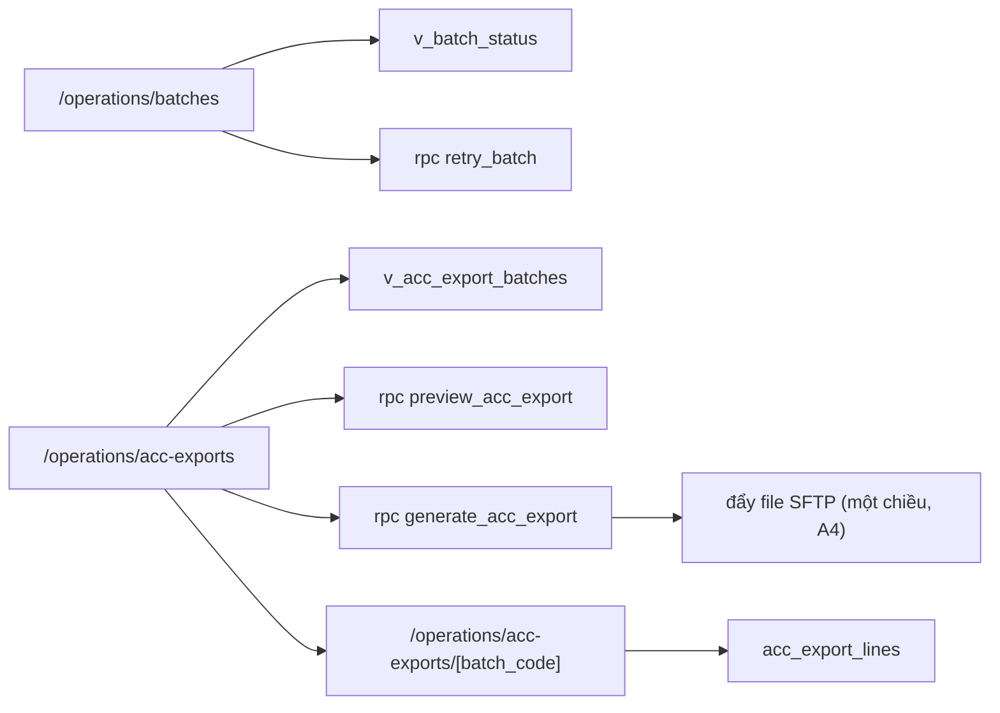

# SCR030_AccountingBatch — Screen Spec

> Alias LAB-1: **SC-30** · バッチ状況・会計連携バッチ · Trạng thái batch & lô xuất kế toán

**Screen**: SCR030_AccountingBatch: Trạng thái batch & lô xuất kế toán (バッチ状況・会計連携バッチ)
**Feature**: F009_ReportsAndExport (tính năng con `F09-04` `F09-05` `F09-06`; user story `US-15`)
**Type**: composite (hai tab + chi tiết lô)
**Route**: `/operations/batches` *(đề xuất)* — tab "Batch báo cáo ngày" · `/operations/acc-exports` — tab "Lô xuất kế toán" · `/operations/acc-exports/[batch_code]` — chi tiết dòng của một lô
**Generated**: 2026-10-06
**Trạng thái**: thiết kế mới, chưa xây — **Chưa có code — màn chỉ đặc tả ở LAB-4**
**Liên kết**: [F009](../../features/F009_ReportsAndExport/business-context.md) · ADR-003 · ADR-005 (thư mục `decisions/`) · màn kề: [SCR018](../SCR018_DailyReconciliation/spec.md) · [SCR029](../SCR029_ReportViewExport/spec.md) · [SCR033](../SCR033_OpsAlertQueue/spec.md) · [SCR022](../SCR022_CorrectionRequestCreate/spec.md) · [SCR037](../SCR037_MarketManagement/spec.md)

## Purpose

Màn trực của bộ phận vận hành trong **cửa sổ một tiếng** giữa lúc sổ chốt (~10:00 JST) và hạn batch báo cáo ngày (**11:00 JST**). Hai việc trên cùng một màn vì chúng xảy ra trong cùng một tiếng đó và cùng một người theo dõi: batch báo cáo ngày (`F09-04`) và lô xuất số liệu sang hệ thống kế toán (`F09-05`). Lỗi của cả hai **không được mất im lặng** (`F09-06`, `NFR-OPS-01`) — mỗi dòng lỗi đi kèm hành động khắc phục bấm được ngay tại chỗ.

Bối cảnh định hình thiết kế: cửa sổ hẹp, **dữ liệu tích luỹ 7 năm**, và giả định **A4 — CSV một chiều qua SFTP**. Một chiều nghĩa là **không có đường nhận phản hồi từ kế toán**: màn này biết lô đã *gửi đi*, không bao giờ biết lô đã được *chấp nhận*. Mọi sửa đổi phải quay về đường điều chỉnh `F07` trong hệ thống này rồi xuất lô delta — không được sửa thẳng ở phía kế toán.

## Screen Layout

*(Suy luận từ bảng field — chưa có wireframe.)* Màn hai tab. Đầu trang: banner (lỗi/thành công) và bộ lọc khoảng ngày. Tab A "Batch báo cáo ngày": bảng `batch_runs` có đếm ngược tới 11:00 và cột hành động khắc phục. Tab B "Lô xuất kế toán": bảng `acc_export_batches` kèm nút "Tạo lô xuất kế toán" (mở `<dialog>` modal). Trang con `/operations/acc-exports/[batch_code]` liệt kê dòng `acc_export_lines`.

### Layout Sketch

```
┌──────────────────────────────────────────────────────────┐
│ R1: Banner (role="alert" / role="status")                │
├──────────────────────────────────────────────────────────┤
│ R2: Bộ lọc khoảng ngày · [Áp dụng]                       │
├──────────────────────────────────────────────────────────┤
│ R3: Tab [Batch báo cáo ngày] [Lô xuất kế toán]           │
│  ┌────────────────────────────────────────────────────┐  │
│  │ R4: Bảng của tab đang chọn (scrollable)            │  │
│  │  Tab A: đếm ngược · status · attempt · remedy      │  │
│  │  Tab B: batch_code · status · [Tạo lô xuất kế toán]│  │
│  └────────────────────────────────────────────────────┘  │
│    ┌ - - - - - - - - - - - - - - - - - - - ┐             │
│    │ R5: <dialog> Tạo lô (modal)           │             │
│    └ - - - - - - - - - - - - - - - - - - - ┘             │
└──────────────────────────────────────────────────────────┘
```

### Layout Regions

| Region ID | Name | Position | Scrollable | Key Components | Responsive Behavior |
|-----------|------|----------|------------|----------------|---------------------|
| R1 | Banner | static | no | banner đỏ `role="alert"`, banner xanh `role="status"` | always |
| R2 | Bộ lọc | static | no | khoảng `business_date`, nút "Áp dụng" | chưa xác định |
| R3 | Tab | static | no | chuyển tab A/B; chỉ báo tự làm mới 15 giây | chưa xác định |
| R4 | Bảng tab / chi tiết lô | static | yes | `batch_runs` / `acc_export_batches` / `acc_export_lines`; nút hành động từng dòng | chưa xác định |
| R5 | Hộp thoại tạo lô | modal (`<dialog>` + `showModal()`) | no | xem trước `業務日`, số dòng, tổng tiền, thuế, phân bố `行ステータス`; nút xác nhận | khi bấm "Tạo lô xuất kế toán" |

## Child Routes

| Route | SCR | URL | Notes |
|-------|-----|-----|-------|
| Batch báo cáo ngày | SCR030 (tab A) | `/operations/batches` | `batch_runs`, đếm ngược tới 11:00 |
| Lô xuất kế toán | SCR030 (tab B) | `/operations/acc-exports` | `acc_export_batches`, tạo lô |
| Chi tiết lô | SCR030 (trang con) | `/operations/acc-exports/[batch_code]` | dòng `acc_export_lines`, 6 trường tối thiểu `IF-ACC-01` |

*(Cùng một mã SCR030 — không cấp mã con; xác nhận với screen-list.)*

## User Flow

> **Scope:** within-screen interactions. Điều hướng liên màn xem `generated/screen-flow.md`.

### Happy Path

1. [SCR018](../SCR018_DailyReconciliation/spec.md) chốt sổ ngày lúc ~10:00 → batch `daily_report` của ngày đó chuyển `queued` → `running`.
2. Người vận hành mở `/operations/batches`, thấy đếm ngược tới 11:00 JST và trạng thái từng batch.
3. **Nhánh thuận:** batch `succeeded` trước hạn → sang tab B, bấm "Tạo lô xuất kế toán" cho `業務日` đó.
4. Hộp thoại hiện trước: `業務日`, số dòng dự kiến, tổng tiền, thuế, và **phân bố `行ステータス`** (bao nhiêu `保留`/`確認済み`). Số `保留` lớn là tín hiệu để người quyết định dừng lại — không chặn, cùng tinh thần ADR-005.
5. Xác nhận → `generate_acc_export` sinh `batch_code`, ghi `acc_export_lines`, tính checksum, đặt `status='generated'`; bước đẩy file SFTP chuyển `status='sent'` hoặc `failed`.
6. Mở `/operations/acc-exports/[batch_code]` xem từng dòng với đủ 6 trường tối thiểu; có liên kết sang `RPT-06` ở [SCR029](../SCR029_ReportViewExport/spec.md) để xem cùng số liệu dưới dạng báo cáo.

### Branches

| Decision point | Condition | Outcome on this screen | Source |
|----------------|-----------|------------------------|--------|
| Bước 3–5 (batch lỗi) | batch `failed` | dòng đỏ kèm `error_code` + hành động khắc phục; "Chạy lại" gọi `retry_batch` (`attempt+1`). `attempt ≥ 3` → `P0048`, nút tắt, cảnh báo sang [SCR033](../SCR033_OpsAlertQueue/spec.md) | (tài liệu gốc trong repo, không nộp) `sc-30-batch-ke-toan.md` §7 |
| Quá hạn | quá 11:00 chưa xong | badge `late`, cảnh báo đẩy đi. Màn **không tự huỷ** batch đang chạy — huỷ giữa chừng để lại file dở ở phía kế toán | cùng file |
| Sau khi gửi | phát hiện sai | không có nút sửa. Chỉ có liên kết "Mở phiếu điều chỉnh ([SCR022](../SCR022_CorrectionRequestCreate/spec.md))" → `F07` duyệt → sinh lô `delta` có `supersedes` | cùng file |

## Data Inventory

> Tất cả field dưới đây readonly; màn không có ô nhập ngoài bộ lọc khoảng ngày và hộp thoại tạo lô. Bảng/view `batch_runs`, `acc_export_batches`, `acc_export_lines`, `v_batch_status`, `v_acc_export_batches` **chưa có** trong `supabase/migrations/` — thiết kế mới; `v_daily_reconciliation` đã có (`0006_derived_views.sql`).

### Tab A — Batch báo cáo ngày (`batch_runs`)

| Field | Display Label | Source | Format | Empty Behavior | Cross-ref |
|-------|---------------|--------|--------|----------------|-----------|
| `business_date` (#1) | Ngày nghiệp vụ / 業務日 | `batch_runs.business_date` | date; mỗi `business_date` có đúng **một** dòng batch (`UNIQUE(business_date, kind)`) | — | — |
| `kind` (#2) | Loại batch / バッチ種別 | `batch_runs.kind` | badge ∈ `daily_report` `acc_export` `report_async` (`report_async` do `P0049` của SCR029 sinh ra) | — | — |
| `status` (#3) | Trạng thái / 状態 | `batch_runs.status` | badge ∈ `queued` `running` `succeeded` `failed` `late` — `late` là trạng thái **dẫn xuất** (xem `deadline_at`); mặc định `queued` | — | — |
| `started_at` (#4) | Bắt đầu / 開始時刻 | `batch_runs.started_at` | datetime JST | "—" khi còn `queued` | — |
| `finished_at` (#5) | Kết thúc / 終了時刻 | `batch_runs.finished_at` | datetime JST | "—" khi chưa xong | — |
| `deadline_at` (#6) | Hạn chót / 期限 | tính từ `business_date`, không lưu | **cố định `business_date` 11:00 `Asia/Tokyo`** (`FIG-LOAD-01`). `late` ⇔ (`finished_at > deadline_at`) hoặc (chưa xong và đã quá `deadline_at`) | — | — |
| `remaining` (#7) | Còn lại / 残り時間 | dẫn xuất phía client | đếm ngược = `deadline_at − đồng hồ trình duyệt`; **chỉ hiển thị**, không tham gia bất kỳ phép kiểm nào ở server | "Quá hạn {n} phút" khi quá hạn | — |
| `attempt` (#8) | Lần thử / 試行回数 | `batch_runs.attempt` | `1..3`; mặc định `1`; `≥ 3` thì nút "Chạy lại" tắt và dòng đẩy sang hàng cảnh báo ([SCR033](../SCR033_OpsAlertQueue/spec.md)) | — | — |
| `error_code` (#9) | Mã lỗi / エラーコード | `batch_runs.error_code` | text | "—" khi `succeeded` | — |
| `error_detail` (#10) | Chi tiết lỗi / エラー詳細 | `batch_runs.error_detail` (`jsonb`) | lấy từ `details` của lỗi, **không** lấy chuỗi `message` | — | — |
| `remedy` (#11) | Hành động khắc phục / 対処 | tra cứu theo `error_code` | văn bản cố định + nút: "Chạy lại" / "Mở phiếu điều chỉnh" / "Liên hệ 財務部門" (bảng dưới) | — | — |

**Bảng hành động khắc phục** (field #11 — `F09-06` đòi "lỗi hiện kèm hành động khắc phục"):

| `error_code` | Nguyên nhân | Hành động hiện ra |
|---|---|---|
| `SFTP_UNREACHABLE` | không mở được kết nối tới máy chủ kế toán | "Chạy lại" (nếu `attempt < 3`), sau 3 lần → "Liên hệ 財務部門" |
| `SFTP_AUTH_FAILED` | xác thực SFTP bị từ chối | **không** hiện "Chạy lại" — thử lại cũng hỏng; chỉ "Liên hệ 財務部門" |
| `REPORT_TIMEOUT` | truy vấn báo cáo vượt thời gian cho phép | "Chạy lại"; kèm cảnh báo còn bao lâu tới 11:00 |
| `DATA_INCOMPLETE` | ngày chưa chốt hoặc thiếu version quy tắc tại `as_of` | "Mở màn chốt sổ ([SCR018](../SCR018_DailyReconciliation/spec.md))" hoặc "Mở quản lý quy tắc ([SCR037](../SCR037_MarketManagement/spec.md))" |
| `ADJUSTMENT_REQUIRED` | phát hiện lệch số sau khi đã gửi | "Mở phiếu điều chỉnh ([SCR022](../SCR022_CorrectionRequestCreate/spec.md))" — **không** có đường sửa thẳng |

### Tab B — Lô xuất kế toán (`acc_export_batches`)

| Field | Display Label | Source | Format | Empty Behavior | Cross-ref |
|-------|---------------|--------|--------|----------------|-----------|
| `batch_code` (#12) | Mã lô gửi / バッチコード | `acc_export_batches.batch_code` | `^ACC-\d{8}-\d{2}$` *(đề xuất)*, duy nhất; **khoá idempotency** — xuất lại cùng `business_date` không được sinh dòng trùng; server cấp | — | — |
| `business_date` (#13) | 業務日 | `acc_export_batches.business_date` | phải có `business_days.status='closed'` — `IF-ACC-01` chỉ trao đổi **dữ liệu sau khi lock** | — | `business_days` |
| `generated_at` (#14) | Thời điểm tạo / 作成日時 | `acc_export_batches.generated_at` | datetime JST | — | — |
| `row_count` (#15) | Số dòng / 件数 | `acc_export_batches.row_count` | `= count(acc_export_lines)` của lô | — | — |
| `checksum` (#16) | Checksum / チェックサム | `acc_export_batches.checksum` | SHA-256 nội dung file; **hai lô cùng `business_date` không có điều chỉnh xen giữa phải cùng checksum** | — | — |
| `status` (#17) | Trạng thái lô / バッチ状態 | `acc_export_batches.status` | badge ∈ `generated` `sent` `failed` `superseded`; **không có `accepted`** — A4 một chiều không biết bên kia nhận hay chưa; mặc định `generated` | — | — |
| `kind` (#18) | Loại lô / 種別 | `acc_export_batches.kind` | badge ∈ `full` `delta` — `delta` sinh từ phiếu điều chỉnh `F07` đã duyệt; mặc định `full` | — | — |
| `supersedes` (#19) | Thay thế lô / 差替元 | `acc_export_batches.supersedes` | link `batch_code` cũ khi `kind='delta'` | rỗng với `full` | — |
| `triggered_by` (#20) | Người kích hoạt / 実行主体 | `app_users.full_name` | text | — | — |

### Chi tiết dòng của một lô (`acc_export_lines`) — 6 trường tối thiểu của `IF-ACC-01`

| Field | Display Label | Source | Format | Empty Behavior | Cross-ref |
|-------|---------------|--------|--------|----------------|-----------|
| `business_date` (#21) | Ngày nghiệp vụ / 業務日 | `acc_export_lines.business_date` | bằng #13 của lô | — | — |
| `participant_code` (#22) | Người tham gia / 参加者 | `acc_export_lines.participant_code` | phải tồn tại trong `participants.code` | — | `participants` (`0003_participants_and_master.sql`) |
| `total_amount` (#23) | Tổng tiền / 総額 | `v_daily_reconciliation` + `trades` | `= Σ trades.amount` của `(業務日, 参加者)` đã `confirmed`; **không** âm với lô `full` (lô `delta` được âm) | — | — |
| `tax_amount` (#24) | Thuế / 税 | `market_rules` tại `as_of` | `≥ 0` với lô `full`; công thức thuế lấy từ version quy tắc tại `as_of` của ngày, **không** hằng số trong code | — | — |
| `line_status` (#25) | Trạng thái dòng / 行ステータス | `acc_export_lines.line_status` | badge ∈ `保留` `確認済み` `調整済み` — **đúng ba giá trị `D.2` đã chốt**, không thêm giá trị thứ tư | — | — |
| `batch_code` (#26) | Mã lô gửi / バッチコード | `acc_export_lines.batch_code` | bằng #12 | — | — |

**Quy tắc suy ra `行ステータス`** *(đề xuất — `D.2` chốt ba giá trị nhưng **không** nói khi nào dùng giá trị nào)*:

| Giá trị | Khi nào | Căn cứ |
|---|---|---|
| `保留` | dòng có tranh chấp đang mở (`F06-04`) hoặc ngoại lệ giao hàng chưa xử lý (`delivery_exception`) tại `as_of` | suy luận từ ADR-005: ngày chốt được dù còn việc tồn — những việc tồn đó phải lộ ra ở đây |
| `確認済み` | dòng không có tranh chấp/ngoại lệ mở tại `as_of` | mặc định sau chốt |
| `調整済み` | dòng sinh từ phiếu điều chỉnh `F07` đã duyệt — chỉ xuất hiện trong lô `kind='delta'` | `FR-INC-03`: điều chỉnh sau lock sinh delta ở kỳ kế, báo cáo kỳ cũ giữ nguyên |

## UI States

| State | Trigger | Visual Behavior | User Action Available | Source |
|-------|---------|----------------|-----------------------|--------|
| empty | chưa có batch nào cho khoảng ngày đang lọc | "Chưa có batch nào trong khoảng này." | đổi khoảng ngày | đặc tả §5 |
| loading | tải danh sách; và khi có batch `running` → **tự làm mới mỗi 15 giây** | chỉ báo nhỏ cạnh tiêu đề tab; bảng không nhấp nháy | none | đặc tả §5 |
| success | `generate_acc_export` trả `batch_code` | banner xanh `role="status"`: "Đã tạo lô {batch_code} — {row_count} dòng, checksum {checksum}."; dòng mới hiện đầu bảng | dismiss | đặc tả §5 |
| error (nghiệp vụ) | `P0045`–`P0048` | banner đỏ `role="alert"`; hộp thoại **không tự đóng** | sửa / đóng hộp thoại | đặc tả §5 |
| error (mạng) | Server Action throw | banner riêng, kèm nhắc tải lại trước khi thử tiếp — trạng thái batch là dữ liệu đang chạy, dễ cũ | tải lại | đặc tả §5 |
| late (quá hạn) | quá 11:00 JST mà batch chưa `succeeded` | dòng nền đỏ, badge `late`, **đẩy cảnh báo sang [SCR033](../SCR033_OpsAlertQueue/spec.md)**; đếm ngược đổi thành "Quá hạn {n} phút" | xử lý theo `remedy` | đặc tả §5 |
| saving | `generate_acc_export` / `retry_batch` đang chạy | *(suy luận — nguồn không mô tả riêng)* | none | — |
| read-only | chức danh `sys_admin` | mọi nút ghi ẩn, bảng hiện đầy đủ | chỉ xem | đặc tả §5 |

## Validation & Error Feedback

### A) Client-side

Bộ lọc khoảng ngày `business_date` (+ `kind?`, `status?`) — ràng buộc cụ thể **chưa nêu** trong đặc tả gốc. Hộp thoại "Tạo lô xuất kế toán": chọn `業務日` và `p_kind` (`full`/`delta`); mọi kiểm nghiệp vụ nằm ở server (mục B).

| Field | Type | Required | Constraints | Async Check | Error Message | Default | Source |
|-------|------|----------|-------------|-------------|---------------|---------|--------|
| khoảng `business_date` | date range | no | chưa nêu | không | — | chưa nêu | `v_batch_status` / `v_acc_export_batches` |
| `p_business_date` (hộp thoại tạo lô) | date | yes | `business_days.status='closed'` | `preview_acc_export` | `P0045` | chưa nêu | `business_days` |
| `p_kind` (hộp thoại tạo lô) | select | yes | ∈ `full` `delta` | không | `P0046` | `full` | — |

### B) Server-side

#### Tạo lô xuất kế toán

- **Endpoint:** `rpc('generate_acc_export', { p_business_date, p_kind })`; xem trước bằng `rpc('preview_acc_export', { p_business_date })`
- **Request:** `業務日`, `full`/`delta`
- **Success:** `jsonb { batch_code, row_count, checksum }`; preview → `jsonb { row_count, total_amount, tax_amount, status_breakdown }`
- **Errors:** `P0045` `P0046` `P0005` (tạo) · `P0045` (preview)
- **Trigger:** xác nhận trong hộp thoại
- **Source:** (tài liệu gốc trong repo, không nộp) `sc-30-batch-ke-toan.md` §8

#### Chạy lại batch

- **Endpoint:** `rpc('retry_batch', { p_batch_id })`
- **Request:** id batch
- **Success:** `jsonb { status, attempt }`
- **Errors:** `P0047` `P0048` `P0005`
- **Trigger:** nút "Chạy lại" trên dòng batch `failed`

| Mã | Điều kiện kích hoạt | Thông báo VI | Thông báo JA | Hiện ở đâu | Chặn? |
|---|---|---|---|---|:---:|
| `P0045` | tạo lô xuất kế toán khi `business_days.status <> 'closed'` | Ngày nghiệp vụ {business_date} chưa chốt sổ — chưa tạo được lô xuất kế toán. | 業務日{business_date}は未締めのため、会計連携バッチを作成できません。 | hộp thoại tạo lô | ● |
| `P0046` | đã tồn tại lô `full` ở trạng thái `sent` cho cùng `business_date` | Ngày {business_date} đã gửi lô {batch_code}. Thay đổi sau khi gửi phải đi qua phiếu điều chỉnh (F07) rồi xuất lô delta. | 業務日{business_date}はバッチ{batch_code}で送信済みです。変更は訂正申請（F07）を経て差分バッチで出力してください。 | hộp thoại tạo lô, kèm nút "Mở phiếu điều chỉnh" | ● |
| `P0047` | bấm "Chạy lại" khi batch không ở `failed` | Chỉ chạy lại được batch đang ở trạng thái thất bại. | 失敗状態のバッチのみ再実行できます。 | dưới nút | ● |
| `P0048` | `attempt ≥ 3` | Batch đã thử 3 lần không thành công. Cần người vận hành xử lý trước khi chạy lại. | バッチは3回失敗しました。再実行前に運用担当の対応が必要です。 | dòng batch, nền đỏ; đồng thời đẩy sang SCR033 | ● |
| `P0005` | `sys_admin` gọi `generate_acc_export`/`retry_batch` | Chức danh của bạn chỉ được xem màn này. | あなたの職掌では参照のみ可能です。 | banner | ● |
| (network) | Server Action throw | Mất kết nối — chưa gửi được lệnh. Trạng thái batch trên màn có thể đã cũ, tải lại trước khi thử tiếp. | 接続が切断されました。バッチ状態が古い可能性があります。再読み込みしてからお試しください。 | banner | ● |

**`P0046` là điểm dễ hiểu sai nhất của màn này.** Vì A4 là một chiều, hệ thống **không biết** bên kế toán đã nhận hay chưa. Xuất lại cùng `business_date` không phải là "gửi lại cho chắc" — nó tạo ra khả năng kế toán nhận hai lô cùng ngày và không có cách phân biệt. Quy tắc: `full` **đúng một lần** cho mỗi `business_date`; mọi thay đổi sau đó là `delta` có `supersedes` trỏ về lô gốc. Đừng hiện thực "ghi đè lô cũ".

Đọc dữ liệu (không phải submit):

| Thao tác | Cách gọi | Tham số | Trả về |
|---|---|---|---|
| Đọc trạng thái batch | `select` từ `v_batch_status` (`security_invoker = true`) | khoảng `business_date`, `kind?`, `status?` | mảng `BatchRunRow` kèm `deadline_at`, `is_late` tính trong view |
| Đọc danh sách lô kế toán | `select` từ `v_acc_export_batches` | khoảng `business_date`, `status?` | mảng `AccExportBatchRow` |
| Đọc dòng của một lô | `select` từ `acc_export_lines` | `batch_code` | 6 trường tối thiểu + `line_status` |

Đọc dùng select thẳng. Hai thao tác ghi **bắt buộc qua RPC**: `generate_acc_export` phải kiểm `business_days.status='closed'`, kiểm trùng `batch_code`, ghi `acc_export_batches` + `acc_export_lines` và tính checksum **trong một transaction** — nửa chừng là có lô không có dòng. `is_late` tính **trong view bằng giờ server**, không bằng đồng hồ trình duyệt; đếm ngược phía client chỉ để nhìn.

## Interaction Patterns

- **Không có phím tắt chạy lại nhanh — cố ý**: chạy lại là thao tác có hệ quả ra ngoài hệ thống. Không thuộc ba màn keyboard-first — source: đặc tả §6.
- **Tab: bộ lọc khoảng ngày → "Áp dụng" → chuyển tab → lần lượt nút hành động của từng dòng** — source: đặc tả §6.
- **Hộp thoại "Tạo lô xuất kế toán" dùng `<dialog>` gốc HTML (`showModal()`)**: trình duyệt tự khoá focus và tự xử lý `Escape` — source: đặc tả §6.
- **Khi có batch `running` → tự làm mới mỗi 15 giây**, bảng không nhấp nháy — source: đặc tả §5.
- **Số `保留` lớn trong hộp thoại xem trước là tín hiệu dừng lại — không chặn** (ADR-005) — source: đặc tả §7.

## Accessibility

| Aspect | Status | Notes |
|--------|--------|-------|
| ARIA roles/labels | partial (theo đặc tả) | banner lỗi `role="alert"`, banner thành công `role="status"` |
| Keyboard navigation | supported (theo đặc tả) | Tab theo thứ tự nêu ở Interaction Patterns; không có phím tắt riêng |
| Focus management | managed (theo đặc tả) | `<dialog>` + `showModal()` khoá focus, `Escape` đóng |
| Screen reader compatibility | unknown | chưa kiểm — cần audit khi xây |

## Conditional Rendering

| Condition | Type | Renders | Hidden | Notes |
|-----------|------|---------|--------|-------|
| `sys_admin` | auth | bảng đầy đủ | mọi nút ghi | bypass → `P0005` |
| `ops_admin` (đề xuất) / `reconcile` | auth | nút "Tạo lô xuất kế toán", "Chạy lại" | — | chỉ ghi qua RPC |
| `attempt ≥ 3` | hardcoded-threshold | nút "Chạy lại" tắt, nền đỏ | nút "Chạy lại" | `P0048` |
| `error_code = SFTP_AUTH_FAILED` | hardcoded-state | chỉ "Liên hệ 財務部門" | "Chạy lại" | thử lại cũng hỏng |
| quá 11:00 JST, chưa `succeeded` | hardcoded-state | badge `late`, "Quá hạn {n} phút" | đếm ngược | `is_late` do server tính |
| `kind='delta'` | hardcoded-state | `supersedes`, dòng `調整済み` | — | |

## Component Variants

Không áp dụng — chưa có code, không có component đa hình dùng chung được xác định.

## Security Surface

| Guard | Type | Consequence if bypassed |
|-------|------|------------------------|
| `route-policy.ts` `{ prefix: "/operations", roles: ["sys_admin","ops_admin","reconcile"] }` *(đề xuất; đặc tả gốc viết `"ops"` — đổi sang tên trong registry)* | role | đẩy về `/403` |
| RLS trên `batch_runs` / `acc_export_batches` | permission | không đọc được ngoài chức danh cho phép |
| RPC `generate_acc_export` / `retry_batch` tự kiểm `current_app_role() IN ('ops_admin','reconcile')` → `P0005` | permission | `sys_admin` xem được nhưng **không** được ghi; thiếu kiểm này thì gọi thẳng RPC ghi được |

Vai trò đề xuất: `sys_admin` xem (hỗ trợ kỹ thuật; không chạy lại batch nghiệp vụ) · `ops_admin` (đề xuất; "Vận hành" trong `04_画面一覧`, **chưa tồn tại** trong 4 chức danh prototype) xem + ghi · `reconcile` xem + ghi (người chịu trách nhiệm số liệu gửi đi; được tạo lô và retry) · `receiving` · `trading` · `party_admin` · `rule_admin` · `internal_audit` ✗ · `market_manager` (đề xuất) ✗ (xem kết quả báo cáo ở SCR029, không xem hạ tầng batch). Server enforcement: `[UNVERIFIED]` — chưa có code.

## Source References

Chưa có code — màn chỉ đặc tả ở LAB-4.

1. Đặc tả gốc: (tài liệu gốc trong repo, không nộp) `sc-30-batch-ke-toan.md`
2. Kiến trúc: (tài liệu gốc trong repo, không nộp) `architecture.md` §4 (IF-ACC-01, chưa làm)
3. ADR: (tài liệu gốc trong repo, không nộp) `adr.md` (ADR-003, ADR-005)
4. Bảng đã có: `v_daily_reconciliation` — `supabase/migrations/0006_derived_views.sql`; `business_days` — `0004_business_days_and_lots.sql`; RPC `close_business_day` — `0008_rpc_functions_admin.sql`
5. Bảng/RPC dự kiến (chưa có): `batch_runs`, `acc_export_batches`, `acc_export_lines`, `v_batch_status`, `v_acc_export_batches`; RPC `preview_acc_export`, `generate_acc_export`, `retry_batch`

## Source Walkthrough

Không có file code để dẫn đọc. Thứ tự đọc đề xuất:

1. **File:** `supabase/migrations/0008_rpc_functions_admin.sql` — `close_business_day`, điểm khởi đầu của cửa sổ 10:00–11:00
2. **File:** `supabase/migrations/0006_derived_views.sql` — `v_daily_reconciliation`, nguồn `total_amount`
3. **File:** (tài liệu gốc trong repo, không nộp) `architecture.md` — §4 điểm tích hợp IF-ACC-01

### Call Hierarchy

*(Thiết kế dự kiến — không phải code hiện có.)*



**Related files:** xem `## Source References`.

## Dependencies & Risks *(mục bổ sung)*

- Phụ thuộc [SCR018](../SCR018_DailyReconciliation/spec.md): không chốt sổ thì không có gì để xuất (`P0045`). Phụ thuộc [SCR037](../SCR037_MarketManagement/spec.md): thiếu version quy tắc tại `as_of` thì không tính được `税` → `DATA_INCOMPLETE`.
- Phụ thuộc `F07`/[SCR022](../SCR022_CorrectionRequestCreate/spec.md) cho lô `delta`. **`F07` chưa xây** — nên đường khắc phục duy nhất sau khi gửi hiện đang trỏ tới một màn chưa tồn tại. Phải làm `F07` trước hoặc cùng lúc, nếu không SCR030 có lỗi mà không có lối ra.
- **Cửa sổ một tiếng là rủi ro thật, không phải lo xa.** Chốt ~10:00, hạn 11:00, dữ liệu 7 năm, và ADR-003 khiến mọi số còn lại **tính lại mỗi lần đọc**. Phải đo thời gian chạy trên dữ liệu quy mô đầy đủ; nếu vượt, hướng xử lý là bảng tổng hợp theo ngày (ghi một lần sau chốt, bất biến) — **không** phải cột `remaining` lưu sẵn, thứ ADR-003 đã loại.
- **Dễ hiểu sai #1:** trạng thái `sent` **không** nghĩa là kế toán đã nhận. A4 một chiều không có xác nhận. Đừng hiện thực trạng thái `accepted`, và đừng để giao diện gợi ý điều đó.
- **Dễ hiểu sai #2:** "chạy lại" lô xuất kế toán khác "chạy lại" batch báo cáo. Batch báo cáo chạy lại vô hại (chỉ đọc). Lô xuất kế toán chạy lại là **gửi file thêm một lần ra ngoài hệ thống** — vì vậy mới có `P0046` và khoá idempotency theo `batch_code`.
- **Dễ hiểu sai #3:** đếm ngược phía client dùng đồng hồ máy người dùng. Máy lệch giờ thì con số hiển thị sai; `is_late` thật phải do server quyết. Đừng để phép kiểm nào phụ thuộc `remaining` (#7).
- ADR-005 kéo theo: lô gửi đi có thể chứa giao dịch chưa giao xong (`行ステータス = 保留`). Cột này không phải trang trí — nó là cách bộ phận tài chính biết dòng nào chưa phải số cuối.

## Unresolved Questions *(mục bổ sung)*

- **Giả định A4 — CSV một chiều qua SFTP — chưa được khách xác nhận.** `IF-ACC-01` mới chốt được ba thứ (dữ liệu trao đổi là bảng đối chiếu **sau khi lock**, bên nhận là hệ thống kế toán của 財務部門, 6 trường tối thiểu + ba giá trị `行ステータス`). **Phương thức kết nối, cơ chế xác thực, retry, môi trường test, thủ tục 受入 đều quyết ở インターフェース検討会 — cuộc họp chưa diễn ra.** Toàn bộ mục Data Inventory (Tab B và chi tiết dòng) và User Flow đứng trên giả định này.
- **Nếu đổi sang API hai chiều** (LAB-1 định lượng **+25…35 MD** ở P10), ba thứ đổi về bản chất và SCR030 phải thiết kế lại chứ không phải sửa thêm:
  1. `行ステータス` trở thành dữ liệu **hai chủ** — cần quy tắc bên nào thắng khi lệch, và ánh xạ `調整済み` do kế toán đặt thành reverse/delta phía này.
  2. **`close_business_day` không còn là điểm cuối của vòng đời ngày** — cần thêm trạng thái "đã chốt, chờ kế toán xác nhận", và SCR018 phải đổi theo.
  3. Cần retry + idempotency ở tầng HTTP và **một môi trường test do 財務部門 cấp — hiện chưa có**. Không có môi trường đó thì không nghiệm thu được interface, dù code xong.
- Role `ops_admin` ("Vận hành") **chưa có trong DB** — role *(đề xuất)* đã chốt ở PREMISE C-09 (cùng nhóm với `market_manager` ở SCR028/SCR029). Còn lại là rủi ro triển khai: nếu bài làm thật không thêm role thì `reconcile` phải gánh cả vai vận hành, và bảng vai trò mất ý nghĩa.
- Quy tắc suy ra `行ステータス` (Data Inventory) là **đề xuất của bên thầu**. `D.2` chốt ba giá trị nhưng không nói khi nào dùng giá trị nào — cần khách xác nhận trước LAB-5, vì nó quyết định cách bộ phận tài chính đọc file.
- Số lần thử tối đa **3** lấy theo mô tả SC-33 ([SCR033](../SCR033_OpsAlertQueue/spec.md)) ("thất bại sau 3 lần thử"); khoảng cách giữa các lần thử chưa có căn cứ nào trong tài liệu.
- Ai được bấm "Tạo lô xuất kế toán" — vận hành hay đối chiếu? Hiện đề xuất **cả hai**, vì cửa sổ chỉ một tiếng và chờ đúng một người là rủi ro vận hành. Cần khách xác nhận trách nhiệm.
