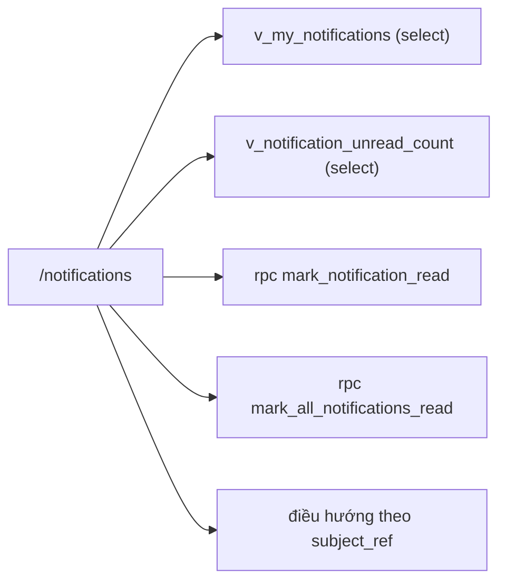

# SCR031_NotificationInbox — Screen Spec

> Alias LAB-1: **SC-31** · 通知ボックス · Hộp thông báo

**Screen**: SCR031_NotificationInbox: Hộp thông báo (通知ボックス)
**Feature**: F010_Notifications (tính năng con `F10-01` `F10-02`; không có US riêng — LAB-1 xếp `F10-01`…`F10-05` vào *"hỗ trợ vận hành, không chặn giao dịch"* (`product-a-user-stories.md`); `US-08` (giao hàng ứ đọng) và `US-13` (tư cách sắp hết hạn) là hai nơi thông báo của màn này được tiêu thụ)
**Type**: atomic
**Route**: `/notifications` *(đề xuất)*
**Generated**: 2026-10-06
**Trạng thái**: thiết kế mới, chưa xây — **Chưa có code — màn chỉ đặc tả ở LAB-4**
**Liên kết**: [F010](../../features/F010_Notifications/business-context.md) · ADR-007 (thư mục `decisions/`) · màn kề: [SCR001](../SCR001_RoleHome/spec.md) · [SCR032](../SCR032_NotificationSettings/spec.md) · [SCR033](../SCR033_OpsAlertQueue/spec.md) · [SCR020](../SCR020_DisputeDetail/spec.md)

## Purpose

Nơi người dùng đọc lại **toàn bộ** thông báo trong ứng dụng gửi cho mình, lọc theo loại và đánh dấu đã đọc. [SCR001](../SCR001_RoleHome/spec.md) chỉ hiện phần nổi (badge + vài dòng mới nhất) theo chức danh; SCR031 là danh sách đầy đủ có lịch sử.

Bối cảnh vật lý ảnh hưởng thiết kế: ca làm chạy **02:00–10:00 JST** trên máy dùng chung theo ca. Vì vậy **trạng thái đã đọc gắn với người đăng nhập, không gắn với máy** — không dùng `localStorage`. Người vào ca sau không được thấy thông báo của người ca trước đã bị đánh dấu đọc hộ.

**Kênh.** `BR-NOTIFY-01` chốt kênh baseline là **アプリ内 + 電子メール**. Màn này là mặt trong ứng dụng của kênh đó; nhánh email chạy nền và chỉ hiện ở [SCR033](../SCR033_OpsAlertQueue/spec.md) khi hỏng. **SMS và FAX ngoài phạm vi** (`F10-01`, khách xác nhận lại ở câu 17 của (tài liệu gốc trong repo, không nộp) `product-a-rfp-qa-part-a-client.md`).

## Screen Layout

*(Suy luận từ bảng field — chưa có wireframe.)* Trang danh sách: banner trạng thái đầu trang, thanh bộ lọc (loại sự kiện, chỉ chưa đọc, khoảng ngày) kèm `unread_count`, rồi danh sách thông báo (critical lên trước, mới nhất trước); nút "Đánh dấu tất cả đã đọc" đặt **sau** danh sách trong thứ tự Tab.

### Layout Sketch

```
┌──────────────────────────────────────────────────────────┐
│ R1: Banner (role="status" / lỗi đỏ)                      │
├──────────────────────────────────────────────────────────┤
│ R2: Bộ lọc: loại · ☑ chỉ chưa đọc · từ–đến · [Áp dụng]   │
│     Số chưa đọc: N (không chịu bộ lọc)                   │
├──────────────────────────────────────────────────────────┤
│ R3: Danh sách thông báo (scrollable)                     │
│   [critical trước] badge · tiêu đề · nội dung · đối tượng│
│   · 発生日時 · 既読 · 配信状態     [biểu tượng đã đọc]   │
├──────────────────────────────────────────────────────────┤
│ R4: [Đánh dấu tất cả đã đọc] (static, sau danh sách)     │
│   ┌ - - - - - - - - - - - - - - - ┐                      │
│   │ R5: Hộp thoại xác nhận (modal)│                      │
│   └ - - - - - - - - - - - - - - - ┘                      │
└──────────────────────────────────────────────────────────┘
```

### Layout Regions

| Region ID | Name | Position | Scrollable | Key Components | Responsive Behavior |
|-----------|------|----------|------------|----------------|---------------------|
| R1 | Banner | static | no | banner `role="status"` ngắn / banner đỏ | always |
| R2 | Bộ lọc + số chưa đọc | static | no | `eventType`, `unreadOnly`, `from`/`to`, `unread_count` | chưa xác định |
| R3 | Danh sách thông báo | static | yes | dòng thông báo, `EmptyState`, biểu tượng "đã đọc" | chưa xác định |
| R4 | Hành động hàng loạt | static | no | "Đánh dấu tất cả đã đọc" | đặt sau R3 trong thứ tự Tab |
| R5 | Hộp thoại xác nhận | modal | no | nêu rõ số dòng sẽ bị đánh dấu | khi bấm R4 |

## Child Routes

Không áp dụng — màn không phải shell có route con.

## User Flow

> **Scope:** within-screen interactions. Điều hướng liên màn xem `generated/screen-flow.md`.

### Happy Path

1. Người dùng thấy badge số chưa đọc ở [SCR001](../SCR001_RoleHome/spec.md) → mở `/notifications`.
2. Mặc định: chỉ chưa đọc, mọi loại, sắp `critical` trước rồi mới nhất trước.
3. Chọn loại sự kiện và/hoặc khoảng ngày → "Áp dụng".
4. Bấm vào một dòng → điều hướng tới đối tượng theo `subject_ref` (ví dụ `dispute_open` → [SCR020](../SCR020_DisputeDetail/spec.md)), **và đánh dấu đã đọc trong cùng thao tác**.
5. "Đánh dấu tất cả đã đọc" → hộp thoại xác nhận nêu rõ **số dòng sẽ bị đánh dấu**, vì thao tác này không hoàn tác được.
6. Bỏ tick "Chỉ chưa đọc" → thấy lại toàn bộ lịch sử, kể cả thông báo đã đọc từ các kỳ trước.

### Branches

| Decision point | Condition | Outcome on this screen | Source |
|----------------|-----------|------------------------|--------|
| Bước 4 | bấm riêng biểu tượng "đã đọc" trên dòng | đánh dấu mà **không** điều hướng | (tài liệu gốc trong repo, không nộp) `sc-31-hop-thong-bao.md` §7 |
| Bước 3 | bộ lọc không khớp | rỗng có lọc + nút "Xoá lọc" | cùng file §5 |

## Data Inventory

> Bảng/view `notifications`, `v_my_notifications`, `v_notification_unread_count`, `v_notification_delivery` **chưa có** trong `supabase/migrations/` — thiết kế mới. Bộ lọc nằm ở `## Validation & Error Feedback`. Mỗi dòng là một `notifications`.

| Field | Display Label | Source | Format | Empty Behavior | Cross-ref |
|-------|---------------|--------|--------|----------------|-----------|
| `event_type` (#1) | Loại sự kiện / 種別 | `notifications.event_type` | badge ∈ **đúng 4 giá trị** `qualification_expiring` · `dispute_open` · `export_failed` · `delivery_backlog` — khoá cứng theo `F10-02`, thêm loại thứ 5 là đổi phạm vi | — | — |
| `severity` (#2) | Mức / 重要度 | `notifications.severity` | badge ∈ `critical` `normal` *(đề xuất)*; mặc định `normal`. `critical` là loại chịu cam kết **gửi xong ≤ 5 phút** của `F10-03` | — | — |
| `title` (#3) | Tiêu đề / 件名 | `notifications.title` | 1–120 ký tự; dựng từ mẫu theo `event_type`, không nhập tay | — | — |
| `body` (#4) | Nội dung / 本文 | `notifications.body` | 1–1000 ký tự | — | — |
| `subject_ref` (#5) | Đối tượng liên quan / 対象 | `notifications.subject_table`, `notifications.subject_id` | link; cặp `(subject_table, subject_id)`, `subject_table` ∈ `participant_qualifications` `disputes` `export_batches` `trades` | — | `participant_qualifications`, `trades` (đã có trong `supabase/migrations/`) |
| `business_date` (#6) | 業務日 | `notifications.business_date` | date | rỗng với sự kiện không gắn ngày nghiệp vụ (ví dụ hồ sơ sắp hết hạn) | — |
| `created_at` (#7) | Thời điểm sinh / 発生日時 | `notifications.created_at` | datetime JST; server đặt | — | — |
| `read_at` (#8) | Đã đọc lúc / 既読日時 | `notifications.read_at` | datetime; **chỉ đặt được một lần**, đọc rồi không bỏ đọc *(đề xuất — xem Unresolved Questions câu 1)* | rỗng ⇒ chưa đọc | — |
| `delivery_state` (#9) | Trạng thái gửi email / 配信状態 | `v_notification_delivery.state` | badge ∈ `pending` `sent` `failed` `alerted`; mặc định `pending`. `alerted` = đã rơi vào [SCR033](../SCR033_OpsAlertQueue/spec.md) sau 3 lần thử (`F10-04`) | — | — |
| `unread_count` (#13) | Số chưa đọc / 未読件数 | `v_notification_unread_count` | số nguyên = số dòng của chính người dùng có `read_at IS NULL`; **không chịu bộ lọc** — luôn là tổng, để khớp badge ở SCR001 | — | — |

Sắp xếp mặc định: `severity = 'critical'` lên trước, rồi `created_at` giảm dần.

## UI States

| State | Trigger | Visual Behavior | User Action Available | Source |
|-------|---------|----------------|-----------------------|--------|
| empty | người dùng chưa từng nhận thông báo | "Chưa có thông báo nào." / 通知はまだありません。 | none | đặc tả §5 |
| empty (có lọc) | lọc không khớp | thông báo rỗng **kèm nút "Xoá lọc"** — phân biệt với rỗng thật | Xoá lọc | đặc tả §5 |
| loading | mở trang / đổi bộ lọc | khung xương 5 dòng | none | đặc tả §5 |
| success | sau khi đánh dấu đã đọc | dòng chuyển sang tông mờ **tại chỗ**, không nhảy khỏi danh sách dù `unreadOnly` đang bật; `unread_count` giảm; banner `role="status"` ngắn | dismiss | đặc tả §5 |
| error (nghiệp vụ) | `P0050` | banner đỏ; trạng thái đọc trên UI **quay về như cũ** | đóng banner | đặc tả §5 |
| error (mạng) | mất kết nối lúc đánh dấu đã đọc | banner + nút thử lại; **bộ lọc đang gõ giữ nguyên**; dấu đọc lạc quan bị hoàn tác | thử lại | đặc tả §5 |
| saving | `mark_notification_read` / `mark_all_notifications_read` đang chạy | dấu đọc lạc quan (suy ra từ mô tả hoàn tác ở dòng error mạng) | none | — |
| read-only | không áp dụng — nội dung thông báo không bao giờ sửa được | — | — | đặc tả §5 |

## Validation & Error Feedback

### A) Client-side

Bộ lọc (field nhập):

| Field | Type | Required | Constraints | Async Check | Error Message | Default | Source |
|-------|------|----------|-------------|-------------|---------------|---------|--------|
| `eventType` — Loại sự kiện / 種別 (#10) | select, 4 lựa chọn + "Tất cả" | no | giá trị ngoài 4 enum → bỏ qua, coi như "Tất cả" | không | — | rỗng | `searchParams.eventType` |
| `unreadOnly` — Chỉ chưa đọc / 未読のみ (#11) | checkbox | no | bật ⇒ thêm `read_at IS NULL` | không | — | **bật** *(đề xuất — hộp thông báo mở ra để xử lý việc tồn, không để đọc lại)* | `searchParams.unread` |
| `from` / `to` — Khoảng ngày sinh / 発生日 範囲 (#12) | 2 × `input type="date"` | no | `from ≤ to`; khoảng **≤ 92 ngày** *(đề xuất)*; lọc trên `created_at` theo JST | không | `V-01`, `V-02` | rỗng | `searchParams.from`, `searchParams.to` |

| Mã | Điều kiện kích hoạt | Thông báo VI | Thông báo JA | Hiện ở đâu | Chặn gửi? |
|---|---|---|---|---|:---:|
| `V-01` | `from > to` | Ngày bắt đầu phải trước hoặc bằng ngày kết thúc. | 開始日は終了日以前にしてください。 | dưới cặp ô ngày | ● |
| `V-02` | khoảng ngày > 92 ngày | Khoảng lọc tối đa 92 ngày. | 絞り込み期間は最大92日です。 | dưới cặp ô ngày | ● |
| — | bộ lọc không khớp dòng nào | (không phải lỗi) "Không có thông báo nào khớp bộ lọc." | 条件に一致する通知がありません。 | vùng danh sách (`EmptyState`) | không áp dụng |

### B) Server-side

#### Đánh dấu một dòng đã đọc

- **Endpoint:** `rpc('mark_notification_read', { p_notification_id })`
- **Request:** `notification_id`
- **Success:** `jsonb { notification_id, read_at }` → dòng mờ tại chỗ, `unread_count` giảm
- **Errors:** `P0050` (bảng dưới)
- **Trigger:** bấm dòng (cùng điều hướng) hoặc bấm biểu tượng "đã đọc"
- **Source:** (tài liệu gốc trong repo, không nộp) `sc-31-hop-thong-bao.md` §8

#### Đánh dấu tất cả đã đọc

- **Endpoint:** `rpc('mark_all_notifications_read', { p_event_type })`
- **Request:** `event_type?`
- **Success:** `jsonb { marked_count }`
- **Errors:** không có mã riêng nêu trong đặc tả gốc
- **Trigger:** xác nhận trong hộp thoại R5

| Mã | Điều kiện kích hoạt | Thông báo VI | Thông báo JA | Hiện ở đâu | Chặn? |
|---|---|---|---|---|:---:|
| `P0050` *(mới, đề xuất)* | đánh dấu đã đọc một `notification_id` **không thuộc người đang đăng nhập** hoặc không tồn tại | Không tìm thấy thông báo này. | この通知は見つかりません。 | banner đầu danh sách | ● |

`P0050` **gộp hai trường hợp khác nhau vào một thông báo có chủ ý**: dòng không tồn tại và dòng của người khác phải không phân biệt được từ phía client, nếu không thì mã thông báo trở thành kênh dò sự tồn tại. Thông báo dựng từ `error.details.notification_id`, không so khớp `message`.

Đọc dữ liệu (không phải submit):

| Thao tác | Cách gọi | Tham số | Trả về |
|---|---|---|---|
| Đọc danh sách | `select` từ `v_my_notifications` (`security_invoker`) | `eventType?`, `unread?`, `from?`, `to?` | mảng dòng kèm `delivery_state` |
| Đọc số chưa đọc | `select` từ `v_notification_unread_count` | — | một số nguyên |

Đọc bằng `select` vì chỉ hiển thị. Đánh dấu đã đọc **đi qua RPC** dù trông như một `UPDATE` một cột: RPC là chỗ duy nhất đặt được `read_at = now()` phía server (không tin đồng hồ client) và là chỗ phân biệt "không tồn tại" với "không phải của bạn" thành cùng một `P0050`.

## Interaction Patterns

- **Không có phím tắt riêng** — không thuộc ba màn ⌨️ (`SC-07`, `SC-10`, `SC-14`) — source: đặc tả §6.
- **Nút "Đánh dấu tất cả đã đọc" nằm sau danh sách trong thứ tự Tab** *(đề xuất)*, để Tab một nhát từ đầu trang không xoá sạch dấu chưa đọc — source: đặc tả §6.
- **Bấm dòng → điều hướng tới đối tượng và đánh dấu đã đọc trong cùng thao tác**; bấm biểu tượng "đã đọc" → chỉ đánh dấu — source: đặc tả §7.
- **"Đánh dấu tất cả đã đọc" mở hộp thoại nêu số dòng sẽ bị đánh dấu** (không hoàn tác được) — source: đặc tả §7.
- **Trạng thái đã đọc gắn với người đăng nhập, không `localStorage`** (máy dùng chung theo ca) — source: đặc tả §1.

## Accessibility

| Aspect | Status | Notes |
|--------|--------|-------|
| ARIA roles/labels | partial (theo đặc tả) | banner thành công `role="status"` |
| Keyboard navigation | partial (theo đặc tả) | "Đánh dấu tất cả đã đọc" phải nằm sau danh sách trong thứ tự Tab *(đề xuất)* |
| Focus management | unknown | hộp thoại xác nhận chưa mô tả focus |
| Screen reader compatibility | unknown | chưa kiểm — cần audit khi xây |

## Conditional Rendering

| Condition | Type | Renders | Hidden | Notes |
|-----------|------|---------|--------|-------|
| `recipient_user_id = auth.uid()` | auth | chỉ thông báo của chính mình | thông báo người khác | RLS; gõ tay `id` người khác → rỗng, không 403 (`P0050`) |
| `unreadOnly` bật (mặc định) | hardcoded-default | chỉ dòng `read_at IS NULL` | dòng đã đọc | dòng vừa đọc vẫn ở lại tại chỗ |
| `severity = 'critical'` | hardcoded-state | lên đầu danh sách | — | |
| `delivery_state` | hardcoded-state | badge email | — | nói về **nhánh email**, không phải nhánh trong ứng dụng |

## Component Variants

Không áp dụng — chưa có code. (Có `EmptyState` được nhắc tới trong đặc tả nhưng chưa xác định biến thể.)

## Security Surface

| Guard | Type | Consequence if bypassed |
|-------|------|------------------------|
| Route `/notifications` mở cho **mọi chức danh đã đăng nhập** (`ROUTE_POLICY` không liệt kê ⇒ chỉ cần phiên hợp lệ) | auth | chưa đăng nhập → về `/login` |
| RLS trên `notifications`: SELECT chỉ dòng `recipient_user_id = auth.uid()`; UPDATE chỉ cột `read_at` của chính dòng đó | permission | lớp thật; lệch → đọc/sửa được thông báo người khác |
| RPC `mark_notification_read` gộp "không tồn tại" và "của người khác" thành `P0050` | permission | thiếu → mã thông báo thành kênh dò sự tồn tại |

Vai trò: mọi chức danh xem + "ghi" (chỉ đánh dấu đã đọc — không ai sửa được nội dung): `sys_admin` (chỉ thông báo của chính mình, **không** xem hộ người khác) · `receiving` · `trading` · `reconcile` · `rule_admin` (đề xuất, SCR037) · `party_admin` (đề xuất, SCR036) · `ops_admin` (đề xuất — hộp cá nhân; hàng cảnh báo vận hành là SCR033, khác màn) · `market_manager` (đề xuất) · `internal_audit` (đề xuất) — đủ 9 role, mỗi người chỉ thấy thông báo của chính mình. Server enforcement: `[UNVERIFIED]` — chưa có code.

## Source References

Chưa có code — màn chỉ đặc tả ở LAB-4.

1. Đặc tả gốc: (tài liệu gốc trong repo, không nộp) `sc-31-hop-thong-bao.md`
2. Bảng LAB-1: (tài liệu gốc trong repo, không nộp) `product-a-screen-list.md` (SC-31), (tài liệu gốc trong repo, không nộp) `product-a-rfp-qa-part-a-client.md` (câu 17)
3. ADR: (tài liệu gốc trong repo, không nộp) `adr.md` (ADR-007)
4. Bảng/view/RPC dự kiến (chưa có trong `supabase/migrations/`): `notifications`, `v_my_notifications`, `v_notification_unread_count`, `v_notification_delivery`; RPC `mark_notification_read`, `mark_all_notifications_read`. Bảng đã có dùng làm `subject_table`: `participant_qualifications` (`0003_participants_and_master.sql`), `trades` (`0005_trades_and_deliveries.sql`)

## Source Walkthrough

Không có file code để dẫn đọc. Thứ tự đọc đề xuất:

1. **File:** (tài liệu gốc trong repo, không nộp) `sc-32-cau-hinh-thong-bao.md` — cấu hình quyết định ai nhận, ngưỡng, `severity`
2. **File:** (tài liệu gốc trong repo, không nộp) `sc-33-hang-canh-bao-van-hanh.md` — nơi nhánh email hỏng hiện ra

### Call Hierarchy

*(Thiết kế dự kiến — không phải code hiện có.)*



**Related files:** xem `## Source References`.

## Dependencies & Risks *(mục bổ sung)*

- **Cần trước:** [SCR037](../SCR037_MarketManagement/spec.md) nếu hệ thống nhiều chợ — thông báo phải mang `market_id` để người của chợ A không nhận việc của chợ B (ADR-007). Hiện `notifications` chưa có cột đó trong thiết kế nào.
- **Dữ liệu phải có sẵn:** bốn nguồn sinh thông báo — `participant_qualifications` (sắp hết hạn), `disputes` ([SCR019](../SCR019_DisputeList/spec.md)), lô xuất kế toán ([SCR030](../SCR030_AccountingBatch/spec.md)), và giao hàng ứ đọng (`v_trade_delivery_status`). Thiếu nguồn nào thì loại sự kiện đó không bao giờ xuất hiện và **không có cách nào biết là do thiếu nguồn hay do không có việc**.
- **Suy luận có đánh dấu:** chức danh **"Vận hành"** mà LAB-1 gán cho SC-30/SC-32/SC-33 **không nằm trong 7 chức danh** của `F01`, và `app_role` của prototype chỉ có 4 giá trị. Đã chốt (PREMISE C-09) dùng role `ops_admin` — vẫn là role *(đề xuất)*, chưa có trong `app_role`; cần khách xác nhận.
- **Dễ hiểu sai #1:** `read_at` là **trạng thái theo người nhận**, không phải thuộc tính của sự kiện. Một sự kiện gửi cho 5 người sinh 5 dòng `notifications`, không phải 1 dòng với 5 cờ.
- **Dễ hiểu sai #2:** `delivery_state` (#9) nói về **nhánh email**, không nói về nhánh trong ứng dụng. Thông báo hiện trên màn này **luôn đã tới nơi**; `failed` chỉ có nghĩa là bản email tương ứng chưa gửi được.
- **Rủi ro khối lượng:** `F10-02` loại `delivery_backlog` sinh theo ngưỡng, và ngưỡng đặt ở [SCR032](../SCR032_NotificationSettings/spec.md). Đặt ngưỡng thấp một lần là cả nhóm giao hàng ngập thông báo và bắt đầu bỏ qua chúng — rủi ro nghiệp vụ thật, không phải rủi ro kỹ thuật.

## Unresolved Questions *(mục bổ sung)*

1. **Bỏ đánh dấu đã đọc được không?** Tài liệu này đề xuất **không** (`read_at` đặt một lần) cho đơn giản và cho dấu vết sạch. Nếu khách cần "đánh dấu lại để xử lý sau" thì phải thêm trạng thái thứ ba, không phải bỏ cờ.
2. **Thông báo có hạn lưu bao lâu?** RFP quy định ảnh/chứng cứ 3 năm và tra lịch sử 7 năm, nhưng không nói gì về bản ghi thông báo. Chưa chốt thì bảng này lớn vô hạn.
3. **`severity = critical` do ai quyết định?** `F10-03` cam kết ≤ 5 phút cho "việc quan trọng" nhưng không định nghĩa việc nào là quan trọng. Đề xuất: thuộc cấu hình SCR032 theo từng `event_type`, không hard-code.
4. **Người tham gia bên ngoài có hộp thông báo không?** `F10` viết *"người tham gia bên ngoài: biết trước khi giấy phép hết hạn"* — nhưng cả 7 chức danh đều là nội bộ. Nếu người ngoài nhận được thì họ nhận **chỉ qua email** hay cũng có màn này?
