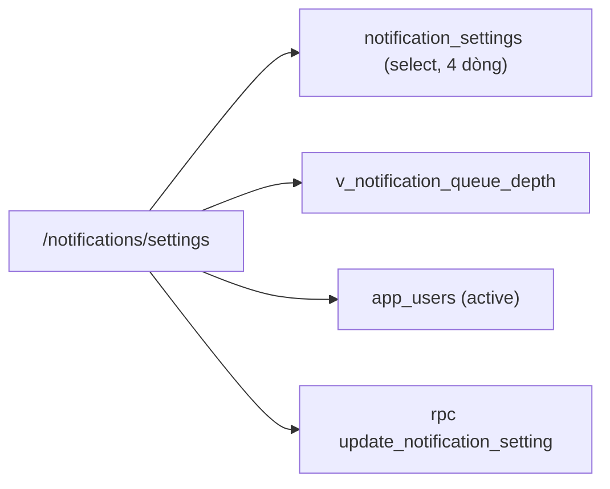

# SCR032_NotificationSettings — Screen Spec

> Alias LAB-1: **SC-32** · 通知設定 · Cấu hình thông báo

**Screen**: SCR032_NotificationSettings: Cấu hình thông báo (通知設定)
**Feature**: F010_Notifications (tính năng con `F10-05`; không có US riêng — `product-a-user-stories.md` xếp `F10-05` vào nhóm *"Cấu hình — thiết lập một lần"*; `US-19` (*"đổi tỷ lệ mà không cần sửa phần mềm"*) là US cùng khuôn cấu hình-thay-vì-code, dùng làm mẫu điều kiện chấp nhận)
**Type**: atomic (form, 4 thẻ cấu hình)
**Route**: `/notifications/settings` *(đề xuất)*
**Generated**: 2026-10-06
**Trạng thái**: thiết kế mới, chưa xây — **Chưa có code — màn chỉ đặc tả ở LAB-4**
**Liên kết**: [F010](../../features/F010_Notifications/business-context.md) · ADR-002 · ADR-007 (thư mục `decisions/`) · màn kề: [SCR031](../SCR031_NotificationInbox/spec.md) · [SCR033](../SCR033_OpsAlertQueue/spec.md) · [SCR004](../SCR004_AccountDetail/spec.md) · [SCR037](../SCR037_MarketManagement/spec.md)

## Purpose

Đặt **ai nhận**, **ngưỡng nào thì sinh thông báo**, và **gửi vào lúc nào** cho từng loại trong 4 loại sự kiện của `F10-02`. Mục tiêu là biến ba thứ này thành **dữ liệu**, để đổi người trực hay đổi ngưỡng ứ đọng không phải chờ một bản phát hành phần mềm.

Người dùng: chức danh **Vận hành** (`ops_admin` (đề xuất), xem [SCR031](../SCR031_NotificationInbox/spec.md) Dependencies & Risks). Giờ hành chính, tần suất rất thấp — đổi khi nhân sự trực thay đổi hoặc khi nghiệp vụ thấy thông báo quá nhiều/quá ít.

**Ràng buộc trung tâm của màn này, khách nêu đích danh** (`F10-05`, `product-a-screen-list.md` dòng SC-32): *đổi cấu hình **không làm mất lịch sử đã gửi***. Tài liệu này đọc rộng ra một bước và nêu thành ràng buộc kiểm được: **đổi cấu hình cũng không được làm mất thông báo đang chờ gửi** — xem Dependencies & Risks.

## Screen Layout

*(Suy luận từ bảng field — chưa có wireframe.)* Trang form gồm **4 thẻ**, mỗi thẻ một `event_type`, kèm `pending_count` và `updated_by`/`updated_at`; mở một thẻ để sửa. Nút Lưu đặt cạnh `pending_count`. Tắt một loại sự kiện mở hộp thoại xác nhận.

### Layout Sketch

```
┌──────────────────────────────────────────────────────────┐
│ R1: Banner (role="status" xanh / đỏ tự nhận focus)       │
├──────────────────────────────────────────────────────────┤
│ R2: Thẻ qualification_expiring   (mở rộng được)          │
│ R2: Thẻ dispute_open                                     │
│ R2: Thẻ export_failed                                    │
│ R2: Thẻ delivery_backlog                                 │
│   mỗi thẻ: enabled · severity · người nhận · kênh ·      │
│   ngưỡng · send_mode · digest_at · quiet_hours ·         │
│   updated_by/at                                          │
│   [Đang chờ gửi: N]  [Lưu]                               │
│    ┌ - - - - - - - - - - - - - - - - ┐                   │
│    │ R3: Hộp thoại tắt loại (modal)  │                   │
│    └ - - - - - - - - - - - - - - - - ┘                   │
└──────────────────────────────────────────────────────────┘
```

### Layout Regions

| Region ID | Name | Position | Scrollable | Key Components | Responsive Behavior |
|-----------|------|----------|------------|----------------|---------------------|
| R1 | Banner | static | no | banner xanh `role="status"`, banner đỏ tự nhận focus | always |
| R2 | 4 thẻ cấu hình | static | yes | field #1–#13 mỗi thẻ; `pending_count` cạnh nút Lưu | chưa xác định |
| R3 | Hộp thoại xác nhận tắt loại | modal | no | nêu rõ hệ quả của việc tắt | khi `enabled` bật → tắt |

## Child Routes

Không áp dụng — màn không phải shell có route con.

## User Flow

> **Scope:** within-screen interactions. Điều hướng liên màn xem `generated/screen-flow.md`.

### Happy Path

1. `ops_admin` mở `/notifications/settings` → thấy 4 thẻ, mỗi thẻ một `event_type`, kèm `pending_count` và `updated_by`/`updated_at`.
2. Mở một thẻ → sửa người nhận / ngưỡng / thời điểm gửi.
3. Bấm "Lưu" → RPC ghi **một dòng cấu hình duy nhất**.
4. Thành công → banner nêu rõ số thông báo đang chờ **không bị ảnh hưởng**; lịch sử [SCR031](../SCR031_NotificationInbox/spec.md) và [SCR033](../SCR033_OpsAlertQueue/spec.md) không đổi một dòng nào.
5. Cấu hình mới áp dụng cho **sự kiện sinh ra sau thời điểm lưu**. Sự kiện đã sinh giữ nguyên người nhận và kênh đã gắn vào nó lúc sinh.

### Branches

| Decision point | Condition | Outcome on this screen | Source |
|----------------|-----------|------------------------|--------|
| Bước 3 | người khác vừa lưu | `P0053`, không ghi gì, người dùng tải lại rồi sửa tiếp | (tài liệu gốc trong repo, không nộp) `sc-32-cau-hinh-thong-bao.md` §7 |
| Bước 3 | tắt một loại (`enabled` bật → tắt) | hộp thoại xác nhận → đồng ý mới lưu | cùng file §6, §7 |

## Data Inventory

> Bảng/view `notification_settings`, `v_notification_queue_depth` **chưa có** trong `supabase/migrations/` — thiết kế mới. Field nhập ở `## Validation & Error Feedback`. Một dòng cấu hình cho **mỗi `event_type`** trong 4 loại; không có cấu hình toàn cục.

| Field | Display Label | Source | Format | Empty Behavior | Cross-ref |
|-------|---------------|--------|--------|----------------|-----------|
| `event_type` (#1) | Loại sự kiện / 種別 | `notification_settings.event_type` | readonly ∈ 4 giá trị của `F10-02`; **khoá** — không tạo, không xoá dòng, chỉ sửa | — | — |
| `threshold_unit` (#8) | Đơn vị ngưỡng / しきい値単位 | hằng số theo `event_type` | readonly; `qualification_expiring`→ngày trước hạn · `delivery_backlog`→số 業務日 còn `remaining > 0` · `dispute_open`→số ngày quá hạn dự kiến · `export_failed`→**không có ngưỡng**, luôn sinh ngay lần lỗi đầu | — | — |
| `updated_by` / `updated_at` (#12) | Người sửa / Lúc sửa / 更新者 / 更新日時 | `notification_settings.updated_*` | readonly; server đặt; là dấu vết kiểm toán tối thiểu của màn này | — | `app_users` |
| `pending_count` (#13) | Đang chờ gửi / 送信待ち件数 | `v_notification_queue_depth` | số thông báo của `event_type` này đang `pending`/`retrying` tại thời điểm mở form; **hiện ngay cạnh nút Lưu** vì nó là thứ người dùng tưởng sẽ mất khi sửa | — | — |

## UI States

| State | Trigger | Visual Behavior | User Action Available | Source |
|-------|---------|----------------|-----------------------|--------|
| empty | không áp dụng — 4 dòng cấu hình luôn tồn tại, tạo bởi migration seed | — | — | đặc tả §5 |
| loading | mở trang | khung xương 4 thẻ | none | đặc tả §5 |
| success | RPC trả về | banner xanh `role="status"`: "Đã lưu cấu hình「{event_type}」. **{pending_count} thông báo đang chờ gửi vẫn giữ nguyên theo cấu hình cũ.**" — câu thứ hai là bắt buộc | dismiss | đặc tả §5 |
| error (nghiệp vụ) | `P0051`/`P0052`/`P0053` | banner đỏ **tự nhận focus**; **mọi giá trị đã gõ giữ nguyên**, sửa và gửi lại ngay được | sửa & gửi lại | đặc tả §5 |
| error (mạng) | mất kết nối lúc Lưu | banner + nút thử lại; **dữ liệu đã gõ giữ nguyên** | thử lại | đặc tả §5 |
| saving | `update_notification_setting` đang chạy | *(suy luận — nguồn không mô tả riêng)* | none | — |
| read-only | role ∈ `sys_admin` `reconcile` | mọi ô `disabled`, ẩn hẳn nút Lưu, hiện dòng "Chỉ chức danh Vận hành sửa được cấu hình này." | chỉ xem | đặc tả §5 |

## Validation & Error Feedback

### A) Client-side

Field nhập của mỗi thẻ:

| Field | Type | Required | Constraints | Async Check | Error Message | Default | Source |
|-------|------|----------|-------------|-------------|---------------|---------|--------|
| `enabled` — Bật thông báo / 通知する (#2) | toggle | yes | tắt ⇒ **ngừng sinh thông báo mới**, không xoá thông báo cũ và không huỷ hàng chờ | không | — | bật | `notification_settings.enabled` |
| `severity` — Mức / 重要度 (#3) | select | yes | ∈ `critical` `normal`. `critical` kéo theo cam kết **gửi xong ≤ 5 phút** (`F10-03`) ⇒ chọn `critical` cho cả 4 loại là tự đặt mình vào SLA không giữ nổi | không | `V-03` | `export_failed` = `critical`, ba loại còn lại = `normal` *(đề xuất)* | `notification_settings.severity` |
| `recipient_roles` — Nhận theo chức danh / 受信職掌 (#4) | multi-select | no | ⊆ danh sách chức danh; **`recipient_roles` và `recipient_user_ids` không được rỗng cùng lúc** khi `enabled = true` → `P0052` | không | `P0052` | theo bảng "Ai cần biết" của `F10` | `notification_settings.recipient_roles[]` |
| `recipient_user_ids` — Nhận đích danh / 個別受信者 (#5) | multi-select người dùng | no | mỗi phần tử phải tồn tại trong `app_users` và `status = 'active'` | `select app_users` lọc `active` | — | rỗng | `notification_settings.recipient_user_ids[]` |
| `channels` — Kênh / 配信チャネル (#6) | checkbox nhóm | yes | ⊆ `{in_app, email}`; **`in_app` không tắt được** *(đề xuất)*; không có `sms`, không có `fax` — `BR-NOTIFY-01` loại hẳn hai kênh này | không | `V-04` | `{in_app, email}` | `notification_settings.channels[]` |
| `threshold_value` — Ngưỡng / しきい値 (#7) | number | theo loại | nguyên, `> 0`; đơn vị do `threshold_unit`; `≤ 365` khi đơn vị là ngày, `≤ 1000` khi là số lần/số dòng → ngoài khoảng thì `P0051` | không | `P0051` | `qualification_expiring` = 30 ngày; `delivery_backlog` = 3 業務日 *(đề xuất)* | `notification_settings.threshold_value` |
| `send_mode` — Thời điểm gửi / 送信タイミング (#9) | select | yes | ∈ `immediate` `digest`. `severity = critical` **bắt buộc** `immediate` — `digest` không giữ nổi cam kết 5 phút của `F10-03` | không | `V-03` | `immediate` | `notification_settings.send_mode` |
| `digest_at` — Giờ gửi gộp / 一括送信時刻 (#10) | time | yes khi `send_mode = digest` | `HH:MM` theo **múi giờ chợ** (`markets.timezone`, ADR-007), không theo múi giờ trình duyệt; nên nằm trong 02:00–10:00 JST để người trực đọc được trong ca | không | `V-02` | `07:00` | `notification_settings.digest_at` |
| `quiet_hours` — Khung không gửi email / メール送信抑止時間帯 (#11) | 2 × time | no | `HH:MM-HH:MM`, được phép vắt qua nửa đêm; **không áp cho `severity = critical`** và **không áp cho kênh `in_app`** | không | — | rỗng | `notification_settings.quiet_hours` |

| Mã | Điều kiện kích hoạt | Thông báo VI | Thông báo JA | Hiện ở đâu | Chặn gửi? |
|---|---|---|---|---|:---:|
| `V-01` | ô bắt buộc để trống | Mục này bắt buộc. | 必須項目です。 | dưới ô | ● |
| `V-02` | `send_mode = digest` mà `digest_at` rỗng | Chọn giờ gửi gộp. | 一括送信時刻を選択してください。 | dưới ô | ● |
| `V-03` | `severity = critical` và `send_mode = digest` | Mức quan trọng phải gửi ngay — cam kết gửi trong 5 phút không áp dụng cho gửi gộp. | 重要度「クリティカル」は即時送信のみです（5分以内の送信保証のため）。 | dưới ô `send_mode` | ● |
| `V-04` | bỏ tick kênh `in_app` | Kênh trong ứng dụng không tắt được. | アプリ内通知は無効にできません。 | dưới nhóm checkbox | ● — ô bị `disabled` sẵn |

### B) Server-side

#### Lưu cấu hình một loại

- **Endpoint:** `rpc('update_notification_setting', { p_event_type, p_payload, p_expected_updated_at })`
- **Request:** toàn bộ field nhập (mục A) + `updated_at` đang giữ
- **Success:** `jsonb { event_type, updated_at, pending_count }` → banner thành công (UI States)
- **Trigger:** bấm "Lưu"; tắt loại qua hộp thoại xác nhận
- **Source:** (tài liệu gốc trong repo, không nộp) `sc-32-cau-hinh-thong-bao.md` §8
- **Errors:**

| Mã | Điều kiện kích hoạt | Thông báo VI | Thông báo JA | Hiện ở đâu | Chặn? |
|---|---|---|---|---|:---:|
| `P0051` *(mới, đề xuất)* | `threshold_value` ngoài khoảng cho phép của `threshold_unit` | Ngưỡng của「{event_type}」phải trong khoảng {min}–{max} {unit}. | 「{event_type}」のしきい値は{min}〜{max}{unit}の範囲で指定してください。 | banner đầu form | ● |
| `P0052` *(mới, đề xuất)* | `enabled = true` mà cả `recipient_roles` lẫn `recipient_user_ids` đều rỗng | Loại「{event_type}」đang bật nhưng chưa có người nhận nào. | 「{event_type}」は有効ですが受信者が未設定です。 | banner đầu form | ● |
| `P0053` *(mới, đề xuất)* | `updated_at` gửi lên khác `updated_at` hiện tại trong bảng (có người khác vừa lưu) | Cấu hình đã được「{updated_by}」sửa lúc {updated_at}. Tải lại để xem bản mới nhất trước khi lưu. | 設定は{updated_at}に「{updated_by}」が更新しました。最新版を読み込んでから保存してください。 | banner đầu form | ● |

Rẽ nhánh theo `error.code`; thông báo dựng từ `error.details` (`event_type`, `min`, `max`, `unit`, `updated_by`, `updated_at`) — không so khớp chuỗi `message`.

`P0053` là **khoá lạc quan**, không phải lỗi người dùng. Có nó vì màn này sửa được bởi nhiều người cùng chức danh và một lần ghi đè im lặng có thể tắt mất một loại thông báo mà không ai biết.

Đọc dữ liệu (không phải submit):

| Thao tác | Cách gọi | Tham số | Trả về |
|---|---|---|---|
| Đọc 4 dòng cấu hình | `select` từ `notification_settings` | — | mảng 4 dòng |
| Đọc số đang chờ gửi | `select` từ `v_notification_queue_depth` | `event_type` | số nguyên theo loại |
| Đọc danh sách người nhận đích danh | `select` từ `app_users` lọc `status = 'active'` | — | mảng `{id, full_name, role}` |

Ghi **bắt buộc qua RPC**: `notification_settings` không có policy ghi (ADR-002), và ba ràng buộc *(ngưỡng trong khoảng · có ít nhất một người nhận · khoá lạc quan)* phải chạy trong cùng transaction với lần ghi, không kiểm được ở client.

## Interaction Patterns

- **Không có phím tắt riêng** — không thuộc ba màn ⌨️ (`SC-07`, `SC-10`, `SC-14`) — source: đặc tả §6.
- **Tắt một loại sự kiện (`enabled` bật → tắt) mở hộp thoại xác nhận chặn luồng**, nêu rõ *"từ lúc lưu, hệ thống ngừng sinh thông báo loại này; thông báo đã sinh và đang chờ gửi không bị ảnh hưởng"*. Lý do: đây là thao tác duy nhất trên màn này làm hệ thống **im lặng**, và im lặng là thứ không ai phát hiện ra bằng cách nhìn màn hình — source: đặc tả §6.
- **Lỗi nghiệp vụ → banner tự nhận focus, giá trị đã gõ giữ nguyên** — source: đặc tả §5.
- **`pending_count` hiện ngay cạnh nút Lưu** — source: đặc tả §3 (#13).

## Accessibility

| Aspect | Status | Notes |
|--------|--------|-------|
| ARIA roles/labels | partial (theo đặc tả) | banner thành công `role="status"`; ô `disabled` khi chỉ đọc |
| Keyboard navigation | unknown | không có yêu cầu riêng (đặc tả §6) |
| Focus management | partial (theo đặc tả) | banner lỗi tự nhận focus; hộp thoại xác nhận chặn luồng |
| Screen reader compatibility | unknown | chưa kiểm — cần audit khi xây |

## Conditional Rendering

| Condition | Type | Renders | Hidden | Notes |
|-----------|------|---------|--------|-------|
| `ops_admin` (đề xuất) | auth | form sửa được + nút Lưu | — | chức danh duy nhất ghi được |
| `sys_admin` / `reconcile` | auth | mọi ô `disabled` + "Chỉ chức danh Vận hành sửa được cấu hình này." | nút Lưu (ẩn hẳn) | bypass → RPC không có policy ghi |
| `send_mode = digest` | hardcoded-state | `digest_at` bắt buộc | — | `V-02` |
| `severity = critical` | hardcoded-state | `send_mode` buộc `immediate`; `quiet_hours` không áp | `digest` | `V-03` |
| `event_type = export_failed` | hardcoded-id | không có ngưỡng | `threshold_value` | luôn sinh ngay lần lỗi đầu |
| kênh `in_app` | hardcoded | checkbox `disabled` sẵn | — | `V-04` |

## Component Variants

Không áp dụng — chưa có code, không có component đa hình dùng chung được xác định.

## Security Surface

| Guard | Type | Consequence if bypassed |
|-------|------|------------------------|
| `route-policy.ts` thêm `{ prefix: "/notifications/settings", roles: ["ops_admin","sys_admin","reconcile"] }` *(đề xuất)* — **phải đặt trước** `/notifications` trong bảng | role | nếu đặt sau, `/notifications` (mở cho mọi người, [SCR031](../SCR031_NotificationInbox/spec.md)) khớp trước và nuốt mất lớp chặn |
| RLS trên `notification_settings`: SELECT theo ba chức danh trên, **không có policy ghi** (ADR-002) | permission | đường ghi duy nhất là RPC |
| Ba ràng buộc trong RPC (ngưỡng · ít nhất một người nhận · khoá lạc quan) | permission | không kiểm được ở client |

Vai trò đề xuất: `ops_admin` (đề xuất) xem + ghi (chức danh duy nhất ghi được) · `sys_admin` xem (hỗ trợ; cấu hình là quyết định nghiệp vụ, không phải quyết định hệ thống) · `reconcile` xem (cần biết ngưỡng nào đang áp để giải thích vì sao có/không có thông báo) · `receiving` · `trading` · `rule_admin` (đề xuất) · `party_admin` (đề xuất) · `market_manager` (đề xuất) · `internal_audit` (đề xuất) ✗. Server enforcement: `[UNVERIFIED]` — chưa có code.

## Source References

Chưa có code — màn chỉ đặc tả ở LAB-4.

1. Đặc tả gốc: (tài liệu gốc trong repo, không nộp) `sc-32-cau-hinh-thong-bao.md`
2. Bảng LAB-1: (tài liệu gốc trong repo, không nộp) `product-a-screen-list.md` (SC-32)
3. ADR: (tài liệu gốc trong repo, không nộp) `adr.md` (ADR-002, ADR-007)
4. Bảng/RPC dự kiến (chưa có trong `supabase/migrations/`): `notification_settings`, `v_notification_queue_depth`, `markets.timezone` (xem SCR037); RPC `update_notification_setting`. Bảng đã có: `app_users` — `supabase/migrations/0002_core_identity.sql`

## Source Walkthrough

Không có file code để dẫn đọc. Thứ tự đọc đề xuất:

1. **File:** (tài liệu gốc trong repo, không nộp) `sc-31-hop-thong-bao.md` — nơi thấy kết quả của cấu hình
2. **File:** (tài liệu gốc trong repo, không nộp) `sc-33-hang-canh-bao-van-hanh.md` — nơi thấy hậu quả khi gửi hỏng

### Call Hierarchy

*(Thiết kế dự kiến — không phải code hiện có.)*



**Related files:** xem `## Source References`.

## Dependencies & Risks *(mục bổ sung)*

- **Cần trước:** [SCR031](../SCR031_NotificationInbox/spec.md) (nơi thấy kết quả của cấu hình) và [SCR033](../SCR033_OpsAlertQueue/spec.md) (nơi thấy hậu quả khi gửi hỏng). Sửa cấu hình mà không có hai màn kia thì không có cách nào quan sát được mình vừa đổi cái gì.
- **Ràng buộc then chốt — ba thứ khác nhau, dễ gộp nhầm làm một:**
  1. **Lịch sử đã gửi** (`notifications` có `read_at`/`sent_at`): khách nêu đích danh là **không được mất**. Bảo đảm bằng việc `notification_settings` và `notifications` là **hai bảng riêng**, không có FK nào cho phép `ON DELETE CASCADE` từ cấu hình sang thông báo.
  2. **Thông báo đang chờ gửi** (`pending`/`retrying`): tài liệu này đề xuất cũng **không được mất**. Bảo đảm bằng cách **sao giá trị cấu hình vào chính dòng thông báo lúc sinh** (`notifications.channels`, `notifications.recipient_user_id` đã cố định), nên hàng chờ không đọc lại `notification_settings` nữa. Kiểm được: lưu cấu hình với `pending_count = N` ⇒ sau khi lưu `pending_count` vẫn `= N`, và `N` thông báo đó vẫn gửi theo kênh cũ.
  3. **Sự kiện tương lai**: thứ duy nhất cấu hình mới chi phối.
- **Dễ hiểu sai #1:** `enabled = false` **không** huỷ hàng chờ. Người vận hành tắt một loại để "dừng spam" sẽ vẫn thấy vài thông báo đến sau đó — đúng thiết kế, cần nói trong hộp thoại xác nhận chứ không sửa hành vi.
- **Dễ hiểu sai #2:** `digest_at` và `quiet_hours` theo **múi giờ chợ**, không theo trình duyệt. Một `new Date()` phía client lọt vào đây là đủ để giờ gửi lệch mà không test nào đỏ — cùng loại bẫy với `effective_from` của [SCR037](../SCR037_MarketManagement/spec.md).
- **Phụ thuộc ADR-007:** nếu hệ thống nhiều chợ thì cấu hình là **theo chợ**, khoá chính thành `(market_id, event_type)` và màn này mọc thêm bước chọn chợ. Thiết kế hiện tại giả định **một dòng mỗi `event_type`** — đổi sau sẽ phá tương thích khoá chính.
- **Rủi ro vận hành:** không có bản xem trước. Người dùng không biết ngưỡng mới sẽ sinh bao nhiêu thông báo/ngày cho tới khi nó sinh thật. Xem Unresolved Questions câu 2.

## Unresolved Questions *(mục bổ sung)*

1. **Cấu hình có cần phiên bản và duyệt như SCR037 không?** Hiện đề xuất **không** — ghi đè kèm `updated_by`/`updated_at` là đủ, vì cấu hình thông báo không viết lại số liệu quá khứ (khác `market_rules`). Nếu khách coi "ai tắt cảnh báo lỗi xuất kế toán" là việc phải duyệt thì phải mượn nguyên khuôn maker–checker của SCR037.
2. **Có cần xem trước số thông báo mà ngưỡng mới sinh ra không?** Hữu ích thật nhưng cần một hàm chạy thử trên dữ liệu 30 ngày gần nhất — chi phí không nhỏ. Để **ngoài phạm vi** cho tới khi khách nêu.
3. **`quiet_hours` có thuộc phạm vi không?** Khách **không hề nhắc** — `F10-05` chỉ nói "người nhận, ngưỡng, thời điểm gửi". Field `quiet_hours` (#11) là **đề xuất của tài liệu này**, suy từ việc ca chạy 02:00–10:00 và email ngoài khung đó dễ bị bỏ sót. Cắt được nếu khách thấy thừa.
4. **Người nhận là chức danh hay là người?** `recipient_roles` và `recipient_user_ids` cho cả hai, nhưng gán theo chức danh có hệ quả: đổi chức danh ở [SCR004](../SCR004_AccountDetail/spec.md) **lập tức đổi người nhận thông báo**, không có bước xác nhận nào. Cần khách biết điều đó trước khi chọn.
5. **Ai gánh cam kết 5 phút của `F10-03`?** Màn này đặt `severity`, nhưng việc **đo** 5 phút nằm ở SCR033. Chưa chốt cách đo thì `critical` chỉ là một nhãn.
