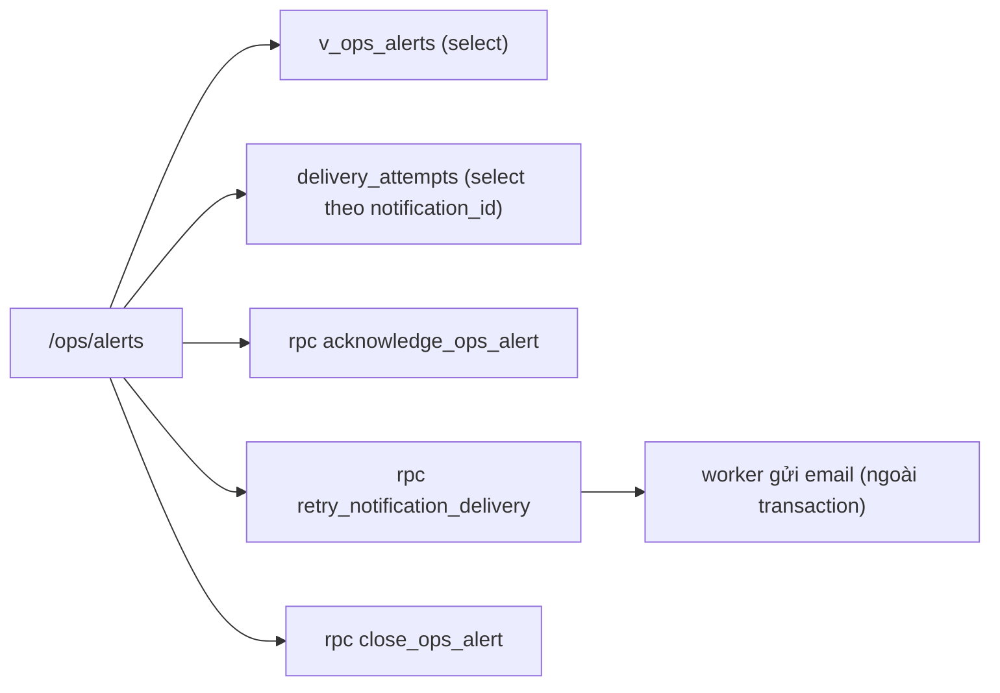

# SCR033_OpsAlertQueue — Screen Spec

> Alias LAB-1: **SC-33** · 運用警告キュー · Hàng cảnh báo vận hành

**Screen**: SCR033_OpsAlertQueue: Hàng cảnh báo vận hành (運用警告キュー)
**Feature**: F010_Notifications (tính năng con `F10-04`; đồng thời `F09-06` thuộc F009_ReportsAndExport; không có US riêng — `product-a-user-stories.md` xếp `F09-06` và `F10-03` vào *"hành vi nền, không có giao diện"*. Màn này là **chỗ hành vi nền đó trở nên nhìn thấy được**; không có nó thì hai tính năng kia không kiểm chứng được)
**Type**: atomic (danh sách + dòng mở rộng)
**Route**: `/ops/alerts` *(đề xuất)*
**Generated**: 2026-10-06
**Trạng thái**: thiết kế mới, chưa xây — **Chưa có code — màn chỉ đặc tả ở LAB-4**
**Liên kết**: [F010](../../features/F010_Notifications/business-context.md) · [F009](../../features/F009_ReportsAndExport/business-context.md) · ADR-002 (thư mục `decisions/`) · màn kề: [SCR030](../SCR030_AccountingBatch/spec.md) · [SCR031](../SCR031_NotificationInbox/spec.md) · [SCR032](../SCR032_NotificationSettings/spec.md)

## Purpose

Chỗ duy nhất trong hệ thống để trả lời câu hỏi *"có việc gì đang hỏng âm thầm không?"*. Gom ba nguồn hỏng: **thông báo email thất bại sau 3 lần thử** (`F10-04`), **batch báo cáo ngày lỗi**, và **lô xuất sang kế toán lỗi** (`F09-06`).

Nguyên tắc khách nêu đích danh ở `F10`: *"để **không có thông báo nào mất im lặng**"*. Màn này là nơi nguyên tắc đó được thực thi — mọi thất bại cuối cùng phải **nổi lên một chỗ có người nhìn**, không chỉ nằm trong log.

Người dùng: chức danh **Vận hành** (`ops_admin` *(đề xuất)*, xem [SCR031](../SCR031_NotificationInbox/spec.md) Dependencies & Risks), cộng `reconcile` ở chế độ chỉ xem — vì lỗi batch trước 11:00 JST là việc của bộ phận đối chiếu chứ không chỉ của IT.

Bối cảnh thời gian quyết định thiết kế: cửa sổ batch **chỉ ~1 giờ** sau khi lock `業務日` lúc ~10:00 (`FIG-LOAD-01`, rủi ro số 14 của RFP). Một cảnh báo batch đọc lúc 11:30 là một cảnh báo đã vô dụng. Vì vậy màn này ưu tiên **thời gian còn lại để xử lý**, không ưu tiên thời gian đã trôi qua.

## Screen Layout

*(Suy luận từ bảng field — chưa có wireframe.)* Trang danh sách: banner đầu danh sách; bộ lọc (nguồn, trạng thái, ngày nghiệp vụ); danh sách cảnh báo sắp `critical` trước rồi `first_failed_at` tăng dần; mỗi dòng mở rộng được để hiện bảng con "từng lần thử". Hành động trên dòng: Nhận xử lý, Thử lại, Đóng cảnh báo (hộp thoại), "Mở màn batch".

### Layout Sketch

```
┌──────────────────────────────────────────────────────────┐
│ R1: Banner (role="status" / đỏ tự nhận focus)            │
├──────────────────────────────────────────────────────────┤
│ R2: Bộ lọc: nguồn · trạng thái · 業務日 · [Áp dụng]      │
├──────────────────────────────────────────────────────────┤
│ R3: Danh sách cảnh báo (critical trước, cũ nhất trước)   │
│   alert_code · source · severity · đối tượng · 業務日 ·  │
│   số lần thử · lỗi cuối · state · người nhận · độ trễ    │
│   [Nhận xử lý] [Thử lại] [Đóng cảnh báo] [Mở màn batch]  │
│   ┌────────────────────────────────────────────────┐     │
│   │ R4: Dòng mở rộng — bảng con từng lần thử       │     │
│   └────────────────────────────────────────────────┘     │
│     ┌ - - - - - - - - - - - - - - ┐                      │
│     │ R5: Hộp thoại đóng cảnh báo │ (modal)              │
│     └ - - - - - - - - - - - - - - ┘                      │
└──────────────────────────────────────────────────────────┘
```

### Layout Regions

| Region ID | Name | Position | Scrollable | Key Components | Responsive Behavior |
|-----------|------|----------|------------|----------------|---------------------|
| R1 | Banner | static | no | banner `role="status"` / banner đỏ tự nhận focus | always |
| R2 | Bộ lọc | static | no | `source`, `state`, `businessDate` | chưa xác định |
| R3 | Danh sách cảnh báo | static | yes | dòng `ops_alerts`, nút hành động, `EmptyState` | chưa xác định |
| R4 | Dòng mở rộng | static (có điều kiện) | no | bảng con `delivery_attempts` | khi mở rộng một dòng |
| R5 | Hộp thoại đóng cảnh báo | modal | no | ô `close_note` bắt buộc | khi bấm "Đóng cảnh báo" |

## Child Routes

Không áp dụng — màn không phải shell có route con.

## User Flow

> **Scope:** within-screen interactions. Điều hướng liên màn xem `generated/screen-flow.md`.

### Happy Path

1. `ops_admin` mở `/ops/alerts` → mặc định thấy cảnh báo `open` + `acknowledged`, cũ nhất trước, `critical` lên đầu.
2. Mở rộng một dòng → thấy bảng **từng lần thử** (lần mấy, lúc nào, kênh gì, kết quả gì, lỗi gì).
3. "Nhận xử lý" → `state = acknowledged`, `assignee` = người đang đăng nhập. Mục đích là tránh hai người cùng xử lý một cảnh báo.
4. Khi việc đã xong ở nơi khác → "Đóng cảnh báo" kèm lý do ≥ 10 ký tự → `state = closed_manual`.
5. Lọc theo `state = resolved`/`closed_manual` để xem lại lịch sử — **không dòng nào bị xoá**.

### Branches

| Decision point | Condition | Outcome on this screen | Source |
|----------------|-----------|------------------------|--------|
| Nhánh thử lại (chỉ `source = notification_delivery`) | bấm "Thử lại" | sinh một `delivery_attempts` mới `is_manual = true`. Thành công → `state = resolved`, cảnh báo rời danh sách mặc định. Thất bại → thêm dòng lịch sử, `state` giữ nguyên, có thể thử lại tiếp | (tài liệu gốc trong repo, không nộp) `sc-33-hang-canh-bao-van-hanh.md` §7 |
| Nhánh thử lại | `hard_fail` hoặc đang có lần thử chạy dở | `P0054`, không sinh lần thử nào | cùng file |
| Nhánh batch/xuất kế toán | `source ∈ report_batch, accounting_export` | không thử lại ở màn này — "Mở màn batch" sang [SCR030](../SCR030_AccountingBatch/spec.md), nơi có thao tác chạy lại thật. Màn này chỉ là **cửa sổ cảnh báo**, không nhân đôi chức năng của SCR030 (DRY) | cùng file |

## Data Inventory

> Bảng/view `ops_alerts`, `delivery_attempts`, `v_ops_alerts`, `v_notification_latency` **chưa có** trong `supabase/migrations/` — thiết kế mới. Bộ lọc ở `## Validation & Error Feedback`. Mỗi dòng là một `ops_alerts`.

### Danh sách

| Field | Display Label | Source | Format | Empty Behavior | Cross-ref |
|-------|---------------|--------|--------|----------------|-----------|
| `alert_code` (#1) | Mã cảnh báo / 警告番号 | `ops_alerts.alert_code` | duy nhất, server cấp; dạng `ALT-{yyyymmdd}-{seq}` *(đề xuất)* | — | — |
| `source` (#2) | Nguồn / 発生源 | `ops_alerts.source` | badge ∈ `notification_delivery` (`F10-04`) · `report_batch` (`F09-06`) · `accounting_export` (`F09-06`) — **đúng 3 giá trị**, khớp ghi chú LAB-1 cho SC-33 | — | — |
| `severity` (#3) | Mức / 重要度 | `ops_alerts.severity` | badge ∈ `critical` `warning`; `report_batch` lỗi **luôn** `critical` vì chặn mốc 11:00 | — | — |
| `subject_ref` (#4) | Đối tượng / 対象 | `ops_alerts.subject_table`, `ops_alerts.subject_id` | link: `notifications` → mở [SCR031](../SCR031_NotificationInbox/spec.md) · `report_batches`/`export_batches` → mở [SCR030](../SCR030_AccountingBatch/spec.md) | — | — |
| `business_date` (#5) | 業務日 | `ops_alerts.business_date` | date | rỗng với cảnh báo không gắn ngày nghiệp vụ | — |
| `attempt_count` (#6) | Số lần đã thử / 試行回数 | `ops_alerts.attempt_count` | `≥ 1`; với `source = notification_delivery` thì **vào hàng này khi `= 3`** — `BR-NOTIFY-01` chốt trần retry là **tối đa 3 lần** | — | — |
| `last_error` (#7) | Lỗi lần cuối / 最終エラー | `ops_alerts.last_error` | 1–500 ký tự, chuỗi lỗi thô từ lần thử cuối | — | — |
| `first_failed_at` (#8) | Hỏng lần đầu lúc / 初回失敗日時 | `ops_alerts.first_failed_at` | datetime JST | — | — |
| `state` (#9) | Trạng thái / 状態 | `ops_alerts.state` | badge ∈ `open` `acknowledged` `resolved` `closed_manual` *(đề xuất)*; mặc định `open` | — | — |
| `assignee` (#10) | Người nhận xử lý / 担当者 | `ops_alerts.assignee_id` → `app_users.full_name` | text | "—"; rỗng khi `state = open` | `app_users` (`0002_core_identity.sql`) |
| `latency_seconds` (#11) | Độ trễ gửi / 送信所要時間 | `v_notification_latency` | số giây; **chỉ có với `source = notification_delivery`**; = `sent_at − created_at`; `> 300` ⇒ **vi phạm cam kết 5 phút của `F10-03`**, hiện tông đỏ | ẩn với nguồn khác | — |

Sắp xếp mặc định: `severity = critical` trước, rồi `first_failed_at` **tăng dần** — cảnh báo cũ nhất lên đầu, vì cái tồn lâu nhất là cái nguy hiểm nhất, khác với [SCR031](../SCR031_NotificationInbox/spec.md) (mới nhất trước).

### Lịch sử từng lần thử — bảng con trong dòng mở rộng

LAB-1 yêu cầu đích danh cho SC-33: *"hiện số lần đã thử **và kết quả từng lần**"*. Nên đây là bảng riêng, không phải một chuỗi gộp.

| Field | Display Label | Source | Format | Empty Behavior | Cross-ref |
|-------|---------------|--------|--------|----------------|-----------|
| `attempt_no` (#12) | Lần thứ / 試行回 | `delivery_attempts.attempt_no` | `1`…`3` cho retry tự động; lần thử thủ công đánh số tiếp từ `4` và có cờ `is_manual` | — | — |
| `attempted_at` (#13) | Lúc thử / 試行日時 | `delivery_attempts.attempted_at` | datetime JST | — | — |
| `channel` (#14) | Kênh / チャネル | `delivery_attempts.channel` | ∈ `email` (chỉ email mới có retry; `in_app` ghi thẳng vào DB nên không hỏng theo kiểu này) | — | — |
| `result` (#15) | Kết quả / 結果 | `delivery_attempts.result` | badge ∈ `ok` `soft_fail` `hard_fail`; `hard_fail` (hộp thư không tồn tại) **không thử lại** dù chưa đủ 3 lần | — | — |
| `error_detail` (#16) | Chi tiết lỗi / エラー詳細 | `delivery_attempts.error_detail` | 0–500 ký tự | "—" | — |
| `is_manual` (#17) | Thử thủ công / 手動再送 | `delivery_attempts.is_manual` | cờ; `true` ⇒ do người ở màn này bấm, kèm `triggered_by`; mặc định `false` | — | — |

## UI States

| State | Trigger | Visual Behavior | User Action Available | Source |
|-------|---------|----------------|-----------------------|--------|
| empty | không có cảnh báo nào ở `open`/`acknowledged` | "Không có cảnh báo nào đang mở." / 未対応の警告はありません。 — **tông trung tính, không tông thành công**, vì rỗng cũng có thể là do job sinh cảnh báo chết | đổi bộ lọc | đặc tả §5 |
| empty (có lọc) | lọc không khớp | thông báo rỗng kèm nút "Xoá lọc" | Xoá lọc | đặc tả §5 |
| loading | mở trang / đổi bộ lọc | khung xương 5 dòng | none | đặc tả §5 |
| success (thử lại) | sau thử lại | banner `role="status"`: "Đã thử lại lần {attempt_no}. Kết quả: {result}." — bảng lịch sử thêm một dòng ngay | dismiss | đặc tả §5 |
| success (đóng) | sau khi đóng cảnh báo | banner + dòng rời khỏi danh sách (do bộ lọc mặc định) | dismiss | đặc tả §5 |
| error (nghiệp vụ) | `P0054`/`P0005`/`P0001` | banner đỏ **tự nhận focus**; dòng giữ nguyên trạng thái cũ | đóng banner | đặc tả §5 |
| error (mạng) | mất kết nối | banner + nút thử lại; **ghi chú đã gõ trong hộp thoại đóng cảnh báo giữ nguyên** | thử lại | đặc tả §5 |
| saving | `acknowledge_ops_alert` / `retry_notification_delivery` / `close_ops_alert` đang chạy | *(suy luận — nguồn không mô tả riêng)* | none | — |
| read-only | role ∈ `reconcile` `sys_admin` | ẩn nút thử lại / nhận xử lý / đóng; bảng lịch sử vẫn xem đầy đủ | chỉ xem | đặc tả §5 |

## Validation & Error Feedback

### A) Client-side

Bộ lọc và ô lý do:

| Field | Type | Required | Constraints | Async Check | Error Message | Default | Source |
|-------|------|----------|-------------|-------------|---------------|---------|--------|
| `source` — Nguồn / 発生源 (#18) | select, 3 lựa chọn + "Tất cả" | no | giá trị ngoài 3 enum → bỏ qua | không | — | rỗng | `searchParams.source` |
| `state` — Trạng thái / 状態 (#19) | select, 4 lựa chọn + "Tất cả" | no | — | không | — | **`open` + `acknowledged`** *(đề xuất — hàng cảnh báo mở ra để xử lý việc chưa xong)* | `searchParams.state` |
| `businessDate` — 業務日 (#20) | `input type="date"` | no | rỗng = không lọc | không | — | rỗng | `searchParams.businessDate` |
| `close_note` (hộp thoại đóng cảnh báo) | text | yes | `≥ 10` ký tự | không | `V-01` | rỗng | — |

| Mã | Điều kiện kích hoạt | Thông báo VI | Thông báo JA | Hiện ở đâu | Chặn gửi? |
|---|---|---|---|---|:---:|
| `V-01` | bấm "Đóng cảnh báo" mà `close_note` < 10 ký tự | Lý do đóng phải từ 10 ký tự. | 完了理由は10文字以上で入力してください。 | dưới ô trong hộp thoại | ● |

### B) Server-side

#### Nhận xử lý

- **Endpoint:** `rpc('acknowledge_ops_alert', { p_alert_id })`
- **Request:** `alert_id`
- **Success:** `jsonb { alert_id, state, assignee_id }`
- **Errors:** `P0001` `P0005`
- **Trigger:** bấm "Nhận xử lý"

#### Thử lại thủ công

- **Endpoint:** `rpc('retry_notification_delivery', { p_alert_id })`
- **Request:** `alert_id`
- **Success:** `jsonb { attempt_no, result }`
- **Errors:** `P0054`
- **Trigger:** bấm "Thử lại" (chỉ `source = notification_delivery`)

#### Đóng cảnh báo

- **Endpoint:** `rpc('close_ops_alert', { p_alert_id, p_close_note })`
- **Request:** `alert_id`, lý do
- **Success:** `jsonb { alert_id, state }`
- **Errors:** `P0001` `P0005`
- **Trigger:** xác nhận trong hộp thoại R5
- **Source (cả ba):** (tài liệu gốc trong repo, không nộp) `sc-33-hang-canh-bao-van-hanh.md` §8

| Mã | Điều kiện kích hoạt | Thông báo VI | Thông báo JA | Hiện ở đâu | Chặn? |
|---|---|---|---|---|:---:|
| `P0054` *(mới, đề xuất)* | bấm "Thử lại" khi dòng không ở `state ∈ {open, acknowledged}`, hoặc `result` lần cuối là `hard_fail`, hoặc đang có lần thử chạy dở | Không thử lại được: {reason}. | 再送できません：{reason}。 | banner đầu danh sách | ● |
| `P0005` | role không ghi được mà vẫn gọi RPC (DOM bị can thiệp) | Chức danh của bạn không được phép thực hiện thao tác này. | この操作を行う権限がありません。 | banner đầu danh sách | ● |
| `P0001` | `alert_id` không tồn tại | Không tìm thấy cảnh báo này. | この警告は見つかりません。 | banner đầu danh sách | ● |

`P0054` dựng câu từ `error.details.reason` ∈ `already_resolved` · `hard_fail_not_retryable` · `attempt_in_flight` — ba lý do khác nhau, ba câu khác nhau, **một mã**. Không so khớp chuỗi `message`.

`hard_fail` không cho thử lại là quyết định có chủ ý: gửi lại vào một hộp thư không tồn tại chỉ sinh thêm một dòng hỏng. Đường đi đúng là sửa người nhận ở [SCR032](../SCR032_NotificationSettings/spec.md) rồi đóng cảnh báo này kèm lý do.

Đọc dữ liệu (không phải submit):

| Thao tác | Cách gọi | Tham số | Trả về |
|---|---|---|---|
| Đọc danh sách cảnh báo | `select` từ `v_ops_alerts` (`security_invoker`) | `source?`, `state?`, `businessDate?` | mảng dòng kèm `latency_seconds` |
| Đọc lịch sử từng lần thử | `select` từ `delivery_attempts` lọc `notification_id` | `notification_id` | mảng, `attempt_no` tăng dần |

Đọc bằng `select` vì chỉ hiển thị. Ba thao tác ghi đi qua RPC: chúng đổi trạng thái vận hành và phải ghi dấu vết (`assignee_id`, `triggered_by`, `close_note`) trong cùng transaction.

**`retry_notification_delivery` không tự gửi email trong transaction.** Nó chỉ đặt lại dòng vào hàng chờ và ghi `delivery_attempts` khi worker trả kết quả — gửi mạng bên trong một transaction database là cách chắc chắn nhất để có một transaction treo dài và một dòng log sai sự thật.

## Interaction Patterns

- **Không có phím tắt riêng** — không thuộc ba màn ⌨️ (`SC-07`, `SC-10`, `SC-14`) — source: đặc tả §6.
- **"Đóng cảnh báo" mở hộp thoại xác nhận chặn luồng kèm ô lý do bắt buộc.** Lý do: đóng một cảnh báo là tuyên bố *"việc này đã xử lý xong"* — nếu sai thì đúng nguyên tắc mà `F10` muốn tránh (mất im lặng) lại xảy ra, chỉ khác là do người chứ không do máy — source: đặc tả §6.
- **Mở rộng một dòng → hiện bảng từng lần thử** — source: đặc tả §7.
- **"Nhận xử lý" gán `assignee` = người đang đăng nhập** để tránh hai người xử lý cùng một cảnh báo — source: đặc tả §7.
- **Lỗi nghiệp vụ → banner tự nhận focus; ghi chú đã gõ giữ nguyên** — source: đặc tả §5.

## Accessibility

| Aspect | Status | Notes |
|--------|--------|-------|
| ARIA roles/labels | partial (theo đặc tả) | banner thành công `role="status"` |
| Keyboard navigation | unknown | không có yêu cầu riêng (đặc tả §6) |
| Focus management | partial (theo đặc tả) | banner lỗi tự nhận focus; hộp thoại đóng cảnh báo chặn luồng |
| Screen reader compatibility | unknown | chưa kiểm — cần audit khi xây |

## Conditional Rendering

| Condition | Type | Renders | Hidden | Notes |
|-----------|------|---------|--------|-------|
| `ops_admin` (đề xuất) | auth | "Nhận xử lý", "Thử lại", "Đóng cảnh báo" | — | bypass → `P0005` |
| `reconcile` / `sys_admin` | auth | bảng + lịch sử đầy đủ | nút thử lại / nhận xử lý / đóng | chỉ đọc |
| `source = notification_delivery` | hardcoded-state | "Thử lại", `latency_seconds` | — | |
| `source ∈ report_batch, accounting_export` | hardcoded-state | "Mở màn batch" → SCR030 | "Thử lại" | |
| `latency_seconds > 300` | hardcoded-threshold | tông đỏ | — | vi phạm `F10-03` |
| `hard_fail` | hardcoded-state | `P0054` nếu bấm thử lại | — | |

## Component Variants

Không áp dụng — chưa có code, không có component đa hình dùng chung được xác định.

## Security Surface

| Guard | Type | Consequence if bypassed |
|-------|------|------------------------|
| `route-policy.ts` thêm `{ prefix: "/ops", roles: ["ops_admin","reconcile","sys_admin"] }` *(đề xuất)* | role | đẩy về `/403` |
| RLS trên `ops_alerts`: SELECT theo ba chức danh, **không có policy ghi** (ADR-002) | permission | thử lại và đóng cảnh báo đều qua RPC |
| RPC kiểm role ghi → `P0005` | permission | role không ghi được mà gọi RPC (DOM bị can thiệp) vẫn bị chặn |

Vai trò đề xuất: `ops_admin` (đề xuất) xem + ghi (thử lại thủ công, nhận xử lý, đóng cảnh báo) · `reconcile` xem (lỗi batch/xuất kế toán chặn việc của chính họ trước 11:00) · `sys_admin` xem (hỗ trợ kỹ thuật, không quyết định nghiệp vụ) · `receiving` · `trading` · `rule_admin` (đề xuất) · `party_admin` (đề xuất) ✗. Server enforcement: `[UNVERIFIED]` — chưa có code.

## Source References

Chưa có code — màn chỉ đặc tả ở LAB-4.

1. Đặc tả gốc: (tài liệu gốc trong repo, không nộp) `sc-33-hang-canh-bao-van-hanh.md`
2. Bảng LAB-1: (tài liệu gốc trong repo, không nộp) `product-a-screen-list.md` (SC-33)
3. ADR: (tài liệu gốc trong repo, không nộp) `adr.md` (ADR-002)
4. Bảng/RPC dự kiến (chưa có trong `supabase/migrations/`): `ops_alerts`, `delivery_attempts`, `v_ops_alerts`, `v_notification_latency`; RPC `acknowledge_ops_alert`, `retry_notification_delivery`, `close_ops_alert`. Bảng đã có: `app_users` — `supabase/migrations/0002_core_identity.sql`

## Source Walkthrough

Không có file code để dẫn đọc. Thứ tự đọc đề xuất:

1. **File:** (tài liệu gốc trong repo, không nộp) `sc-30-batch-ke-toan.md` — nơi hai nguồn `report_batch`/`accounting_export` được xử lý thật
2. **File:** (tài liệu gốc trong repo, không nộp) `sc-32-cau-hinh-thong-bao.md` — `severity` và người nhận quyết định cảnh báo nào sinh ra

### Call Hierarchy

*(Thiết kế dự kiến — không phải code hiện có.)*



**Related files:** xem `## Source References`.

## Dependencies & Risks *(mục bổ sung)*

- **Cần trước:** [SCR030](../SCR030_AccountingBatch/spec.md) (trạng thái batch & lô xuất kế toán) — màn này **trỏ sang** SCR030 chứ không thay nó. [SCR032](../SCR032_NotificationSettings/spec.md) quyết định `severity`, nên cũng là phụ thuộc gián tiếp.
- **Dữ liệu phải có sẵn:** bảng `delivery_attempts` phải được worker gửi email ghi **mỗi lần thử, kể cả lần thành công**. Chỉ ghi lần hỏng thì cột `attempt_count` và `latency_seconds` đều sai, và cam kết 5 phút của `F10-03` không đo được.
- **Suy luận có đánh dấu:** LAB-1 không mô tả bảng `ops_alerts`, `delivery_attempts` hay cấu trúc "kết quả từng lần" — chỉ ghi một dòng yêu cầu ở `product-a-screen-list.md`. Toàn bộ Data Inventory là **đề xuất của tài liệu này**, suy từ `F10-04` (trần 3 lần), `F09-06` (lỗi không mất im lặng) và `FR-NOTIFY-01` (*"log gửi phải có kênh, người nhận, kết quả, số lần thử"* — đây là căn cứ gần nhất và nó khớp với 4 cột `attempt_no`, `channel`, `result`, `error_detail`).
- **Dễ hiểu sai #1:** "3 lần" của `BR-NOTIFY-01` là **trần retry tự động**, không phải trần tổng số lần thử. Thử lại thủ công ở màn này đánh số từ 4 trở đi và **không bị trần** — nếu triển khai gộp hai loại vào một bộ đếm thì nút thử lại sẽ chết ngay lần đầu bấm.
- **Dễ hiểu sai #2:** `state = resolved` nghĩa là **lần gửi sau cùng thành công**, không nghĩa là nguyên nhân gốc đã sửa. Cùng một hộp thư hỏng sẽ sinh cảnh báo mới ở sự kiện kế tiếp. Muốn chặn tận gốc thì sửa người nhận ở SCR032.
- **Dễ hiểu sai #3:** màn rỗng **không** đồng nghĩa hệ thống khoẻ. Nếu chính job sinh cảnh báo chết thì màn cũng rỗng. Vì vậy trạng thái rỗng cố ý **không** dùng tông thành công; cần một chỉ báo "lần quét gần nhất lúc nào" — xem Unresolved Questions câu 2.
- **Rủi ro thời gian:** cửa sổ batch chỉ ~1 giờ sau lock 10:00 (rủi ro 14 của RFP). Một cảnh báo `report_batch` chỉ hiển thị trên màn mà không đẩy ra ngoài sẽ bị phát hiện muộn nếu không có ai đang mở trang.

## Unresolved Questions *(mục bổ sung)*

1. **Cảnh báo của hàng cảnh báo thì gửi đi đâu?** Nếu kênh email hỏng thì cảnh báo "email hỏng" cũng không gửi được bằng email. Cần một đường ngoài băng (ví dụ danh sách địa chỉ dự phòng, hoặc chỉ dựa vào người trực mở màn). Khách chưa nói gì.
2. **Có cần cột "lần quét gần nhất" (heartbeat) không?** Không có nó thì không phân biệt được "không có lỗi" với "cơ chế phát hiện lỗi đã chết". Đề xuất: có, một dòng nhỏ dưới tiêu đề. Chưa có căn cứ từ khách.
3. **Cam kết 5 phút của `F10-03` đo và báo cáo ở đâu?** Cột `latency_seconds` đo được **từng dòng**, nhưng `F10-03` là cam kết vận hành ⇒ cần một con số tổng hợp theo ngày. `RPT-09` là báo cáo gần nhất nhưng nó dành cho tranh chấp. Có cần báo cáo thứ 13 không?
4. **Cảnh báo lưu bao lâu?** Cùng câu hỏi bỏ ngỏ với [SCR031](../SCR031_NotificationInbox/spec.md) (Unresolved Questions câu 2).
5. **`hard_fail` nhận diện thế nào?** Phân biệt bounce cứng với bounce mềm phụ thuộc nhà cung cấp email, mà kênh gửi email chưa chọn. Chưa chốt thì mọi lỗi phải coi là `soft_fail` và trần 3 lần luôn bị dùng hết.
