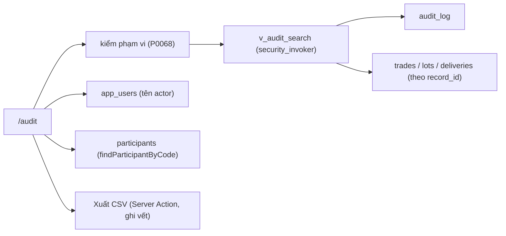

# SCR034_AuditLogSearch — Screen Spec

> Alias LAB-1: **SC-34** · 監査証跡の検索 · Tra cứu nhật ký kiểm toán

**Screen**: SCR034_AuditLogSearch: Tra cứu nhật ký kiểm toán (監査証跡の検索)
**Feature**: F011_AuditLog (tính năng con `F11-02`; user story `US-20` — tra lại một giao dịch cũ trong 2 phút)
**Type**: atomic (tra cứu)
**Route**: `/audit` *(đề xuất)*
**Generated**: 2026-10-06
**Trạng thái**: thiết kế mới, chưa xây — **Chưa có code — màn chỉ đặc tả ở LAB-4**
**Liên kết**: [F011](../../features/F011_AuditLog/business-context.md) · ADR-003 (thư mục `decisions/`) · màn kề: [SCR013](../SCR013_TradeDetail/spec.md) · [SCR009](../SCR009_LotDetail/spec.md) · [SCR016](../SCR016_DeliveryDetail/spec.md) · [SCR029](../SCR029_ReportViewExport/spec.md) · [SCR037](../SCR037_MarketManagement/spec.md)

## Purpose

Tra lại **監査証跡** của một giao dịch, một ngày, một người, hay một loại thao tác — và thấy đủ **5 trường** mà `FR-AUDIT-01` đòi: ai làm · lúc nào · số cũ · số mới · lý do. Mục tiêu đo được của khách: hiện tra một bản ghi mất **15–30 phút**, phải xuống **≤ 2 phút**; tỷ lệ giao dịch có đủ dấu vết đi từ **35% lên ≥ 98%**.

Người dùng: kiểm toán nội bộ (`internal_audit` (đề xuất)) điều tra một con số của tháng trước; bộ phận đối chiếu (`reconcile`) chứng minh mình làm đúng. Giờ hành chính, PC văn phòng — không phải màn hiện trường.

**Màn này vá đúng một lỗ hổng của prototype:** LAB-3 đã ghi `audit_log` thật (kể cả lần **thử** ghi bị chặn, qua `log_blocked_write_attempt`), nhưng **chưa có màn nào đọc ra**. Dữ liệu đang nằm đó mà không ai tra được. Đây cũng là nguồn của báo cáo `RPT-08` (hiện qua [SCR029](../SCR029_ReportViewExport/spec.md)) — một công thức, hai nơi dùng.

## Screen Layout

*(Suy luận từ bảng field — chưa có wireframe.)* Trang tra cứu một cột cho PC văn phòng: banner/khối lỗi, form điều kiện (4 chiều khách yêu cầu + 3 chiều bổ sung đề xuất), thanh tra nhanh, rồi bảng kết quả với dòng tổng và nút "Xuất CSV". Mỗi dòng mở rộng hiện JSON `old_value`/`new_value`. Điều kiện giữ trên query string.

### Layout Sketch

```
┌──────────────────────────────────────────────────────────┐
│ R1: Banner P0068 / khối lỗi mạng (static)                │
├──────────────────────────────────────────────────────────┤
│ R2: Form tra cứu — mã GD · ngày NV từ–đến · mã người    │
│     tham gia · loại thao tác  [+ người thực hiện · đối  │
│     tượng · thời điểm thao tác]       [Tra cứu]          │
│     Tra nhanh: Hôm nay | Bị chặn 7 ngày | Đổi quyền 30  │
├──────────────────────────────────────────────────────────┤
│ R3: Dòng tổng "Tìm thấy {n} vết trong {ms} ms" [CSV]     │
├──────────────────────────────────────────────────────────┤
│ R4: Bảng vết (scrollable): Ai làm · Lúc nào · Số cũ ·    │
│     Số mới · Lý do · GD/ngày NV · Phiên bản quy chế      │
│   ┌────────────────────────────────────────────────┐     │
│   │ R5: Dòng mở rộng — JSON định dạng + link gốc   │     │
│   └────────────────────────────────────────────────┘     │
└──────────────────────────────────────────────────────────┘
```

### Layout Regions

| Region ID | Name | Position | Scrollable | Key Components | Responsive Behavior |
|-----------|------|----------|------------|----------------|---------------------|
| R1 | Banner / khối lỗi | static | no | banner đỏ `P0068`; khối lỗi mạng + nút "Tra lại" | always |
| R2 | Form tra cứu + tra nhanh | static | no | field #1–#7, nút "Tra cứu" (GET), 3 nút tra nhanh | PC văn phòng (không phải màn hiện trường) |
| R3 | Dòng tổng + xuất | static | no | "Tìm thấy {n} vết trong {ms} ms", "Xuất CSV" | hiện sau khi có kết quả |
| R4 | Bảng vết | static | yes | cột #8–#14; skeleton 10 dòng khi tải | chưa xác định |
| R5 | Dòng mở rộng | static (có điều kiện) | no | JSON `old_value`/`new_value`, liên kết bản ghi gốc | khi bấm một dòng |

## Child Routes

Không áp dụng — màn không phải shell có route con.

## User Flow

> **Scope:** within-screen interactions. Điều hướng liên màn xem `generated/screen-flow.md`.

### Happy Path

1. `internal_audit`/`reconcile` mở `/audit`.
2. Chọn một hoặc nhiều trong 4 chiều (mã giao dịch · ngày nghiệp vụ · người tham gia · loại thao tác), tuỳ chọn thêm 3 chiều bổ sung → "Tra cứu" (GET, điều kiện đẩy lên URL).
3. Hệ thống kiểm phạm vi trước khi truy vấn → quá rộng thì `P0068`, không chạy truy vấn.
4. Kết quả hiện theo `occurred_at` giảm dần, mỗi dòng đủ 5 trường bắt buộc.
5. Bấm vào một dòng → mở rộng hiện nguyên `old_value`/`new_value` dạng JSON đã định dạng, và liên kết sang bản ghi gốc ([SCR009](../SCR009_LotDetail/spec.md) / [SCR013](../SCR013_TradeDetail/spec.md) / [SCR016](../SCR016_DeliveryDetail/spec.md)).
6. "Xuất CSV" → tệp mang theo điều kiện tra, thời điểm tạo và người kích hoạt — chính việc xuất này **cũng được ghi vết** (`F11-01`).

### Branches

| Decision point | Condition | Outcome on this screen | Source |
|----------------|-----------|------------------------|--------|
| Bước 2 (tra nhanh) | lọc nhanh `action = blocked_write` | thấy các lần **thử** ghi vào ngày đã chốt sổ mà hệ thống đã chặn (`P0002`/`P0009`) — bằng chứng trực tiếp cho `US-12` | (tài liệu gốc trong repo, không nộp) `sc-34-tra-cuu-nhat-ky-kiem-toan.md` §7 |
| Bước 3 | khoảng ngày `> 31 ngày` không kèm chiều lọc nào khác | `P0068`, không chạy truy vấn | cùng file |

## Data Inventory

> `audit_log` **đã có** (`supabase/migrations/0002_core_identity.sql`: `id`, `table_name`, `record_id`, `action`, `actor_id`, `occurred_at`, `old_value`, `new_value`; không có `business_date`, `trade_code`, `participant_code`, `reason`). View `v_audit_search` là **đề xuất mới**. Field nhập ở `## Validation & Error Feedback`.

Cột kết quả — **5 trường bắt buộc** (`FR-AUDIT-01`) và hai cột phụ:

| Field | Display Label | Source | Format | Empty Behavior | Cross-ref |
|-------|---------------|--------|--------|----------------|-----------|
| `actor` (#8) | Ai làm / 実行者 | `audit_log.actor_id` | `{họ tên} · {chức danh lúc đó}`; tra bằng truy vấn **thứ hai** vào `app_users` | tài khoản đã xoá ⇒ hiện `actor_id` thô, **không** hiện "—" | `app_users` |
| `occurredAt` (#9) | Lúc nào / 日時 | `audit_log.occurred_at` | datetime JST; sắp giảm dần mặc định | — | — |
| `oldValue` (#10) | Số cũ / 変更前 | `audit_log.old_value` | cặp khoá–giá trị từ `jsonb`; chỉ hiện các khoá **có đổi** | "—" (`insert` ⇒ "—") | — |
| `newValue` (#11) | Số mới / 変更後 | `audit_log.new_value` | như trên; `blocked_write` ⇒ hiện nội dung đã bị từ chối | "—" | — |
| `reason` (#12) | Lý do / 理由 | `audit_log.reason` *(cột mới, đề xuất — chưa có)* | text | "—" | — |
| `tradeCode` · `businessDate` (#13) | Giao dịch · ngày nghiệp vụ / 取引番号・業務日 | `v_audit_search` | link → [SCR013](../SCR013_TradeDetail/spec.md) | rỗng khi dòng không gắn giao dịch (đổi quyền, chốt sổ) → "—" | `trades` |
| `ruleVersion` (#14) | Phiên bản quy chế áp dụng / 適用規程バージョン | bảng quy tắc có phiên bản ([SCR037](../SCR037_MarketManagement/spec.md)) | chỉ có với dòng gắn 精算/tiền khuyến khích (`F11-03`); tra theo `as_of = business_date`, **không theo `now()`** | "—" (chưa có SCR037 thì để trống, **không bịa**) | — |

## UI States

| State | Trigger | Visual Behavior | User Action Available | Source |
|-------|---------|----------------|-----------------------|--------|
| empty | chưa tra lần nào trong phiên | gợi ý "Chọn ít nhất một điều kiện rồi bấm Tra cứu." + 3 nút tra nhanh: "Hôm nay" · "Lần ghi bị chặn 7 ngày qua" · "Thay đổi quyền 30 ngày qua" | tra nhanh / nhập điều kiện | đặc tả §5 |
| empty (không khớp) | không có dòng nào khớp | "Không có vết nào khớp điều kiện tra cứu." / 条件に一致する監査証跡はありません。(`EmptyState`) | đổi điều kiện | đặc tả §4 |
| loading | sau khi bấm "Tra cứu" | skeleton 10 dòng; hiện đồng hồ đếm giây để đối chiếu với ngưỡng 2 phút của `US-20` | none | đặc tả §5 |
| success | có kết quả | bảng + dòng tổng "Tìm thấy {n} vết trong {ms} ms"; nút "Xuất CSV" (gắn thời điểm tạo, điều kiện tra, người kích hoạt — cùng khuôn với SCR029) | mở rộng dòng, Xuất CSV | đặc tả §5 |
| error (nghiệp vụ) | `P0068` | banner đỏ; bộ lọc **giữ nguyên** để người dùng thu hẹp, không reset | thu hẹp điều kiện | đặc tả §5 |
| error (mạng) | truy vấn `throw` | khối lỗi + nút "Tra lại"; điều kiện tra giữ trên URL nên không mất | Tra lại | đặc tả §5 |
| saving | không áp dụng — màn không có đường ghi (trừ ghi vết việc xuất CSV phía server) | — | — | — |
| read-only | **luôn luôn** | không nút sửa, không nút xoá, kể cả cho `sys_admin` | — | đặc tả §5 |

## Validation & Error Feedback

### A) Client-side

Màn **không có form ghi**. Chỉ có một phép chặn phạm vi để giữ ngưỡng hiệu năng cam kết.

Bốn chiều tra cứu *(ràng buộc bắt buộc của LAB-1 — không bớt chiều nào)* và ba chiều bổ sung *(đề xuất)*:

| Field | Type | Required | Constraints | Async Check | Error Message | Default | Source |
|-------|------|----------|-------------|-------------|---------------|---------|--------|
| `tradeCode` — Mã giao dịch / 取引番号 (#1) | text | no | khớp **chính xác** `trades.trade_code`; không tồn tại ⇒ kết quả rỗng, **không phải lỗi** | không | — | rỗng | `v_audit_search.trade_code` |
| `businessDateFrom` · `businessDateTo` — Ngày nghiệp vụ từ · đến / 業務日（開始・終了） (#2) | 2 × `input type="date"` | no | `from ≤ to`; khoảng `> 31 ngày` **mà không có chiều lọc nào khác** ⇒ `P0068` | không | `V-range`, `P0068` | `from = to = hôm nay` | `v_audit_search.business_date` |
| `participantCode` — Người tham gia (mã) / 参加者コード (#3) | text, placeholder "VD: PTA-01" | no | mã không tồn tại trong `participants.code` ⇒ kết quả rỗng, không báo lỗi | `findParticipantByCode()` | — | rỗng | `v_audit_search.participant_code` |
| `action` — Loại thao tác / 操作種別 (#4) | select nhiều lựa chọn | no | ∈ `insert` 作成 · `update` 修正 · `cancel` 取消 · `approve` 承認 · `close_day` 締め · `role_change` 権限変更 · `blocked_write` 遮断された書込 + "Tất cả" | không | — | "Tất cả" | `audit_log.action` |
| `actorId` — Người thực hiện / 実行者 (#5) *(đề xuất)* | select (danh sách `app_users`) | no | phải là `app_users.id` đang có | không | — | "Tất cả" | `audit_log.actor_id` |
| `tableName` — Đối tượng / 対象テーブル (#6) *(đề xuất)* | select | no | ∈ `lots` `trades` `deliveries` `app_users` `business_days` + "Tất cả" | không | — | "Tất cả" | `audit_log.table_name` |
| `occurredFrom` · `occurredTo` — Thời điểm thao tác từ · đến / 操作日時（開始・終了） (#7) *(đề xuất)* | 2 × datetime-local | no | `from ≤ to`; khác chiều #2 — đây là **lúc thao tác**, không phải **ngày nghiệp vụ** | không | `V-range` | rỗng | `audit_log.occurred_at` |

> Vì sao tách bảng: khách yêu cầu tra theo **người tham gia** (買受人/荷主 — một bên ngoài), còn `audit_log` lưu **người thực hiện** (`actor_id` — một tài khoản nội bộ). Hai thứ khác nhau; chiều #3 phải đi vòng qua `trades.buyer_participant_id`, không đọc thẳng được từ `audit_log`. Xem Dependencies & Risks.

| Mã | Điều kiện kích hoạt | Thông báo VI | Thông báo JA | Hiện ở đâu | Chặn gửi? |
|---|---|---|---|---|:---:|
| `V-range` | `businessDateFrom > businessDateTo` (hoặc tương tự cho `occurredFrom/To`) | Ngày bắt đầu phải trước ngày kết thúc. | 開始日は終了日より前である必要があります。 | dưới ô ngày | ● |
| (network) | truy vấn `throw` | Không tải được nhật ký kiểm toán. Kiểm tra kết nối rồi tra lại. | 監査証跡を読み込めませんでした。接続を確認して再検索してください。 | thay chỗ bảng, kèm nút "Tra lại" | không áp dụng |

### B) Server-side

#### Tra cứu vết

- **Endpoint:** `select` từ `v_audit_search` *(view mới, đề xuất)*
- **Request:** 7 chiều ở mục A
- **Success:** mảng dòng theo Data Inventory
- **Errors:** `P0068` (kiểm phạm vi **trước** khi truy vấn)
- **Trigger:** bấm "Tra cứu" (GET)
- **Source:** (tài liệu gốc trong repo, không nộp) `sc-34-tra-cuu-nhat-ky-kiem-toan.md` §8

| Mã | Điều kiện kích hoạt | Thông báo VI | Thông báo JA | Hiện ở đâu | Chặn? |
|---|---|---|---|---|:---:|
| `P0068` *(mới)* | khoảng ngày nghiệp vụ `> 31 ngày` **và** không có chiều nào trong {mã giao dịch, người tham gia, người thực hiện} — `details: {days, max_days}` | Khoảng tra cứu {days} ngày là quá rộng khi chưa chọn giao dịch, người tham gia hay người thực hiện. Thu hẹp còn {max_days} ngày hoặc thêm một điều kiện. | 取引・参加者・実行者のいずれも指定せずに{days}日間を検索することはできません。{max_days}日以内に絞るか、条件を追加してください。 | banner trên vùng kết quả | ● |

#### Xuất CSV

- **Endpoint:** cùng truy vấn, giới hạn cao hơn, chạy ở Server Action
- **Success:** tệp + một dòng `audit_log` mới ghi lại chính việc xuất
- **Errors:** không nêu mã riêng
- **Trigger:** bấm "Xuất CSV"

Đọc dữ liệu phụ (không phải submit):

| Thao tác | Cách gọi | Tham số | Trả về |
|---|---|---|---|
| Tra mã người tham gia | `select` từ `participants` qua `findParticipantByCode()` | `code` | `participant.id` hoặc `null` |
| Tra tên người thực hiện | `select` thứ hai từ `app_users` theo tập `actor_id` | `id IN (...)` | map `id → full_name` |

**Vì sao cần view mới:** `audit_log` chỉ có `table_name`, `record_id`, `action`, `actor_id`, `occurred_at`, `old_value`, `new_value` — **không có** `business_date`, `trade_code`, hay người tham gia. Hai trong bốn chiều khách yêu cầu không truy vấn được nếu đọc thẳng bảng. `v_audit_search` *(đề xuất)* nối `audit_log` → `trades`/`lots`/`deliveries` theo `record_id` để lộ ra `trade_code`, `business_date`, `participant_code`. **Bắt buộc `security_invoker = true`** (bài học ADR-003), và cần index trên `(table_name, record_id)` cùng `(occurred_at)` để giữ ngưỡng 2 phút.

## Interaction Patterns

- **Không có phím tắt riêng** (đặc tả §6).
- **Toàn bộ điều kiện tra giữ trên query string** để chia sẻ được đường dẫn — một kiểm toán viên gửi link là người kia thấy đúng kết quả đó — source: đặc tả §6.
- **3 nút tra nhanh** ("Hôm nay" · "Lần ghi bị chặn 7 ngày qua" · "Thay đổi quyền 30 ngày qua") ở trạng thái rỗng — source: đặc tả §5.
- **Bấm một dòng → mở rộng hiện JSON định dạng + liên kết bản ghi gốc** — source: đặc tả §7.
- **Xuất CSV cũng được ghi vết** (`F11-01`) — source: đặc tả §7.
- **Đồng hồ đếm giây khi đang tải** để đối chiếu ngưỡng 2 phút của `US-20` — source: đặc tả §5.

## Accessibility

| Aspect | Status | Notes |
|--------|--------|-------|
| ARIA roles/labels | unknown | chưa có code; đặc tả không nêu |
| Keyboard navigation | unknown | không có yêu cầu riêng (đặc tả §6) |
| Focus management | unknown | không có hộp thoại; chưa mô tả focus sau khi tra |
| Screen reader compatibility | unknown | `[NO_A11Y_DETECTED]` — cần audit khi xây |

## Conditional Rendering

| Condition | Type | Renders | Hidden | Notes |
|-----------|------|---------|--------|-------|
| mọi role | hardcoded | bảng chỉ đọc | nút sửa/xoá | không bao giờ có, kể cả `sys_admin` (`BR-CLOSE-01`, B.7 cấm hard-delete) |
| `action = blocked_write` | hardcoded-state | `newValue` = nội dung đã bị từ chối | — | |
| dòng không gắn giao dịch (đổi quyền, chốt sổ) | hardcoded-state | "—" ở #13 | link SCR013 | |
| dòng gắn 精算/tiền khuyến khích | hardcoded-state | `ruleVersion` | — | chưa có SCR037 → để trống |
| `INSERT` | hardcoded-state | `oldValue` = "—" | — | |
| tài khoản actor đã xoá | hardcoded-state | `actor_id` thô | "—" | |

## Component Variants

Không áp dụng — chưa có code, không có component đa hình dùng chung được xác định.

## Security Surface

| Guard | Type | Consequence if bypassed |
|-------|------|------------------------|
| route mới `{ prefix: "/audit", roles: ["internal_audit", "reconcile", "sys_admin"] }` *(đề xuất)* | role | đẩy về `/403` |
| migration nới RLS SELECT của `audit_log` cho đúng ba role đó — hiện `audit_log_select` chỉ cho `sys_admin` (`supabase/migrations/0009_rls_policies.sql`) | permission | chưa nới thì màn trả rỗng cho mọi role trừ `sys_admin` |
| `audit_log` append-only: không policy INSERT qua RLS, chỉ RPC `SECURITY DEFINER` ghi | permission | không thêm nút sửa/xoá dưới bất kỳ hình thức nào (`BR-CLOSE-01`, B.7) |

Vai trò: `sys_admin` xem (hiện là role **duy nhất** đọc được `audit_log` theo RLS) · `internal_audit` (đề xuất; chức danh "Kiểm toán nội bộ" của LAB-1 — **không có trong 4 role của prototype**) xem · `reconcile` xem (LAB-1 liệt kê cho màn này; RLS hiện **chưa cho phép**) · `receiving` · `trading` · `party_admin` · `rule_admin` · `ops_admin` · `market_manager` ✗ (không thuộc `roles` của route `/audit`). Không ai có quyền ghi. Server enforcement: `[UNVERIFIED]` cho phần mới; RLS hiện hữu đã xác minh ở `0009_rls_policies.sql`.

## Source References

Chưa có code giao diện — màn chỉ đặc tả ở LAB-4. Dữ liệu nền đã có trong migration.

1. Đặc tả gốc: (tài liệu gốc trong repo, không nộp) `sc-34-tra-cuu-nhat-ky-kiem-toan.md`
2. Bảng đã có: `audit_log` — `supabase/migrations/0002_core_identity.sql`; RLS `audit_log_select` — `supabase/migrations/0009_rls_policies.sql`; RPC ghi vết lần thử bị chặn `log_blocked_write_attempt` — `supabase/migrations/0040_log_blocked_write_attempt.sql`; trigger `guard_closed_day` (`P0009`) — `supabase/migrations/0010_closed_day_guard.sql`
3. ADR: (tài liệu gốc trong repo, không nộp) `adr.md` (ADR-003)
4. Dự kiến (chưa có): view `v_audit_search`; cột `audit_log.reason`; index `(table_name, record_id)`, `(occurred_at)`; migration nới RLS

## Source Walkthrough

1. **File:** `supabase/migrations/0002_core_identity.sql` — định nghĩa `audit_log` (4 trường chứ không đủ 5 của `FR-AUDIT-01`)
2. **File:** `supabase/migrations/0009_rls_policies.sql` — policy `audit_log_select` hiện chỉ cho `sys_admin`
3. **File:** `supabase/migrations/0040_log_blocked_write_attempt.sql` — nguồn của dòng `blocked_write`

### Call Hierarchy

*(Thiết kế dự kiến — không phải code hiện có.)*



**Related files:** xem `## Source References`.

## Dependencies & Risks *(mục bổ sung)*

- Phụ thuộc migration nới RLS `audit_log` và view `v_audit_search` — cả hai phải xong **trước** khi làm giao diện, nếu không màn trả rỗng cho mọi role trừ `sys_admin`.
- **Thiếu trường so với yêu cầu P0.** `FR-AUDIT-01` đòi đủ 5 trường, `audit_log` hiện chỉ có 4 — **không có `reason`**. Không vá chỗ này thì cột "Lý do" luôn là "—" và mục tiêu 98% dấu vết đủ không đạt được dù hệ thống vẫn chạy. Đề xuất thêm cột `reason text` và sửa các RPC ghi vết để điền vào; quy ước nhét lý do vào `new_value->>'reason'` rẻ hơn nhưng **không kiểm được** và sẽ trôi.
- **Hai khái niệm dễ gộp nhầm:** "người tham gia" (bên ngoài — 買受人/荷主) và "người thực hiện" (tài khoản nội bộ). Khách yêu cầu chiều thứ ba là **người tham gia**; nếu LAB-5 cài thành bộ lọc theo `actor_id` thì màn vẫn chạy, vẫn có vẻ đúng, nhưng **không trả lời được** câu hỏi kiểm toán thật ("người mua này đã dính vào những giao dịch nào").
- Tương tự với hai mốc thời gian: **ngày nghiệp vụ** (số liệu thuộc về ngày nào) và **thời điểm thao tác** (`occurred_at`). Một sửa đổi ghi lúc 09:00 hôm nay có thể thuộc ngày nghiệp vụ hôm qua. Gộp hai cái làm một là lỗi kiểm toán, không phải lỗi hiển thị.
- `F11-03` (hiện phiên bản quy chế đã áp dụng, cột `ruleVersion`) phụ thuộc bảng quy tắc có phiên bản của [SCR037](../SCR037_MarketManagement/spec.md) — chưa có thì cột để trống, **không bịa**.
- Hiệu năng: `audit_log` là bảng tăng mãi, lịch sử giữ 7 năm (`FIG-022`). Ở quy mô 1.200 giao dịch/ngày thì sau 3 năm là hàng triệu dòng. `P0068` là lưới an toàn ở tầng ứng dụng; nó **không thay** cho index — thiếu index thì chính truy vấn hẹp cũng chậm.

## Unresolved Questions *(mục bổ sung)*

- **`internal_audit` có được khách xác nhận không?** Đã chốt dùng role `internal_audit` *(đề xuất, chưa có trong `app_role`)* — PREMISE C-09; phương án cờ `can_audit` trên `reconcile` bị loại vì kiểm toán và đối chiếu không còn tách được, trái tinh thần `起票・承認分離`. Còn mở: chờ khách xác nhận role này tồn tại ở chợ thật.
- Thêm cột `reason` vào `audit_log` (quyết định này dùng chung với SC-13 / [SCR013](../SCR013_TradeDetail/spec.md)).
- `audit_log` mở tới mức nào cho `reconcile`: toàn bộ bảng, hay chỉ `table_name ∈ {lots, trades, deliveries, business_days}` (giấu `app_users`/`role_change_log`)? Mức sau đúng nguyên tắc tối thiểu hơn.
- Ngưỡng `P0068` (31 ngày) là **đề xuất**, chưa có nguồn. Phải chốt cùng ngưỡng hiệu năng cam kết của `RPT-08`.
- Xuất CSV có cần giới hạn số dòng và có cần duyệt không? Dữ liệu kiểm toán chứa thông tin cá nhân của 参加者 (APPI 09-06) — việc xuất hàng loạt có thể phải có kiểm soát riêng.
