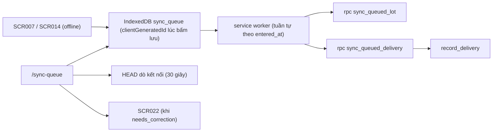

# SCR035_SyncQueue — Screen Spec

> Alias LAB-1: **SC-35** · 同期待ちキュー · Hàng chờ đồng bộ

**Screen**: SCR035_SyncQueue: Hàng chờ đồng bộ (同期待ちキュー)
**Feature**: F010_Notifications (chủ sở hữu theo sổ đăng ký; tính năng con LAB-1 của màn: `F03-06` `F05-07` — thuộc nhóm F003_LotsAndInspection / F005_DeliveryTracking; user story `US-09` — tiếp tục làm việc khi mất mạng)
**Type**: atomic (danh sách chạy hoàn toàn phía máy khách)
**Route**: `/sync-queue` *(đề xuất)*
**Generated**: 2026-10-06
**Trạng thái**: thiết kế mới, chưa xây — **Chưa có code — màn chỉ đặc tả ở LAB-4**
**Liên kết**: [F010](../../features/F010_Notifications/business-context.md) · [F003](../../features/F003_LotsAndInspection/business-context.md) · [F005](../../features/F005_DeliveryTracking/business-context.md) · FL-01 (thư mục `flows/`) · màn kề: [SCR007](../SCR007_LotEntry/spec.md) · [SCR014](../SCR014_DeliveryEntry/spec.md) · [SCR022](../SCR022_CorrectionRequestCreate/spec.md) · [SCR024](../SCR024_RequestDetailApproval/spec.md) · [SCR009](../SCR009_LotDetail/spec.md) · [SCR016](../SCR016_DeliveryDetail/spec.md)

## Purpose

Hiện **những bản ghi đã nhập lúc mất mạng và chưa lên tới máy chủ** — lô nháp ([SCR007](../SCR007_LotEntry/spec.md)) và lần giao ([SCR014](../SCR014_DeliveryEntry/spec.md)) — cùng trạng thái từng bản, để người ở hiện trường (`receiving`) biết chắc việc mình vừa làm đã vào sổ hay chưa.

Bối cảnh vật lý quyết định toàn bộ thiết kế: mạng khu tiếp nhận và cầu cảng mất **3–5 lần mỗi tuần** vào giờ cao điểm (`PP-NET-01`), mỗi lần vài phút. Hiện nay nhân viên quay về ghi giấy rồi nhập bù — và **nhập bù trùng** là sự cố đã được ghi nhận (`EX-05`).

Ba việc màn này phải làm đúng, theo đúng thứ tự quan trọng:

1. **Chỉ báo rõ ràng** bản nào đang chờ — không để ai tưởng đã lưu rồi trong khi chưa.
2. **Chống tạo bản ghi trùng** khi nhập bù.
3. **Xử lý đúng** khi bản ghi đồng bộ về mà ngày nghiệp vụ **đã chốt sổ**.

## Screen Layout

*(Suy luận từ bảng field — chưa có wireframe.)* Trang danh sách thao tác được kể cả khi mất mạng: thanh trạng thái đầu trang (kết nối, số bản chờ, bản chờ lâu nhất, dải cảnh báo mất kết nối, nút "Gửi lại tất cả"), rồi danh sách bản ghi chờ với nút thao tác từng dòng. Chỉ báo `pendingCount` còn xuất hiện trên thanh điều hướng của mọi màn.

### Layout Sketch

```
┌──────────────────────────────────────────────────────────┐
│ R0: Thanh điều hướng chung (mọi màn) — badge pendingCount│
├──────────────────────────────────────────────────────────┤
│ R1: Dải cảnh báo cố định "Đang mất kết nối — {n} bản ghi │
│     đang chờ" (sticky, có điều kiện)                     │
├──────────────────────────────────────────────────────────┤
│ R2: Thanh trạng thái: kết nối · số bản chờ · chờ lâu nhất│
│     [Gửi lại tất cả]                                     │
├──────────────────────────────────────────────────────────┤
│ R3: Danh sách bản ghi chờ (scrollable)                   │
│   mã tạm · loại · tóm tắt · 業務日 · trạng thái · lúc   │
│   nhập · người nhập · lần thử/lỗi · bản ghi máy chủ      │
│   [Gửi lại][Chi tiết/sửa][Bỏ][Lập phiếu ĐC][Trùng-bỏ]    │
│     ┌ - - - - - - - - - - - - - - ┐                      │
│     │ R4: Hộp thoại bỏ bản ghi    │ (modal, lý do ≥ 10)  │
│     └ - - - - - - - - - - - - - - ┘                      │
└──────────────────────────────────────────────────────────┘
```

### Layout Regions

| Region ID | Name | Position | Scrollable | Key Components | Responsive Behavior |
|-----------|------|----------|------------|----------------|---------------------|
| R0 | Thanh điều hướng chung | fixed-top | no | chỉ báo `pendingCount > 0` (hiện ở mọi màn) | always |
| R1 | Dải cảnh báo mất kết nối | sticky | no | "Đang mất kết nối — {n} bản ghi đang chờ" | chỉ khi vẫn offline |
| R2 | Thanh trạng thái | static | no | `connectivity`, `pendingCount`, `oldestPendingAge`, "Gửi lại tất cả" (đặt ở đầu trang) | always |
| R3 | Danh sách bản ghi chờ | static | yes | dòng hàng đợi, nút thao tác #13–#17 | người dùng đeo găng tay: mọi thao tác tới được bằng Tab, không có hành động chỉ hiện khi hover |
| R4 | Hộp thoại bỏ bản ghi | modal | no | ô lý do, xác nhận; đóng bằng `Escape` | khi bấm "Bỏ bản ghi này" |

## Child Routes

Không áp dụng — màn không phải shell có route con.

## User Flow

> **Scope:** within-screen interactions. Điều hướng liên màn xem `generated/screen-flow.md`.

### Happy Path

1. Mất mạng → [SCR007](../SCR007_LotEntry/spec.md)/[SCR014](../SCR014_DeliveryEntry/spec.md) lưu bản ghi vào IndexedDB kèm `clientGeneratedId` **sinh ngay lúc bấm lưu**, hiện ngay chỉ báo "Đang chờ đồng bộ" và tăng `pendingCount` trên thanh điều hướng.
2. Có mạng lại → service worker tự gửi lần lượt theo `entered_at` tăng dần (bản cũ trước), **tuần tự, không song song**: thứ tự quan trọng vì lần giao thứ 2 phụ thuộc số còn lại sau lần giao thứ 1.
3. Mỗi lần gửi mang theo `p_client_generated_id`. Phía máy chủ: cột `client_generated_id uuid UNIQUE` *(mới, đề xuất)* trên `lots` và `deliveries`.
4. Gửi xong hết → `pendingCount = 0`, chỉ báo trên thanh điều hướng tắt.

### Branches

| Decision point | Condition | Outcome on this screen | Source |
|----------------|-----------|------------------------|--------|
| Bước 3 — trùng khoá, khớp nội dung (đường chống trùng chính) | máy chủ đã có đúng `clientGeneratedId` **và nội dung khớp** | trả về **thành công** kèm `record_id` của bản cũ, **không tạo bản mới** — hành vi idempotent, không phải lỗi; xử lý ca hay gặp nhất: gửi thành công rồi nhưng phản hồi không về tới máy khách | (tài liệu gốc trong repo, không nộp) `sc-35-hang-cho-dong-bo.md` §7 |
| Bước 3 — trùng khoá, lệch nội dung | cùng `clientGeneratedId`, nội dung khác | `P0066` — không ghi đè, để người xử lý | cùng file |
| Bước 3 — nghi trùng | khác khoá, giống nội dung: `lot` ⇒ cùng chủ hàng + mặt hàng + số lượng, nhập trong vòng 30 phút; `delivery` ⇒ cùng giao dịch + số lượng, trong vòng 30 phút | **không ghi**, trả `W-duplicate` để người quyết định (thao tác #17). *Ngưỡng 30 phút và bộ trường so khớp là **đề xuất**.* Hệ thống **không tự bỏ** bản nghi trùng — đúng `CAP-HUMAN-01` | cùng file |
| Bước 3 — ngày đã chốt sổ | `P0067` | `state='needs_correction'`. Bản ghi **ở nguyên trong hàng đợi**, không mất; nút "Lập phiếu điều chỉnh" mở [SCR022](../SCR022_CorrectionRequestCreate/spec.md) mang theo toàn bộ dữ liệu + `clientGeneratedId` làm chứng cứ. Khi phiếu được duyệt ([SCR024](../SCR024_RequestDetailApproval/spec.md)), bản ghi vào sổ bằng **đường điều chỉnh** (sinh bản ghi mới, không chèn lén vào ngày đã khoá) và mục trong hàng đợi chuyển `synced` | cùng file |

## Data Inventory

> **Không có bảng database cho dữ liệu của màn này** — hàng đợi nằm trong **IndexedDB của chính máy đó**. Cột `client_generated_id` trên `lots`/`deliveries` là **đề xuất mới** (chưa có trong `supabase/migrations/`). Thao tác trên từng dòng (#13–#17) ở `## Interaction Patterns`.

Cột của hàng đợi (một dòng = một bản ghi chờ):

| Field | Display Label | Source | Format | Empty Behavior | Cross-ref |
|-------|---------------|--------|--------|----------------|-----------|
| `clientGeneratedId` (#1) | Mã bản ghi tạm / ローカル識別子 | IndexedDB `queue.client_generated_id` | text (8 ký tự đầu); UUIDv4 sinh **ở máy khách ngay lúc bấm lưu**, không phải lúc gửi; là **khoá chống trùng**; sinh tự động | — | — |
| `kind` (#2) | Loại bản ghi / 種別 | IndexedDB `queue.kind` | badge ∈ `lot` ロット · `delivery` 引渡し — **chỉ hai loại này** (ranh giới `architecture.md` §3.5) | — | — |
| `summary` (#3) | Tóm tắt / 概要 | dựng từ `queue.payload` | `lot`: `{chủ hàng} · {mặt hàng} · {số lượng}`; `delivery`: `{mã giao dịch} · lần {seq dự kiến} · {số lượng}` | — | — |
| `businessDate` (#4) | Ngày nghiệp vụ / 業務日 | `queue.business_date` | date; ghi lại **lúc nhập**, không tính lại lúc gửi — một bản nhập lúc 01:50 không được nhảy sang ngày hôm sau vì gửi lúc 06:00 | — | `business_days` |
| `state` (#5) | Trạng thái đồng bộ / 同期状態 | `queue.state` | badge 6 giá trị: `pending` 送信待ち (neutral) · `sending` 送信中 (neutral) · `synced` 同期済 (positive) · `rejected` 拒否 (danger) · `duplicate_suspect` 重複疑い (warning) · `needs_correction` 訂正申請が必要 (danger); mặc định `pending` | — | — |
| `enteredAt` (#6) | Lúc nhập / 入力日時 | `queue.entered_at` | datetime; giờ máy khách; lệch đồng hồ máy khách là rủi ro đã biết (Dependencies & Risks) | — | — |
| `enteredBy` (#7) | Người nhập / 入力者 | `queue.entered_by` | `{họ tên} · {email}`; tài khoản đăng nhập **tại thời điểm nhập**; dòng do ca trước nhập hiện nền khác | — | `app_users` |
| `attemptCount` · `lastError` (#8) | Số lần thử · lỗi gần nhất / 試行回数・直近エラー | `queue.attempt_count`, `queue.last_error` | `attemptCount ≥ 5` ⇒ dừng tự gửi, chuyển sang chỉ gửi tay; mặc định 0 | — | — |
| `serverRecordRef` (#9) | Bản ghi trên máy chủ / サーバー側レコード | `queue.server_record_id` | link sang [SCR009](../SCR009_LotDetail/spec.md) hoặc [SCR016](../SCR016_DeliveryDetail/spec.md); chỉ có khi `state='synced'` | "—" | `lots` / `deliveries` |

Thanh trạng thái đầu trang:

| Field | Display Label | Source | Format | Empty Behavior | Cross-ref |
|-------|---------------|--------|--------|----------------|-----------|
| `connectivity` (#10) | Trạng thái kết nối / 接続状態 | đo ở client | badge "Có mạng" / "Mất mạng" — dựa trên **kết quả gọi thật gần nhất tới máy chủ**, không chỉ `navigator.onLine` (cờ này báo có mạng LAN cả khi không ra được Internet) | — | — |
| `pendingCount` (#11) | Số bản chờ / 送信待ち件数 | đếm `state ∈ {pending, sending}` | số; `> 0` ⇒ hiện cả trên thanh điều hướng **của mọi màn**, không chỉ màn này; mặc định 0 | — | — |
| `oldestPendingAge` (#12) | Bản chờ lâu nhất / 最長待機時間 | tính từ `entered_at` | `≥ 2 giờ` ⇒ chữ đỏ + nhắc "Kiểm tra lại kết nối trước khi hết ca" | "—" | — |

## UI States

| State | Trigger | Visual Behavior | User Action Available | Source |
|-------|---------|----------------|-----------------------|--------|
| empty | hàng đợi trống | "Không có bản ghi nào chờ đồng bộ." / 同期待ちの記録はありません。 — **trạng thái mong muốn**, nền xanh nhạt chứ không phải xám buồn | none | đặc tả §5 |
| loading | đang đọc IndexedDB | gần như tức thì; không cần skeleton | none | đặc tả §5 |
| success | một bản gửi xong | dòng đổi badge sang "Đã đồng bộ", `pendingCount` giảm 1, hiện link sang bản ghi thật; dòng tự rời danh sách sau **24 giờ** (giữ lại để người nhập kịp xác nhận) | xem bản ghi thật | đặc tả §5 |
| error (nghiệp vụ) | `P0001`/`P0003`/`P0006`/`P0066`/`P0067` | dòng chuyển `rejected` hoặc `needs_correction` kèm câu lỗi đầy đủ; **bản ghi không bị xoá khỏi hàng đợi trong mọi trường hợp** | theo dòng #13–#17 | đặc tả §5 |
| error (mạng) | vẫn offline | dải cảnh báo cố định đầu trang "Đang mất kết nối — {n} bản ghi đang chờ"; **không** đếm là lần thử thất bại (không tăng `attemptCount`) | chờ / gửi lại | đặc tả §5 |
| saving | `state = sending` | badge `sending` (neutral) | none | đặc tả §3 (#5) |
| read-only | không áp dụng | màn này luôn thao tác được, kể cả khi mất mạng — đó là lý do nó tồn tại | — | đặc tả §5 |

## Validation & Error Feedback

### A) Client-side

| Field | Type | Required | Constraints | Async Check | Error Message | Default | Source |
|-------|------|----------|-------------|-------------|---------------|---------|--------|
| lý do bỏ bản ghi (hộp thoại) | text | yes | `≥ 10` ký tự; ghi vào `audit_log` khi có mạng lại (`action='queue_discarded'`) | không | `V-discard-reason` | rỗng | — |

| Mã | Điều kiện kích hoạt | Thông báo VI | Thông báo JA | Hiện ở đâu | Chặn gửi? |
|---|---|---|---|---|:---:|
| `V-discard-reason` | bỏ bản ghi mà lý do < 10 ký tự | Vui lòng nêu lý do bỏ bản ghi, tối thiểu 10 ký tự. | 破棄理由を10文字以上で入力してください。 | trong hộp thoại | ● |
| (network) | vẫn chưa có mạng | Chưa gửi được — vẫn mất kết nối. Bản ghi vẫn an toàn trên máy này. | 送信できません — 接続がありません。記録はこの端末に保持されています。 | thanh trạng thái đầu trang | không — giữ `pending`, thử lại sau |

### B) Server-side

#### Gửi bản `lot`

- **Endpoint:** `rpc('sync_queued_lot', {...})` *(mới, đề xuất — chưa có trong migration)*
- **Request:** `p_client_generated_id` + toàn bộ trường của [SCR007](../SCR007_LotEntry/spec.md) + `p_entered_by`, `p_entered_at`
- **Success:** `jsonb {lot_id, lot_code, was_existing}`
- **Errors:** `P0066` `P0067`
- **Trigger:** tự động khi có mạng lại (service worker, tuần tự theo `entered_at`) hoặc bấm "Gửi lại" / "Gửi lại tất cả"
- **Source:** (tài liệu gốc trong repo, không nộp) `sc-35-hang-cho-dong-bo.md` §8

#### Gửi bản `delivery`

- **Endpoint:** `rpc('sync_queued_delivery', {...})` *(mới, đề xuất)* — bọc ngoài `record_delivery` (`supabase/migrations/0007_rpc_functions.sql`)
- **Request:** `p_client_generated_id` + tham số của `record_delivery` + `p_entered_by`, `p_entered_at`
- **Success:** `jsonb {delivery_id, delivery_seq, was_existing}`
- **Errors:** `P0001` `P0003` `P0006` `P0066` `P0067`
- **Trigger:** như trên

| Mã | Điều kiện kích hoạt | Thông báo VI | Thông báo JA | Hiện ở đâu | Chặn? |
|---|---|---|---|---|:---:|
| `P0001` | bản ghi `delivery` tham chiếu mã giao dịch không còn tồn tại | Không tìm thấy giao dịch {trade_code} của bản ghi này. | この記録が参照する取引{trade_code}が見つかりません。 | dưới dòng, `state='rejected'` | ● |
| `P0003` | tư cách người nhận hết hiệu lực tại thời điểm đồng bộ | Người nhận {buyer_name} đã hết hạn tham gia từ {expired_on}. Bản ghi không vào sổ được. | 買受人{buyer_name}は{expired_on}から資格が失効しています。記録は登録できません。 | dưới dòng, `state='rejected'` | ● |
| `P0006` | lần giao vượt số còn lại của giao dịch (số còn lại đã đổi trong lúc mất mạng) | Giao dịch {trade_code} chỉ còn {remaining} {unit}, không đủ cho {requested} {unit}. Sửa số lượng hoặc ghi ngoại lệ ([SCR017](../SCR017_DeliveryException/spec.md)). | 取引{trade_code}の残数量は{remaining} {unit}で、{requested} {unit}には不足しています。数量を修正するか例外（SC-17）を記録してください。 | dưới dòng, `state='rejected'` | ● |
| `P0066` *(mới)* | **cùng `clientGeneratedId` nhưng nội dung khác** với bản đã nhận trước đó — `details: {client_generated_id, stored_at, diff_fields[]}` | Mã bản ghi tạm này đã được nhận lúc {stored_at} với nội dung khác ({diff_fields}). Không ghi đè. | このローカル識別子は{stored_at}に異なる内容（{diff_fields}）で受理済みです。上書きしません。 | dưới dòng, `state='rejected'` | ● |
| `P0067` *(mới)* | bản ghi đồng bộ về mà ngày nghiệp vụ **đã chốt sổ** — `details: {business_date, closed_at, closed_by}` | Ngày nghiệp vụ {business_date} đã chốt sổ lúc {closed_at}. Bản ghi này phải đi qua phiếu điều chỉnh có duyệt ([SCR022](../SCR022_CorrectionRequestCreate/spec.md)) — không chèn thẳng vào ngày đã chốt được. | 業務日{business_date}は{closed_at}に締められています。この記録は訂正申請（SC-22）を経る必要があり、締め済みの日へ直接登録できません。 | dưới dòng, `state='needs_correction'`, kèm nút #16 | ● |
| `P0009` | trigger `guard_closed_day` bắn — nghĩa là `P0067` **đã bị lọt** | (dùng chung câu của `P0067`) | (dùng chung) | như `P0067` | ● |
| `W-duplicate` | phát hiện **nghi vấn trùng** (khác `clientGeneratedId`, nội dung gần trùng) | Có thể trùng với {mã bản ghi} đã vào sổ lúc {time}: cùng ngày nghiệp vụ, cùng {các trường trùng}. Bạn kiểm tra rồi quyết định. | {time}に登録済みの{mã bản ghi}と重複の可能性があります（同一業務日・{các trường trùng}）。ご確認のうえ判断してください。 | dưới dòng, `state='duplicate_suspect'`, kèm 2 nút #17 | ● **tạm dừng**, chờ người quyết định |

**Then chốt về `P0009`:** nó là **lưới an toàn cuối**, không phải cách xử lý (trigger có thật: `supabase/migrations/0010_closed_day_guard.sql`). Đường đúng là `P0067` — RPC tự kiểm `business_days.status` **trước khi** insert và từ chối tử tế kèm lối đi thay thế. Nếu trong thực tế thấy `P0009` xuất hiện ở màn này thì nghĩa là có một đường ghi nào đó chưa kiểm ngày chốt — đó là lỗi phải sửa, không phải trạng thái bình thường (`db-schema.md` §11.3).

Đọc dữ liệu (không phải submit):

| Thao tác | Cách gọi | Tham số | Trả về |
|---|---|---|---|
| Đọc hàng đợi | đọc IndexedDB tại chỗ (`sync_queue` store) — **không gọi mạng** | không | mảng mục chờ |
| Dò kết nối | `HEAD` tới một endpoint nhẹ của máy chủ, chu kỳ 30 giây khi đang offline | không | có/không ra được máy chủ |

**Vì sao `lot` cũng phải qua RPC** dù `lots` có policy INSERT cho `receiving`: phép kiểm idempotency + dò nghi trùng + kiểm ngày chốt phải chạy trong **một transaction có khoá**, và `p_entered_by` phải vào `audit_log` thay cho `auth.uid()` của người đang bấm nút. INSERT thẳng qua RLS không làm được cả ba.

## Interaction Patterns

Thao tác trên từng dòng:

| # | Thao tác | Nhãn VI / JA | Hiện khi | Ràng buộc |
|---|---|---|---|---|
| 13 | Gửi lại | 再送信 | `state ∈ {pending, rejected, duplicate_suspect}` | gửi **đúng `clientGeneratedId` cũ**, tuyệt đối không sinh mã mới — sinh mã mới là chính cái tạo ra bản ghi trùng |
| 14 | Xem chi tiết / sửa | 詳細・修正 | `state ≠ 'synced'` | mở lại form gốc ([SCR007](../SCR007_LotEntry/spec.md)/[SCR014](../SCR014_DeliveryEntry/spec.md)) với dữ liệu đã nhập; sửa **không** đổi `clientGeneratedId` |
| 15 | Bỏ bản ghi này | 破棄 | `state ≠ 'synced'` | hộp thoại xác nhận, **bắt buộc nhập lý do** `≥ 10` ký tự; lý do ghi vào `audit_log` khi có mạng lại (`action='queue_discarded'`) |
| 16 | Lập phiếu điều chỉnh | 訂正申請 | `state = 'needs_correction'` | mở [SCR022](../SCR022_CorrectionRequestCreate/spec.md) mang sẵn toàn bộ dữ liệu bản ghi + mã bản ghi tạm làm chứng cứ |
| 17 | Đây là bản trùng — bỏ | 重複のため破棄 | `state = 'duplicate_suspect'` | cạnh nút "Không trùng — gửi tiếp"; **người quyết định, hệ thống không tự chọn** |

- **Mọi thao tác #13–#17 tới được bằng Tab; không có hành động chỉ hiện khi hover; hộp thoại đóng bằng `Escape`** (người dùng đeo găng tay) — source: đặc tả §6.
- **Nút "Gửi lại tất cả" ở đầu trang** để không phải bấm từng dòng — source: đặc tả §6.
- **Không có yêu cầu bàn phím riêng theo LAB-1** — source: đặc tả §6.
- **Gửi tuần tự theo `entered_at` tăng dần, không song song** — source: đặc tả §7.

## Accessibility

| Aspect | Status | Notes |
|--------|--------|-------|
| ARIA roles/labels | unknown | chưa có code; đặc tả không nêu |
| Keyboard navigation | supported (theo đặc tả) | mọi thao tác dòng #13–#17 tới được bằng Tab, không có hành động chỉ hiện khi hover |
| Focus management | partial (theo đặc tả) | hộp thoại đóng bằng `Escape`; focus trap chưa nêu |
| Screen reader compatibility | unknown | chưa kiểm — cần audit khi xây |

## Conditional Rendering

| Condition | Type | Renders | Hidden | Notes |
|-----------|------|---------|--------|-------|
| `role = receiving` | auth | toàn màn | — | cả "Tiếp nhận" và "Giao hàng" của LAB-1 ánh xạ về `receiving` |
| `state` của dòng | hardcoded-state | nút #13–#17 theo bảng Interaction Patterns | nút không hợp lệ | |
| `pendingCount > 0` | hardcoded-state | chỉ báo trên thanh điều hướng mọi màn | — | |
| `oldestPendingAge ≥ 2 giờ` | hardcoded-threshold | chữ đỏ + nhắc kiểm tra kết nối | — | |
| `attemptCount ≥ 5` | hardcoded-threshold | chỉ gửi tay | tự gửi | |
| vẫn offline | hardcoded-state | dải cảnh báo cố định đầu trang | — | không tăng `attemptCount` |
| `enteredBy` ≠ người đang đăng nhập (ca trước) | hardcoded-state | dòng nền khác | — | hàng đợi thuộc **thiết bị**, không thuộc tài khoản |
| `state = 'synced'` quá 24 giờ | hardcoded-threshold | — | dòng tự rời danh sách | |

## Component Variants

Không áp dụng — chưa có code, không có component đa hình dùng chung được xác định.

## Security Surface

| Guard | Type | Consequence if bypassed |
|-------|------|------------------------|
| route `{ prefix: "/sync-queue", roles: ["receiving"] }` *(đề xuất)* | role | đẩy về `/403` |
| **Không có tầng RLS cho dữ liệu của màn này** — hàng đợi nằm trong IndexedDB của máy, chưa từng chạm database | — | **không viết policy RLS nào cho màn này** (không có bảng để viết) |
| Tầng chặn thật của từng bản ghi: RPC đích (`record_delivery`, hoặc INSERT `lots` qua RLS) đúng lúc được gửi đi | permission | RPC từ chối (`P0003`, `P0006`, `P0067`…) |

Vai trò: `receiving` xem + ghi (gửi lại, sửa trước khi gửi, bỏ bản ghi) · `trading` ✗ (không có thao tác nào chạy offline — SC-10/SC-11 bắt buộc có mạng) · `sys_admin` ✗ · `reconcile` ✗.

**Hệ quả của máy dùng chung theo ca:** hàng đợi thuộc về **thiết bị**, không thuộc về tài khoản. Ca sau đăng nhập sẽ thấy bản ghi ca trước còn kẹt. Vì vậy mỗi mục trong hàng đợi phải mang theo **người đã nhập** (`enteredBy`), và khi gửi lên phải ghi vết theo người đó, **không** theo người đang đăng nhập (`p_entered_by`). Server enforcement: `[UNVERIFIED]` — chưa có code.

## Source References

Chưa có code — màn chỉ đặc tả ở LAB-4. Prototype LAB-3 **không có hàng đợi** (MOCK-2): mất mạng là submit thất bại kèm lỗi rõ ràng.

1. Đặc tả gốc: (tài liệu gốc trong repo, không nộp) `sc-35-hang-cho-dong-bo.md`
2. Kiến trúc: (tài liệu gốc trong repo, không nộp) `architecture.md` §3.5 (mất mạng ở cầu cảng, PP-NET-01), C9 (hàng đợi hiện trường)
3. RPC/trigger đã có: `record_delivery` — `supabase/migrations/0007_rpc_functions.sql`; `guard_closed_day` (`P0009`) — `supabase/migrations/0010_closed_day_guard.sql`; `log_blocked_write_attempt` — `supabase/migrations/0040_log_blocked_write_attempt.sql`
4. Tham chiếu schema: (tài liệu gốc trong repo, không nộp) `db-schema.md` §11.3
5. Dự kiến (chưa có): IndexedDB store `sync_queue`, service worker, cột `client_generated_id uuid UNIQUE` trên `lots`/`deliveries`, RPC `sync_queued_lot`, `sync_queued_delivery`

## Source Walkthrough

1. **File:** `supabase/migrations/0007_rpc_functions.sql` — `record_delivery`, hàm mà `sync_queued_delivery` sẽ bọc ngoài (các mã `P0001`, `P0003`, `P0006`)
2. **File:** `supabase/migrations/0010_closed_day_guard.sql` — lưới an toàn `P0009`
3. **File:** (tài liệu gốc trong repo, không nộp) `architecture.md` — §3.5 và C9

### Call Hierarchy

*(Thiết kế dự kiến — không phải code hiện có.)*



**Related files:** xem `## Source References`.

## Dependencies & Risks *(mục bổ sung)*

- Phụ thuộc toàn bộ hạ tầng offline chưa có trong prototype: IndexedDB store, service worker, cột `client_generated_id` trên `lots`/`deliveries`, hai RPC bọc ngoài. Prototype LAB-3 **không có hàng đợi** (MOCK-2) — mất mạng là submit thất bại kèm lỗi rõ ràng. LAB-1 định lượng **+80…120 MD** nếu phạm vi offline rộng hơn giả định A1.
- **Rủi ro hiểu sai nghiêm trọng nhất:** `clientGeneratedId` phải sinh **lúc bấm lưu**, không phải lúc gửi. Sinh lúc gửi thì mỗi lần thử lại là một khoá mới, và khoá chống trùng trở thành vô dụng — đúng cái sự cố `EX-05` mà màn này sinh ra để chặn.
- **Rủi ro thứ hai:** `P0009` không được dùng làm cách xử lý ngày đã chốt. Nó bắn từ trigger, câu lỗi không mang đủ ngữ cảnh để dựng lối đi SCR022, và nó chỉ bắn khi `P0067` đã lọt.
- **Đồng hồ máy khách không tin được.** `entered_at` lấy từ máy khách có thể lệch. Giải pháp đề xuất: gửi kèm cả `entered_at` của máy khách và độ lệch đo được so với máy chủ ở lần gọi gần nhất; máy chủ lưu cả hai. `business_date` thì **không** suy từ đồng hồ — nó đã được chốt lúc nhập trên form và gửi đi như một tham số.
- **Thứ tự gửi là ràng buộc nghiệp vụ, không phải tối ưu.** Gửi song song hai lần giao của cùng một giao dịch có thể khiến lần sau bị `P0006` oan, hoặc tệ hơn là cả hai cùng lọt.
- **Máy dùng chung theo ca:** ghi vết phải mang tên người **đã nhập**, không phải người bấm gửi. Lẫn hai cái này là làm hỏng đúng dấu vết mà `FR-AUDIT-01` đòi.
- Hàng đợi nằm trên **máy đó**: máy hỏng, xoá dữ liệu trình duyệt, hoặc đổi máy giữa ca là mất bản ghi chưa gửi. Cần quy trình vận hành (kiểm hàng đợi trống trước khi hết ca — `oldestPendingAge` nhắc việc này), không phải giải pháp kỹ thuật.

## Unresolved Questions *(mục bổ sung)*

- **Phạm vi degraded operation chưa được khách chốt** — câu 1 gửi khách (tài liệu gốc trong repo, không nộp: `product-a-rfp-qa-part-a-client.md`), và đây là **một trong bốn điểm chặn estimate** của RFP. Giả định A1 hiện tại: **chỉ** SC-07 và SC-14 chạy offline. Nếu khách yêu cầu rộng hơn thì:
  - cần **thêm một màn xử lý mâu thuẫn khi đồng bộ** (調停) — so hai phiên bản, ai thắng, ai chịu trách nhiệm — mà màn này **không** làm thay được: SCR035 chỉ xếp hàng và báo trạng thái, nó không phân xử;
  - SC-10/SC-11/SC-18 ([SCR010](../SCR010_NegotiatedTradeConfirm/spec.md)/[SCR011](../SCR011_AuctionResultEntry/spec.md)/[SCR018](../SCR018_DailyReconciliation/spec.md)) vẫn **phải** có mạng trong mọi phương án (`FR-AITAI-02` đòi kiểm quyền + tồn kho tại thời điểm chốt; kiểm trên bản sao cũ = 過剰販売).
- Ngưỡng dò nghi trùng (30 phút) và bộ trường so khớp là **đề xuất**, chưa có nguồn. Quá rộng thì cảnh báo nhiễu, nhân viên bấm bỏ qua theo quán tính; quá hẹp thì lọt trùng thật.
- Bản ghi chờ quá lâu thì sao? Đề xuất: sau **24 giờ** chuyển sang cảnh báo đỏ và cấm tự gửi (bắt gửi tay) vì rất có thể ngày nghiệp vụ đã chốt. Ngưỡng này cần khách xác nhận.
- Có cần cho `reconcile` xem hàng đợi của các máy hiện trường không? Hiện **không thể** về mặt kỹ thuật (dữ liệu nằm trong IndexedDB từng máy). Nếu khách cần nhìn tập trung thì hàng đợi phải chuyển thành bảng trên máy chủ — một thiết kế khác hẳn, chi phí khác hẳn.
