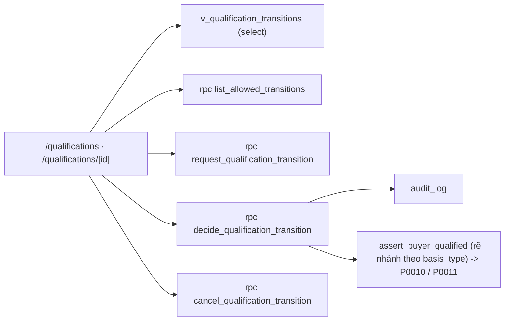

# SCR036_QualificationReview — Screen Spec

> Alias LAB-1: **SC-N1** · 参加資格 審査・停止 *(đề xuất)* · Xét duyệt / tạm dừng tư cách tham gia

**Screen**: SCR036_QualificationReview: Xét duyệt / tạm dừng tư cách tham gia (参加資格 審査・停止 — đề xuất; màn mới, không có trong 35 màn của LAB-1)
**Feature**: F002_ParticipantsAndQualification (tính năng con LAB-1 `F02-05` phần "chuyển trạng thái" — LAB-1 gán tính năng này cho `SC-06`, tài liệu này tách ra vì luồng cần **hai người**; không có US riêng, gần nhất là `US-17` — duyệt mà không mất lịch sử — về khuôn maker-checker)
**Type**: composite (danh sách phiếu + form lập phiếu + khối duyệt)
**Route**: `/qualifications` (danh sách phiếu) · `/qualifications/[id]` (phiếu) *(đề xuất)*
**Generated**: 2026-10-06
**Trạng thái**: thiết kế mới, chưa xây — **Chưa có code — màn chỉ đặc tả ở LAB-4**
**Wireframe**: [sc-n1-xet-duyet-tu-cach.html](../../design/wireframes/sc-n1-xet-duyet-tu-cach.html) (HTML tĩnh, dữ liệu mẫu — không phải code sản phẩm)
**Liên kết**: [F002](../../features/F002_ParticipantsAndQualification/business-context.md) · FL-03 (thư mục `flows/`) · ADR-002 · ADR-003 · ADR-004 · ADR-006 (thư mục `decisions/`) · màn kề: [SCR005](../SCR005_ParticipantList/spec.md) · [SCR006](../SCR006_ParticipantProfile/spec.md) · [SCR010](../SCR010_NegotiatedTradeConfirm/spec.md) · [SCR011](../SCR011_AuctionResultEntry/spec.md) · [SCR037](../SCR037_MarketManagement/spec.md) · [SCR027](../SCR027_RateVersionApproval/spec.md)

## Purpose

Đổi trạng thái tư cách tham gia theo **đúng máy trạng thái của từng căn cứ**, với người duyệt khác người đề nghị. Đây là màn hiện thực hoá ADR-006 ở tầng giao diện (sai lệch **D-01** trong (tài liệu gốc trong repo, không nộp) `database-diagram.md`).

Người dùng: quản lý người tham gia (`party_admin` (đề xuất)) lập phiếu; người có thẩm quyền duyệt (`party_admin` có `can_approve` (đề xuất)) xử lý phiếu. Giờ hành chính, không phải màn hiện trường.

**Vì sao phải là một màn riêng, không phải nút trên [SCR006](../SCR006_ParticipantProfile/spec.md).** Nguyên tắc `起票・承認分離` của khách (`GOV-RULE-01`) và `CAP-HUMAN-01` điểm 3 (*"phê duyệt sửa dữ liệu nhạy cảm — maker ≠ checker, hệ thống không tự duyệt"*) đòi hai người và hai thời điểm. Một nút trên form chỉnh sửa không diễn đạt được điều đó.

**Vì sao hai máy trạng thái, không phải một.** `条件付き` của `許可` **vẫn cho giao dịch** trong giới hạn; `再審査` của `承認` **chặn hẳn** tới khi duyệt lại. Gộp hai cái này là điều kiện trực tiếp bị loại (RFP 12-06).

## Screen Layout

Dựa theo wireframe `sc-n1-xet-duyet-tu-cach.html`: sau thanh đầu trang và điều hướng, màn gồm bốn khối dọc — (1) hai sơ đồ máy trạng thái `許可` và `承認` vẽ cạnh nhau, mỗi sơ đồ có khối "khác biệt cốt lõi"; (2) danh sách phiếu với bộ lọc; (3) phiếu maker-checker (khối lập + khối duyệt, `V-05` ẩn nút khi người duyệt trùng người đề nghị); (4) bảng dấu vết hai người của các phiếu đã xử lý (chỉ đọc). Duyệt/từ chối mở hộp thoại xác nhận chặn luồng. Phần bố cục cụ thể dưới đây là **suy luận** từ wireframe + bảng field — wireframe là tài liệu thiết kế, không phải ràng buộc pixel.

### Layout Sketch

```
┌──────────────────────────────────────────────────────────┐
│ R1: Đầu trang + điều hướng (static)                      │
├──────────────────────────────────────────────────────────┤
│ R2: Hai máy trạng thái cạnh nhau                         │
│  ┌─ 許可 (vẫn giao dịch, có trần) ─┬─ 承認 (chặn tới khi ┐│
│  │ 有効→条件付き→有効|取消        │ duyệt lại)           ││
│  │                                │ 有効→再審査→有効|取消 ││
│  └────────────────────────────────┴──────────────────────┘│
├──────────────────────────────────────────────────────────┤
│ R3: Danh sách phiếu — lọc: trạng thái phiếu · căn cứ     │
├──────────────────────────────────────────────────────────┤
│ R4: Phiếu maker-checker                                  │
│   R4a: Khối lập (maker)  │ R4b: Khối duyệt (checker)     │
│     ┌ - - - - - - - - - - - - - - ┐                      │
│     │ R5: Hộp thoại xác nhận      │ (modal)              │
│     └ - - - - - - - - - - - - - - ┘                      │
├──────────────────────────────────────────────────────────┤
│ R6: Dấu vết hai người — phiếu đã xử lý (chỉ đọc)         │
└──────────────────────────────────────────────────────────┘
```

### Layout Regions

| Region ID | Name | Position | Scrollable | Key Components | Responsive Behavior |
|-----------|------|----------|------------|----------------|---------------------|
| R1 | Đầu trang + điều hướng | static | no | tiêu đề hệ thống, nhãn người dùng/chức danh | wireframe: xếp dọc dưới 860px |
| R2 | Hai máy trạng thái | static | no | sơ đồ `許可` và `承認` (div + ký tự mũi tên), khối "khác biệt cốt lõi" | wireframe: xếp dọc dưới 860px |
| R3 | Danh sách phiếu | static | yes | bộ lọc `decision_state`/`basis_type`, cột #3–#7 | chưa xác định |
| R4 | Phiếu maker-checker | static | yes | khối lập (field #8–#18), khối duyệt (#19–#22) | wireframe: xếp dọc dưới 860px |
| R5 | Hộp thoại xác nhận | modal | no | xác nhận duyệt / từ chối | khi bấm duyệt hoặc từ chối |
| R6 | Dấu vết hai người | static | yes | bảng chỉ đọc các phiếu đã xử lý | chưa xác định |

## Child Routes

Không áp dụng — màn không phải shell có route con. (`/qualifications` và `/qualifications/[id]` là hai chế độ của cùng màn.)

## User Flow

> **Scope:** within-screen interactions. Điều hướng liên màn xem `generated/screen-flow.md`.

### Happy Path

1. Từ [SCR005](../SCR005_ParticipantList/spec.md) hoặc [SCR006](../SCR006_ParticipantProfile/spec.md), maker bấm "Đề nghị chuyển trạng thái" → mở phiếu mới với #8, #9 điền sẵn.
2. Hệ thống đọc `basis_type` → nạp **đúng một** trong hai máy trạng thái → #10 chỉ liệt kê bước hợp lệ.
3. Maker nhập lý do, chứng cứ, ngày hiệu lực → gửi. Phiếu vào `pending`. **Trạng thái tư cách chưa đổi gì** — giống nguyên tắc `FR-CORR-01`: bản ghi gốc không đổi trước khi được duyệt.
4. Checker mở `/qualifications`, lọc `pending`, mở phiếu.
5. Checker chọn `approved` hoặc `rejected` → hộp thoại xác nhận → gửi.
6. `approved` → RPC ghi trạng thái mới vào bảng riêng theo căn cứ, đặt `effective_on`, ghi `audit_log`. `rejected` → phiếu đóng, tư cách giữ nguyên, lý do lưu lại.
7. Hệ quả xuống [SCR010](../SCR010_NegotiatedTradeConfirm/spec.md)/[SCR011](../SCR011_AuctionResultEntry/spec.md) từ lúc `effective_on`: `条件付き` + vượt điều kiện → `P0010`; `再審査` → `P0011` ngay cả khi mọi thứ khác hợp lệ.

### Branches

| Decision point | Condition | Outcome on this screen | Source |
|----------------|-----------|------------------------|--------|
| Bước 2 | `to_status = 条件付き` | hiện thêm #14–#17 | (tài liệu gốc trong repo, không nộp) `sc-n1-xet-duyet-tu-cach.md` §7 |
| Bước 2 | `to_status = 再審査` | hiện thêm #18 | cùng file |
| Bước 4 | checker chính là maker | khối duyệt không hiện, chỉ có `V-05` | cùng file |
| Sau bước 3 | maker rút phiếu khi chưa duyệt | `cancelled`, vẫn lưu dấu vết | cùng file |

## Data Inventory

> Bảng đã có: `participant_qualifications`, `qualification_basis_rules`, `participants` (`supabase/migrations/0003_participants_and_master.sql`). Bảng/view/cột **chưa có**: `qualification_transitions`, `qualification_license`, `qualification_approval`, `v_qualification_transitions`, `app_users.can_approve`. Field nhập của phiếu ở `## Validation & Error Feedback`.

Cột danh sách phiếu (readonly):

| Field | Display Label | Source | Format | Empty Behavior | Cross-ref |
|-------|---------------|--------|--------|----------------|-----------|
| `col.participant` (#3) | Người tham gia / 参加者 | `participants.code`, `participants.name` | mã + tên | — | `participants` |
| `col.from_status` (#4) | Trạng thái hiện tại / 現在の状態 | `qualification_transitions.from_status` | text | — | — |
| `col.to_status` (#5) | Trạng thái đề nghị / 申請先の状態 | `qualification_transitions.to_status` | text | — | — |
| `col.requested_by` (#6) | Người đề nghị / 起票者 | `app_users.full_name` | text | — | `app_users` |
| `col.requested_at` (#7) | Lúc đề nghị / 起票日時 | `qualification_transitions.requested_at` | JST | — | — |

Trường chỉ đọc trong phiếu:

| Field | Display Label | Source | Format | Empty Behavior | Cross-ref |
|-------|---------------|--------|--------|----------------|-----------|
| `qualification_id` (#8) | Tư cách / 対象資格 | `participant_qualifications.id` | readonly; điền sẵn từ [SCR006](../SCR006_ParticipantProfile/spec.md); phải tồn tại | — | `participant_qualifications` |
| `from_status` (#9) | Trạng thái hiện tại / 現在の状態 | enum theo căn cứ | readonly; đọc tại thời điểm lập phiếu | — | — |
| `decided_by` (#21) | Người duyệt / 決裁者 | `app_users.id` | readonly; **phải khác `requested_by`**, phải có `can_approve`; mặc định người đang đăng nhập | — | `app_users` |
| `decided_at` (#22) | Lúc duyệt / 決裁日時 | `qualification_transitions.decided_at` | JST, do server đặt | — | — |

#### Bước chuyển hợp lệ — `許可` (`qualification_license_status`)

| Từ | Sang | Điều kiện | Hệ quả |
|---|---|---|---|
| `有効` | `条件付き` | cần #14, #15 | **vẫn giao dịch được**; vượt điều kiện ở SCR010/SCR011 → `P0010` |
| `条件付き` | `有効` | đã khắc phục, có người duyệt | xoá #14–#17 |
| `条件付き` | `取消` | vi phạm tiếp | chặn giao dịch, `P0003` |
| `有効` | `失効` | tự động khi `current_date > expires_on` — **không qua phiếu** | chặn giao dịch, `P0003` |
| `失効` | `有効` | có giấy phép mới → **tạo dòng tư cách mới ở SCR006**, không chuyển trạng thái | — |

#### Bước chuyển hợp lệ — `承認` (`qualification_approval_status`)

| Từ | Sang | Điều kiện | Hệ quả |
|---|---|---|---|
| `有効` | `再審査` | cần #18 | **chặn giao dịch ngay**; SCR010/SCR011 → `P0011` |
| `再審査` | `有効` | người có thẩm quyền `承認` lại | mở lại giao dịch |
| `再審査` | `取消` | từ chối | chặn giao dịch, `P0003` |
| `有効` | `失効` | tự động khi quá hạn — **không qua phiếu** | chặn giao dịch, `P0003` |
| `失効` | `再審査` | nộp đơn `申請` | vẫn chặn giao dịch cho tới khi `承認` |

Hai căn cứ còn lại (`市場登録` = `registration`, `卸売場登録` = `market_registration`) chỉ có `有効 → 取消` và `有効 → 失効`; `有効 → 失効` chỉ áp khi dòng có `valid_to` — hai căn cứ này không bắt buộc hạn (G9 của PREMISE, `valid_to` NULL = không thời hạn; thay đổi ràng buộc đề xuất, migration ở LAB-5), dòng không thời hạn chỉ rời `有効` bằng `取消`; không có `条件付き`, không có `再審査`. Với `卸売場登録`, điều kiện của bước chuyển đọc từ `resolve_market_rule(market_id,'buyer_registration',effective_on)` ([SCR037](../SCR037_MarketManagement/spec.md)).

## UI States

| State | Trigger | Visual Behavior | User Action Available | Source |
|-------|---------|----------------|-----------------------|--------|
| empty | không có phiếu `pending` | "Không có phiếu chờ duyệt." + nút lập phiếu | lập phiếu | đặc tả §5 |
| loading | mở danh sách hoặc phiếu | khung xương | none | đặc tả §5 |
| success (lập) | sau khi lập phiếu | banner "Đã gửi phiếu, chờ duyệt"; phiếu chuyển sang chỉ đọc; hiện rõ **chưa có hiệu lực** | — | đặc tả §5 |
| success (duyệt) | sau khi duyệt | banner "Đã duyệt. Trạng thái「{to}」có hiệu lực từ {effective_on}"; focus về đầu phiếu | — | đặc tả §5 |
| error (nghiệp vụ) | RPC từ chối | banner **tự nhận focus**; dữ liệu đã gõ giữ nguyên | sửa & gửi lại | đặc tả §5 |
| error (mạng) | mất kết nối | banner + nút thử lại; **dữ liệu đã gõ giữ nguyên** | thử lại | đặc tả §5 |
| saving | `request_`/`decide_`/`cancel_qualification_transition` đang chạy | *(suy luận — nguồn không mô tả riêng)* | none | — |
| read-only | phiếu đã `approved`/`rejected`/`cancelled`, hoặc role `reconcile` | toàn bộ phiếu + khối duyệt ở chế độ xem, kèm dấu vết hai người | chỉ xem | đặc tả §5 |

## Validation & Error Feedback

### A) Client-side

Bộ lọc danh sách và field nhập của phiếu — khối lập (maker) và khối duyệt (checker):

| Field | Type | Required | Constraints | Async Check | Error Message | Default | Source |
|-------|------|----------|-------------|-------------|---------------|---------|--------|
| `filter.decision_state` — Trạng thái phiếu / 起票状態 (#1) | select | no | ∈ `pending` `approved` `rejected` `cancelled` | không | — | `pending` | `qualification_transitions.decision_state` |
| `filter.basis_type` — Căn cứ / 根拠 (#2) | select | no | ∈ 4 căn cứ | không | — | rỗng | `participant_qualifications.basis_type` |
| `to_status` — Trạng thái đề nghị / 申請先の状態 (#10) | select | yes | **chỉ hiện các bước hợp lệ của máy trạng thái ứng với `basis_type`** (hai bảng ở Data Inventory) | `list_allowed_transitions` | `P0012` | — | enum theo căn cứ |
| `reason` — Lý do / 理由 (#11) | text (nhiều dòng) | yes | 10–1000 ký tự | không | `V-02` | — | `qualification_transitions.reason` |
| `evidence_url` — Chứng cứ đính kèm / 証跡 (#12) | text | no | URL hoặc số hiệu văn bản, ≤ 300 ký tự | không | — | — | `qualification_transitions.evidence_ref` |
| `effective_on` — Ngày hiệu lực / 発効日 (#13) | date | yes | `≥ current_date`; **là ngày nghiệp vụ**, không phải `now()` | không | `V-03` | hôm nay | `qualification_transitions.effective_on` |
| `condition_note` — Nội dung điều kiện / 条件の内容 (#14) | text (nhiều dòng) | yes khi `to_status = 条件付き` | 10–1000 ký tự | không | `P0014` | — | `qualification_license.condition_note` |
| `condition_until` — Hạn điều kiện / 条件期限 (#15) | date | yes khi `to_status = 条件付き` | `> effective_on` | không | `V-04`, `P0014` | — | `qualification_license.condition_until` |
| `condition_max_qty_per_day` — Trần số lượng/ngày / 1日あたり数量上限 (#16) | number | no | `> 0` | không | — | — | `qualification_license.condition_max_qty_per_day` |
| `condition_negotiated_only` — Chỉ cho 相対, cấm せり / 相対のみ・せり不可 (#17) | checkbox | no | boolean | không | — | `false` | `qualification_license.condition_negotiated_only` |
| `review_due_on` — Hạn xét lại / 再審査期限 (#18) | date | yes khi `to_status = 再審査` | `> effective_on` | không | `V-04` | — | `qualification_approval.review_due_on` |
| `decision` — Quyết định / 決裁 (#19) | select | yes | ∈ `approved` `rejected` | không | `P0013` | — | `qualification_transitions.decision_state` |
| `decision_note` — Ý kiến người duyệt / 決裁意見 (#20) | text (nhiều dòng) | yes khi `decision = rejected` | ≤ 1000 ký tự | không | — | — | `qualification_transitions.decision_note` |

| Mã | Điều kiện kích hoạt | Thông báo VI | Thông báo JA | Hiện ở đâu | Chặn gửi? |
|---|---|---|---|---|:---:|
| `V-01` | ô bắt buộc để trống | Mục này bắt buộc. | 必須項目です。 | dưới ô | ● |
| `V-02` | `reason` < 10 ký tự | Lý do phải từ 10 ký tự — phiếu này là chứng cứ kiểm toán. | 理由は10文字以上で入力してください。 | dưới ô | ● |
| `V-03` | `effective_on < current_date` | Ngày hiệu lực không được ở quá khứ. | 発効日に過去日は指定できません。 | dưới ô | ● |
| `V-04` | `condition_until ≤ effective_on` hoặc `review_due_on ≤ effective_on` | Hạn phải sau ngày hiệu lực. | 期限は発効日より後にしてください。 | dưới ô | ● |
| `V-05` | người đang xem là người đã lập phiếu, và đang mở khối duyệt | Bạn không duyệt được phiếu do chính mình lập. | 自身が起票した申請は決裁できません。 | thay chỗ nút duyệt | ● — ẩn hẳn nút |

### B) Server-side

Toàn bộ đường ghi qua RPC `SECURITY DEFINER`, không có policy ghi trên `qualification_transitions` — đúng ADR-002.

#### Lập phiếu

- **Endpoint:** `rpc('request_qualification_transition', { p_qualification_id, p_to_status, p_reason, p_effective_on, p_payload })`
- **Request:** như tham số trên; `p_payload` mang #14–#18 theo nhánh
- **Success:** `jsonb { transition_id }`
- **Errors:** `P0012` `P0014` `P0070`
- **Trigger:** gửi phiếu ở khối lập (maker)
- **Source:** (tài liệu gốc trong repo, không nộp) `sc-n1-xet-duyet-tu-cach.md` §8

#### Duyệt / từ chối

- **Endpoint:** `rpc('decide_qualification_transition', { p_transition_id, p_decision, p_note })`
- **Success:** `jsonb { applied_status, effective_on }`
- **Errors:** `P0013` `P0070`
- **Trigger:** xác nhận trong hộp thoại (R5)

#### Rút phiếu

- **Endpoint:** `rpc('cancel_qualification_transition', { p_transition_id })`
- **Success:** `jsonb`
- **Trigger:** maker rút phiếu khi chưa duyệt → `cancelled`

| Mã | Điều kiện kích hoạt | Thông báo VI | Thông báo JA | Hiện ở đâu | Chặn? |
|---|---|---|---|---|:---:|
| `P0012` *(mới, đề xuất)* | `(from_status → to_status)` không thuộc máy trạng thái của `basis_type` | Không chuyển được từ「{from}」sang「{to}」với căn cứ「{basis}」. | 根拠「{basis}」では「{from}」から「{to}」へ遷移できません。 | banner đầu phiếu | ● |
| `P0013` *(mới, đề xuất)* | `decided_by = requested_by`, hoặc người duyệt không có `can_approve` | Người duyệt phải khác người đề nghị và phải có thẩm quyền duyệt. | 決裁者は起票者と異なり、かつ決裁権限が必要です。 | banner đầu phiếu | ● |
| `P0014` *(mới, đề xuất)* | `to_status = 条件付き` mà thiếu `condition_note` hoặc `condition_until` | Trạng thái「条件付き」phải có nội dung điều kiện và hạn điều kiện. | 「条件付き」には条件の内容と期限が必須です。 | banner đầu phiếu | ● |
| `P0070` *(mới, đề xuất)* | `from_status` đọc lúc lập phiếu đã khác trạng thái hiện tại (có người đổi trước) (cấp lại khi nộp lại 2026-10-06: trước đây trùng P0005) | Trạng thái đã thay đổi từ lúc bạn mở phiếu. Hãy tải lại. | 申請後に状態が変わりました。再読み込みしてください。 | banner đầu phiếu | ● |
| `P0017` *(mới, đề xuất)* | căn cứ `market_registration`, không có quy chế hiệu lực tại `effective_on` | Chợ chưa có quy chế hiệu lực tại ngày này. | 当日に有効な市場規程がありません。 | banner đầu phiếu | ● |

Rẽ nhánh theo `error.code`; thông báo dựng từ `error.details` (`from`, `to`, `basis`, `requested_by`, `rule_key`) qua `mapRpcError`. `P0010` và `P0011` **không bắn ở màn này** — chúng là hệ quả xuống SCR010/SCR011 của trạng thái mà màn này tạo ra.

Đọc dữ liệu (không phải submit):

| Thao tác | Cách gọi | Tham số | Trả về |
|---|---|---|---|
| Đọc danh sách phiếu | `select` từ `v_qualification_transitions` | `decision_state`, `basis_type` | mảng dòng |
| Đọc bước chuyển hợp lệ | `rpc('list_allowed_transitions', { p_qualification_id })` | — | `jsonb[]` — **server quyết định**, client không giữ bảng chuyển |

**Đọc bước chuyển hợp lệ phải ở server, không ở client.** Nếu client giữ bảng bước chuyển thì bảng đó là bản sao thứ hai của máy trạng thái, và hai bản sẽ lệch — đúng thứ ADR-003 từ chối với cột `remaining`. Client chỉ dựng danh sách chọn từ thứ server trả.

Hai phép kiểm **maker ≠ checker** và **bước chuyển hợp lệ** nằm trong thân RPC, trong cùng một transaction với `select … for update` trên dòng tư cách — để hai người duyệt đồng thời không ghi đè nhau.

## Interaction Patterns

- **Không có phím tắt riêng** — không thuộc ba màn ⌨️ (`SC-07`, `SC-10`, `SC-14`) — source: đặc tả §6.
- **Duyệt và từ chối đều mở hộp thoại xác nhận chặn luồng — có chủ ý.** Đây là điểm `CAP-HUMAN-01` cố ý không tự động hoá: một phím Enter lỡ tay không được phép đổi tư cách của một người tham gia — source: đặc tả §6.
- **Chọn `to_status` chỉ liệt kê bước hợp lệ theo căn cứ; chọn `条件付き` hiện thêm #14–#17; chọn `再審査` hiện thêm #18** — source: đặc tả §7.
- **Wireframe vẽ hai máy trạng thái cạnh nhau** để người đọc đối chiếu `許可` (vẫn giao dịch) với `承認` (chặn) — source: [`README.md`](../../design/wireframes/README.md).

## Accessibility

| Aspect | Status | Notes |
|--------|--------|-------|
| ARIA roles/labels | unknown | chưa có code; đặc tả không nêu role/label |
| Keyboard navigation | unknown | không có yêu cầu riêng (đặc tả §6); wireframe: chạm tối thiểu 44×44px |
| Focus management | partial (theo đặc tả + wireframe) | banner lỗi tự nhận focus; sau duyệt focus về đầu phiếu; wireframe: viền focus `3px solid #2563eb`, `prefers-reduced-motion` |
| Screen reader compatibility | unknown | chưa kiểm — cần audit khi xây |

## Conditional Rendering

| Condition | Type | Renders | Hidden | Notes |
|-----------|------|---------|--------|-------|
| `party_admin` (maker) | auth | khối lập, lập phiếu | khối duyệt | không tự duyệt phiếu của mình |
| `party_admin` có `can_approve` và **khác** `requested_by` | auth | khối duyệt (chọn `approved`/`rejected`) | — | bypass → RPC `P0013` |
| người xem là người đã lập phiếu `pending` | auth | thông báo `V-05` | nút duyệt (ẩn hẳn) | ẩn nút **không** phải cơ chế thực thi |
| `reconcile` hoặc phiếu `approved`/`rejected`/`cancelled` | auth | xem + dấu vết hai người | mọi ô sửa | chỉ đọc |
| `to_status = 条件付き` | hardcoded-state | #14–#17 | — | `P0014` nếu thiếu #14/#15 |
| `to_status = 再審査` | hardcoded-state | #18 | — | |
| `basis_type ∈ {市場登録, 卸売場登録}` | hardcoded-state | chỉ `有効→取消`/`失効` | `条件付き`, `再審査` | |
| bước `→ 失効` | hardcoded-state | — | không qua phiếu | hệ quả của ngày tháng; chỉ áp cho dòng có hạn (`許可`, `承認` luôn có; `市場登録`/`卸売場登録` khi `valid_to` khác NULL — G9) |

## Component Variants

Không áp dụng — chưa có code. (Hai máy trạng thái là hai bảng bước chuyển, không phải biến thể component; xem `SCR006` cho bốn biến thể form theo căn cứ.)

## Security Surface

| Guard | Type | Consequence if bypassed |
|-------|------|------------------------|
| `route-policy.ts` thêm `{ prefix: "/qualifications", roles: ["party_admin", "reconcile"] }` *(đề xuất)* | role | đẩy về `/403` |
| RLS trên `qualification_transitions`; không policy ghi (ADR-002) | permission | không đọc/ghi ngoài RLS |
| Bất biến **maker ≠ checker** bên trong RPC duyệt (bài học ADR-004) | permission | tầng thứ ba — bất biến nghiệp vụ, không phải quy ước giao diện; gọi thẳng PostgREST vẫn bị `P0013` |

Vai trò đề xuất: `sys_admin` ✗ (quản trị kỹ thuật không quyết định nghiệp vụ) · `party_admin` (đề xuất) xem + lập phiếu, là **maker** · `party_admin` có cờ `can_approve` (đề xuất) xem + duyệt, là **checker**, phải khác người lập · `reconcile` chỉ xem (giải thích số liệu) · `trading` · `receiving` · `rule_admin` · `ops_admin` · `market_manager` · `internal_audit` ✗ (route `/qualifications` chỉ cho `party_admin`, `reconcile`; đủ 9 role).

> **Đã chốt (PREMISE C-09).** Dùng một cột boolean `app_users.can_approve` thay vì thêm chức danh riêng cho người duyệt, vì `GOV-RULE-01` nói **tách người**, không nói tách chức danh — và thêm vai thì ma trận quyền phình tiếp. Phương án vai `qualification_approver` riêng đã bị loại ở C-09.

Server enforcement: `[UNVERIFIED]` — chưa có code.

## Source References

Chưa có code — màn chỉ đặc tả ở LAB-4.

1. Đặc tả gốc: (tài liệu gốc trong repo, không nộp) `sc-n1-xet-duyet-tu-cach.md`
2. Wireframe: [`sc-n1-xet-duyet-tu-cach.html`](../../design/wireframes/sc-n1-xet-duyet-tu-cach.html); mô tả chung: [`README.md`](../../design/wireframes/README.md)
3. Kiến trúc: (tài liệu gốc trong repo, không nộp) `architecture.md` §2.3 (hai máy trạng thái `許可`/`承認`), C7
4. ADR: (tài liệu gốc trong repo, không nộp) `adr.md` (ADR-002, ADR-003, ADR-004, ADR-006); sai lệch D-01: (tài liệu gốc trong repo, không nộp) `database-diagram.md`
5. Bảng/hàm đã có: `participant_qualifications`, `qualification_basis_rules` — `supabase/migrations/0003_participants_and_master.sql`; `_assert_buyer_qualified` — `supabase/migrations/0007_rpc_functions.sql` (hiện **không** rẽ nhánh theo `basis_type`, chỉ kiểm `status = 'active'` và khoảng hiệu lực → `P0003`)
6. Dự kiến (chưa có): `qualification_transitions`, `qualification_license`, `qualification_approval`, `v_qualification_transitions`, RPC `list_allowed_transitions` · `request_qualification_transition` · `decide_qualification_transition` · `cancel_qualification_transition`, `resolve_market_rule`; cột `app_users.can_approve`

## Source Walkthrough

Không có file code giao diện để dẫn đọc. Thứ tự đọc đề xuất:

1. **File:** (tài liệu gốc trong repo, không nộp) `architecture.md` — §2.3, hai máy trạng thái và vì sao không gộp
2. **File:** `supabase/migrations/0003_participants_and_master.sql` — bảng tư cách hiện có (một cột `status` duy nhất cho cả bốn căn cứ — chính là D-01)
3. **File:** `supabase/migrations/0007_rpc_functions.sql` — `_assert_buyer_qualified`, hàm phải sửa để rẽ nhánh theo `basis_type`
4. **File:** [`sc-n1-xet-duyet-tu-cach.html`](../../design/wireframes/sc-n1-xet-duyet-tu-cach.html) — bố cục tham chiếu

### Call Hierarchy

*(Thiết kế dự kiến — không phải code hiện có.)*



**Related files:** xem `## Source References`.

## Dependencies & Risks *(mục bổ sung)*

- **Cần trước:** [SCR006](../SCR006_ParticipantProfile/spec.md) (dòng tư cách để trỏ tới), [SCR037](../SCR037_MarketManagement/spec.md) (quy chế chợ cho căn cứ `卸売場登録`), và cột `app_users.can_approve`.
- **Cần đồng bộ:** `_assert_buyer_qualified` phải **rẽ nhánh theo `basis_type`** và sinh `P0010`/`P0011`. Làm màn này mà không sửa hàm kiểm thì trạng thái mới chỉ là chữ trên màn hình — đúng cái bẫy "dữ liệu chết" của D-01.
- **Dữ liệu phải có sẵn:** ít nhất hai tài khoản `party_admin`, một có `can_approve`. Một tài khoản thì không ai duyệt được phiếu nào.
- **Dễ hiểu sai #1:** `条件付き` **không chặn** giao dịch. Nếu triển khai cho `_assert_buyer_qualified` trả `P0003` cho `条件付き` thì đã gộp lại hai luồng, tức là quay về D-01.
- **Dễ hiểu sai #2:** `effective_on` tương lai nghĩa là phiếu đã duyệt **chưa có hiệu lực**. `_assert_buyer_qualified` phải so với **ngày nghiệp vụ** của giao dịch, không phải `now()` — một `now()` lọt vào đây phá `BR-CLOSE-01` mà không test nào đỏ (`architecture.md` §3.1).
- **Dễ hiểu sai #3:** `失効` là hệ quả của ngày tháng, không phải của phiếu. Cho phép lập phiếu `→ 失効` sẽ tạo hai nguồn sự thật cho cùng một trạng thái.
- **Rủi ro di trú:** xem [SCR006](../SCR006_ParticipantProfile/spec.md) (mục Dependencies & Risks) — dữ liệu cũ không map được sang trạng thái mới.
- **Rủi ro vận hành:** chợ nhỏ có thể chỉ có một người đủ thẩm quyền. Lúc đó maker-checker thành vật cản chứ không phải kiểm soát. Cần biết trước số người, không phát hiện lúc vận hành.

## Unresolved Questions *(mục bổ sung)*

1. **`条件付き` cụ thể hạn chế cái gì?** #16 và #17 là **suy luận của tài liệu này**. Tài liệu khách chỉ có cụm "hạn chế có điều kiện". Chưa chốt thì `P0010` chưa có điều kiện nào để kiểm, và màn này chỉ ghi được chữ tự do.
2. **Ai được gắn cờ `can_approve` để duyệt `再審査`?** Cơ chế đã chốt (C-09: cờ `can_approve` + maker ≠ checker, `P0013`); còn mở là *người cụ thể* mang cờ ở chợ thật. Phương án ban lãnh đạo ngoài hệ thống (màn chỉ ghi lại kết quả) bị loại vì không cưỡng chế được maker ≠ checker.
3. **Hệ thống phục vụ một chợ hay nhiều chợ?** Nhiều chợ thì phiếu phải mang `market_id`, và quyền duyệt phải giới hạn theo chợ — đổi cả mục Security Surface lẫn RLS.
4. **Hai căn cứ còn lại có luồng vi phạm riêng không?** Câu hỏi để ngỏ số 2 của ADR-006. Tài liệu này giả định không — chỉ `有効 → 取消`/`失効`. Phần hạn hiệu lực đã chốt (G9): `valid_to` NULL = không thời hạn với `市場登録`/`卸売場登録`, nên `失効` tự động chỉ áp cho dòng có hạn.
5. **Phiếu có hạn xử lý không?** Phiếu `pending` treo vô hạn thì danh sách sẽ đầy rác. Đề xuất: cảnh báo sau 7 ngày, không tự huỷ.
6. **`条件付き` hết hạn điều kiện (`condition_until`) thì tự về `有効` hay tự sang `取消`?** Hai cách đọc đều hợp lý và hệ quả ngược nhau. Tài liệu này **không giả định** — cần khách trả lời trước khi code.
7. **Có cần xác thực hai lớp khi duyệt không?** `SC-02` của LAB-1 ghi *"xác thực hai lớp cho quản trị và chức danh có quyền duyệt"*. Nếu áp vào đây thì luồng duyệt có thêm một chặng.
