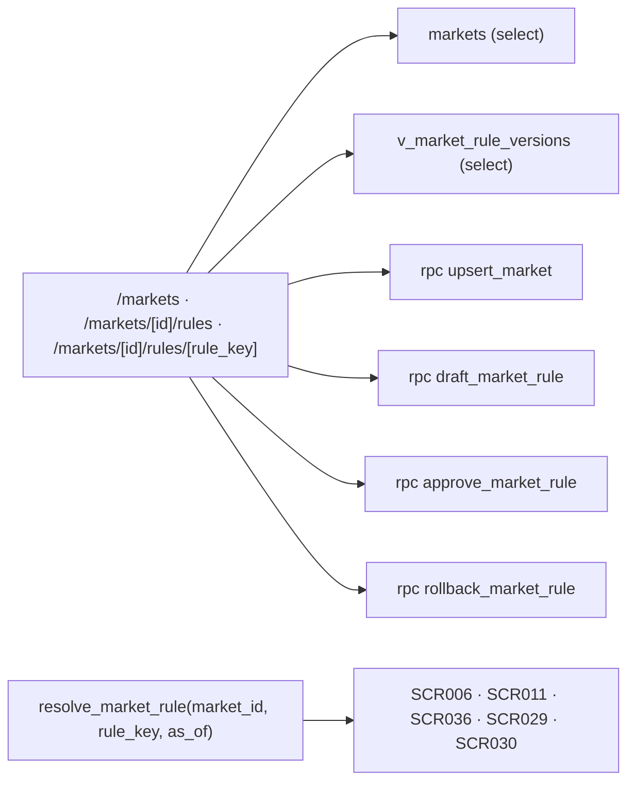

# SCR037_MarketManagement — Screen Spec

> Alias LAB-1: **SC-N2** · 市場・業務規程管理 *(đề xuất)* · Quản lý chợ & quy tắc vận hành

**Screen**: SCR037_MarketManagement: Quản lý chợ & quy tắc vận hành (市場・業務規程管理 — đề xuất; màn mới, không có trong 35 màn của LAB-1)
**Feature**: F012_MarketManagement (mới ở LAB-4, sai lệch D-02; LAB-1 không có tính năng tương ứng — gần nhất là `F08-03`/`F08-04`/`F08-05`, màn SC-26/SC-27: **cùng khuôn phiên bản, khác đối tượng**; không có US riêng, `US-19` — đổi tỷ lệ mà không cần sửa phần mềm — là US cùng khuôn, dùng làm mẫu điều kiện chấp nhận)
**Type**: composite (bảng chợ + dòng thời gian phiên bản + form có duyệt)
**Route**: `/markets` (danh sách chợ) · `/markets/[id]/rules` (quy tắc của một chợ) · `/markets/[id]/rules/[rule_key]` (các phiên bản của một quy tắc) *(đề xuất)*
**Generated**: 2026-10-06
**Trạng thái**: thiết kế mới, chưa xây — **Chưa có code — màn chỉ đặc tả ở LAB-4**
**Wireframe**: [sc-n2-quan-ly-cho.html](../../design/wireframes/sc-n2-quan-ly-cho.html) (HTML tĩnh, dữ liệu mẫu — không phải code sản phẩm)
**Liên kết**: [F012](../../features/F012_MarketManagement/business-context.md) · [F008](../../features/F008_IncentiveAndRateVersion/business-context.md) · ADR-002 · ADR-007 (thư mục `decisions/`) · màn kề: [SCR026](../SCR026_RateVersionList/spec.md) · [SCR027](../SCR027_RateVersionApproval/spec.md) · [SCR036](../SCR036_QualificationReview/spec.md) · [SCR006](../SCR006_ParticipantProfile/spec.md) · [SCR011](../SCR011_AuctionResultEntry/spec.md)

## Purpose

Khai báo các chợ và **quy tắc vận hành riêng của từng chợ**, dưới dạng dữ liệu có **ngày hiệu lực và phiên bản** — không phải hằng số trong code.

Người dùng: quản trị quy chế (`rule_admin` (đề xuất); LAB-1 gọi là vai này ở SC-21, SC-26, SC-27). Giờ hành chính, tần suất thấp — `GOV-RULE-01` giới hạn **tối đa 4 lần đổi mỗi năm**.

**Vì sao màn này tồn tại.** Đề bài LAB-4 nêu đích danh *"quy tắc vận hành riêng của từng chợ"*. Prototype không có bảng nào về chợ (tìm `market` trong `information_schema.columns` → 0 kết quả), nên căn cứ `market_registration` với `violation_action = "Theo quy chế chợ"` đang **trỏ tới một thực thể không tồn tại** — sai lệch **D-02**, hạng *phải sửa*. LAB-1 cũng không có màn nào cho việc này; đây là lỗ hổng từ khâu phân tích.

**Vì sao phải có phiên bản.** `FR-INC-03`: in lại báo cáo kỳ cũ phải ra **đúng con số cũ**. Một bảng cấu hình phẳng không phiên bản sẽ làm quy tắc đổi giữa kỳ viết lại quá khứ.

## Screen Layout

Dựa theo wireframe `sc-n2-quan-ly-cho.html`: sau thanh đầu trang, màn gồm các khối dọc — (1) khối chợ `markets`; (2) danh mục `rule_key` của chợ đang chọn kèm phiên bản đang hiệu lực; (3) bảng dòng thời gian phiên bản của một `rule_key` (版, 発効日, trạng thái `draft`/`approved`/`superseded`/`rolled_back`, 起案者, 承認者, 旧版, 変更理由) cùng thanh đếm lần đổi trong năm (wireframe: 3/4, kèm cảnh báo `P0015`); (4) khối lập nháp + khối duyệt đối chiếu v4↔v5 với `V-06`; (5) hộp thoại xác nhận quay lui. Bố cục chi tiết dưới đây là **suy luận** từ wireframe + bảng field. Wireframe đã cập nhật theo **4** khoá (`incentive_rate` thuộc F008, SCR026/SCR027).

### Layout Sketch

```
┌──────────────────────────────────────────────────────────┐
│ R1: Đầu trang + điều hướng (static)                      │
├──────────────────────────────────────────────────────────┤
│ R2: Khối chợ — markets (danh sách + form tạo/sửa)        │
├──────────────────────────────────────────────────────────┤
│ R3: Danh mục rule_key của chợ — bản đang hiệu lực · 発効日│
├──────────────────────────────────────────────────────────┤
│ R4: Dòng thời gian phiên bản của một rule_key            │
│     thanh đếm lần đổi trong năm (n/4) · banner P0015     │
├──────────────────────────────────────────────────────────┤
│ R5a: Khối lập nháp (maker) │ R5b: Khối duyệt (checker)   │
│      payload theo rule_key │ đối chiếu v(n)↔v(n+1), V-06 │
│     ┌ - - - - - - - - - - - - - - - - - ┐                │
│     │ R6: Hộp thoại duyệt / quay lui    │ (modal)        │
│     └ - - - - - - - - - - - - - - - - - ┘                │
└──────────────────────────────────────────────────────────┘
```

### Layout Regions

| Region ID | Name | Position | Scrollable | Key Components | Responsive Behavior |
|-----------|------|----------|------------|----------------|---------------------|
| R1 | Đầu trang + điều hướng | static | no | tiêu đề, nhãn chức danh | wireframe: xếp dọc dưới 860px |
| R2 | Khối chợ | static | yes | field #1–#7 (`markets`) | wireframe: xếp dọc dưới 860px |
| R3 | Danh mục `rule_key` | static | no | 4 `rule_key`, phiên bản đang hiệu lực | chưa xác định |
| R4 | Dòng thời gian phiên bản | static | yes | bảng cột #9, #10, #12–#19; thanh đếm; banner lỗi | chưa xác định |
| R5a / R5b | Khối lập / khối duyệt | static | yes | form `payload` dựng theo lược đồ; đối chiếu hai phiên bản cạnh nhau | wireframe: bảng ba cột |
| R6 | Hộp thoại xác nhận | modal | no | duyệt / quay lui (nêu bản nào sống lại, từ ngày nào, bản nào bị huỷ hiệu lực) | khi duyệt hoặc quay lui |

## Child Routes

| Route | SCR | URL | Notes |
|-------|-----|-----|-------|
| Danh sách chợ | SCR037 | `/markets` | `markets` |
| Quy tắc của một chợ | SCR037 | `/markets/[id]/rules` | danh mục `rule_key` + phiên bản đang hiệu lực |
| Phiên bản của một quy tắc | SCR037 | `/markets/[id]/rules/[rule_key]` | dòng thời gian, lập nháp, duyệt, quay lui |

*(Cùng một mã SCR037 — không cấp mã con; xác nhận với screen-list.)*

## User Flow

> **Scope:** within-screen interactions. Điều hướng liên màn xem `generated/screen-flow.md`.

### Happy Path

1. `rule_admin` mở `/markets`, chọn chợ → `/markets/[id]/rules` thấy danh mục `rule_key` kèm phiên bản đang hiệu lực và `発効日`.
2. Chọn một `rule_key` → dòng thời gian các phiên bản: `approved` đã qua, bản đang hiệu lực, bản tương lai đã duyệt, bản nháp.
3. "Lập bản mới" → form sao nội dung từ bản đang hiệu lực, `version` do server cấp, `effective_from` để trống.
4. Nhập `effective_from` tương lai + `change_note` → lưu nháp. **Nháp không có hiệu lực** — `resolve_market_rule` không bao giờ trả bản `draft`.
5. Checker (khác người lập) mở bản nháp → đối chiếu với bản đang hiệu lực (xem cạnh nhau) → duyệt.
6. Duyệt xong: bản mới `approved`; bản cũ chuyển `superseded` **tại `effective_from`**, không phải ngay lúc duyệt. Giữa lúc duyệt và `effective_from`, truy vấn với `as_of` trong khoảng đó vẫn trả bản cũ.
7. Quay lui: chọn một bản `approved` cũ → hệ thống **tạo bản mới sao nội dung bản cũ**, không hồi sinh dòng cũ. Giữ append-only, truy vết được (`GOV-RULE-01` yêu cầu rollback *truy vết được*).
8. Mọi màn nghiệp vụ gọi `resolve_market_rule(market_id, rule_key, as_of)` với `as_of` là **ngày nghiệp vụ**.

### Branches

| Decision point | Condition | Outcome on this screen | Source |
|----------------|-----------|------------------------|--------|
| Bước 4 | đã có 4 bản `approved` trong năm | `P0015`, không lưu | (tài liệu gốc trong repo, không nộp) `sc-n2-quan-ly-cho.md` §7 |
| Bước 5 | người xem là người lập | `V-06`, nút duyệt ẩn hẳn | cùng file §4 |
| Bước 7 | không còn bản `approved` trước đó | `P0071` | cùng file §4 |

## Data Inventory

> Các bảng `markets`, `market_rules`, view `v_market_rule_versions` **chưa có** trong `supabase/migrations/` — thiết kế mới (sai lệch D-02). Field nhập (khối chợ, khối lập) ở `## Validation & Error Feedback`.

Cột dòng thời gian — mỗi dòng của `market_rules` là **một phiên bản** (readonly):

| Field | Display Label | Source | Format | Empty Behavior | Cross-ref |
|-------|---------------|--------|--------|----------------|-----------|
| `version` (#9) | Phiên bản / 版 | `market_rules.version` | số nguyên tăng dần theo `(market_id, rule_key)`; **server cấp**, client không gửi | — | — |
| `status` (#12) | Trạng thái bản / 版の状態 | `market_rules.status` | badge ∈ `draft` `approved` `superseded` `rolled_back`; mặc định `draft`; **`draft` không có hiệu lực** | — | — |
| `drafted_by` (#13) | Người lập / 起案者 | `app_users.id` | người đang đăng nhập lúc tạo bản nháp | — | `app_users` |
| `drafted_at` (#14) | Lúc lập / 起案日時 | `market_rules.drafted_at` | JST, server đặt | — | — |
| `approved_by` (#15) | Người duyệt / 承認者 | `app_users.id` | **phải khác `drafted_by`** | rỗng khi còn `draft` | `app_users` |
| `approved_at` (#16) | Lúc duyệt / 承認日時 | `market_rules.approved_at` | JST, server đặt | — | — |
| `supersedes` (#17) | Thay cho bản / 旧版 | `market_rules.superseded_by` (chiều ngược) | `version` của bản bị thay | rỗng với bản đầu tiên | — |
| `changes_this_year` (#19) | Số lần đổi trong năm / 年内変更回数 | tính trong view | đếm bản `approved` có `effective_from` trong năm dương lịch; cảnh báo khi `≥ 3`, chặn khi `≥ 4` | — | — |

#### Danh mục `rule_key` — thứ **thuộc chợ**

| `rule_key` | Nhãn JA | Nội dung `payload` | Ai đọc |
|---|---|---|---|
| `buyer_registration` | 買出人登録規程 | regex mã đăng ký, `sites[]`, thời hạn, điều kiện gia hạn | [SCR006](../SCR006_ParticipantProfile/spec.md) biến thể D |
| `license_condition` | 条件付きの条件 | trần số lượng/ngày, có cho `せり` hay không, hạn điều kiện mặc định | [SCR036](../SCR036_QualificationReview/spec.md), nhánh `条件付き` trong `_assert_buyer_qualified` → `P0010` (đề xuất; hàm rẽ nhánh theo `basis_type`, không có hàm riêng) |
| `seri_cutoff` | せり締切時刻 | giờ cắt phiên đấu giá | [SCR011](../SCR011_AuctionResultEntry/spec.md) |
| `qualification_expiry_warning_days` | 期限警告日数 | số ngày cảnh báo trước hết hạn | [SCR005](../SCR005_ParticipantList/spec.md) bộ lọc #6 |

**Thứ KHÔNG thuộc chợ, đừng đẩy vào đây** (`architecture.md` C6): hệ số thuế `110/100` và làm tròn xuống theo JPY (`BR-INC-01`) là quy tắc **quốc gia**; 料率 完納奨励金 (`incentive_rate`) thuộc F008 với dòng thời gian phiên bản riêng (SCR026/SCR027), không phải khoá của màn này. Đưa vào `market_rules` là mở đường cho một chợ tự đổi thuế suất.

## UI States

| State | Trigger | Visual Behavior | User Action Available | Source |
|-------|---------|----------------|-----------------------|--------|
| empty | chợ chưa có quy tắc nào cho `rule_key` đó | "Chưa có phiên bản nào." + nút lập bản đầu tiên | lập bản đầu tiên | đặc tả §5 |
| loading | mở danh sách phiên bản | khung xương dòng thời gian | none | đặc tả §5 |
| success (lưu nháp) | sau khi lưu nháp | banner "Đã lưu bản nháp v{version} — **chưa có hiệu lực**"; nhãn `draft` nổi bật | — | đặc tả §5 |
| success (duyệt) | sau khi duyệt | banner "Đã duyệt v{version}, hiệu lực từ {effective_from}"; dòng thời gian cập nhật | — | đặc tả §5 |
| success (quay lui) | sau khi quay lui | banner "Đã quay lại v{n}. Bản v{n+1} chuyển sang `rolled_back`" | — | đặc tả §5 |
| error (nghiệp vụ) | RPC từ chối | banner **tự nhận focus**; dữ liệu đã gõ giữ nguyên | sửa & gửi lại | đặc tả §5 |
| error (mạng) | mất kết nối | banner + nút thử lại; **dữ liệu đã gõ giữ nguyên** | thử lại | đặc tả §5 |
| saving | `upsert_market`/`draft_`/`approve_`/`rollback_market_rule` đang chạy | *(suy luận — nguồn không mô tả riêng)* | none | — |
| read-only | bản `approved`, `superseded`, `rolled_back`, hoặc role không ghi được | mọi ô readonly; bản đã duyệt **không sửa được, chỉ tạo bản mới** | chỉ xem | đặc tả §5 |

## Validation & Error Feedback

### A) Client-side

Khối chợ — `markets`:

| Field | Type | Required | Constraints | Async Check | Error Message | Default | Source |
|-------|------|----------|-------------|-------------|---------------|---------|--------|
| `code` — Mã chợ / 市場コード (#1) | text | yes | `^[A-Z0-9-]{2,12}$`; duy nhất; **khoá sau khi tạo** | `upsert_market` (trùng → `P0069`) | `V-02`, `P0069` | — | `markets.code` |
| `name_ja` — Tên chợ (JA) / 市場名 (#2) | text | yes | 1–120 ký tự | không | `V-01` | — | `markets.name_ja` |
| `name_vi` — Tên chợ (VI) / 市場名（ベトナム語） (#3) | text | yes | 1–120 ký tự | không | `V-01` | — | `markets.name_vi` |
| `operator_name` — Đơn vị mở chợ / 開設者 (#4) | text | yes | 1–120 ký tự; là giá trị điền sẵn cho SCR006 C2 và D3 | không | `V-01` | — | `markets.operator_name` |
| `timezone` — Múi giờ / タイムゾーン (#5) | select | yes | mặc định `Asia/Tokyo`; đổi được vì ngày nghiệp vụ tính theo múi giờ chợ | không | — | `Asia/Tokyo` | `markets.timezone` |
| `service_window` — Khung giờ vận hành / 業務時間帯 (#6) | text | no | `HH:MM-HH:MM`; được phép vắt qua nửa đêm (chợ mở từ 02:00) | không | `V-04` | — | `markets.service_window` |
| `status` — Trạng thái / 状態 (#7) | select | yes | ∈ `active` `inactive` | không | — | `active` | `markets.status` |

Khối quy tắc — khối lập (maker):

| Field | Type | Required | Constraints | Async Check | Error Message | Default | Source |
|-------|------|----------|-------------|-------------|---------------|---------|--------|
| `rule_key` — Loại quy tắc / 規程種別 (#8) | select | yes | ∈ danh mục ở Data Inventory; **khoá sau khi tạo bản đầu** | không | — | — | `market_rules.rule_key` |
| `effective_from` — Ngày hiệu lực / 発効日 (#10) | date | yes | `> current_date` (đặt được ngày **tương lai**, `US-19`); không trùng `effective_from` của bản đã duyệt cùng `(market_id, rule_key)` | kiểm lại ở server | `P0016` | — | `market_rules.effective_from` |
| `payload` — Nội dung quy tắc / 規程内容 (#11) | form theo `rule_key` | yes | **không phải JSON thô** — dựng form theo lược đồ của từng `rule_key` | không | `V-05` | sao từ bản đang hiệu lực | `market_rules.payload` (`jsonb`) |
| `change_note` — Lý do thay đổi / 変更理由 (#18) | text (nhiều dòng) | yes | 10–1000 ký tự — là chứng cứ kiểm toán | không | `V-03` | — | `market_rules.change_note` |

| Mã | Điều kiện kích hoạt | Thông báo VI | Thông báo JA | Hiện ở đâu | Chặn gửi? |
|---|---|---|---|---|:---:|
| `V-01` | ô bắt buộc để trống | Mục này bắt buộc. | 必須項目です。 | dưới ô | ● |
| `V-02` | `code` sai regex | Mã chợ gồm chữ in hoa, số, gạch ngang, 2–12 ký tự. | 市場コードは英大文字・数字・ハイフン2〜12文字です。 | dưới ô | ● |
| `V-03` | `change_note` < 10 ký tự | Lý do thay đổi phải từ 10 ký tự. | 変更理由は10文字以上で入力してください。 | dưới ô | ● |
| `V-04` | `service_window` sai định dạng | Khung giờ theo dạng HH:MM-HH:MM. | 業務時間帯は HH:MM-HH:MM 形式です。 | dưới ô | ● |
| `V-05` | `payload` thiếu trường theo lược đồ của `rule_key` | Thiếu「{field}」cho loại quy tắc「{rule_key}」. | 規程種別「{rule_key}」には「{field}」が必要です。 | dưới ô tương ứng | ● |
| `V-06` | người đang xem là người lập bản nháp, đang mở khối duyệt | Bạn không duyệt được bản do chính mình lập. | 自身が起案した版は承認できません。 | thay chỗ nút duyệt | ● — ẩn hẳn nút |

### B) Server-side

Toàn bộ đường ghi qua RPC `SECURITY DEFINER`, `market_rules` **không có policy ghi** — đúng ADR-002. Ba bất biến nằm trong thân RPC, không ở client: trần 4 lần/năm, maker ≠ checker, và `effective_from` phải ở tương lai.

#### Tạo / sửa chợ

- **Endpoint:** `rpc('upsert_market', {...})`
- **Success:** `jsonb { market_id }`
- **Errors:** `P0069`
- **Trigger:** lưu form khối chợ
- **Source:** (tài liệu gốc trong repo, không nộp) `sc-n2-quan-ly-cho.md` §8

#### Lập bản nháp

- **Endpoint:** `rpc('draft_market_rule', { p_market_id, p_rule_key, p_effective_from, p_payload, p_change_note })`
- **Success:** `jsonb { rule_id, version }`
- **Errors:** `P0015` `P0016`
- **Trigger:** "Lưu nháp"

#### Duyệt bản nháp

- **Endpoint:** `rpc('approve_market_rule', { p_rule_id })`
- **Success:** `jsonb { version, effective_from }`
- **Errors:** `P0013`
- **Trigger:** xác nhận duyệt (R6)

#### Quay lui

- **Endpoint:** `rpc('rollback_market_rule', { p_market_id, p_rule_key, p_to_version, p_effective_from, p_change_note })`
- **Success:** `jsonb { new_version }`
- **Errors:** `P0071` `P0015` `P0016` (`p_effective_from` phải ở tương lai — wireframe hộp thoại quay lui)
- **Trigger:** xác nhận quay lui (R6)

| Mã | Điều kiện kích hoạt | Thông báo VI | Thông báo JA | Hiện ở đâu | Chặn? |
|---|---|---|---|---|:---:|
| `P0015` *(mới, đề xuất)* | đã có 4 bản `approved` với `effective_from` trong cùng năm dương lịch | Quy tắc「{rule_key}」đã đổi 4 lần trong năm {year} — mức tối đa. | 規程「{rule_key}」は{year}年に4回変更済みで上限です。 | banner đầu form | ● |
| `P0016` *(mới, đề xuất)* | `effective_from ≤ current_date`, hoặc trùng `effective_from` của bản `approved` khác | Ngày hiệu lực phải ở tương lai và không trùng bản đã duyệt. | 発効日は未来日かつ既承認版と重複しない日にしてください。 | banner đầu form | ● |
| `P0013` *(mới, đề xuất)* | `approved_by = drafted_by`, hoặc người duyệt không có `can_approve` | Người duyệt phải khác người lập và phải có thẩm quyền duyệt. | 承認者は起案者と異なり、かつ承認権限が必要です。 | banner đầu form | ● |
| `P0017` *(mới, đề xuất; dùng chung với SCR036)* | `resolve_market_rule` không tìm được bản `approved` hiệu lực tại `p_as_of` | Chợ chưa có quy chế hiệu lực tại ngày này. | 当日に有効な市場規程がありません。 | (hàm đọc — người gọi tự xử lý) | ● |
| `P0071` *(mới, đề xuất)* | quay lui mà không còn bản `approved` nào trước đó (cấp lại khi nộp lại 2026-10-06: trước đây trùng P0017, mã của "không có quy chế hiệu lực") | Không còn phiên bản trước để quay lại. | 戻せる旧版がありません。 | banner đầu form | ● |
| `P0069` *(mới, đề xuất; dùng chung với SCR006)* | mã chợ đã tồn tại (cấp lại khi nộp lại 2026-10-06: trước đây trùng P0005, mã đã cài của "sai chức danh") | Mã chợ「{code}」đã được dùng. | 市場コード「{code}」は既に使用されています。 | banner đầu form | ● |

Rẽ nhánh theo `error.code`; thông báo dựng từ `error.details` (`rule_key`, `year`, `count`, `field`, `code`) qua `mapRpcError` — không so khớp `message`.

Đọc dữ liệu (không phải submit):

| Thao tác | Cách gọi | Tham số | Trả về |
|---|---|---|---|
| Đọc danh sách chợ | `select` từ `markets` | `status` | mảng dòng |
| Đọc dòng thời gian phiên bản | `select` từ `v_market_rule_versions` | `market_id`, `rule_key` | mảng, kèm `changes_this_year` |
| Tra quy tắc hiệu lực | `rpc('resolve_market_rule', { p_market_id, p_rule_key, p_as_of })` | `p_as_of` là **ngày nghiệp vụ** | `jsonb` hoặc raise `P0017` |

**`resolve_market_rule` là hàm đọc nhưng vẫn là RPC**, không phải view. Lý do: nó cần tham số `as_of` để chọn **một** bản trong dòng thời gian, và cần raise `P0017` khi không có bản nào — một view không raise được, nó chỉ trả rỗng, và rỗng sẽ bị hiểu nhầm thành "không có hạn chế".

## Interaction Patterns

- **Không có phím tắt riêng** — không thuộc ba màn ⌨️ (`SC-07`, `SC-10`, `SC-14`) — source: đặc tả §6.
- **Duyệt và quay lui có hộp thoại xác nhận chặn luồng** (cùng lý do với SCR036); hộp thoại quay lui phải hiện rõ **bản nào sẽ sống lại, từ ngày nào, và bản nào bị huỷ hiệu lực**. `CAP-HUMAN-01` điểm 3 — source: đặc tả §6.
- **Khối duyệt đặt hai phiên bản cạnh nhau** (wireframe: bảng ba cột v4↔v5) trước khi quyết — source: đặc tả §7 + [`README.md`](../../design/wireframes/README.md).
- **Form `payload` dựng theo lược đồ của từng `rule_key`**, không phải JSON thô — source: đặc tả §3 (#11).

## Accessibility

| Aspect | Status | Notes |
|--------|--------|-------|
| ARIA roles/labels | unknown | chưa có code; đặc tả không nêu role/label |
| Keyboard navigation | unknown | không có yêu cầu riêng (đặc tả §6); wireframe: chạm tối thiểu 44×44px |
| Focus management | partial (theo đặc tả + wireframe) | banner lỗi tự nhận focus; hộp thoại duyệt/quay lui chặn luồng; wireframe: viền focus `3px solid #2563eb`, `prefers-reduced-motion` |
| Screen reader compatibility | unknown | chưa kiểm — cần audit khi xây |

## Conditional Rendering

| Condition | Type | Renders | Hidden | Notes |
|-----------|------|---------|--------|-------|
| `rule_admin` (maker) | auth | khối lập bản nháp | khối duyệt | chỉ lập bản nháp |
| `rule_admin` có `can_approve` và **khác** người lập | auth | khối duyệt + quay lui | — | bypass → RPC `P0013` |
| người xem là người lập bản nháp | auth | `V-06` | nút duyệt (ẩn hẳn) | ẩn nút **không** phải cơ chế thực thi |
| `reconcile` / `party_admin` / `sys_admin` | auth | xem | mọi nút ghi | `party_admin`: SCR006 biến thể D đọc quy chế từ đây |
| `status ∈ approved, superseded, rolled_back` | hardcoded-state | mọi ô readonly | nút sửa | chỉ tạo bản mới |
| `changes_this_year ≥ 3` / `≥ 4` | hardcoded-threshold | cảnh báo / chặn (`P0015`) | — | |

## Component Variants

Không áp dụng — chưa có code. (Form `payload` thay đổi theo `rule_key` nhưng lược đồ từng loại **chưa có** từ khách — Unresolved Questions câu 8.)

## Security Surface

| Guard | Type | Consequence if bypassed |
|-------|------|------------------------|
| `route-policy.ts` thêm `{ prefix: "/markets", roles: ["sys_admin","rule_admin","reconcile","party_admin"] }` *(đề xuất)* | role | đẩy về `/403` |
| RLS trên `markets` / `market_rules`; không policy ghi (ADR-002) | permission | không đọc/ghi ngoài RLS |
| Tầng RPC: **maker ≠ checker** và **trần 4 lần/năm** (+ `effective_from` tương lai) | permission | bất biến nghiệp vụ; gọi thẳng PostgREST vẫn bị `P0013`/`P0015`/`P0016` |

Vai trò đề xuất: `sys_admin` xem (hỗ trợ, không quyết định nghiệp vụ) · `rule_admin` (đề xuất; LAB-1 "Quản trị quy chế") xem + chỉ lập bản nháp, là **maker** · `rule_admin` có `can_approve` (đề xuất) xem + duyệt/quay lui, là **checker**, phải khác người lập · `reconcile` xem (cần biết version nào đang hiệu lực để giải thích số liệu) · `party_admin` (đề xuất) xem (SCR006 biến thể D đọc quy chế từ đây) · `trading` · `receiving` · `ops_admin` · `market_manager` · `internal_audit` ✗ (không thuộc `roles` của route `/markets`; đủ 9 role). Dùng chung cột `can_approve` với [SCR036](../SCR036_QualificationReview/spec.md) (DRY) — nhưng thẩm quyền khác nhau: duyệt quy chế không đồng nghĩa với duyệt tư cách (Unresolved Questions câu 3). Server enforcement: `[UNVERIFIED]` — chưa có code.

## Source References

Chưa có code — màn chỉ đặc tả ở LAB-4.

1. Đặc tả gốc: (tài liệu gốc trong repo, không nộp) `sc-n2-quan-ly-cho.md`
2. Wireframe: [`sc-n2-quan-ly-cho.html`](../../design/wireframes/sc-n2-quan-ly-cho.html); mô tả chung: [`README.md`](../../design/wireframes/README.md)
3. Kiến trúc: (tài liệu gốc trong repo, không nộp) `architecture.md` C6 (tầng quy tắc theo chợ, đường di trú), §3.1, §3.2
4. ADR: (tài liệu gốc trong repo, không nộp) `adr.md` (ADR-002, ADR-007); sai lệch D-02: (tài liệu gốc trong repo, không nộp) `database-diagram.md`
5. Hiện trạng DB: `supabase/migrations/` **không có** bảng `markets`; `qualification_basis_rules.violation_action = 'Theo quy chế chợ'` cho `market_registration` — `supabase/migrations/0003_participants_and_master.sql` (đúng như mô tả D-02); `business_days` — `0004_business_days_and_lots.sql` (PK hiện chưa có `market_id`)
6. Dự kiến (chưa có): `markets`, `market_rules`, `v_market_rule_versions`, RPC `upsert_market` · `draft_market_rule` · `approve_market_rule` · `rollback_market_rule` · `resolve_market_rule`; cột `app_users.can_approve`

## Source Walkthrough

Không có file code giao diện để dẫn đọc. Thứ tự đọc đề xuất:

1. **File:** (tài liệu gốc trong repo, không nộp) `adr.md` — ADR-007, quyết định quy tắc là dữ liệu có phiên bản theo chợ
2. **File:** (tài liệu gốc trong repo, không nộp) `architecture.md` — C6 và §3.2, đường di trú
3. **File:** `supabase/migrations/0003_participants_and_master.sql` — chỗ `violation_action = 'Theo quy chế chợ'` trỏ vào khoảng không
4. **File:** [`sc-n2-quan-ly-cho.html`](../../design/wireframes/sc-n2-quan-ly-cho.html) — bố cục tham chiếu

### Call Hierarchy

*(Thiết kế dự kiến — không phải code hiện có.)*



**Related files:** xem `## Source References`.

## Dependencies & Risks *(mục bổ sung)*

- **Cần trước:** không có màn nào. Đây là màn **gốc** của hai màn còn lại — [SCR006](../SCR006_ParticipantProfile/spec.md) biến thể D và [SCR036](../SCR036_QualificationReview/spec.md) nhánh `条件付き` đều đọc từ đây.
- **Đường di trú** (`architecture.md` C6): tạo `markets` với **1 dòng mặc định** → backfill `market_id` cho `participant_qualifications`, `lots`, `business_days` → đổi `business_days` sang PK ghép `(market_id, business_date)`. **Bước đổi PK là bước duy nhất phá tương thích** — làm sau cùng, sau khi mọi truy vấn đã mang `market_id`.
- **Phạm vi lan rộng:** mọi truy vấn nghiệp vụ phải mang ngữ cảnh chợ. Hiện **không truy vấn nào có**. Chạm cả ba view dẫn xuất và cả năm RPC.
- **Dễ hiểu sai #1:** `effective_from` so với **ngày nghiệp vụ**, không phải `now()`. Một `now()` lọt vào tầng báo cáo là đủ phá `BR-CLOSE-01` mà không test nào đỏ.
- **Dễ hiểu sai #2:** quay lui **không** sửa dòng cũ. Sửa đè làm mất dấu vết và phá yêu cầu "rollback truy vết được".
- **Dễ hiểu sai #3:** `draft` là dữ liệu đã ghi nhưng **không có hiệu lực**. `resolve_market_rule` phải lọc `status = 'approved'`; quên lọc là cho bản nháp chi phối giao dịch thật.
- **Dễ hiểu sai #4:** trần 4 lần/năm đếm theo **`effective_from`**, không theo ngày duyệt. Duyệt tháng 12 cho hiệu lực tháng 1 thì tính vào năm sau.
- **Rủi ro trừu tượng hoá sớm:** ADR-007 tự ghi — nếu khách chỉ vận hành một chợ thì phần lớn màn này là chi phí thừa. Đánh đổi đã cân nhắc: đề bài nêu đích danh ràng buộc, và `violation_action = "Theo quy chế chợ"` đang trỏ vào khoảng không.

## Unresolved Questions *(mục bổ sung)*

1. **Hệ thống phục vụ một chợ hay nhiều chợ?** Câu hỏi quan trọng nhất của màn này. Một chợ thì `/markets` thu về một trang cấu hình, bỏ hẳn bước chọn chợ ở mọi màn khác, và `market_id` thành hằng. Câu hỏi gốc ở ADR-007.
2. **`条件付き` cụ thể hạn chế cái gì?** Quyết định lược đồ `payload` của `rule_key = license_condition`. Chưa chốt thì SCR036 chỉ ghi được chữ tự do và `P0010` không có gì để kiểm.
3. **Một cờ `can_approve` có đủ cho cả duyệt quy chế và duyệt tư cách không?** Cơ chế cờ + maker ≠ checker đã chốt (PREMISE C-09, dùng chung với SCR036 cho KISS), nhưng duyệt quy chế chợ và duyệt tư cách một người tham gia có thể là hai thẩm quyền khác nhau. Nếu khách tách thì cần hai cờ, hoặc một bảng thẩm quyền.
4. **料率 完納奨励金 thuộc chợ hay thuộc quốc gia? — ĐÃ CHỐT (đồng bộ F012/F008):** thuộc quy tắc quốc gia/F008, không phải `rule_key` của chợ; có khuôn phiên bản riêng ở [SCR026](../SCR026_RateVersionList/spec.md)/[SCR027](../SCR027_RateVersionApproval/spec.md). Còn mở: nếu khách nói 料率 khác nhau theo chợ thì phải thêm lại `rule_key` này (hoặc gộp SCR026/SCR027 vào màn này theo **DRY**).
5. **Trần 4 lần/năm tính theo năm dương lịch hay năm tài chính Nhật (tháng 4–tháng 3)?** `GOV-RULE-01` chỉ ghi "4 lần/năm". Khác nhau ở biên tháng 1–tháng 3.
6. **Quay lui có bị tính vào trần 4 lần không?** Tài liệu này giả định **có**, vì quay lui tạo một bản `approved` mới. Cần khách xác nhận — nếu không thì quay lui thành đường lách trần.
7. **Chợ có bị xoá không?** Đề xuất: không, chỉ `inactive`, vì dữ liệu lịch sử vẫn trỏ về.
8. **Lược đồ `payload` cho từng `rule_key`** chưa có bản nào từ khách. Bốn `rule_key` ở Data Inventory là **đề xuất của tài liệu này**, suy từ các chỗ tài liệu khách nhắc "theo quy chế chợ".
