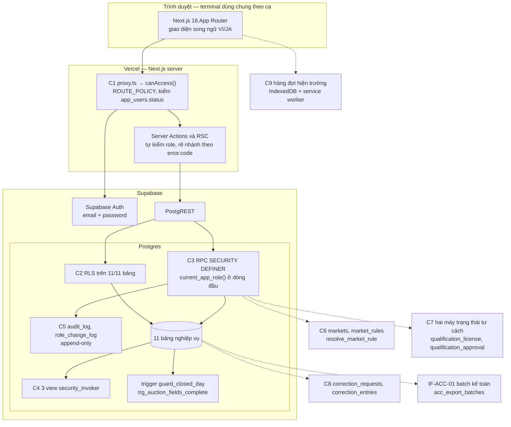
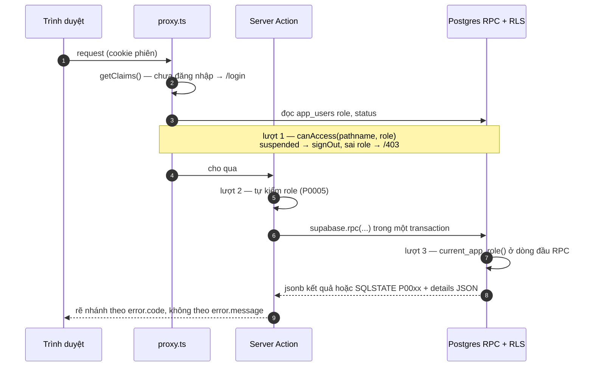

# Architecture

**Project**: Product A — 水産物卸売市場 業務支援システム
**Generated**: 2026-10-06
**Điều hướng**: [System Architecture](#system-architecture) · [Tech Stack](#tech-stack) · [Data Flow](#data-flow) · [1. Thành phần](#1-thành-phần-hệ-thống) · [2. Luồng dữ liệu chính](#2-luồng-dữ-liệu-chính) · [3. Ràng buộc đặc thù](#3-ràng-buộc-kiến-trúc-đặc-thù) · [4. Tích hợp IF-ACC-01](#4-điểm-tích-hợp--if-acc-01-chưa-làm) · [5. Phân quyền hai tầng](#5-phân-quyền-hai-tầng--lý-do-kỹ-thuật) · [6. Câu hỏi chưa giải quyết](#6-câu-hỏi-chưa-giải-quyết)

> **Phép thử của tài liệu này:** xoá tên miền nghiệp vụ đi thì nó phải trở nên vô nghĩa. Mỗi thành phần dưới đây đứng đó vì một câu cụ thể trong RFP, có dẫn mã. Không có thành phần nào ở đây chỉ vì "app nào cũng cần".

**Ký hiệu trạng thái** — `[CÓ]` chạy thật trong prototype LAB-3 · `[MỘT PHẦN]` có xương, thiếu thịt · `[ĐỀ XUẤT]` thiết kế LAB-4, **chưa xây**.

**Nền đã xác minh.** 11 bảng · 83 cột · 17 khoá ngoại · 11 enum · 3 view (hút từ `pg_catalog`, xem [entities.md](../generated/entities.md)). Tải mục tiêu (RFP 03, `FIG-LOAD-01`): 180 account · 60 người đồng thời · 350/600 lô một ngày · 700/1.200 giao dịch một ngày · cửa sổ dịch vụ **02:00–10:00 JST**, 99,5%/tháng · batch báo cáo xong trước **11:00 JST** · dữ liệu tham chiếu online **7 năm**.

> Đọc đúng con số đó: **độ khó không nằm ở scale**. Nằm ở tính đúng đắn, bất biến lịch sử, dấu vết kiểm toán và quy tắc có phiên bản. Mọi lựa chọn dưới đây tối ưu cho bốn thứ đó, không cho throughput.

Tài liệu liên quan: [overview.md](./overview.md) · [business-rules.md](./business-rules.md) · [permissions.md](./permissions.md) · [glossary.md](./glossary.md) · ADR [ADR-001](../decisions/ADR-001-role-from-table-not-jwt.md) … [ADR-007](../decisions/ADR-007-market-rules-as-versioned-data.md) · flow [FL-01](../flows/FL-01-lot-trade-delivery-reconciliation.md) · [FL-02](../flows/FL-02-post-close-correction.md) · [FL-03](../flows/FL-03-participant-qualification-lifecycle.md).

---

## System Architecture

Nét liền = `[CÓ]`/`[MỘT PHẦN]`; nét đứt = `[ĐỀ XUẤT]`.



## Tech Stack

Nguồn: `package.json`; ràng buộc kỹ thuật chốt ở LAB-3 (tài liệu gốc trong repo, không nộp: `lab3-scope-lock`).

| Layer | Technology | Version |
|-------|------------|---------|
| Frontend | Next.js App Router + React + TypeScript + Tailwind CSS; i18n bằng dictionary phẳng `lib/i18n/{vi,ja}.ts` + cookie `locale` (không `next-intl`, không routing theo locale) | Next.js `16.3.5` · React `19.2.8` · Tailwind `^4` · TypeScript `^5` |
| Chặn route | `proxy.ts` ở gốc project (export `proxy()`), **không** `middleware.ts` | Next.js 16 |
| Backend | Server Actions + RPC PL/pgSQL `SECURITY DEFINER`; client `@supabase/ssr` (cookie `getAll`/`setAll`), kiểm auth bằng `supabase.auth.getClaims()` | `@supabase/ssr ^0.12.7` · `@supabase/supabase-js ^2.116.0` |
| Database | Postgres do Supabase quản lý; schema bằng SQL migration `supabase/migrations/0001…0041`, seed `supabase/seed.sql` | phiên bản Postgres không ghi trong repo — chưa xác minh |
| Auth | Supabase Auth email/password; `auth.users` ↔ `app_users` (1-1 theo `id`) | — |
| Hosting | Vercel; env qua project settings; `.env.local` không commit, `service_role` chỉ phía server | — |
| Cache | Không áp dụng — prototype không có cache; tính số còn lại tại chỗ qua view ([ADR-003](../decisions/ADR-003-derived-remaining-quantity-views.md)) | — |
| Queue | Không áp dụng trong prototype. `[ĐỀ XUẤT]` C9: hàng đợi IndexedDB + service worker ở client (§3.5); batch kế toán outbox `acc_export_batches` (§4) | — |

## Data Flow

Một request ghi đi qua **ba lượt phòng thủ độc lập** (chi tiết §5). Ví dụ cổng chốt SC-10 (đầy đủ hai phép kiểm, `P0003`/`P0004`) nằm ở [FL-01](../flows/FL-01-lot-trade-delivery-reconciliation.md#cổng-chốt-giao-dịch--sc-10--sc-11).



---

## 1. Thành phần hệ thống

| # | Thành phần | Trạng thái | Ràng buộc nghiệp vụ sinh ra nó |
|---|---|---|---|
| C1 | Chặn route theo chức danh | `[CÓ]` | 責任分離の原則 (02-08) + terminal dùng chung theo ca |
| C2 | RLS trên Postgres | `[CÓ]` | APPI 09-06 — hồ sơ 許可/承認 là thông tin cá nhân |
| C3 | RPC transaction | `[CÓ]` | FR-AITAI-02 — chống 過剰販売 trên lô cá không tái tạo được |
| C4 | View dẫn xuất | `[CÓ]` | BR-LOT-02 + F05 giao nhiều lần theo lịch xe gom |
| C5 | Nhật ký kiểm toán | `[MỘT PHẦN]` | 06-04 #2 + FR-CORR-03 "chặn **và ghi log**" |
| C6 | Tầng quy tắc theo chợ | `[ĐỀ XUẤT]` | 買出人 "mua theo quy chế chợ" + GOV-RULE-01 |
| C7 | Hai máy trạng thái tư cách tham gia | `[ĐỀ XUẤT]` | 許可 ≠ 承認 (12-06 — điều kiện bị loại) |
| C8 | Đường điều chỉnh sau chốt | `[ĐỀ XUẤT]` | BR-CLOSE-01 + FR-CORR-02 reverse/delta |
| C9 | Hàng đợi hiện trường | `[ĐỀ XUẤT]` | PP-NET-01 — mạng cầu cảng mất 3–5 lần/tuần cao điểm |

### C1 — Chặn route theo chức danh `[CÓ]`

`proxy.ts` (Next.js 16, **không** `middleware.ts`) → `lib/supabase/proxy.ts` → `canAccess()` đọc bảng `ROUTE_POLICY` trong `lib/auth/route-policy.ts`, bảng này là **hằng số duy nhất** cho việc chặn route. `ROUTE_POLICY` duyệt theo thứ tự khai báo, khớp entry đầu tiên — prefix cụ thể phải đứng trước prefix chung.

- **Tồn tại vì:** terminal ở khu tiếp nhận và cầu cảng **dùng chung theo ca** (INV-DEVICE-01). Người ca sau ngồi vào đúng cái máy ca trước vừa rời. Nếu URL mở được thì ranh giới chức danh biến mất ở đúng chỗ nó cần nhất. Đây cũng là chỗ thực thi quyết định "`sys_admin` **không** mở được màn nghiệp vụ" — phân quyền phải là hạn chế thật, không phải "admin thấy tất cả".
- **Proxy còn kiểm `app_users.status`:** tài khoản `suspended` bị `signOut()` ngay tại tầng request, không đợi tới truy vấn (`lib/supabase/proxy.ts`). Lock/unlock account là thao tác 高感度 trong TBL-ROLE-01.
- **Bỏ đi thì hỏng:** người lạ mở URL thấy nội dung; chức danh sai mở được màn hình; tài khoản bị khoá vẫn dùng tiếp tới hết phiên.

### C2 — RLS trên Postgres `[CÓ]`

RLS bật trên **toàn bộ 11 bảng** (xác minh: `pg_tables WHERE rowsecurity=false` → 0 dòng). `trades` và `deliveries` **không có policy ghi** — đường ghi duy nhất là RPC. Ba view bật `security_invoker = true` nên RLS bảng gốc vẫn áp dụng khi đọc qua view. Policy: `supabase/migrations/0009_rls_policies.sql` (+ `0013` mở `trades` SELECT cho `receiving`).

- **Tồn tại vì:** hồ sơ hiệu lực 許可/承認 của 参加者 là **thông tin cá nhân thuộc APPI** (09-06), đòi RBAC + access log nhất quán với DR-RET-01. Và vì lý do kỹ thuật ở §5 — tầng C1 có thể bị bỏ mất **âm thầm**.
- **Bỏ đi thì hỏng:** một token `authenticated` bất kỳ đọc được toàn bộ hồ sơ tư cách tham gia và lịch sử giao dịch gắn với cá nhân.

### C3 — RPC transaction `[CÓ]`

`confirm_negotiated_trade` / `record_auction_result` (dùng chung `_confirm_trade`), `record_delivery`, `close_business_day`, `change_user_role` (+ `log_blocked_write_attempt`, `next_lot_code`, `next_trade_code`, `current_app_role`). Mọi hàm `SECURITY DEFINER` + `set search_path = ''` + **tự kiểm `current_app_role()` ở dòng đầu** (P0005) — bắt buộc, vì `SECURITY DEFINER` bỏ qua RLS. Định nghĩa: `0007_rpc_functions.sql`, `0008_rpc_functions_admin.sql`, `0030`, `0040`.

- **Tồn tại vì:** một lô cá là **vật thể duy nhất đã lên bờ**, không phải hàng tồn kho nhập thêm được. Bán vượt lô không sửa được bằng cách gọi nhà cung cấp — nó thành tranh chấp giữa hai người mua đang đứng ở sàn. FR-AITAI-02 vì thế đòi kiểm quyền + tồn tại **thời điểm chốt**, trong một transaction, với `SELECT ... FOR UPDATE` trên dòng lô (`0007:58`).
- **Bỏ đi thì hỏng:** kiểm ở client = kiểm trên dữ liệu đã cũ; hai bàn điều hành chốt cùng lô trong cùng vài giây sẽ cùng thấy "còn đủ".

### C4 — View dẫn xuất `[CÓ]`

`v_lot_availability` (còn lại + `sold_to[]`) · `v_trade_delivery_status` (đã giao / còn lại / số lần giao) · `v_daily_reconciliation`. (`0006_derived_views.sql`)

- **Tồn tại vì:** F05 của LAB-1 — **một giao dịch giao nhiều lần** do lịch xe gom và lịch hạ hàng. Số "đã giao" biến động suốt ngày, và sau này còn bị F07 sinh reverse/delta tác động. Một cột `remaining` lưu sẵn sẽ lệch, và lệch âm thầm.
- **Chi tiết nghiệp vụ nằm trong công thức:** `v_trade_delivery_status` tính cả delivery `exception` (giao thiếu/thừa) vào `delivered_qty`, vì đó là số **đã thực giao thật**, không phải số dự kiến.
- **Bỏ đi thì hỏng:** số còn lại thành ý kiến thay vì hệ quả; BR-LOT-02 "số khả dụng không được âm, truy vết được" mất chỗ tựa.

### C5 — Nhật ký kiểm toán `[MỘT PHẦN]`

`audit_log` + `role_change_log`, cả hai append-only, SELECT chỉ `sys_admin`, **không có policy INSERT** — chỉ `SECURITY DEFINER` ghi được.

- **Tồn tại vì:** FR-CORR-03 không nói "chặn sửa trực tiếp", nó nói **"chặn *và ghi log*"** — và chính log đó là nguồn của một trong 12 báo cáo. Một lần thử ghi vào ngày đã chốt là **sự kiện nghiệp vụ**, không phải lỗi kỹ thuật.
- **Hệ quả kiến trúc riêng:** RPC `log_blocked_write_attempt` phải được gọi **ngoài** transaction đã rollback của `record_delivery` — transaction bị huỷ thì mọi INSERT trong nó biến mất, kể cả dòng log. Prototype gọi nó bằng một lời gọi riêng từ Server Action khi bắt `P0002`/`P0009` (`app/(app)/deliveries/actions.ts`, `lib/domain/reconciliation.ts:140`).
- **Đang có:** đổi quyền (SC-04), chốt sổ (SC-18), lần thử ghi bị chặn (SC-14). **Chưa có:** màn tra cứu bốn chiều và trigger phủ toàn bộ bảng (MOCK-8); cột `reason` (FR-AUDIT-01 đòi đủ 5 trường).

### C6 — Tầng quy tắc theo chợ `[ĐỀ XUẤT — chưa có trong prototype]`

Hiện **không có bảng nào về chợ** (tìm `market` trong `information_schema.columns` → 0 kết quả). Mọi quy tắc là toàn cục. Đây là lỗ hổng có từ khâu phân tích LAB-1, không riêng prototype.

Thiết kế:

```
markets(id, code, name_ja, name_vi, service_window, timezone)
market_rules(id, market_id, rule_key, version, effective_from,
             payload jsonb, status, drafted_by, approved_by, superseded_by)
resolve_market_rule(p_market_id, p_rule_key, p_as_of date) → jsonb
```

- **Tồn tại vì:** 買出人 (ACT-04) "mua **theo quy chế chợ**", và căn cứ `market_registration` có `violation_action = "Theo quy chế chợ"` — hiện trỏ tới một thực thể không tồn tại. GOV-RULE-01 quy định quy chế đổi **tối đa 4 lần/năm**, có **起票・承認分離**, có **発効日**, có **ロールバック**. Thứ đổi 4 lần/năm, cần người duyệt và cần quay lui được thì **không thể là hằng số trong code** — đổi quy chế không được biến thành một lần deploy. Xem [ADR-007](../decisions/ADR-007-market-rules-as-versioned-data.md).
- **Điểm sống còn:** `resolve_market_rule` tra theo **`p_as_of` là ngày nghiệp vụ**, không theo `now()`. Vì 06-04 #3 — quy tắc mới **không được biến dạng lịch sử đã chốt**: in lại báo cáo kỳ cũ phải ra đúng con số cũ.
- **Phân biệt phạm vi:** hệ số thuế 110/100 và làm tròn xuống theo JPY (BR-INC-01) là quy tắc **quốc gia**, không phải quy tắc chợ — đừng đẩy vào `market_rules`. Thứ thuộc chợ: điều kiện đăng ký 買出人 tại điểm giao dịch, giờ cắt phiên せり, số ngày cảnh báo hết hạn tư cách, điều kiện của trạng thái 条件付き (4 `rule_key`, xem [F012](../features/F012_MarketManagement/technical-spec.md)). 料率 完納奨励金 **không** thuộc chợ: là quy tắc quốc gia có dòng thời gian phiên bản riêng ở [F008](../features/F008_IncentiveAndRateVersion/technical-spec.md).
- **Đường di trú:** tạo `markets` với 1 dòng mặc định → backfill `market_id` → đổi `business_days` sang PK ghép `(market_id, business_date)`. Bước đổi PK là bước duy nhất phá tương thích; làm sau cùng.
- **Bỏ đi thì hỏng:** hệ thống âm thầm giả định một chợ duy nhất, và mọi lần chợ sửa quy chế đều là một lần sửa code.

### C7 — Hai máy trạng thái tư cách tham gia `[ĐỀ XUẤT]`

Xem §2.3 và [FL-03](../flows/FL-03-participant-qualification-lifecycle.md), [ADR-006](../decisions/ADR-006-split-license-approval-state-machines.md).

### C8 — Đường điều chỉnh sau chốt `[ĐỀ XUẤT]`

Xem §3.1 và [FL-02](../flows/FL-02-post-close-correction.md).

### C9 — Hàng đợi hiện trường `[ĐỀ XUẤT]`

Xem §3.5.

---

## 2. Luồng dữ liệu chính

### 2.1 Đường sống của một ngày nghiệp vụ

Sơ đồ flowchart bốn khung giờ (tiếp nhận 02:00–05:00 → chốt giao dịch 05:00–08:00 → giao hàng 06:00–10:00 → đối chiếu sau 10:00 JST) và các trạng thái lô nằm ở [FL-01 § Day Lifeline](../flows/FL-01-lot-trade-delivery-reconciliation.md#day-lifeline). Tóm tắt:

| Khung | Bước | Màn | Trạng thái dữ liệu |
|---|---|---|---|
| 02:00–05:00 | Nhập lô → mở bán | SC-07 → SC-08 | `lots` `受付` → `公開`; `quantity` bất biến |
| 05:00–08:00 | Chốt 相対 (90%) / ghi せり (10%) | SC-10 / SC-11 | `trades` `confirmed`; lô → `確定` khi `remaining = 0` |
| 06:00–10:00 | Ghi lần giao | SC-14 | `deliveries` seq n (UNIQUE `trade_id, seq`); hiện lô → `引渡し完了` khi `remaining = 0` (B-02); thiết kế: hoàn tất ở cấp giao dịch, lô chuyển khi mọi giao dịch `confirmed` đã hoàn tất (PREMISE G3) |
| sau 10:00 | Đối chiếu, chốt sổ | SC-18 | `close_business_day` → `pending_conditions[]` (**cảnh báo, không chặn**) → `business_days.closed` → `guard_closed_day` chặn mọi ghi trực tiếp (`P0009`), ghi cả lần thử |
| `[ĐỀ XUẤT]` | điều chỉnh sau chốt; batch kế toán trước 11:00 JST | F07; IF-ACC-01 | `correction_requests` reverse/delta, maker ≠ checker |

`pending_conditions` **cảnh báo chứ không chặn** là quyết định có cân nhắc ([ADR-005](../decisions/ADR-005-close-day-warn-not-block.md)): giao hàng kéo dài qua ngày là bình thường (lịch xe gom), chặn cứng thì không ngày nào chốt được.

### 2.2 Cổng chốt giao dịch — SC-10 / SC-11

Hai phép kiểm trong **một** transaction — ranh giới cứng #3 của LAB-3. Sequence diagram (khoá `FOR UPDATE` dòng lô → ngày chưa chốt `P0002` → KIỂM 1 tư cách `P0003` → KIỂM 2 số lượng `P0004` → `INSERT trades` + cập nhật lô) ở [FL-01 § Cổng chốt giao dịch](../flows/FL-01-lot-trade-delivery-reconciliation.md#cổng-chốt-giao-dịch--sc-10--sc-11).

Hai nhánh từ chối **không** trả về cùng một thông báo. `P0003` trả `contact_office` vì người thao tác cần biết **gọi ai**. `P0004` trả `sold_to[]` vì câu hỏi tiếp theo luôn là "ai đã mua mất". Client **rẽ nhánh theo `error.code`, không bao giờ theo `error.message`** — SQLSTATE ổn định, câu chữ thì không.

### 2.3 Xét duyệt tư cách tham gia — HAI nhánh, KHÔNG gộp

LAB-1 (02-08, 12-06): *"許可 ≠ 承認 — tuyệt đối không gộp thành một rule chung. Đây là điều kiện trực tiếp bị loại."* Prototype hiện **đang gộp** (sai lệch D-01): một enum `qualification_status` ba giá trị `active/expired/revoked` dùng chung cho cả bốn căn cứ, và `_assert_buyer_qualified` kiểm đồng nhất. Cột `violation_action` khai báo đúng bốn hành động khác nhau nhưng **không dòng logic nào đọc nó** — dữ liệu chết tạo ảo giác đã mô hình hoá.

**Phân luồng theo căn cứ `[ĐỀ XUẤT]`** — flowchart `_assert_buyer_qualified` rẽ nhánh theo `basis_type` và hai stateDiagram (máy A `許可`, máy B `承認`) nằm ở [FL-03](../flows/FL-03-participant-qualification-lifecycle.md#state-diagram).

**Khác biệt phải thấy được trong kiến trúc, không chỉ trong tài liệu:**

| | 許可 | 承認 |
|---|---|---|
| Bên cấp | cơ quan hành chính ngoài chợ | chính chợ |
| Vi phạm → | `条件付き` — **vẫn giao dịch**, có trần | `再審査` — **dừng giao dịch** |
| Gỡ trạng thái bằng | người duyệt nội bộ gỡ điều kiện | xét lại hồ sơ, 承認 lại |
| Trường riêng | 許可番号, 許可行政庁, nội dung + hạn điều kiện | 承認番号, hạn mức tham gia, lý do + hạn 再審査 |
| Mã lỗi khi chặn | `P0010` (vượt điều kiện) | `P0011` (đang xét lại) |
| Gắn với chợ | không — hiệu lực liên chợ | có — `market_id` bắt buộc |

Hai bảng riêng `qualification_license` / `qualification_approval` cùng trỏ về `participants`, mỗi bảng một enum trạng thái riêng. `participant_qualifications` hiện tại giữ lại phần chung (ai, căn cứ gì, số hiệu, hiệu lực từ–đến) và trở thành bảng định tuyến. **Hạn hiệu lực theo căn cứ (PREMISE G9, `[ĐỀ XUẤT]`):** `valid_to` nullable (NULL = không thời hạn) với `市場登録` và `卸売場登録`; `許可`, `承認` bắt buộc có hạn; `有効 → 失効` tự động chỉ áp cho dòng có hạn. Màn hình: **SC-06 bốn biến thể** ([SCR006_ParticipantProfile](../screens/SCR006_ParticipantProfile/spec.md)) + màn **Xét duyệt / tạm dừng tư cách** ([SCR036_QualificationReview](../screens/SCR036_QualificationReview/spec.md)) — cả hai đang ngoài phạm vi prototype.

---

## 3. Ràng buộc kiến trúc đặc thù

### 3.1 Append-only + temporal (BR-CLOSE-01, FR-CORR-02, 06-04)

LAB-1 gọi đây là **trục kiến trúc trung tâm**: *"sai từ đầu → không sửa được về sau"*. Hiện trạng AS-IS: chỉ **35% giao dịch** có đủ dấu vết thay đổi (OBJ-03), vì sửa được làm trực tiếp trên bảng tính.

Đang có `[CÓ]` — ba lớp:
1. `lots.quantity` **bất biến** sau khi tạo; `trades`/`deliveries` **không có policy ghi** qua RLS.
2. Trigger `guard_closed_day` trên cả ba bảng → `P0009` cho mọi INSERT/UPDATE/DELETE thuộc ngày đã chốt (`0010_closed_day_guard.sql`).
3. Lần **thử** ghi bị chặn cũng được ghi lại (`log_blocked_write_attempt`, `0040`).

Chưa có `[ĐỀ XUẤT]` — đường điều chỉnh hợp lệ (F07, MOCK-6): `correction_requests` (lý do + chứng cứ + trạng thái duyệt, bản ghi gốc **chưa đổi gì**) → khi duyệt sinh **reverse/delta** truy ngược được về phiếu, **không ghi đè**. Người xin ≠ người duyệt. Với 完納奨励金, điều chỉnh sau chốt kỳ sinh **差分 ở kỳ kế tiếp** — in lại báo cáo kỳ cũ vẫn ra số cũ. Luồng đầy đủ: [FL-02](../flows/FL-02-post-close-correction.md).

> Hệ quả kiến trúc dễ bỏ sót: điều này buộc **mọi truy vấn báo cáo tham số hoá theo `business_date` + version quy tắc tại `as_of`**, không bao giờ theo `now()`. Một `now()` lọt vào tầng báo cáo là đủ phá BR-CLOSE-01 mà không có test nào đỏ.

### 3.2 Quy tắc riêng từng chợ → quy tắc là dữ liệu có phiên bản

Xem C6. Nguyên tắc: thứ gì **đổi được tối đa 4 lần/năm, cần hai người (起票・承認分離), có 発効日 và rollback** thì nó là **dữ liệu**, không phải hằng số. Hằng số trong code không có 発効日, không rollback được, và không in lại được quá khứ.

### 3.3 Bốn căn cứ tham gia tách biệt

Xem §2.3. Hệ quả kiến trúc: **hai bảng, hai enum trạng thái, hai hàm kiểm, hai mã lỗi** — không phải một bảng với cột `basis_type` rồi `CASE WHEN`. Phép thử: nếu xoá `basis_type` đi mà logic vẫn chạy y nguyên thì vẫn đang gộp.

### 3.4 Keyboard-first ở ba màn hiện trường (SC-07 · SC-10 · SC-14)

Điều kiện thật: nhân viên **đeo găng tay**, làm **từ 2h sáng**, khu vực ẩm và ồn, **terminal dùng chung theo ca** (PERSONA-DOCK-01, NFR-USE-01).

Hệ quả thiết kế, đã làm thật trong prototype `[CÓ]`:
- Trạng thái form tách khỏi JSX, nằm trong hook riêng (`app/(app)/trades/negotiated/use-negotiated-form.ts`, `app/(app)/lots/new/use-lot-entry-form.ts`, `app/(app)/deliveries/new/use-delivery-form.ts`) — **thứ tự focus trở thành hợp đồng kiểm thử được**, không phải hệ quả tình cờ của cây DOM.
- `Enter` chỉ submit khi đang đứng ở ô cuối (đơn giá); `Ctrl+Enter` chốt từ bất kỳ đâu trong vùng form; `Escape` xoá form và đưa focus về ô 1.
- Chốt thành công → focus **tự quay về ô mã lô**, nhập tiếp không rời bàn phím.
- Banner lỗi tự nhận focus để trình đọc màn hình đọc ra — trong môi trường ồn, lỗi không được chỉ "hiện ra".

Hệ quả từ **máy dùng chung theo ca**: form phải **xoá sạch sau submit**, không autofill người mua của lần trước. Ca sau ngồi vào máy ca trước mà form còn dữ liệu cũ thì giao dịch sai sẽ mang tên người đang đăng nhập. Cùng lý do: không dùng component thư viện tự quản focus (combobox/dialog có focus trap) ở ba màn này.

Hệ quả từ **găng tay**: không affordance chỉ hiện khi hover, không kéo-thả, không menu chuột phải — mọi hành động phải có đường bàn phím.

### 3.5 Mất mạng ở cầu cảng — 3–5 lần/tuần cao điểm (PP-NET-01)

Biên được vẽ bởi nghiệp vụ, không bởi tiện lợi kỹ thuật:

| Thao tác | Offline? | Lý do |
|---|---|---|
| SC-07 nhập nháp lô | **Được** `[ĐỀ XUẤT]` | Chỉ ghi nhận hàng vừa lên bờ, không đụng trạng thái dùng chung |
| SC-14 ghi lần giao | **Được** `[ĐỀ XUẤT]` | Như trên; số còn lại tính lại khi sync |
| **SC-10 / SC-11 chốt giao dịch** | **KHÔNG** | Hai phép kiểm cần trạng thái máy chủ + `FOR UPDATE`. Kiểm trên bản sao local = chốt trên dữ liệu cũ = 過剰販売 |
| SC-18 chốt sổ | **KHÔNG** | Phải thấy toàn bộ giao dịch đủ điều kiện của ngày |

Prototype `[CÓ]`: **không có hàng đợi** (MOCK-2) — mất mạng là submit thất bại kèm lỗi rõ ràng (form giữ nguyên dữ liệu đã gõ; SC-11 sửa ở commit `c62a586`). Thiết kế đầy đủ cần: `client_generated_id` làm khoá idempotency (chống tạo trùng khi nhập bù, EX-05), hàng đợi IndexedDB + service worker, màn SC-35 hàng chờ đồng bộ ([SCR035_SyncQueue](../screens/SCR035_SyncQueue/spec.md)), và quy tắc điều hoà. LAB-1 định lượng **+80…120 MD** nếu phạm vi offline rộng hơn giả định A1.

> Điều hoà khi sync là chỗ dễ sai nhất: một lô nháp sync về **sau khi ngày đó đã chốt sổ** không được chèn lén vào ngày đã lock — nó phải đi qua đường điều chỉnh §3.1. `guard_closed_day`/`P0009` là lưới an toàn cuối, không phải cách xử lý.

### 3.6 CAP-HUMAN-01 — bốn điểm cố ý không tự động hoá

| Điểm | Hệ quả kiến trúc |
|---|---|
| Đánh giá độ tươi/chất lượng lô (目利き) | `下見済` có trong enum nhưng **không** có đường suy ra từ dữ liệu; phải có người ghi + thời điểm |
| Chốt kết quả cuối của せり | FR-SERI-01: **không OCR, không nhận dạng 手やり/符丁, không gợi ý tự động**. SC-11 là form nhập tay — thiếu tính năng ở đây là **yêu cầu**, không phải nợ |
| Phê duyệt sửa dữ liệu nhạy cảm | Maker ≠ checker ở F07 và GOV-RULE-01; hệ thống không tự duyệt |
| Xác nhận hoàn tất 荷受け khi tranh chấp | `delivery_exception` (`short`/`over`/`returned`/`partial_cancel`) chỉ **ghi lại** phán quyết của người, không tự kết luận |

Dấu vết đặc thù đã làm thật `[CÓ]`: `trades` lưu **hai lớp dấu vết** cho せり — `auction_session_at` + `auction_confirmed_by_name` là **người và thời điểm ở hiện trường** (nhập tay), còn `confirmed_at` + `confirmed_by` là **dấu vết hệ thống** (ai gọi API, lúc nào). Hai cái này cố ý khác nhau vì máy dùng chung theo ca: người chịu trách nhiệm cho kết quả phiên **có thể không phải người gõ máy**. Ràng buộc "auction phải có đủ hai trường lúc commit" được thực thi bằng `CONSTRAINT TRIGGER ... DEFERRABLE INITIALLY DEFERRED` (`P0008`), không phải CHECK thường — xem [ADR-004](../decisions/ADR-004-invariants-at-database-layer.md).

---

## 4. Điểm tích hợp — IF-ACC-01 `[chưa làm]`

**Đã chốt (08-03, D.2):** dữ liệu trao đổi là **bảng đối chiếu ngày SAU KHI LOCK**; bên nhận là hệ thống kế toán hiện có do 財務部門 vận hành; trường tối thiểu **業務日, 参加者, 総額, 税, 状態, batch code** với 行ステータス ∈ {保留, 確認済み, 調整済み}.

**Chưa chốt:** phương thức kết nối, xác thực, retry, môi trường test, thủ tục 受入 — quyết ở インターフェース検討会, **chưa diễn ra**.

**Giả định đang đứng trên — A4:** CSV **một chiều** qua SFTP. Hệ quả kiến trúc nếu giữ A4:
- Một bảng outbox `acc_export_batches(batch_code, business_date, generated_at, row_count, checksum, status)` — xuất lại cùng `business_date` phải **idempotent** theo `batch_code`, vì SFTP không cho biết bên kia đã nhận chưa.
- Phải chạy **sau** `close_business_day` và **xong trước 11:00 JST**, nằm trong cửa sổ hẹp giữa chốt sổ và hạn batch.
- Vì một chiều, **không có đường nhận phản hồi điều chỉnh từ kế toán**. Mọi sửa đổi bắt buộc quay về đường F07 trong hệ thống này rồi xuất batch delta — không được sửa thẳng ở phía kế toán rồi để hai bên lệch.

**Nếu đổi sang API hai chiều** (LAB-1 định lượng **+25…35 MD** ở P10), ba thứ đổi về bản chất:
1. 行ステータス trở thành dữ liệu **hai chủ** → phải có quy tắc bên nào thắng khi lệch, và ánh xạ "調整済み" phía kế toán thành reverse/delta phía này.
2. `close_business_day` không còn là điểm cuối của vòng đời ngày — cần trạng thái "đã chốt, chờ kế toán xác nhận".
3. Cần retry + idempotency ở tầng HTTP và một môi trường test do 財務部門 cấp — hiện chưa có.

Khuyến nghị: **giữ A4 trong baseline**, và viết tầng xuất dữ liệu sau một cổng `IAccountingExport` để đổi vận chuyển không phải đụng vào logic đối chiếu. Màn hình: [SCR030_AccountingBatch](../screens/SCR030_AccountingBatch/spec.md).

---

## 5. Phân quyền hai tầng — lý do kỹ thuật

Ma trận quyền được thực thi ở **hai tầng độc lập**: `proxy.ts` chặn route (C1) và RLS chặn truy vấn (C2). Đây **không phải** "làm cho chắc".

**Lý do:** tài liệu Next.js 16 cảnh báo **Server Function là một POST tới chính route chứa nó**. Nghĩa là lớp bảo vệ của proxy phụ thuộc vào `matcher` và vào việc Server Function nằm ở route nào. Một lần đổi `matcher`, hoặc một lần refactor chuyển Server Function sang route khác, **âm thầm bỏ mất lớp proxy** — không lỗi compile, không test nào đỏ, không ai biết. RLS ở tầng database không bị ảnh hưởng bởi bất kỳ thay đổi nào trong cây route.

Vì thế phòng thủ xếp **ba lượt**, mỗi lượt độc lập với lượt trước:

| Lượt | Ở đâu | Kiểm gì | Bỏ qua được bằng |
|---|---|---|---|
| 1 | `proxy.ts` → `canAccess()` | role vs prefix route | đổi `matcher`, refactor route |
| 2 | Server Action tự kiểm | `user.role !== "trading"` → `P0005` | gọi RPC trực tiếp qua PostgREST |
| 3 | RPC + RLS | `current_app_role()` ở dòng đầu mỗi RPC | **không** |

Lượt 3 là **bắt buộc, không phải thừa**: mọi RPC là `SECURITY DEFINER` nên nó **bỏ qua RLS** — nếu hàm không tự kiểm role thì nó chính là cái lỗ đi vòng qua hai tầng kia.

Hai bài học về quyền EXECUTE đã xác minh thật trên project này, phải áp dụng cho mọi migration mới:
- `REVOKE EXECUTE ... FROM anon` **không đủ** — Postgres cấp EXECUTE cho pseudo-role `PUBLIC` khi `CREATE FUNCTION`, `anon` kế thừa qua đó (sửa ở `0011_lockdown_public_execute.sql`).
- `REVOKE ... FROM PUBLIC` **cũng không đủ** cho hàm tạo mới — project này có default privilege cấp EXECUTE **trực tiếp** cho `anon` (`0040`). Phải revoke **cả hai**, rồi xác minh lại bằng `has_function_privilege`.
- Đổi chữ ký hàm = hàm khác: phải revoke lại (`0041`, [ADR-002](../decisions/ADR-002-no-write-policy-on-trades-deliveries.md)).

Ma trận chức danh ↔ màn hình/bảng: [permissions.md](./permissions.md). Thứ tự prefix trong `ROUTE_POLICY` (vd `/notifications/settings` trước `/notifications`; `/deliveries/new` khớp chính xác trước `/deliveries`) là điểm cần chốt khi cài đặt (mục 18) — xem [business-rules.md](./business-rules.md#điểm-chưa-chốt-trước-lab-5).

---

## 6. Câu hỏi chưa giải quyết

**Chặn thiết kế — cần khách trả lời:**
1. `条件付き` **cụ thể hạn chế cái gì?** Trần số lượng, trần giá trị, cấm せり, hay do chợ tự định? Chưa có trong baseline RFP. Quyết định này định hình `market_rules.payload` và mã lỗi `P0010`.
2. `再審査` — **ai có thẩm quyền duyệt lại, trong bao lâu?** Hướng đã chọn (PREMISE G8): `party_admin` có cờ `can_approve`, khác người lập; khách chưa trả lời.
3. **Một chợ hay nhiều chợ?** D-02 là lỗ hổng có từ LAB-1 — không có màn hình nào cho quản lý chợ trong 35 màn. Thiết kế đã chọn dữ liệu có `market_id` (ADR-007); khách chưa trả lời. Nếu chỉ một chợ, C6 thu lại còn bảng quy tắc có `発効日` không cần `market_id`.

**Bốn điểm chặn estimate từ LAB-1 (khách chưa trả lời; mỗi điểm đã có giả định chốt ở PREMISE C-02, C-03, C-03b):** Q-01 phạm vi degraded operation (A1) · Q-02 timing + giới hạn split delivery (A2) · Q-03 số cấp duyệt correction (A3; đã chốt một cấp, PREMISE C-03b) · Q-04 protocol/auth của IF-ACC-01 (A4).

**Chưa xác minh trong tài liệu này:**
- Giới hạn thời gian thực tế của cửa sổ giữa `close_business_day` và hạn batch 11:00 JST — chưa đo, chỉ suy từ hai con số RFP.
- Chi phí di trú của bước đổi `business_days` sang PK ghép `(market_id, business_date)` — chưa ước lượng; nó kéo theo mọi FK trỏ `business_date`.
- Mã lỗi `P0010`/`P0011` ở §2.3 là **đề xuất**, chưa cài. `P0001`–`P0009` đều đã dùng hết trong prototype (`P0007` bị migration `0012` chiếm cho việc chặn quản trị viên tự đổi quyền của chính mình — dòng comment trong file đó nói "chưa dùng" là mô tả trạng thái TRƯỚC khi chính nó áp dụng, dễ đọc nhầm). Hai mã mới bắt đầu từ `P0010`. Bảng mã đầy đủ: [business-rules.md](./business-rules.md#bảng-mã-lỗi-đã-triển-khai).
- Phiên bản Postgres cụ thể của project Supabase — không ghi trong repo.
