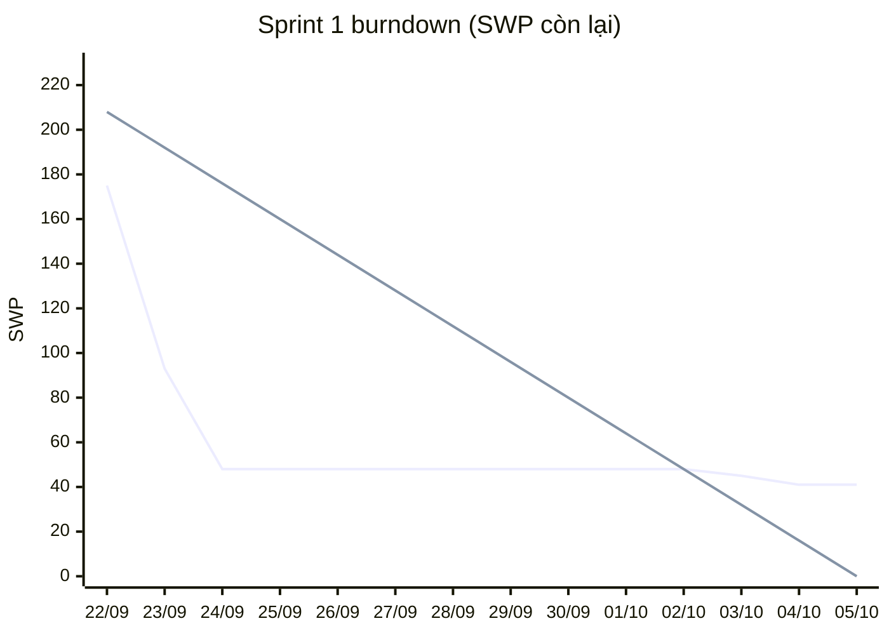

# Báo cáo tiến độ — Sprint 1

> Product A · Người báo cáo: Trần Ngọc Thắng · Ngày báo cáo: 2026-10-19
> Nguồn số liệu: [GitHub Project](https://github.com/users/thangtn-0016/projects/2) (field Status, Sprint, SWP) và ngày commit thật của code LAB-3. SWP là điểm đã qua người kiểm ([`estimate.md`](estimate.md)).

## 1. Iteration

| | |
|---|---|
| Iteration trên Project | **Sprint 1** |
| Khoảng thời gian | 22/09/2026 → 05/10/2026 (2 tuần) |
| Mục tiêu sprint | Dựng nền kỹ thuật + luồng chính lô → giao dịch → giao hàng → đối chiếu, chạy được đầu-cuối trên bản deploy |
| Người làm | 1 người, làm cùng AI (AIDD), ngoài giờ |
| Giờ thực tế | ~35 giờ (điểm giữa khoảng 30–40 giờ ghi ở quick-report LAB-3, không phải số đo chính xác) |

Sprint 1 là sprint đã chạy thật: trạng thái từng issue lấy từ việc đã có commit, không giả lập. 04/10–12/10 có commit tài liệu thiết kế LAB-4 (đã nộp 12/10), 13/10–19/10 không có commit; không có sprint code trong khoảng 06/10–19/10. Sprint 2 bắt đầu 20/10.

## 2. Trạng thái

Phạm vi Sprint 1 = 24 issue (và 59 sub-issue của chúng) đã được kéo vào sprint. Cột "Số issue" đếm issue cha; cột "Số sub-issue" và "Tổng SWP" đếm sub-issue — hai đơn vị khác nhau, không đọc chéo hàng.

| Trạng thái | Số issue | Số sub-issue | Tổng SWP (sub-issue) | Ghi chú |
|---|---:|---:|---:|---|
| **Done** | 13 | 45 | 183 | Đã có commit, chạy được trên bản deploy. 27 sub-issue (102 SWP) thuộc 13 issue Done này. Gồm nền kỹ thuật F000, đăng nhập, quản trị tài khoản, nhập lô, chốt 相対取引, ghi kết quả せり, ghi giao hàng, đối chiếu ngày |
| **In Progress** | 11 | — | — | Phần code đã xong nhưng còn sub-issue chưa làm (chủ yếu unit test) → issue chưa đóng. 18 sub-issue Done (81 SWP) nằm dưới 11 issue này; 14 sub-issue còn lại là phần trượt ở dòng dưới |
| **Todo (trượt sang Sprint 2)** | — | 14 | 41 | 10 sub-issue test (30 SWP) + 3 việc implement còn dở (10 SWP: ghi vết lần thử bị chặn ở đường lô / giao dịch, điều kiện cảnh báo chốt sổ) + 1 sửa lỗi (1 SWP) = 41 SWP; đã gắn Sprint 2 trên Project |
| **Tổng phạm vi** | **24** | **59** | **224** | Hoàn thành **183 / 224 SWP = 82%** |

Velocity Sprint 1: **183 SWP / sprint**, ≈ **0,19 giờ / SWP** (35 giờ / 183 SWP). Hệ số này dùng để quy giờ cho toàn backlog — cách tính ở [`estimate.md`](estimate.md) mục 3.

Ngoài phạm vi Sprint 1: 69 issue Todo chưa xếp sprint (24 issue Todo khác đã ở Sprint 2) và 13 epic (9 In Progress tự cập nhật theo con, 4 Todo).

## 3. Burndown

SWP còn lại cuối mỗi ngày (phạm vi 224 SWP, tính trên sub-issue; ngày xong = ngày việc đó chạy được đầu-cuối, tức commit tính năng cuối cùng hoàn tất nó, không phải commit đầu tiên chạm tới nó):

| Ngày | 22/09 | 23/09 | 24/09 | 25/09–02/10 | 03/10 | 04/10 | 05/10 |
|---|---:|---:|---:|---:|---:|---:|---:|
| SWP xong trong ngày | 49 | 82 | 45 | 0 | 3 | 4 | 0 |
| **Còn lại (thực tế)** | 175 | 93 | 48 | 48 | 45 | 41 | **41** |
| Còn lại (đường lý tưởng) | 208 | 192 | 176 | 160 → 48 | 32 | 16 | 0 |

**Thực tế lệch kế hoạch ở đâu:**
- **Ba ngày đầu (22–24/09) xong 176 SWP (79% phạm vi)** — 5 commit `feat` theo blueprint 6 phase của LAB-3 (phase 4–5 chung một commit), AI sinh schema, RPC và màn hình. Đường thực tế nằm xa dưới đường lý tưởng ngay từ đầu.
- **25/09 → 02/10 đi ngang**: git log không có commit code nào trong 8 ngày này.
- **03–04/10**: deploy lần đầu (03/10) rồi hai bản sửa chỉ lộ ra trên môi trường thật — tương phản màu và **SC-11 mất dữ liệu form khi mất mạng** ([F004-02-c #146](https://github.com/thangtn-0016/lab5-product-a/issues/146)), đều commit ngày 04/10.
- **Kết thúc còn 41 SWP**, trong đó 30 SWP là test tự động: repo chưa có khung test nên mọi sub-issue test của việc đã xây đều trượt. 11 SWP còn lại (10 SWP implement + 1 SWP sửa lỗi) là phần ghi vết lần thử bị chặn mới phủ đường giao hàng (chưa phủ lô / giao dịch) và điều kiện cảnh báo chốt sổ phải viết lại sau khi chốt định nghĩa "chưa giao xong" (PREMISE S-05).

## 4. Rủi ro trễ

Bảng dưới đã qua phản biện bằng skill `tkm:predict-risks` (5 góc nhìn: kiến trúc, bảo mật, hiệu năng, UX, phản biện) — verdict **CAUTION**; ba dòng cuối là rủi ro skill phát hiện thêm.

| Rủi ro | Issue | Ảnh hưởng tới mốc nào | Hành động | Ai làm, khi nào |
|---|---|---|---|---|
| **Chưa có test tự động** — 30 SWP test trượt; sửa 8 lỗi đã biết mà không có test hồi quy thì dễ vỡ chỗ đã Done | [F000-07 #24](https://github.com/thangtn-0016/lab5-product-a/issues/24) · [F000-06 #21](https://github.com/thangtn-0016/lab5-product-a/issues/21) | Sprint 2 (kết thúc 02/11): mọi issue bug không đóng được vì tiêu chí xong đòi test | Dựng khung test + CI **trước** khi sửa lỗi; mỗi bug viết test đỏ trước | Thắng · 20–22/10 (3 ngày đầu Sprint 2) |
| **Số liệu sai trong việc đã Done**: B-05 cộng trùng tiền theo số lần giao (view đối chiếu 53.250 so với tổng thật 38.250 trên dữ liệu demo 23/09); B-01/B-02 sai trạng thái giao | [F006-02 #201](https://github.com/thangtn-0016/lab5-product-a/issues/201) · [F005-03 #168](https://github.com/thangtn-0016/lab5-product-a/issues/168) · [F005-04 #171](https://github.com/thangtn-0016/lab5-product-a/issues/171) · [F005-05 #174](https://github.com/thangtn-0016/lab5-product-a/issues/174) · [F005-06 #177](https://github.com/thangtn-0016/lab5-product-a/issues/177) | Demo / nghiệm thu luồng đối chiếu; F009 báo cáo và lô kế toán đọc số này | Áp bản vá nháp migration 0042 + test so với `sum(trades.amount)`; sửa B-01/B-02 theo G3 của LAB-4 | Thắng · 23–27/10 |
| **3 khoảng trống LAB-4 đã ghi trong spec, chưa có mã B-0x** (sửa thẳng `lots.quantity`, báo nhầm "lỗi kết nối", mất vết lần thử bị chặn) — LAB-5 tách thành issue bug | [F003-04 #114](https://github.com/thangtn-0016/lab5-product-a/issues/114) · [F003-05 #117](https://github.com/thangtn-0016/lab5-product-a/issues/117) · [F011-03 #361](https://github.com/thangtn-0016/lab5-product-a/issues/361) | Sprint 2 | Đưa vào Sprint 2, cùng nhóm với B-0x | Thắng · 27–30/10 |
| **11 câu hỏi khách chưa trả lời** — nặng nhất là bộ số mẫu Appendix C cho **完納奨励金** và mốc "đã thanh toán" | [F008-10 #277](https://github.com/thangtn-0016/lab5-product-a/issues/277) · [F008-11 #280](https://github.com/thangtn-0016/lab5-product-a/issues/280) · [F008-12 #282](https://github.com/thangtn-0016/lab5-product-a/issues/282) · [F012-09 #412](https://github.com/thangtn-0016/lab5-product-a/issues/412) · [F002-10 #100](https://github.com/thangtn-0016/lab5-product-a/issues/100) | Sprint 3 (03–16/11) dự kiến làm F008 / F012; không có câu trả lời thì [F008-07 #267](https://github.com/thangtn-0016/lab5-product-a/issues/267) không nghiệm thu được | Gửi bộ câu hỏi có sẵn phương án trong **tuần đầu Sprint 2**; quá 02/11 chưa có trả lời thì đổi thứ tự, kéo F009 / F010 lên Sprint 3 | Thắng soạn · gửi trước 24/10 |
| **Velocity đo trên prototype** — 0,19 giờ/SWP đến từ sprint không viết test, nên quy giờ cho backlog đang lạc quan | — | Mọi mốc sau Sprint 2 | Đo lại velocity sau Sprint 2 (sprint có test); cập nhật field "Giờ ước lượng" bằng hệ số mới | Thắng · 03/11 |
| **Đổi khoá chính `business_days`** khi thêm khái niệm chợ — thay đổi phá tương thích, chạm mọi FK / RPC / view | [F012-02 #385](https://github.com/thangtn-0016/lab5-product-a/issues/385) | Sprint có F012 | Làm sau cùng trong F012, có migration rollback và kiểm trên bản sao dữ liệu | Thắng · khi tới F012 |
| **Lỗ hổng phân quyền F003-04**: policy `lots_update` cho `receiving` sửa mọi cột của `lots` (code LAB-3 `supabase/migrations/0009_rls_policies.sql:48-51`) → sửa thẳng `quantity`, số còn lại âm | [F003-04 #114](https://github.com/thangtn-0016/lab5-product-a/issues/114) | Sprint 2 — đây là lỗi bảo mật, ưu tiên hơn lỗi số liệu | Thay bằng RPC sửa có kiểm + lý do, hoặc giới hạn cột được UPDATE; test RLS từ chối sửa `quantity` | Thắng · ngay sau khung test (23/10) |
| **Đổi schema nền 許可/承認 trên đường nóng**: `_assert_buyer_qualified` đang chạy ở 2 luồng đã Done (chốt giao dịch, ghi giao hàng) | [F002-02 #69](https://github.com/thangtn-0016/lab5-product-a/issues/69) | Sprint 2 → có thể vỡ luồng đã Done | Tách đôi: Sprint 2 chỉ thêm bảng mới (không đổi hàm kiểm); chuyển hàm kiểm + bỏ `NOT NULL` sang Sprint 3 khi đã có test P0003 | Thắng · quyết định trước 27/10 |
| **Sửa B-05 làm đổi số đã hiển thị** của các ngày đã chốt trên SCR018 | [F006-02 #201](https://github.com/thangtn-0016/lab5-product-a/issues/201) | Demo / báo cáo đã in | Chụp `total_amount` các ngày đã chốt trước khi áp 0042, ghi rõ trong PR và changelog | Thắng · cùng lúc áp 0042 |

## 5. Kế hoạch Sprint 2 (20/10 → 02/11)

83 item = 24 issue + 59 sub-issue; **141 SWP** là tổng của 59 sub-issue (≈ 77% velocity Sprint 1 — chừa đệm vì sprint này có viết test). 24 issue gồm 8 bug và 16 task; 59 sub-issue gồm 14 sub-issue trượt từ Sprint 1 và 45 sub-issue của 24 issue này. Nhóm việc chính (đếm theo mục, không cộng ra 83): 14 sub-issue trượt + 8 bug + 11 issue làm rõ + nền CI / test ([F000-06 #21](https://github.com/thangtn-0016/lab5-product-a/issues/21), [F000-07 #24](https://github.com/thangtn-0016/lab5-product-a/issues/24)) + view tên người lập ([F001-09 #58](https://github.com/thangtn-0016/lab5-product-a/issues/58)) + nền dữ liệu 許可/承認 ([F002-02 #69](https://github.com/thangtn-0016/lab5-product-a/issues/69)) + hoàn tất cấp giao dịch ([F005-08 #182](https://github.com/thangtn-0016/lab5-product-a/issues/182)). Lọc `Sprint: Sprint 2` trên Project để xem.

**Thứ tự làm** (theo kết quả `tkm:predict-risks`): khung test + CI chạy Supabase cục bộ (không dùng project thật) → F003-04 (bảo mật) → B-05 / migration 0042 → F005-08 → B-02 → B-01 → điều kiện cảnh báo chốt sổ, chung một nhánh có test cho cả 3 module đọc `v_trade_delivery_status` → F002-02 phần thêm bảng. Issue làm rõ coi là xong khi **đã gửi câu hỏi kèm phương án và ghi giả định tạm**; nhóm chặn 完納奨励金 gửi trước 24/10. Nếu hết tuần 1 đốt < 50% SWP thì đẩy F002-02 sang Sprint 3.
